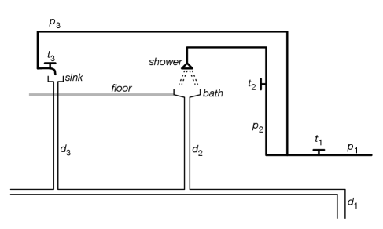
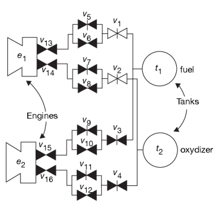
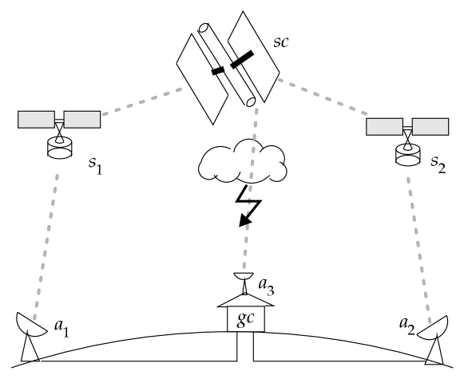

Một số bài tập dưới đây có thể sử dụng công cụ AIPython (aipython.org) hoặc ngôn ngữ lập trình logic Prolog để kiểm chứng và chạy thử nghiệm.

::: exercise Bài tập 5.1: Mô hình hóa ấm đun nước điện
Giả sử ta muốn suy luận về một chiếc ấm đun nước điện được cắm vào một trong các ổ cắm điện của hệ thống mạch điện trong Hình 5.2. Để ấm đun có thể đun sôi nước, nó phải được cắm vào một ổ cắm đang có điện hoạt động bình thường, ấm phải được bật công tắc, và bên trong ấm phải có nước.

Hãy viết các mệnh đề xác định cho phép hệ thống suy ra khi nào ấm đun nước đang đun nóng. Yêu cầu:

1. Nêu rõ diễn giải dự định cho mọi ký hiệu và nguyên tử được sử dụng.
2. Viết các mệnh đề theo đúng định dạng cú pháp để có thể nạp vào AIPython hoặc Prolog.
3. Chứng minh cơ sở tri thức hoạt động chính xác qua kết quả chạy truy vấn.
:::

::: solution Lời giải gợi ý
Ta định nghĩa các nguyên tử với diễn giải dự định:

- $\mathit{heating\_k}$: Ấm đun nước đang đun nóng.
- $\mathit{plugged\_k\_p}_{1}$: Ấm đun được cắm vào ổ cắm điện $p_{1}$.
- $\mathit{live\_p}_{1}$: Ổ cắm điện $p_{1}$ có điện.
- $\mathit{on\_k}$: Công tắc trên ấm đang bật.
- $\mathit{has\_water\_k}$: Trong ấm có nước.
- $\mathit{ok\_k}$: Ấm hoạt động bình thường (dây mayso không bị cháy).

Mệnh đề xác định mô hình hóa:

```prolog
heating_k :- plugged_k_p1, live_p1, on_k, has_water_k, ok_k.
```

Kết hợp với các quy tắc cấp điện cho ổ cắm $p_{1}$ từ Ví dụ 5.8:

```prolog
live_p1 :- live_w3.
live_w3 :- live_w5, ok_cb1.
live_w5 :- live_outside.
```
:::

::: exercise Bài tập 5.2: Mô hình hóa hệ thống cấp thoát nước gia đình
Xem xét sơ đồ hệ thống đường ống nước trong nhà được minh họa trong Hình 5.13:



Hình 5.13: Miền bài toán hệ thống cấp thoát nước gia đình.

Trong sơ đồ này: $p_{1}, p_{2}, p_{3}$ là các đường ống nước lạnh; $t_{1}, t_{2}, t_{3}$ là các van khóa hoặc vòi nước; $d_{1}, d_{2}, d_{3}$ là các đường ống thoát nước thải.

Giả sử có các nguyên tử sau:

- $\mathit{pressurized\_p}_{i}$: Đúng nếu ống $p_{i}$ có áp lực nước từ nguồn cấp chính.
- $\mathit{on\_t}_{i}$: Đúng nếu vòi $t_{i}$ đang mở.
- $\mathit{off\_t}_{i}$: Đúng nếu vòi $t_{i}$ đang đóng.
- $\mathit{wet\_b}$: Đúng nếu vị trí $b$ bị ướt ($b$ có thể là bồn rửa chén $\mathit{sink}$, bồn tắm $\mathit{bath}$, hoặc sàn nhà $\mathit{floor}$).
- $\mathit{flow\_p}_{i}$: Đúng nếu có dòng nước đang chảy qua ống $p_{i}$.
- $\mathit{plugged\_sink}$: Đúng nếu bồn rửa chén đang được đậy nút chặn.
- $\mathit{plugged\_bath}$: Đúng nếu bồn tắm đang được đậy nút chặn.
- $\mathit{unplugged\_sink}$: Đúng nếu nút chặn bồn rửa chén đang được mở.
- $\mathit{unplugged\_bath}$: Đúng nếu nút chặn bồn tắm đang được mở.

Hệ thống mệnh đề xác định mô tả dòng nước chảy xuống cống $d_{1}$ khi các vòi $t_{1}, t_{2}$ mở và bồn tắm không đậy nút:

<pre class="logic-expression">pressurized_p_1. 

pressurized_p_2 ← on_t_1 ∧ pressurized_p_1. 

flow_shower ← on_t_2 ∧ pressurized_p_2. 

wet_bath ← flow_shower. 

flow_d_2 ← wet_bath ∧ unplugged_bath. 

flow_d_1 ← flow_d_2. 

on_t_1.   on_t_2.   unplugged_bath.</pre>

Yêu cầu:

- (a) Hoàn thiện các tiên đề cho bồn rửa chén ($\mathit{sink}$) tương tự như bồn tắm.
- (b) Thông tin nào mà một người cư ngụ trong ngôi nhà có thể cung cấp trực tiếp mà người thợ sửa ống nước (đang ở xa) không biết? Hãy điều chỉnh cơ sở tri thức để hệ thống chủ động hỏi người dùng về những thông tin này.
- (c) Tiên đề hóa hiện tượng sàn nhà bị ướt ($\mathit{wet\_floor}$) khi bồn rửa chén hoặc bồn tắm bị tràn nước. Bồn bị tràn nước khi có nút đậy chặn và có dòng nước liên tục chảy vào. (Giả định trạng thái giữ nguyên trong một giờ).
- (d) Giả sử lắp đặt thêm một bình nước nóng ở bên trái vòi $t_{1}$, cấp nước nóng cho cả vòi sen và bồn rửa chén. Hãy mở rộng hệ thống mệnh đề để mô hình hóa mạng lưới này.
:::

::: solution Lời giải gợi ý
- (a) Bổ sung quy tắc cho nhánh bồn rửa qua ống $p_{3}$ và vòi $t_{3}$:
  <pre class="logic-expression">pressurized_p_3 ← on_t_1 ∧ pressurized_p_1. 

flow_sink ← on_t_3 ∧ pressurized_p_3. 

wet_sink ← flow_sink. 

flow_d_3 ← wet_sink ∧ unplugged_sink. 

flow_d_1 ← flow_d_3.</pre>
- (b) Người cư ngụ có thể quan sát trực tiếp trạng thái vòi nước và nút chặn: $\mathit{on\_t}_{i}$, $\mathit{off\_t}_{i}$, $\mathit{plugged\_sink}$, $\mathit{unplugged\_sink}$, $\mathit{plugged\_bath}$, $\mathit{unplugged\_bath}$. Đây là các nguyên tử khả vấn.
- (c) Mô hình hóa tràn nước và ướt sàn:
  <pre class="logic-expression">overflow_sink ← flow_sink ∧ plugged_sink. 

overflow_bath ← flow_shower ∧ plugged_bath. 

wet_floor ← overflow_sink. 

wet_floor ← overflow_bath.</pre>
:::

::: exercise Bài tập 5.3: Phân tích mô hình và hệ quả logic
Cho cơ sở tri thức $\mathit{KB}$:

$$
\begin{aligned}
&a \leftarrow b \wedge c. \quad b \leftarrow d. \quad d \leftarrow h. \\
&a \leftarrow e \wedge f. \quad b \leftarrow f \wedge h. \quad f \leftarrow g. \\
&c \leftarrow e. \quad e. \quad g \leftarrow c.
\end{aligned}
$$

- (a) Hãy chỉ ra một mô hình của cơ sở tri thức.
- (b) Hãy chỉ ra một diễn giải không phải là mô hình của cơ sở tri thức.
- (c) Nêu tên hai nguyên tử là hệ quả logic của cơ sở tri thức.
- (d) Nêu tên hai nguyên tử không phải là hệ quả logic của cơ sở tri thức.
:::

::: solution Lời giải gợi ý
- (a) Diễn giải gán toàn bộ các nguyên tử $\{a, b, c, d, e, f, g, h\}$ nhận giá trị $\mathit{true}$ là một mô hình hợp lệ. Một mô hình khác là mô hình tối tiểu: Gán $\mathit{true}$ cho $\{a, c, e, f, g\}$ và $\mathit{false}$ cho $\{b, d, h\}$.
- (b) Diễn giải gán mọi nguyên tử đều mang giá trị $\mathit{false}$ không phải là mô hình, vì tiên đề $e.$ bị vi phạm.
- (c) Hai nguyên tử là hệ quả logic: $e$ và $c$ (hoặc $a, f, g$).
- (d) Hai nguyên tử không phải là hệ quả logic: $h$ và $d$ (hoặc $b$).
:::

::: exercise Bài tập 5.4: Suy diễn tiến và lùi trên mệnh đề xác định
Cho cơ sở tri thức $\mathit{KB}$:

$$
\begin{aligned}
&a \leftarrow b \wedge c. \quad c. \quad f \leftarrow g \wedge b. \\
&b \leftarrow d. \quad d \leftarrow h. \quad g \leftarrow c \wedge k. \\
&b \leftarrow e. \quad e. \quad j \leftarrow a \wedge b.
\end{aligned}
$$

- (a) Minh họa từng bước thực thi của thuật toán chứng minh từ dưới lên. Liệt kê toàn bộ các hệ quả logic của $\mathit{KB}$.
- (b) Nguyên tử $f$ không phải là hệ quả logic của $\mathit{KB}$. Hãy chỉ ra một mô hình của $\mathit{KB}$ mà trong đó $f$ mang giá trị sai.
- (c) Cho biết $a$ là một hệ quả logic. Hãy xây dựng một dẫn xuất SLD từ trên xuống cho truy vấn $\mathbf{ask} \; a$.
:::

::: solution Lời giải gợi ý
- (a) Chuỗi tích lũy của tập $C$ trong thuật toán từ dưới lên:
 
 <pre class="logic-expression">C_0 = {} → C_1 = {c} → C_2 = {c, e} → C_3 = {b, c, e} → C_4 = {a, b, c, e} → C_5 = {a, b, c, e, j}.</pre>
  Tập toàn bộ các hệ quả logic là $\{a, b, c, e, j\}$.
- (b) Mô hình tối tiểu gán $\mathit{true}$ cho $\{a, b, c, e, j\}$ và gán $\mathit{false}$ cho $\{d, f, g, h, k\}$ là một mô hình của $\mathit{KB}$ mà trong đó $f$ nhận giá trị sai.
- (c) Dẫn xuất SLD từ trên xuống cho $\mathbf{ask} \; a$:
  1. $\mathit{yes} \leftarrow a$.
  2. Phân giải với $a \leftarrow b \wedge c \implies \mathit{yes} \leftarrow b \wedge c$.
  3. Phân giải $b$ với $b \leftarrow e \implies \mathit{yes} \leftarrow e \wedge c$.
  4. Phân giải $e$ với sự kiện $e. \implies \mathit{yes} \leftarrow c$.
  5. Phân giải $c$ với sự kiện $c. \implies \mathit{yes} \leftarrow$. (Thành công).
:::

::: exercise Bài tập 5.5: Cơ chế hỏi người dùng tối ưu trong suy diễn tiến
Quy trình chứng minh từ dưới lên có thể tích hợp cơ chế hỏi người dùng bằng cách hỏi tất cả các nguyên tử khả vấn. Làm thế nào một thuật toán từ dưới lên vẫn đảm bảo chứng minh được mọi nguyên tử không khả vấn là hệ quả logic mà không cần phải hỏi người dùng về toàn bộ các nguyên tử khả vấn?
:::

::: solution Lời giải gợi ý
Giải pháp là kết hợp phân tích phụ thuộc lùi trước khi suy diễn tiến:

1. Chỉ xét tập các nguyên tử khả vấn có mặt trong nón phụ thuộc (chóp quan hệ) dẫn tới các mục tiêu cần chứng minh.
2. Hoặc sử dụng cơ chế định hướng mục tiêu (Magic Sets / Goal-directed Forward Chaining): Chỉ hỏi một nguyên tử khả vấn khi toàn bộ các điều kiện tiên quyết khác trong cùng thân quy tắc đã được thỏa mãn và việc biết chân trị của nguyên tử khả vấn đó có thể kích hoạt quy tắc sinh ra nguyên tử mới hữu ích.
:::

::: exercise Bài tập 5.6: Gỡ lỗi chương trình mạch điện ở mức tri thức
Tệp cơ sở tri thức `elect_bug2` mô phỏng hệ thống điện trong Hình 5.2 nhưng chứa một quy tắc bị lỗi (sai trong diễn giải dự định). Truy vấn $\mathbf{ask} \; \mathit{lit\_l}_{1}$ được chứng minh thành công, nhưng trong thực tế đèn $l_{1}$ đang tắt.

Bằng phương pháp gỡ lỗi ở mức tri thức với câu hỏi dạng "Vì sao (How)", hãy giải thích cách thức định vị quy tắc có đầu sai và thân đúng mà không cần duyệt mã nguồn ngẫu nhiên.
:::

::: solution Lời giải gợi ý
Sử dụng thuật toán `Debug_false`:

1. Bắt đầu từ nguyên tử sai $\mathit{lit\_l}_{1}$.
2. Kiểm tra quy tắc đã dùng để suy ra $\mathit{lit\_l}_{1}$: Nếu các nguyên tử thân đều đúng thì đây là quy tắc lỗi; nếu có nguyên tử thân sai thì đệ quy đi xuống nhánh sai đó.
3. Quá trình lần ngược chuỗi chứng minh theo vết thực thi đảm bảo cô lập chính xác quy tắc bị gán nhầm tín hiệu điều khiển mà không cần đọc trước toàn bộ cơ sở tri thức.
:::

::: exercise Bài tập 5.7: Giải thích hành vi đáng ngờ bằng suy luận quy nạp đảo
Xét cơ sở tri thức giải thích hành vi đáng ngờ:

<pre class="logic-expression">goto_forest ← walking. 

get_gun ← hunting. 

goto_forest ← hunting. 

get_gun ← robbing. 

goto_bank ← robbing. 

goto_bank ← banking. 

fill_withdrawal_form ← banking. 

false ← banking ∧ robbing. 

false ← wearing_good_shoes ∧ goto_forest. 

assumable   walking, hunting, robbing, banking.</pre>

- (a) Nếu quan sát thấy đối tượng lấy súng ($\mathit{get\_gun}$), hãy tìm tất cả các lời giải thích tối tiểu.
- (b) Nếu quan sát thấy đối tượng vừa lấy súng vừa đi đến ngân hàng ($\mathit{get\_gun} \wedge \mathit{goto\_bank}$), tìm các lời giải thích tối tiểu.
- (c) Có thể bổ sung quan sát nào để loại bỏ một trong các lời giải thích trên?
- (d) Tìm các lời giải thích tối tiểu cho quan sát $\mathit{goto\_bank}$.
- (e) Tìm các lời giải thích tối tiểu cho quan sát <code class="logic-expression">goto_bank ∧ get_gun ∧ fill_withdrawal_form</code>.
:::

::: solution Lời giải gợi ý
- (a) Các lời giải thích tối tiểu cho $\mathit{get\_gun}$: $\{\mathit{hunting}\}$ và $\{\mathit{robbing}\}$.
- (b) Các lời giải thích tối tiểu cho $\mathit{get\_gun} \wedge \mathit{goto\_bank}$:
  - Giả thuyết đơn lẻ: $\{\mathit{robbing}\}$ (vừa giải thích việc lấy súng vừa giải thích việc đến ngân hàng).
  - Giả thuyết kết hợp: $\{\mathit{hunting}, \mathit{banking}\}$.
- (c) Nếu quan sát thấy đối tượng mang giày đẹp ($\mathit{wearing\_good\_shoes}$), thì giả thuyết $\mathit{hunting}$ sẽ kéo theo $\mathit{goto\_forest}$ và vi phạm ràng buộc toàn vẹn, do đó bị loại bỏ hoàn toàn.
- (d) Các lời giải thích tối tiểu cho $\mathit{goto\_bank}$: $\{\mathit{banking}\}$ và $\{\mathit{robbing}\}$.
- (e) Khi quan sát <code class="logic-expression">goto_bank ∧ get_gun ∧ fill_withdrawal_form</code>:
  - Không có lời giải thích nào hợp lệ. Lý do: Việc điền phiếu rút tiền bắt buộc phải giả định $\mathit{banking}$, việc lấy súng đòi hỏi $\mathit{robbing}$ hoặc $\mathit{hunting}$. Nhưng tổ hợp $\mathit{banking} \wedge \mathit{robbing}$ bị ràng buộc toàn vẹn cấm, còn tổ hợp $\mathit{banking} \wedge \mathit{hunting}$ không giải thích được vì sao đi đến ngân hàng với súng cùng một lúc mà không vi phạm tính tương thích bối cảnh nếu có ràng buộc bổ sung. Nếu không có ràng buộc cấm đi săn kết hợp rút tiền, $\{\mathit{hunting}, \mathit{banking}\}$ là lời giải thích duy nhất.
:::

::: exercise Bài tập 5.8: Chẩn đoán bệnh bằng suy luận quy nạp đảo
Một bệnh nhân có thể mắc một trong bốn bệnh: $p, q, r, s$. Bệnh $p$ gây phát ban ($\mathit{spots}$). Bệnh $q$ gây phát ban. Triệu chứng sốt ($\mathit{fever}$) có thể do một (hoặc nhiều) bệnh $q, r, s$ gây ra. Bệnh nhân có biểu hiện phát ban và sốt.

- (a) Biểu diễn tri thức trên bằng mệnh đề Horn và các nguyên tử khả giả định.
- (b) Thực hiện chẩn đoán bệnh nhân bằng quy nạp đảo. Chỉ ra câu truy vấn và các câu trả lời.
- (c) Giả sử $p$ và $s$ không thể cùng xuất hiện trên một bệnh nhân. Hãy cập nhật cơ sở tri thức và thực hiện lại chẩn đoán.
:::

::: solution Lời giải gợi ý
- (a) Cơ sở tri thức:
  <pre class="logic-expression">spots ← p.   spots ← q. 

fever ← q.   fever ← r.   fever ← s. 

assumable   p, q, r, s.</pre>
- (b) Truy vấn: Giải thích $\mathit{spots} \wedge \mathit{fever}$.
  Các lời giải thích tối tiểu:
  1. $\{q\}$ (bệnh $q$ giải thích cả phát ban lẫn sốt).
  2. $\{p, r\}$ (bệnh $p$ giải thích phát ban, bệnh $r$ giải thích sốt).
  3. $\{p, s\}$ (bệnh $p$ giải thích phát ban, bệnh $s$ giải thích sốt).
- (c) Bổ sung ràng buộc toàn vẹn: $\mathit{false} \leftarrow p \wedge s$.
  Lời giải thích $\{p, s\}$ trở thành xung đột và bị loại bỏ. Kết quả chẩn đoán còn lại: $\{q\}$ và $\{p, r\}$.
:::

::: exercise Bài tập 5.9: Tìm xung đột tối tiểu từ ràng buộc toàn vẹn
Cho các mệnh đề và ràng buộc toàn vẹn:

$$
\begin{aligned}
&\mathit{false} \leftarrow a \wedge b. \quad a \leftarrow d. \quad b \leftarrow d. \\
&\mathit{false} \leftarrow c. \quad a \leftarrow g. \quad b \leftarrow e. \\
&c \leftarrow h. \quad a \leftarrow h.
\end{aligned}
$$

Giả sử tập nguyên tử khả giả định là $\{d, e, f, g, h, i\}$. Hãy tìm tất cả các xung đột tối tiểu.
:::

::: solution Lời giải gợi ý
Ta lần lượt kiểm tra các chuỗi dẫn xuất dẫn tới $\mathit{false}$:

1. Từ $c \leftarrow h$ và $\mathit{false} \leftarrow c$, ta có ngay $\{h\} \models \mathit{false}$. Do đó $\{h\}$ là một xung đột tối tiểu.
2. Từ $a \leftarrow d$ và $b \leftarrow d$, kết hợp với $\mathit{false} \leftarrow a \wedge b$, ta có $\{d\} \models \mathit{false}$. Do đó $\{d\}$ là một xung đột tối tiểu.
3. Từ $a \leftarrow g$ và $b \leftarrow e$, kết hợp với $\mathit{false} \leftarrow a \wedge b$, ta có $\{g, e\} \models \mathit{false}$. Do đó $\{g, e\}$ là một xung đột tối tiểu.

Tập hợp tất cả các xung đột tối tiểu là: $\{h\}$, $\{d\}$, và $\{e, g\}$.
:::

::: exercise Bài tập 5.10: Mô hình hóa hệ thống đẩy tàu vũ trụ Deep Space One
Tàu vũ trụ Deep Space One (DS1) do NASA phóng năm 1998 sử dụng công nghệ tác tử tự hành để chẩn đoán và điều khiển động cơ. Hình 5.14 mô tả một phần sơ đồ thiết kế hệ thống van đẩy của động cơ DS1. Để tạo lực đẩy cho động cơ, nhiên liệu và chất oxy hóa phải được phun đồng thời qua hệ thống van dự phòng:



Hình 5.14: Thiết kế hệ thống van đẩy của tàu vũ trụ Deep Space One.

Các nguyên tử có dạng: $\mathit{open\_V}$ (van $V$ mở), $\mathit{ok\_V}$ (van $V$ hoạt động tốt), $\mathit{pressurized\_V}$ (đầu ra của van có áp suất khí, với hai bình nguồn $\mathit{pressurized\_t}_{1}$ và $\mathit{pressurized\_t}_{2}$ luôn có áp suất), $\mathit{thrust\_E}$ (động cơ $E$ có lực đẩy), $\mathit{nothrust}$ (không có lực đẩy).

Yêu cầu:

- (a) Hãy tiên đề hóa đường dẫn khí vào động cơ $e_{1}$. Dùng chẩn đoán dựa trên tính nhất quán (CBD) để xác định van nào có thể bị hỏng khi quan sát thấy động cơ $e_{1}$ không có lực đẩy dù các van chỉ định đã được mở.
- (b) Dùng chẩn đoán quy nạp đảo để xác định cấu hình van nào cần mở để đạt được mục tiêu tạo lực đẩy cho động cơ.
:::

::: solution Lời giải gợi ý
- (a) Trong CBD: Một van cấp áp suất cho đường ống sau nó nếu nó mở và hoạt động tốt:
 
 <pre class="logic-expression">pressurized_v_i ← pressurized_in_v_i ∧ open_v_i ∧ ok_v_i.</pre>
  Động cơ $e_{1}$ có lực đẩy nếu cả nhánh nhiên liệu và oxy hóa đều có áp suất đến buồng đốt:
 
 $$
  \mathit{thrust\_e}_{1} \leftarrow \mathit{fuel\_e}_{1} \wedge \mathit{oxidizer\_e}_{1}.
 
 $$
  Ràng buộc toàn vẹn khi quan sát mất lực đẩy: $\mathit{false} \leftarrow \mathit{thrust\_e}_{1} \wedge \mathit{nothrust\_e}_{1}$.
  Các xung đột tìm được sẽ chỉ ra những van trên tuyến cấp khí nghi ngờ bị hỏng (kẹt đóng).
- (b) Trong thiết kế bằng quy nạp đảo: Coi $\mathit{thrust\_e}_{1}$ là mục tiêu cần giải thích, các hành động mở van $\mathit{open\_v}_{i}$ là khả giả định, hệ thống sẽ tìm kịch bản tối tiểu các van cần mở để thiết lập đường dẫn khí thông suốt.
:::

::: exercise Bài tập 5.11: Chẩn đoán quy nạp đảo nâng cao với cảm biến rò rỉ khí
Mở rộng bài toán động cơ DS1 với các trạng thái chi tiết của van: $\mathit{ok}$ (mở thì chảy, đóng thì ngắt), $\mathit{broken}$ (luôn ngắt), $\mathit{stuck}$ (luôn thông), $\mathit{leaking}$ (khí rò rỉ ra ngoài). Ba cảm biến khí giám sát rò rỉ tại ba khu vực: Cụm van bên phải ($v_{1} \dots v_{4}$), cụm trung tâm ($v_{5} \dots v_{12}$), và cụm bên trái ($v_{13} \dots v_{16}$).

- (a) Hãy xây dựng các quy tắc giải thích hiện tượng động cơ mất lực đẩy đồng thời phát hiện có khí rò rỉ ở cảm biến thứ ba.
- (b) Đề xuất giải pháp kiểm soát số lượng lời giải thích khi không gian giả thuyết quá lớn.
:::

::: solution Lời giải gợi ý
- (a) Mô hình hóa khí rò rỉ tại khu vực 3:
 
 <pre class="logic-expression">gas_detected_s_3 ← pressurized_in_v_k ∧ leaking_v_k   (∀ v_k ∈ {v_13, …, v_16}).</pre>
  Khi động cơ mất lực đẩy và cảm biến 3 báo rò rỉ, hệ thống quy nạp đảo sẽ tìm các kịch bản trong đó một van thuộc cụm 3 bị rò rỉ làm tụt áp suất buồng đốt.
- (b) Để kiểm soát bùng nổ tổ hợp:
  1. Áp dụng xác suất tiên nghiệm cho từng dạng lỗi (tìm kiếm kịch bản có xác suất cao nhất trước).
  2. Áp dụng nguyên lý dao cạo Occam (ưu tiên chẩn đoán có ít lỗi nhất - lỗi đơn, lỗi kép).
:::

::: exercise Bài tập 5.12: Phân chia tri thức trong hệ thống ống nước cho người thuê nhà
Trong bài toán ống nước gia đình (Bài tập 5.2), một người thuê nhà chuẩn bị dọn vào ở. Hãy phân loại các nguyên tử thành ba nhóm:

1. Tri thức người chủ nhà nắm giữ (cấu trúc đường ống ngầm).
2. Tri thức người thuê nhà có thể quan sát trực tiếp (vị trí vòi, nút bồn).
3. Tri thức mà cả hai đều không thể quan sát trực tiếp (sự cố nghẹt cống sâu, vỡ ống ngầm).

Hãy chỉ ra nguyên tử nào nên thiết lập là khả vấn (askable) và nguyên tử nào nên thiết lập là khả giả định (assumable), đồng thời mô tả kịch bản tương tác gỡ lỗi giữa người thuê nhà và hệ thống.
:::

::: solution Lời giải gợi ý
- **Nguyên tử người thuê nhà biết (Khả vấn - Askable)**: Các van và vòi lộ thiên ($\mathit{on\_t}_{i}$, $\mathit{off\_t}_{i}$, $\mathit{plugged\_sink}$, $\mathit{wet\_floor}$). Hệ thống sẽ chủ động hỏi người thuê nhà những sự kiện này.
- **Nguyên tử người chủ nhà biết (Quy tắc cố định trong KB)**: Cấu trúc liên kết đường ống ngầm giữa các vách tường, vị trí van tổng.
- **Nguyên tử không ai quan sát trực tiếp được (Khả giả định - Assumable)**: Trạng thái ống bị vỡ ngầm ($\mathit{broken\_pipe}$), cống ngầm bị nghẹt ($\mathit{clogged\_drain}$). Hệ thống sử dụng các nguyên tử này để sinh giả thuyết chẩn đoán.
:::

::: exercise Bài tập 5.13: Đánh giá độ tin cậy của các nguồn thông tin trên Web
Một tác tử mua sắm thu thập thông tin từ 5 nguồn trên Internet:

- Nguồn $s_{1}$ tuyên bố: $a \leftarrow h$ và $d \leftarrow c$.
- Nguồn $s_{2}$ tuyên bố: $e \leftarrow d$, $f \leftarrow k$, $z \leftarrow g$, và $j.$
- Nguồn $s_{3}$ tuyên bố: $h \leftarrow d$.
- Nguồn $s_{4}$ tuyên bố: $a \leftarrow b \wedge e$ và $b \leftarrow c$.
- Nguồn $s_{5}$ tuyên bố: $g \leftarrow f \wedge j$.
- Tri thức nền đã kiểm chứng chắc chắn: $\mathit{false} \leftarrow a \wedge z$, $c.$, và $k.$

Yêu cầu:

- (a) Mô hình hóa bài toán với các giả định về độ tin cậy của từng nguồn ($s_{1}, \dots, s_{5}$).
- (b) Tìm các tập xung đột tối tiểu về độ tin cậy của các nguồn.
- (c) Nếu giả định có ít nguồn tin bị sai nhất có thể, nguồn đơn lẻ nào nếu không đáng tin cậy sẽ giải thích được mâu thuẫn?
- (d) Những cặp nguồn tin nào (mà không có nguồn đơn lẻ nào trong cặp đó) có thể cùng giải thích mâu thuẫn?
:::

::: solution Lời giải gợi ý
- (a) Gắn mỗi quy tắc của nguồn $s_{i}$ với giả định nguồn đó đáng tin cậy.
- (b) Quan sát hai nhánh dẫn tới $a$ và $z$:
  - Nhánh 1: $a$ suy ra từ $\{s_{1}, s_{3}\}$, $z$ suy ra từ $\{s_{2}, s_{5}\} \implies$ Xung đột 1: $\{s_{1}, s_{2}, s_{3}, s_{5}\}$.
  - Nhánh 2: $a$ suy ra từ $\{s_{1}, s_{2}, s_{4}\}$, $z$ suy ra từ $\{s_{2}, s_{5}\} \implies$ Xung đột 2: $\{s_{1}, s_{2}, s_{4}, s_{5}\}$.
- (c) Các nguồn đơn lẻ nằm trong giao của cả hai xung đột: $\{s_{1}\}$, $\{s_{2}\}$, hoặc $\{s_{5}\}$. Chỉ cần một trong ba nguồn này không đáng tin cậy là toàn bộ mâu thuẫn được hóa giải.
- (d) Cặp nguồn duy nhất (không chứa nguồn đơn lẻ nào ở câu c) có thể hóa giải mâu thuẫn là: $\{s_{3}, s_{4}\}$. (Nguồn $s_{3}$ cắt nhánh 1, nguồn $s_{4}$ cắt nhánh 2).
:::

::: exercise Bài tập 5.14: So sánh CBD và suy luận quy nạp đảo trong hệ gia sư vật lý
Một công ty công nghệ giáo dục đang phát triển hệ thống trợ giảng thông minh cho môn Vật lý đại cương (cơ học và điện từ học). Hệ thống cần chẩn đoán lỗi sai trong bài làm của học sinh.

- (a) Chẩn đoán dựa trên tính nhất quán (CBD) đòi hỏi những tri thức gì về vật lý và về học sinh?
- (b) Chẩn đoán quy nạp đảo đòi hỏi những tri thức gì về vật lý và về học sinh?
- (c) Ưu điểm lớn nhất của chẩn đoán quy nạp đảo so với CBD trong ứng dụng này là gì?
- (d) Ưu điểm lớn nhất của CBD so với chẩn đoán quy nạp đảo trong ứng dụng này là gì?
:::

::: solution Lời giải gợi ý
- (a) Tri thức cho CBD: Chỉ cần mô hình hóa các định luật vật lý chuẩn xác và giả định học sinh hiểu đúng từng khái niệm ($\mathit{ok\_concept}$). Khi học sinh đưa ra đáp số sai mâu thuẫn với định lý vật lý, CBD chỉ ra khái niệm nào học sinh có thể chưa nắm vững.
- (b) Tri thức cho quy nạp đảo: Cần mô hình hóa cả định lý vật lý đúng lẫn các quan niệm sai lầm phổ biến của học sinh (misconceptions / buggy rules, ví dụ nhầm lẫn giữa gia tốc và vận tốc).
- (c) Ưu điểm của quy nạp đảo: Có khả năng chỉ ra chính xác học sinh đang mắc phải quan niệm sai lầm cụ thể nào, từ đó đưa ra bài giảng khắc phục thích ứng thay vì chỉ báo lỗi chung chung.
- (d) Ưu điểm của CBD: Công sức xây dựng cơ sở tri thức nhẹ nhàng hơn nhiều, vì chỉ cần mô hình hóa vật lý chuẩn mà không phải liệt kê vô vàn cách thức làm sai khác nhau của học sinh.
:::

::: exercise Bài tập 5.15: Cập nhật động trong suy diễn tiến NAF
Xét thuật toán suy diễn tiến cho phủ định như một thất bại (Hình 5.11). Khi một mệnh đề được bổ sung thêm vào cơ sở tri thức, tập kết luận $C$ thay đổi như thế nào? Khi một mệnh đề bị rút lại hoặc xóa bỏ, tập $C$ thay đổi như thế nào?
:::

::: solution Lời giải gợi ý
- Khi bổ sung một mệnh đề mới $h \leftarrow B$:
  - Nếu thân $B$ đã được thỏa mãn, nguyên tử $h$ có thể được thêm vào $C$.
  - Sự xuất hiện của $h$ có thể làm vi phạm các điều kiện phủ định $\sim h$ đã từng được rút ra trước đó, đòi hỏi phải thu hồi các kết luận phụ thuộc vào $\sim h$ (tính phi đơn điệu).
- Khi xóa bỏ một mệnh đề:
  - Một số nguyên tử từng được chứng minh khẳng định có thể mất đi căn cứ và bị loại khỏi $C$.
  - Việc mất đi các nguyên tử khẳng định có thể biến các phép phủ định tương ứng thành thành công, kích hoạt các quy tắc mới. Cần hệ thống duy trì chân lý (TMS) với đồ thị phụ thuộc để cập nhật chân trị chính xác.
:::

::: exercise Bài tập 5.16: Cập nhật động các lời giải thích trong ATMS
Trong một bộ suy luận quy nạp đảo sử dụng thuật toán từ dưới lên (ATMS), khi một mệnh đề xác định mới được bổ sung, tập hợp các lời giải thích tối tiểu bị ảnh hưởng như thế nào? Khi một nguyên tử khả giả định mới được đưa vào, tập hợp các lời giải thích tối tiểu thay đổi ra sao?
:::

::: solution Lời giải gợi ý
- Khi bổ sung một mệnh đề: Có thể tạo thêm các đường dẫn chứng minh mới từ các giả định đến các nguyên tử, dẫn đến việc bổ sung các lời giải thích mới hoặc thu nhỏ các lời giải thích cũ nếu đường dẫn mới sử dụng ít giả định hơn. Đồng thời có thể làm xuất hiện các xung đột mới làm vô hiệu hóa một số lời giải thích hiện hành.
- Khi bổ sung một nguyên tử khả giả định: Mở rộng không gian các giả thuyết khả dĩ, cho phép hình thành các kịch bản mới cho những nguyên tử phụ thuộc vào nó.
:::

::: exercise Bài tập 5.17: Chẩn đoán sự cố mạng truyền thông tàu vũ trụ
Hình 5.15 mô tả mạng truyền thông dự phòng giữa tàu vũ trụ không người lái ($\mathit{sc}$) và trung tâm kiểm soát mặt đất ($\mathit{gc}$):



Hình 5.15: Mạng truyền thông dự phòng không gian.

Hai kênh băng thông cao được chuyển tiếp qua các vệ tinh ($s_{1}, s_{2}$) đến các ăng ten mặt đất ($a_{1}, a_{2}$). Một kênh băng thông thấp nối trực tiếp từ tàu vũ trụ tới ăng ten $a_{3}$, hoạt động nếu không có nhiễu khí quyển ($\mathit{no\_dist}$).

Cơ sở tri thức mô tả mạng truyền thông:

<pre class="logic-expression">send_signal_lg_sc ← ok_sc_lg ∧ alive_sc. 

send_signal_hg_sc ← ok_sc_hg ∧ alive_sc. 

get_signal_s_1 ← send_signal_hg_sc ∧ ok_s_1_ant. 

get_signal_s_2 ← send_signal_hg_sc ∧ ok_s_2_ant. 

send_signal_s_1 ← get_signal_s_1 ∧ ok_s_1_trans. 

send_signal_s_2 ← get_signal_s_2 ∧ ok_s_2_trans. 

get_signal_gc ← send_signal_s_1 ∧ ok_a_1. 

get_signal_gc ← send_signal_s_2 ∧ ok_a_2. 

get_signal_gc ← send_signal_lg_sc ∧ ok_a_3 ∧ no_dist.</pre>

Mặt đất không nhận được tín hiệu ($\mathit{no\_signal\_gc}$). Biết chắc chắn các ăng ten mặt đất đều tốt ($\mathit{ok\_a}_{1}, \mathit{ok\_a}_{2}, \mathit{ok\_a}_{3}$) và bộ phát của vệ tinh 1 tốt ($\mathit{ok\_s}_{1}\mathit{\_trans}$).

- (a) Xác định tập các nguyên tử khả giả định và ràng buộc toàn vẹn mô hình hóa tình huống.
- (b) Tìm các xung đột tối tiểu.
- (c) Xác định toàn bộ các chẩn đoán tối tiểu dựa trên tính nhất quán (CBD).
:::

::: solution Lời giải gợi ý
- (a) Ràng buộc toàn vẹn: $\mathit{false} \leftarrow \mathit{get\_signal\_gc} \wedge \mathit{no\_signal\_gc}$.
  Tập khả giả định: <code class="logic-expression">{alive_sc, ok_sc_hg, ok_sc_lg, ok_s_1_ant, ok_s_2_ant, ok_s_2_trans, no_dist}</code>.
- (b) Ba xung đột tối tiểu tương ứng với 3 tuyến truyền tin:
  1. $C_{1} = \{\mathit{alive\_sc}, \mathit{ok\_sc\_hg}, \mathit{ok\_s}_{1}\mathit{\_ant}\}$.
  2. <code class="logic-expression">C_2 = {alive_sc, ok_sc_hg, ok_s_2_ant, ok_s_2_trans}</code>.
  3. $C_{3} = \{\mathit{alive\_sc}, \mathit{ok\_sc\_lg}, \mathit{no\_dist}\}$.
- (c) Các chẩn đoán tối tiểu (tập đánh trúng giao với cả 3 xung đột):
  - Lỗi đơn (1 chẩn đoán): $\{\mathit{alive\_sc}\}$ (tàu vũ trụ ngừng hoạt động).
  - Lỗi kép (2 chẩn đoán):
    - $\{\mathit{ok\_sc\_hg}, \mathit{no\_dist}\}$
    - $\{\mathit{ok\_sc\_hg}, \mathit{ok\_sc\_lg}\}$
  - Lỗi ba (4 chẩn đoán):
    - $\{\mathit{ok\_s}_{1}\mathit{\_ant}, \mathit{ok\_s}_{2}\mathit{\_ant}, \mathit{no\_dist}\}$
    - $\{\mathit{ok\_s}_{1}\mathit{\_ant}, \mathit{ok\_s}_{2}\mathit{\_trans}, \mathit{no\_dist}\}$
    - $\{\mathit{ok\_s}_{1}\mathit{\_ant}, \mathit{ok\_s}_{2}\mathit{\_ant}, \mathit{ok\_sc\_lg}\}$
    - $\{\mathit{ok\_s}_{1}\mathit{\_ant}, \mathit{ok\_s}_{2}\mathit{\_trans}, \mathit{ok\_sc\_lg}\}$
:::

::: exercise Bài tập 5.18: Mở rộng mô hình mạng truyền thông với tín hiệu nhiễu
- (a) Vì sao NASA có thể muốn áp dụng suy luận quy nạp đảo thay vì CBD cho miền bài toán truyền thông không gian ở Bài tập 5.17?
- (b) Giả sử hiện tượng nhiễu khí quyển ($\mathit{dist}$) có thể gây ra tín hiệu tĩnh vô tuyến ($\mathit{static\_gc}$) hoặc làm mất hoàn toàn tín hiệu. Để thu được tín hiệu tĩnh, ăng ten $a_{3}$ và bộ phát $\mathit{sc\_lg}$ phải hoạt động tốt. Hãy mở rộng cơ sở tri thức để có thể giải thích được cả ba trường hợp quan sát: $\mathit{no\_signal\_gc}$, $\mathit{get\_signal\_gc}$, và $\mathit{static\_gc}$.
:::

::: solution Lời giải gợi ý
- (a) NASA ưu tiên quy nạp đảo vì các kỹ sư cần giải thích chính xác nguyên nhân cụ thể gây mất tín hiệu (ví dụ do nhiễu thời tiết hay do hỏng bộ phát tần số cao) để đưa ra hành động khắc phục tương ứng (như chuyển tần số hoặc tái khởi động thiết bị).
- (b) Mở rộng cơ sở tri thức cho tín hiệu tĩnh vô tuyến:
 
 <pre class="logic-expression">static_gc ← alive_sc ∧ ok_sc_lg ∧ ok_a_3 ∧ dist.</pre>
  Khi trạm mặt đất thu được tín hiệu tĩnh vô tuyến ($\mathit{static\_gc}$), quy nạp đảo giải thích ngay rằng tàu vũ trụ vẫn hoạt động bình thường ($\mathit{alive\_sc}$), bộ phát thấp tầng tốt, và nguyên nhân mất dữ liệu là do nhiễu khí quyển ($\mathit{dist}$).
:::

## Tài liệu tham khảo

1. Poole, D. L., & Mackworth, A. K. (2023). *Artificial Intelligence: Foundations of Computational Agents* (3rd ed.). Chapter 5: Propositions and Inference. Cambridge University Press.


[Đọc mục tương ứng trong giáo trình](https://artint.info/3e/html/ArtInt3e.Ch5.S13.html).
