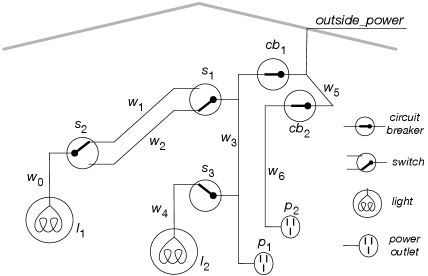
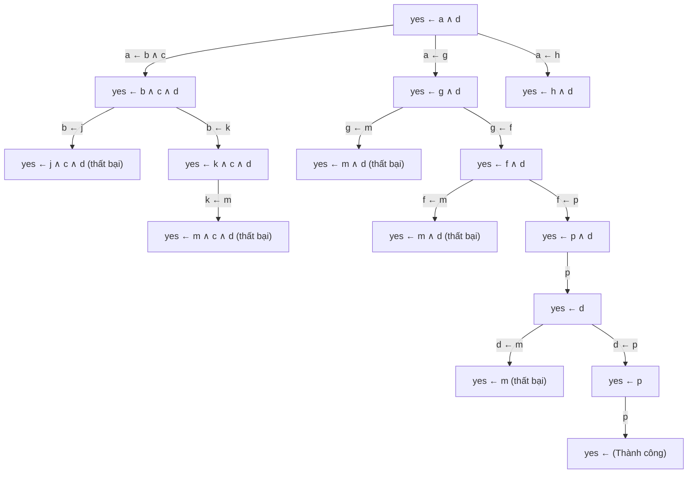

Ngôn ngữ các mệnh đề xác định (propositional definite clauses) là một tập con chặt chẽ của giải tích mệnh đề, trong đó loại bỏ hoàn toàn tính không chắc chắn và tính nhập nhằng. Trong ngôn ngữ này, các mệnh đề vẫn mang ý nghĩa như trong giải tích mệnh đề, nhưng không phải mọi dạng mệnh đề phức hợp đều được phép xuất hiện trong cơ sở tri thức.

Cú pháp của mệnh đề xác định được quy định như sau:

- Một mệnh đề nguyên tử hay nguyên tử được định nghĩa hoàn toàn giống như trong giải tích mệnh đề.
- Một **mệnh đề xác định** (definite clause) có cấu trúc dạng:

$$
h \leftarrow a_{1} \wedge \ldots \wedge a_{m}.
$$

trong đó $h$ là một nguyên tử, được gọi là **phần đầu** (head) của mệnh đề, và mỗi $a_{i}$ là một nguyên tử. Mệnh đề này được đọc là "$h$ nếu $a_{1}$ và $\dots$ và $a_{m}$".
- Nếu $m > 0$, mệnh đề này được gọi là một **quy tắc** (rule), và biểu thức hội $a_{1} \wedge \ldots \wedge a_{m}$ được gọi là **phần thân** (body) của mệnh đề.
- Nếu $m = 0$, dấu mũi tên suy diễn có thể được lược bỏ và mệnh đề được gọi là một **mệnh đề nguyên tử** (atomic clause) hoặc một **sự kiện** (fact). Một sự kiện chính là một mệnh đề có phần thân rỗng.
- Một **cơ sở tri thức** (knowledge base) là một tập hợp các mệnh đề xác định.

::: example Ví dụ 5.7: Nhận diện mệnh đề xác định hợp lệ
Tất cả các phần tử trong cơ sở tri thức ở Ví dụ 5.2 đều là các mệnh đề xác định.

Ngược lại, các phát biểu sau đây không phải là mệnh đề xác định:

- `~apple_is_eaten.` (chứa dấu phủ định).
- `apple_is_eaten ^ bird_eats_apple.` (là một phép hội, không có dạng đầu - thân).
- `sam_is_in_room ^ night_time <- switch_1_is_up.` (phần đầu chứa phép hội hai nguyên tử, vi phạm quy tắc phần đầu chỉ gồm đúng một nguyên tử).
- `Apple_is_eaten <- Bird_eats_apple.` (tên nguyên tử bắt đầu bằng chữ cái viết hoa).
- `happy \/ sad \/ ~alive.` (chứa phép tuyển nhiều nguyên tử).
:::

Một mệnh đề xác định $h \leftarrow a_{1} \wedge \ldots \wedge a_{m}$ nhận giá trị sai trong diễn giải $I$ khi và chỉ khi tất cả các nguyên tử $a_{1}, \dots, a_{m}$ đều đúng trong $I$ nhưng nguyên tử đầu $h$ lại bị gán giá trị sai trong $I$. Trong mọi trường hợp khác, mệnh đề xác định đều nhận giá trị đúng trong $I$.

Mệnh đề xác định là một trường hợp đặc biệt của câu tuyển. Ví dụ: Mệnh đề xác định:

$$
a \leftarrow b \wedge c \wedge d
$$

hoàn toàn tương đương về mặt logic với câu tuyển:

$$
a \vee \neg b \vee \neg c \vee \neg d.
$$

Tổng quát lại, một mệnh đề xác định tương đương với một câu tuyển chứa đúng một từ vị khẳng định duy nhất (nguyên tử không có dấu phủ định). Ngôn ngữ mệnh đề xác định không thể biểu diễn trực tiếp phép tuyển giữa các nguyên tử (như $a \vee b$) hoặc phép tuyển giữa các nguyên tử phủ định (như $\neg c \vee \neg d$).



Hình 5.2: Sơ đồ môi trường mạch điện với các thiết bị và dây dẫn được đặt tên.

::: example Ví dụ 5.8: Tiên đề hóa hệ thống mạch điện
Hãy cùng xem xét cách thức tiên đề hóa môi trường mạch điện trong Hình 5.2 theo đúng phương pháp luận về góc nhìn ngữ nghĩa của người thiết kế. Mô hình tiên đề hóa này cho phép chúng ta mô phỏng trạng thái hệ thống điện, đồng thời làm nền tảng cho việc chẩn đoán sự cố dựa trên các triệu chứng quan sát được ở các phần tiếp theo.

Mục tiêu của mô hình là xác định bóng đèn nào đang sáng hoặc tắt dựa vào trạng thái đóng ngắt của các công tắc cùng tình trạng của các cầu dao.

Người thiết kế cơ sở tri thức cần lựa chọn một mức độ trừu tượng thích hợp. Mục tiêu là mô tả miền bài toán ở mức tổng quát nhất đủ để tác tử giải quyết được nhiệm vụ. Chúng ta không cần quan tâm đến điện áp chính xác 12V DC hay 120V AC, tần số dòng điện, màu sắc dây dẫn, kích thước hay ngày sản xuất của các công tắc.

Ta mô hình hóa miền bài toán theo trực giác thông thường: Dây dẫn có điện hay không, dòng điện chạy từ nguồn bên ngoài qua dây dẫn đến các bóng đèn, và các cầu dao cùng công tắc sẽ kết nối các đoạn dây với nhau nếu chúng đang ở trạng thái đóng và hoạt động bình thường.

Người thiết kế chọn các nguyên tử biểu diễn các mệnh đề:

- $\mathit{up\_s}_{2}$ đúng khi công tắc $s_{2}$ đang bật lên.
- $\mathit{ok\_l}_{1}$ đúng khi bóng đèn $l_{1}$ hoạt động bình thường (sẽ phát sáng nếu có điện cấp vào).
- $\mathit{live\_w}_{1}$ đúng khi dây dẫn $w_{1}$ có điện.

Sau khi đã quy ước ý nghĩa các ký hiệu, ta nạp các mệnh đề xác định mô tả tri thức nền về thế giới. Trước hết là các sự kiện không có phần thân:

$$
\begin{aligned}
&\mathit{light\_l}_{1}. \quad \mathit{light\_l}_{2}. \quad \mathit{ok\_l}_{1}. \\
&\mathit{ok\_l}_{2}. \quad \mathit{ok\_cb}_{1}. \quad \mathit{ok\_cb}_{2}. \\
&\mathit{live\_outside}.
\end{aligned}
$$

Tiếp theo là các quy tắc thể hiện mối quan hệ nhân quả và kết nối vật lý:

$$
\begin{aligned}
&\mathit{live\_l}_{1} \leftarrow \mathit{live\_w}_{0}. \\
&\mathit{live\_w}_{0} \leftarrow \mathit{live\_w}_{1} \wedge \mathit{up\_s}_{2}. \\
&\mathit{live\_w}_{0} \leftarrow \mathit{live\_w}_{2} \wedge \mathit{down\_s}_{2}. \\
&\mathit{live\_w}_{1} \leftarrow \mathit{live\_w}_{3} \wedge \mathit{up\_s}_{1}. \\
&\mathit{live\_w}_{2} \leftarrow \mathit{live\_w}_{3} \wedge \mathit{down\_s}_{1}. \\
&\mathit{live\_l}_{2} \leftarrow \mathit{live\_w}_{4}. \\
&\mathit{live\_w}_{4} \leftarrow \mathit{live\_w}_{3} \wedge \mathit{up\_s}_{3}. \\
&\mathit{live\_p}_{1} \leftarrow \mathit{live\_w}_{3}. \\
&\mathit{live\_w}_{3} \leftarrow \mathit{live\_w}_{5} \wedge \mathit{ok\_cb}_{1}. \\
&\mathit{live\_p}_{2} \leftarrow \mathit{live\_w}_{6}. \\
&\mathit{live\_w}_{6} \leftarrow \mathit{live\_w}_{5} \wedge \mathit{ok\_cb}_{2}. \\
&\mathit{live\_w}_{5} \leftarrow \mathit{live\_outside}. \\
&\mathit{lit\_l}_{1} \leftarrow \mathit{light\_l}_{1} \wedge \mathit{live\_l}_{1} \wedge \mathit{ok\_l}_{1}. \\
&\mathit{lit\_l}_{2} \leftarrow \mathit{light\_l}_{2} \wedge \mathit{live\_l}_{2} \wedge \mathit{ok\_l}_{2}.
\end{aligned}
$$

Trong quá trình vận hành, người dùng cung cấp các quan sát về trạng thái hiện tại của các công tắc, chẳng hạn:

$$
\mathit{down\_s}_{1}. \quad \mathit{up\_s}_{2}. \quad \mathit{up\_s}_{3}.
$$

Cơ sở tri thức hoàn chỉnh bao gồm tất cả các mệnh đề xác định, bất kể được nhập vào dưới dạng tri thức nền hay dữ liệu quan sát tức thời.
:::

## 5.3.1 Truy vấn và câu trả lời

Sau khi máy tính được cung cấp một cơ sở tri thức về một miền bài toán, người dùng có thể đặt ra các câu hỏi truy vấn. Máy tính sẽ kiểm tra và trả lời xem một mệnh đề có phải là hệ quả logic của cơ sở tri thức hay không.

Một **truy vấn** (query) có cấu trúc chuẩn dạng:

$$
\mathbf{ask} \; b.
$$

trong đó $b$ là một nguyên tử hoặc một phép hội các nguyên tử (tương tự như phần thân của một quy tắc).

Một truy vấn sẽ nhận câu trả lời:

- **yes** nếu phần thân $b$ là một hệ quả logic của cơ sở tri thức ($\mathit{KB} \models b$).
- **no** nếu phần thân $b$ không phải là hệ quả logic của cơ sở tri thức ($\mathit{KB} \not\models b$). Câu trả lời *no* không mang hàm ý rằng $b$ bị sai trong thế giới thực, mà nó chỉ khẳng định rằng dựa trên cơ sở tri thức đã cung cấp, hệ thống không có đủ thông tin để chứng minh $b$ là đúng.

::: example Ví dụ 5.9: Thực hiện các truy vấn trên hệ thống mạch điện
Với cơ sở tri thức ở Ví dụ 5.8:

- Truy vấn $\mathbf{ask} \; \mathit{light\_l}_{1}$ trả về kết quả **yes**, vì sự kiện này đã được khai báo trực tiếp trong $\mathit{KB}$.
- Truy vấn $\mathbf{ask} \; \mathit{light\_l}_{6}$ trả về kết quả **no**, vì hệ thống không có thông tin để xác định $l_{6}$ có phải là một bóng đèn hay không.
- Truy vấn $\mathbf{ask} \; \mathit{lit\_l}_{2}$ trả về kết quả **yes**, vì từ nguồn điện $\mathit{live\_outside}$, qua cầu dao $\mathit{ok\_cb}_{1}$ cấp điện cho dây $w_{3}$, rồi qua công tắc bật $\mathit{up\_s}_{3}$ cấp điện cho dây $w_{4}$, từ đó cấp điện cho đèn $l_{2}$, kết hợp với điều kiện đèn tốt $\mathit{ok\_l}_{2}$ nên đèn phát sáng trong mọi mô hình.
:::

## 5.3.2 Các quy trình chứng minh

Bài toán suy diễn (deduction) là việc xác định xem một mệnh đề có phải là hệ quả logic của cơ sở tri thức hay không. Một **chứng minh** (proof) là một dẫn giải có thể suy diễn bằng thuật toán máy tính cho thấy mệnh đề là hệ quả logic của cơ sở tri thức. Một mệnh đề có thể chứng minh được gọi là một **định lý** (theorem).

Một quy trình chứng minh (proof procedure) là một thuật toán dùng để suy diễn các hệ quả từ cơ sở tri thức. Ta ký hiệu $\mathit{KB} \vdash g$ khi $g$ có thể được chứng minh hoặc suy dẫn từ $\mathit{KB}$ bằng một quy trình chứng minh cụ thể.

Chất lượng của một quy trình chứng minh được đánh giá qua hai thuộc tính cốt lõi:

- **Tính đúng đắn (Soundness)**: Một quy trình chứng minh là đúng đắn đối với ngữ nghĩa nếu mọi mệnh đề được chứng minh đều thực sự là hệ quả logic của cơ sở tri thức. Tức là nếu $\mathit{KB} \vdash g$ thì $\mathit{KB} \models g$.
- **Tính đầy đủ (Completeness)**: Một quy trình chứng minh là đầy đủ đối với ngữ nghĩa nếu mọi hệ quả logic của cơ sở tri thức đều tìm được một chứng minh. Tức là nếu $\mathit{KB} \models g$ thì $\mathit{KB} \vdash g$.

Có hai phương pháp tiếp cận kinh điển để xây dựng chứng minh cho các mệnh đề xác định: Quy trình từ dưới lên (tiến) và quy trình từ trên xuống (lùi).

### Quy trình chứng minh từ dưới lên (Bottom-Up Proof Procedure)

Quy trình chứng minh từ dưới lên suy diễn tất cả các hệ quả logic của cơ sở tri thức. Giống như việc xây một ngôi nhà từ móng lên mái, quy trình này bắt đầu từ các sự kiện đã biết và dần dần suy rộng ra các nguyên tử mới. Phương pháp này còn được gọi là suy diễn tiến (forward chaining).

Nguyên lý tổng quát dựa trên một quy tắc suy diễn duy nhất, là dạng tổng quát hóa của quy tắc Modus Ponens:

> Nếu "$h \leftarrow a_{1} \wedge \ldots \wedge a_{m}$" là một mệnh đề xác định trong cơ sở tri thức, và mỗi $a_{i}$ đều đã được suy dẫn ra từ trước, thì ta có thể suy dẫn ra nguyên tử đầu $h$.

Thuật toán chi tiết được trình bày trong Hình 5.3:

```
Quy trình Prove_DC_BU(KB)
  Đầu vào:
    KB: Tập hợp các mệnh đề xác định
  Đầu ra:
    Tập hợp C chứa toàn bộ các nguyên tử là hệ quả logic của KB
  Biến cục bộ:
    C là một tập hợp các nguyên tử

  1. Khởi tạo C := {}
  2. Lặp:
  3.    Chọn một mệnh đề "h <- a_1 ^ ... ^ a_m" trong KB sao cho
        mọi a_i đều thuộc C, và h chưa thuộc C
  4.    C := C U {h}
  5. Cho đến khi: Không còn mệnh đề xác định nào có thể chọn được nữa
  6. Trả về C
```

Hình 5.3: Thuật toán suy diễn tiến từ dưới lên cho mệnh đề xác định.

::: example Ví dụ 5.10: Từng bước thực thi của suy diễn từ dưới lên
Xét cơ sở tri thức $\mathit{KB}$ gồm các mệnh đề sau:

$$
\begin{aligned}
&a \leftarrow b \wedge c. \quad d. \\
&b \leftarrow d \wedge e. \quad e. \\
&b \leftarrow g \wedge e. \quad f \leftarrow a \wedge g. \\
&c \leftarrow e.
\end{aligned}
$$

Quá trình tích lũy các phần tử vào tập $C$ diễn ra theo chuỗi các bước:

1. Khởi đầu: $C_{0} = \{\}$.
2. Bổ sung sự kiện $d$: $C_{1} = \{d\}$.
3. Bổ sung sự kiện $e$: $C_{2} = \{e, d\}$.
4. Áp dụng quy tắc $c \leftarrow e$ (do $e \in C$): $C_{3} = \{c, e, d\}$.
5. Áp dụng quy tắc $b \leftarrow d \wedge e$ (do $d, e \in C$): $C_{4} = \{b, c, e, d\}$.
6. Áp dụng quy tắc $a \leftarrow b \wedge c$ (do $b, c \in C$): $C_{5} = \{a, b, c, e, d\}$.

Thuật toán dừng lại với $C = \{a, b, c, e, d\}$. Do đó: $\mathit{KB} \vdash a$, $\mathit{KB} \vdash b$, $\mathit{KB} \vdash c$, $\mathit{KB} \vdash d$, $\mathit{KB} \vdash e$.

Quy tắc cuối cùng $f \leftarrow a \wedge g$ không bao giờ được kích hoạt. Quy trình không thể suy ra $f$ hay $g$. Điều này hoàn toàn chính xác vì tồn tại mô hình của cơ sở tri thức mà ở đó cả $f$ và $g$ đều nhận giá trị sai.
:::

Thuật toán từ dưới lên sở hữu các tính chất lý thuyết quan trọng:

- **Tính đúng đắn**: Mọi nguyên tử trong $C$ đều là hệ quả logic của $\mathit{KB}$. Chứng minh: Giả sử phản chứng tồn tại một nguyên tử trong $C$ không phải là hệ quả logic. Gọi $h$ là nguyên tử đầu tiên được thêm vào $C$ mà bị sai trong một mô hình $I$ nào đó của $\mathit{KB}$. Do $h$ được sinh ra, phải tồn tại mệnh đề $h \leftarrow a_{1} \wedge \ldots \wedge a_{m}$ với mọi $a_{i} \in C$. Vì $h$ là nguyên tử sai đầu tiên được thêm vào $C$, toàn bộ $a_{i}$ phải đúng trong $I$. Khi đó mệnh đề có thân đúng nhưng đầu sai, mâu thuẫn với giả thiết $I$ là mô hình của $\mathit{KB}$.
- **Độ phức tạp**: Thuật toán luôn dừng lại trên một cơ sở tri thức mệnh đề hữu hạn vì tập các nguyên tử là hữu hạn và mỗi vòng lặp bổ sung ít nhất một nguyên tử mới vào $C$. Mỗi mệnh đề xác định chỉ cần được kích hoạt khi mọi nguyên tử trong thân của nó đã thuộc $C$. Với cấu trúc dữ liệu lập chỉ mục thích hợp (theo dõi số lượng nguyên tử chưa thỏa mãn trong thân mỗi mệnh đề), độ phức tạp thời gian đạt mức tuyến tính theo tổng kích thước của cơ sở tri thức.
- **Điểm bất động và mô hình tối tiểu**: Tập $C$ cuối cùng là một điểm bất động tối tiểu (least fixed point). Nếu ta định nghĩa diễn giải $I$ sao cho mọi nguyên tử trong $C$ nhận giá trị đúng và mọi nguyên tử ngoài $C$ nhận giá trị sai, thì $I$ chắc chắn là một mô hình của $\mathit{KB}$. Mô hình này được gọi là **mô hình tối tiểu** (minimal model).
- **Tính đầy đủ**: Nếu $g$ là một nguyên tử (hoặc hội của các nguyên tử trong ngôn ngữ truy vấn hỗ trợ) và $\mathit{KB} \models g$, thì $g$ phải đúng trong mọi mô hình của $\mathit{KB}$, bao gồm cả mô hình tối tiểu $I$. Do $I$ chỉ gán giá trị đúng cho các nguyên tử trong $C$, nguyên tử $g$ bắt buộc phải thuộc $C$, đồng nghĩa với việc $\mathit{KB} \vdash g$. Lưu ý rằng tính đầy đủ ở đây xét trên các mục tiêu nguyên tử và hội nguyên tử; thuật toán không sinh ra các công thức logic phức hợp tùy ý (như công thức hằng đúng $p \vee \neg p$) mà chỉ tập trung vào các nguyên tử là hệ quả logic.

### Quy trình chứng minh từ trên xuống (Top-Down Proof Procedure)

Một phương pháp chứng minh thay thế là tìm kiếm ngược (suy diễn lùi) từ câu hỏi truy vấn. Quy trình này được gọi là **phân giải SLD** (SLD resolution) cho mệnh đề xác định, trong đó SL là viết tắt của chiến lược tuyến tính chọn nguyên tử (Selecting an atom using a Linear strategy) và D là viết tắt của mệnh đề xác định (Definite clauses).

Quy trình hoạt động dựa trên việc tinh chỉnh một câu tuyển trả lời (answer clause) có dạng:

$$
\mathit{yes} \leftarrow a_{1} \wedge a_{2} \wedge \ldots \wedge a_{m}
$$

trong đó $\mathit{yes}$ là một nguyên tử đặc biệt đại diện cho kết luận câu trả lời là khẳng định.

Nếu truy vấn là $\mathbf{ask} \; q_{1} \wedge \ldots \wedge q_{m}$, câu tuyển trả lời ban đầu sẽ là:

$$
\mathit{yes} \leftarrow q_{1} \wedge \dots \wedge q_{m}.
$$

Tại mỗi bước, thuật toán chọn một nguyên tử trong phần thân của câu tuyển trả lời, gọi là một **mục tiêu phụ** (subgoal). Giả sử chọn nguyên tử $a_{1}$. Thuật toán thực hiện một bước phân giải bằng cách tìm một mệnh đề xác định trong $\mathit{KB}$ có $a_{1}$ ở phần đầu, ví dụ $a_{1} \leftarrow b_{1} \wedge \ldots \wedge b_{p}$. Khi đó, **câu tuyển phân giải** (resolvent) thu được sẽ là:

$$
\mathit{yes} \leftarrow b_{1} \wedge \ldots \wedge b_{p} \wedge a_{2} \wedge \ldots \wedge a_{m}.
$$

Tức là mục tiêu phụ $a_{1}$ đã được thay thế bằng các điều kiện tiên quyết để chứng minh nó. Một câu trả lời hoàn chỉnh đạt được khi phần thân trở nên rỗng ($m = 0$), tức là dẫn về câu tuyển $\mathit{yes} \leftarrow$.

Thuật toán phân giải từ trên xuống được mô tả chi tiết trong Hình 5.4:

```
Quy trình không tất định Prove_DC_TD(KB, Query)
  Đầu vào:
    KB: Tập hợp các mệnh đề xác định
    Query: Tập hợp các nguyên tử cần chứng minh
  Đầu ra:
    yes nếu KB kéo theo Query; ngược lại thuật toán thất bại
  Biến cục bộ:
    G là tập hợp các nguyên tử mục tiêu

  1. G := Query
  2. Lặp:
  3.    Chọn một nguyên tử a trong G
  4.    Lựa chọn mệnh đề xác định "a <- B" trong KB có đầu là a
  5.    G := B U (G \ {a})
  6. Cho đến khi: G = {}
  7. Trả về yes
```

Hình 5.4: Thuật toán suy diễn lùi từ trên xuống cho mệnh đề xác định.

::: example Ví dụ 5.11: Quá trình dẫn xuất SLD từ trên xuống
Xét lại cơ sở tri thức ở Ví dụ 5.10 với truy vấn $\mathbf{ask} \; a$:

Chuỗi biến đổi của câu tuyển trả lời khi luôn chọn nguyên tử ngoài cùng bên trái diễn ra như sau:

| Câu tuyển trả lời | Mệnh đề được phân giải |
| :--- | :--- |
| $\mathit{yes} \leftarrow a$ | $a \leftarrow b \wedge c$ |
| $\mathit{yes} \leftarrow b \wedge c$ | $b \leftarrow d \wedge e$ |
| $\mathit{yes} \leftarrow d \wedge e \wedge c$ | $d$ |
| $\mathit{yes} \leftarrow e \wedge c$ | $e$ |
| $\mathit{yes} \leftarrow c$ | $c \leftarrow e$ |
| $\mathit{yes} \leftarrow e$ | $e$ |
| $\mathit{yes} \leftarrow$ | Thành công (trả về **yes**) |

Nếu ở bước phân giải cho nguyên tử $b$, thuật toán lựa chọn nhánh quy tắc $b \leftarrow g \wedge e$, câu tuyển trả lời sẽ trở thành $\mathit{yes} \leftarrow g \wedge e \wedge c$. Khi chọn nguyên tử $g$, trong cơ sở tri thức không có quy tắc nào có đầu là $g$, nhánh tìm kiếm này rơi vào ngõ cụt và thất bại. Thuật toán sẽ phải quay lui để thử các lựa chọn khác.
:::

Cần phân biệt rõ hai động từ trong thuật toán: **Chọn (select)** một nguyên tử mục tiêu phụ trong phần thân, và **lựa chọn (choose)** một quy tắc trong cơ sở tri thức:

- Bất kỳ nguyên tử nào trong phần thân cũng có thể được chọn; nếu một cách chọn không dẫn tới chứng minh thì các cách chọn nguyên tử khác cũng không làm thay đổi chân lý.
- Ngược lại, khi có nhiều quy tắc cùng có đầu là nguyên tử được chọn, việc lựa chọn quy tắc đòi hỏi thuật toán phải tìm kiếm trong không gian các khả năng.



Hình 5.5: Đồ thị không gian tìm kiếm cho dẫn xuất SLD từ trên xuống trong Ví dụ 5.12.

::: example Ví dụ 5.12: Đồ thị tìm kiếm dẫn xuất SLD
Xét cơ sở tri thức sau:

$$
\begin{aligned}
&a \leftarrow b \wedge c. \quad a \leftarrow g. \quad a \leftarrow h. \\
&b \leftarrow j. \quad b \leftarrow k. \quad d \leftarrow m. \\
&d \leftarrow p. \quad f \leftarrow m. \quad f \leftarrow p. \\
&g \leftarrow m. \quad g \leftarrow f. \quad k \leftarrow m. \\
&h \leftarrow m. \quad p.
\end{aligned}
$$

Với truy vấn $\mathbf{ask} \; a \wedge d$, đồ thị tìm kiếm được minh họa chi tiết trong Hình 5.5. Bằng cách duyệt theo nhánh $a \leftarrow g$, tiếp theo là $g \leftarrow f$, $f \leftarrow p$, rồi giải quyết $p$ và tiếp tục phân giải $d \leftarrow p$, ta dẫn về được câu tuyển rỗng $\mathit{yes} \leftarrow$, chứng minh thành công rằng $a \wedge d$ là hệ quả logic.
:::

Quy trình từ trên xuống có thể rơi vào vòng lặp vô hạn nếu không có cơ chế phát hiện chu trình.

::: example Ví dụ 5.13: Nguy cơ lặp vô tận trong suy diễn lùi
Xét cơ sở tri thức:

$$
\begin{aligned}
&g \leftarrow a. \quad a \leftarrow b. \\
&g \leftarrow c. \quad b \leftarrow a. \\
&c.
\end{aligned}
$$

Hai nguyên tử duy nhất là hệ quả logic của cơ sở tri thức là $c$ và $g$. Thuật toán từ dưới lên nhanh chóng tìm ra điểm bất động $\{c, g\}$. Tuy nhiên, quy trình từ trên xuống với tìm kiếm theo chiều sâu (DFS), khi chứng minh $g$ nếu chọn quy tắc $g \leftarrow a$, rồi $a \leftarrow b$, sau đó $b \leftarrow a$ sẽ lặp đi lặp lại vô tận giữa $a$ và $b$ mà không bao giờ dừng nếu không có kỹ thuật cắt chu trình (cycle pruning).
:::

Chiến lược lựa chọn nguyên tử mục tiêu phụ có ảnh hưởng lớn đến hiệu quả tính toán. Một chiến lược suy nghiệm (heuristic) thường được áp dụng là ưu tiên thất bại trước (fail-first): Lựa chọn nguyên tử có khả năng thất bại cao nhất hoặc có ít mệnh đề trong cơ sở tri thức có đầu trùng với nó nhất, nhằm nhanh chóng loại bỏ các nhánh tìm kiếm không triển vọng.

## Tài liệu tham khảo

1. Poole, D. L., & Mackworth, A. K. (2023). *Artificial Intelligence: Foundations of Computational Agents* (3rd ed.). Chapter 5: Propositions and Inference. Cambridge University Press. Bản gốc trực tuyến: [ArtInt3e.Ch5.S3.html](https://artint.info/3e/html/ArtInt3e.Ch5.S3.html).
2. Kowalski, R. (1974). Predicate logic as programming language. *Information Processing*, 74, 569–574.
3. Lloyd, J. W. (1987). *Foundations of Logic Programming* (2nd ed.). Springer-Verlag.
