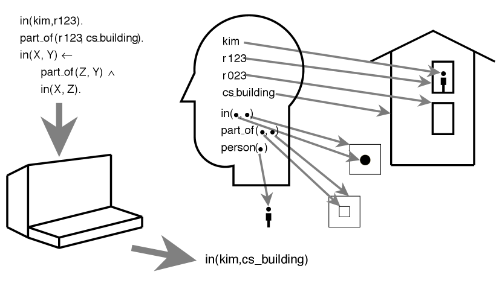

Tư tưởng cơ bản đằng sau việc sử dụng logic hình thức (xem [Chương 5](https://artint.info/3e/html/ArtInt3e.Ch5.html)) là: Khi những người thiết kế cơ sở tri thức muốn đặc tả một thế giới cụ thể, họ có thể chọn thế giới đó làm một **diễn giải dự định** (intended interpretation), chọn ý nghĩa cho các ký hiệu tương ứng với diễn giải này, và viết ra dưới dạng các tiên đề (axioms) những điều đúng đắn trong thế giới đó.

Khi một hệ thống tính toán một hệ quả logic (logical consequence) từ cơ sở tri thức, người dùng (người hiểu rõ ý nghĩa của các ký hiệu) có thể diễn giải câu trả lời này trong mối liên hệ với diễn giải dự định. Vì diễn giải dự định là một mô hình (model), và một hệ quả logic thì luôn đúng trong mọi mô hình, nên hệ quả logic đó chắc chắn phải đúng trong diễn giải dự định.

Chương này mở rộng [logic mệnh đề](https://artint.info/3e/html/ArtInt3e.Ch5.S1.html) để cho phép tác tử suy luận về các cá thể và mối quan hệ. Giờ đây, các mệnh đề nguyên tử (atomic propositions) mang cấu trúc nội tại được xây dựng từ các quan hệ và cá thể.

*Hình 15.1: Vai trò của ngữ nghĩa. Ý nghĩa của các ký hiệu nằm trong tâm trí người dùng. Máy tính tiếp nhận các ký hiệu và xuất ra các ký hiệu. Kết quả xuất ra có thể được người dùng diễn giải dựa trên ý nghĩa mà người dùng đã gán cho các ký hiệu.*

::: example Ví dụ 15.2: Phân tách ý nghĩa và cơ chế tính toán
Hình 15.1 minh họa ý tưởng tổng quát về ngữ nghĩa với các cá thể và quan hệ:

- Người thiết kế cơ sở tri thức nắm giữ ý nghĩa của các ký hiệu. Người đó biết các ký hiệu $kim$, $r123$ và $in$ ám chỉ điều gì trong miền bài toán và cung cấp cho máy tính một cơ sở tri thức gồm các câu trong ngôn ngữ biểu diễn.
- Tri thức bao gồm các sự kiện cụ thể "$kim$ ở trong $r123$" và "$r123$ là một phần của $cs\_building$", cùng luật tổng quát: "Nếu một $Z$ bất kỳ là một phần của $Y$, và một $X$ bất kỳ ở trong $Z$, thì $X$ ở trong $Y$", trong đó $X$, $Y$ và $Z$ là các biến logic.
- Các câu này có ý nghĩa đối với người thiết kế. Họ có thể đặt các câu hỏi truy vấn bằng những ký hiệu này và với ý nghĩa cụ thể mà họ dành cho chúng.
- Máy tính tiếp nhận các câu và câu hỏi truy vấn này, rồi tính toán các câu trả lời. Máy tính không biết các ký hiệu mang ý nghĩa gì. Tuy nhiên, người cung cấp thông tin có thể sử dụng ý nghĩa gắn với các ký hiệu để diễn giải câu trả lời đối với thế giới thực.
:::

## Khái niệm hóa (Conceptualization)

Ánh xạ giữa các ký hiệu trong tâm trí và các cá thể cùng quan hệ được biểu thị bởi các ký hiệu này được gọi là một **sự khái niệm hóa** (conceptualization).

Chương học này giả định rằng sự khái niệm hóa nằm trong nhận thức của người dùng, hoặc được viết một cách không chính thức trong các chú thích (comments). Việc làm cho các sự khái niệm hóa trở nên tường minh là vai trò của một **bản thể học hình thức** (formal ontology, xem [Chương 16](https://artint.info/3e/html/ArtInt3e.Ch16.S3.html)).

## Phân tách độc lập giữa ý nghĩa và tính toán

Câu trả lời đúng đắn được định nghĩa độc lập với cách thức tính toán câu trả lời đó:

- Tính đúng đắn của một cơ sở tri thức được quy định bởi ngữ nghĩa, chứ không phụ thuộc vào một thuật toán cụ thể nào dùng để chứng minh các câu hỏi truy vấn.
- Miễn là một thuật toán suy diễn trung thực với ngữ nghĩa (sound / faithful to the semantics), thuật toán đó có thể được tối ưu hóa để đạt hiệu quả tính toán cao.

Sự phân tách giữa ý nghĩa và tính toán này cho phép một tác tử tối ưu hóa hiệu năng thực thi trong khi vẫn duy trì tính đúng đắn.

## Tài liệu tham khảo

1. Poole, D. L., & Mackworth, A. K. (2023). *Artificial Intelligence: Foundations of Computational Agents* (3rd ed.). Cambridge University Press. Nguồn trực tuyến: [https://artint.info/3e/html/ArtInt3e.Ch15.S2.html](https://artint.info/3e/html/ArtInt3e.Ch15.S2.html).
