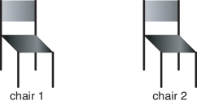

Đôi khi việc sử dụng nhiều hơn một số hạng để gọi tên cùng một cá thể là rất hữu ích. Ví dụ, các số hạng $4*4$, $2^{4}$, $273-257$ và $16$ có thể cùng biểu thị một con số. Đôi khi, ta muốn mỗi tên gọi bắt buộc phải quy chiếu tới một cá thể khác nhau. Ví dụ, ta có thể muốn các tên gọi duy nhất cho các khóa học khác nhau trong một trường đại học. Lại có những khi ta chưa biết liệu hai tên gọi có biểu thị cùng một cá thể hay không — chẳng hạn, liệu người giao hàng lúc 8 giờ sáng có phải chính là người giao hàng lúc 1 giờ chiều hay không.

Mục này xem xét vai trò của quan hệ đẳng thức (equality), cho phép ta biểu diễn việc hai số hạng có hay không biểu thị cùng một cá thể trong thế giới thực. Lưu ý rằng, trong ngôn ngữ câu tuyển xác định được trình bày ở các phần trước của chương, mọi câu trả lời đều có hiệu lực bất kể các số hạng có biểu thị cùng một cá thể hay không.

Đẳng thức là một ký hiệu vị từ đặc biệt với một diễn giải dự định tiêu chuẩn độc lập với mọi miền bài toán:

Số hạng $t_{1}$ bằng số hạng $t_{2}$, viết là $t_{1} = t_{2}$, nhận giá trị đúng ($true$) trong diễn giải $I$ nếu $t_{1}$ và $t_{2}$ cùng biểu thị một cá thể duy nhất trong $I$.

Đẳng thức *không* đồng nghĩa với sự tương đồng (similarity). Nếu $a$ và $b$ là các hằng số và $a = b$, điều này không có nghĩa là có hai thứ tương tự nhau hay thậm chí giống hệt nhau. Đúng hơn, điều đó có nghĩa là chỉ có duy nhất một thực thể nhưng mang hai tên gọi khác nhau.



*Hình 15.13: Hai chiếc ghế.*

::: example Ví dụ 15.38: Hai chiếc ghế và quan hệ đẳng thức
Xem xét thế giới gồm hai chiếc ghế được minh họa trong Hình 15.13. Trong thế giới này, khẳng định $chair1 = chair2$ là *không* đúng, mặc dù hai chiếc ghế có thể giống hệt nhau về mọi phương diện; nếu không biểu diễn vị trí chính xác của các chiếc ghế, ta không thể phân biệt được chúng dựa trên hình dáng.

Mặt khác, có thể xảy ra trường hợp $chairOnRight = chair2$. Ở đây không phải là chiếc ghế bên phải *tương tự* như chair2, mà nó *chính là* chair2.
:::

## 15.8.1 Cho phép khẳng định đẳng thức

Nếu không cho phép đẳng thức xuất hiện ở phần đầu (head) của các câu tuyển, điều duy nhất bằng với một số hạng trong mọi diễn giải chính là bản thân số hạng đó.

Ta thường muốn có khả năng khẳng định hoặc suy diễn rằng hai số hạng biểu thị cùng một cá thể, chẳng hạn như $chairOnRight = chair2$. Để làm được điều này, hệ thống biểu diễn và suy luận phải có khả năng dẫn xuất những gì tất suy từ một cơ sở tri thức có chứa các câu tuyển với đẳng thức ở phần đầu. Có hai phương pháp thực hiện:
- Cách thứ nhất là tiên đề hóa đẳng thức giống như bất kỳ vị từ nào khác (bao gồm các tiên đề phản xạ, đối xứng, bắc cầu và thế tương đương).
- Cách thứ hai là xây dựng cơ chế suy diễn chuyên dụng dành riêng cho đẳng thức.

Nếu $t_{1} = t_{2}$, bất kỳ sự xuất hiện nào của $t_{1}$ đều có thể được thay thế bằng $t_{2}$. Do đó, đẳng thức có thể được xử lý như một quy tắc viết lại (rewrite rule), thay thế những thứ bằng nhau cho nhau. Cách tiếp cận này hoạt động hiệu quả nhất nếu ta có thể chọn một biểu diễn chuẩn tắc (canonical representation) cho từng cá thể, tức một số hạng chuẩn mà các biểu diễn khác của cá thể đó có thể được ánh xạ về.

Một ví dụ kinh điển là cách biểu diễn các con số. Có rất nhiều số hạng cùng biểu thị một số (chẳng hạn $4*4$, $13+3$, $273-257$, $2^{4}$, $4^{2}$, $16$), nhưng thông thường chuỗi các chữ số ở hệ cơ số 10 ($16$) được sử dụng làm biểu diễn chuẩn tắc cho con số đó.

Các trường đại học đặt ra mã số sinh viên để tạo ra một biểu diễn chuẩn tắc cho mỗi sinh viên. Những sinh viên khác nhau có cùng họ tên sẽ được phân biệt rõ ràng, và các tên gọi khác nhau của cùng một người có thể được ánh xạ về mã số sinh viên của người đó.

Mỗi quy tắc viết lại nên đưa mô tả tiến gần hơn về biểu diễn chuẩn tắc. Trong chứng minh định lý tự động, việc sử dụng đẳng thức làm quy tắc viết lại được gọi là phép cận điều biến (paramodulation). Việc xác định biểu diễn chuẩn tắc đôi khi còn được gọi là xác định danh tính của mô tả (chẳng hạn, xác định danh tính của một sinh viên nộp bài tập mà quên ghi tên).

## 15.8.2 Giả định tên duy nhất

Thay vì giữ thái độ trung lập về sự bằng nhau của từng số hạng và đòi hỏi người dùng phải tiên đề hóa rõ ràng những tên nào biểu thị cùng một cá thể và những tên nào biểu thị các cá thể khác nhau, người ta thường quy ước rằng các số hạng không biến khác nhau sẽ biểu thị các cá thể khác nhau.

::: example Ví dụ 15.39: Nhu cầu về giả định tên duy nhất trong quản lý đào tạo
Xét ví dụ về cơ sở dữ liệu sinh viên, trong đó một sinh viên phải hoàn thành hai môn học tự chọn thuộc khối khoa học. Giả sử sinh viên đã học qua môn $math302$ và $psyc303$; khi đó ta chỉ biết sinh viên đó đã hoàn thành hai môn học nếu ta biết chắc rằng $math302 \neq psyc303$. Nghĩa là các hằng số $math302$ và $psyc303$ biểu thị các khóa học khác nhau.

Như vậy, hệ thống phải biết những mã môn học nào biểu thị các môn học khác nhau. Thay vì phải viết $\frac{n(n-1)}{2}$ tiên đề bất đẳng thức cho $n$ cá thể, việc áp dụng quy ước rằng mỗi mã môn học biểu thị một môn học khác nhau sẽ thuận tiện hơn rất nhiều, giúp tránh được việc phải khai báo hàng loạt tiên đề bất đẳng thức thủ công.
:::

Theo giả định tên duy nhất (Unique Names Assumption — UNA), các số hạng không biến phân biệt sẽ biểu thị các cá thể khác nhau. Nghĩa là, với mọi cặp số hạng không biến phân biệt $t_{1}$ và $t_{2}$, hệ thống giả định $t_{1} \neq t_{2}$, trong đó "$\neq$" mang nghĩa "không bằng".

Giả định tên duy nhất rất hữu ích cho các ứng dụng cơ sở dữ liệu. Ta không muốn phải phát biểu dài dòng rằng $kim \neq sam$, $kim \neq chris$, $chris \neq sam$, và lặp lại tương tự cho mọi cặp thực thể.

Giả định tên duy nhất *không* tất suy từ ngữ nghĩa của ngôn ngữ câu tuyển xác định tiêu chuẩn. Đối với ngữ nghĩa đó, các số hạng không biến phân biệt $t_{1}$ và $t_{2}$ hoàn toàn có thể biểu thị cùng một cá thể hoặc biểu thị các cá thể khác nhau.

Với giả định tên duy nhất, phép bất đẳng thức ($\neq$) có thể xuất hiện trong phần thân của các câu tuyển.

Các số hạng không biến là khác nhau khi và chỉ khi chúng không hợp nhất được với nhau. Tuy nhiên, điều này không đúng đối với các số hạng có chứa biến. Ví dụ, $a \neq X$ có những trường hợp cụ thể là đúng — chẳng hạn khi $X$ nhận giá trị $b$ — và có một trường hợp cụ thể là sai, cụ thể là khi $X$ nhận giá trị $a$.

Đôi khi giả định tên duy nhất là không phù hợp — ví dụ, khẳng định $2+2 \neq 4$ là sai, hoặc không thể mặc định cho rằng $clark\_kent \neq superman$.

### Thủ tục chứng minh từ trên xuống với giả định tên duy nhất

Một thủ tục chứng minh từ trên xuống tích hợp giả định tên duy nhất không nên coi bất đẳng thức như một vị từ thông thường, chủ yếu là vì có quá nhiều cá thể khác nhau đối với bất kỳ cá thể nào đã cho.

Nếu có một mục tiêu con dạng $t_{1} \neq t_{2}$, đối với hai số hạng $t_{1}$ và $t_{2}$, sẽ có ba trường hợp xảy ra:

1. **$t_{1}$ và $t_{2}$ không hợp nhất được**: Trong trường hợp này, $t_{1} \neq t_{2}$ thành công ngay lập tức.
   Ví dụ, bất đẳng thức $f(X, a, g(X)) \neq f(t(X), X, b)$ thành công vì hai số hạng không thể hợp nhất được với nhau.
2. **$t_{1}$ và $t_{2}$ giống hệt nhau về mặt cú pháp**, bao gồm việc có cùng các biến ở cùng các vị trí: Trong trường hợp này, $t_{1} \neq t_{2}$ thất bại.
   Ví dụ, $f(X, a, g(X)) \neq f(X, a, g(X))$ thất bại.
   Lưu ý rằng, đối với bất kỳ cặp số hạng *không biến* nào, bắt buộc phải rơi vào một trong hai trường hợp đầu tiên này.
3. **Ngược lại, có những trường hợp cụ thể của $t_{1} \neq t_{2}$ thành công và có những trường hợp thất bại**:
   Ví dụ, xét mục tiêu con $f(W, a, g(Z)) \neq f(t(X), X, Y)$. Bộ hợp nhất tổng quát nhất của $f(W, a, g(Z))$ và $f(t(X), X, Y)$ là $\{X/a, W/t(a), Y/g(Z)\}$. Một số thể hiện cụ thể của bất đẳng thức này (những thể hiện không biến nhất quán với bộ hợp nhất) sẽ thất bại. Mọi thể hiện không nhất quán với bộ hợp nhất sẽ thành công. Không giống như các mục tiêu khác, ta không muốn liệt kê mọi thể hiện thành công, vì điều đó đồng nghĩa với việc hợp nhất $X$ với mọi hàm và hằng số khác $a$, cũng như liệt kê mọi cặp giá trị của $Y$ và $Z$ mà $Y$ khác $g(Z)$.

Thủ tục chứng minh từ trên xuống có thể được mở rộng để tích hợp giả định tên duy nhất:
- Các bất đẳng thức thuộc loại thứ nhất có thể thành công ngay, và những bất đẳng thức thuộc loại thứ hai có thể thất bại ngay.
- Các bất đẳng thức thuộc loại thứ ba có thể được **trì hoãn** (delayed), chờ đợi các mục tiêu tiếp theo hợp nhất các biến để đưa về một trong hai trường hợp đầu tiên.

Để trì hoãn một mục tiêu trong thủ tục chứng minh, khi chọn một nguyên tử trong thân của câu tuyển trả lời $G$, thuật toán sẽ chọn một trong các nguyên tử không bị trì hoãn. Nếu không còn nguyên tử nào khác để chọn, và không trường hợp nào trong hai trường hợp đầu áp dụng được, câu truy vấn sẽ thành công. Lý do là luôn tồn tại một thể hiện của bất đẳng thức thành công, cụ thể là thể hiện trong đó mỗi biến được gán một hằng số phân biệt không xuất hiện ở bất kỳ đâu khác. Khi điều này xảy ra, người dùng cần cẩn trọng khi diễn giải các biến tự do trong câu trả lời: Câu trả lời không có nghĩa là đúng với mọi thể hiện của các biến tự do, mà là đúng với một số thể hiện nào đó.

::: example Ví dụ 15.40: Trì hoãn bất đẳng thức trong thủ tục chứng minh
Xét các quy tắc xác định xem một sinh viên đã vượt qua ít nhất hai môn học hay chưa:

```prolog
passed_two_courses(S) :-
    C1 \= C2,
    passed(S, C1),
    passed(S, C2).

passed(S, C) :-
    grade(S, C, M),
    M >= 50.

grade(sam, engl101, 87).
grade(sam, phys101, 89).
```

Đối với câu truy vấn:

$$
\text{ask } passed\_two\_courses(sam)
$$

mục tiêu con $C_{1} \neq C_{2}$ ban đầu chưa thể xác định được vì cả hai đều là biến tự do, do đó nó phải bị trì hoãn lại.

Thay vào đó, thủ tục chứng minh từ trên xuống có thể chọn mục tiêu $passed(sam, C_{1})$, làm biến $C_{1}$ liên kết với $engl101$. Sau đó, hệ thống gọi $passed(sam, C_{2})$, tiếp tục gọi $grade(sam, C_{2}, M)$. Mục tiêu này có thể thành công với phép thế $\{C_{2}/engl101, M/87\}$. Tại giai đoạn này, các biến trong bất đẳng thức bị trì hoãn đã được liên kết đủ để xác định rằng bất đẳng thức $engl101 \neq engl101$ phải thất bại.

Hệ thống quay lui và chọn một câu tuyển khác cho $grade(sam, C_{2}, M)$, trả về phép thế $\{C_{2}/phys101, M/89\}$. Lần này, các biến trong bất đẳng thức trì hoãn đã được liên kết đủ để kiểm tra, và bất đẳng thức $engl101 \neq phys101$ thành công. Tiếp theo, hệ thống chứng minh $89 \ge 50$, và toàn bộ mục tiêu thành công.

Một câu hỏi có thể nảy sinh từ ví dụ này: "Tại sao không đơn giản là đặt lời gọi bất đẳng thức xuống vị trí cuối cùng, vì khi đó nó sẽ không cần phải trì hoãn?". Có hai lý do:
- Thứ nhất, việc trì hoãn có thể đem lại hiệu quả tính toán cao hơn. Trong ví dụ này, bất đẳng thức trì hoãn có thể được kiểm tra ngay trước khi kiểm tra $87 \ge 50$. Mặc dù phép kiểm tra bất đẳng thức cụ thể này diễn ra rất nhanh, nhưng trong nhiều bài toán, ta có thể tiết kiệm được một khối lượng tính toán đáng kể bằng cách phát hiện các bất đẳng thức bị vi phạm càng sớm càng tốt.
- Thứ hai, nếu một phép chứng minh con trả về một trong các giá trị trước khi biến được gán cố định, thủ tục chứng minh vẫn cần ghi nhớ ràng buộc bất đẳng thức đó, sao cho bất kỳ phép hợp nhất nào trong tương lai vi phạm ràng buộc đều sẽ thất bại.
:::

## Tài liệu tham khảo

- Poole, D. L., & Mackworth, A. K. (2023). *Artificial Intelligence: Foundations of Computational Agents* (3rd ed.). Cambridge University Press. Bản điện tử: [https://artint.info/3e/html/ArtInt3e.Ch15.S8.html](https://artint.info/3e/html/ArtInt3e.Ch15.S8.html).
