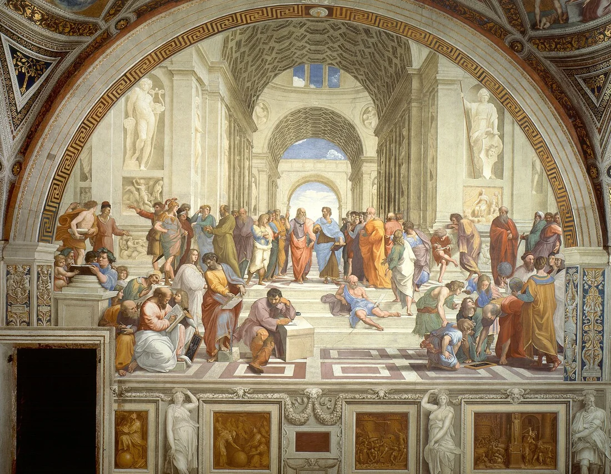

<PhilosophyTopic topic-id="nguon-goc-triet-hoc">

<template #notes>

Khi một vụ mùa thất bát, người ta có thể tìm nguyên nhân ở đất, nước, thời tiết hoặc cách canh tác. Nhưng nếu tiếp tục hỏi tự nhiên có tuân theo quy luật không, con người có hiểu và thay đổi hoàn cảnh được không, ta đã đi tới những vấn đề triết học. Những câu trả lời ấy định hướng cách sống và hành động, ngay cả khi người trả lời chưa gọi tên lập trường của mình.

## Triết học ra đời từ nhu cầu giải thích thế giới

**Triết học** là hệ thống quan điểm lý luận chung nhất về thế giới và về vị trí của con người trong thế giới đó. Điểm riêng của triết học không nằm ở việc bàn những chuyện xa đời sống. Nó nằm ở mức độ khái quát và ở yêu cầu giải thích bằng khái niệm, lý lẽ, thay vì chỉ kể lại kinh nghiệm riêng lẻ.

Triết học hình thành khoảng thế kỷ VIII–VI trước Công nguyên tại những trung tâm văn minh lớn ở phương Đông và phương Tây. Trước đó, con người đã có kinh nghiệm lao động, tín ngưỡng và những câu chuyện thần thoại. Tuy nhiên, có suy nghĩ về cuộc sống chưa đồng nghĩa đã có một học thuyết triết học. Sự chuyển biến diễn ra khi người ta có thể hệ thống hóa hiểu biết và tìm căn cứ chung cho nhiều hiện tượng.

Ở Hy Lạp, tên gọi triết học gắn với ý nghĩa yêu mến sự thông thái. Trong truyền thống Trung Quốc, hoạt động triết học hướng vào việc suy xét sâu về con người, xã hội và trật tự thế giới. Ở Ấn Độ, nó gắn với sự suy ngẫm để nhận ra lẽ phải và định hướng đời sống. Các truyền thống có cách đặt vấn đề khác nhau, nhưng đều vượt khỏi việc biết từng sự kiện riêng biệt.

<!-- philosophy-figure -->
<figure class="philosophy-figure">
  
  <figcaption>Hình 1.1: Các nhà tư tưởng trong bức Trường học Athens của Raphael.</figcaption>
</figure>

Raphael hình dung đời sống triết học như một cuộc đối thoại giữa nhiều cách đặt vấn đề. Bức tranh thời Phục hưng không phải tư liệu ghi lại một cuộc gặp có thật ở Athens cổ đại. Giá trị gợi mở của nó nằm ở sự chuyển từ việc tiếp nhận một lời giải có sẵn sang việc cùng nhau hỏi, lập luận và tranh biện.

## Hai nguồn gốc gắn bó với nhau

Nguồn gốc nhận thức bắt đầu từ sự tích lũy tri thức. Trong lao động và sinh hoạt, con người quan sát nhiều hiện tượng, so sánh chúng và nhận ra những đặc điểm lặp lại. Tư duy dần có khả năng trừu tượng hóa, tức tạm gạt những nét riêng để nhận ra cái chung. Nhờ vậy, con người có thể suy xét về nguyên nhân, bản chất và quy luật, thay vì chỉ ghi nhớ từng trường hợp.

Nguồn gốc xã hội nằm ở những biến đổi của đời sống vật chất. Sản xuất phát triển, xã hội có sự phân công lao động và phân hóa giai cấp. Lao động trí óc dần tách khỏi lao động chân tay, tạo điều kiện cho một bộ phận con người chuyên nghiên cứu và truyền đạt tri thức. Những vấn đề về quyền lực, lợi ích, công bằng và tổ chức đời sống chung cũng đặt ra nhu cầu lý luận.

Hai nguồn gốc không thay thế nhau. Có thời gian suy nghĩ nhưng chưa có vốn tri thức và năng lực khái quát thì chưa đủ hình thành lý luận. Ngược lại, tri thức của cá nhân chỉ phát triển thành hoạt động lý luận tương đối chuyên biệt khi có những điều kiện xã hội tương ứng. Vì thế, triết học vừa là thành quả nhận thức, vừa mang dấu ấn của thời đại và đời sống xã hội.

## Từ kinh nghiệm sống đến cách giải thích bằng lý luận

Kinh nghiệm cho biết một việc đã xảy ra trong những hoàn cảnh ta từng gặp. Lý luận còn tìm cách giải thích vì sao việc ấy xảy ra và có thể xảy ra trong những điều kiện nào khác. Sự chuyển từ kinh nghiệm sang lý luận vì thế đòi hỏi so sánh, khái quát và lập luận, chứ không chỉ tích lũy thêm ký ức.

Người canh tác có thể biết một vùng đất thích hợp với một loại cây qua nhiều mùa sản xuất. Khi đi xa hơn, họ tìm hiểu quan hệ giữa đất, nước, khí hậu và sự sinh trưởng. Những hiểu biết ấy thuộc các lĩnh vực nghiên cứu cụ thể. Tư duy triết học tiếp tục suy xét cơ sở để con người tin vào tính có quy luật của tự nhiên và khả năng nhận thức những quan hệ ấy.

Các cấp độ giải thích này nương tựa nhau. Không có tri thức cụ thể, những khái quát chung dễ trở thành suy đoán thiếu căn cứ. Nhưng chỉ có một tập hợp kinh nghiệm rời rạc, con người cũng khó nhận ra những tiền đề đang hướng dẫn cách hiểu của mình. Triết học hình thành trong chính nhu cầu vừa tổng hợp tri thức vừa suy xét những nền tảng ấy.

Đặt nguồn gốc nhận thức cạnh nguồn gốc xã hội còn cho thấy lý luận không sinh ra trong một đầu óc hoàn toàn tách biệt. Người suy nghĩ sử dụng ngôn ngữ, câu hỏi, tri thức và điều kiện sống do xã hội tạo ra. Những xung đột về tổ chức đời sống cũng ảnh hưởng đến vấn đề được quan tâm và cách giải quyết được lựa chọn.

Tuy nhiên, hoàn cảnh chung không làm mọi nhà tư tưởng có cùng quan điểm. Trên cùng một nền tảng lịch sử có thể xuất hiện những học thuyết đối lập. Muốn hiểu một học thuyết, cần xét cả điều kiện hình thành, nội dung lập luận và những giới hạn của nó. Việc quy một tư tưởng hoàn toàn về xuất thân của tác giả sẽ bỏ qua công việc nghiên cứu lý luận.

## Khi một thói quen cần được hỏi lại

Một gia đình có thể truyền nhau kinh nghiệm chọn nghề vì nghề ấy từng đem lại cuộc sống ổn định. Người trẻ đứng trước lựa chọn lại gặp những điều kiện khác về việc làm, công nghệ và khả năng của bản thân. Nếu chỉ nói “Trước đây như vậy nên sau này vẫn thế”, kinh nghiệm đã bị kéo vượt khỏi hoàn cảnh làm nó có giá trị.

Nhưng phủ nhận toàn bộ lời khuyên của người đi trước cũng chưa phải suy nghĩ có lý luận. Ta cần hỏi sự ổn định đến từ đâu, điều kiện nào còn tồn tại và điều kiện nào đã thay đổi. Những câu hỏi cụ thể ấy cần thông tin về nghề nghiệp. Phía sau chúng còn có một quan niệm rộng hơn về con người, hoàn cảnh và khả năng tự quyết định đời mình.

Nếu tin lựa chọn đã được số phận định sẵn, ta sẽ tìm cách thích nghi với điều không thể đổi. Nếu coi mong muốn cá nhân có thể vượt qua mọi giới hạn, ta lại dễ bỏ qua điều kiện đào tạo và sinh kế. Một thế giới quan có căn cứ giúp giữ cả hai phía trong suy xét, tức nhận ra giới hạn hiện thực và phần việc con người có thể làm.

## Chúng ta tin một điều vì đâu?

Trong một cuộc trò chuyện, một nhận định có thể được tin chỉ vì người nói có uy tín hoặc vì nhiều người cùng nhắc lại. Uy tín và sự đồng thuận giúp con người định hướng khi chưa thể tự kiểm tra mọi việc. Tuy nhiên, chúng không thay thế được căn cứ cho nội dung nhận định.

Giả sử một khu dân cư đang bàn cách giảm rác thải. Có người cho rằng chỉ cần mọi người có ý thức, có người cho rằng chỉ cần đặt thêm thùng rác. Cả hai đều chạm đến một phần của vấn đề. Thói quen, điều kiện thu gom, cách tổ chức không gian và trách nhiệm chung phải được xem trong quan hệ với nhau.

Ở tình huống này, tri thức cho biết hoạt động đang diễn ra thế nào. Niềm tin khiến người dân sẵn sàng tham gia, còn lý tưởng về một môi trường sống tốt hơn giữ phương hướng cho hoạt động chung. Nếu chỉ có thiện chí mà thiếu tổ chức, mục tiêu khó đạt. Nếu chỉ có thông tin nhưng không ai thấy trách nhiệm của mình, thông tin cũng chưa trở thành hành động.

Thế giới quan vì vậy có mặt trong cách ta trao trách nhiệm, chấp nhận giới hạn và lựa chọn điều đáng làm. Khi một niềm tin quen thuộc gặp sự kiện trái ngược, ta sẵn sàng sửa niềm tin đến đâu để giữ sự trung thực với điều mình đang biết?

## Vì sao đối tượng triết học thay đổi trong lịch sử?

Thời cổ đại, các khoa học chuyên ngành chưa tách biệt rõ. Triết học thường bao gồm cả những hiểu biết về toán học, thiên văn, tự nhiên và xã hội. Quan niệm triết học bao quát mọi tri thức có cơ sở trong hoàn cảnh ấy, nhưng không thể giữ nguyên khi khoa học đã phát triển thành các ngành độc lập.

Ở Tây Âu thời trung cổ, triết học gắn chặt với thần học, dành nhiều sự chú ý cho việc giải thích và bảo vệ các tín điều. Từ thời Phục hưng và cận đại, sự phát triển của sản xuất và khoa học thực nghiệm thúc đẩy việc nghiên cứu tự nhiên bằng quan sát, thực nghiệm và lý luận. Các khoa học tách ra khiến triết học phải xác định rõ hơn nhiệm vụ của mình.

Sự thay đổi đó không làm triết học mất đối tượng. Các khoa học giải thích những lĩnh vực xác định, còn triết học suy xét các vấn đề chung về hiện thực, nhận thức, con người và phương pháp tư duy. Quan hệ giữa chúng là quan hệ bổ sung và khái quát, không phải tranh giành quyền giải thích mọi sự vật.

## Triết học là hạt nhân lý luận của thế giới quan

**Thế giới quan** là hệ thống tri thức, quan điểm, tình cảm, niềm tin và lý tưởng về thế giới cùng vị trí con người trong thế giới. Nó bao gồm cả cách ta hiểu hiện thực lẫn điều ta coi là có giá trị và đáng theo đuổi. Nhân sinh quan, tức quan niệm về cuộc sống và mục đích sống, gắn bó với thế giới quan ấy.

Một người tin mọi kết quả đều do số phận sẽ hành động khác người tin kết quả phụ thuộc những điều kiện có thể tìm hiểu và cải biến. Tuy nhiên, thế giới quan của mỗi người không phải lúc nào cũng được trình bày thành học thuyết. Nó có thể pha trộn kinh nghiệm, niềm tin và những quan niệm tiếp nhận từ cộng đồng.

Triết học là hạt nhân lý luận vì nó hệ thống hóa, lý giải và làm rõ những tiền đề chung của thế giới quan. Học triết học giúp ta nhận ra mình đang dựa trên quan niệm nào, quan niệm ấy có căn cứ gì và dẫn đến cách hành động nào. Đây là mối liên hệ trực tiếp giữa lịch sử tư tưởng với việc suy nghĩ có trách nhiệm trong đời sống.

## Tri thức, niềm tin và lý tưởng định hướng đời sống

Tri thức, niềm tin và lý tưởng là những thành phần chủ yếu nhưng không có cùng chức năng. Tri thức cung cấp hiểu biết về thế giới và con người. Niềm tin thể hiện sự xác tín, gắn hiểu biết ấy với thái độ và sự sẵn sàng hành động. Lý tưởng hướng con người tới một mục tiêu được coi là có giá trị.

Biết rằng học tập có thể nâng cao năng lực chưa giống với việc thực sự tin vào khả năng tự rèn luyện của mình. Niềm tin ấy có thể hình thành qua hiểu biết, trải nghiệm và sự kiểm nghiệm trong hoạt động. Khi gắn sự rèn luyện với mục tiêu sống và trách nhiệm đối với cộng đồng, con người còn xác định một phương hướng lý tưởng.

Ví dụ này giúp phân biệt các thành phần, nhưng không biến mọi mong muốn thành lý tưởng đúng đắn. Một mục tiêu vẫn cần được xét về giá trị, điều kiện và cách thực hiện. Tương tự, sức mạnh của một niềm tin không tự chứng minh nội dung được tin là đúng. Niềm tin có căn cứ cần gắn với tri thức và có khả năng được điều chỉnh trước bằng chứng.

Thế giới quan ảnh hưởng cả cách con người đọc một sự kiện. Nếu cho rằng mọi khó khăn đều do số phận bất biến, người ta có thể bỏ qua những điều kiện có thể thay đổi. Nếu tin rằng chỉ mong muốn là đủ, người ta lại đánh giá thấp giới hạn hiện thực. Cách hiểu quan hệ giữa con người và hoàn cảnh sẽ đi vào quyết định cụ thể.

Triết học giúp làm rõ những quan niệm nền tảng ấy bằng lý luận. Nó đặt các niềm tin trong quan hệ với nhau, xét căn cứ và hệ quả của chúng. Vai trò hạt nhân không có nghĩa triết học thay thế toàn bộ kiến thức, tình cảm và trải nghiệm cá nhân. Nó cung cấp cách hệ thống hóa và xem xét những nội dung đang định hướng đời sống.

Vì vậy, học triết học không chỉ nhằm nhớ tên các trường phái. Giá trị tự học còn nằm ở khả năng nhận ra tiền đề của một cách giải thích, phân biệt điều đã biết với điều đang tin và cân nhắc mục tiêu mình theo đuổi. Những việc ấy nối tri thức lý luận với sự trưởng thành trong nhận thức và hành động.

</template>

<template #exercises>

<!-- workbook: WB1-MC01; PDF 13 -->

::: exercise Bài 1

Theo quan điểm của triết học Hy Lạp cổ đại, “triết học” là gì?

- A. Yêu mến sự thông thái.
- B. Tình yêu cuộc sống.
- C. Yêu quý thiên nhiên.
- D. Tình yêu thần thánh.

:::

::: solution Giải thích

Đáp án: A.

Tên gọi triết học trong truyền thống Hy Lạp diễn đạt tình yêu đối với sự thông thái, tức khát vọng tìm kiếm hiểu biết có lý lẽ. Yêu cuộc sống, thiên nhiên hoặc thần thánh có thể là một thái độ sống, nhưng không diễn đạt đúng nghĩa của tên gọi này.

:::

<!-- workbook: WB1-MC02; PDF 13 -->

::: exercise Bài 2

Nguồn gốc ra đời của triết học là:

- A. Nguồn gốc tự nhiên và xã hội.
- B. Nguồn gốc kinh tế - xã hội.
- C. Nguồn gốc nhận thức và tự nhiên.
- D. Nguồn gốc nhận thức và xã hội.

:::

::: solution Giải thích

Đáp án: D.

Về nhận thức, tri thức tích lũy và năng lực trừu tượng hóa cho phép con người khái quát về thế giới. Về xã hội, sản xuất, phân công lao động và sự tách biệt tương đối của lao động trí óc tạo điều kiện cho hoạt động lý luận. Chỉ nêu kinh tế - xã hội còn thiếu phương diện nhận thức.

:::

<!-- workbook: WB1-MC04; PDF 13 -->

::: exercise Bài 3

Triết học kinh viện thuộc về hệ thống triết học nào sau đây?

- A. Triết học Hy Lạp cổ đại.
- B. Triết học Trung Quốc cổ đại.
- C. Triết học Tây Âu trung cổ.
- D. Triết học Tây Âu cận đại.

:::

::: solution Giải thích

Đáp án: C.

Triết học kinh viện gắn với Tây Âu thời trung cổ, khi hoạt động triết học chịu sự chi phối mạnh của thần học. Việc vận dụng khái niệm và suy luận để giải thích, bảo vệ tín điều là một đặc trưng của truyền thống này. Những giai đoạn còn lại không xác định đúng hoàn cảnh lịch sử ấy.

:::

<!-- workbook: WB1-MC05; PDF 13 -->

::: exercise Bài 4

Triết học phương Tây ra đời ở thời kỳ nào?

- A. Công xã nguyên thủy.
- B. Chiếm hữu nô lệ.
- C. Phong kiến.
- D. Tư bản chủ nghĩa.

:::

::: solution Giải thích

Đáp án: B.

Theo cách phân kỳ được dùng trong học phần, triết học phương Tây hình thành ở Hy Lạp cổ đại trong xã hội chiếm hữu nô lệ. Sự phát triển sản xuất, phân công lao động và tư duy khái quát tạo điều kiện cho hoạt động lý luận. Điều này không có nghĩa mọi xã hội có nô lệ đều tự động sản sinh triết học.

:::

<!-- workbook: WB1-MC06; PDF 13 -->

::: exercise Bài 5

Triết học ra đời trong điều kiện nào?

- A. Xã hội phân chia thành giai cấp.
- B. Xuất hiện tầng lớp lao động trí óc.
- C. Tư duy của con người đạt đến trình độ tư duy khái quát cao và xuất hiện tầng lớp lao động trí óc.
- D. Xuất hiện giai cấp tư sản.

:::

::: solution Giải thích

Đáp án: C.

Phương án C nêu cả điều kiện nhận thức và một điều kiện xã hội trực tiếp. A và B mới nêu từng phương diện nên chưa đầy đủ bằng C. Giai cấp tư sản xuất hiện muộn hơn nhiều so với sự ra đời của triết học, vì vậy D không phù hợp.

:::

<!-- workbook: WB1-MC07; PDF 13 -->

::: exercise Bài 6

Những nhà triết học nào xem thường kinh nghiệm, xa rời cuộc sống?

- A. Chủ nghĩa kinh nghiệm.
- B. Chủ nghĩa duy vật biện chứng.
- C. Chủ nghĩa kinh viện.
- D. Chủ nghĩa duy vật siêu hình.

:::

::: solution Giải thích

Đáp án: C.

Trong phạm vi câu hỏi, đặc điểm được nhắm tới là lối tư duy kinh viện quá dựa vào tranh luận khái niệm và quyền uy, tách việc suy luận khỏi kinh nghiệm và đời sống. Chủ nghĩa kinh nghiệm lại đề cao kinh nghiệm. Không thể chỉ từ tên gọi duy vật siêu hình mà quy mọi đại biểu của nó về thái độ coi thường kinh nghiệm.

:::

</template>

</PhilosophyTopic>

## Tài liệu tham khảo

1. Hội đồng biên soạn, Phạm Văn Đức (chủ biên, 2019). *Giáo trình Triết học Mác – Lênin*. Dành cho bậc đại học, khối các ngành ngoài lý luận chính trị. Hà Nội. Chương 1, tr. 5–60.
2. Khoa Triết học, Trường Đại học Khoa học Xã hội và Nhân văn (2024). *Bài tập Triết học Mác - Lênin*. Hà Nội. Chương 1, phần Bài tập.
3. Raphael. [Các nhà tư tưởng trong bức Trường học Athens của Raphael.](https://commons.wikimedia.org/wiki/File:%22The_School_of_Athens%22_by_Raffaello_Sanzio_da_Urbino.jpg). Phạm vi công cộng. Bản thu nhỏ.
