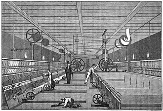

<PhilosophyTopic topic-id="su-hinh-thanh-va-phat-trien">

<template #notes>

Triết học Mác không ra đời chỉ vì xuất hiện hai nhà tư tưởng có năng lực. Nó hình thành khi những biến đổi của sản xuất, xã hội, khoa học và tư tưởng đặt ra các vấn đề mà lý luận trước đó chưa giải quyết thỏa đáng. Đọc lịch sử hình thành học thuyết cần nối các điều kiện ấy với những bước chuyển trong quan điểm của C. Mác và Ph. Ăngghen.

## Bối cảnh kinh tế và phong trào xã hội

Trong nửa đầu thế kỷ XIX, cách mạng công nghiệp thúc đẩy lực lượng sản xuất ở Tây Âu. Chủ nghĩa tư bản công nghiệp được củng cố, các đô thị và đội ngũ công nhân phát triển. Đồng thời, sự đối lập giữa giai cấp tư sản và giai cấp vô sản bộc lộ rõ trong đời sống và đấu tranh xã hội.

Phong trào công nhân không còn chỉ là những phản ứng riêng lẻ. Các cuộc khởi nghĩa của thợ dệt Lyông năm 1831 và 1834, phong trào Hiến chương ở Anh và đấu tranh của thợ dệt Xilêdi ở Đức là những sự kiện tiêu biểu. Chúng cho thấy giai cấp công nhân đang trở thành lực lượng chính trị tương đối độc lập. Thực tiễn ấy đặt ra nhu cầu giải thích nguồn gốc các mâu thuẫn xã hội, xác định lực lượng và điều kiện có thể cải biến xã hội.

Đây là quan hệ hai chiều giữa lý luận và đời sống. Phong trào tạo nhu cầu và cung cấp chất liệu cho lý luận, nhưng bản thân nhu cầu chưa tự sinh ra một học thuyết hoàn chỉnh. Cần hoạt động nghiên cứu, khái quát và kiểm tra của những chủ thể cụ thể. C. Mác và Ph. Ăngghen kết hợp nghiên cứu triết học với kinh tế chính trị và tham gia phong trào xã hội trong quá trình ấy.

<!-- philosophy-figure -->
<figure class="philosophy-figure">
  
  <figcaption>Hình 1.4: Máy kéo sợi mule trong một xưởng dệt, tranh khắc năm 1835.</figcaption>
</figure>

Máy móc không chỉ làm tăng quy mô sản xuất. Nó còn đặt người lao động vào cách tổ chức thời gian, phân công và sở hữu khác trước. Chính sự biến đổi đồng thời của kỹ thuật và các quan hệ xã hội khiến công nghiệp hóa trở thành bối cảnh cần phân tích, thay vì chỉ là một danh sách phát minh đứng bên ngoài lịch sử tư tưởng.

## Những nguồn lý luận được kế thừa

Ba nguồn lý luận của chủ nghĩa Mác gồm triết học cổ điển Đức, kinh tế chính trị học cổ điển Anh và chủ nghĩa xã hội không tưởng Pháp. Đối với triết học, sự kế thừa trực tiếp tập trung ở phép biện chứng của Hêghen và chủ nghĩa duy vật của Phoiơbắc.

Hêghen cung cấp một hệ thống tư duy về liên hệ, mâu thuẫn và phát triển, nhưng giải thích hiện thực từ sự vận động của ý niệm. C. Mác và Ph. Ăngghen tiếp thu nội dung biện chứng, đồng thời phê phán cơ sở duy tâm. Phoiơbắc khôi phục lập trường duy vật và phê phán sự đảo ngược quan hệ giữa con người với thực thể tinh thần, nhưng còn hạn chế trong cách hiểu thực tiễn và đời sống xã hội.

Kinh tế chính trị học cổ điển Anh, tiêu biểu ở A. Xmít và Đ. Ricácđô, cung cấp những kết quả nghiên cứu về lao động, sản xuất và các quan hệ kinh tế. Trong khi đó, chủ nghĩa xã hội không tưởng Pháp, với các đại biểu như Xanh Ximông và Phuriê, phê phán bất công và đặt vấn đề về một xã hội khác. Những nguồn này giúp mở rộng vấn đề triết học sang cơ cấu kinh tế và sự biến đổi xã hội.

Kế thừa có phê phán khác với lắp ghép. Nếu giữ nguyên quan niệm duy tâm của Hêghen rồi đặt cạnh duy vật của Phoiơbắc, mâu thuẫn về nền tảng vẫn chưa được giải quyết. Hệ thống mới đòi hỏi cải tạo cả phép biện chứng lẫn chủ nghĩa duy vật, đặc biệt bằng việc đưa thực tiễn và đời sống xã hội hiện thực vào trung tâm phân tích.

## Ba bộ phận của chủ nghĩa Mác liên hệ trong một hệ thống

Cần phân biệt nguồn gốc lý luận với bộ phận cấu thành của một học thuyết. Triết học cổ điển Đức, kinh tế chính trị học cổ điển Anh và chủ nghĩa xã hội không tưởng Pháp là những nguồn được kế thừa, phê phán và cải tạo. Triết học Mác, kinh tế chính trị học Mác và chủ nghĩa xã hội khoa học là những bộ phận hình thành trong hệ thống mới.

Mối liên hệ giữa chúng thể hiện ngay trong công việc nghiên cứu. Khi tìm hiểu đời sống xã hội, C. Mác phải đi vào những quan hệ sản xuất và trao đổi cụ thể. Nghiên cứu kinh tế giúp quan niệm duy vật về lịch sử có nội dung hiện thực. Ngược lại, cách nhìn lịch sử và biện chứng định hướng việc phân tích những quan hệ kinh tế đang biến đổi.

Mục tiêu giải phóng con người cũng đặt ra yêu cầu vượt khỏi sự phê phán đạo đức đơn thuần. Muốn giải thích khả năng thay đổi xã hội, cần chỉ rõ những điều kiện, lực lượng và quan hệ có thể tạo nên biến đổi. Chủ nghĩa xã hội khoa học hình thành trong liên hệ với cơ sở triết học và nghiên cứu kinh tế ấy.

Vì thế, không nên học ba bộ phận như ba danh sách tên gọi hoàn toàn tách biệt. Chúng có đối tượng và nhiệm vụ riêng, nhưng cùng tham gia giải thích một đời sống xã hội hiện thực. Sự thống nhất này giúp hiểu vì sao một công trình kinh tế như Tư bản đồng thời có giá trị đối với việc phát triển tư duy triết học.

## Những tiền đề khoa học tự nhiên

Định luật bảo toàn và chuyển hóa năng lượng cho thấy các hình thức vận động có thể chuyển hóa trong những điều kiện xác định. Học thuyết tế bào làm rõ sự thống nhất về cấu tạo của thế giới sống. Học thuyết tiến hóa giải thích giới sinh vật trong một quá trình lịch sử tự nhiên.

Các thành tựu ấy góp phần làm rõ giới hạn của cách nhìn tự nhiên như tập hợp những thực thể bất biến, tách rời. Tuy nhiên, không nên kể tất cả phát minh như những sự kiện đồng thời hoàn tất trước khi triết học Mác ra đời. Học thuyết hình thành trong những năm 1840. Những thành tựu được phát triển về sau, tiêu biểu là học thuyết tiến hóa của Đácuyn, tiếp tục củng cố cơ sở khoa học cho quá trình phát triển học thuyết.

## Những giai đoạn hình thành và phát triển

| Giai đoạn | Bước chuyển hoặc công việc chủ yếu |
| --- | --- |
| 1841–1844 | C. Mác và Ph. Ăngghen chuyển từ lập trường duy tâm, dân chủ cách mạng sang duy vật và cộng sản chủ nghĩa qua nghiên cứu, hoạt động báo chí và tiếp xúc thực tiễn. |
| 1844–1848 | Những nguyên lý của duy vật biện chứng và duy vật lịch sử được đề xuất, phát triển qua các tác phẩm và sự hợp tác lý luận. |
| 1848–1895 | Lý luận tiếp tục được bổ sung qua nghiên cứu kinh tế, tổng kết đấu tranh xã hội và khái quát các thành tựu khoa học. |

Một số tác phẩm giúp nhận ra nội dung của các bước chuyển. *Luận cương về Phoiơbắc* năm 1845 làm nổi bật vai trò của thực tiễn. *Hệ tư tưởng Đức* viết trong giai đoạn 1845–1846 trình bày quan niệm duy vật về lịch sử tương đối hệ thống. *Tuyên ngôn của Đảng Cộng sản* năm 1848 gắn quan niệm lịch sử với vai trò chính trị của giai cấp công nhân.

Ở giai đoạn sau, việc nghiên cứu phương thức sản xuất tư bản chủ nghĩa trong *Tư bản* làm sâu sắc sự phân tích các quan hệ kinh tế và lịch sử. Những công trình của Ph. Ăngghen tiếp tục trình bày, bảo vệ và phát triển các nội dung triết học. Các tác phẩm không phải những khẳng định tách rời, mà thuộc một quá trình nghiên cứu và tổng kết thực tiễn.

## Thực chất của bước chuyển trong triết học

Thứ nhất, chủ nghĩa duy vật và phép biện chứng được thống nhất trong cùng một hệ thống. Hiện thực vật chất được xem xét trong liên hệ và phát triển, còn những phạm trù biện chứng được hiểu là sự phản ánh hiện thực ấy.

Thứ hai, quan điểm duy vật được phát triển vào lĩnh vực xã hội. Thay vì chỉ lấy ý chí hoặc tư tưởng của các cá nhân để giải thích lịch sử, lý luận xem xét sản xuất vật chất, các quan hệ xã hội và hoạt động của con người trong điều kiện xác định.

Thứ ba, thực tiễn trở thành cơ sở để hiểu nhận thức và sự cải biến hiện thực. Triết học không dừng ở giải thích thế giới, nhưng việc cải biến cũng phải xuất phát từ điều kiện và quy luật khách quan. Ý nghĩa của bước chuyển nằm ở cách đặt quan hệ giữa thế giới quan, phương pháp và hoạt động xã hội.

## Vai trò của chủ thể sáng tạo trong những điều kiện lịch sử

Điều kiện kinh tế, phong trào xã hội và thành tựu tri thức tạo tiền đề cho học thuyết mới, nhưng tiền đề chưa đồng nghĩa kết quả đã hoàn thành. Cần có những chủ thể lựa chọn vấn đề, kiểm tra lập luận và nối các kết quả nghiên cứu thành hệ thống. Đây là phương diện chủ quan trong sự hình thành triết học Mác.

C. Mác và Ph. Ăngghen kết hợp hoạt động nghiên cứu với hoạt động báo chí, tiếp xúc và tham gia phong trào công nhân. Qua đó, những vấn đề của đời sống trở thành đối tượng khảo sát, đồng thời các quan niệm đang có bị thử thách. Sự thay đổi lập trường không chỉ là quyết định đổi tên trường phái.

Tinh thần kế thừa có phê phán còn đòi hỏi xem lại chính những khái niệm đã tiếp nhận. Nêu vai trò lao động chưa đủ nếu vẫn hiểu con người như một thực thể trừu tượng ngoài lịch sử. Đề cao thay đổi xã hội cũng chưa đủ nếu chỉ trông vào ý chí mà không nghiên cứu những quan hệ thực.

Sự hợp tác giữa hai nhà tư tưởng có ý nghĩa trong quá trình ấy vì cho phép trao đổi, bổ sung và phát triển công việc nghiên cứu. Tuy nhiên, giải thích sự ra đời của học thuyết chỉ bằng phẩm chất cá nhân sẽ bỏ mất những tiền đề lịch sử. Ngược lại, chỉ kể điều kiện khách quan lại bỏ mất lao động lý luận làm nên kết quả.

## Chiếc máy mới và đời sống của người lao động

Giả sử một xưởng đưa thiết bị mới vào sử dụng. Thiết bị có thể làm thay đổi năng suất, nhịp làm việc, cách phân công và những kỹ năng người lao động cần có. Cùng một tiến bộ kỹ thuật, người quản lý có thể nhìn trước hết vào khả năng mở rộng sản xuất, còn người công nhân quan tâm việc làm, thu nhập và quyền tham gia quyết định.

Nếu chỉ nói mọi người nên cư xử tử tế hơn, ta chưa giải thích được vì sao các lợi ích có thể xung đột. Cần xem ai quyết định việc sử dụng thiết bị, ai sở hữu tư liệu sản xuất và kết quả lao động được phân chia thế nào. Những câu hỏi ấy đưa việc phân tích từ thái độ cá nhân sang quan hệ xã hội có tổ chức.

Tình huống này giúp hiểu vì sao nghiên cứu triết học của Mác gắn với kinh tế chính trị và phong trào công nhân. Một hiện tượng trong xưởng không tự chứng minh toàn bộ học thuyết. Nhưng nó cho thấy giới hạn của cách giải thích xã hội chỉ bằng ý tốt, ý xấu hoặc tài năng của từng người, trong khi bỏ qua những quan hệ mà họ đang hoạt động bên trong.

## Giữ mục đích trong khi thay đổi cách làm

Một nhóm sinh viên muốn giúp trẻ em trong khu phố tiếp cận sách. Nhóm mở tủ sách nhưng ít người sử dụng. Thay vì kết luận trẻ em không muốn đọc, nhóm tìm hiểu thời gian sinh hoạt, cách chọn sách và khả năng tiếp cận địa điểm. Có thể mục tiêu vẫn đúng đắn, trong khi hình thức tổ chức ban đầu chưa phù hợp.

Khi điều chỉnh, nhóm cần phân biệt điều muốn giữ với điều có thể thay đổi. Nếu coi cách làm đầu tiên là chuẩn mực bất biến, họ sẽ bảo vệ phương tiện đến mức quên mục đích. Nếu chỉ chạy theo phản ứng trước mắt mà không còn tiêu chí, việc thay đổi lại mất phương hướng. Căn cứ để sửa phải là quan sát có suy xét và kết quả hoạt động.

Quan hệ giữa lý luận với thực tiễn cũng đặt ra yêu cầu tương tự, dù phạm vi lịch sử rộng hơn rất nhiều. Kế thừa một học thuyết không buộc người tiếp nhận lặp nguyên mọi kết luận trong điều kiện khác. Nhưng gọi một sự thay đổi là sáng tạo cũng chưa chứng minh được nó đúng. Cần chỉ rõ điều kiện mới nào khiến kết luận cũ cần được bổ sung và kết quả mới được kiểm nghiệm ra sao.

Khi gặp một thực tế trái với điều từng tin, điều khó hơn là từ bỏ kết luận hay nhận ra mình đã âm thầm thay đổi ý nghĩa của nó để khỏi phải sửa? Lịch sử tư tưởng cũng được viết từ những lần con người đủ trung thực để đối diện câu hỏi ấy.

## V.I. Lênin và yêu cầu tiếp tục phát triển lý luận

Cuối thế kỷ XIX và đầu thế kỷ XX, chủ nghĩa tư bản phát triển sang giai đoạn độc quyền, đế quốc chủ nghĩa. Những mâu thuẫn xã hội và quan hệ giữa các nước đặt ra các vấn đề mới đối với phong trào công nhân. Trong điều kiện nước Nga, V.I. Lênin nghiên cứu tổ chức lực lượng, quan hệ giữa các nhiệm vụ cách mạng và vấn đề nhà nước.

Đồng thời, những phát hiện vật lý làm thay đổi các quan niệm từng được coi là cố định về vật chất. Nếu đồng nhất vật chất với một mô hình vật lý cũ, người ta dễ suy từ sự khủng hoảng của mô hình đến kết luận rằng vật chất không tồn tại. V.I. Lênin phân biệt sự thay đổi của tri thức với sự tồn tại của hiện thực khách quan, qua đó bảo vệ lập trường duy vật và phát triển lý luận nhận thức.

Ông còn nghiên cứu sâu phép biện chứng, đặc biệt quan hệ giữa mâu thuẫn, phát triển và nhận thức. Sau Cách mạng Tháng Mười năm 1917, trọng tâm thực tiễn chuyển sang tổ chức và xây dựng xã hội mới. Các vấn đề kinh tế, năng suất lao động, quản lý và quan hệ giữa những lực lượng xã hội đòi hỏi tiếp tục tổng kết kinh nghiệm.

Sau khi V.I. Lênin mất năm 1924, những người nghiên cứu và vận dụng học thuyết tiếp tục đối diện các điều kiện lịch sử khác nhau. Thành công và sai lầm trong thực tiễn đặt ra yêu cầu bổ sung lý luận, khắc phục giáo điều và chủ quan duy ý chí. Vì vậy, lịch sử phát triển không dừng ở việc ghi nhớ một danh sách tác phẩm.

Từ đây có thể rút ra một nguyên tắc xuyên suốt. Trung thành với phương pháp không đồng nghĩa lặp lại mọi kết luận cũ trong mọi hoàn cảnh. Muốn lý luận có khả năng giải thích, cần nghiên cứu điều kiện mới, nhận diện sai lầm và kiểm tra việc vận dụng bằng thực tiễn.

</template>

<template #exercises>

<!-- workbook: WB1-MC22; PDF 15 -->

::: exercise Bài 1

Chủ nghĩa Mác - Lênin ra đời vào khoảng thời gian nào?

- A. Những năm 40 của thế kỷ XIX.
- B. Những năm 50 của thế kỷ XIX.
- C. Những năm 30 của thế kỷ XIX.
- D. Những năm 60 của thế kỷ XIX.

:::

::: solution Giải thích

Đáp án: A.

A xác định thời kỳ hình thành chủ nghĩa Mác do C. Mác và Ph. Ăngghen sáng lập. Cần đọc chính xác tên gọi trong câu hỏi. V.I. Lênin bảo vệ và phát triển học thuyết trong những điều kiện cuối thế kỷ XIX, đầu thế kỷ XX, vì vậy không thể hiểu rằng toàn bộ giai đoạn Mác - Lênin đã hoàn tất từ những năm 1840.

:::

<!-- workbook: WB1-MC23; PDF 15, 16 -->

::: exercise Bài 2

Điều kiện kinh tế - xã hội nào ở Tây Âu nửa đầu thế kỷ XIX đã dẫn đến sự ra đời của triết học Mác?

- A. Chủ nghĩa tư bản đã hình thành và phát triển.
- B. Cuộc cách mạng công nghiệp phát triển mạnh mẽ ở các nước tư bản phát triển.
- C. Chủ nghĩa tư bản đã phát triển và giai cấp vô sản xuất hiện trên vũ đài lịch sử.
- D. Các phong trào đấu tranh giai cấp nổ ra.

:::

::: solution Giải thích

Đáp án: C.

C gắn sự phát triển của chủ nghĩa tư bản với sự trưởng thành của giai cấp vô sản như một lực lượng xã hội và chính trị. A và B nêu những điều kiện có thật nhưng chưa thể hiện đầy đủ chủ thể đặt ra nhu cầu lý luận mới. D quá chung vì đấu tranh giai cấp đã tồn tại trước thế kỷ XIX.

:::

<!-- workbook: WB1-MC24; PDF 16 -->

::: exercise Bài 3

Trong lĩnh vực triết học, C. Mác và Ph. Ăngghen kế thừa trực tiếp những lý luận nào sau đây:

- A. Chủ nghĩa duy vật cổ đại.
- B. Thuyết nguyên tử.
- C. Phép biện chứng trong triết học của Hêghen và quan niệm duy vật trong triết học của Phoiơbắc.
- D. Chủ nghĩa duy vật thế kỷ XVII - XVIII.

:::

::: solution Giải thích

Đáp án: C.

Nguồn lý luận triết học trực tiếp là triết học cổ điển Đức, đặc biệt phép biện chứng Hêghen và chủ nghĩa duy vật Phoiơbắc. Sự kế thừa diễn ra thông qua phê phán và cải tạo, không giữ nguyên hai hệ thống rồi ghép lại. A, B và D có vị trí trong lịch sử duy vật nhưng không nêu đúng nguồn trực tiếp này.

:::

<!-- workbook: WB1-MC25; PDF 16 -->

::: exercise Bài 4

Yếu tố nào dưới đây không phải là tiền đề, nguồn gốc dẫn đến sự ra đời của Triết học Mác - Lênin?

- A. Điều kiện kinh tế - xã hội ở Tây Âu những năm 40 của thế kỷ XIX.
- B. Triết học Cổ điển Đức, Chủ nghĩa xã hội không tưởng của Pháp và Kinh tế chính trị học Cổ điển Anh.
- C. Điều kiện kinh tế - xã hội ở Tây Âu những năm 50 của thế kỷ XVIII.
- D. Dựa trên những thành tựu của khoa học tự nhiên thế kỷ XIX.

:::

::: solution Giải thích

Đáp án: C.

Bối cảnh trực tiếp là Tây Âu nửa đầu thế kỷ XIX, cùng những nguồn lý luận và thành tựu khoa học tương ứng. Những biến đổi ở thế kỷ XVIII có thể là tiền sử xa hơn, nhưng C không xác định điều kiện trực tiếp của sự ra đời triết học Mác. D cần hiểu là nền tảng khoa học được tiếp tục phát triển trong thế kỷ XIX.

:::

<!-- workbook: WB1-MC26; PDF 16 -->

::: exercise Bài 5

Sự thất bại của các phong trào công nhân những năm nửa đầu thế kỷ XIX cho thấy điều gì?

- A. Các phong trào này thiếu tính tổ chức.
- B. Các phong trào này thiếu tính linh hoạt.
- C. Các phong trào này thiếu lý luận khoa học soi đường.
- D. Các phong trào này mang tính tự phát.

:::

::: solution Giải thích

Đáp án: C.

Trong mạch phân tích sự ra đời của chủ nghĩa Mác, kết luận được nhấn mạnh là nhu cầu có lý luận khoa học để giải thích xã hội và định hướng đấu tranh. Điều đó không có nghĩa mọi thất bại chỉ có một nguyên nhân. Mức độ tổ chức, điều kiện lực lượng và hoàn cảnh chính trị của từng phong trào còn phải được nghiên cứu riêng.

:::

<!-- workbook: WB1-MC27; PDF 16 -->

::: exercise Bài 6

Phát minh nào trong khoa học tự nhiên nửa đầu thế kỷ XIX vạch ra nguồn gốc tự nhiên của con người, chống lại quan điểm tôn giáo?

- A. Học thuyết tế bào.
- B. Thuyết duy nghiệm.
- C. Định luật bảo toàn và chuyển hóa năng lượng.
- D. Học thuyết tiến hóa.

:::

::: solution Giải thích

Đáp án: D.

Về nội dung, học thuyết tiến hóa giải thích sự hình thành và biến đổi của sinh giới bằng quá trình tự nhiên, tạo cơ sở nghiên cứu nguồn gốc tự nhiên của con người. Tuy nhiên, mốc “nửa đầu thế kỷ XIX” chưa chính xác nếu nói riêng học thuyết Đácuyn. Công trình Nguồn gốc các loài xuất bản năm 1859, thuộc nửa sau thế kỷ XIX. Vì vậy D phù hợp về học thuyết, còn giới hạn thời gian trong đề cần được sửa.

:::

<!-- workbook: WB1-MC28; PDF 16 -->

::: exercise Bài 7

Định luật bảo toàn và chuyển hóa năng lượng có ý nghĩa thế nào đối với sự ra đời của Triết học Mác?

- A. Chứng minh cho sự bảo toàn về mặt năng lượng.
- B. Chứng minh cho tính thống nhất vật chất của thế giới.
- C. Chứng minh khả năng vận động, chuyển hóa của sự vật hiện tượng.
- D. Chứng minh cho mối liên hệ gắn bó giữa triết học và khoa học tự nhiên.

:::

::: solution Giải thích

Không có đủ căn cứ để chốt một phương án duy nhất với cách đặt câu hỏi này. A mới nhắc nội dung bảo toàn. C nêu ý nghĩa trực tiếp về sự chuyển hóa giữa các hình thức vận động, còn B nêu ý nghĩa khái quát đối với quan niệm về tính thống nhất vật chất. D diễn đạt quan hệ giữa thành tựu khoa học với sự phát triển triết học.

Cách trả lời đầy đủ là định luật cung cấp cơ sở khoa học cho việc hiểu các hình thức vận động trong liên hệ và chuyển hóa, qua đó góp phần củng cố thế giới quan duy vật biện chứng. Không nên hiểu một định luật vật lý riêng lẻ là chứng minh trọn vẹn mọi luận điểm triết học. Nếu yêu cầu chỉ một đáp án, đề cần quy định rõ đang hỏi ý nghĩa trực tiếp về chuyển hóa hay ý nghĩa khái quát về thế giới quan.

:::

<!-- workbook: WB1-MC29; PDF 17 -->

::: exercise Bài 8

Tác phẩm nào đánh dấu sự ra đời của Chủ nghĩa Mác - Lênin?

- A. Luận cương về Phoiơbắc.
- B. Tuyên ngôn của Đảng cộng sản.
- C. Hệ tư tưởng Đức.
- D. Bản thảo kinh tế - triết học.

:::

::: solution Giải thích

Đáp án: B.

Tuyên ngôn của Đảng Cộng sản năm 1848 trình bày công khai những quan điểm nền tảng và có tính chất cương lĩnh của chủ nghĩa Mác. Các tác phẩm còn lại có vai trò trong quá trình hình thành quan niệm mới, nhưng không giữ cùng vị trí cương lĩnh ấy. Tên gọi cần được hiểu chính xác là dấu mốc ra đời của chủ nghĩa Mác, vì giai đoạn phát triển của V.I. Lênin diễn ra về sau.

:::

<!-- workbook: WB1-MC30; PDF 17 -->

::: exercise Bài 9

Thực chất bước chuyển cách mạng trong Triết học do C. Mác và Ph. Ăngghen thực hiện là nội dung nào sau đây?

- A. Thống nhất giữa thế giới quan duy vật và phép biện chứng trong một hệ thống triết học.
- B. Thống nhất giữa triết học của Hegel và triết học của Phoiơbắc.
- C. Phê phán triết học duy tâm của Hegel.
- D. Khái quát các thành tựu triết học trước đó.

:::

::: solution Giải thích

Đáp án: A.

A nêu một nội dung cơ bản của bước chuyển, tức thống nhất duy vật với biện chứng bằng sự cải tạo cả hai. B gợi cách lắp ghép nguyên trạng nên không đúng. C và D là những công việc có tham gia vào quá trình nhưng chưa diễn đạt thực chất của hệ thống mới. Bước chuyển còn bao gồm duy vật lịch sử và vai trò của thực tiễn.

:::

<!-- workbook: WB1-MC31; PDF 17 -->

::: exercise Bài 10

Phoiơbắc là nhà triết học theo trường phái triết học nào?

- A. Chủ nghĩa duy tâm chủ quan.
- B. Chủ nghĩa duy tâm khách quan.
- C. Chủ nghĩa duy vật biện chứng.
- D. Chủ nghĩa duy vật siêu hình.

:::

::: solution Giải thích

Đáp án: D.

Phoiơbắc khẳng định tự nhiên và con người cảm tính, phê phán cơ sở duy tâm của triết học Hêghen. Tuy nhiên, ông chưa xây dựng chủ nghĩa duy vật biện chứng và chưa hiểu đầy đủ vai trò của thực tiễn, tính lịch sử của các quan hệ xã hội. Trong hệ phân loại của học phần, D là phương án phù hợp.

:::

<!-- workbook: WB1-MC33; PDF 17 -->

::: exercise Bài 11

Đâu KHÔNG phải là nguồn gốc lý luận trực tiếp dẫn tới sự ra đời của chủ nghĩa Mác - Lênin?

- A. Triết học Cổ điển Đức.
- B. Chủ nghĩa xã hội không tưởng Pháp.
- C. Triết học Khai sáng Pháp.
- D. Kinh tế chính trị học cổ điển Anh.

:::

::: solution Giải thích

Đáp án: C.

Ba nguồn lý luận trực tiếp được xác định là triết học cổ điển Đức, kinh tế chính trị học cổ điển Anh và chủ nghĩa xã hội không tưởng Pháp. Triết học Khai sáng Pháp có ảnh hưởng trong lịch sử tư tưởng, nhưng không phải tên của một trong ba nguồn trực tiếp ấy. Không thuộc danh sách trực tiếp không đồng nghĩa hoàn toàn không có ảnh hưởng.

:::

<!-- workbook: WB1-TF01; PDF 18 -->

::: exercise Bài 12

Xác định đúng hoặc sai và giải thích ngắn gọn.

Triết học Mác - Lênin là sự lồng ghép giữa phép biện chứng của Hêghen và quan điểm duy vật của Phoiơbắc.

:::

::: solution Giải thích

Đáp án: Sai.

Mác và Ăngghen không giữ nguyên phép biện chứng duy tâm rồi ghép với chủ nghĩa duy vật còn hạn chế về thực tiễn. Hai ông cải tạo phép biện chứng trên lập trường duy vật, đồng thời phát triển chủ nghĩa duy vật vào đời sống xã hội và gắn nhận thức với thực tiễn.

Phát biểu chính xác hơn là triết học Mác hình thành qua sự kế thừa có phê phán và đổi mới về chất những thành tựu trước đó, về sau được Lênin bảo vệ và phát triển.

:::

<!-- workbook: WB1-TF02; PDF 18 -->

::: exercise Bài 13

Xác định đúng hoặc sai và giải thích ngắn gọn.

Sự ra đời của chủ nghĩa Mác - Lênin đáp ứng yêu cầu của thực tiễn.

:::

::: solution Giải thích

Đáp án: Đúng.

Sự phát triển của sản xuất tư bản chủ nghĩa và phong trào công nhân đặt ra nhu cầu giải thích những mâu thuẫn xã hội, xác định lực lượng và điều kiện cải biến xã hội. Lý luận được hình thành bằng nghiên cứu, khái quát và tổng kết hoạt động ấy.

Đúng ở đây không có nghĩa chỉ cần xuất hiện nhu cầu là học thuyết tự động ra đời. Các nguồn lý luận, thành tựu khoa học và lao động sáng tạo của những nhà tư tưởng cũng là điều kiện cần xem xét.

:::

<!-- workbook: WB1-ES03; PDF 19 -->

::: exercise Bài 14

Trình bày những điều kiện lịch sử của sự ra đời của Triết học Mác - Lênin. Thực chất và ý nghĩa cuộc cách mạng trong triết học do C. Mác và Ăng-ghen thực hiện?

:::

::: solution Giải thích

Trước hết cần phân biệt thời kỳ Mác và Ăngghen sáng lập học thuyết với thời kỳ Lênin phát triển về sau. Triết học Mác hình thành trong những năm 1840, trên cơ sở các điều kiện kinh tế - xã hội, nguồn lý luận, thành tựu khoa học và hoạt động sáng tạo của những chủ thể cụ thể.

Về kinh tế - xã hội, cách mạng công nghiệp thúc đẩy sản xuất tư bản chủ nghĩa ở Tây Âu và làm bộc lộ mâu thuẫn giữa giai cấp tư sản với vô sản. Phong trào công nhân phát triển thành một lực lượng chính trị đặt ra nhu cầu lý luận để nhận thức xã hội, xác định phương hướng đấu tranh. Nhu cầu ấy là điều kiện hiện thực, nhưng chưa tự động tạo nên một hệ thống tư tưởng.

Về lý luận, chủ nghĩa Mác kế thừa triết học cổ điển Đức, kinh tế chính trị học cổ điển Anh và chủ nghĩa xã hội không tưởng Pháp. Nguồn triết học trực tiếp là phép biện chứng của Hêghen và chủ nghĩa duy vật của Phoiơbắc. Sự tiếp thu đi cùng phê phán cơ sở duy tâm, giới hạn siêu hình và quan niệm chưa đầy đủ về thực tiễn. Không được đồng nhất nguồn được kế thừa với bộ phận cấu thành của hệ thống mới.

Về khoa học, định luật bảo toàn và chuyển hóa năng lượng, học thuyết tế bào và học thuyết tiến hóa góp phần củng cố cách hiểu tự nhiên trong liên hệ, thống nhất và phát triển. Những thành tựu này hình thành, hoàn thiện ở các thời điểm khác nhau trong thế kỷ XIX. Không coi mọi thành tựu đã hoàn tất trước những năm 1840.

Mác và Ăngghen kết hợp nghiên cứu lý luận với hoạt động báo chí và phong trào xã hội. Lao động nghiên cứu, sự chuyển biến lập trường và sự hợp tác của hai ông giải thích vì sao những tiền đề lịch sử có thể được khái quát thành một học thuyết mới.

Thực chất bước chuyển có ba phương diện gắn bó. Thứ nhất, duy vật và biện chứng được thống nhất qua sự cải tạo cả hai. Thứ hai, quan niệm duy vật được phát triển vào lịch sử, tìm cơ sở giải thích xã hội trong sản xuất vật chất, các quan hệ xã hội và hoạt động con người. Thứ ba, thực tiễn được đặt vào cơ sở của nhận thức và cải biến hiện thực. Triết học không còn tự nhận thay thế mọi khoa học cụ thể.

Ý nghĩa của bước chuyển là hình thành một thế giới quan và phương pháp luận gắn việc nhận thức khách quan với hoạt động cải biến xã hội, hướng tới giải phóng con người. Lênin tiếp tục bảo vệ và phát triển học thuyết khi chủ nghĩa tư bản, phong trào cách mạng và khoa học đặt ra những vấn đề mới. Chính lịch sử ấy đòi hỏi vận dụng sáng tạo, tổng kết thực tiễn và tránh biến lý luận thành tập hợp kết luận bất biến.

:::

</template>

</PhilosophyTopic>

## Tài liệu tham khảo

1. Hội đồng biên soạn, Phạm Văn Đức (chủ biên, 2019). *Giáo trình Triết học Mác – Lênin*. Dành cho bậc đại học, khối các ngành ngoài lý luận chính trị. Hà Nội. Chương 1, tr. 5–60.
2. Khoa Triết học, Trường Đại học Khoa học Xã hội và Nhân văn (2024). *Bài tập Triết học Mác - Lênin*. Hà Nội. Chương 1, phần Bài tập.
3. Darwin, C. (1859). [*On the Origin of Species*, ấn bản đầu](https://darwin-online.org.uk/content/contentblock?basepage=1&itemID=F373&viewtype=text). London: John Murray.
4. Andrew Ure (1835). [Máy kéo sợi mule trong một xưởng dệt, tranh khắc năm 1835.](https://commons.wikimedia.org/wiki/File:Cotton_Mule_Spinning,_1835.jpg). Phạm vi công cộng. Bản thu nhỏ.
