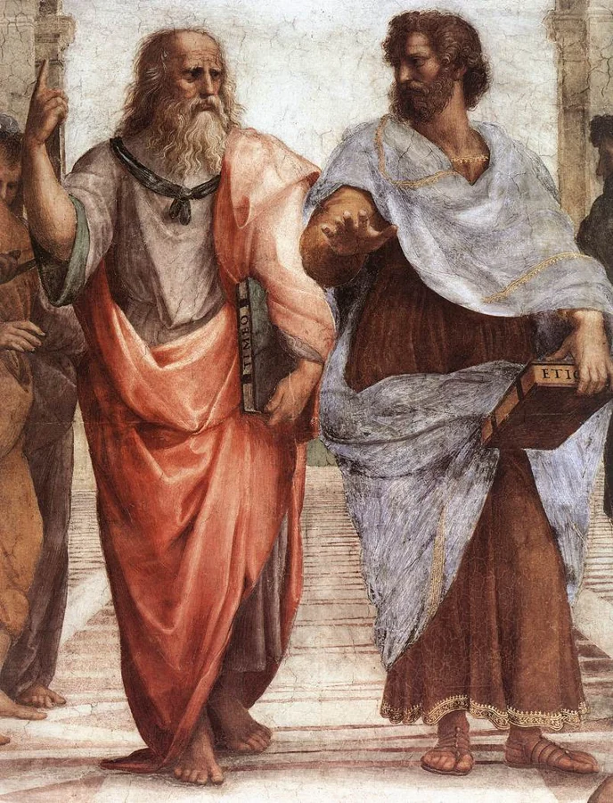

<PhilosophyTopic topic-id="van-de-co-ban">

<template #notes>

Một kế hoạch xây cầu có trước cây cầu được xây dựng. Vậy có thể kết luận ý thức có trước vật chất không? Chưa thể, vì bản thiết kế đã dựa vào vật liệu, địa hình, nhu cầu đi lại và tri thức được tích lũy từ hiện thực. Câu hỏi triết học phải xét quan hệ nền tảng giữa ý thức và thế giới, không chỉ thứ tự của hai sự việc trong một công việc cụ thể.

## Hai mặt của cùng một vấn đề

Trong triết học Mác – Lênin, **vấn đề cơ bản của triết học** là mối quan hệ giữa tư duy và tồn tại, giữa ý thức và vật chất. Vấn đề này có hai mặt:

| Phương diện | Câu hỏi | Lập trường |
| --- | --- | --- |
| Về cái có trước và quyết định | Vật chất hay ý thức là cái có trước, cái nào quyết định cái nào? | Chủ nghĩa duy vật và chủ nghĩa duy tâm. |
| Về khả năng nhận thức | Con người có thể nhận thức thế giới và bản chất của sự vật không? | Thuyết khả tri và thuyết bất khả tri. |

Đây là vấn đề cơ bản vì cách giải quyết nó chi phối cách giải thích tự nhiên, xã hội và hoạt động con người. Tuy nhiên, phân biệt hai mặt vẫn cần thiết. Thừa nhận con người có khả năng hiểu thế giới chưa cho biết người đó coi vật chất hay tinh thần là nền tảng của thế giới.

## Chủ nghĩa duy vật và những hình thức lịch sử

Chủ nghĩa duy vật khẳng định giới tự nhiên, vật chất tồn tại trước, độc lập với ý thức và quyết định ý thức. Ý thức hình thành trên cơ sở vật chất và là sự phản ánh hiện thực. Lập trường ấy không phủ nhận tư duy, tình cảm hay lý tưởng, mà tìm cách giải thích nguồn gốc và tác dụng của chúng từ những điều kiện hiện thực.

Chủ nghĩa duy vật có ba hình thức cơ bản. Duy vật chất phác thời cổ đại tìm nguồn gốc thế giới trong tự nhiên, nhưng thường đồng nhất vật chất nói chung với một dạng cụ thể như nước, lửa hoặc nguyên tử. Giá trị của nó là không cần viện đến một lực lượng siêu nhiên để giải thích giới tự nhiên. Giới hạn của nó nằm ở tính trực quan và trình độ khoa học còn thấp.

Duy vật siêu hình phát triển rõ trong thời cận đại, đặc biệt dưới ảnh hưởng của cơ học cổ điển. Nó nhấn mạnh tính khách quan của thế giới, nhưng thường xem sự vật như những bộ phận biệt lập của một cỗ máy. Vận động dễ bị thu hẹp thành dịch chuyển cơ học, còn biến đổi về chất và những quan hệ phức tạp chưa được giải thích đầy đủ.

Duy vật biện chứng do C. Mác và Ph. Ăngghen xây dựng, sau đó được V.I. Lênin phát triển, kết hợp quan điểm duy vật với việc xem xét liên hệ, vận động và phát triển. Đối với xã hội, nó tìm cơ sở giải thích trong đời sống vật chất và thực tiễn của con người, đồng thời thừa nhận vai trò của ý thức thông qua hoạt động thực tiễn.

## Hai hình thức chủ nghĩa duy tâm

Chủ nghĩa duy tâm đặt tinh thần, ý thức hoặc ý niệm ở vị trí có trước và quyết định thế giới vật chất. Hai hình thức của nó khác nhau ở cách hiểu thực thể tinh thần ấy.

Duy tâm chủ quan lấy ý thức, cảm giác của chủ thể làm điểm xuất phát và quy sự tồn tại của đối tượng về cảm giác hoặc những tổ hợp cảm giác. Cần phân biệt lập trường này với sự thật rằng mỗi người tiếp nhận thế giới bằng kinh nghiệm riêng. Có trải nghiệm chủ quan không đồng nghĩa thế giới chỉ tồn tại trong trải nghiệm ấy.

Duy tâm khách quan thừa nhận một thực thể tinh thần tồn tại độc lập với ý thức của từng cá nhân, chẳng hạn ý niệm tuyệt đối, rồi coi nó là nguồn gốc của tự nhiên. Từ “khách quan” ở đây nói đến sự độc lập với cá nhân, không có nghĩa học thuyết đã thừa nhận tính thứ nhất của vật chất.

Những học thuyết nhất nguyên lấy một bản nguyên làm nền tảng, có thể là vật chất hoặc tinh thần. Nhị nguyên luận thừa nhận vật chất và tinh thần là hai bản nguyên độc lập. Khó khăn của lập trường nhị nguyên là phải giải thích hai thực thể độc lập ấy tác động đến nhau bằng cách nào.

<!-- philosophy-figure -->
<figure class="philosophy-figure">
  
  <figcaption>Hình 1.2: Platon và Arixtốt ở trung tâm bức Trường học Athens.</figcaption>
</figure>

Trong ngôn ngữ tạo hình của Raphael, Platon chỉ tay lên cao, còn Arixtốt đưa tay ngang về phía thế giới trước mặt. Cử chỉ gợi sự khác biệt về cách tìm nền tảng của hiểu biết. Tuy nhiên, không thể dùng một động tác trong tranh để thay thế việc đọc và phân tích lập trường của từng nhà triết học.

## Nguồn gốc nhận thức và xã hội của quan điểm duy tâm

Con người chỉ biết thế giới thông qua hoạt động nhận thức của mình. Cảm giác, khái niệm và tư duy vì thế có vai trò thực sự, không thể gạt bỏ. Nhưng từ vai trò ấy có thể xuất hiện một bước chuyển sai về lập luận. Người ta tuyệt đối hóa một mặt của nhận thức rồi coi nó là nền tảng sản sinh toàn bộ hiện thực.

Chẳng hạn, mọi hiểu biết của ta về màu sắc đều phải đi qua cảm giác. Điều đó chưa cho phép kết luận đối tượng chỉ tồn tại như cảm giác của ta. Mệnh đề về con đường nhận biết và mệnh đề về cơ sở tồn tại trả lời hai vấn đề khác nhau. Đánh đồng chúng sẽ biến sự phụ thuộc của tri thức vào chủ thể thành sự phụ thuộc của thế giới vào chủ thể.

Sự khái quát cũng có thể bị tuyệt đối hóa theo cách khác. Khái niệm giúp con người nhận ra cái chung giữa nhiều sự vật. Nhưng nếu tách cái chung thành một thực thể tinh thần độc lập rồi cho rằng thực thể ấy tạo ra các sự vật, thứ tự giải thích đã bị đảo ngược theo quan điểm duy vật.

Về mặt xã hội, sự phân công giữa lao động trí óc và lao động chân tay có thể làm mờ cơ sở vật chất của hoạt động tinh thần. Người điều hành nhìn thấy mệnh lệnh đi trước công việc, trong khi những điều kiện khiến mệnh lệnh có thể thực hiện lại bị đặt ra ngoài tầm chú ý. Những quan hệ lợi ích và quyền lực cũng có thể củng cố cách nhìn ấy.

Giải thích nguồn gốc xã hội không có nghĩa mọi người làm việc trí óc đều duy tâm. Cũng không thể suy từ một học thuyết duy tâm tới kết luận tác giả của nó không biết lập luận. Chủ nghĩa duy tâm triết học có những hệ thống lý luận phức tạp. Muốn phê phán cần xác định đúng bước tuyệt đối hóa hoặc đảo ngược quan hệ, thay vì chỉ gắn nhãn.

## Khả tri, bất khả tri và giới hạn của tri thức

Thuyết khả tri khẳng định con người về nguyên tắc có thể nhận thức thế giới và bản chất sự vật. Điều này không có nghĩa mỗi cá nhân đã biết mọi thứ hoặc mọi kết luận hiện có đều đúng. Tri thức cần được bổ sung, sửa chữa và kiểm nghiệm.

Thuyết bất khả tri cho rằng con người không thể đạt tới bản chất thực sự của đối tượng, dù vẫn có thể biết các biểu hiện hoặc kinh nghiệm về nó. Trong lịch sử, Hium và Cantơ là những đại biểu quan trọng thường được xem xét khi trình bày lập trường này. Hoài nghi luận có liên hệ với bất khả tri, nhưng không nên đồng nhất mọi sự hoài nghi với việc phủ nhận khả năng nhận thức.

Hoài nghi một kết luận để yêu cầu chứng cứ có thể phục vụ khoa học. Chỉ khi tuyệt đối hóa sự hoài nghi thành quan niệm rằng con người không thể đạt tri thức khách quan, nó mới khác về căn bản với thái độ kiểm tra có phương pháp. Chủ nghĩa duy vật biện chứng phân biệt cái chưa biết với cái về nguyên tắc không thể biết, đồng thời coi thực tiễn là cơ sở kiểm nghiệm nhận thức.

Cuối cùng, duy vật không phải tên gọi một lối sống ham tiền bạc, còn duy tâm không đồng nghĩa với sống có đạo đức. Muốn phân loại một quan điểm triết học, phải xét cách nó giải quyết quan hệ vật chất và ý thức, thay vì đánh giá phẩm chất cá nhân.

## Một bức ảnh không tạo ra căn phòng

Khi gọi điện trực tuyến, ta nhìn thấy căn phòng của người đối thoại qua màn hình. Chất lượng đường truyền, góc máy và ánh sáng làm thay đổi hình ảnh nhận được. Sự thay đổi ấy chứng tỏ hiểu biết của ta có điều kiện trung gian, nhưng không chứng tỏ căn phòng chỉ tồn tại khi được nhìn thấy.

Tắt máy khiến hình ảnh biến mất khỏi màn hình của ta. Căn phòng và hoạt động của người đối thoại vẫn có thể tiếp tục. Cần phân biệt sự phụ thuộc của hình ảnh vào thiết bị, chủ thể với sự tồn tại của đối tượng được phản ánh. Nếu bỏ sự phân biệt này, ta sẽ biến giới hạn của cách nhìn thành một kết luận quá rộng về thế giới.

Ví dụ không tự giải quyết mọi tranh luận triết học. Nó giúp nhận đúng hai câu hỏi đang được đặt ra. Một câu hỏi là hình ảnh của ta hình thành thế nào và có thể sai lệch ra sao. Câu hỏi khác là cái được nhìn có tồn tại độc lập với việc ta đang nhìn hay không. Chủ nghĩa duy vật khẳng định sự độc lập ấy, đồng thời vẫn phải giải thích vai trò của cơ thể, công cụ và hoạt động trong nhận thức.

## Sự dè dặt không đồng nghĩa với bất lực

Một người nghe tiếng động lạ trong chiếc xe có thể chưa biết bộ phận nào gặp trục trặc. Thừa nhận “Tôi chưa biết” là phù hợp với lượng thông tin đang có. Người thợ có thể kiểm tra từng bộ phận, so sánh dấu hiệu và thử lại sau khi sửa. Giới hạn ban đầu được vượt qua nhờ thêm phương tiện và hoạt động tìm hiểu.

Nhưng từ “Chưa xác định được nguyên nhân” đến “Con người không bao giờ biết được nguyên nhân thực sự” là một bước chuyển khác hẳn. Nhận định sau không chỉ nói về tình trạng hiện tại. Nó đặt một giới hạn về nguyên tắc đối với khả năng nhận thức. Chính cấp độ khẳng định này cần được nhận ra khi phân biệt giới hạn lịch sử của tri thức với lập trường bất khả tri.

Mặt khác, tin rằng có thể nhận thức cũng không cho phép đoán nguyên nhân rồi gọi đó là hiểu biết. Người thợ vẫn cần dấu hiệu, thao tác kiểm tra và kết quả thực tế. Khả tri là sự khẳng định khả năng đi sâu vào đối tượng, chứ không phải đặc quyền miễn chứng cứ cho bất kỳ lời giải thích nào.

Trong đời sống, giữ được sự tin tưởng vào khả năng hiểu biết và thái độ khiêm tốn trước điều chưa biết có mâu thuẫn không? Hay chính sự thừa nhận giới hạn hiện tại mới cho ta lý do tiếp tục tìm hiểu?

## Phân biệt lập trường nền tảng với một nhận định cụ thể

Câu nói rằng một kế hoạch tốt có thể thay đổi cuộc sống không tự nó là duy tâm. Kế hoạch có thể hướng dẫn con người sử dụng phương tiện, phối hợp hành động và cải biến điều kiện. Điều cần xét là người nói có thừa nhận những điều kiện vật chất và hoạt động thực tiễn làm trung gian hay không.

Tương tự, nói rằng hoàn cảnh ảnh hưởng tư tưởng chưa đủ để diễn đạt đầy đủ lập trường duy vật. Vấn đề cơ bản còn đòi xác định cái gì có trước và giữ vai trò quyết định xét về nền tảng. Một ảnh hưởng qua lại trong trường hợp riêng cần được đặt trong quan hệ rộng hơn giữa thế giới khách quan với đời sống ý thức.

Sự phân biệt này cũng áp dụng cho khả tri. Thừa nhận một sự kiện chưa được giải thích không đồng nghĩa chấp nhận bất khả tri. Một ngành khoa học có thể chưa có phương tiện phù hợp hoặc chưa xây dựng được lý thuyết cần thiết. Giới hạn lịch sử của hiểu biết không tự chứng minh rằng bản chất đối tượng vĩnh viễn nằm ngoài khả năng nhận thức.

Trong cách hiểu về Cantơ, ranh giới quan trọng là giữa hiện tượng con người có thể biết và vật tự nó không thể được nhận thức như nó vốn có. Khi trình bày lập trường bất khả tri, cần giữ ranh giới này. Nếu viết thành không ai biết được bất cứ điều gì, ta đã biến một quan điểm có nội dung xác định thành sự phủ nhận quá rộng.

Quan điểm duy vật biện chứng đặt vấn đề khác. Con người có thể từng bước đi sâu vào đối tượng nhờ hoạt động, phương tiện và việc sửa chữa tri thức. Khả năng ấy được hiểu như quá trình xã hội lâu dài, không phải lời bảo đảm rằng một người có thể lập tức giải đáp mọi câu hỏi.

Hai mặt của vấn đề cơ bản vì thế cần được theo dõi riêng nhưng trong liên hệ. Mặt thứ nhất làm rõ cơ sở tồn tại và quan hệ quyết định. Mặt thứ hai làm rõ khả năng của nhận thức. Nhận ra cả hai giúp đọc một lập luận triết học chính xác hơn việc phân loại theo những từ quen tai như tinh thần, khách quan hoặc niềm tin.

</template>

<template #exercises>

<!-- workbook: WB1-MC03; PDF 13 -->

::: exercise Bài 1

Thuyết nào sau đây thừa nhận hai bản nguyên vật chất và tinh thần song song tồn tại?

- A. Học thuyết nhất nguyên.
- B. Học thuyết nhị nguyên.
- C. Học thuyết đa nguyên.
- D. Học thuyết hư vô.

:::

::: solution Giải thích

Đáp án: B.

Nhị nguyên luận coi vật chất và tinh thần là hai bản nguyên độc lập. Nhất nguyên luận chỉ thừa nhận một bản nguyên, có thể là vật chất hoặc tinh thần. Đa nguyên luận không giới hạn ở hai bản nguyên, còn hư vô luận không phải tên gọi của lập trường được mô tả.

:::

<!-- workbook: WB1-MC09; PDF 13, 14 -->

::: exercise Bài 2

Vấn đề cơ bản của triết học là:

- A. Vấn đề vật chất và ý thức.
- B. Vấn đề mối quan hệ giữa tư duy và tồn tại.
- C. Vấn đề quan hệ giữa con người với thế giới xung quanh.
- D. Vấn đề quan hệ giữa con người với con người trong xã hội.

:::

::: solution Giải thích

Đáp án: B.

B phát biểu trực tiếp quan hệ giữa tư duy và tồn tại, cũng được diễn đạt bằng quan hệ giữa ý thức và vật chất. A mới gọi tên hai phạm trù mà chưa nói rõ quan hệ cần giải quyết. Nếu A được dùng như một cách nói tắt về quan hệ ấy thì nội dung sẽ gần B, nhưng cách diễn đạt của B đầy đủ hơn. C và D là những vấn đề rộng hoặc riêng khác.

:::

<!-- workbook: WB1-MC10; PDF 14 -->

::: exercise Bài 3

Mặt thứ nhất của vấn đề cơ bản của triết học trả lời cho câu hỏi:

- A. Con người có khả năng nhận thức thế giới hay không?
- B. Giữa vật chất và ý thức, cái nào có trước, cái nào có sau, cái nào quyết định cái nào?
- C. Vấn đề quan hệ giữa vật chất và ý thức như thế nào?
- D. Vấn đề quan hệ giữa tư duy và tồn tại như thế nào?

:::

::: solution Giải thích

Đáp án: B.

Mặt thứ nhất xác định tính thứ nhất và quan hệ quyết định giữa vật chất với ý thức. A thuộc mặt thứ hai, nói về khả năng nhận thức. C và D chỉ gọi tên quan hệ chung mà chưa tách riêng nội dung của mặt thứ nhất.

:::

<!-- workbook: WB1-MC11; PDF 14 -->

::: exercise Bài 4

Mặt thứ hai của vấn đề cơ bản của triết học trả lời cho câu hỏi:

- A. Con người có khả năng nhận thức thế giới hay không?
- B. Giữa vật chất và ý thức thì cái nào có trước, cái nào có sau, cái nào quyết định cái nào?
- C. Vật chất có tồn tại vĩnh viễn hay không?
- D. Vật chất tồn tại dưới những dạng nào?

:::

::: solution Giải thích

Đáp án: A.

Đây là câu hỏi về khả năng nhận thức thế giới và bản chất của sự vật. Cách trả lời phân biệt thuyết khả tri với thuyết bất khả tri. B thuộc mặt thứ nhất, còn C và D không phát biểu câu hỏi về khả năng nhận thức.

:::

<!-- workbook: WB1-MC12; PDF 14 -->

::: exercise Bài 5

Cơ sở để phân chia các trào lưu triết học thành chủ nghĩa duy vật và chủ nghĩa duy tâm là:

- A. Cách giải quyết mặt thứ hai của vấn đề cơ bản của triết học.
- B. Cách giải quyết vấn đề cơ bản của triết học.
- C. Cách giải quyết mặt thứ nhất của vấn đề cơ bản của triết học.
- D. Quan điểm lý luận nhận thức.

:::

::: solution Giải thích

Đáp án: C.

Cơ sở trực tiếp là câu trả lời về cái có trước và giữ vai trò quyết định giữa vật chất với ý thức. C nêu đúng mặt thứ nhất. B quá rộng vì vấn đề cơ bản còn có mặt thứ hai. Mặt thứ hai và quan điểm về khả năng nhận thức không tự phân chia duy vật với duy tâm.

:::

<!-- workbook: WB1-MC13; PDF 14 -->

::: exercise Bài 6

Ý thức có trước, vật chất có sau, ý thức quyết định vật chất, đây là quan điểm của trường phái triết học nào?

- A. Duy vật.
- B. Duy tâm.
- C. Nhất nguyên.
- D. Nhị nguyên.

:::

::: solution Giải thích

Đáp án: B.

Duy tâm là tên gọi trực tiếp của lập trường coi tinh thần, ý thức có trước và quyết định vật chất. Duy tâm cũng là một dạng nhất nguyên khi lấy tinh thần làm bản nguyên duy nhất, nên C có thể đúng ở cấp phân loại rộng hơn. Tuy nhiên, C chưa phân biệt được nhất nguyên duy vật với nhất nguyên duy tâm, vì vậy B xác định đúng trường phái cụ thể.

:::

<!-- workbook: WB1-MC14; PDF 14 -->

::: exercise Bài 7

Ý thức, cảm giác của con người sinh ra và quyết định sự tồn tại của sự vật là quan điểm của trường phái nào?

- A. Duy tâm chủ quan.
- B. Bất khả tri.
- C. Duy tâm khách quan.
- D. Khả tri.

:::

::: solution Giải thích

Đáp án: A.

Duy tâm chủ quan lấy cảm giác, ý thức của chủ thể làm cơ sở quyết định sự tồn tại của đối tượng. Duy tâm khách quan lại đặt cơ sở ở một thực thể tinh thần độc lập với từng cá nhân. Khả tri và bất khả tri trả lời vấn đề khả năng nhận thức, không trực tiếp xác định bản nguyên của thế giới.

:::

<!-- workbook: WB1-MC15; PDF 14 -->

::: exercise Bài 8

Ý thức, ý niệm tuyệt đối sinh ra thế giới, là quan điểm của trường phái triết học nào:

- A. Duy tâm chủ quan.
- B. Bất khả tri.
- C. Duy tâm khách quan.
- D. Khả tri.

:::

::: solution Giải thích

Đáp án: C.

Ý niệm tuyệt đối được đặt như một thực thể tinh thần có trước và độc lập với ý thức từng cá nhân. Đó là cách giải thích của duy tâm khách quan. Từ “khách quan” trong tên gọi này không biến thực thể tinh thần thành vật chất. Hai phương án khả tri và bất khả tri thuộc cách giải quyết mặt thứ hai.

:::

<!-- workbook: WB1-MC16; PDF 14 -->

::: exercise Bài 9

Quan niệm của chủ nghĩa duy tâm khách quan về mặt thứ nhất của vấn đề cơ bản của triết học là như thế nào?

- A. Thừa nhận thế giới vật chất do thực thể tinh thần tạo ra.
- B. Thừa nhận thế giới vật chất tồn tại khách quan.
- C. Thừa nhận cảm giác và sự phức hợp các cảm giác của con người quyết định sự tồn tại của các sự vật hiện tượng trong thế giới.
- D. Thừa nhận khả năng nhận thức của con người.

:::

::: solution Giải thích

Đáp án: A.

Duy tâm khách quan coi một thực thể tinh thần khách quan là cơ sở sản sinh thế giới vật chất. C mô tả duy tâm chủ quan. D không trả lời câu hỏi về cái có trước. B chỉ nêu sự tồn tại khách quan mà không diễn đạt quan hệ tinh thần sinh ra vật chất, nên không xác định được đặc trưng đang hỏi.

:::

<!-- workbook: WB1-MC17; PDF 14, 15 -->

::: exercise Bài 10

Chủ nghĩa duy tâm chủ quan có đặc điểm nổi bật nào?

- A. Giải thích được nguồn gốc, bản chất của cảm giác, ý thức của con người.
- B. Thấy được tính năng động, sáng tạo của cảm giác, ý thức của con người.
- C. Thừa nhận cảm giác và phức hợp các cảm giác của con người quyết định sự tồn tại của các sự vật hiện tượng trong thế giới.
- D. Thừa nhận khả năng nhận thức của con người.

:::

::: solution Giải thích

Đáp án: C.

C nêu sự tuyệt đối hóa cảm giác của chủ thể thành cơ sở tồn tại của đối tượng. Đề cao tính năng động của ý thức hoặc thừa nhận khả năng nhận thức chưa đủ làm một quan điểm trở thành duy tâm chủ quan. A cũng không phải tiêu chí phân loại trường phái này.

:::

<!-- workbook: WB1-MC18; PDF 15 -->

::: exercise Bài 11

Sắp xếp các hình thức cơ bản của chủ nghĩa duy vật theo đúng trình tự phát triển

- A. Chủ nghĩa duy vật siêu hình, chủ nghĩa duy vật biện chứng, chủ nghĩa duy vật chất phác.
- B. Chủ nghĩa duy vật tầm thường, chủ nghĩa duy vật biện chứng, chủ nghĩa duy vật siêu hình.
- C. Chủ nghĩa duy vật biện chứng, chủ nghĩa duy vật siêu hình, chủ nghĩa duy vật chất phác.
- D. Chủ nghĩa duy vật chất phác, chủ nghĩa duy vật siêu hình, chủ nghĩa duy vật biện chứng.

:::

::: solution Giải thích

Đáp án: D.

Trình tự khái quát là duy vật chất phác thời cổ đại, duy vật siêu hình phát triển rõ thời cận đại, rồi duy vật biện chứng. Đây là các hình thức lịch sử cơ bản, không phải khẳng định rằng hình thức sau xuất hiện thì mọi quan điểm thuộc hình thức trước lập tức biến mất.

:::

<!-- workbook: WB1-MC19; PDF 15 -->

::: exercise Bài 12

Giải quyết mặt thứ 2 của vấn đề cơ bản của triết học trong lịch sử triết học chia thành những trường phái nào?

- A. Chủ nghĩa duy vật và chủ nghĩa duy tâm.
- B. Thuyết khả tri và thuyết bất khả tri.
- C. Chủ nghĩa duy tâm chủ quan và chủ nghĩa duy tâm khách quan.
- D. Chủ nghĩa duy vật biện chứng và chủ nghĩa duy vật siêu hình.

:::

::: solution Giải thích

Đáp án: B.

Mặt thứ hai hỏi con người có thể nhận thức thế giới và bản chất sự vật hay không. Khả tri khẳng định khả năng ấy về nguyên tắc, còn bất khả tri phủ nhận khả năng đi tới bản chất như nó vốn có. A, C và D dùng những căn cứ phân loại khác.

:::

<!-- workbook: WB1-MC20; PDF 15 -->

::: exercise Bài 13

Bản chất của thuyết bất khả tri là gì?

- A. Con người không thể nhận thức được sự tồn tại, vận động của sự vật, hiện tượng.
- B. Con người không thể nhận thức được về bản chất thật sự của sự vật, hiện tượng.
- C. Con người có xu hướng nhận thức sai lầm về thế giới.
- D. Con người cần phải hiểu rõ về những giới hạn của nhận thức.

:::

::: solution Giải thích

Đáp án: B.

Bất khả tri không nhất thiết phủ nhận mọi kinh nghiệm hoặc mọi hiểu biết về biểu hiện bên ngoài. Điểm quyết định là phủ nhận khả năng biết bản chất thực sự của đối tượng. Thừa nhận tri thức hiện có còn giới hạn, hoặc con người có thể sai, chưa đồng nghĩa với bất khả tri.

:::

<!-- workbook: WB1-ES01; PDF 19 -->

::: exercise Bài 14

Trình bày vấn đề cơ bản của triết học theo quan điểm của triết học Mác - Lênin.

:::

::: solution Giải thích

Vấn đề cơ bản của triết học là quan hệ giữa tư duy và tồn tại, giữa ý thức và vật chất. Nó được gọi là cơ bản vì cách giải quyết quan hệ này chi phối điểm xuất phát để giải thích tự nhiên, xã hội và hoạt động con người. Cần trình bày hai mặt có liên hệ nhưng không đồng nhất.

Mặt thứ nhất hỏi giữa vật chất và ý thức, cái nào có trước, cái nào có sau và cái nào giữ vai trò quyết định. Chủ nghĩa duy vật khẳng định vật chất có trước, tồn tại độc lập với ý thức và quyết định ý thức. Chủ nghĩa duy tâm khẳng định tinh thần, ý thức có trước và quyết định vật chất. Duy tâm chủ quan lấy cảm giác của chủ thể làm cơ sở, còn duy tâm khách quan lấy một thực thể tinh thần độc lập với cá nhân.

Mặt thứ hai hỏi con người có khả năng nhận thức thế giới và bản chất sự vật hay không. Thuyết khả tri thừa nhận khả năng ấy về nguyên tắc. Thuyết bất khả tri cho rằng con người không thể biết bản chất thực sự như nó vốn có, dù có thể tiếp nhận các biểu hiện. Biết rằng tri thức hiện tại chưa đầy đủ không đồng nghĩa chấp nhận bất khả tri.

Theo quan điểm duy vật biện chứng, ý thức có cơ sở vật chất và nhận thức có thể đi sâu vào hiện thực thông qua quá trình xã hội, hoạt động thực tiễn và sự sửa chữa tri thức. Chẳng hạn, bản thiết kế có thể có trước một cây cầu cụ thể, nhưng còn dựa trên tự nhiên, nhu cầu xã hội và tri thức đã tích lũy. Thứ tự trong công việc riêng ấy không đảo ngược quan hệ nền tảng giữa vật chất với ý thức.

Khi kết luận, cần giữ riêng hai tiêu chí. Thừa nhận khả năng nhận thức không tự cho biết lập trường duy vật hay duy tâm. Ngược lại, xác định cái có trước chưa thay thế được việc giải thích con đường, điều kiện và giới hạn lịch sử của nhận thức.

:::

</template>

</PhilosophyTopic>

## Tài liệu tham khảo

1. Hội đồng biên soạn, Phạm Văn Đức (chủ biên, 2019). *Giáo trình Triết học Mác – Lênin*. Dành cho bậc đại học, khối các ngành ngoài lý luận chính trị. Hà Nội. Chương 1, tr. 5–60.
2. Khoa Triết học, Trường Đại học Khoa học Xã hội và Nhân văn (2024). *Bài tập Triết học Mác - Lênin*. Hà Nội. Chương 1, phần Bài tập.
3. Raphael. [Platon và Arixtốt ở trung tâm bức Trường học Athens.](https://commons.wikimedia.org/wiki/File:Sanzio_01_Plato_Aristotle.jpg). Phạm vi công cộng. Bản thu nhỏ.
