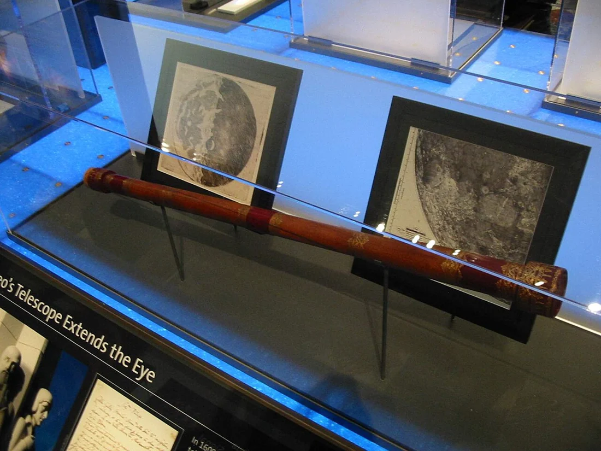

<PhilosophyTopic topic-id="nhan-thuc-va-chan-ly">

<template #notes>

## Từ tiếp xúc trực tiếp đến hiểu quan hệ bên trong

Nhìn một cây đang héo, ta có thể nhận biết lá đổi màu và thân mất độ tươi. Muốn giải thích quá trình ấy, ta còn phải tìm những quan hệ giữa nước, rễ và điều kiện môi trường. Nhận thức vận động từ sự tiếp xúc cảm tính đến việc khái quát và suy luận, rồi trở lại hoạt động thực tế để kiểm tra.

**Nhận thức cảm tính** phản ánh đối tượng bằng những hình ảnh cảm tính, hình thành trên cơ sở tác động của đối tượng vào các giác quan. Ba hình thức cơ bản là cảm giác, tri giác và biểu tượng. Chúng liên hệ với nhau nhưng có phạm vi phản ánh khác nhau.

Cảm giác phản ánh từng thuộc tính riêng lẻ, như màu sắc, âm thanh hoặc độ nóng. Tri giác phản ánh đối tượng như một chỉnh thể cảm tính qua sự kết hợp các cảm giác. Biểu tượng là hình ảnh được tái hiện khi đối tượng không còn trực tiếp tác động vào giác quan. Biểu tượng vẫn thuộc cảm tính vì tái hiện hình ảnh trực quan, chưa khái quát thành khái niệm. Nhờ đó, kinh nghiệm cảm tính được lưu giữ và huy động trong hoạt động tiếp theo.

Nhận thức cảm tính cung cấp tài liệu sinh động và trực tiếp, nhưng chưa tự làm rõ các quan hệ bản chất. Những gì xuất hiện trước mắt còn chịu tác động của điều kiện quan sát. Bởi vậy, nhận biết hình ảnh không thể thay thế toàn bộ việc giải thích đối tượng.

## Khái niệm, phán đoán và suy luận

**Nhận thức lý tính** là giai đoạn phản ánh gián tiếp, khái quát những thuộc tính và quan hệ bản chất của đối tượng. Nó được thực hiện qua khái niệm, phán đoán và suy luận, trên cơ sở tài liệu cảm tính cùng hoạt động thực tiễn.

Khái niệm khái quát những thuộc tính chung, bản chất của một nhóm đối tượng. Khi hình thành khái niệm “cây xanh”, tư duy không giữ nguyên mọi chi tiết của từng cây mà lựa chọn những đặc trưng phù hợp với việc nhận diện nhóm đối tượng. Trừu tượng hóa có căn cứ giúp ta hiểu sâu hơn, dù không giữ toàn bộ vẻ phong phú trực tiếp.

Phán đoán liên kết các khái niệm để khẳng định hoặc phủ định một thuộc tính hay quan hệ. Suy luận liên kết những phán đoán làm tiền đề để rút ra kết luận mới. Quy nạp đi từ các trường hợp riêng đến nhận định chung. Diễn dịch vận dụng những nhận định chung để rút ra kết luận về trường hợp thuộc phạm vi ấy.

Suy luận đúng về hình thức còn cần tiền đề phù hợp với hiện thực. Tư duy có thể tổ chức các khái niệm rất chặt chẽ mà vẫn đi sai nếu giả thiết ban đầu sai hoặc phạm vi áp dụng bị mở rộng tùy tiện. Vì thế, nhận thức lý tính phải tiếp tục gắn với khảo sát và kiểm tra.

## Sự thống nhất giữa cảm tính, lý tính và thực tiễn

Cảm tính cung cấp chất liệu cho lý tính. Lý tính định hướng việc quan sát, giúp chọn dấu hiệu và đặt vấn đề sâu hơn. Trong hoạt động thực, hai giai đoạn không phải những ngăn kín chỉ xuất hiện lần lượt một lần. Người quan sát có tri thức sẽ nhìn thấy những quan hệ mà sự quan sát chưa được hướng dẫn có thể bỏ qua.

Con đường nhận thức được khái quát từ trực quan sinh động đến tư duy trừu tượng, rồi từ tư duy trừu tượng trở lại thực tiễn. Trở lại thực tiễn vừa là vận dụng vừa là kiểm tra. Kết quả thực hiện có thể làm rõ giới hạn của cách giải thích và mở đầu một vòng nhận thức mới.

Chẳng hạn, từ các biểu hiện cây héo, người chăm cây hình thành giả thuyết về điều kiện sống. Họ đối chiếu thêm dấu hiệu, điều chỉnh điều kiện thích hợp và theo dõi kết quả. Tri thức mới được hình thành qua cả quan sát, suy luận và hoạt động thực, không phải chỉ từ một cảm giác riêng lẻ.

<!-- philosophy-figure -->
<figure class="philosophy-figure">
  
  <figcaption>Hình 2.8: Bản phục dựng kính thiên văn thời Galileo tại Đài thiên văn Griffith.</figcaption>
</figure>

Dụng cụ mở rộng những gì giác quan có thể tiếp cận, nhưng hình ảnh nhìn thấy vẫn cần được giải thích. Người quan sát phải phân biệt đặc điểm của đối tượng với sai lệch do thiết bị và điều kiện quan sát. Vì vậy, nhận thức khách quan không đòi hỏi con người hoàn toàn không có trung gian. Nó đòi hỏi hiểu và kiểm soát những trung gian đang tham gia vào việc nhận biết.

## Chùm chìa khóa ở đâu trong trí nhớ

Một người nhớ đã nhìn thấy chìa khóa trên bàn buổi sáng và nói chắc rằng hiện giờ nó vẫn ở đó. Hình ảnh được nhớ lại có thể rất rõ, nhưng độ rõ của biểu tượng không bảo đảm trạng thái hiện tại của đối tượng. Trong lúc người ấy vắng nhà, chìa khóa có thể đã được chuyển chỗ.

Ở đây, cảm giác và tri giác ban đầu cung cấp tài liệu về vị trí chìa khóa trong một thời điểm. Biểu tượng tái hiện tài liệu ấy khi đối tượng không còn trước mắt. Phán đoán “chìa khóa hiện vẫn ở trên bàn” lại thêm một nội dung khác: Vị trí không đổi trong khoảng thời gian đã qua. Nội dung thêm ấy cần căn cứ, không tự có chỉ vì ký ức sinh động.

Sự suy nghĩ có thể giúp tìm nơi nên xem trước, chẳng hạn nhớ lại công việc đã làm sau khi cất chìa khóa. Tuy nhiên, một suy luận mạch lạc vẫn phải đối chiếu với đối tượng và những thông tin mới. Việc tìm lại không chỉ minh họa quan hệ cảm tính với lý tính mà còn cho thấy mỗi kết luận phải giữ đúng thời điểm và điều kiện mà tài liệu cho phép.

## Nhận thức kinh nghiệm và nhận thức lý luận

Phân chia cảm tính và lý tính xét những hình thức, giai đoạn phản ánh của nhận thức. Phân chia kinh nghiệm và lý luận lại chú ý trình độ cùng cách hình thành tri thức. Hai cách phân chia có liên hệ, nhưng không nên đồng nhất từng cặp thuật ngữ như những tên gọi thay thế hoàn toàn.

Nhận thức kinh nghiệm dựa trên quan sát và hoạt động thực tiễn, gồm cả kinh nghiệm thường ngày lẫn kết quả thực nghiệm khoa học. Tri thức này có thể chứa sự so sánh, phân loại và khái quát ban đầu. Vì vậy, nói kinh nghiệm không có bất cứ hoạt động tư duy nào sẽ làm nghèo nội dung thực của nó.

Nhận thức lý luận sử dụng khái niệm, phán đoán và suy luận để làm rõ những quan hệ bản chất, tất yếu và quy luật. Nó cần tài liệu kinh nghiệm nhưng còn phải giải thích những tài liệu ấy trong một hệ thống. Việc thấy một hiện tượng lặp lại chưa tự chứng minh nguyên nhân và tính tất yếu của nó.

Xét sự sinh trưởng của cây, người chăm sóc có thể tích lũy kinh nghiệm về dấu hiệu thiếu nước. Muốn giải thích cơ chế và xác định phạm vi áp dụng, cần nghiên cứu quan hệ giữa nước, rễ, đất và các quá trình của cây. Khi điều kiện thay đổi, lý luận giúp định hướng quan sát và lựa chọn cách kiểm tra mới.

Kinh nghiệm và lý luận vì thế không thay thế nhau. Xem thường kinh nghiệm làm lý luận thiếu tài liệu và cơ sở kiểm tra. Dừng ở kinh nghiệm riêng lại làm khó việc nhận ra quy luật hoặc những điều kiện chưa từng gặp. Sự phát triển nhận thức đòi hỏi đi từ hoạt động cụ thể đến khái quát rồi tiếp tục trở lại đối tượng.

Nhận thức thông thường và nhận thức khoa học cũng là một cách phân biệt khác. Nhận thức thông thường hình thành trực tiếp trong đời sống hằng ngày. Nhận thức khoa học được tổ chức tự giác, sử dụng phương pháp để tìm những mối liên hệ bản chất. Không thể chỉ căn cứ vào việc một người dùng thuật ngữ khó để coi nhận định của họ là khoa học.

## Chân lý và tính khách quan

**Chân lý** là tri thức phù hợp với hiện thực khách quan và được thực tiễn kiểm nghiệm. Chân lý thuộc về nội dung nhận thức, không phải tên gọi khác của bản thân sự vật. Sự vật tồn tại và vận động, còn nhận định của con người về sự vật có thể đúng hoặc sai.

Tính khách quan của chân lý nghĩa là nội dung đúng của tri thức do đối tượng quy định, không phụ thuộc ý muốn, lợi ích hoặc số người đồng tình. Hình thức diễn đạt do con người tạo ra nhưng điều làm nhận định đúng không chỉ là cách gọi tên. Sự nhất quán trong suy luận là cần thiết, song chưa thay thế sự phù hợp với hiện thực.

Tính khách quan cũng không có nghĩa chủ thể vắng mặt trong nhận thức. Chính con người phát hiện, diễn đạt và kiểm tra tri thức bằng những phương tiện lịch sử cụ thể. Điều cần phân biệt là hoạt động của người nhận thức với cơ sở khách quan làm cho nội dung nhận thức có giá trị đúng.

## Sai lầm, sự kiểm tra và khả năng phát triển của tri thức

Một nhận định có thể nhất quán với những nhận định khác mà vẫn sai nếu tiền đề không phù hợp đối tượng. Ngược lại, sự trái nhau giữa hai cách giải thích là dấu hiệu cần xem xét, chưa đủ để chọn ngay một phía. Muốn xác định giá trị đúng, cần kiểm tra cả lập luận lẫn căn cứ hiện thực.

Trong quá trình nhận thức, sai lầm có thể xuất hiện do quan sát chưa đầy đủ, khái niệm chưa phù hợp hoặc áp dụng tri thức ra ngoài điều kiện của nó. Việc phát hiện sai lầm không phủ nhận khả năng nhận thức. Nó tạo cơ sở để xác định phần nào cần bác bỏ, phần nào có thể giữ và điều kiện nào phải bổ sung.

Chẳng hạn, một nhận định về cây sinh trưởng tốt có thể đúng trong môi trường đã khảo sát nhưng không đúng khi đất, ánh sáng hoặc giống cây thay đổi. Vấn đề lúc này có thể nằm ở phạm vi phát biểu quá rộng. Sửa lại điều kiện là một bước làm tri thức chính xác hơn, không nhất thiết xóa bỏ toàn bộ hiểu biết ban đầu.

Sự kiểm tra cần dựa vào thực tiễn trong tính lịch sử và phát triển. Có những vấn đề chưa thể được kiểm nghiệm đầy đủ bằng phương tiện hiện có. Tạm chưa có kết quả quyết định không có nghĩa mọi giả thuyết đều có giá trị ngang nhau. Vẫn cần xem mức độ căn cứ và giữ rõ điều đã biết với điều còn đang giả định.

Thái độ khoa học kết hợp sự kiên định với nội dung đã có căn cứ và sự sẵn sàng sửa nhận thức. Kiên định không phải giữ mọi cách diễn đạt cũ. Sẵn sàng sửa cũng không phải phủ nhận sạch những kết quả đã được kiểm nghiệm. Hai yêu cầu giúp hiểu tri thức như một quá trình tiến sâu vào hiện thực.

## Hai con đường và một lời khuyên đi lại

Giả sử một người khuyên đi theo con đường quen vì hôm trước họ đến nơi thuận lợi. Lời khuyên có thể có căn cứ trong trải nghiệm ấy, nhưng muốn khẳng định nó vẫn phù hợp hôm nay còn cần biết giờ đi, phương tiện và điều kiện đường sá. Một nhận định đúng trong hoàn cảnh cũ có thể bị dùng sai khi những điều kiện gắn với nó đã thay đổi.

Nếu phát hiện con đường hôm nay bị chặn, ta không cần phủ nhận rằng hôm trước người kia đã đi thành công. Cần sửa phạm vi của lời khuyên và tìm thông tin phù hợp hiện tại. Tri thức phát triển có thể giữ một phần đúng đồng thời bác bỏ sự khái quát quá rộng từ phần đúng ấy.

Cũng không thể vì điều kiện có thể đổi mà nói mọi lời chỉ đường đều đúng theo cách riêng. Có những sự kiện khách quan có thể khảo sát như đường có thông hay không và phương tiện có đi qua được hay không. Sự thận trọng về giới hạn khác với thái độ coi mọi nhận định đều có giá trị ngang nhau.

Khi nghe một lời khẳng định rất chắc chắn, ta có thể dừng lại ở việc nó được nói rõ ràng đến đâu, hoặc đi xa hơn để nhận ra điều gì làm nó đúng. Đối tượng, điều kiện và cách kiểm tra chính là những điểm tựa cho bước đi xa hơn ấy. Sự sẵn sàng sửa một nhận định có căn cứ mới không làm suy yếu việc tìm chân lý, mà giữ cho việc tìm kiếm còn gắn với hiện thực.

## Chân lý tương đối, tuyệt đối và tính cụ thể

**Chân lý tương đối** là tri thức đúng nhưng chưa đầy đủ, phản ánh một mặt hoặc một phạm vi của hiện thực trong những điều kiện xác định. “Tương đối” không có nghĩa sai hoặc đúng tùy ý mỗi người. Nó nêu giới hạn lịch sử và mức độ hoàn chỉnh của tri thức.

**Chân lý tuyệt đối** biểu thị sự phản ánh đầy đủ, toàn diện hiện thực khách quan. Nhận thức của loài người tiến tới sự đầy đủ ấy thông qua việc tích lũy, bổ sung và phát triển những chân lý tương đối. Trong mỗi tri thức đúng có nội dung khách quan được bảo tồn trong quá trình nhận thức tiếp tục phát triển.

Do đó, không nên coi chân lý tương đối và tuyệt đối là hai kho tri thức không liên quan. Cũng không nên gọi bất kỳ nhận định nào đúng trong một hoàn cảnh là chân lý tuyệt đối theo nghĩa đã phản ánh trọn vẹn đối tượng. Biết đúng một quan hệ chưa đồng nghĩa biết đầy đủ mọi mặt và điều kiện của nó.

Chân lý luôn cụ thể vì một nhận định đúng gắn với đối tượng, quan hệ và điều kiện áp dụng xác định. Nhận định về khả năng sinh trưởng của cây phải gắn với loại cây và môi trường. Bỏ các điều kiện ấy rồi áp dụng cho mọi trường hợp có thể làm một tri thức đúng bị sử dụng sai.

Nhấn mạnh tính tuyệt đối đến mức xem hiểu biết hiện có là hoàn tất sẽ dẫn đến giáo điều. Tuyệt đối hóa tính tương đối đến mức phủ nhận mọi nội dung đúng khách quan lại dẫn đến chủ nghĩa tương đối. Thái độ nhận thức phù hợp là giữ vững những kết quả đã được kiểm nghiệm, xác định rõ giới hạn và tiếp tục mở rộng hiểu biết bằng thực tiễn.

</template>

<template #exercises>

<!-- workbook: WB2-MC69; PDF 56 -->

::: exercise Bài 1

Luận điểm sau đây là của nhà triết học nào (1) và được viết trong tác phẩm nào (2): “Từ trực quan sinh động đến tư duy trừu tượng và từ tư duy trừu tượng đến thực tiễn, đó là con đường biện chứng của sự nhận thức chân lý, nhận thức thực tại khách quan”.

- A. (1) C. Mác, (2) Luận cương về Phoiơbắc.
- B. (1) V.I. Lênin, (2) Chủ nghĩa duy vật và chủ nghĩa kinh nghiệm phê phán.
- C. (1) Ph. Ăngghen, (2) Biện chứng của tự nhiên.
- D. (1) V.I. Lênin, (2) Bút ký triết học.

:::

::: solution Giải thích

Đáp án: D.

Luận điểm nêu sự vận động từ tài liệu cảm tính đến khái quát lý tính rồi trở về thực tiễn để kiểm tra và vận dụng. Tác giả là V.I. Lênin và tác phẩm là Bút ký triết học. B đúng tác giả nhưng sai tác phẩm. A và C đều không khớp cặp tác giả với tác phẩm được hỏi.

:::

<!-- workbook: WB2-MC70; PDF 56 -->

::: exercise Bài 2

Giai đoạn nhận thức diễn ra trên cơ sở sự tác động trực tiếp của các sự vật lên các giác quan của con người là giai đoạn nhận thức nào?

- A. Nhận thức lý tính.
- B. Nhận thức lý luận.
- C. Nhận thức cảm tính.
- D. Nhận thức khoa học.

:::

::: solution Giải thích

Đáp án: C.

Nhận thức cảm tính gồm cảm giác, tri giác và biểu tượng, gắn với những tài liệu cảm giác có được từ tiếp xúc với đối tượng. Biểu tượng có thể tái hiện đối tượng khi nó không còn trực tiếp hiện diện. A và B gắn với khái quát, còn D phân biệt theo tính chất và trình độ nghiên cứu, không phải tên giai đoạn cảm tính.

:::

<!-- workbook: WB2-MC71; PDF 56–57 -->

::: exercise Bài 3

Luận điểm sau đây thuộc lập trường triết học nào: “Cảm giác là hình ảnh chủ quan về thế giới khách quan”.

- A. Chủ nghĩa duy tâm chủ quan.
- B. Chủ nghĩa duy tâm khách quan.
- C. Thuyết nhị nguyên.
- D. Chủ nghĩa duy vật biện chứng.

:::

::: solution Giải thích

Đáp án: D.

Luận điểm thừa nhận đối tượng tồn tại khách quan và cảm giác là hình ảnh của đối tượng ở chủ thể. “Chủ quan” không có nghĩa đối tượng do chủ thể sáng tạo ra. Hai hình thức duy tâm đều không giữ cách giải quyết duy vật này, còn nhị nguyên tách vật chất và tinh thần thành hai nguồn gốc độc lập.

:::

<!-- workbook: WB2-MC72; PDF 57 -->

::: exercise Bài 4

Nhận thức lý tính được thực hiện dưới những hình thức nào?

- A. Cảm giác, tri giác và biểu tượng.
- B. Cảm giác, khái niệm, suy luận.
- C. Khái niệm, phán đoán, suy luận.
- D. Tri giác, biểu tượng, khái niệm.

:::

::: solution Giải thích

Đáp án: C.

Khái niệm khái quát thuộc tính chung, bản chất. Phán đoán khẳng định hoặc phủ định một quan hệ, còn suy luận rút tri thức mới từ những phán đoán theo quan hệ xác định. A gồm các hình thức cảm tính. B và D trộn hình thức của hai giai đoạn.

:::

<!-- workbook: WB2-MC77; PDF 58 -->

::: exercise Bài 5

Lựa chọn phát biểu đúng:

- A. Thực tiễn là tiêu chuẩn của chân lý hoàn toàn có tính chất tuyệt đối.
- B. Thực tiễn là tiêu chuẩn của chân lý hoàn toàn có tính chất tương đối.
- C. Thực tiễn là tiêu chuẩn của chân lý vừa có tính chất tuyệt đối, vừa có tính chất tương đối.
- D. Thực tiễn không phải là tiêu chuẩn khách quan để kiểm tra chân lý.

:::

::: solution Giải thích

Đáp án: C.

Tính tuyệt đối thể hiện ở vai trò tiêu chuẩn khách quan của thực tiễn, không thể thay bằng mong muốn hay sự tán thành chủ quan. Tính tương đối thể hiện ở giới hạn lịch sử của mỗi trình độ thực tiễn, bởi một lần kiểm nghiệm không giải quyết mọi mặt của đối tượng. A và B tuyệt đối hóa một phương diện, còn D phủ nhận vai trò tiêu chuẩn.

:::

<!-- workbook: WB2-TF19; PDF 62 -->

::: exercise Bài 6

Xác định đúng hoặc sai và giải thích: Nhận thức lý tính quan trọng hơn nhận thức cảm tính.

:::

::: solution Giải thích

Đáp án: Sai.

Không thể xếp hạng tuyệt đối hai giai đoạn như những yếu tố thay thế được cho nhau. Cảm tính cung cấp tài liệu trực tiếp, còn lý tính khái quát những thuộc tính và quan hệ bản chất, đồng thời định hướng quan sát. Lý tính thiếu tài liệu cảm tính và sự kiểm tra thực tiễn có thể thành suy diễn rỗng, còn cảm tính không được khái quát có thể dừng ở biểu hiện bề ngoài.

:::

<!-- workbook: WB2-TF20; PDF 62 -->

::: exercise Bài 7

Xác định đúng hoặc sai và giải thích: Chân lý có tính tương đối, tính tuyệt đối, tính cụ thể.

:::

::: solution Giải thích

Đáp án: Đúng.

Ba tính chất được nêu đều đúng, nhưng chưa phải danh sách đầy đủ vì còn tính khách quan. Tương đối nói về giới hạn lịch sử của hiểu biết. Tuyệt đối nói về nội dung đúng khách quan được giữ lại trong sự phát triển tri thức. Cụ thể đòi hỏi gắn nhận định với đối tượng và điều kiện áp dụng. Không được suy từ tính tương đối rằng chân lý tùy sở thích cá nhân.

:::

</template>

</PhilosophyTopic>

## Tài liệu tham khảo

1. Hội đồng biên soạn, Phạm Văn Đức (chủ biên, 2019). *Giáo trình Triết học Mác – Lênin*. Dành cho bậc đại học, khối các ngành ngoài lý luận chính trị. Hà Nội. Chương 2, tr. 61–143.
2. Khoa Triết học, Trường Đại học Khoa học Xã hội và Nhân văn (2024). *Bài tập Triết học Mác - Lênin*. Hà Nội. Chương 2, phần Bài tập.
3. Michael Dunn. [Bản phục dựng kính thiên văn thời Galileo tại Đài thiên văn Griffith.](https://commons.wikimedia.org/wiki/File:Galileo_telescope_replica.jpg). [CC BY 2.5](https://creativecommons.org/licenses/by/2.5). Bản thu nhỏ.
