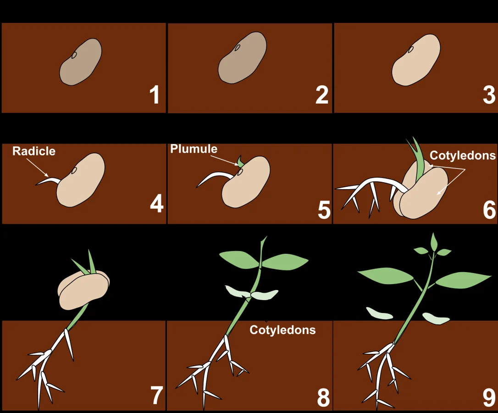

<PhilosophyTopic topic-id="sau-cap-pham-tru">

<template #notes>

## Phạm trù là công cụ phân tích những quan hệ cơ bản

Khi gặp một hiện tượng, ta thường cần phân biệt cái quan sát được với cái chi phối bên trong, điều đã xảy ra với điều mới có thể xảy ra. **Phạm trù triết học** là những khái niệm khái quát các mặt, thuộc tính và mối liên hệ phổ biến của hiện thực. Chúng giúp tổ chức việc suy xét, nhưng không thay thế tài liệu cụ thể về đối tượng.

Sáu cặp phạm trù dưới đây không phải sáu danh sách từ đồng nghĩa và trái nghĩa. Mỗi cặp làm rõ một kiểu quan hệ. Cần nhận diện đối tượng đang xét, định nghĩa từng mặt và chỉ ra chúng chuyển hóa hoặc quy định nhau trong điều kiện nào.

## Cái riêng và cái chung

**Cái riêng** là một sự vật, hiện tượng hoặc quá trình xác định. **Cái chung** là những mặt, thuộc tính hoặc quan hệ lặp lại ở nhiều cái riêng. **Cái đơn nhất** là những đặc điểm chỉ có ở một cái riêng trong phạm vi so sánh đang xét.

Một trường đại học cụ thể là cái riêng. Những đặc trưng chung về đào tạo và nghiên cứu của các trường đại học là cái chung. Lịch sử thành lập cùng những dấu ấn riêng của trường thể hiện cái đơn nhất. Vì vậy, “cái riêng” không đồng nghĩa với “đặc điểm riêng”. Một bên là đối tượng toàn bộ, bên kia chỉ là một mặt của đối tượng.

Cái chung không tồn tại lơ lửng bên ngoài mọi cái riêng. Nó biểu hiện thông qua các sự vật cụ thể. Ngược lại, mỗi cái riêng đều có quan hệ với những cái riêng khác và chứa những mặt chung nhất định. Cái riêng phong phú hơn vì còn có các đặc điểm đơn nhất. Cái chung có thể phản ánh những quan hệ sâu sắc, ổn định giúp ta hiểu một nhóm đối tượng.

Trong những điều kiện xác định, cái đơn nhất và cái chung có thể chuyển hóa. Một phương thức tổ chức lúc đầu chỉ xuất hiện ở một nơi có thể được tiếp nhận rộng rãi và trở thành cách làm chung. Một cách làm từng phổ biến cũng có thể dần chỉ còn ở ít nơi khi điều kiện thay đổi.

Ý nghĩa phương pháp luận là đi từ các trường hợp cụ thể để nhận ra cái chung, rồi vận dụng cái chung có điều chỉnh vào từng trường hợp. Chỉ sao chép hình thức của một kinh nghiệm sẽ bỏ qua điều kiện khiến kinh nghiệm ấy có hiệu quả. Ngược lại, tuyệt đối hóa sự khác biệt sẽ khiến ta không nhận ra quy luật hoặc kinh nghiệm có thể vận dụng.

## Chiếc cốc giống nhau và chiếc cốc không thể thay thế

Hai chiếc cốc cùng kiểu có thể thay cho nhau khi ta cần đựng nước. Nhưng một chiếc được người thân tặng lại có ý nghĩa riêng đối với người giữ nó. Trong quan hệ sử dụng, những thuộc tính chung như cấu tạo và công dụng được đặt lên trước. Trong quan hệ tình cảm, lịch sử của chiếc cốc này trở thành yếu tố không thể thay nguyên bằng chiếc cùng mẫu.

Điều ấy không làm cái chung biến mất hoặc khiến chiếc cốc tồn tại ngoài những quan hệ khách quan. Nó cho thấy một cái riêng luôn phong phú hơn một đặc điểm được trừu tượng hóa. Nói các cốc cùng loại có công dụng chung không đồng nghĩa chúng đồng nhất ở mọi phương diện.

Nếu một chiếc cốc được làm đẹp hơn nhưng cầm khó hơn và dễ đổ hơn thì nên đánh giá ra sao? Không thể chỉ tách phần trang trí rồi gọi toàn bộ hình thức là tốt. Hình thức còn là cấu trúc và cách tổ chức giúp nội dung thực hiện chức năng. Cũng cần nói rõ đang xét đồ dùng hay vật trưng bày, bởi cùng một đặc điểm có thể phù hợp mục đích này mà chưa phù hợp mục đích khác.

## Nguyên nhân và kết quả

**Nguyên nhân** là sự tác động lẫn nhau giữa các mặt trong một sự vật hoặc giữa các sự vật, làm nảy sinh biến đổi nhất định. **Kết quả** là biến đổi xuất hiện do sự tác động ấy. Nguyên nhân vì vậy cần được hiểu như một quá trình tác động, không chỉ như tên một đồ vật đứng trước đồ vật khác.

Quan hệ nhân quả có tính khách quan và diễn ra trong những điều kiện xác định. Nguyên nhân có trước kết quả do nó sinh ra, nhưng không phải cái gì xảy ra trước cũng là nguyên nhân. Tiếng chuông báo vào học có trước giờ học không chứng tỏ chính âm thanh đã tạo ra toàn bộ hoạt động dạy và học.

Cần phân biệt nguyên nhân với điều kiện và nguyên cớ. Điều kiện giúp một tác động sinh ra kết quả nhưng không nhất thiết giữ cùng vai trò với nguyên nhân đang xét. Nguyên cớ là sự kiện có thể làm quá trình bộc lộ hoặc được dùng làm lý do trực tiếp. Muốn giải thích sâu phải tìm quá trình tác động thực, thay vì dừng ở sự kiện dễ nhìn thấy nhất.

Một kết quả có thể do nhiều nguyên nhân kết hợp. Cây héo có thể liên quan chế độ nước, tổn thương rễ hoặc điều kiện môi trường. Ngược lại, cùng một tác động có thể dẫn đến những kết quả khác nhau khi điều kiện khác nhau. Bởi vậy, việc tìm nguyên nhân đòi hỏi so sánh, kiểm tra và phân biệt vai trò chủ yếu, thứ yếu.

Trong chuỗi tác động, kết quả có thể trở thành nguyên nhân của biến đổi tiếp theo và tác động trở lại quá trình đã sinh ra nó. Kỹ năng lao động tốt hơn có thể nâng hiệu quả sản xuất. Kết quả ấy lại tạo điều kiện để đầu tư công cụ và học tập thêm. Sự đổi vai không xóa bỏ chiều sinh thành trong từng quan hệ cụ thể.

Muốn xử lý một hiện tượng bất lợi phải tác động vào nguyên nhân và điều kiện duy trì nó. Chỉ sửa biểu hiện trước mắt có thể cần thiết, nhưng chưa bảo đảm loại bỏ quá trình làm nó tái diễn.

## Tất nhiên và ngẫu nhiên

**Tất nhiên** là mối liên hệ do những nguyên nhân cơ bản, bên trong quy định và phải xảy ra khi có các điều kiện xác định. **Ngẫu nhiên** là những mối liên hệ có thể xảy ra hoặc không, có thể xảy ra theo cách này hoặc cách khác do sự gặp gỡ của các điều kiện, hoàn cảnh nhất định.

Ngẫu nhiên không đồng nghĩa với không có nguyên nhân. Một cuộc gặp tình cờ vẫn có những nguyên nhân khiến mỗi người đến địa điểm ấy. Nó ngẫu nhiên đối với một quá trình đang xét vì không phải kết quả bắt buộc từ bản chất của quá trình đó. Cũng không thể lấy việc chưa biết nguyên nhân làm tiêu chuẩn duy nhất để gọi một sự kiện là ngẫu nhiên.

Tất nhiên và ngẫu nhiên tồn tại trong quan hệ thống nhất. Cái tất nhiên không xuất hiện như một lực lượng thuần túy tách khỏi các sự kiện cụ thể, mà bộc lộ qua nhiều biểu hiện có yếu tố ngẫu nhiên. Những yếu tố ngẫu nhiên có thể làm thay đổi thời điểm, hình thức và mức độ của một quá trình.

Sự suy giảm chất lượng vật liệu do hao mòn trong điều kiện sử dụng là một xu hướng có tính quy luật. Thời điểm một chi tiết cụ thể hỏng còn phụ thuộc tải trọng bất thường, sai khác vật liệu và hoàn cảnh sử dụng. Phân tích xu hướng chung và phân tích sự cố cụ thể vì thế liên quan nhau nhưng không đồng nhất.

Ý nghĩa phương pháp luận là dựa vào quan hệ tất nhiên để nhận ra xu hướng và xây dựng kế hoạch, đồng thời tính đến các biến cố ngẫu nhiên để chuẩn bị phương án ứng phó. Không nên phó mặc kết quả cho may rủi. Cũng không nên tin rằng đã biết xu hướng chung thì có thể bỏ qua mọi hoàn cảnh cụ thể.

## Nội dung và hình thức

**Nội dung** là tổng thể các mặt, yếu tố và quá trình tạo nên sự vật. **Hình thức** là phương thức tồn tại và tổ chức của nội dung, tức hệ thống những mối liên hệ tương đối bền vững giữa các yếu tố ấy. Hình thức vì vậy không chỉ là vẻ trang trí bên ngoài.

Trong một buổi học, tri thức, hoạt động của người dạy và người học cùng các nhiệm vụ học tập góp phần tạo nên nội dung. Cách sắp xếp trình tự, phân công và tương tác là phương thức tổ chức nội dung ấy. Nếu chỉ đổi màu trình chiếu mà không đổi quan hệ tổ chức, ta mới chạm một biểu hiện bề ngoài của hình thức.

Nội dung giữ vai trò quyết định đối với hình thức. Khi nội dung phát triển, hình thức cần được điều chỉnh cho phù hợp. Tuy vậy, hình thức có tính độc lập tương đối và tác động trở lại. Một cách tổ chức thích hợp có thể làm các yếu tố phối hợp hiệu quả. Cách tổ chức cứng nhắc có thể kìm hãm nội dung đã đổi mới.

Quan hệ này không phải sự tương ứng đơn giản giữa một nội dung và một hình thức duy nhất. Một nội dung có thể được thể hiện bằng nhiều hình thức, còn cùng một hình thức có thể phục vụ những nội dung khác nhau. Vì thế, đánh giá phải xem chúng phù hợp với nhau đến đâu trong trường hợp cụ thể.

Ý nghĩa phương pháp luận là chú trọng chất lượng nội dung, đồng thời lựa chọn và đổi mới hình thức tổ chức. Chỉ chạy theo biểu hiện đẹp mắt dễ dẫn tới hình thức chủ nghĩa. Chỉ coi trọng nội dung mà bỏ qua cách tổ chức lại có thể làm nội dung không được thực hiện hiệu quả.

## Bản chất và hiện tượng

**Bản chất** là tổng thể những mối liên hệ khách quan, tất nhiên, tương đối ổn định bên trong, quy định sự vận động và phát triển của đối tượng. **Hiện tượng** là sự biểu hiện ra bên ngoài của những mặt và mối liên hệ ấy trong những điều kiện xác định.

Bản chất không tồn tại ngoài hiện tượng. Muốn biết bản chất phải xuất phát từ những biểu hiện có thể khảo sát. Nhưng hiện tượng không trình bày bản chất một cách đầy đủ, trực tiếp và thuần túy. Nó còn chịu ảnh hưởng của những điều kiện và quan hệ khác.

Kết quả một lần kiểm tra biểu hiện một mặt năng lực học tập, đồng thời chịu tác động của dạng đề, sức khỏe và hoàn cảnh làm bài. Muốn nhận xét năng lực ổn định hơn phải đối chiếu nhiều biểu hiện và xem cách người học xử lý những nhiệm vụ khác nhau. Một kết quả đơn lẻ có ý nghĩa, nhưng chưa đại diện đầy đủ cho bản chất đang tìm hiểu.

Hiện tượng có thể biểu hiện bản chất dưới hình thức dễ gây nhầm lẫn. Bởi vậy, đi sâu vào bản chất không có nghĩa phủ nhận dữ kiện không thuận với kết luận của mình. Cần giải thích được vì sao các biểu hiện khác nhau cùng xuất hiện và chúng liên hệ với cơ chế bên trong ra sao.

Về phương pháp, phải thu thập và phân tích hiện tượng, phân biệt biểu hiện chủ yếu với thứ yếu, rồi tìm những quan hệ tương đối ổn định. Kết luận về bản chất phải tiếp tục được kiểm tra qua các biểu hiện và điều kiện mới. Không thể dùng một lời khẳng định trừu tượng để thay thế việc giải thích dữ kiện.

## Cửa hàng vắng khách sau khi thay bảng hiệu

Giả sử một cửa hàng thay bảng hiệu rồi lượng khách giảm. Hai sự kiện nối tiếp nhau khiến chủ cửa hàng nghĩ ngay bảng hiệu là nguyên nhân. Nhưng còn cần xem giá bán, giờ mở cửa, chất lượng phục vụ và những thay đổi xung quanh. Cái xảy ra trước là nơi nên khảo sát, chưa tự trở thành nguyên nhân đã được chứng minh.

Một buổi vắng khách là hiện tượng có thật. Nó có thể biểu hiện một vấn đề bền vững của cửa hàng, nhưng cũng có thể chịu ảnh hưởng của một tình huống nhất thời. Muốn tìm bản chất phải xem nhiều biểu hiện và cơ chế liên hệ giữa chúng. Việc chỉ chọn những ngày thuận với lời giải thích ban đầu sẽ làm dữ kiện bị đặt dưới mong muốn.

Trong quá trình khảo sát, những nguyên nhân và điều kiện không giữ vai trò giống nhau. Một đợt mưa có thể ảnh hưởng thời điểm khách đến, trong khi sự phục vụ thiếu ổn định có thể tiếp tục tác động khi thời tiết đã đổi. Không vì cần tìm yếu tố chủ yếu mà được phép bỏ qua điều kiện ngẫu nhiên, bởi nó vẫn có thể làm thay đổi kết quả của một giai đoạn.

Nếu cửa hàng có đội ngũ biết nghề nhưng cách phối hợp còn kém, cải thiện phục vụ là một khả năng có căn cứ. Tuy nhiên, khả năng không đồng nghĩa kết quả đã hiện diện. Còn phải đổi cách phân công, thực hiện và theo dõi phản hồi. Nhìn rõ triển vọng mà không nhận ra những điều kiện cần tạo thêm dễ khiến chủ cửa hàng nhầm hy vọng với một kết quả đã được bảo đảm.

## Khả năng và hiện thực

**Khả năng** là những tiền đề và xu hướng làm cho sự vật có thể hình thành khi có các điều kiện thích hợp. **Hiện thực** là những gì đang tồn tại, trong đó có kết quả của khả năng đã được thực hiện. Khả năng khách quan khác với bất cứ điều gì con người có thể tưởng tượng.

Một hạt giống có khả năng phát triển thành cây vì cấu tạo và các quá trình sống của nó. Khả năng ấy cần những điều kiện thích hợp để thành hiện thực. Việc đã có khả năng không có nghĩa kết quả chắc chắn xuất hiện bất chấp môi trường. Khi cây hình thành, hiện thực mới lại mở ra các khả năng tiếp theo.

Trong cùng một hiện thực có thể tồn tại nhiều khả năng. Một tổ chức có thể phát triển hoặc suy giảm tùy điều kiện và cách giải quyết các vấn đề. Các khả năng không có căn cứ, mức độ chín muồi và triển vọng thực hiện ngang nhau.

Có thể phân biệt khả năng thực gắn với những quan hệ tất nhiên và khả năng hình thức gắn với những quan hệ ngẫu nhiên. Cũng cần phân biệt khả năng cụ thể, đã có điều kiện thực hiện, với khả năng trừu tượng, còn phải chờ những điều kiện chưa hình thành. Các cách phân biệt giúp đánh giá cơ sở của dự báo, thay vì đánh đồng mong muốn với triển vọng khách quan.

Trong hoạt động xã hội, con người có thể chủ động tạo điều kiện để một khả năng thuận lợi thành hiện thực. Điều đó đòi hỏi xuất phát từ hiện thực đang có, lựa chọn khả năng có căn cứ và dự kiến cả những hướng biến đổi bất lợi. Nhận thức khả năng nhằm tổ chức hành động, chứ không chỉ liệt kê tương lai có thể tưởng tượng.

Các cặp phạm trù giúp phân biệt những mặt của đối tượng và quan hệ giữa chúng. Ba quy luật cơ bản sẽ tiếp tục làm rõ những quan hệ ấy khi xem xét động lực, cách thức và khuynh hướng của sự phát triển.

<!-- philosophy-figure -->
<figure class="philosophy-figure">
  
  <figcaption>Hình 2.5: Các giai đoạn từ hạt đậu đến cây con.</figcaption>
</figure>

Hạt có khả năng nảy mầm nhưng không phải hạt nào cũng thực sự trở thành cây. Độ ẩm, nhiệt độ và tình trạng của phôi tham gia vào quá trình hiện thực hóa khả năng ấy. Khi phân tích một kết quả, cần tìm cả điều kiện bên trong lẫn bên ngoài. Chỉ nhìn vào hình cuối cùng sẽ che khuất những điều kiện đã giúp nó hình thành.
</template>

<template #exercises>

<!-- workbook: WB2-MC32; PDF 48 -->

::: exercise Bài 1

Giả sử Hà Nội là một cái riêng thì yếu tố nào sau đây là cái đơn nhất của nó?

- A. Thủ đô nước CHXHCN Việt Nam.
- B. Mật độ dân số cao.
- C. Ô nhiễm không khí nghiêm trọng.
- D. Lối sống đô thị.

:::

::: solution Giải thích

Đáp án: A.

Trong phạm vi so sánh các đô thị Việt Nam của đề bài, tư cách thủ đô phân biệt Hà Nội với các đô thị khác. Các đặc điểm B, C và D có thể lặp lại ở nhiều đô thị nên không phải cái đơn nhất. Cái đơn nhất phải được xác định trong một phạm vi so sánh, không phải mọi thuộc tính của một đối tượng riêng đều là đơn nhất.

:::

<!-- workbook: WB2-MC33; PDF 48–49 -->

::: exercise Bài 2

Phát biểu nào sau đây là đúng với quan niệm của triết học Mác - Lênin?

- A. Cái chung là cái bao trùm toàn bộ cái riêng.
- B. Chỉ có cái chung tồn tại thực còn cái riêng không tồn tại.
- C. Chỉ có cái riêng tồn tại thực còn cái chung chỉ là tên gọi trống rỗng.
- D. Cái chung, cái riêng cùng tồn tại khách quan, giữa chúng có mối quan hệ hữu cơ.

:::

::: solution Giải thích

Đáp án: D.

Cái chung tồn tại trong cái riêng, thông qua cái riêng. Mỗi cái riêng còn có những đặc điểm đơn nhất nên không bị cái chung bao trùm hết như A. B và C tuyệt đối hóa một mặt rồi phủ nhận mặt còn lại.

:::

<!-- workbook: WB2-MC34; PDF 49 -->

::: exercise Bài 3

Vì sao trong nhận thức và hoạt động thực tiễn chúng ta phải phân tích, xem xét kỹ các nguyên nhân gây ra một kết quả nào đó?

- A. Vì một kết quả do nhiều nguyên nhân sinh ra và các nguyên nhân ấy có vị trí, vai trò như nhau.
- B. Vì mọi kết quả đều có một nguyên nhân nào đó sinh ra.
- C. Vì một kết quả do nhiều nguyên nhân sinh ra và các nguyên nhân ấy có vị trí, vai trò khác nhau.
- D. Vì một nguyên nhân sinh ra nhiều kết quả và các kết quả có vị trí, vai trò khác nhau.

:::

::: solution Giải thích

Đáp án: C.

Việc xác định nguyên nhân chủ yếu, thứ yếu, bên trong và bên ngoài giúp chọn đúng khâu tác động. A san bằng vai trò các nguyên nhân. B mới nêu nguyên tắc nhân quả chung, còn D chuyển sang nhiều kết quả của một nguyên nhân, chưa trả lời trực tiếp việc phân tích các nguyên nhân của kết quả đang xét.

:::

<!-- workbook: WB2-MC35; PDF 49 -->

::: exercise Bài 4

Vì sao trong nhận thức và hoạt động thực tiễn chúng ta không được phủ nhận mối quan hệ nhân - quả?

- A. Vì mối liên hệ nhân - quả biểu hiện rất phức tạp.
- B. Vì nguyên nhân và kết quả có sự chuyển hóa lẫn nhau.
- C. Vì nguyên nhân là cái có trước, kết quả là cái có sau.
- D. Vì mối liên hệ nhân - quả tồn tại khách quan.

:::

::: solution Giải thích

Đáp án: D.

Không thể dùng ý muốn để xóa bỏ một quan hệ tồn tại khách quan. Nhận thức và hành động phải tìm đúng cơ chế sinh ra kết quả. A, B và C mô tả những phương diện của quan hệ nhân quả, nhưng tính khách quan mới là căn cứ trực tiếp cho yêu cầu không phủ nhận nó. Riêng C không cho phép suy rằng mọi sự kiện xảy ra trước đều là nguyên nhân.

:::

<!-- workbook: WB2-MC36; PDF 49 -->

::: exercise Bài 5

Điền từ thích hợp vào chỗ trống (...) để có được một định nghĩa đúng: “Phạm trù tất nhiên dùng để chỉ cái do ... của kết cấu vật chất quyết định và trong những điều kiện nhất định, nó phải xảy ra như thế, không thể khác”.

- A. Những nguyên nhân cơ bản, bên trong.
- B. Những nguyên nhân bên ngoài.
- C. Những nguyên nhân không cơ bản.
- D. Những nguyên nhân thứ yếu.

:::

::: solution Giải thích

Đáp án: A.

Tất nhiên gắn với những nguyên nhân cơ bản bên trong của đối tượng, xét trong các điều kiện xác định. Những điều kiện ấy không được lược bỏ khi vận dụng. B, C và D không diễn đạt căn cứ làm cho một quá trình nhất thiết xảy ra theo cách đang xét.

:::

<!-- workbook: WB2-MC37; PDF 49 -->

::: exercise Bài 6

Triết học Mác - Lênin cho rằng:

- A. Cả tất nhiên và ngẫu nhiên đều có tính quy luật.
- B. Ngẫu nhiên mang tính xác suất, chỉ có tất nhiên có tính quy luật.
- C. Mọi thứ đều là tất nhiên, ngẫu nhiên là cái tất nhiên không có quy luật.
- D. Tất nhiên và ngẫu nhiên đều không có tính quy luật.

:::

::: solution Giải thích

Đáp án: A.

Ngẫu nhiên có nguyên nhân và tồn tại khách quan, không phải cái tùy tiện đứng ngoài mọi quan hệ. Tính quy luật ở đây phải hiểu theo nghĩa có thể khảo sát những quan hệ khách quan, trong đó có quy luật thống kê. Nó không biến từng sự kiện ngẫu nhiên thành điều bắt buộc phải xảy ra. B đối lập xác suất với quy luật như thể quy luật thống kê không tồn tại. C phủ nhận ngẫu nhiên, còn D phủ nhận tính quy luật của cả hai.

:::

<!-- workbook: WB2-MC38; PDF 50 -->

::: exercise Bài 7

Điền từ thích hợp vào chỗ trống (...) để có được một định nghĩa đúng: “Triết học Mác - Lênin dùng phạm trù ... để chỉ cách thức liên hệ, tổ chức, sắp xếp các phần tử, yếu tố, bộ phận cấu thành một đối tượng nhất định”.

- A. Bản chất.
- B. Hiện tượng.
- C. Nội dung.
- D. Hình thức.

:::

::: solution Giải thích

Đáp án: D.

Hình thức là phương thức tổ chức và hệ thống liên hệ tương đối bền vững giữa các yếu tố của nội dung. Nội dung chỉ tổng thể những mặt, yếu tố cấu thành. Bản chất chỉ những quan hệ tất nhiên tương đối ổn định bên trong, còn hiện tượng là sự biểu hiện của chúng. Hình thức không chỉ là vẻ trang trí bên ngoài.

:::

<!-- workbook: WB2-MC39; PDF 50 -->

::: exercise Bài 8

Vì sao trong nhận thức và hoạt động thực tiễn ta không được xem nhẹ hình thức?

- A. Vì hình thức là yếu tố thường xuyên biến đổi.
- B. Vì hình thức là yếu tố ổn định hơn nội dung.
- C. Vì hình thức có tính độc lập tương đối đối với nội dung.
- D. Vì hình thức quyết định nội dung.

:::

::: solution Giải thích

Đáp án: C.

Tính độc lập tương đối khiến hình thức có thể tác động trở lại, thúc đẩy hoặc cản trở nội dung tùy mức độ phù hợp. B mới nói một phương diện về độ ổn định, chưa chỉ rõ căn cứ của vai trò tác động. D đảo vai trò quyết định giữa nội dung với hình thức.

:::

<!-- workbook: WB2-MC40; PDF 50 -->

::: exercise Bài 9

Phạm trù nào được dùng để chỉ tổng thể các mối liên hệ khách quan, tất nhiên, tương đối ổn định bên trong, quy định sự vận động, phát triển của đối tượng và thể hiện mình qua các hiện tượng tương ứng của đối tượng?

- A. Nội dung.
- B. Hình thức.
- C. Bản chất.
- D. Hiện tượng.

:::

::: solution Giải thích

Đáp án: C.

Các dấu hiệu tất nhiên, tương đối ổn định bên trong và quy định vận động là nội dung của phạm trù bản chất. Hiện tượng là biểu hiện của bản chất trong điều kiện cụ thể. Nội dung và hình thức trả lời những câu hỏi khác về các yếu tố cấu thành và cách tổ chức chúng.

:::

<!-- workbook: WB2-MC41; PDF 50 -->

::: exercise Bài 10

Trong các hiện tượng sau đây, hiện tượng nào vi phạm nguyên tắc phương pháp luận được rút ra từ nội dung lý luận của mối quan hệ giữa hiện tượng và bản chất?

- A. Không ngừng thu thập và tổng kết các hiện tượng.
- B. Đề cao kinh nghiệm, tuyệt đối hóa vai trò của kinh nghiệm.
- C. Phát triển khoa học để tìm ra bản chất của sự vật, hiện tượng.
- D. Căn cứ vào cái bản chất để cải tạo hiện thực.

:::

::: solution Giải thích

Đáp án: B.

Kinh nghiệm là điểm xuất phát cần thiết nhưng tuyệt đối hóa nó sẽ dừng ở những biểu hiện đã gặp, không đi sâu tìm cơ chế và quan hệ bản chất. A và C góp phần thực hiện quá trình ấy. D đúng khi bản chất đã được nhận thức có căn cứ và được vận dụng trong điều kiện phù hợp.

:::

<!-- workbook: WB2-MC42; PDF 50 -->

::: exercise Bài 11

Nhận định nào dưới đây là đúng?

- A. Trong hoạt động thực tiễn chỉ cần dựa vào khả năng để xác định chủ trương, phương hướng, mục đích hành động của mình.
- B. Trong hoạt động thực tiễn chỉ cần dựa vào hiện thực, không cần tính đến khả năng để xác định chủ trương, phương hướng, mục đích hành động của mình.
- C. Trong hoạt động thực tiễn cần dựa vào hiện thực và cũng phải tính đến các khả năng để xác định chủ trương, phương hướng, mục đích hành động của mình.
- D. Trong hoạt động thực tiễn không cần dựa vào hiện thực, mà chỉ cần dựa theo suy nghĩ chủ quan của bản thân để xác định chủ trương, phương hướng, mục đích hành động.

:::

::: solution Giải thích

Đáp án: C.

Hiện thực cung cấp những điều kiện và giới hạn đang có. Những khả năng có căn cứ cho biết các hướng biến đổi và điều kiện cần tạo thêm. A tách khả năng khỏi nền tảng hiện thực, B bỏ qua triển vọng phát triển, còn D thay khảo sát khách quan bằng mong muốn chủ quan.

:::

<!-- workbook: WB2-MC43; PDF 50–51 -->

::: exercise Bài 12

Việc áp dụng một cách dập khuôn cách học của người này cho người khác là vi phạm nguyên tắc phương pháp luận của cặp phạm trù nào sau đây?

- A. Nguyên nhân và kết quả.
- B. Bản chất và hiện tượng.
- C. Cái chung và cái riêng.
- D. Khả năng và hiện thực.

:::

::: solution Giải thích

Đáp án: C.

Kinh nghiệm có thể chứa yếu tố chung đáng học, nhưng mỗi người có nền tảng, mục tiêu và điều kiện riêng. Vận dụng cái chung phải cụ thể hóa theo cái riêng, thay vì sao chép toàn bộ hình thức. Điều ấy cũng không có nghĩa mọi kinh nghiệm đều không thể chia sẻ.

:::

<!-- workbook: WB2-TF08; PDF 60 -->

::: exercise Bài 13

Xác định đúng hoặc sai và giải thích: Cái chung và cái đơn nhất có thể chuyển hóa cho nhau.

:::

::: solution Giải thích

Đáp án: Đúng.

Trong những điều kiện xác định, một đặc điểm ban đầu chỉ có ở một trường hợp có thể được tiếp nhận và trở nên phổ biến. Một đặc điểm từng phổ biến cũng có thể thu hẹp, chỉ còn ở một trường hợp trước khi mất đi. Sự chuyển hóa liên quan các đặc điểm trong những cái riêng, không phải cái chung tồn tại như một vật thể riêng rồi tự biến hình.

:::

<!-- workbook: WB2-TF09; PDF 60 -->

::: exercise Bài 14

Xác định đúng hoặc sai và giải thích: Thế giới này được tạo thành bởi một chuỗi các quan hệ nhân quả.

:::

::: solution Giải thích

Đáp án: Đúng.

Có thể chấp nhận nếu “chuỗi” được hiểu là những quan hệ nhân quả liên hệ và chuyển hóa không ngừng, không phải thế giới chỉ là một hàng đơn tuyến. Một kết quả có thể do nhiều nguyên nhân, đồng thời trở thành nguyên nhân trong quan hệ tiếp theo. Không được suy rằng mỗi hiện tượng chỉ có một nguyên nhân duy nhất hoặc rằng mọi sự kiện nối tiếp nhau đều có quan hệ nhân quả trực tiếp.

:::

<!-- workbook: WB2-TF10; PDF 60 -->

::: exercise Bài 15

Xác định đúng hoặc sai và giải thích: Hiện tượng nào, bản chất ấy.

:::

::: solution Giải thích

Câu quá ngắn nên có hai cách hiểu cần phân biệt. Nếu nói hiện tượng là biểu hiện của một bản chất xác định thì có cơ sở. Nếu suy mỗi biểu hiện đơn lẻ bộc lộ trực tiếp, đầy đủ và duy nhất bản chất thì sai. Một bản chất có thể biểu hiện qua nhiều hiện tượng, còn hiện tượng chịu tác động của điều kiện và có thể làm ta hiểu sai. Phát biểu chặt hơn là: Bản chất biểu hiện qua hiện tượng, nhưng phải khảo sát nhiều biểu hiện trong quan hệ cụ thể mới nhận thức được bản chất.

:::

<!-- workbook: WB2-TF11; PDF 60 -->

::: exercise Bài 16

Xác định đúng hoặc sai và giải thích: Trong nhận thức và hoạt động thực tiễn, chúng ta phải dựa vào cái tất nhiên chứ không dựa vào cái ngẫu nhiên để cải tạo sự vật.

:::

::: solution Giải thích

Đáp án: Đúng.

Đúng khi nói về cơ sở chủ yếu để xác định phương hướng hành động: Cần tìm những quan hệ tất nhiên thay vì trông chờ may rủi. Không được hiểu câu này là bỏ qua mọi ngẫu nhiên. Tất nhiên biểu hiện thông qua ngẫu nhiên, còn sự cố ngẫu nhiên có thể làm đổi nhịp độ hoặc tiến trình. Vì vậy vẫn phải dự phòng và theo dõi những điều kiện cụ thể.

:::

</template>

</PhilosophyTopic>

## Tài liệu tham khảo

1. Hội đồng biên soạn, Phạm Văn Đức (chủ biên, 2019). *Giáo trình Triết học Mác – Lênin*. Dành cho bậc đại học, khối các ngành ngoài lý luận chính trị. Hà Nội. Chương 2, tr. 61–143.
2. Khoa Triết học, Trường Đại học Khoa học Xã hội và Nhân văn (2024). *Bài tập Triết học Mác - Lênin*. Hà Nội. Chương 2, phần Bài tập.
3. HudsonFlagg. [Các giai đoạn từ hạt đậu đến cây con.](https://commons.wikimedia.org/wiki/File:Sequential_Steps_of_Bean_Seedling_Germination.svg). [CC0](http://creativecommons.org/publicdomain/zero/1.0/deed.en). Bản thu nhỏ.
