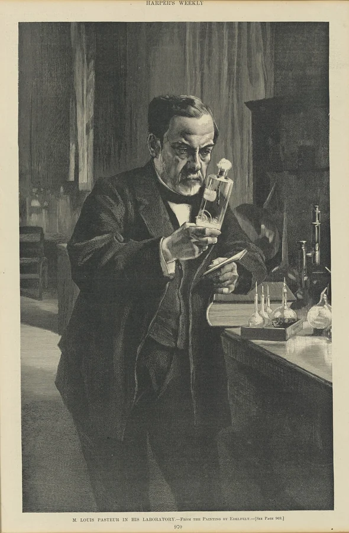

<PhilosophyTopic topic-id="thuc-tien-va-nhan-thuc">

<template #notes>

## Nhận thức không chỉ là đứng ngoài quan sát

Người thợ hiểu vật liệu qua quá trình chế tác, còn nhà nghiên cứu phát hiện thuộc tính khi thiết kế và thực hiện thí nghiệm. Trong những trường hợp ấy, con người tìm hiểu thế giới bằng cách tham gia tác động vào nó. Đưa thực tiễn vào lý luận nhận thức là một bước phát triển quan trọng của triết học Mác.

Trong lịch sử triết học, chủ nghĩa duy tâm tìm cơ sở nhận thức ở tinh thần hoặc hoạt động của ý thức. Chủ nghĩa hoài nghi đặt vấn đề về khả năng đạt tri thức chắc chắn. Thuyết bất khả tri phủ nhận hoặc hạn chế khả năng nhận thức bản chất của thế giới. Chủ nghĩa duy vật trước Mác thừa nhận thế giới khách quan nhưng thường chưa làm rõ đầy đủ vai trò tích cực của chủ thể và thực tiễn xã hội.

Lý luận nhận thức duy vật biện chứng kế thừa lập trường thế giới tồn tại khách quan và có thể được nhận thức. Đồng thời, nó xem nhận thức là quá trình phản ánh tích cực, sáng tạo, vận động từ chưa biết đến biết và từ biết chưa đầy đủ đến biết đầy đủ hơn.

## Chủ thể, khách thể và tính xã hội của nhận thức

**Chủ thể nhận thức** là con người thực hiện hoạt động nhận thức trong những điều kiện lịch sử, xã hội xác định. **Khách thể nhận thức** là bộ phận hiện thực được chủ thể hướng tới tìm hiểu. Khách thể không phải toàn bộ thế giới cùng lúc, mà là đối tượng đã đi vào phạm vi hoạt động nhận thức nhất định.

Chủ thể có nhu cầu, tri thức, công cụ và phương pháp. Những điều kiện ấy ảnh hưởng việc chọn vấn đề và cách tiếp cận đối tượng. Tuy nhiên, chủ thể không được tùy ý quyết định đối tượng có thuộc tính gì. Nhận thức đúng đòi hỏi hoạt động chủ quan phản ánh được những đặc điểm khách quan.

Nhận thức còn mang tính xã hội và lịch sử. Một người tiếp nhận ngôn ngữ, kiến thức và công cụ đã được các thế hệ trước tạo ra. Khả năng tìm hiểu đối tượng thay đổi theo sự phát triển của sản xuất, khoa học và các phương tiện khảo sát. Vì vậy, giới hạn hiểu biết của một thời đại không đồng nghĩa với giới hạn bất biến của khả năng nhận thức loài người.

Các nguyên tắc cơ bản của cách tiếp cận này là thừa nhận hiện thực khách quan, thừa nhận khả năng nhận thức, xem nhận thức như quá trình biện chứng và coi thực tiễn là cơ sở trực tiếp của nhận thức. Những nguyên tắc ấy phải được hiểu cùng nhau. Chỉ thừa nhận có thế giới bên ngoài chưa đủ giải thích con người hiểu và kiểm tra tri thức về thế giới bằng cách nào.

## Thực tiễn là hoạt động gì

**Thực tiễn** là toàn bộ hoạt động vật chất có mục đích, mang tính lịch sử, xã hội của con người nhằm cải biến tự nhiên và xã hội. Hoạt động ấy có chủ thể, đối tượng, phương tiện và kết quả thực, chứ không chỉ diễn ra trong suy nghĩ.

Suy xét một kế hoạch là hoạt động tinh thần. Thực hiện kế hoạch bằng lao động, phương tiện và tổ chức cụ thể là hoạt động thực tiễn. Hai hoạt động liên hệ chặt chẽ nhưng không đồng nhất. Nhờ phân biệt chúng, ta hiểu vì sao một ý tưởng hợp lý vẫn phải được kiểm tra trong những điều kiện thực hiện.

Ba hình thức cơ bản của thực tiễn là sản xuất vật chất, hoạt động chính trị, xã hội và thực nghiệm khoa học. Sản xuất vật chất tạo ra những điều kiện sinh hoạt cần thiết, đồng thời hình thành nhu cầu và phương tiện nhận thức. Hoạt động chính trị, xã hội tác động vào các quan hệ và cách tổ chức đời sống chung. Thực nghiệm khoa học chủ động tạo hoặc điều chỉnh điều kiện để khảo sát thuộc tính, quan hệ của đối tượng.

Ba hình thức liên hệ với nhau. Nhu cầu sản xuất có thể đặt ra vấn đề khoa học. Kết quả thực nghiệm có thể đổi mới công cụ sản xuất. Những biến đổi trong tổ chức xã hội lại có thể mở rộng hoặc hạn chế điều kiện nghiên cứu và ứng dụng.

Trong quan hệ ấy, sản xuất vật chất giữ vai trò cơ bản vì tạo điều kiện tồn tại cho xã hội và những hoạt động khác. Điều đó không làm giảm tác động trở lại của tổ chức xã hội và thực nghiệm khoa học đối với sản xuất. Nền tảng vật chất và sự phát triển của các hình thức thực tiễn cần được xem trong quan hệ hai chiều.

## Thực tiễn, thực tế và hoạt động nhận thức

Thực tế có phạm vi rộng, chỉ những gì đang tồn tại hoặc diễn ra trong hiện thực. Một cơn mưa, tình trạng của một con đường và hoạt động sửa đường đều có thể thuộc thực tế đang xét. Nhưng không phải mọi hiện tượng thực tế đều là thực tiễn theo nghĩa triết học.

Thực tiễn là hoạt động vật chất có mục đích của con người nhằm cải biến tự nhiên và xã hội. Cơn mưa tự xảy ra không phải hoạt động thực tiễn. Việc con người tổ chức thoát nước và sửa đường là hoạt động thực tiễn vì có chủ thể, phương tiện, sự tác động và kết quả vật chất.

Hoạt động tinh thần giữ vai trò quan trọng nhưng cần được phân biệt với hoạt động ấy. Suy luận về nguyên nhân đường hỏng, đọc tài liệu hoặc xây dựng phương án thuộc nhận thức và chuẩn bị tinh thần. Khi phương án được thực hiện bằng con người, vật liệu và tổ chức cụ thể, nó đi vào thực tiễn.

Trong nghiên cứu khoa học, sự phân biệt càng cần rõ. Xây dựng mô hình và phân tích khái niệm là hoạt động lý luận. Tổ chức thực nghiệm để tác động vào đối tượng trong điều kiện kiểm soát là hoạt động thực tiễn. Hai mặt có thể cùng xuất hiện trong một công trình, nhưng không vì thế trở thành một loại hoạt động duy nhất.

Nhờ phân biệt, ta hiểu đúng yêu cầu gắn học với hành. Học không bị thu hẹp thành trực tiếp làm ngay mọi việc. Nó có thể chuẩn bị khả năng hành động bằng tri thức được tiếp nhận từ người khác. Tuy nhiên, việc nắm một lời giải thích vẫn cần được phân biệt với năng lực vận dụng và kiểm tra nó trong hoàn cảnh hiện thực.

## Thực tiễn là cơ sở và động lực của nhận thức

Thực tiễn là cơ sở vì con người tiếp xúc và tác động vào thế giới qua hoạt động hiện thực. Khi đối tượng được tác động, những thuộc tính và quan hệ của nó bộc lộ. Tri thức được hình thành từ việc xử lý những tài liệu ấy. Công cụ thực tiễn còn mở rộng khả năng quan sát vượt khỏi giới hạn giác quan trực tiếp.

Điều này không có nghĩa mỗi người phải tự thực hiện mọi kinh nghiệm mới được biết. Cá nhân có thể học qua sách, lời giảng và giao tiếp. Tuy nhiên, hệ thống tri thức xã hội xét đến cùng vẫn có nguồn gốc và cơ sở kiểm tra trong thực tiễn của loài người.

Thực tiễn là động lực vì nó không ngừng đặt ra vấn đề cần giải quyết. Khó khăn trong sản xuất, giao thông hay tổ chức đời sống thúc đẩy việc tìm hiểu những quan hệ chưa rõ. Đồng thời, thực tiễn cung cấp phương tiện và năng lực mới giúp con người đi sâu hơn vào đối tượng. Động lực vì thế vừa nằm ở nhu cầu vừa nằm ở điều kiện mở rộng khả năng nghiên cứu.

<!-- philosophy-figure -->
<figure class="philosophy-figure">
  
  <figcaption>Hình 2.7: Louis Pasteur trong phòng thí nghiệm, tranh của Albert Edelfelt.</figcaption>
</figure>

Dụng cụ thí nghiệm không chỉ giúp nhà khoa học nhìn rõ hơn. Chúng cho phép con người chủ động tạo và thay đổi điều kiện để kiểm tra một nhận định. Bức tranh nhắc tới mặt hoạt động ấy của nhận thức. Sự quan sát và suy luận vẫn cần thiết, nhưng phải được nối với những thao tác có thể kiểm tra và lặp lại.

## Một giàn cây ngoài ban công

Giả sử một gia đình trồng cây trên ban công nhưng cây phát triển không như mong đợi. Nhu cầu chăm cây tốt hơn đặt ra những câu hỏi về nước, ánh sáng và đất. Hoạt động ấy cung cấp đối tượng cho nhận thức, đồng thời tạo động lực tìm hiểu những quan hệ trước đó người trồng chưa chú ý.

Khi thay đổi một điều kiện rồi theo dõi kết quả, họ có thêm tài liệu để so sánh dự đoán với hiện thực. Cây có thể phản ứng khác điều đã nghĩ, buộc họ xét lại giả thuyết. Hiểu biết không chỉ hình thành trong lúc ngồi đọc hướng dẫn, cũng không tự xuất hiện đầy đủ ngay khi bắt tay làm. Nó phát triển trong quan hệ giữa tài liệu, suy luận và sự tác động thực tế.

Đọc tài liệu do người khác viết không trái với việc thừa nhận thực tiễn là cơ sở nhận thức. Người đọc đang tiếp nhận tri thức xã hội mà mình không phải tự xây dựng lại từ đầu. Điều còn phải xác định là tri thức ấy nói về điều kiện nào và có thể vận dụng đến đâu ở ban công của mình.

Nếu cây tốt lên sau một thay đổi, liệu đã biết chắc nguyên nhân chưa? Trong thời gian ấy, những điều kiện khác có thể cũng thay đổi. Tôn trọng thực tiễn không phải thấy kết quả thuận lợi là dừng mọi câu hỏi. Nó đòi hỏi xem kết quả được tạo ra trong hoàn cảnh nào và có lặp lại khi ta hiểu đúng điều kiện ấy hay không.

## Kinh nghiệm cần được khái quát và lý luận cần trở lại đời sống

Kinh nghiệm thường gắn với những tình huống chủ thể đã trải qua hoặc những kết quả quan sát được tích lũy. Nó giúp giải quyết công việc trong những điều kiện quen thuộc. Nhưng khi quy mô, đối tượng hoặc môi trường thay đổi, cách làm từng có hiệu quả có thể bộc lộ giới hạn.

Lý luận tìm những quan hệ bản chất để giải thích cả kết quả và điều kiện của kết quả ấy. Nhờ khái quát, con người có thể xem xét trường hợp chưa trực tiếp trải qua. Tuy nhiên, khả năng đi xa hơn kinh nghiệm riêng không cho phép lý luận tách khỏi tài liệu và việc kiểm nghiệm.

Một người quản lý có thể biết cách phối hợp một nhóm nhỏ nhờ trải nghiệm. Khi tổ chức nhiều nhóm có quan hệ phụ thuộc nhau, họ cần hiểu thêm cơ chế phân công và trao đổi. Áp nguyên cách cũ mà không xem điều kiện mới là tuyệt đối hóa kinh nghiệm, dù kinh nghiệm ban đầu từng đúng.

Ở chiều khác, một mô hình tổ chức có thể được trình bày mạch lạc nhưng chưa phù hợp nguồn lực và quan hệ thực. Việc vận dụng đòi hỏi khảo sát, điều chỉnh và tổng kết kết quả. Nếu chỉ viện dẫn mô hình để bỏ qua những khó khăn đã quan sát, người thực hiện đang tách lý luận khỏi thực tiễn.

Thống nhất lý luận và thực tiễn vì thế là một quá trình qua lại. Hoạt động đặt ra vấn đề, kinh nghiệm cung cấp tài liệu, lý luận khái quát và định hướng, rồi việc thực hiện tiếp tục kiểm tra. Qua những vòng ấy, cả hiểu biết lẫn năng lực hành động có thể được phát triển.

## Từ bản hướng dẫn đến chiếc áo mặc được

Một người có thể trình bày lưu loát các bước may áo sau khi đọc hướng dẫn. Nhưng khi trực tiếp xử lý vải, họ mới gặp việc vật liệu bị xê dịch, đường may chưa đều hoặc các bộ phận chưa khớp. Những khó khăn ấy không chứng minh lý thuyết vô dụng. Chúng làm rõ các yêu cầu mà việc hiểu bằng lời chưa chuyển thành kỹ năng thực hiện.

Ngược lại, may được một chiếc áo vừa người quen chưa có nghĩa đã biết giải thích và điều chỉnh cho mọi dáng người, mọi loại vải. Kinh nghiệm thành công có giá trị nhưng gắn với phạm vi đã trải qua. Khái quát về kích thước, cấu trúc và tính chất vật liệu giúp người làm xử lý những tình huống mới có căn cứ hơn.

Lý luận và kinh nghiệm gặp nhau ở việc người làm biết vì sao cần một thao tác, thao tác ấy giải quyết điều kiện nào và khi nào phải đổi cách làm. Kết quả thực hiện lại chỉ ra những điều bản hướng dẫn đã nói quá rộng hoặc người đọc đã hiểu thiếu. Học và làm vì thế không phải hai chặng hoàn tất riêng rồi mới ghép lại.

Ví dụ không đặt ra yêu cầu ai muốn biết về áo cũng phải tự làm mọi chiếc áo. Phân công xã hội cho phép con người tiếp nhận tri thức của nhau. Yêu cầu là giữ mối liên hệ giữa lời giải thích với đối tượng và điều kiện thực hiện, thay vì coi khả năng nhắc lại lời giải thích là bằng chứng đã có đầy đủ năng lực hành động.

## Thực tiễn là mục đích và tiêu chuẩn kiểm tra

Thực tiễn là mục đích vì tri thức giúp định hướng hoạt động cải biến tự nhiên và xã hội. Sự phục vụ ấy có thể trực tiếp hoặc thông qua những khâu trung gian lâu dài. Không nên hiểu rằng một nghiên cứu chưa có ứng dụng ngay thì không có ý nghĩa thực tiễn.

Thực tiễn còn là tiêu chuẩn kiểm tra chân lý. Một cách giải thích phải được đối chiếu với đối tượng và kết quả hoạt động hiện thực, thay vì chỉ dựa vào sự đồng tình hay mong muốn. Dự đoán có đúng khi đối tượng được khảo sát trong những điều kiện đã nêu là một căn cứ để đánh giá tri thức.

Tuy nhiên, một kết quả thành công đơn lẻ không tự chứng minh toàn bộ lý thuyết đúng trong mọi hoàn cảnh. Một lần thất bại cũng cần được phân tích để biết do giả thuyết, điều kiện hay cách thực hiện. Tôn trọng thực tiễn đòi hỏi kiểm tra có phương pháp và sẵn sàng sửa nhận thức khi có căn cứ mới.

Tiêu chuẩn thực tiễn có cả tính tuyệt đối và tương đối. Tính tuyệt đối thể hiện ở chỗ việc kiểm tra cuối cùng phải dựa vào thực tiễn khách quan, không thể thay bằng ý muốn hoặc sự tán thành. Tính tương đối thể hiện ở giới hạn của thực tiễn trong từng giai đoạn lịch sử. Khả năng kiểm nghiệm được mở rộng cùng sự phát triển của hoạt động và phương tiện thực tiễn.

Từ đó hình thành yêu cầu thống nhất lý luận với thực tiễn. Kinh nghiệm cần được khái quát để vượt khỏi trường hợp riêng. Lý luận cần trở lại thực tiễn để được vận dụng, kiểm tra và phát triển. Tách một phía khỏi phía kia sẽ làm nhận thức trở nên hạn hẹp hoặc xa rời đối tượng.

Trên cơ sở vai trò của thực tiễn, cần làm rõ hơn quá trình hình thành tri thức và tiêu chuẩn phân biệt tri thức đúng với sai. Phân tích nhận thức cảm tính, nhận thức lý tính và chân lý sẽ hoàn thiện mạch vấn đề đó.

</template>

<template #exercises>

<!-- workbook: WB2-MC66; PDF 55 -->

::: exercise Bài 1

Theo quan điểm của triết học Mác - Lênin, bản chất của nhận thức là:

- A. Tự nhận thức của con người.
- B. Sự tiến gần của tư duy đến khách thể.
- C. Quá trình phản ánh thế giới khách quan của mọi sinh vật sống.
- D. Sự phản ánh tích cực, tự giác và sáng tạo thế giới khách quan vào bộ óc con người trên cơ sở thực tiễn, nhằm tạo ra tri thức mới về hiện thực khách quan.

:::

::: solution Giải thích

Đáp án: D.

D nêu đủ đối tượng phản ánh, tính tích cực sáng tạo và cơ sở thực tiễn của nhận thức. A chỉ nói một trường hợp con người nhận thức chính mình. B gợi sự vận động của hiểu biết nhưng chưa đủ. C đồng nhất nhận thức người với mọi hình thức phản ánh của sinh vật.

:::

<!-- workbook: WB2-MC67; PDF 56 -->

::: exercise Bài 2

Trường phái triết học nào cho rằng nhận thức không phải là sự phản ánh thế giới khách quan bởi con người mà chỉ là sự phản ánh trạng thái chủ quan của con người?

- A. Chủ nghĩa duy tâm chủ quan.
- B. Chủ nghĩa duy tâm khách quan.
- C. Chủ nghĩa duy vật biện chứng.
- D. Chủ nghĩa duy vật siêu hình.

:::

::: solution Giải thích

Đáp án: A.

Duy tâm chủ quan lấy cảm giác và trạng thái của chủ thể làm cơ sở giải thích nhận thức, thay vì thừa nhận thế giới khách quan được phản ánh. Duy tâm khách quan quy về tinh thần khách quan. Hai hình thức duy vật đều thừa nhận đối tượng khách quan, dù duy vật trước Mác còn những hạn chế về cách giải thích quá trình nhận thức.

:::

<!-- workbook: WB2-MC68; PDF 56 -->

::: exercise Bài 3

Trường phái triết học nào cho rằng: Nhận thức là tự nhận thức của “Tinh thần thế giới” hay “Ý niệm tuyệt đối”?

- A. Chủ nghĩa duy tâm chủ quan.
- B. Chủ nghĩa duy tâm khách quan.
- C. Chủ nghĩa duy vật biện chứng.
- D. Chủ nghĩa duy vật siêu hình.

:::

::: solution Giải thích

Đáp án: B.

Nhận thức được xem là quá trình một tinh thần có trước và độc lập với cá nhân tự nhận biết chính nó. Đó là lập trường duy tâm khách quan. A đặt cơ sở ở chủ thể cá nhân, còn C và D không coi tinh thần thế giới là nguồn gốc của hiện thực.

:::

<!-- workbook: WB2-MC73; PDF 57 -->

::: exercise Bài 4

Chọn cụm từ thích hợp, điền vào chỗ trống để có định nghĩa đúng về phạm trù thực tiễn: “Thực tiễn là toàn bộ ... có mục đích mang tính lịch sử - xã hội của con người nhằm cải tạo tự nhiên và xã hội”.

- A. Hoạt động vật chất.
- B. Hoạt động tinh thần.
- C. Hoạt động vật chất và tinh thần.
- D. Hoạt động sản xuất.

:::

::: solution Giải thích

Đáp án: A.

Thực tiễn là hoạt động vật chất có mục đích, trong đó con người sử dụng lực lượng và công cụ vật chất tác động làm biến đổi đối tượng. Nó có sự định hướng của ý thức nhưng không vì thế bao gồm mọi hoạt động tinh thần. D thu hẹp thực tiễn vào sản xuất và bỏ qua các hình thức khác.

:::

<!-- workbook: WB2-MC74; PDF 57 -->

::: exercise Bài 5

Phát biểu nào dưới đây là SAI?

- A. Thực tiễn không phải là toàn bộ hoạt động của con người mà chỉ là những hoạt động vật chất - cảm tính.
- B. Thực tiễn là những hoạt động mang tính lịch sử - xã hội của con người.
- C. Thực tiễn là hoạt động có tính mục đích nhằm cải tạo tự nhiên và xã hội phục vụ con người.
- D. Thực tiễn là toàn bộ những hoạt động vật chất và tinh thần của con người.

:::

::: solution Giải thích

Đáp án: D.

Thực tiễn có những đặc trưng vật chất, có mục đích và mang tính lịch sử, xã hội. Không phải mọi suy nghĩ, tưởng tượng hoặc hoạt động biểu đạt tinh thần đều là thực tiễn theo nghĩa triết học. A, B và C cùng nêu những đặc trưng của nó, không phải ba cách định nghĩa loại trừ nhau.

:::

<!-- workbook: WB2-MC75; PDF 57 -->

::: exercise Bài 6

Hình thức hoạt động thực tiễn cơ bản, đầu tiên là:

- A. Hoạt động thực nghiệm khoa học.
- B. Hoạt động nghiên cứu khoa học.
- C. Hoạt động sản xuất vật chất.
- D. Hoạt động chính trị - xã hội.

:::

::: solution Giải thích

Đáp án: C.

Sản xuất vật chất tạo tư liệu để con người và xã hội tồn tại, đồng thời cung cấp điều kiện cho những hoạt động khác. Thực nghiệm khoa học và hoạt động chính trị, xã hội là những hình thức cơ bản khác. B có thể bao gồm cả nghiên cứu lý thuyết nên không đồng nghĩa với một hình thức thực tiễn.

:::

<!-- workbook: WB2-MC76; PDF 57–58 -->

::: exercise Bài 7

Điền từ thích hợp vào chỗ trống (...) trong câu sau: “... là hoạt động thực tiễn thể hiện tính tự giác cao của con người nhằm biến đổi, cải tạo xã hội, phát triển các thiết chế xã hội, các quan hệ xã hội, v.v.”.

- A. Hoạt động thực nghiệm khoa học.
- B. Hoạt động nghiên cứu khoa học.
- C. Hoạt động sản xuất vật chất.
- D. Hoạt động chính trị - xã hội.

:::

::: solution Giải thích

Đáp án: D.

Đối tượng được tác động ở đây là các quan hệ, thiết chế và tổ chức xã hội. Đó là dấu hiệu phân biệt với sản xuất vật chất hoặc thực nghiệm khoa học. Các hình thức có liên hệ với nhau nhưng không vì thế mất đối tượng và vai trò đặc thù.

:::

<!-- workbook: WB2-MC78; PDF 58 -->

::: exercise Bài 8

Đâu KHÔNG PHẢI là hoạt động thực tiễn?

- A. Giảng dạy triết học trên lớp.
- B. Viết nhật ký cá nhân không chia sẻ với ai.
- C. Trình diễn nhạc giao hưởng trước đám đông.
- D. Nghiên cứu khoa học thực nghiệm trong phòng thí nghiệm.

:::

::: solution Giải thích

Đề chưa đủ chặt để có một đáp án duy nhất. B là hoạt động biểu đạt và tự phản tỉnh tinh thần. Tuy nhiên, nếu xét nội dung chủ yếu, A thuộc hoạt động giáo dục và C thuộc hoạt động nghệ thuật, cũng không tự động trở thành thực tiễn chỉ vì diễn ra trước người khác. D là trường hợp rõ của thực nghiệm khoa học khi có tác động vật chất lên đối tượng. Tiêu chí phân biệt là tính chất hoạt động, không phải riêng tư hay công khai. Không nên ghi nhớ B bằng cách coi mọi hoạt động có đông người đều là thực tiễn.

:::

<!-- workbook: WB2-MC79; PDF 58 -->

::: exercise Bài 9

Thực tiễn là gì?

- A. Là hoạt động vật chất và hoạt động tinh thần của con người.
- B. Là hoạt động vật chất có mục đích mang tính lịch sử - xã hội của con người nhằm cải tạo tự nhiên và xã hội.
- C. Là hoạt động tinh thần của con người.
- D. Là hoạt động vật chất, hoạt động tinh thần, hoạt động giải trí của con người.

:::

::: solution Giải thích

Đáp án: B.

B giữ đủ những đặc trưng vật chất, mục đích, tính lịch sử và xã hội. A và D mở rộng thành gần như mọi hoạt động người, còn C biến thực tiễn thành hoạt động tinh thần. Một kế hoạch có thể hướng dẫn thực tiễn nhưng bản thân việc suy nghĩ ra kế hoạch chưa đồng nhất với quá trình thực hiện nó.

:::

<!-- workbook: WB2-MC80; PDF 58 -->

::: exercise Bài 10

Thực tiễn đóng vai trò gì đối với nhận thức?

- A. Là điểm khởi đầu của nhận thức.
- B. Là đích đến của nhận thức.
- C. Là cơ sở, động lực, mục đích của nhận thức và là tiêu chuẩn của chân lý.
- D. Tồn tại song hành, hỗ trợ quá trình nhận thức.

:::

::: solution Giải thích

Đáp án: C.

Thực tiễn cung cấp đối tượng và tài liệu, đặt ra nhu cầu tìm hiểu, định hướng việc vận dụng tri thức và kiểm tra nhận thức. A và B mới nêu từng mặt nên chưa đầy đủ. D xem thực tiễn như một yếu tố hỗ trợ bên cạnh nhận thức, làm mờ vai trò nền tảng của nó.

:::

<!-- workbook: WB2-TF17; PDF 61 -->

::: exercise Bài 11

Xác định đúng hoặc sai và giải thích: Thực tiễn và thực tế là một.

:::

::: solution Giải thích

Đáp án: Sai.

Thực tế là phạm vi hiện thực đang tồn tại, bao gồm cả những quá trình không phải hoạt động cải tạo của con người. Thực tiễn là hoạt động vật chất có mục đích, mang tính lịch sử và xã hội nhằm cải tạo tự nhiên, xã hội. Một cơn mưa là thực tế, còn xây và vận hành hệ thống dẫn nước là hoạt động thực tiễn.

:::

<!-- workbook: WB2-TF18; PDF 61 -->

::: exercise Bài 12

Xác định đúng hoặc sai và giải thích: Hoạt động nghiên cứu khoa học là hoạt động thực tiễn cơ bản nhất, quan trọng nhất.

:::

::: solution Giải thích

Đáp án: Sai.

Sản xuất vật chất mới là hình thức thực tiễn đầu tiên, cơ bản nhất và giữ vai trò nền tảng đối với đời sống xã hội. Nghiên cứu khoa học còn bao gồm cả hoạt động lý thuyết, không phải toàn bộ đều đồng nhất với thực tiễn. Thực nghiệm khoa học là một hình thức thực tiễn cơ bản, có quan hệ chặt chẽ với sản xuất và những hoạt động khác.

:::

<!-- workbook: WB2-ES05; PDF 63 -->

::: exercise Bài 13

Vai trò của thực tiễn đối với quá trình nhận thức?

:::

::: solution Giải thích

Thực tiễn là hoạt động vật chất có mục đích, mang tính lịch sử và xã hội, qua đó con người cải tạo tự nhiên và xã hội. Vai trò của nó đối với nhận thức không chỉ là cung cấp một ví dụ sau khi lý thuyết đã hoàn tất. Nó gắn với cả quá trình hình thành, phát triển và kiểm tra tri thức.

Trước hết, thực tiễn là cơ sở của nhận thức. Khi tác động lên đối tượng bằng công cụ và phương tiện, con người làm những thuộc tính của nó bộc lộ và thu được tài liệu để suy nghĩ. Tri thức của một cá nhân không nhất thiết xuất phát từ việc chính người ấy tự làm mọi thí nghiệm. Họ còn tiếp nhận thành quả thực tiễn và nhận thức tích lũy trong xã hội.

Thực tiễn đồng thời là động lực. Nhu cầu sản xuất và đời sống đặt ra những vấn đề mà tri thức hiện có chưa giải quyết được, thúc đẩy tìm hiểu đối tượng và tạo phương tiện quan sát mới. Tuy nhiên, không phải mọi nghiên cứu đều đáp ứng ngay một nhu cầu trước mắt. Nhận thức có tính độc lập tương đối và có thể phát triển qua những vấn đề lý luận của chính nó.

Thực tiễn là mục đích vì tri thức giúp con người định hướng hoạt động, dự kiến kết quả và cải biến điều kiện sống. Một người nghiên cứu cách bảo quản nông sản không chỉ cần mô tả hiện tượng hư hỏng mà còn cần tìm điều kiện bảo quản thích hợp. Mục đích ấy không hạ thấp nghiên cứu cơ bản chỉ vì chưa thấy ứng dụng tức thời.

Cuối cùng, thực tiễn là tiêu chuẩn của chân lý. Một nhận định phải được đối chiếu với kết quả tác động và những bằng chứng khách quan, không được coi đúng chỉ vì người nói có uy tín hoặc nhiều người tán thành. Chẳng hạn, một cách bảo quản được đề xuất phải được thử trong những điều kiện được nêu rõ, so sánh và tiếp tục kiểm tra.

Tiêu chuẩn thực tiễn có tính tuyệt đối ở vai trò kiểm tra khách quan, đồng thời có tính tương đối vì mỗi trình độ thực tiễn còn giới hạn. Một lần thành công không chứng minh nhận định đúng trong mọi hoàn cảnh. Do đó, nhận thức cần trở lại thực tiễn để được vận dụng, điều chỉnh và tiếp tục mở rộng.

:::

</template>

</PhilosophyTopic>

## Tài liệu tham khảo

1. Hội đồng biên soạn, Phạm Văn Đức (chủ biên, 2019). *Giáo trình Triết học Mác – Lênin*. Dành cho bậc đại học, khối các ngành ngoài lý luận chính trị. Hà Nội. Chương 2, tr. 61–143.
2. Khoa Triết học, Trường Đại học Khoa học Xã hội và Nhân văn (2024). *Bài tập Triết học Mác - Lênin*. Hà Nội. Chương 2, phần Bài tập.
3. Albert Edelfelt; Science History Institute. [Louis Pasteur trong phòng thí nghiệm, tranh của Albert Edelfelt.](https://commons.wikimedia.org/wiki/File:M._(Monsieur)_Louis_Pasteur_in_his_Laboratory_-_DPLA_-_cf562a067828965f91bb71ee340cc921.jpg). Phạm vi công cộng. Bản thu nhỏ.
