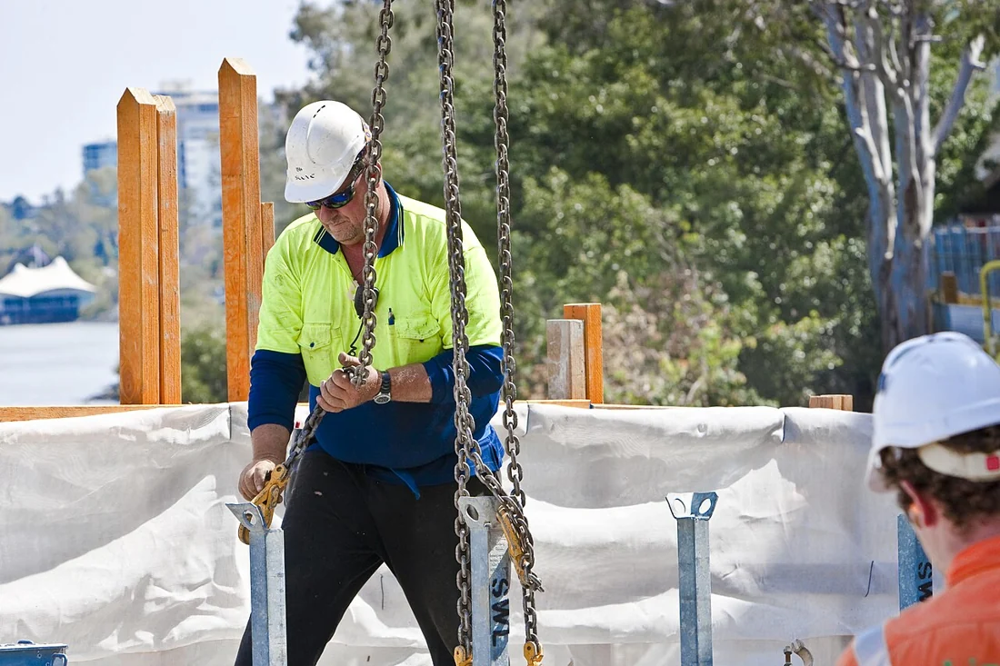

<PhilosophyTopic topic-id="vat-chat-va-y-thuc">

<template #notes>

## Hoàn cảnh và sự lựa chọn của con người

Một kế hoạch tốt có thể thất bại khi thiếu nguồn lực. Nhưng có nguồn lực mà tổ chức kém cũng có thể thất bại. Hai tình huống này cho thấy cần giải thích đồng thời vai trò của điều kiện khách quan và hoạt động có ý thức. Triết học Mác – Lênin xem vật chất và ý thức trong quan hệ biện chứng, với vật chất giữ vai trò quyết định.

Quan hệ này không đặt hai lực lượng ngang nhau rồi chia phần ảnh hưởng. Vật chất có trước và là cơ sở làm nảy sinh ý thức. Khi hình thành, ý thức có tính độc lập tương đối và tác động trở lại hiện thực thông qua hoạt động của con người. Mỗi chiều quan hệ phải được hiểu đúng cơ chế của nó.

## Vật chất quyết định ý thức trên bốn phương diện

Thứ nhất, vật chất quyết định nguồn gốc của ý thức. Bộ óc người, thế giới khách quan và hoạt động lao động xã hội là những điều kiện làm xuất hiện ý thức. Ý thức không phải một thực thể có sẵn đứng ngoài tự nhiên rồi nhập vào con người.

Thứ hai, vật chất quyết định nội dung của ý thức. Con người suy nghĩ về những đối tượng và quan hệ có nguồn gốc trong hiện thực. Nội dung ấy được tiếp nhận qua hoạt động, kinh nghiệm và giao tiếp xã hội. Một người có thể nghĩ sai về hiện thực, nhưng cả sự sai lệch ấy cũng hình thành trong những điều kiện và từ những chất liệu hiện thực xác định.

Thứ ba, vật chất quyết định bản chất phản ánh năng động, sáng tạo của ý thức. Con người không chỉ chịu tác động mà còn lao động, thử nghiệm và cải biến đối tượng. Chính hoạt động hiện thực ấy tạo cơ sở cho năng lực chọn lọc, khái quát, dự kiến và đặt mục đích. Vì vậy, tính sáng tạo không phải bằng chứng để tách ý thức khỏi thế giới vật chất.

Thứ tư, vật chất quyết định sự vận động và phát triển của ý thức. Khi sản xuất, công cụ, cách giao tiếp và quan hệ xã hội thay đổi, đời sống tinh thần cũng biến đổi. Những vấn đề mới làm xuất hiện tri thức và nhu cầu nhận thức mới. Sự biến đổi không nhất thiết diễn ra ngay lập tức, bởi kinh nghiệm và tập quán còn có sức bền lịch sử.

Chẳng hạn, sự xuất hiện của phương tiện liên lạc mới mở rộng cách con người hợp tác và tiếp cận thông tin. Từ đó, những quan niệm về công việc, thời gian và trách nhiệm cũng có thể được điều chỉnh. Đây là một quá trình xã hội, không phải phản ứng giống hệt nhau ở mọi cá nhân.

## Ý thức có tính độc lập tương đối

**Tính độc lập tương đối của ý thức** thể hiện ở việc ý thức có cách vận động, kế thừa và phát triển riêng sau khi hình thành. Con người không phải đợi mọi điều kiện hoàn tất mới nghĩ tới tương lai. Từ hiểu biết hiện có, họ có thể dự báo, lập kế hoạch và chủ động chuẩn bị điều kiện mới.

Ý thức cũng có thể lạc hậu so với hoàn cảnh. Một thói quen từng phù hợp vẫn được giữ khi điều kiện đã đổi khác. Ngược lại, tư tưởng có thể đi trước hiện thực khi nhận ra một xu hướng đang hình thành. “Đi trước” ở đây là dự kiến trên cơ sở hiện thực, không phải tinh thần tự tạo ra điều kiện vật chất.

Sự kế thừa tri thức qua ngôn ngữ, giáo dục và văn hóa còn giúp mỗi thế hệ tiếp nhận thành quả của các thế hệ trước. Bởi vậy, không thể giải thích một tư tưởng chỉ bằng hoàn cảnh vật chất tức thời của người đang phát biểu nó. Cần tính đến lịch sử tích lũy và những quan hệ xã hội rộng hơn.

## Điều kiện khách quan, nhân tố chủ quan và hoạt động thực tiễn

Điều kiện khách quan là những hoàn cảnh, quan hệ và khả năng hiện thực mà chủ thể phải tính đến khi hành động. Chúng không phụ thuộc riêng vào mong muốn của người thực hiện. Nhân tố chủ quan gồm những năng lực và phẩm chất được huy động như tri thức, mục tiêu, động cơ, ý chí và khả năng tổ chức.

Cần phân biệt cách chia này với việc đơn giản xếp tất cả những gì ở ngoài cơ thể vào khách quan và mọi thứ ở trong cơ thể vào chủ quan. Một điều kiện có thể do hoạt động con người tạo ra nhưng vẫn tồn tại khách quan đối với một người đang hành động. Một thể chế, công cụ hoặc nguồn lực không biến mất theo ý thích riêng của người ấy.

Ngược lại, nhân tố chủ quan không chỉ là trạng thái vui buồn. Nó còn thể hiện ở khả năng nhận biết vấn đề, xây dựng phương án, phối hợp con người và điều chỉnh hoạt động. Những năng lực ấy được hình thành trong điều kiện xã hội và có thể được rèn luyện. Vai trò chủ thể vì thế có nội dung thực tế, không chỉ là lời đề cao tinh thần.

Thực tiễn là con đường nối hai mặt. Qua hoạt động vật chất có mục đích, con người sử dụng những điều kiện đang có để tạo ra kết quả và làm thay đổi hoàn cảnh. Một quyết định trong ý thức chưa trực tiếp làm hiện thực thay đổi. Nó phải được chuyển thành tổ chức, phương tiện và hành động phù hợp.

Xét việc cải thiện điều kiện học tập, người thực hiện cần biết cơ sở vật chất, nhu cầu, năng lực tổ chức và những khó khăn hiện có. Từ đó mới chọn mục tiêu và cách làm. Khi triển khai, kết quả có thể bộc lộ điều kiện đã đánh giá thiếu hoặc năng lực chưa đáp ứng. Sự điều chỉnh dựa vào những phát hiện ấy là biểu hiện của chủ động.

Tôn trọng khách quan vì thế bao gồm cả việc tìm ra khả năng có thể tác động. Phát huy chủ quan bao gồm cả sự sẵn sàng sửa mục tiêu hoặc phương pháp khi chúng không có đủ căn cứ. Hai yêu cầu được thực hiện trong cùng một quá trình, không phải luân phiên buông xuôi trước hoàn cảnh rồi đề cao ý chí.

## Ý thức tác động trở lại vật chất bằng thực tiễn

Ý thức định hướng hoạt động bằng việc xác định mục tiêu, lựa chọn phương tiện, dự kiến hậu quả và điều chỉnh cách làm. Khi con người hành động, sức lao động, công cụ và tổ chức biến định hướng tinh thần thành tác động vật chất. Đây là con đường để ý thức tác động trở lại hiện thực.

Một bản thiết kế không tự biến thành cây cầu. Người xây dựng phải huy động vật liệu, lao động, kỹ thuật và phương thức phối hợp. Nhưng nếu thiếu thiết kế phù hợp, các nguồn lực ấy có thể bị sử dụng sai. Vai trò của ý thức vì vậy có thực, dù không tách khỏi các điều kiện thực hiện.

Ý thức phản ánh đúng điều kiện và quy luật có thể thúc đẩy hoạt động đạt mục đích. Ý thức sai lệch có thể kìm hãm, gây tổn thất hoặc khiến con người chọn phương tiện không phù hợp. Tuy nhiên, hiểu biết đúng chưa tự bảo đảm thành công. Còn phải có năng lực thực hiện, nguồn lực và sự điều chỉnh trước các biến đổi của hoàn cảnh.

Tác động trở lại cũng không làm ý thức trở thành yếu tố quyết định xét đến cùng. Một quyết tâm dù mạnh vẫn không thể tùy ý xóa bỏ thuộc tính vật liệu hay những điều kiện khách quan. Sức mạnh của chủ thể thể hiện ở khả năng nhận biết và vận dụng các điều kiện ấy.

<!-- philosophy-figure -->
<figure class="philosophy-figure">
  
  <figcaption>Hình 2.3: Người lao động trên công trường cầu Go Between tại Australia.</figcaption>
</figure>

Một ý tưởng về cây cầu chỉ trở thành công trình qua hoạt động của những con người cụ thể. Vật liệu, thiết bị, kỹ năng và phối hợp lao động là các khâu trung gian. Nếu bản thiết kế không phù hợp điều kiện chịu lực, quyết tâm không thể bù cho sai lầm ấy. Ngược lại, hiểu đúng điều kiện giúp con người tìm được cách tổ chức và cải biến hiện thực.

## Tác động của ý thức cần được đánh giá qua những khâu trung gian

Ý thức có thể hướng dẫn hoạt động theo chiều tích cực hoặc tiêu cực. Một cách hiểu đúng giúp chủ thể chọn mục tiêu và phương tiện phù hợp. Một cách hiểu sai có thể dẫn tới sử dụng nguồn lực không đúng hoặc làm nảy sinh hậu quả trái mục đích. Sự tác động ấy diễn ra thông qua hành động của con người.

Vì vậy, đánh giá vai trò của tư tưởng cần phân tích cả nội dung và điều kiện thực hiện. Một chủ trương có căn cứ nhưng thiếu phương tiện, sự phối hợp hoặc năng lực tổ chức có thể chưa đem lại kết quả dự kiến. Kết quả không như mong đợi chưa tự chứng minh toàn bộ nội dung tư tưởng sai.

Ở chiều khác, một kết quả thuận lợi cũng chưa chứng minh mọi nhận định dẫn đến nó đều đúng. Có thể còn những điều kiện khách quan chưa được nhận ra hoặc những tác động không nằm trong kế hoạch. Muốn rút kinh nghiệm, cần xác định điều gì thực sự tạo nên kết quả và giới hạn của nó.

Quan hệ lợi ích cũng ảnh hưởng việc con người tiếp nhận và thực hiện mục tiêu chung. Yêu cầu tổ chức hoạt động phải đi cùng việc hiểu động cơ, trách nhiệm và điều kiện tham gia. Chỉ truyền đạt ý tưởng mà bỏ qua những quan hệ ấy có thể khiến chủ trương không trở thành hành động thống nhất.

Mối quan hệ vật chất và ý thức vì thế dẫn tới yêu cầu kết hợp hiểu biết với tổ chức thực tiễn. Năng lực tư duy tạo ra định hướng, còn điều kiện và hoạt động hiện thực quyết định định hướng ấy được thực hiện đến đâu. Phân tích từng khâu giúp việc đánh giá tránh dừng ở lời khen tinh thần hoặc sự quy kết ý chí.

## Khi khu nhà bắt đầu phân loại rác

Giả sử những người cùng sống trong một khu nhà thống nhất muốn phân loại rác. Lời kêu gọi có thể rõ ràng và mọi người đều tán thành, nhưng hoạt động vẫn khó duy trì nếu chỉ có một thùng chung, không thống nhất nơi bỏ từng loại và không có cách thu gom tương ứng.

Trong trường hợp ấy, giải thích mọi thất bại bằng câu “mọi người chưa có ý thức” sẽ bỏ qua những khâu vật chất và tổ chức đang thiếu. Ngược lại, đặt thêm thùng mà không giải thích cách dùng hoặc không phân công công việc cũng chưa bảo đảm có kết quả. Tri thức và thái độ phải được chuyển thành một cách tổ chức khả thi.

Đặt vấn đề như vậy không san bằng vai trò của vật chất và ý thức. Điều kiện hiện thực quy định hoạt động có thể diễn ra theo những cách nào. Ý thức giúp nhận ra điều kiện cần thay đổi, dự kiến cách phối hợp và điều chỉnh dự định. Sự tác động trở lại chỉ thành hiện thực qua những việc có người làm, có phương tiện và có kết quả quan sát được.

Khi một việc tốt chưa thực hiện được, điều cần hỏi không chỉ là mọi người có muốn hay không. Giữa mong muốn và kết quả còn những khâu nào chưa được tạo ra? Câu hỏi ấy đưa trách nhiệm từ một lời phê bình chung trở về những việc cụ thể có thể làm.

## Một bữa ăn trong điều kiện có hạn

Một gia đình muốn chuẩn bị bữa ăn chung nhưng phải tính đến tiền mua nguyên liệu, thời gian và dụng cụ đang có. Những giới hạn này không mất đi vì mọi người rất nhiệt tình. Tuy vậy, cùng những điều kiện ấy, cách phân công, lựa chọn món và chuẩn bị trước có thể tạo ra kết quả khác nhau.

Tôn trọng khách quan là nhận diện đúng những giới hạn và khả năng ấy. Chủ động là lựa chọn mục tiêu phù hợp rồi tổ chức thực hiện, thay vì hoặc đòi một bữa ăn vượt mọi điều kiện, hoặc kết luận rằng đã thiếu thốn thì không thể cải thiện điều gì. Không có ý chí nào thay được nguyên liệu, nhưng cách dùng nguyên liệu cũng không tự quyết định nếu thiếu con người.

Ví dụ chỉ cho thấy vai trò của những khâu trung gian trong hoạt động có mục đích. Nó không cho phép quy mọi hoàn cảnh khó khăn về sự thiếu cố gắng của cá nhân. Có những điều kiện vượt quá khả năng thay đổi của một người, đòi hỏi hợp tác hoặc sự thay đổi ở phạm vi rộng hơn. Nhận ra giới hạn của hành động cá nhân cũng là một phần của thái độ tôn trọng hiện thực.

## Tôn trọng khách quan và phát huy tính chủ động

Ý nghĩa phương pháp luận của quan hệ này là xuất phát từ thực tế khách quan đồng thời phát huy tính năng động, sáng tạo của con người. Tôn trọng khách quan đòi hỏi khảo sát điều kiện thực, phân biệt mong muốn với khả năng và lựa chọn cách làm dựa trên quy luật của đối tượng.

Phát huy tính chủ động đòi hỏi học tập, suy xét, tổ chức và hành động để cải biến điều kiện. Thiếu nguồn lực không phải lúc nào cũng có nghĩa phải dừng lại. Có thể đổi cách tổ chức, tích lũy nguồn lực hoặc chọn bước đi phù hợp hơn. Nhưng những phương án ấy phải có căn cứ và được kiểm tra qua kết quả thực tế.

**Chủ quan duy ý chí** là lấy ý muốn thay cho điều kiện và quy luật, tin rằng quyết tâm đủ để làm được mọi việc. Ở chiều ngược lại, thái độ thụ động tuyệt đối hóa hoàn cảnh, xem con người chỉ có thể chờ đợi. Cả hai đều làm sai lệch quan hệ giữa khách quan và chủ quan.

Trong học tập, hiểu nguyên tắc này là đánh giá đúng nền tảng hiện có, xác định phần còn thiếu và chủ động bổ sung bằng hành động cụ thể. Mục tiêu có tác dụng khi gắn với phương tiện và điều kiện thực hiện. Hoàn cảnh là điểm xuất phát của hoạt động, đồng thời có thể trở thành đối tượng được hoạt động cải biến.

Muốn nhận biết đúng hoàn cảnh và điều kiện, cần một cách xem xét sự vật trong những mối liên hệ và quá trình biến đổi. Hai nguyên lý của phép biện chứng duy vật sẽ mở rộng cách tiếp cận ấy từ quan hệ vật chất, ý thức sang mọi lĩnh vực của hiện thực.

</template>

<template #exercises>

<!-- workbook: WB2-MC23; PDF 46–47 -->

::: exercise Bài 1

Chủ nghĩa duy vật biện chứng khẳng định rằng:

- A. Ý thức quyết định vật chất, vật chất có tính độc lập tương đối và tác động trở lại ý thức.
- B. Ý thức quyết định vật chất, vật chất hoàn toàn độc lập và tác động trở lại ý thức.
- C. Vật chất quyết định ý thức, ý thức có tính độc lập tương đối và tác động trở lại vật chất.
- D. Vật chất quyết định ý thức, ý thức hoàn toàn độc lập và tác động trở lại vật chất.

:::

::: solution Giải thích

Đáp án: C.

Vật chất quyết định nguồn gốc, nội dung và những điều kiện phát triển của ý thức. Ý thức có tính độc lập tương đối và tác động trở lại thông qua hoạt động thực tiễn của con người. A và B đảo vai trò quyết định. D biến độc lập tương đối thành hoàn toàn tách rời cơ sở vật chất.

:::

<!-- workbook: WB2-MC24; PDF 47 -->

::: exercise Bài 2

Xác định câu trả lời đúng theo quan điểm của chủ nghĩa duy vật biện chứng về vai trò của ý thức:

- A. Vai trò của ý thức là sự phản ánh sáng tạo thực tại khách quan và đồng thời có sự tác động trở lại thực tại đó thông qua hoạt động thực tiễn của con người.
- B. Ý thức là cái phụ thuộc vào nguồn gốc sinh ra nó, vì vậy chỉ có vật chất là cái năng động, tích cực.
- C. Ý thức chỉ là sự sao chép nguyên xi thế giới hiện thực nên không có vai trò gì đối với thực tiễn.
- D. Ý thức tự nó chỉ làm thay đổi tư tưởng, do đó ý thức hoàn toàn không có vai trò gì đối với thực tiễn.

:::

::: solution Giải thích

Đáp án: A.

Tri thức, mục tiêu và ý chí có thể định hướng việc lựa chọn công cụ, tổ chức hoạt động và điều chỉnh hành động. Tác động ấy cần những khâu thực tiễn để làm thay đổi hiện thực. B, C và D đều phủ nhận tính tích cực hoặc vai trò thực tế của ý thức.

:::

<!-- workbook: WB2-MC25; PDF 47 -->

::: exercise Bài 3

Từ mối quan hệ giữa vật chất và ý thức, chúng ta rút ra nguyên tắc phương pháp luận chủ đạo nào cho hoạt động nhận thức và thực tiễn?

- A. Nguyên tắc toàn diện.
- B. Nguyên tắc lịch sử - cụ thể.
- C. Nguyên tắc thống nhất giữa lý luận và thực tiễn.
- D. Nguyên tắc tôn trọng tính khách quan kết hợp với phát huy tính năng động, chủ quan.

:::

::: solution Giải thích

Đáp án: D.

Phải xuất phát từ điều kiện và quy luật khách quan, đồng thời chủ động đặt mục tiêu, lựa chọn cách làm và tổ chức thực hiện. A, B và C là những nguyên tắc có ý nghĩa nhưng D diễn đạt trực tiếp yêu cầu rút ra từ quan hệ vật chất với ý thức. Tôn trọng khách quan không đồng nghĩa với chấp nhận thụ động hoàn cảnh hiện có.

:::

</template>

</PhilosophyTopic>

## Tài liệu tham khảo

1. Hội đồng biên soạn, Phạm Văn Đức (chủ biên, 2019). *Giáo trình Triết học Mác – Lênin*. Dành cho bậc đại học, khối các ngành ngoài lý luận chính trị. Hà Nội. Chương 2, tr. 61–143.
2. Khoa Triết học, Trường Đại học Khoa học Xã hội và Nhân văn (2024). *Bài tập Triết học Mác - Lênin*. Hà Nội. Chương 2, phần Bài tập.
3. Brisbane City Council. [Người lao động trên công trường cầu Go Between tại Australia.](https://commons.wikimedia.org/wiki/File:Go_Between_Bridge_Construction_Workers_(5159662865).jpg). [CC BY 2.0](https://creativecommons.org/licenses/by/2.0). Bản thu nhỏ.
