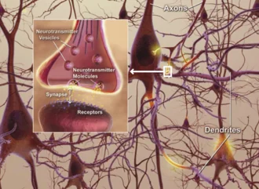

<PhilosophyTopic topic-id="y-thuc">

<template #notes>

## Ý thức hình thành từ đời sống hiện thực

Khi một người thợ hình dung sản phẩm trước khi chế tạo, hình ảnh ấy chưa phải sản phẩm vật chất. Tuy vậy, nó có thể định hướng cả quá trình lao động. Muốn hiểu năng lực này, cần giải thích ý thức hình thành từ đâu, phản ánh hiện thực ra sao và vì sao nó có khả năng sáng tạo.

Chủ nghĩa duy tâm đặt tinh thần hoặc cảm giác vào vị trí có trước và chi phối thế giới. Một số cách giải thích duy vật trước Mác lại đồng nhất ý thức với một chất do bộ óc tạo ra. Triết học Mác – Lênin khắc phục cả việc tách ý thức khỏi cơ sở vật chất lẫn việc coi ý thức như một vật thể. Cách tiếp cận này gắn cơ sở tự nhiên với đời sống xã hội của con người.

## Nguồn gốc tự nhiên: Bộ óc và thế giới khách quan

**Nguồn gốc tự nhiên của ý thức** gồm bộ óc người cùng thế giới khách quan tác động vào bộ óc thông qua các giác quan. Bộ óc là cơ quan vật chất thực hiện hoạt động ý thức. Thế giới khách quan cung cấp đối tượng và nội dung để hoạt động ấy phản ánh.

Để hiểu mối liên hệ này, cần phân biệt ý thức với phản ánh nói chung. **Phản ánh** là sự tái hiện những đặc điểm của đối tượng này ở đối tượng khác trong quá trình tác động qua lại. Dấu chân trên nền đất là một dạng lưu lại dấu vết tác động. Ở cơ thể sống, khả năng tiếp nhận và đáp ứng tác động trở nên có tổ chức hơn, phục vụ sự thích nghi.

Ý thức là trình độ phản ánh đặc biệt gắn với con người và bộ óc người. Không phải mọi sự vật có khả năng phản ánh đều có ý thức. Cũng không thể suy từ việc bộ óc là cơ quan của ý thức đến kết luận rằng nội dung suy nghĩ đồng nhất với các quá trình sinh lý. Quá trình thần kinh là cơ sở vật chất, còn ý nghĩa của một nhận định thuộc nội dung tinh thần.

Thí dụ, âm thanh của một câu nói tác động vào cơ quan thính giác. Nhưng để hiểu câu nói, người nghe còn phải biết ngôn ngữ, hoàn cảnh và những quy ước xã hội liên quan. Cấu tạo sinh học mở ra khả năng tiếp nhận, còn đời sống xã hội góp phần hình thành ý nghĩa được tiếp nhận.

<!-- philosophy-figure -->
<figure class="philosophy-figure">
  
  <figcaption>Hình 2.2: Minh họa các tế bào thần kinh và những điểm liên hệ giữa chúng.</figcaption>
</figure>

Bộ óc là một cơ quan vật chất có tổ chức phức tạp. Tuy nhiên, nhìn vào hình thái tế bào chưa thể đọc ra nội dung một lời hứa hay ý nghĩa của một bài thơ. Những nội dung ấy còn được hình thành trong lao động, ngôn ngữ và quan hệ giữa người với người. Cơ sở sinh học và lịch sử xã hội phải được xem xét trong sự thống nhất.

## Nguồn gốc xã hội: Lao động và ngôn ngữ

Có bộ óc và thế giới tác động chưa đủ để giải thích toàn bộ ý thức người. **Nguồn gốc xã hội của ý thức** trực tiếp gắn với lao động và ngôn ngữ. Đây là điểm phân biệt quan trọng giữa giải thích duy vật biện chứng với cách giải thích chỉ dựa vào sinh học.

Trong lao động, con người dùng công cụ tác động vào đối tượng nhằm đạt mục đích. Đối tượng bộc lộ thuộc tính qua sự tác động ấy. Người làm gốm nhận ra đất có thể tạo hình trong điều kiện này nhưng nứt vỡ trong điều kiện khác. Việc làm, quan sát và điều chỉnh khiến tri thức không chỉ đến từ nhìn ngắm thụ động.

Lao động chung còn đòi hỏi phối hợp hành động và truyền kinh nghiệm. Ngôn ngữ phát triển trong đời sống xã hội ấy, vừa là phương tiện giao tiếp vừa là công cụ tư duy. Nhờ từ ngữ và khái niệm, con người có thể nói về đối tượng đang vắng mặt, khái quát nhiều trường hợp và lưu giữ kinh nghiệm qua các thế hệ.

Nguồn gốc tự nhiên và xã hội thống nhất với nhau. Không có cơ sở sinh học thích hợp thì không có hoạt động ý thức người. Nhưng nếu bỏ qua lao động, ngôn ngữ và quan hệ xã hội, ta không giải thích được nội dung lịch sử, văn hóa của ý thức.

## Phản ánh hiện thực bằng hình thức chủ quan và sáng tạo

Về bản chất, **ý thức** là hình ảnh chủ quan của thế giới khách quan, là sự phản ánh năng động, sáng tạo hiện thực trên cơ sở thực tiễn xã hội. Từ “chủ quan” ở đây chỉ hình thức tồn tại trong chủ thể, không có nghĩa mọi nội dung đều tùy tiện hoặc sai lệch.

Cùng quan sát một khu đất, người nông dân chú ý độ màu mỡ, kiến trúc sư chú ý địa hình xây dựng, còn nhà sinh thái chú ý hệ sinh vật. Đối tượng có những thuộc tính khách quan, nhưng nội dung được lựa chọn còn phụ thuộc nhu cầu, tri thức và hoạt động của người quan sát. Vì vậy, ý thức phản ánh có chọn lọc và thông qua sự xử lý của chủ thể.

Sáng tạo không đối lập với phản ánh. Con người có thể kết hợp hiểu biết thành thiết kế, dự báo hoặc phương án chưa có sẵn trong thực tế. Tuy nhiên, thiết kế muốn thành công phải tôn trọng thuộc tính vật liệu và điều kiện thực hiện. Ý thức không tạo ra sản phẩm vật chất chỉ bằng hình dung. Sản phẩm được hình thành qua hoạt động thực tiễn.

Ngay cả tưởng tượng cũng sử dụng những chất liệu, hình ảnh và quan hệ đã được tiếp nhận, rồi tổ chức chúng theo cách mới. Khả năng vượt khỏi cái đang có không làm ý thức mất nguồn gốc hiện thực.

## Nội dung khách quan không đồng nghĩa mọi nhận thức đều đúng

Thế giới khách quan cung cấp đối tượng và chất liệu cho ý thức. Nhưng hình ảnh trong ý thức được hình thành qua bộ óc, kinh nghiệm, nhu cầu và các quan hệ xã hội của con người. Vì vậy, khẳng định ý thức phản ánh hiện thực chưa đủ để bảo đảm từng nhận định riêng đều phù hợp với đối tượng.

Một người có thể chỉ quan sát một mặt, dùng khái niệm không phù hợp hoặc giải thích theo điều mình đang mong muốn. Những sai lệch ấy vẫn có nguồn gốc và điều kiện hiện thực. Chúng không chứng minh ý thức tồn tại ngoài thế giới, mà cho thấy quá trình phản ánh cần được kiểm tra và điều chỉnh.

Tính sáng tạo cũng bao gồm nhiều mức độ. Con người có thể khái quát quy luật, xây dựng giả thuyết hoặc hình dung phương án chưa được thực hiện. Giá trị của các nội dung ấy phụ thuộc vào căn cứ, tính phù hợp với đối tượng và khả năng được kiểm nghiệm. Sự mới lạ trong tư duy chưa tự trở thành tri thức đúng.

Từ đây cần hiểu vai trò của tự ý thức. Khi xem xét cách mình quan sát, đánh giá và hành động, chủ thể có thể nhận ra giới hạn hiểu biết hoặc ảnh hưởng của động cơ riêng. Việc tự nhận thức ấy vẫn diễn ra trong giao tiếp và hoạt động xã hội, không phải sự quay vào một cái tôi hoàn toàn biệt lập.

Nhờ kết hợp phản ánh đối tượng với tự xem xét hoạt động của mình, con người có khả năng sửa cách tiếp cận. Đây là một biểu hiện của tính năng động, sáng tạo. Khả năng ấy được phát triển thông qua học tập và thực tiễn, chứ không phải lời bảo đảm sẵn có rằng mọi suy nghĩ của chủ thể đều đúng.

## Cùng một tiếng chuông, những ý nghĩa khác nhau

Giả sử tiếng chuông vang lên ở cửa một cửa hàng. Người mới đến có thể chỉ nghe một âm thanh, còn người bán hiểu rằng có khách bước vào và cần ngừng việc đang làm. Cùng một tác động vật lý chưa bảo đảm hình thành cùng một nội dung ý thức. Người bán đã gắn âm thanh ấy với một hoàn cảnh và một hoạt động có ý nghĩa.

Sự khác biệt không buộc ta chọn giữa bộ óc với xã hội như hai nguyên nhân loại trừ nhau. Cơ quan thần kinh là điều kiện để tiếp nhận và xử lý âm thanh. Kinh nghiệm giao tiếp và cách tổ chức công việc lại giúp âm thanh có ý nghĩa cụ thể. Không thể cắt một phương diện rồi mong nó giải thích đầy đủ phương diện còn lại.

Nếu một người chưa hiểu quy ước của cửa hàng, điều họ thiếu trước hết có phải một khả năng sinh học không? Trong tình huống này, cần giải thích và cho họ tham gia hoạt động, chứ không kết luận từ một lần chưa hiểu rằng họ không có năng lực nhận thức. Nội dung ý thức mang dấu ấn những quan hệ mà con người thực sự sống trong đó.

## Một bữa cơm chưa xuất hiện trên bàn

Trước khi nấu ăn, người nấu có thể hình dung món ăn, dự kiến thứ tự công việc và trao đổi với người cùng làm. Những món ăn ấy chưa có trên bàn nhưng đã có hình ảnh trong ý thức. Khả năng đặt mục đích cho thấy ý thức không chỉ chép lại thụ động những gì đang hiện diện trước mắt.

Tuy nhiên, sự hình dung vẫn được xây dựng từ hiểu biết về nguyên liệu, dụng cụ và những lần nấu trước. Khi nguyên liệu hoặc phương tiện không phù hợp, dự định phải được điều chỉnh. Càng muốn làm một món mới, người nấu càng cần hiểu những thuộc tính không tùy thuộc ý muốn của mình. Sáng tạo vì thế không phải sự thoát ly khỏi hiện thực.

Trong lúc phối hợp, lời nói giúp người này hiểu phần việc của người kia, còn những tên gọi như “chín”, “mềm” hoặc “đậm” giữ lại kinh nghiệm đã được chia sẻ. Dẫu vậy, cùng dùng một từ chưa chắc đã đánh giá giống nhau. Trao đổi phải trở lại những biểu hiện cụ thể và kết quả công việc. Từ ngữ làm tư duy và hợp tác phong phú hơn, nhưng không thay người thực hiện tiếp xúc với đối tượng.

## Những thành phần và mức độ của đời sống ý thức

Xét theo các yếu tố cấu thành, ý thức có tri thức, tình cảm và ý chí. **Tri thức** là hiểu biết về đối tượng, giữ vai trò định hướng có căn cứ. **Tình cảm** biểu hiện thái độ và sự gắn bó của con người đối với đối tượng. **Ý chí** thể hiện năng lực xác định mục tiêu, tổ chức hành động và vượt khó để theo đuổi mục tiêu ấy.

Ba mặt này liên hệ trong hoạt động. Biết một việc cần làm chưa bảo đảm sẽ làm, vì còn có động cơ và khả năng tự điều chỉnh. Ngược lại, nhiệt tình và kiên trì thiếu hiểu biết có thể dẫn tới hành động sai. Việc bồi dưỡng con người vì thế không thể chỉ chú ý một thành phần.

Xét chiều sâu của đời sống tinh thần, tự ý thức là khả năng nhận thức và đánh giá chính mình. Tiềm thức gồm những tri thức, kinh nghiệm đã được hình thành nhưng không phải lúc nào cũng được huy động tự giác. Vô thức chỉ những quá trình tâm lý không chịu sự điều khiển trực tiếp của ý thức tại thời điểm diễn ra. Sự phân biệt này giúp thấy đời sống tinh thần phức tạp hơn những điều ta đang chủ động suy nghĩ.

## Tri thức, tình cảm, niềm tin và ý chí không vận động tách rời

Tri thức giữ vai trò cơ bản vì hoạt động có mục đích cần hiểu đối tượng và điều kiện thực hiện. Nhưng biết một điều không tự động tạo nên thái độ tương ứng. Một người có thể hiểu lợi ích của một việc mà chưa gắn bó với mục tiêu ấy, hoặc có tình cảm mạnh nhưng chưa biết phải hành động thế nào.

Niềm tin hình thành trong sự gắn bó giữa hiểu biết, tình cảm và trải nghiệm thực tiễn. Nó tạo sự xác tín, góp phần giữ phương hướng khi hoạt động gặp khó khăn. Tuy nhiên, cần phân biệt sức bền của niềm tin với giá trị đúng của nội dung được tin. Một sự xác tín vẫn phải có căn cứ và có thể cần được điều chỉnh.

Ý chí thể hiện ở khả năng huy động năng lực, kiểm soát hành vi và kiên trì thực hiện mục tiêu. Ý chí cần tri thức để xác định cách làm, còn tình cảm và niềm tin góp phần tạo động lực. Coi ý chí như sức mạnh có thể bỏ qua mọi giới hạn hiện thực sẽ làm sai chính vai trò chủ động của con người.

Chẳng hạn, một người muốn học thành thạo một nghề cần hiểu yêu cầu nghề nghiệp, có động cơ theo đuổi và tổ chức việc rèn luyện. Nếu phương pháp không phù hợp, kiên trì lặp lại cũng có thể không đem lại tiến bộ. Khi hiểu biết thay đổi, sự chủ động còn thể hiện ở khả năng sửa cách làm mà vẫn giữ mục tiêu có căn cứ.

Các thành phần vì thế có thể hỗ trợ nhau nhưng cũng có thể chưa thống nhất. Điều được tuyên bố là đúng chưa chắc đã chuyển thành thói quen hành động. Phân tích khoảng cách ấy đòi hỏi xét cả tri thức, động cơ, tình cảm, khả năng tự điều chỉnh và hoàn cảnh, thay vì chỉ kết luận người đó thiếu ý thức.

Giáo dục và tự rèn luyện cần tác động đến sự thống nhất ấy. Truyền đạt thông tin là cần thiết, nhưng còn phải tạo điều kiện để hiểu biết được vận dụng, kiểm nghiệm và gắn với trách nhiệm. Quá trình này nối sự phát triển ý thức với đời sống thực tế của chủ thể.

Nguồn gốc và bản chất của ý thức cho thấy nó không đứng ngoài đời sống hiện thực. Nhưng vai trò sáng tạo cũng đặt ra vấn đề ý thức tác động trở lại hoàn cảnh bằng cách nào. Đó là nội dung của quan hệ biện chứng giữa vật chất và ý thức.

</template>

<template #exercises>

<!-- workbook: WB2-MC12; PDF 44–45 -->

::: exercise Bài 1

Chọn mệnh đề KHÔNG ĐÚNG theo quan điểm của chủ nghĩa duy vật biện chứng về lao động và ý thức:

- A. Con người là sinh vật duy nhất biết sử dụng công cụ lao động.
- B. Con người là sinh vật duy nhất có phản ánh ý thức.
- C. Con người là sinh vật duy nhất có năng lực sản xuất.
- D. Con người là sinh vật duy nhất có năng lực tư duy.

:::

::: solution Giải thích

Đáp án: A.

Chỉ biết sử dụng một vật làm phương tiện chưa phải đặc trưng đủ để phân biệt lao động người với hoạt động động vật. Đặc trưng đang xét là chế tạo công cụ, hoạt động có mục đích và truyền kinh nghiệm trong quan hệ xã hội. B, C và D được dùng theo nghĩa ý thức, sản xuất và tư duy người trong hệ thống khái niệm của bài, không có nghĩa động vật hoàn toàn không học hỏi hoặc xử lý thông tin.

:::

<!-- workbook: WB2-MC14; PDF 45 -->

::: exercise Bài 2

Phát biểu nào dưới đây là SAI?

- A. Nguồn gốc của ý thức bao gồm nguồn gốc tự nhiên và nguồn gốc xã hội.
- B. Nguồn gốc tự nhiên của ý thức bao gồm bộ não người và thế giới khách quan tác động lên bộ não người.
- C. Nguồn gốc xã hội của ý thức bao gồm lao động và ngôn ngữ.
- D. Ý thức là cái vốn có trong bộ óc của con người.

:::

::: solution Giải thích

Đáp án: D.

Bộ óc là cơ quan vật chất của ý thức, nhưng nội dung ý thức không có sẵn từ khi có bộ óc. Ý thức hình thành trong quan hệ với thế giới và đời sống xã hội. A, B và C cùng nêu những điều kiện cần được xem trong sự thống nhất.

:::

<!-- workbook: WB2-MC15; PDF 45 -->

::: exercise Bài 3

Điều kiện cần cho sự ra đời của ý thức là:

- A. Bộ não người.
- B. Bộ não người và hiện thực khách quan tác động lên bộ não.
- C. Năng lực chế tạo và sử dụng công cụ lao động.
- D. Năng lực ngôn ngữ phát triển.

:::

::: solution Giải thích

Đáp án: B.

B nêu đầy đủ hai mặt của nguồn gốc tự nhiên: Cơ quan phản ánh và đối tượng được phản ánh. A mới có cơ quan. C và D thuộc nguồn gốc xã hội. Cách chia điều kiện cần và đủ ở đây không được hiểu như một thí nghiệm chỉ cần ghép máy móc hai yếu tố là tự sinh ra ý thức.

:::

<!-- workbook: WB2-MC16; PDF 45 -->

::: exercise Bài 4

Điều kiện đủ cho sự ra đời của ý thức là:

- A. Lao động và ngôn ngữ.
- B. Bộ não người và hiện thực khách quan.
- C. Năng lực chế tạo và sử dụng công cụ lao động.
- D. Ngôn ngữ phát triển với cả tiếng nói và chữ viết.

:::

::: solution Giải thích

Đáp án: A.

Trong cách trình bày của bài, lao động và ngôn ngữ là nguồn gốc xã hội trực tiếp, quyết định sự hình thành ý thức trên cơ sở những tiền đề tự nhiên đã có. B mới nêu nguồn gốc tự nhiên, C thiếu ngôn ngữ. D đòi cả chữ viết là không đúng, bởi ý thức người không chờ đến khi chữ viết ra đời.

:::

<!-- workbook: WB2-MC17; PDF 45 -->

::: exercise Bài 5

Theo quan điểm của chủ nghĩa duy vật biện chứng:

- A. Phản ánh của thế giới vô cơ mang tính sáng tạo.
- B. Phản ánh không phải là cái vốn có của thế giới vật chất.
- C. Phản ánh là thuộc tính của mọi dạng vật chất.
- D. Phản ánh chỉ là ý thức con người tưởng tượng ra.

:::

::: solution Giải thích

Đáp án: C.

Phản ánh là khả năng lưu giữ hoặc tái hiện những đặc điểm của đối tượng trong sự tác động qua lại. Ở những trình độ tổ chức khác nhau, phản ánh có hình thức khác nhau. A gán đặc trưng sáng tạo của ý thức cho thế giới vô cơ. B và D phủ nhận tính khách quan của phản ánh.

:::

<!-- workbook: WB2-MC18; PDF 45–46 -->

::: exercise Bài 6

Xác định nhận định đúng:

- A. Ý thức là thuộc tính của mọi dạng vật chất.
- B. Vật chất sinh ra ý thức giống như “gan tiết ra mật”.
- C. Ý thức là quà tặng của Thượng đế ban cho con người.
- D. Ý thức là thuộc tính của một dạng vật chất có tổ chức cao nhất là bộ não người.

:::

::: solution Giải thích

Đáp án: D.

Ý thức gắn với bộ óc người và hoạt động xã hội của con người, không phải thuộc tính có ở mọi vật thể. Cần hiểu D trong toàn bộ những điều kiện ấy. B đồng nhất hình ảnh tinh thần với một sản phẩm sinh lý có thể tiết ra. C giải thích bằng lực lượng siêu nhiên.

:::

<!-- workbook: WB2-MC19; PDF 46 -->

::: exercise Bài 7

Trình tự sắp xếp nào sau đây là đúng về trình độ các hình thức phản ánh từ phức tạp đến đơn giản của vật chất?

- A. Phản ánh ý thức → Phản ánh vật lý, hóa học → Phản ánh sinh học → Phản ánh tâm lý.
- B. Phản ánh vật lý, hóa học → Phản ánh sinh học → Phản ánh tâm lý → Phản ánh ý thức.
- C. Phản ánh ý thức → Phản ánh tâm lý → Phản ánh sinh học → Phản ánh vật lý, hóa học.
- D. Phản ánh ý thức → Phản ánh sinh học → Phản ánh tâm lý → Phản ánh vật lý, hóa học.

:::

::: solution Giải thích

Đáp án: C.

C đi từ ý thức xuống tâm lý, phản ánh sinh học rồi phản ánh vật lý, hóa học. B có cùng các thành phần nhưng sắp từ đơn giản đến phức tạp, trái yêu cầu đề bài. A và D đổi sai vị trí các trình độ. Sự sắp xếp nói về trình độ tổ chức phản ánh, không khẳng định mỗi vật riêng lẻ đều lần lượt trải qua đủ các hình thức ấy.

:::

<!-- workbook: WB2-MC20; PDF 46 -->

::: exercise Bài 8

Lựa chọn câu đúng:

- A. Ý thức là một hiện tượng cá nhân thuần túy.
- B. Ý thức không là hiện tượng cá nhân cũng không là hiện tượng xã hội.
- C. Ý thức của con người là sự hồi tưởng của ý niệm tuyệt đối.
- D. Ý thức không phải thuần túy là hiện tượng cá nhân mà là hiện tượng xã hội.

:::

::: solution Giải thích

Đáp án: D.

Ý thức được thực hiện ở những cá nhân cụ thể nhưng nội dung và phương tiện của nó hình thành trong lao động, ngôn ngữ và quan hệ xã hội. Vì thế không thể tách ý thức cá nhân khỏi lịch sử xã hội. A tuyệt đối hóa cá nhân, B phủ nhận cả hai phương diện, còn C thuộc lối giải thích duy tâm.

:::

<!-- workbook: WB2-MC21; PDF 46 -->

::: exercise Bài 9

Theo quan điểm của chủ nghĩa duy vật biện chứng, bản chất của ý thức là:

- A. Sự phản ánh tích cực, năng động, sáng tạo thế giới khách quan vào trong đầu óc con người.
- B. Tiếp nhận và xử lý các kích thích từ môi trường bên ngoài vào bên trong bộ não.
- C. Hình ảnh của thế giới khách quan và suy nghĩ chủ quan.
- D. Quá trình vật chất vận động bên trong bộ não.

:::

::: solution Giải thích

Đáp án: A.

Ý thức không chỉ tiếp nhận kích thích mà còn lựa chọn, khái quát, đặt mục đích và dự kiến cách biến đổi đối tượng. B mới mô tả một quá trình tiếp nhận, C ghép hai vế chưa làm rõ quan hệ, còn D đồng nhất nội dung tinh thần với cơ chế sinh lý của nó.

:::

<!-- workbook: WB2-MC22; PDF 46 -->

::: exercise Bài 10

Ăngghen cho rằng, ý thức là “hình ảnh chủ quan về hiện thực khách quan”, điều ấy có nghĩa là gì?

- A. Ý thức là hình ảnh vật lý hình thành trong não người dưới tác động của hiện thực khách quan.
- B. Ý thức là sự sáng tạo mang tính chủ quan của chủ thể, có thể phản ánh những gì hiện thực khách quan không biểu hiện ra bên ngoài.
- C. Chức năng của bộ não người là tạo ra ý thức để phản ánh hiện thực khách quan.
- D. Ý thức là hình ảnh tinh thần tồn tại trong não người, phản ánh tích cực, sáng tạo về hiện thực khách quan.

:::

::: solution Giải thích

Đáp án: D.

Chủ quan nói về hình thức tinh thần và dấu ấn của chủ thể, còn khách quan nói về đối tượng được phản ánh. A biến hình ảnh tinh thần thành hình ảnh vật lý. B có một phần gợi tới khả năng khái quát nhưng chưa nêu đầy đủ quan hệ ấy. C mới nói tới cơ quan thực hiện ý thức, không giải thích trực tiếp luận điểm.

:::

<!-- workbook: WB2-TF03; PDF 59 -->

::: exercise Bài 11

Xác định đúng hoặc sai và giải thích: Ngôn ngữ là “cái vỏ vật chất” của ý thức, của tư duy.

:::

::: solution Giải thích

Đáp án: Đúng.

Ý nghĩ được biểu đạt và lưu giữ qua những hình thức vật chất như âm thanh, chữ viết và hệ thống dấu hiệu. Ngôn ngữ còn giúp khái quát và truyền kinh nghiệm xã hội. “Cái vỏ” không có nghĩa ngôn ngữ chỉ là vật trang trí bên ngoài, cũng không có nghĩa âm thanh và ý nghĩa của nó là một.

:::

<!-- workbook: WB2-TF04; PDF 59 -->

::: exercise Bài 12

Xác định đúng hoặc sai và giải thích: Óc tiết ra tư tưởng cũng như gan tiết ra mật vậy.

:::

::: solution Giải thích

Đáp án: Sai.

Bộ óc là cơ quan vật chất của ý thức, nhưng tư tưởng không phải một chất sinh lý có thể tiết ra như mật. Nội dung ý thức là hình ảnh tinh thần của hiện thực, hình thành trong đời sống thực tiễn và xã hội. Cần giữ vai trò cơ sở của bộ óc mà không đồng nhất hoạt động ý thức với một sản phẩm bài tiết.

:::

<!-- workbook: WB2-TF05; PDF 59 -->

::: exercise Bài 13

Xác định đúng hoặc sai và giải thích: Bản chất của ý thức là sự hồi tưởng của ý niệm tuyệt đối. Sự phản ánh thế giới khách quan vào trong đầu óc con người là quá trình tự nhận thức của con người.

:::

::: solution Giải thích

Đáp án: Sai.

Ý thức không có nguồn gốc từ ý niệm tuyệt đối. Bản chất của nó là sự phản ánh tích cực, năng động, sáng tạo hiện thực khách quan trên cơ sở đời sống xã hội. Nhận thức thế giới không đồng nhất với tự nhận thức, bởi tự nhận thức chỉ là trường hợp chủ thể xem chính mình làm đối tượng.

:::

<!-- workbook: WB2-ES02; PDF 62 -->

::: exercise Bài 14

Hãy chứng minh rằng: “Nguồn gốc trực tiếp và quan trọng nhất quyết định sự ra đời và phát triển của ý thức là lao động và ngôn ngữ”.

:::

::: solution Giải thích

Ý thức có tiền đề tự nhiên là bộ óc người và thế giới khách quan tác động vào bộ óc. Tuy nhiên, chỉ nêu cơ quan thần kinh chưa giải thích được vì sao con người có tư duy khái niệm, biết đặt mục đích và truyền kinh nghiệm qua nhiều thế hệ. Muốn giải thích những năng lực ấy phải xét nguồn gốc xã hội.

Trong lao động, con người sử dụng và chế tạo công cụ để biến đổi đối tượng. Khi tác động vào vật liệu, họ làm bộc lộ những thuộc tính mà quan sát thụ động chưa đủ phát hiện. Người làm gốm nhận biết đất có thể tạo hình, nhưng cũng biết sản phẩm có thể nứt khi điều kiện chưa phù hợp. Kết quả hoạt động buộc chủ thể so sánh dự định với hiện thực và sửa cách làm.

Lao động còn đòi hỏi hình dung sản phẩm trước khi nó có thật, lựa chọn phương tiện và phối hợp với người khác. Những yêu cầu ấy thúc đẩy năng lực khái quát, dự kiến và điều chỉnh hành động. Ý thức vì thế phát triển trong một quá trình vừa nhận thức vừa cải tạo hiện thực, không phải từ bộ óc đứng ngoài đời sống.

Lao động chung làm nảy sinh và phát triển nhu cầu giao tiếp. Ngôn ngữ giúp biểu đạt ý nghĩ, phân công công việc và giữ lại kinh nghiệm. Từ ngữ cho phép con người nói về đối tượng đang vắng mặt, gọi một thuộc tính chung của nhiều trường hợp và truyền điều đã học cho người chưa trực tiếp trải qua. Vì thế, ngôn ngữ vừa là phương tiện giao tiếp vừa là công cụ tư duy.

Lao động và ngôn ngữ không tồn tại như hai nguyên nhân tách biệt. Hoạt động chung tạo nhu cầu ngôn ngữ, còn ngôn ngữ làm sự phối hợp và tích lũy kinh nghiệm phong phú hơn. Nhờ đó, kinh nghiệm cá nhân có thể trở thành tri thức xã hội rồi tiếp tục phát triển trong những cá nhân mới.

Gọi chúng là nguồn gốc trực tiếp và quyết định không có nghĩa phủ nhận bộ óc hay thế giới khách quan. Tiền đề tự nhiên và điều kiện xã hội thống nhất với nhau. Luận điểm chỉ rõ cái còn thiếu của cách giải thích thuần sinh học: Ý thức người hình thành và phát triển trong thực tiễn xã hội, với lao động và ngôn ngữ làm những nhân tố trực tiếp.

:::

</template>

</PhilosophyTopic>

## Tài liệu tham khảo

1. Hội đồng biên soạn, Phạm Văn Đức (chủ biên, 2019). *Giáo trình Triết học Mác – Lênin*. Dành cho bậc đại học, khối các ngành ngoài lý luận chính trị. Hà Nội. Chương 2, tr. 61–143.
2. Khoa Triết học, Trường Đại học Khoa học Xã hội và Nhân văn (2024). *Bài tập Triết học Mác - Lênin*. Hà Nội. Chương 2, phần Bài tập.
3. National Institute on Aging. [Minh họa các tế bào thần kinh và những điểm liên hệ giữa chúng.](https://commons.wikimedia.org/wiki/File:Neurons-axons-dendrites-synapses.PNG). Phạm vi công cộng. Bản thu nhỏ.
