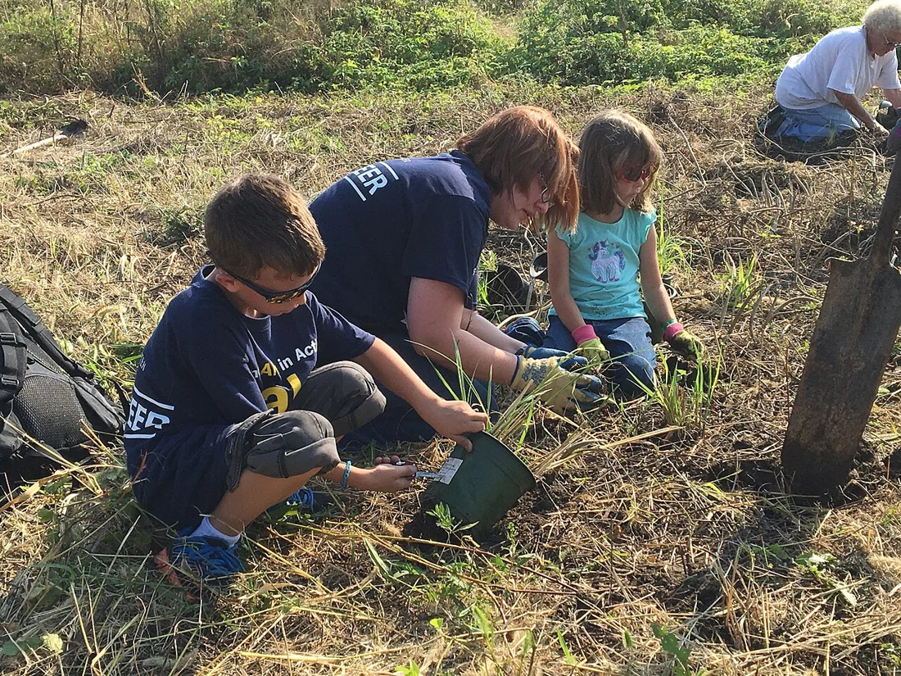

<PhilosophyTopic topic-id="con-nguoi">

<template #notes>

Cùng một người vừa có cơ thể với những nhu cầu tự nhiên, vừa biết nói, lao động, học tập và chịu trách nhiệm trước người khác. Muốn hiểu con người, không thể chỉ giải thích bằng sinh học hoặc chỉ mô tả tư tưởng. Triết học Mác - Lênin đặt con người trong sự thống nhất giữa tự nhiên, hoạt động thực tiễn và những quan hệ xã hội.

## Vấn đề con người trong lịch sử triết học

Các truyền thống triết học đã đặt nhiều câu hỏi về nguồn gốc, bản tính, đạo đức và sự hoàn thiện con người. Trong Nho giáo, việc tu dưỡng và giáo dục giữ vị trí nổi bật. Mạnh Tử chủ trương bản tính con người là thiện. Trái lại, Tuân Tử chủ trương tính ác và đề cao giáo hóa, rèn luyện để cải biến con người.

Đạo gia chú ý sự hài hòa với tự nhiên và phê phán hành động bị dục vọng chi phối. Vô vi trong cách hiểu này không đơn giản là không làm gì. Nó hướng tới hành động không cưỡng ép trái với sự vận động tự nhiên.

Ở phương Tây cổ đại, có những cách giải thích con người từ những yếu tố tự nhiên, đồng thời có những học thuyết nhấn mạnh linh hồn và ý niệm. Trong thời Trung cổ, cách hiểu Kitô giáo về con người có ảnh hưởng lớn. Những thời kỳ sau tiếp tục tranh luận về tự nhiên, tinh thần, tự do và phẩm giá con người.

Các trào lưu Phục hưng và Khai sáng đề cao năng lực, lý trí và những giá trị của con người. Những thành tựu ấy mở rộng cách nhận thức về con người, nhưng chưa tự giải đáp đầy đủ việc đời sống xã hội hình thành nhân cách như thế nào. Triết học Mác chuyển trọng tâm sang con người hiện thực trong hoạt động và quan hệ lịch sử cụ thể.

## Con người là thực thể sinh học - xã hội

Phương diện sinh học thể hiện ở cơ thể, nhu cầu ăn uống, nghỉ ngơi, sinh sản và những quy luật tự nhiên mà con người phải tuân theo. Con người là bộ phận của giới tự nhiên, sống nhờ môi trường và những vật liệu tự nhiên. Hoạt động xã hội không làm cơ thể ngừng chịu các giới hạn ấy.

Phương diện xã hội thể hiện ở lao động, ngôn ngữ, giao tiếp, tư duy và những quan hệ cộng đồng. Con người không chỉ nhận trực tiếp sản phẩm có sẵn. Họ học cách chế tạo phương tiện, phối hợp với người khác và truyền lại kinh nghiệm cho thế hệ sau.

Hai phương diện thống nhất ngay trong một hoạt động. Ăn uống đáp ứng nhu cầu sinh học, nhưng cách chế biến, tổ chức bữa ăn và chuẩn mực ứng xử mang tính xã hội. Giáo dục dựa trên khả năng của cơ thể và bộ não, đồng thời cần ngôn ngữ, tri thức và quan hệ giữa người với người.

Do đó, không thể dùng đặc điểm sinh học để giải thích toàn bộ vị thế, đạo đức hay năng lực của một người. Cũng không thể nhân danh mục tiêu xã hội mà bỏ qua sức khỏe, nhu cầu nghỉ ngơi và điều kiện tự nhiên. Phát triển con người phải tính đến cả hai phương diện.

## Lao động và sự hình thành những năng lực người

Lao động có vai trò đặc biệt vì thông qua lao động, con người cải biến tự nhiên và cải biến bản thân. Khi làm một công cụ, người lao động phải hình dung mục đích, lựa chọn vật liệu và điều chỉnh thao tác. Khi cùng làm việc, họ cần giao tiếp và phối hợp hành động.

Những năng lực ấy được tích lũy qua lịch sử, kết tinh trong sản phẩm, quy trình và tri thức. Thế hệ mới không phải bắt đầu lại toàn bộ từ đầu. Bằng học tập và hoạt động, họ tiếp nhận những thành tựu xã hội rồi có thể tiếp tục biến đổi chúng.

Vai trò của lao động không đồng nghĩa chỉ người trực tiếp tạo sản phẩm vật chất mới có giá trị. Đời sống xã hội còn cần giáo dục, chăm sóc, nghiên cứu và sáng tạo tinh thần. Luận điểm nhấn mạnh vai trò của hoạt động thực tiễn có tính xã hội trong việc hình thành con người.

## Bản chất con người là tổng hòa các quan hệ xã hội

Luận điểm của C. Mác xác định rằng trong tính hiện thực, **bản chất con người** là tổng hòa các quan hệ xã hội. Con người cụ thể hình thành và thể hiện năng lực, nhu cầu, nhân cách trong những quan hệ gia đình, lao động, kinh tế, chính trị, giáo dục và văn hóa.

Tổng hòa không có nghĩa cộng cơ học từng mối quan hệ thành một danh sách. Những quan hệ ấy tác động qua lại và có vai trò khác nhau. Điều kiện lao động ảnh hưởng đến đời sống gia đình, giáo dục ảnh hưởng đến cơ hội nghề nghiệp, còn cộng đồng tạo những chuẩn mực đánh giá hành vi.

Luận điểm cũng không xóa bỏ cơ sở sinh học hay tính độc đáo của cá nhân. Mỗi người tiếp nhận những quan hệ xã hội qua lịch sử sống, hoạt động và lựa chọn riêng. Cùng hoàn cảnh rộng, những trải nghiệm và cách hành động khác nhau vẫn tạo nên những con người khác nhau.

Chẳng hạn, một người học nghề không chỉ tiếp nhận kỹ thuật. Họ còn học cách phối hợp, chịu trách nhiệm về sản phẩm và ứng xử với đồng nghiệp. Khi được chuyển sang môi trường có quyền chủ động khác, những năng lực và cách hành động của họ cũng có điều kiện thay đổi.

Vì vậy, đánh giá con người cần đặt họ trong những quan hệ và hoàn cảnh cụ thể. Một biểu hiện đơn lẻ chưa cho phép suy ra toàn bộ nhân cách. Muốn phát triển con người, không thể chỉ khuyên họ cố gắng mà bỏ qua những điều kiện cản trở việc học tập, lao động và tham gia cộng đồng.

Một sinh viên ít phát biểu có thể im lặng vì chưa hiểu bài, nhưng cũng có thể vì từng bị chế giễu khi nói sai hoặc chưa quen ngôn ngữ học thuật. Nếu chỉ gọi người ấy là thiếu tự tin, ta đã đặt tên cho biểu hiện mà chưa giải thích nó. Quan hệ với thầy cô, bạn học và những trải nghiệm trước đó đều cần được xem xét.

Khi nhóm học tạo cách trao đổi cho phép hỏi lại và sửa ý, người ấy có thể dần nói rõ suy nghĩ hơn. Điều kiện quan hệ đã đổi, nhưng việc đọc, tập diễn đạt và chủ động tham gia vẫn phải do chính người học thực hiện. Bao nhiêu năng lực đang chưa được bộc lộ vì thiếu điều kiện phù hợp? Câu hỏi ấy không xóa trách nhiệm cá nhân, mà giúp trách nhiệm có một con đường thực hiện.

## Con người vừa là sản phẩm, vừa là chủ thể của lịch sử

Mỗi người sinh ra trong những điều kiện tự nhiên và xã hội có trước mình. Họ thừa hưởng ngôn ngữ, công cụ, thiết chế, tri thức và những vấn đề chưa được giải quyết. Theo nghĩa ấy, con người là sản phẩm của lịch sử.

Nhưng con người không chỉ tiếp nhận hoàn cảnh. Bằng lao động, học tập, đấu tranh và tổ chức đời sống chung, họ làm thay đổi các điều kiện đã có. Theo nghĩa ấy, họ là chủ thể sáng tạo lịch sử. Hai mặt không tách rời vì mọi hành động đều có điều kiện, còn điều kiện xã hội có thể được con người cải biến.

Nói con người là chủ thể không có nghĩa muốn gì cũng làm được. Nói con người chịu hoàn cảnh quy định cũng không có nghĩa số phận hoàn toàn bất biến. Cần xác định những khả năng có thật và hoạt động cần thiết để biến khả năng thành hiện thực.

## Tha hóa trong lao động và đời sống xã hội

**Tha hóa** trong phân tích của C. Mác chỉ quá trình hoạt động và sản phẩm do con người tạo ra trở thành những lực lượng xa lạ, đối lập và chi phối con người. Trọng tâm là lao động bị tha hóa trong những quan hệ sở hữu và tổ chức sản xuất xác định.

Người lao động có thể tạo ra sản phẩm nhưng không làm chủ sản phẩm hoặc quá trình tạo ra nó. Hoạt động lẽ ra phát triển năng lực lại chỉ còn là phương tiện bắt buộc để duy trì sự sống. Những sản phẩm và điều kiện lao động do con người tạo nên có thể quay lại chi phối chính người sản xuất.

C. Mác gắn hiện tượng ấy với chế độ tư hữu tư liệu sản xuất và đặc biệt phân tích nó trong quan hệ sản xuất tư bản chủ nghĩa. Vấn đề nằm ở quan hệ xã hội, không chỉ ở thái độ xấu của một người quản lý. Vì vậy, cải thiện cách cư xử chưa đủ để giải quyết mọi cơ sở của tha hóa.

Chẳng hạn, nếu người lao động chỉ được làm những thao tác lặp lại, không có khả năng hiểu hoặc tác động đến quá trình chung, hoạt động có thể hạn chế sự phát triển năng lực của họ. Khi phân tích trường hợp cụ thể, cần xét quyền kiểm soát, mục đích lao động và cách hưởng thành quả. Không thể chỉ thấy máy móc rồi kết luận có tha hóa.

Hãy hình dung một nhóm lao động cùng xây dựng hệ thống ghi nhận tiến độ. Ban đầu, dữ liệu giúp họ nhận ra chỗ công việc bị nghẽn. Về sau, nếu chỉ tiêu do người khác áp đặt khiến họ không được giải thích hoàn cảnh, phương tiện từng được tạo để hỗ trợ có thể quay lại chi phối cách họ làm việc.

Tình huống gợi đến vấn đề tha hóa nhưng chưa đủ để kết luận chỉ cần có dữ liệu hoặc chỉ tiêu là có tha hóa lao động. Cần xét ai kiểm soát hệ thống, người lao động có quyền tác động đến mục đích và quy trình hay không, và thành quả được phân phối thế nào. Một cảm giác chán nản cũng không tự chứng minh toàn bộ quan hệ tha hóa. Phân tích phải đi từ trải nghiệm đến những quan hệ làm trải nghiệm ấy nảy sinh.

## Giải phóng con người và sự phát triển tự do

Trong quan niệm Mác - Lênin, giải phóng con người là khắc phục những quan hệ áp bức, bóc lột và những điều kiện làm con người bị tha hóa. Mục tiêu không chỉ là thay đổi danh nghĩa pháp lý. Con người cần có điều kiện thực tế để lao động sáng tạo, học tập, tham gia xã hội và phát triển năng lực.

Giải phóng cá nhân gắn với giải phóng giai cấp, dân tộc và nhân loại. Một cộng đồng không thể được coi là đã giải phóng đầy đủ nếu những con người cụ thể vẫn bị tước điều kiện phát triển. Ngược lại, tự do cá nhân cần những quan hệ xã hội cho phép người khác cùng phát triển.

Từ đó, sự phát triển tự do của mỗi người và của mọi người được đặt trong quan hệ hỗ trợ nhau. Điều này khác với việc chỉ mở cơ hội cho một số người bằng cách làm suy yếu điều kiện sống của những người còn lại. Việc thực hiện đòi hỏi biến đổi các điều kiện kinh tế, chính trị, văn hóa và giáo dục.

## Cá nhân và xã hội

Cá nhân là con người cụ thể với những nét riêng, đang sống và hoạt động trong một xã hội nhất định. Xã hội không phải thực thể hoàn toàn đứng ngoài các cá nhân. Nó là những quan hệ được con người tạo ra, duy trì và biến đổi qua hoạt động.

Xã hội cung cấp ngôn ngữ, tri thức, tổ chức và cơ hội để cá nhân phát triển. Cá nhân bằng hoạt động của mình tái tạo hoặc thay đổi xã hội. Lợi ích cá nhân và lợi ích chung vì vậy có thể thống nhất, đồng thời có thể xuất hiện mâu thuẫn cần được giải quyết.

Tuyệt đối hóa cá nhân làm mất những điều kiện xã hội của thành tựu riêng. Tuyệt đối hóa tập thể có thể làm mờ nhu cầu, quyền lợi và năng lực sáng tạo của từng người. Cần tìm những cách tổ chức trong đó sự đóng góp và sự phát triển của cá nhân hỗ trợ đời sống chung.

<!-- philosophy-figure -->
<figure class="philosophy-figure">
  
  <figcaption>Hình 3.6: Những người tình nguyện phối hợp trồng cây.</figcaption>
</figure>

Việc trồng một cây có thể là hành động của cá nhân, nhưng việc phục hồi một khu vực cần nhiều năng lực và sự phối hợp. Mỗi người tham gia mang theo kỹ năng và lý do riêng, đồng thời được rèn luyện thêm trong công việc chung. Quan hệ xã hội vì thế vừa tạo điều kiện cho hành động, vừa được con người duy trì hoặc thay đổi qua chính hành động ấy.

## Quần chúng nhân dân và lãnh tụ trong lịch sử

Quần chúng nhân dân là những lực lượng đông đảo có lợi ích cơ bản chung, liên kết hành động để thực hiện những nhiệm vụ lịch sử cụ thể, trước hết là những người lao động. Nội dung cụ thể của khái niệm thay đổi theo thời kỳ và nhiệm vụ lịch sử. Cơ sở lợi ích và sự liên kết hành động giúp phân biệt quần chúng nhân dân với mọi tập hợp đông người.

Quần chúng tạo ra của cải vật chất, sáng tạo những giá trị tinh thần và tham gia thực hiện các biến đổi xã hội. Vì vậy, chủ nghĩa duy vật lịch sử khẳng định vai trò quyết định của họ. Một chủ trương không thể trở thành hiện thực xã hội chỉ bằng tư tưởng của người đề xuất.

Cá nhân kiệt xuất và lãnh tụ có thể nhận ra yêu cầu lịch sử, đề xuất phương hướng, tập hợp và tổ chức lực lượng. Vai trò ấy gắn với điều kiện khách quan và hoạt động của quần chúng. Đề cao lãnh tụ đến mức coi một cá nhân tạo ra toàn bộ lịch sử sẽ dẫn đến sùng bái cá nhân.

Ngược lại, thừa nhận vai trò quần chúng không có nghĩa mọi cá nhân đều tác động như nhau. Năng lực nhận thức, lựa chọn và tổ chức có thể ảnh hưởng lớn đến kết quả. Cần đánh giá cá nhân qua đóng góp thực tế trong quan hệ với cộng đồng và nhiệm vụ lịch sử.

Trong một dự án chung, người trình bày trước công chúng có thể là gương mặt dễ được ghi nhớ nhất. Nhưng kết quả còn dựa vào những người chuẩn bị dữ liệu, thử nghiệm, tổ chức và sửa lỗi. Nhìn thấy lao động tích lũy ấy không làm đóng góp của người đại diện mất đi. Nó đặt đóng góp cá nhân vào mạng lưới hợp tác đã làm nó trở thành hiện thực.

Khi kể lại một thành tựu, ta đã nhìn thấy những người tạo nên điều kiện của nó đến đâu? Từ câu hỏi nhỏ ấy có thể hiểu vì sao nghiên cứu lịch sử vừa cần đánh giá cá nhân kiệt xuất, vừa phải đi vào đời sống và hoạt động của quần chúng. Con người sáng tạo trong những quan hệ có trước mình, rồi bằng hoạt động chung lại mở thêm khả năng cho người đến sau.

## Phát triển con người trong điều kiện Việt Nam

Tư tưởng Hồ Chí Minh gắn độc lập dân tộc với tự do và hạnh phúc của nhân dân, đồng thời coi con người là mục tiêu và động lực của sự phát triển. Mục tiêu hướng vào đời sống của những con người cụ thể. Động lực nằm ở tri thức, năng lực, tinh thần trách nhiệm và hoạt động sáng tạo của họ.

Từ cách tiếp cận ấy, phát triển con người cần quan tâm đồng thời sức khỏe, học vấn, đạo đức, năng lực lao động và cơ hội tham gia xã hội. Giáo dục phải gắn với hoạt động thực tiễn, còn nỗ lực tự rèn luyện cần những điều kiện xã hội hỗ trợ. Đây cũng là sự nối kết giữa phát triển cá nhân và phát triển cộng đồng.

</template>

<template #exercises>

<!-- workbook: WB3-MC02; PDF 82 -->

::: exercise Bài 1

Tiền đề xuất phát của quan điểm duy vật lịch sử là:

- A. Con người trừu tượng.
- B. Con người hành động.
- C. Con người tư duy.
- D. Con người hiện thực.

:::

::: solution

Đáp án: D.

Con người hiện thực là những con người đang sống, hoạt động và sản xuất trong những điều kiện lịch sử xác định. Cách xuất phát này bao gồm tư duy và hành động nhưng không tách chúng khỏi cơ thể, nhu cầu, quan hệ xã hội và điều kiện sinh hoạt vật chất.

:::

<!-- workbook: WB3-MC74; PDF 95 -->

::: exercise Bài 2

Chủ nghĩa duy vật lịch sử coi con người là một bộ phận của giới tự nhiên, còn giới tự nhiên là:

- A. Đối tượng chinh phục của con người.
- B. Đối tượng cải tạo của con người.
- C. Thân thể vô cơ của con người.
- D. Đối tượng vô cơ của con người.

:::

::: solution

Đáp án: C.

“Thân thể vô cơ” chỉ giới tự nhiên bên ngoài cơ thể mà con người phải liên hệ thường xuyên để sống và lao động. Không khí, nước, đất và vật liệu là những điều kiện tồn tại ấy. Cách nói nhấn mạnh sự phụ thuộc và gắn bó với tự nhiên, không cho phép coi tự nhiên chỉ là đối tượng khai thác tùy ý.

:::

<!-- workbook: WB3-MC75; PDF 95 -->

::: exercise Bài 3

Nội dung nào thể hiện đúng nhất quan điểm của chủ nghĩa duy vật lịch sử về con người?

- A. Con người là sản phẩm của lịch sử, luôn chịu tác động của lịch sử.
- B. Con người vừa là chủ thể của lịch sử, vừa là sản phẩm của lịch sử.
- C. Con người sáng tạo ra lịch sử theo mong muốn chủ quan của mình.
- D. Con người vừa là sản phẩm của lịch sử, vừa là bộ phận của lịch sử.

:::

::: solution

Đáp án: B.

Con người tiếp nhận những điều kiện đã có từ lịch sử, đồng thời cải biến chúng bằng hoạt động thực tiễn. Vai trò chủ thể luôn có điều kiện, còn vai trò sản phẩm không đồng nghĩa thụ động. A và D chỉ nhấn mạnh một phía, trong khi C tuyệt đối hóa ý muốn cá nhân.

:::

<!-- workbook: WB3-MC76; PDF 95 -->

::: exercise Bài 4

Điền vào chỗ trống: “Bản chất con người không phải là một cái trừu tượng cố hữu của cá nhân riêng biệt. Trong ...(1)... của nó, bản chất con người là ...(2)... những quan hệ xã hội”.

- A. 1) Tính vật chất, 2) Tổng hòa.
- B. 1) Tính vật chất, 2) Tổng hợp.
- C. 1) Tính hiện thực, 2) Tổng số.
- D. 1) Tính hiện thực, 2) Tổng hòa.

:::

::: solution

Đáp án: D.

Hai cụm cần điền là “tính hiện thực” và “tổng hòa”. Con người phải được xem trong những quan hệ xã hội cụ thể, có lịch sử. Tổng hòa chỉ sự liên hệ và tác động giữa các quan hệ ấy, không phải phép cộng cơ học và cũng không phủ nhận cơ sở sinh học của con người.

:::

<!-- workbook: WB3-MC77; PDF 95 -->

::: exercise Bài 5

Nội dung nào trong các nội dung được nêu dưới đây thể hiện đúng nhất xuất phát điểm nghiên cứu chủ nghĩa duy vật lịch sử của C. Mác và Ph. Ăngghen?

- A. Con người cụ thể.
- B. Con người trừu tượng.
- C. Con người hiện thực.
- D. Con người lý tưởng.

:::

::: solution

Đáp án: C.

“Con người hiện thực” là cách xác định đầy đủ tiền đề: Những con người đang sống và hoạt động trong các điều kiện vật chất, lịch sử nhất định. “Con người cụ thể” ở A có thể gần nghĩa trong cách nói thông thường, nhưng chưa tự xác định nội dung về hoạt động và điều kiện sinh hoạt mà khái niệm đang nhấn mạnh.

:::

<!-- workbook: WB3-MC78; PDF 95 -->

::: exercise Bài 6

Cống hiến quan trọng nhất của triết học Mác về bản chất con người là:

- A. Chỉ ra bản chất con người là chủ thể sáng tạo ra lịch sử.
- B. Chỉ ra hai mặt cơ bản tạo thành bản chất con người là cái sinh học và cái xã hội.
- C. Chỉ ra vai trò của các quan hệ xã hội trong việc hình thành bản chất con người.
- D. Chỉ ra bản chất con người là kết quả của sự tiến hóa lâu dài của giới tự nhiên.

:::

::: solution

Đáp án: C.

C thể hiện bước chuyển từ con người trừu tượng, biệt lập sang con người trong tổng hòa những quan hệ xã hội có lịch sử. Các mặt sinh học, tiến hóa và vai trò sáng tạo đều cần được xét đến, nhưng riêng chúng chưa nêu điểm phát triển có tính quyết định của luận điểm về bản chất xã hội.

:::

<!-- workbook: WB3-MC79; PDF 96 -->

::: exercise Bài 7

Trong các nội dung được nêu dưới đây, nội dung nào KHÔNG thể hiện đúng quan điểm của triết học Mác – Lênin về hiện tượng tha hóa của con người?

- A. Tha hóa con người là phạm trù vĩnh viễn.
- B. Tha hóa con người là hiện tượng mang tính lịch sử.
- C. Tha hóa con người không chỉ tồn tại trong lĩnh vực đạo đức.
- D. Tha hóa con người phát triển cao độ trong xã hội tư bản chủ nghĩa.

:::

::: solution

Đáp án: A.

Tha hóa gắn với những điều kiện xã hội và quan hệ sản xuất xác định, vì vậy có tính lịch sử và có thể được khắc phục khi những điều kiện ấy thay đổi. Nó không chỉ chỉ sự suy thoái đạo đức, mà còn chỉ quan hệ trong đó hoạt động và sản phẩm do con người tạo ra trở thành lực lượng xa lạ, chi phối họ.

:::

<!-- workbook: WB3-MC80; PDF 96 -->

::: exercise Bài 8

Theo quan điểm của triết học Mác – Lênin:

- A. Lịch sử được quyết định bởi quần chúng nhân dân.
- B. Lịch sử được quyết định bởi mệnh trời.
- C. Lịch sử được quyết định bởi cá nhân hào kiệt.
- D. Lịch sử không do ai quyết định, vì nó diễn ra theo quy luật tự nhiên.

:::

::: solution

Đáp án: A.

Quần chúng nhân dân là lực lượng tạo ra của cải, giá trị tinh thần và thực hiện những biến đổi xã hội. Vai trò quyết định của họ không phủ nhận đóng góp của cá nhân kiệt xuất, nhưng đóng góp ấy chỉ được hiện thực hóa trong những điều kiện lịch sử và hoạt động của những lực lượng xã hội cụ thể.

:::

<!-- workbook: WB3-TF18; PDF 98 -->

::: exercise Bài 9

Xác định đúng hoặc sai và giải thích ngắn gọn: Con người vừa có bản chất tự nhiên, vừa có bản chất xã hội.

:::

::: solution

Đáp án: Đúng.

Con người là thực thể sinh học - xã hội thống nhất. Cơ thể và nhu cầu sống thuộc tự nhiên, còn lao động, ngôn ngữ và nhân cách phát triển trong quan hệ xã hội. Tính xã hội giữ vai trò đặc trưng đối với con người hiện thực, nhưng không xóa bỏ những điều kiện sinh học và sinh thái.

:::

<!-- workbook: WB3-TF19; PDF 98 -->

::: exercise Bài 10

Xác định đúng hoặc sai và giải thích ngắn gọn: Con người là sản phẩm thụ động của hoàn cảnh.

:::

::: solution

Đáp án: Sai.

Con người tiếp nhận những điều kiện tự nhiên, lịch sử và xã hội có trước mình, đồng thời cải biến chúng bằng lao động và các hoạt động thực tiễn. Mỗi hành động đều có điều kiện nên không thể tùy ý sáng tạo lịch sử, nhưng sự quy định của hoàn cảnh không tước bỏ vai trò chủ thể.

:::

<!-- workbook: WB3-TF20; PDF 98 -->

::: exercise Bài 11

Xác định đúng hoặc sai và giải thích ngắn gọn: Lịch sử của nhân loại là lịch sử của các vị anh hùng, hào kiệt, các cá nhân kiệt xuất.

:::

::: solution

Đáp án: Sai.

Nhận định tuyệt đối hóa cá nhân và bỏ qua quần chúng nhân dân, lực lượng sản xuất của cải, sáng tạo giá trị tinh thần và thực hiện những biến đổi xã hội. Cá nhân kiệt xuất có thể định hướng, tổ chức và thúc đẩy hành động, nhưng tác dụng ấy gắn với điều kiện khách quan và hoạt động của các lực lượng xã hội.

:::

<!-- workbook: WB3-ES05; PDF 100 -->

::: exercise Bài 12

Hãy giải thích luận điểm của C. Mác: “Trong tính hiện thực của nó, bản chất con người là tổng hòa các quan hệ xã hội”.

:::

::: solution

“Trong tính hiện thực” đặt việc tìm hiểu con người vào đời sống cụ thể. Một người không chỉ là cơ thể sinh học hoặc một chủ thể tư duy trừu tượng. Người ấy sống, lao động, giao tiếp và hình thành nhân cách trong những quan hệ gia đình, kinh tế, chính trị, giáo dục và văn hóa có lịch sử.

“Tổng hòa” không phải tổng số các mối quan hệ được cộng lại một cách cơ học. Những quan hệ ấy tác động qua lại và có vị trí khác nhau. Điều kiện lao động có thể ảnh hưởng tới đời sống gia đình, cơ hội giáo dục ảnh hưởng tới hoạt động nghề nghiệp, còn chuẩn mực cộng đồng định hướng việc đánh giá và lựa chọn hành vi. Bản chất xã hội được hình thành và thể hiện trong sự liên hệ ấy.

Chẳng hạn, một người học nghề không chỉ tiếp thu thao tác kỹ thuật. Trong quan hệ với người hướng dẫn, đồng nghiệp và người sử dụng sản phẩm, họ học sự hợp tác, trách nhiệm và cách đánh giá chất lượng công việc. Khi những quan hệ và cơ hội hoạt động thay đổi, năng lực và cách ứng xử của họ cũng có điều kiện phát triển khác đi.

Luận điểm không phủ nhận cơ sở sinh học, tính độc đáo của cá nhân hoặc khả năng lựa chọn. Con người tiếp nhận hoàn cảnh thông qua hoạt động của chính mình, đồng thời có thể cải biến những quan hệ đang tác động tới mình. Vì vậy, không thể kết luận cá nhân chỉ là sản phẩm thụ động của môi trường.

Ý nghĩa phương pháp là đánh giá con người trong hoàn cảnh và quan hệ cụ thể, đồng thời gắn việc phát triển cá nhân với cải thiện các điều kiện xã hội. Khuyên một người học tập, lao động có trách nhiệm cần đi cùng việc tạo cơ hội tiếp cận tri thức, hợp tác và tham gia đời sống chung. Sự tác động xã hội và nỗ lực tự rèn luyện phải được xem trong mối quan hệ với nhau.

:::

</template>

</PhilosophyTopic>

## Tài liệu tham khảo

1. Hội đồng biên soạn, Phạm Văn Đức (chủ biên, 2019). *Giáo trình Triết học Mác – Lênin*. Dành cho bậc đại học, khối các ngành ngoài lý luận chính trị. Hà Nội. Chương 3, tr. 144–254.
2. Khoa Triết học, Trường Đại học Khoa học Xã hội và Nhân văn (2024). *Bài tập Triết học Mác - Lênin*. Hà Nội. Chương 3, phần Bài tập.
3. U.S. Fish and Wildlife Service. [Những người tình nguyện phối hợp trồng cây.](https://commons.wikimedia.org/wiki/File:Volunteers_Assist_With_Planting_(26402804327).jpg). Phạm vi công cộng. Bản thu nhỏ.
