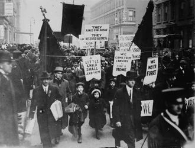

<PhilosophyTopic topic-id="giai-cap-va-dan-toc">

<template #notes>

Một người có thể đồng thời là công nhân, người Việt Nam và thành viên của cộng đồng nhân loại. Ba cách xác định ấy nêu ba phương diện quan hệ khác nhau. Phân tích giai cấp, dân tộc và nhân loại đòi hỏi thấy sự gắn bó giữa chúng mà không biến phương diện này thành tên gọi khác của phương diện kia.

## Giai cấp được xác định từ địa vị trong sản xuất

Khác nhau về nghề nghiệp, mức sống hoặc uy tín chưa đủ để xác định giai cấp. Một người quản lý hưởng lương và một người sở hữu doanh nghiệp có thể cùng điều hành công việc, nhưng quan hệ của họ với tư liệu sản xuất khác nhau. Cần đi từ những quan hệ kinh tế tạo nên địa vị của mỗi tập đoàn người.

Trong định nghĩa của V.I. Lênin, **giai cấp** là những tập đoàn người lớn khác nhau về địa vị trong một hệ thống sản xuất xã hội nhất định trong lịch sử. Sự khác nhau ấy thể hiện qua quan hệ với tư liệu sản xuất, vai trò tổ chức lao động, cách thức và quy mô hưởng của cải xã hội.

Những dấu hiệu này liên hệ chặt chẽ. Quyền đối với tư liệu sản xuất giữ vai trò cơ bản vì tạo điều kiện chi phối việc tổ chức lao động và phân phối thành quả. Trong xã hội có đối kháng giai cấp, sự khác nhau về địa vị cho phép tập đoàn này chiếm đoạt lao động của tập đoàn khác.

Chẳng hạn, quan hệ giữa địa chủ và nông dân không chỉ được mô tả bằng việc một bên giàu, một bên nghèo. Phải xét quyền đối với đất đai, điều kiện người nông dân được sử dụng đất và cách sản phẩm được phân chia. Chính cấu trúc quan hệ ấy giải thích nguồn gốc và sự tái tạo khác biệt.

Thu nhập là một biểu hiện có thể quan sát, nhưng không thay thế toàn bộ các tiêu chí. Cũng không thể suy từ một hành vi cá nhân ra bản chất của cả giai cấp. Phân tích giai cấp nghiên cứu địa vị và quan hệ xã hội có tính cấu trúc, đồng thời cần tính đến những biến đổi của cơ cấu kinh tế.

Giả sử một xưởng có chủ sở hữu, người quản lý hưởng lương và thợ trực tiếp sản xuất. Người quản lý có thể ra lệnh hằng ngày, nhưng không vì thế có quyền bán xưởng hoặc quyết định toàn bộ cách chia lợi nhuận. Một thợ lành nghề có thể có thu nhập cao hơn người quản lý ở thời điểm nào đó. Chỉ nhìn thu nhập hoặc chức danh sẽ chưa làm rõ địa vị của họ.

Điều cần theo dõi là ai có quyền đối với những điều kiện sản xuất, ai làm việc trong quyền tổ chức của ai và mỗi người hưởng kết quả bằng cách nào. Cũng không thể vì người quản lý có thái độ thân thiện mà suy ra quan hệ sở hữu đã thay đổi. Phân tích quan hệ kinh tế và đánh giá cách cư xử cá nhân là hai công việc có liên quan nhưng không thể thay thế nhau.

## Nguồn gốc và tính lịch sử của giai cấp

Trong cách giải thích của chủ nghĩa duy vật lịch sử, giai cấp không phải sự phân chia do đặc điểm sinh học hay một bản tính bất biến tạo nên. Nó gắn với những giai đoạn phát triển nhất định của sản xuất và quan hệ sở hữu.

Sự phát triển lực lượng sản xuất làm năng suất tăng và xuất hiện sản phẩm dư thừa tương đối. Nhờ đó, khả năng một bộ phận sống bằng lao động của bộ phận khác xuất hiện. Phân công lao động, trao đổi và sự tích lũy của cải tiếp tục làm biến đổi những cộng đồng ban đầu.

Đó là điều kiện sâu xa, còn nguyên nhân trực tiếp của sự xuất hiện giai cấp là chế độ tư hữu về tư liệu sản xuất. Khi những điều kiện sản xuất chủ yếu trở thành đối tượng chiếm hữu riêng, các tập đoàn người dần có địa vị kinh tế đối lập. Sự phân hóa được củng cố bằng tổ chức và quyền lực.

Cần phân biệt tư hữu về tư liệu sản xuất với việc mỗi người có vật dụng phục vụ sinh hoạt. Vấn đề lý luận đặt ra không phải mọi đồ vật riêng đều tạo thành giai cấp. Nó liên quan đến quyền kiểm soát những điều kiện mà người khác cần để lao động và duy trì đời sống.

Một xã hội thường có các giai cấp cơ bản gắn với phương thức sản xuất thống trị, cùng những giai cấp khác và tầng lớp trung gian. Tầng lớp có thể tập hợp người theo nghề nghiệp, vai trò chuyên môn hoặc những đặc điểm xã hội khác. Chẳng hạn, trí thức là một tầng lớp có vai trò lao động trí óc, không tạo thành một giai cấp độc lập chỉ vì có học vấn.

Cơ cấu giai cấp và tầng lớp có thể biến đổi khi sản xuất, sở hữu và phân công lao động thay đổi. Vì vậy, không thể bê nguyên cách phân chia của một thời kỳ sang mọi thời kỳ khác.

## Đấu tranh giai cấp và những hình thức của nó

**Đấu tranh giai cấp** là cuộc đấu tranh giữa những tập đoàn người có lợi ích căn bản đối lập trong một phương thức sản xuất xác định. Nguồn gốc của nó nằm ở những quan hệ lợi ích hiện thực. Nó không xuất hiện chỉ vì có một học thuyết mô tả hoặc một cá nhân kêu gọi.

Không phải mọi tranh chấp cá nhân đều là đấu tranh giai cấp. Một bất đồng riêng về lời nói hay tính cách chưa cho thấy sự đối lập giữa những địa vị trong sản xuất. Muốn xác định tính chất giai cấp của một cuộc đấu tranh, cần chỉ rõ lực lượng tham gia, lợi ích, đối tượng và mục tiêu của nó.

Lý luận Mác - Lênin phân tích ba hình thức cơ bản trong cuộc đấu tranh của giai cấp vô sản khi chưa có chính quyền. Đấu tranh kinh tế hướng đến những lợi ích trực tiếp như tiền lương, thời gian và điều kiện lao động. Nó có thể bảo vệ đời sống, tập hợp lực lượng nhưng chưa tự giải quyết vấn đề quyền lực chính trị.

Đấu tranh chính trị hướng vào quyền lực nhà nước và cách tổ chức trật tự xã hội. Đấu tranh tư tưởng làm rõ mục tiêu, quan điểm, đường lối và chống những quan niệm duy trì áp bức. Ba hình thức đan xen, hỗ trợ nhau, nhưng không đồng nhất về nhiệm vụ và mức độ tác động.

Đấu tranh giai cấp được xem là động lực trực tiếp, quan trọng của lịch sử trong xã hội có đối kháng giai cấp. Mâu thuẫn giữa lực lượng sản xuất và quan hệ sản xuất được biểu hiện qua những lực lượng có lợi ích đối lập. Hoạt động của các lực lượng ấy có thể thay đổi những quan hệ đang cản trở phát triển.

Điều này không có nghĩa đấu tranh giai cấp là động lực duy nhất hoặc mọi xung đột đều tạo tiến bộ. Tác dụng lịch sử phụ thuộc vào nhiệm vụ, lực lượng, hoàn cảnh và kết quả. Liên minh giữa các giai cấp, tầng lớp có lợi ích chung cũng là phương diện cần thiết khi phân tích các phong trào xã hội.

<!-- philosophy-figure -->
<figure class="philosophy-figure">
  
  <figcaption>Hình 3.3: Người ủng hộ cuộc đình công ngành dệt Lawrence tuần hành tại New York năm 1912.</figcaption>
</figure>

Một tập hợp người trong ảnh chưa tự cho biết họ thuộc giai cấp nào. Điều cần xét là địa vị của họ trong hệ thống sản xuất và những lợi ích đang được đặt ra. Trong một phong trào lao động, khác biệt về ngôn ngữ hay xuất thân có thể cùng tồn tại với lợi ích kinh tế chung. Bởi vậy, không thể đồng nhất ranh giới giai cấp với mọi ranh giới cộng đồng.

## Những hình thức cộng đồng người trong lịch sử

Giai cấp phân biệt con người theo địa vị kinh tế, còn cộng đồng dân tộc được hình thành qua những liên hệ lịch sử rộng hơn. Để hiểu quá trình ấy, cần nhận biết những hình thức cộng đồng trước dân tộc mà lý luận khái quát.

Thị tộc dựa chủ yếu vào quan hệ huyết thống và đời sống chung. Bộ lạc liên kết nhiều thị tộc, có địa bàn và những sinh hoạt chung rộng hơn. Bộ tộc hình thành từ sự liên kết các bộ lạc trên cơ sở lãnh thổ, kinh tế và văn hóa trong những xã hội đã phân chia giai cấp.

Chiều hướng đáng chú ý là quan hệ huyết thống dần không còn đủ để tổ chức cộng đồng rộng lớn. Những liên hệ kinh tế, lãnh thổ, ngôn ngữ, văn hóa và chính trị trở nên bền vững hơn. Đây là khái quát về sự biến đổi cộng đồng, không phải sơ đồ bắt mọi cộng đồng hiện thực giống nhau ở từng chi tiết.

## Phân biệt hai nghĩa của dân tộc

Trong tiếng Việt, **dân tộc** được dùng theo hai nghĩa. Nghĩa quốc gia - dân tộc chỉ cộng đồng như dân tộc Việt Nam. Nghĩa tộc người chỉ những cộng đồng như người Kinh, Tày hoặc Êđê. Một quốc gia - dân tộc có thể bao gồm nhiều tộc người, vì vậy không được áp mọi đặc trưng của nghĩa này sang nghĩa kia.

Khi xét quốc gia - dân tộc, cần chú ý lãnh thổ, những liên hệ kinh tế ổn định, ngôn ngữ giao tiếp chung, đời sống văn hóa và tổ chức nhà nước. Sự thống nhất của cộng đồng không có nghĩa mọi thành viên chỉ nói một ngôn ngữ hoặc có phong tục giống hệt nhau. Đời sống chung có thể thống nhất trong sự đa dạng.

Khi xét tộc người, trọng tâm là những đặc điểm văn hóa, ngôn ngữ và ý thức cộng đồng hình thành trong lịch sử. Không thể đòi mỗi tộc người đều phải có một nhà nước riêng mới được công nhận là tộc người. Đặc trưng nhà nước và pháp luật thống nhất thuộc cách xem xét quốc gia - dân tộc.

Sự hình thành dân tộc cũng không chỉ là kết quả của huyết thống. Các liên hệ kinh tế thường xuyên làm những địa bàn và nhóm cư dân gắn bó hơn. Cùng với đó, lịch sử chung, văn hóa, ngôn ngữ và tổ chức chính trị góp phần tạo nên cộng đồng bền vững.

Trong một nhóm sinh viên có nhiều tộc người, các thành viên có thể dùng chung tiếng Việt để học tập mà vẫn giữ tiếng mẹ đẻ và phong tục riêng. Sự thống nhất của hoạt động chung không đòi xóa những khác biệt ấy. Ngược lại, chỉ nhấn mạnh nét riêng mà không tạo điều kiện giao tiếp cũng có thể làm một số thành viên khó tham gia.

Nếu nhóm tổ chức một hoạt động chung, thế nào là công bằng trong việc chia việc và ghi nhận đóng góp? Câu trả lời cần tính tới khả năng tiếp cận thông tin, điều kiện thời gian và tiếng nói của từng thành viên. Ví dụ nhỏ không đại diện cho toàn bộ quan hệ dân tộc, nhưng làm rõ vì sao bình đẳng cần được thể hiện trong điều kiện tham gia thực tế, bên cạnh sự thừa nhận về lời nói.

## Quan hệ giữa vấn đề giai cấp và vấn đề dân tộc

Trong xã hội có giai cấp, lợi ích dân tộc được nhận thức và thực hiện thông qua những lực lượng xã hội cụ thể. Các giai cấp có thể có cách giải quyết khác nhau đối với độc lập, thống nhất và con đường phát triển của dân tộc. Vì vậy, nêu lợi ích dân tộc vẫn cần xác định ai được hưởng, ai tham gia và bằng cách nào.

Tuy nhiên, dân tộc không thể thu hẹp thành một giai cấp. Khi một cộng đồng chịu áp bức từ bên ngoài, yêu cầu giành độc lập có thể liên kết những lực lượng khác nhau. Sự khác nhau về địa vị kinh tế không làm yêu cầu chung ấy tự mất đi.

Trong tư tưởng Hồ Chí Minh, giải phóng dân tộc gắn với giải phóng giai cấp và giải phóng con người. Đối với các dân tộc thuộc địa, độc lập tạo tiền đề để nhân dân làm chủ và cải biến đời sống xã hội. Độc lập đồng thời phải gắn với những điều kiện sống, tự do và hạnh phúc thực tế của con người.

Ngay cả một mục tiêu mà mọi người cùng đồng ý cũng có thể chứa những lợi ích khác nhau. Giả sử một khu dân cư muốn giảm khói bụi, nhưng phương án thực hiện khiến người làm nghề thủ công phải chịu toàn bộ chi phí chuyển đổi. Chỉ nhắc đến lợi ích môi trường chưa giải quyết được câu hỏi ai có khả năng trả chi phí và ai cần được hỗ trợ.

Một lợi ích chung sẽ được thực hiện bền vững bằng cách nào nếu những người chịu gánh nặng không có tiếng nói? Nhìn đồng thời lợi ích chung và vị trí cụ thể của các nhóm giúp tránh biến lời kêu gọi đoàn kết thành sự bỏ qua khác biệt. Sự liên kết có sức sống khi con người thấy điều kiện và trách nhiệm của mình được xem xét trong quyết định chung.

## Nhân loại và những lợi ích chung

Nhân loại là toàn thể cộng đồng người trên Trái Đất. Những thành tựu văn minh không chỉ do một quốc gia hay giai cấp riêng lẻ tạo nên. Hoạt động của nhiều thế hệ, nhiều cộng đồng được tích lũy, trao đổi và kế thừa, tạo điều kiện phát triển chung.

Lợi ích nhân loại như hòa bình, bảo vệ môi trường sống và sự tồn tại của con người có ý nghĩa đối với mọi cộng đồng. Những lợi ích ấy không xóa bỏ các khác biệt giai cấp và dân tộc. Chính các lực lượng có lợi ích khác nhau phải cùng tìm cách giải quyết những vấn đề vượt khỏi phạm vi riêng của mình.

Chẳng hạn, bảo vệ môi trường đòi hỏi hợp tác rộng, nhưng chi phí và lợi ích có thể phân bố không đều giữa những nhóm người và quốc gia. Chỉ nói lợi ích chung sẽ chưa đủ nếu bỏ qua sự khác nhau đó. Ngược lại, chỉ giữ lợi ích riêng có thể làm suy yếu điều kiện tồn tại của tất cả.

Quan hệ giai cấp, dân tộc và nhân loại vì vậy cần được xem xét đồng thời. Mỗi phương diện giúp nhận ra một quan hệ lợi ích có thật. Gắn chúng với nhau cho phép phân tích xã hội cụ thể hơn, đồng thời tránh dùng một sự phân chia duy nhất để giải thích mọi hành động của con người.

</template>

<template #exercises>

<!-- workbook: WB3-MC43; PDF 89 -->

::: exercise Bài 1

Theo quan điểm của triết học Mác – Lênin, xã hội đầu tiên xuất hiện giai cấp là xã hội nào?

- A. Xã hội cộng sản nguyên thủy.
- B. Xã hội phong kiến.
- C. Xã hội chiếm hữu nô lệ.
- D. Xã hội tư bản.

:::

::: solution

Đáp án: C.

Trong sơ đồ khái quát các hình thái kinh tế - xã hội, chiếm hữu nô lệ là xã hội có giai cấp đầu tiên. Cộng sản nguyên thủy chưa có sự phân hóa giai cấp. Sự xuất hiện giai cấp gắn với lực lượng sản xuất phát triển, sản phẩm dư thừa và chế độ tư hữu.

:::

<!-- workbook: WB3-MC44; PDF 89 -->

::: exercise Bài 2

Theo quan điểm của triết học Mác – Lênin, trong xã hội có giai cấp đối kháng, giai cấp nào sẽ là giai cấp thống trị?

- A. Giai cấp đông đảo nhất trong xã hội.
- B. Giai cấp đóng vai trò là lực lượng sản xuất chủ yếu của xã hội.
- C. Giai cấp nắm quyền sở hữu tư liệu sản xuất chủ yếu của xã hội.
- D. Tầng lớp có trình độ hiểu biết về khoa học cao nhất trong xã hội.

:::

::: solution

Đáp án: C.

Quyền sở hữu những tư liệu sản xuất chủ yếu tạo cơ sở kinh tế cho sự thống trị giai cấp. Số lượng người, mức độ trực tiếp lao động hay học vấn không tự tạo ra địa vị ấy. Khi nghiên cứu lịch sử cụ thể, còn cần phân tích cách quyền lực kinh tế được tổ chức thành quyền lực chính trị.

:::

<!-- workbook: WB3-MC45; PDF 89, 90 -->

::: exercise Bài 3

Nhận định nào sau đây là SAI với quan điểm của triết học Mác – Lênin?

- A. Giai cấp cơ bản của xã hội là các giai cấp được sinh ra từ chính phương thức sản xuất đang giữ địa vị thống trị trong xã hội đó.
- B. Trong mỗi xã hội có giai cấp, ngoài giai cấp cơ bản còn tồn tại các giai cấp không cơ bản và tầng lớp trung gian.
- C. Giai cấp gắn với phương thức sản xuất tàn dư của xã hội cũ là giai cấp không cơ bản của xã hội.
- D. Trí thức là một giai cấp cơ bản trong xã hội.

:::

::: solution

Đáp án: D.

Trí thức được xác định chủ yếu bởi đặc điểm lao động trí óc và trình độ chuyên môn, nên là một tầng lớp xã hội. Họ có thể xuất thân và gắn với các địa vị kinh tế khác nhau. Chỉ có học vấn hoặc nghề nghiệp chung chưa tạo thành một giai cấp theo tiêu chí quan hệ với tư liệu sản xuất.

:::

<!-- workbook: WB3-MC46; PDF 90 -->

::: exercise Bài 4

Theo quan điểm của triết học Mác – Lênin, đâu là nguyên nhân trực tiếp quyết định sự ra đời giai cấp?

- A. Sự phân công lao động xã hội phát triển, tách lao động trí óc khỏi lao động chân tay.
- B. Năng suất lao động cao có sản phẩm dư thừa tương đối.
- C. Sự xuất hiện chế độ sở hữu tư nhân về tư liệu sản xuất.
- D. Công cụ sản xuất bằng kim loại thay thế công cụ bằng đá.

:::

::: solution

Đáp án: C.

Sản phẩm dư thừa và sự phát triển công cụ tạo điều kiện sâu xa cho phân hóa xã hội. Chế độ sở hữu tư nhân về tư liệu sản xuất là nguyên nhân trực tiếp vì làm xuất hiện những tập đoàn có quyền kiểm soát điều kiện sản xuất khác nhau, từ đó có khả năng chiếm đoạt lao động của nhau.

:::

<!-- workbook: WB3-MC47; PDF 90 -->

::: exercise Bài 5

Theo quan điểm của triết học Mác – Lênin, trong xã hội tư bản chủ nghĩa, giai cấp tư sản là giai cấp thống trị bởi vì:

- A. Giai cấp tư sản đông đảo nhất trong xã hội.
- B. Giai cấp tư sản là lực lượng trực tiếp sản xuất ra của cải của xã hội.
- C. Giai cấp tư sản là giai cấp sở hữu tư liệu sản xuất chủ yếu trong xã hội.
- D. Giai cấp tư sản có trình độ văn hóa, khoa học kỹ thuật cao.

:::

::: solution

Đáp án: C.

Địa vị thống trị được giải thích trước hết từ quyền sở hữu tư liệu sản xuất chủ yếu. Quyền ấy tạo khả năng chi phối tổ chức sản xuất và phân phối, đồng thời làm cơ sở cho quyền lực chính trị. Nó không được xác định bằng số lượng thành viên hay học vấn của từng cá nhân.

:::

<!-- workbook: WB3-MC48; PDF 90 -->

::: exercise Bài 6

Theo quan điểm của triết học Mác – Lênin, nguyên nhân khách quan của đấu tranh giai cấp là:

- A. Do một lý thuyết khoa học về giai cấp thúc đẩy quần chúng nhân dân nổi dậy.
- B. Do sự lôi kéo của một thủ lĩnh có uy tín trong nhân dân phát động và lãnh đạo.
- C. Do sự nghèo khổ của quần chúng nhân dân.
- D. Do mâu thuẫn giữa trình độ phát triển của lực lượng sản xuất xã hội với quan hệ sản xuất đã trở nên lỗi thời.

:::

::: solution

Đáp án: D.

Mâu thuẫn kinh tế được biểu hiện thành xung đột lợi ích giữa những lực lượng xã hội gắn với quan hệ sản xuất cũ và những lực lượng đòi hỏi thay đổi. Học thuyết và người tổ chức có thể ảnh hưởng đến nhận thức, hình thức đấu tranh nhưng không tạo ra nguyên nhân kinh tế khách quan của nó.

:::

<!-- workbook: WB3-MC49; PDF 90 -->

::: exercise Bài 7

Nhận định nào dưới đây là SAI với quan điểm của triết học Mác – Lênin về đấu tranh giai cấp?

- A. Trong thời kỳ quá độ đi lên chủ nghĩa xã hội ở Việt Nam vẫn tồn tại giai cấp và đấu tranh giai cấp.
- B. Trong thời kỳ quá độ đi lên chủ nghĩa xã hội ở Việt Nam do không còn đối kháng giai cấp nên không còn đấu tranh giai cấp.
- C. Trong thời kỳ quá độ ở Việt Nam, cuộc đấu tranh giai cấp diễn ra trên nhiều lĩnh vực với nội dung và hình thức khác nhau.
- D. Đấu tranh trên lĩnh vực kinh tế là một biểu hiện của cuộc đấu tranh giai cấp trong thời kỳ quá độ đi lên chủ nghĩa xã hội ở Việt Nam.

:::

::: solution

Đáp án: B.

B phủ nhận đấu tranh giai cấp trong thời kỳ quá độ. Trong hệ thống lý luận đang xét, các giai cấp, khác biệt lợi ích và những lực lượng cản trở phát triển vẫn tồn tại, còn nội dung và hình thức đấu tranh đã biến đổi. Không thể đồng nhất đấu tranh giai cấp với mọi bất đồng hoặc mặc định nó chỉ có hình thức bạo lực.

:::

<!-- workbook: WB3-MC50; PDF 90, 91 -->

::: exercise Bài 8

Nhận định nào dưới đây là SAI với quan điểm của triết học Mác – Lênin?

- A. Giai cấp tồn tại trong mọi xã hội.
- B. Giai cấp là một phạm trù lịch sử.
- C. Giai cấp là những tập đoàn người mà tập đoàn này có thể chiếm đoạt lao động của tập đoàn khác.
- D. Sự ra đời của giai cấp không phụ thuộc vào ý muốn chủ quan của con người.

:::

::: solution

Đáp án: A.

Giai cấp chỉ xuất hiện khi có những điều kiện kinh tế - xã hội nhất định, vì thế là phạm trù lịch sử. Xã hội cộng sản nguyên thủy chưa phân chia giai cấp. Những tập đoàn trong quan hệ giai cấp khác nhau về địa vị sản xuất, không chỉ về mức thu nhập hoặc sở thích.

:::

<!-- workbook: WB3-MC51; PDF 91 -->

::: exercise Bài 9

Theo chủ nghĩa duy vật lịch sử, trong xã hội có giai cấp:

- A. Bất cứ giai cấp nào cũng có thể làm cho hệ tư tưởng của nó trở thành hệ tư tưởng thống trị trong toàn xã hội.
- B. Chỉ có đội ngũ trí thức mới có thể làm cho hệ tư tưởng của nó trở thành hệ tư tưởng thống trị trong toàn xã hội.
- C. Chỉ có giai cấp nắm quyền sở hữu tư liệu sản xuất chủ yếu mới có thể làm cho hệ tư tưởng của nó trở thành hệ tư tưởng thống trị trong toàn xã hội.
- D. Chỉ có giai cấp ưu tú trong xã hội mới có thể làm cho hệ tư tưởng của nó trở thành tư tưởng thống trị trong toàn xã hội.

:::

::: solution

Đáp án: C.

C phản ánh mối liên hệ giữa địa vị thống trị về kinh tế và sức mạnh tổ chức, truyền bá hệ tư tưởng trong trật tự xã hội xác định. Điều này không có nghĩa giai cấp bị trị không có hệ tư tưởng riêng hoặc tư tưởng thống trị được mọi người chấp nhận hoàn toàn. Sự tác động tư tưởng vẫn có đấu tranh, kế thừa và ảnh hưởng qua lại.

:::

<!-- workbook: WB3-MC56; PDF 92 -->

::: exercise Bài 10

Nhận định nào sau đây là SAI?

- A. Giai cấp bị trị chịu ảnh hưởng tư tưởng của giai cấp thống trị.
- B. Giai cấp thống trị không chịu ảnh hưởng tư tưởng của giai cấp bị trị.
- C. Giai cấp bị trị có thể có hệ tư tưởng riêng của mình.
- D. Giai cấp thống trị luôn tìm cách áp đặt hệ tư tưởng của mình cho các giai cấp khác.

:::

::: solution

Đáp án: B.

Sự tác động tư tưởng không chỉ diễn ra một chiều. Các giai cấp có thể chịu ảnh hưởng của nhau thông qua tranh luận, đấu tranh và đời sống chung, dù khả năng tổ chức và truyền bá không ngang nhau. Có địa vị thống trị không có nghĩa đứng ngoài mọi ảnh hưởng tư tưởng của lực lượng bị trị.

:::

<!-- workbook: WB3-MC63; PDF 93 -->

::: exercise Bài 11

Khái niệm nào sau đây được dùng để chỉ một cộng đồng người ổn định được hình thành trong lịch sử trong một lãnh thổ nhất định, có chung mối liên hệ về kinh tế, ngôn ngữ và một nền văn hóa?

- A. Bộ lạc.
- B. Dân tộc.
- C. Quốc gia.
- D. Bộ tộc.

:::

::: solution

Đáp án: B.

Các dấu hiệu về lãnh thổ, liên hệ kinh tế, ngôn ngữ và văn hóa hướng đến khái niệm dân tộc theo nghĩa cộng đồng lịch sử rộng lớn. Cần phân biệt với bộ lạc dựa nhiều vào liên kết thị tộc và với quốc gia như một tổ chức cộng đồng chính trị. Trong tiếng Việt, dân tộc còn có nghĩa tộc người, nên phải đọc đúng ngữ cảnh của câu hỏi.

:::

<!-- workbook: WB3-TF12; PDF 97 -->

::: exercise Bài 12

Xác định đúng hoặc sai và giải thích ngắn gọn: Sự khác nhau về giai cấp là do có sự khác nhau về nòi giống.

:::

::: solution

Đáp án: Sai.

Giai cấp được xác định bằng địa vị trong hệ thống sản xuất, quan hệ với tư liệu sản xuất, vai trò tổ chức lao động và cách hưởng của cải xã hội. Nòi giống hoặc những đặc điểm sinh học không phải căn cứ phân chia này. Những người cùng tộc người có thể thuộc những giai cấp khác nhau.

:::

<!-- workbook: WB3-TF13; PDF 97 -->

::: exercise Bài 13

Xác định đúng hoặc sai và giải thích ngắn gọn: Chủ nghĩa dân tộc và đấu tranh giai cấp không có liên quan gì với nhau.

:::

::: solution

Đáp án: Sai.

Quan điểm về dân tộc được hình thành và thực hiện bởi những lực lượng xã hội có lợi ích cụ thể, nên có liên hệ với quan hệ và đấu tranh giai cấp. Tuy nhiên, không thể đồng nhất lợi ích dân tộc với lợi ích riêng của một giai cấp. Cũng cần phân biệt lòng yêu nước và yêu cầu độc lập dân tộc với chủ nghĩa dân tộc hẹp hòi, cực đoan.

:::

<!-- workbook: WB3-TF14; PDF 98 -->

::: exercise Bài 14

Xác định đúng hoặc sai và giải thích ngắn gọn: Ở các thị tộc và bộ lạc thời nguyên thủy chưa có sự phân hóa giai cấp.

:::

::: solution

Đáp án: Đúng.

Nhận định đúng khi nói về thị tộc, bộ lạc trong chế độ cộng sản nguyên thủy. Lực lượng sản xuất còn thấp và quan hệ cộng đồng chưa tạo thành sự phân chia các giai cấp đối kháng. Cuối thời nguyên thủy, sự phát triển sản xuất và tư hữu mới dẫn đến phân hóa, nên không được gán tình trạng không có giai cấp cho mọi cộng đồng mang tên bộ lạc ở mọi thời điểm.

:::

<!-- workbook: WB3-TF15; PDF 98 -->

::: exercise Bài 15

Xác định đúng hoặc sai và giải thích ngắn gọn: Trí thức là một giai cấp quan trọng trong xã hội hiện đại.

:::

::: solution

Đáp án: Sai.

Trí thức là một tầng lớp có đặc trưng lao động trí óc và chuyên môn, không phải một giai cấp riêng chỉ vì có trình độ học vấn. Các thành viên có thể có quan hệ sở hữu và địa vị sản xuất khác nhau. Việc sửa cách phân loại không làm giảm vai trò của tri thức và đội ngũ trí thức đối với phát triển xã hội.

:::

<!-- workbook: WB3-ES03; PDF 99 -->

::: exercise Bài 16

Tại sao nói mâu thuẫn giai cấp là biểu hiện xã hội của mâu thuẫn giữa lực lượng sản xuất và quan hệ sản xuất?

:::

::: solution

Lực lượng sản xuất và quan hệ sản xuất không tồn tại bên ngoài hoạt động của con người. Một quan hệ sở hữu, tổ chức hoặc phân phối luôn gắn với những tập đoàn có địa vị và lợi ích khác nhau. Vì vậy, mâu thuẫn kinh tế có thể được biểu hiện thành quan hệ giữa những lực lượng xã hội cụ thể.

Khi quan hệ sản xuất cũ đã trở thành trở lực đối với sự phát triển lực lượng sản xuất, giai cấp được hưởng lợi từ quan hệ ấy có xu hướng bảo vệ nó. Những lực lượng gắn với yêu cầu phát triển mới lại có lợi ích trong việc thay đổi các quan hệ đang cản trở. Sự đối lập không chỉ là bất đồng nhận thức mà bắt nguồn từ địa vị trong hệ thống sản xuất và cách hưởng của cải xã hội.

Trong phân tích về xã hội tư bản chủ nghĩa của Mác, tính xã hội hóa ngày càng cao của sản xuất mâu thuẫn với quan hệ chiếm hữu tư nhân tư bản chủ nghĩa. Về mặt xã hội, mâu thuẫn được biểu hiện tập trung trong quan hệ giữa giai cấp công nhân và giai cấp tư sản. Muốn hiểu biểu hiện ấy phải nối yêu cầu phát triển sản xuất với quan hệ sở hữu, tổ chức lao động và phân phối.

Tuy nhiên, không được quy mọi tranh chấp hoặc mọi mâu thuẫn giai cấp riêng lẻ trực tiếp về một thay đổi kỹ thuật. Chúng còn chịu tác động của chính trị, tư tưởng và điều kiện lịch sử. Đấu tranh giai cấp là một phương thức xã hội để giải quyết mâu thuẫn trong xã hội có đối kháng, còn kết quả cụ thể phụ thuộc vào lực lượng, mục tiêu và khả năng tổ chức thực tiễn.

:::

</template>

</PhilosophyTopic>

## Tài liệu tham khảo

1. Hội đồng biên soạn, Phạm Văn Đức (chủ biên, 2019). *Giáo trình Triết học Mác – Lênin*. Dành cho bậc đại học, khối các ngành ngoài lý luận chính trị. Hà Nội. Chương 3, tr. 144–254.
2. Khoa Triết học, Trường Đại học Khoa học Xã hội và Nhân văn (2024). *Bài tập Triết học Mác - Lênin*. Hà Nội. Chương 3, phần Bài tập.
3. Hồ sơ Lawrence Textile Strike, 1912. [Người ủng hộ cuộc đình công ngành dệt Lawrence tuần hành tại New York năm 1912.](https://commons.wikimedia.org/wiki/File:Lawrence_textile_strikers_parading_in_New_York_City.png). Phạm vi công cộng. Bản thu nhỏ.
