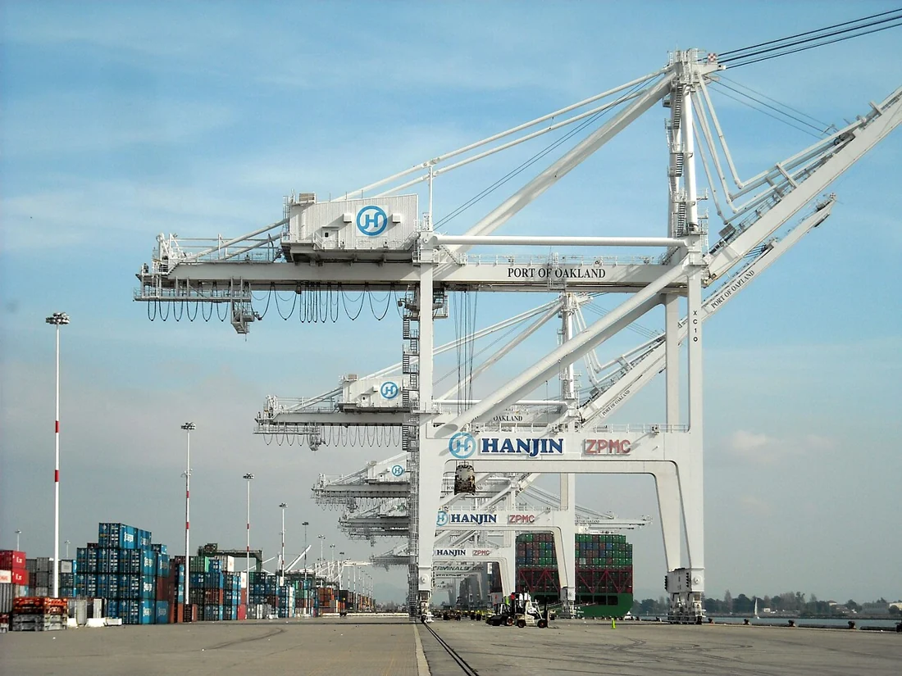

<PhilosophyTopic topic-id="hinh-thai-kinh-te-xa-hoi">

<template #notes>

Một hoạt động kinh tế luôn diễn ra trong những quy tắc về sở hữu, quyền hạn và trách nhiệm. Các quy tắc ấy lại được thể hiện bằng pháp luật, thiết chế và quan niệm xã hội. Muốn hiểu một xã hội, cần thấy quan hệ giữa nền tảng kinh tế với toàn bộ cách tổ chức đời sống chung.

## Cơ sở hạ tầng trong nghĩa triết học

**Cơ sở hạ tầng** là toàn bộ những quan hệ sản xuất hợp thành cơ cấu kinh tế của một xã hội. Trong nghĩa này, nó không chỉ đường sá, cầu cống hay hệ thống điện. Những công trình ấy là điều kiện vật chất, còn khái niệm đang xét chỉ các quan hệ giữa người với người trong sản xuất.

Cơ sở hạ tầng của một xã hội có thể gồm nhiều kiểu quan hệ sản xuất. Có quan hệ giữ địa vị thống trị, có tàn dư của quan hệ cũ và có mầm mống của quan hệ mới. Quan hệ thống trị quy định đặc trưng chủ yếu của cơ cấu kinh tế, nhưng không làm những quan hệ khác lập tức biến mất.

Điều này giúp hiểu vì sao trong cùng một xã hội có thể tồn tại những cách sở hữu, tổ chức và phân phối khác nhau. Nghiên cứu xã hội cần xác định quan hệ nào đang giữ vai trò chủ đạo và các quan hệ tác động đến nhau ra sao. Không thể lấy một hiện tượng kinh tế riêng lẻ đại diện cho toàn bộ cơ cấu.

Có thể bắt đầu từ một cửa hàng bán hàng qua mạng. Những chiếc điện thoại, kho chứa và đường truyền là điều kiện kỹ thuật. Quan hệ giữa người sở hữu cửa hàng, người làm thuê và những bên cùng góp vốn mới là các quan hệ kinh tế cần xét. Cùng một kho hàng có thể được sử dụng trong những quan hệ sở hữu và phân phối rất khác nhau.

Nếu đường truyền được nâng cấp, cơ sở hạ tầng trong nghĩa triết học đã thay đổi hay chưa? Chưa thể kết luận chỉ từ việc ấy. Cần xem sự cải tiến kỹ thuật có làm biến đổi quan hệ sở hữu, quản lý hoặc phân phối hay không. Nhờ vậy, ta tránh lấy hình ảnh một con đường hay một nhà máy để thay cho quan hệ xã hội mà khái niệm muốn nhận diện.

<!-- philosophy-figure -->
<figure class="philosophy-figure">
  
  <figcaption>Hình 3.2: Cần cẩu và container tại một cảng hàng hóa.</figcaption>
</figure>

Cảng và cần cẩu là những công trình, phương tiện vật chất có thể nhìn thấy. Chúng không đồng nghĩa với “cơ sở hạ tầng” trong nghĩa triết học đang dùng ở đây. Muốn phân tích cơ sở kinh tế, phải hỏi về quan hệ sở hữu, tổ chức quản lý và phân phối gắn với hoạt động tại cảng. Hình ảnh công trình chỉ mở đầu việc tìm hiểu các quan hệ ấy.

## Kiến trúc thượng tầng gồm tư tưởng và thiết chế

**Kiến trúc thượng tầng** là toàn bộ những quan điểm, tư tưởng xã hội cùng những thiết chế tương ứng và các quan hệ nội tại của chúng, hình thành trên một cơ sở hạ tầng nhất định. Nó bao gồm các quan điểm chính trị, pháp quyền, đạo đức, tôn giáo, nghệ thuật, triết học và những tổ chức gắn với chúng.

Nhà nước, các tổ chức chính trị và các thiết chế tôn giáo là những bộ phận có cách tổ chức, phương tiện hoạt động khác nhau. Vì vậy, kiến trúc thượng tầng không chỉ tồn tại trong đầu óc dưới dạng ý niệm. Tư tưởng còn được tổ chức thành hoạt động, quy tắc và bộ máy có khả năng tác động đến xã hội.

Các bộ phận không liên hệ với kinh tế bằng cùng một con đường. Chính trị và pháp luật gắn khá trực tiếp với những quan hệ kinh tế, chẳng hạn xác định quyền sở hữu và trách nhiệm trong trao đổi. Nghệ thuật, tôn giáo hay triết học thường liên hệ thông qua nhiều khâu trung gian và truyền thống tư tưởng.

Trong xã hội có đối kháng giai cấp, kiến trúc thượng tầng cũng có những quan điểm và tổ chức đối lập nhau. Tư tưởng giữ địa vị thống trị không phải tư tưởng duy nhất tồn tại. Những lực lượng phê phán trật tự hiện có cũng hình thành quan điểm, cách tổ chức và hoạt động của mình.

## Cơ sở hạ tầng quyết định kiến trúc thượng tầng

Luận điểm này xác định rằng nguồn gốc, tính chất và sự biến đổi căn bản của kiến trúc thượng tầng xét đến cùng phải được giải thích từ những quan hệ kinh tế hiện thực. Một trật tự sở hữu cần những quy tắc và thiết chế bảo vệ nó. Những lợi ích khác nhau cũng tạo cơ sở cho những quan điểm chính trị, pháp lý khác nhau.

Khi cơ cấu kinh tế biến đổi sâu sắc, các quy tắc và tổ chức tương ứng đứng trước yêu cầu thay đổi. Tuy nhiên, không phải mọi yếu tố tinh thần đều thay đổi ngay sau một biến động kinh tế. Một số quan niệm, tập quán và giá trị có thể tiếp tục tồn tại, được cải biến hoặc được kế thừa trong hoàn cảnh mới.

Chẳng hạn, khi quan hệ trao đổi mở rộng vượt khỏi những cộng đồng nhỏ, những tập quán giao dịch chỉ dựa vào quen biết có thể trở nên không đủ. Nhu cầu xác định quyền, nghĩa vụ và xử lý tranh chấp đặt ra yêu cầu đối với các thiết chế. Ví dụ cho thấy một cơ chế liên hệ, không thay thế việc nghiên cứu lịch sử của từng xã hội.

## Kiến trúc thượng tầng tác động trở lại kinh tế

Kiến trúc thượng tầng có tính độc lập tương đối. Một thiết chế sau khi hình thành có tổ chức, phương tiện và cách vận động riêng. Nó có thể bảo vệ quan hệ kinh tế hiện có, điều chỉnh cách hoạt động của các chủ thể hoặc hỗ trợ hình thành những quan hệ mới.

Nhà nước có vai trò đặc biệt vì sử dụng quyền lực công và hệ thống pháp luật. Những quy định về sở hữu, phân phối và tổ chức sản xuất có thể mở đường hoặc gây trở ngại cho hoạt động kinh tế. Đạo đức, tôn giáo và tư tưởng cũng ảnh hưởng đến động cơ, niềm tin và cách hợp tác của con người.

Một quy định giúp các bên biết rõ quyền và trách nhiệm có thể tạo điều kiện cho hợp tác ổn định. Trái lại, quy định không phù hợp với khả năng thực tế có thể khiến hoạt động sản xuất khó thực hiện. Tác dụng ấy phải được đánh giá qua hoạt động và kết quả thực tế, không chỉ qua mục đích được tuyên bố.

Vì thế, xác định vai trò quyết định của kinh tế không đồng nghĩa chờ kinh tế tự giải quyết mọi vấn đề chính trị. Đồng thời, sức mạnh của thiết chế không cho phép ý chí chính trị tạo ra tùy ý những năng lực vật chất còn thiếu. Hai cách tuyệt đối hóa ấy đều cắt đứt quan hệ đang cần giải thích.

Khi cửa hàng mở rộng và giao dịch với nhiều người chưa từng gặp, lời hứa miệng dựa vào quen biết có thể không còn đủ. Các bên cần xác định cách chứng minh giao hàng, trách nhiệm khi sản phẩm hỏng và phương thức giải quyết bất đồng. Những yêu cầu kinh tế ấy tạo vấn đề cho hoạt động pháp lý và quản lý. Tư tưởng và thiết chế xuất hiện trong một nhu cầu đời sống có thể nhận diện được.

Chiều tác động trở lại cũng rõ. Một cách xử lý tranh chấp đáng tin cậy có thể giúp các bên mạnh dạn hợp tác. Một thủ tục quá rườm rà có thể làm họ ngại giao dịch. Tuy vậy, quy tắc rõ ràng chưa thay thế được hàng hóa, kỹ năng và phương tiện vận chuyển. Muốn đánh giá tác dụng của thể chế, cần nhìn cả khả năng thực hiện và những lợi ích mà nó phân bố.

## Quan hệ kinh tế và chính trị trong quá trình biến đổi xã hội

Vai trò quyết định của cơ sở hạ tầng không có nghĩa mọi biến đổi chính trị đều phải chờ một cơ cấu kinh tế mới hoàn chỉnh. Chính trị có thể tác động tới việc tổ chức, bảo vệ hoặc cải biến những quan hệ kinh tế đang tồn tại. Khả năng tác động ấy vẫn cần được xét trong điều kiện vật chất và tương quan lực lượng cụ thể.

Khi những quan hệ mới xuất hiện bên cạnh quan hệ cũ, các lực lượng xã hội có thể có những yêu cầu khác nhau về luật pháp và tổ chức quyền lực. Sự biến đổi vì thế không diễn ra như việc đổi đồng thời mọi bộ phận của một cỗ máy. Các mặt có thể thay đổi không cùng nhịp, làm nảy sinh những mâu thuẫn cần giải quyết.

Trong thời kỳ quá độ, việc xây dựng quan hệ kinh tế và thiết chế tương ứng thường là quá trình từng bước. Cơ cấu kinh tế còn đa dạng thì không thể chỉ nhìn vào một hình thức riêng để kết luận toàn bộ nền tảng xã hội đã đồng nhất. Cần nghiên cứu vai trò của từng thành phần và sự tác động giữa chúng.

Phương diện chủ động của chính trị thể hiện ở việc nhận ra yêu cầu khách quan và lựa chọn cách tác động phù hợp. Nếu đặt mục tiêu vượt quá những điều kiện có thể tạo dựng, ý chí chính trị không thay thế được năng lực sản xuất còn thiếu. Nếu chỉ chờ kinh tế tự điều chỉnh, những trở lực thể chế lại có thể tiếp tục kìm hãm hoạt động.

Quan hệ này làm rõ ý nghĩa của việc xem xã hội như một chỉnh thể lịch sử. Quyết định về tổ chức và pháp luật cần gắn với cơ cấu kinh tế, nhưng vẫn phải được đánh giá về nội dung, cách thực hiện và tác dụng trở lại. Chỉ nhắc vai trò của kinh tế hoặc chính trị riêng rẽ sẽ chưa giải thích được biến đổi.

## Hình thái kinh tế - xã hội là một chỉnh thể lịch sử

**Hình thái kinh tế - xã hội** chỉ xã hội ở một giai đoạn lịch sử nhất định, có quan hệ sản xuất đặc trưng, gắn với một trình độ lực lượng sản xuất và kiến trúc thượng tầng tương ứng. Khái niệm này kết hợp những yếu tố đã học thành một cách xem xét xã hội trong tính chỉnh thể.

Lực lượng sản xuất tạo nền tảng vật chất và năng lực cải biến tự nhiên. Quan hệ sản xuất tạo cơ cấu kinh tế, đồng thời là căn cứ phân biệt bản chất các chế độ xã hội. Kiến trúc thượng tầng thể hiện đời sống chính trị, tư tưởng và những thiết chế tương ứng. Không yếu tố nào tồn tại hoàn toàn biệt lập.

Học thuyết khái quát tiến trình lịch sử qua những hình thái như cộng sản nguyên thủy, chiếm hữu nô lệ, phong kiến, tư bản chủ nghĩa và cộng sản chủ nghĩa. Trong hệ thống lý luận này, xã hội xã hội chủ nghĩa được xem là giai đoạn đầu của hình thái cộng sản chủ nghĩa.

Những tên gọi ấy là kết quả khái quát lý luận về các cấu trúc xã hội. Khi nghiên cứu một quốc gia, vẫn phải xác định các quan hệ hiện thực và điều kiện lịch sử cụ thể. Không thể chỉ gắn một nhãn rồi suy ra mọi mặt của đời sống xã hội đều thuần nhất.

Hãy hình dung một địa phương tiếp cận được công nghệ mới nhờ trao đổi với bên ngoài. Người dân không nhất thiết chế tạo lại từng thế hệ máy móc từng xuất hiện trong lịch sử. Họ có thể học và sử dụng thành tựu đã có. Nhưng để máy hoạt động lâu dài vẫn cần người vận hành, nguồn năng lượng, vốn và cách tổ chức phù hợp.

Sự tiếp thu ấy giúp hiểu khả năng phát triển rút ngắn mà không giản lược toàn bộ biến đổi xã hội thành chuyện nhập công nghệ. Thành tựu có thể được kế thừa, còn những điều kiện làm chủ nó phải được tạo dựng. Khi nghe một lời hứa “đi tắt”, ta có thể tiếp tục hỏi: Những khâu nào thực sự được kế thừa, và những điều kiện nào vẫn cần kiên trì xây dựng?

## Quá trình lịch sử - tự nhiên không phải một lịch trình máy móc

Gọi sự phát triển các hình thái là quá trình lịch sử - tự nhiên có hai ý nghĩa gắn nhau. Lịch sử vận động dưới tác động của những quy luật khách quan. Nhưng các quy luật xã hội chỉ được thực hiện thông qua hoạt động có ý thức của những con người trong hoàn cảnh xác định.

Con người không tự chọn được toàn bộ điều kiện xuất phát. Họ thừa hưởng công cụ, quan hệ, tri thức và những mâu thuẫn của các thế hệ trước. Tuy vậy, cách nhận thức và giải quyết các mâu thuẫn ấy có thể ảnh hưởng đến hướng đi, nhịp độ và hình thức biến đổi xã hội.

Tính quy luật không đòi mọi dân tộc phải trải qua đầy đủ một trình tự giống hệt nhau. Sự giao lưu và kế thừa thành tựu từ các xã hội khác tạo khả năng phát triển rút ngắn. Khả năng ấy vẫn cần những tiền đề vật chất và năng lực chủ thể tương ứng, không thể có chỉ bằng mong muốn.

Trong quan niệm về con đường phát triển của Việt Nam, bỏ qua chế độ tư bản chủ nghĩa không được hiểu là bỏ qua khoa học, công nghệ hay những thành tựu tổ chức sản xuất của nhân loại. Nội dung được bỏ qua là việc xác lập địa vị thống trị của quan hệ sản xuất và kiến trúc thượng tầng tư bản chủ nghĩa.

Giá trị phương pháp của học thuyết nằm ở yêu cầu xem xã hội như một chỉnh thể có lịch sử. Khi giải thích một biến đổi, cần nối năng lực sản xuất với quan hệ lợi ích, tư tưởng, thiết chế và hoạt động của con người. Từ đó mới hiểu vì sao một mâu thuẫn kinh tế có thể trở thành vấn đề giai cấp và chính trị.

</template>

<template #exercises>

<!-- workbook: WB3-MC25; PDF 86 -->

::: exercise Bài 1

Cơ sở hạ tầng là:

- A. Toàn bộ đất đai, máy móc, phương tiện để sản xuất của cải vật chất trong xã hội.
- B. Toàn bộ những quan hệ sản xuất hợp thành cơ sở kinh tế của một xã hội nhất định.
- C. Toàn bộ sinh hoạt vật chất và điều kiện sinh hoạt vật chất của một xã hội.
- D. Toàn bộ cơ cấu công - nông nghiệp của một nền kinh tế, xã hội nhất định.

:::

::: solution

Đáp án: B.

Trong chủ nghĩa duy vật lịch sử, cơ sở hạ tầng là cơ cấu các quan hệ sản xuất. Đất đai, máy móc và công trình kỹ thuật thuộc những điều kiện vật chất, còn toàn bộ sinh hoạt vật chất có phạm vi rộng hơn, thuộc khái niệm tồn tại xã hội.

:::

<!-- workbook: WB3-MC26; PDF 86 -->

::: exercise Bài 2

Nhân tố nào trong kiến trúc thượng tầng có tác động trực tiếp và mạnh mẽ nhất tới cơ sở kinh tế của xã hội?

- A. Các chính đảng.
- B. Nhà nước.
- C. Các đoàn thể chính trị - xã hội.
- D. Giáo hội.

:::

::: solution

Đáp án: B.

Nhà nước có quyền lực công, pháp luật và bộ máy tổ chức thực hiện những quyết định có tính bắt buộc. Nhờ đó, nó có khả năng tác động trực tiếp, mạnh mẽ đến quan hệ sở hữu, tổ chức sản xuất và phân phối. Các bộ phận khác của kiến trúc thượng tầng cũng tác động nhưng bằng những phương thức khác.

:::

<!-- workbook: WB3-MC27; PDF 86 -->

::: exercise Bài 3

Cơ sở làm phát sinh các quan điểm chính trị, pháp luật, đạo đức là do:

- A. Kiến trúc thượng tầng.
- B. Trình độ nhận thức của con người ngày càng cao.
- C. Cơ sở hạ tầng.
- D. Trình độ của lực lượng sản xuất.

:::

::: solution

Đáp án: C.

Các quan điểm chính trị, pháp luật và đạo đức thuộc kiến trúc thượng tầng, hình thành trên một cơ sở hạ tầng xác định. Lực lượng sản xuất tác động sâu xa thông qua những quan hệ kinh tế và các khâu trung gian. Năng lực nhận thức là điều kiện của hoạt động tư tưởng nhưng không tự giải thích nội dung xã hội của các quan điểm ấy.

:::

<!-- workbook: WB3-MC28; PDF 86, 87 -->

::: exercise Bài 4

Phát biểu nào sau đây khẳng định đúng vai trò của kiến trúc thượng tầng đối với cơ sở hạ tầng?

- A. Kiến trúc thượng tầng chịu sự quyết định hoàn toàn của cơ sở hạ tầng.
- B. Kiến trúc thượng tầng luôn có tác động tích cực đối với cơ sở hạ tầng.
- C. Kiến trúc thượng tầng thường xuyên có vai trò tác động trở lại cơ sở hạ tầng của xã hội.
- D. Kiến trúc thượng tầng quyết định cơ sở hạ tầng.

:::

::: solution

Đáp án: C.

Kiến trúc thượng tầng có tính độc lập tương đối và tác động trở lại nền kinh tế. Tác động có thể hỗ trợ hoặc cản trở phát triển, tùy nội dung và sự phù hợp với điều kiện khách quan. Vì vậy, không thể khẳng định nó luôn tích cực hoặc đảo chiều quan hệ quyết định.

:::

<!-- workbook: WB3-MC29; PDF 87 -->

::: exercise Bài 5

Thực chất của quan hệ biện chứng giữa cơ sở hạ tầng và kiến trúc thượng tầng có thể quy về:

- A. Quan hệ giữa đời sống vật chất và đời sống tinh thần.
- B. Quan hệ giữa vật chất và ý thức.
- C. Quan hệ giữa tồn tại xã hội và ý thức xã hội.
- D. Quan hệ giữa kinh tế và chính trị.

:::

::: solution

Đáp án: D.

D diễn đạt quan hệ kinh tế và chính trị, là phương diện trung tâm của quan hệ cơ sở hạ tầng với kiến trúc thượng tầng. A, B và C nêu những quan hệ có phạm vi khái quát rộng hơn. Không được suy ngược rằng toàn bộ kiến trúc thượng tầng chỉ có chính trị, vì nó còn gồm pháp luật, đạo đức, tôn giáo, nghệ thuật và các thiết chế tương ứng.

:::

<!-- workbook: WB3-MC30; PDF 87 -->

::: exercise Bài 6

Nguyên nhân sâu xa sự biến đổi của cơ sở hạ tầng dẫn đến biến đổi kiến trúc thượng tầng là do sự biến đổi của yếu tố nào sau đây?

- A. Lực lượng sản xuất.
- B. Quan hệ sản xuất.
- C. Cơ sở hạ tầng.
- D. Nhà nước.

:::

::: solution

Đáp án: A.

Lực lượng sản xuất phát triển làm xuất hiện yêu cầu điều chỉnh quan hệ sản xuất. Quan hệ sản xuất hợp thành cơ sở hạ tầng, nên sự thay đổi của nó tiếp tục đặt ra yêu cầu đối với kiến trúc thượng tầng. Câu hỏi hỏi nguyên nhân sâu xa nên cần đi đến lực lượng sản xuất.

:::

<!-- workbook: WB3-MC31; PDF 87 -->

::: exercise Bài 7

Trong các nội dung sau, nội dung nào thể hiện đúng nhất sự thay đổi của kiến trúc thượng tầng khi cơ sở hạ tầng thay đổi?

- A. Mọi yếu tố của kiến trúc thượng tầng sẽ thay đổi theo ngay.
- B. Nhà nước, tôn giáo, đạo đức thay đổi theo ngay.
- C. Tôn giáo, nghệ thuật, triết học thay đổi theo ngay.
- D. Không phải mọi yếu tố của kiến trúc thượng tầng sẽ thay đổi theo ngay.

:::

::: solution

Đáp án: D.

Các yếu tố của kiến trúc thượng tầng có lịch sử, cách tổ chức và mức độ liên hệ với kinh tế khác nhau. Chúng có thể biến đổi không cùng nhịp, kế thừa những giá trị cũ hoặc tiếp tục tồn tại một thời gian. Vai trò quyết định của cơ sở hạ tầng không đồng nghĩa sự thay đổi đồng loạt và tức thời.

:::

<!-- workbook: WB3-MC32; PDF 87 -->

::: exercise Bài 8

Bàn về kiến trúc thượng tầng, chủ nghĩa duy vật lịch sử KHÔNG cho rằng:

- A. Cơ sở hạ tầng quyết định sự hình thành của kiến trúc thượng tầng.
- B. Cơ sở hạ tầng thay đổi thì kiến trúc thượng tầng thay đổi theo.
- C. Mọi sự thay đổi của kiến trúc thượng tầng đều do sự thay đổi của cơ sở hạ tầng gây ra.
- D. Kiến trúc thượng tầng có thể lạc hậu so với cơ sở hạ tầng.

:::

::: solution

Đáp án: C.

C tuyệt đối hóa tác động kinh tế và phủ nhận tính độc lập tương đối của kiến trúc thượng tầng. Những thay đổi còn có thể bắt nguồn từ tác động qua lại giữa các bộ phận, sự kế thừa tư tưởng và giao lưu văn hóa. B được hiểu là quan hệ quyết định xét trong quá trình lịch sử, không phải một phản ứng tức thời.

:::

<!-- workbook: WB3-MC33; PDF 87 -->

::: exercise Bài 9

Hãy chỉ ra luận điểm SAI:

- A. Cơ sở hạ tầng thay đổi kéo theo sự thay đổi của kiến trúc thượng tầng.
- B. Khi cơ sở hạ tầng thay đổi, ngay lập tức mọi bộ phận của kiến trúc thượng tầng thay đổi.
- C. Kiến trúc thượng tầng có tính độc lập tương đối so với cơ sở hạ tầng.
- D. Kiến trúc thượng tầng có khả năng kìm hãm sự phát triển của cơ sở hạ tầng.

:::

::: solution

Đáp án: B.

Từ “ngay lập tức mọi bộ phận” làm B sai. Sự thay đổi có thể không đồng đều và đi qua nhiều khâu trung gian. Tính độc lập tương đối cũng giải thích vì sao một thiết chế cũ có thể tiếp tục tồn tại và cản trở những quan hệ kinh tế mới.

:::

<!-- workbook: WB3-MC34; PDF 88 -->

::: exercise Bài 10

Cơ sở hạ tầng của Việt Nam trong thời kỳ quá độ đi lên chủ nghĩa xã hội được xác định là:

- A. Hệ thống điện - đường - trường - trạm hiện đại, rộng khắp cả nước.
- B. Nền kinh tế thị trường.
- C. Nền kinh tế hàng hóa nhiều thành phần theo định hướng xã hội chủ nghĩa.
- D. Nền sản xuất được công nghiệp hóa, hiện đại hóa ở trình độ tiên tiến.

:::

::: solution

Đáp án: C.

C nêu sự đa dạng của các quan hệ kinh tế trong thời kỳ quá độ và định hướng phát triển của chúng. Ở đây phải đọc cơ sở hạ tầng theo nghĩa cơ cấu quan hệ sản xuất. A mô tả kết cấu hạ tầng kỹ thuật, còn D chủ yếu mô tả trình độ sản xuất.

:::

<!-- workbook: WB3-MC35; PDF 88 -->

::: exercise Bài 11

Chọn phương án đúng: Đâu là cấu trúc của một hình thái kinh tế - xã hội?

- A. Lực lượng sản xuất, quan hệ sản xuất.
- B. Lực lượng sản xuất, quan hệ sản xuất và kiến trúc thượng tầng.
- C. Cơ sở hạ tầng và kiến trúc thượng tầng.
- D. Tồn tại xã hội và ý thức xã hội.

:::

::: solution

Đáp án: B.

Ba yếu tố cơ bản là lực lượng sản xuất, quan hệ sản xuất và kiến trúc thượng tầng. C mới nêu quan hệ giữa cơ cấu kinh tế với tư tưởng và thiết chế, chưa trực tiếp nêu lực lượng sản xuất như một yếu tố cấu thành hình thái.

:::

<!-- workbook: WB3-MC36; PDF 88 -->

::: exercise Bài 12

Điền thêm từ vào câu sau đây và xác định đó là luận điểm của ai: “Sự phát triển của các hình thái kinh tế - xã hội là một quá trình ...”.

- A. Lịch sử tất yếu theo quy luật / V.I. Lênin.
- B. Lịch sử đi lên / Ph. Ăngghen.
- C. Lịch sử - tự nhiên / C. Mác.
- D. Lịch sử của các dân tộc / Hồ Chí Minh.

:::

::: solution

Đáp án: C.

Luận điểm của C. Mác xác định tính lịch sử - tự nhiên của quá trình phát triển xã hội. Các quy luật khách quan tác động thông qua hoạt động có ý thức của con người trong những điều kiện lịch sử xác định, chứ không vận động tách rời con người.

:::

<!-- workbook: WB3-MC37; PDF 88 -->

::: exercise Bài 13

Theo chủ nghĩa duy vật lịch sử, ba yếu tố cơ bản của hình thái kinh tế - xã hội tác động biện chứng, tạo thành các quy luật cơ bản chi phối sự vận động, phát triển lịch sử xã hội là:

- A. Lực lượng sản xuất, quan hệ sản xuất, kiến trúc thượng tầng.
- B. Tồn tại xã hội, ý thức xã hội, cơ sở hạ tầng.
- C. Cơ sở hạ tầng, kiến trúc thượng tầng, tồn tại xã hội.
- D. Lực lượng sản xuất, quan hệ sản xuất, tồn tại xã hội.

:::

::: solution

Đáp án: A.

Quan hệ giữa lực lượng sản xuất và quan hệ sản xuất, cùng quan hệ giữa cơ sở hạ tầng và kiến trúc thượng tầng, tạo thành những quy luật cơ bản của vận động xã hội. Quan hệ sản xuất vừa thuộc phương thức sản xuất, vừa hợp thành cơ sở hạ tầng của xã hội.

:::

<!-- workbook: WB3-MC38; PDF 88 -->

::: exercise Bài 14

Khẳng định tính lịch sử - tự nhiên của sự phát triển các hình thái kinh tế - xã hội tức là khẳng định sự phát triển của xã hội:

- A. Hoàn toàn tuân theo quy luật khách quan của lịch sử.
- B. Hoàn toàn là một quá trình tự nhiên và khách quan.
- C. Tuân theo quy luật khách quan nhưng đồng thời cũng chịu tác động của các nhân tố chủ quan của con người.
- D. Là kết quả của vô số hoạt động chủ quan, tự nhiên của con người.

:::

::: solution

Đáp án: C.

C giữ cả tính khách quan của quy luật lẫn vai trò hoạt động có ý thức. Không thể hiểu lịch sử - tự nhiên thành một quá trình tự động, không cần con người. A nêu tính quy luật nhưng chưa làm rõ đặc thù của quy luật xã hội, còn B dễ xóa nhòa đặc thù ấy.

:::

<!-- workbook: WB3-MC39; PDF 88 -->

::: exercise Bài 15

Nguồn gốc sâu xa của sự vận động và phát triển của các hình thái kinh tế - xã hội là:

- A. Sự tăng lên không ngừng của năng suất lao động.
- B. Áp bức, bất công và mâu thuẫn giai cấp.
- C. Động cơ chính trị của các vĩ nhân, lãnh tụ.
- D. Mâu thuẫn giữa lực lượng sản xuất với quan hệ sản xuất.

:::

::: solution

Đáp án: D.

Lực lượng sản xuất phát triển có thể làm quan hệ sản xuất đang tồn tại trở nên chật hẹp. Mâu thuẫn ấy đặt ra yêu cầu cải biến những quan hệ kinh tế và kiến trúc thượng tầng tương ứng. Đấu tranh giai cấp là một hình thức xã hội của việc giải quyết mâu thuẫn trong xã hội có đối kháng giai cấp.

:::

<!-- workbook: WB3-MC40; PDF 89 -->

::: exercise Bài 16

Về tổng thể, lịch sử nhân loại là quá trình thay thế tuần tự của các hình thái kinh tế - xã hội:

- A. Cộng sản nguyên thủy - Chiếm hữu nô lệ - Phong kiến - Tư bản chủ nghĩa - Xã hội chủ nghĩa.
- B. Cộng sản nguyên thủy - Phong kiến - Tư bản chủ nghĩa - Xã hội chủ nghĩa - Cộng sản chủ nghĩa.
- C. Cộng sản nguyên thủy - Chiếm hữu nô lệ - Phong kiến - Tư bản chủ nghĩa - Cộng sản chủ nghĩa.
- D. Chiếm hữu nô lệ - Phong kiến - Tư bản chủ nghĩa - Xã hội chủ nghĩa - Cộng sản chủ nghĩa.

:::

::: solution

Đáp án: C.

C nêu sơ đồ khái quát năm hình thái trong học thuyết Mác. Chủ nghĩa xã hội được xác định là giai đoạn đầu của hình thái cộng sản chủ nghĩa, không phải hình thái thứ sáu. Đây là khái quát lý luận về lịch sử nhân loại, không buộc mỗi dân tộc phải lần lượt trải qua đầy đủ năm hình thái.

:::

<!-- workbook: WB3-MC41; PDF 89 -->

::: exercise Bài 17

Đặc điểm bao trùm của thời kỳ quá độ lên chủ nghĩa xã hội ở Việt Nam là:

- A. Lực lượng sản xuất lạc hậu.
- B. Quan hệ sản xuất lạc hậu.
- C. Năng suất lao động thấp.
- D. Từ một nền sản xuất nhỏ bỏ qua chế độ tư bản chủ nghĩa.

:::

::: solution

Đáp án: D.

D nêu đặc điểm xuất phát và con đường quá độ được đặt ra trong nội dung lý luận. Các phương án còn lại nêu những mặt riêng về trình độ kinh tế, chưa chỉ ra quan hệ giữa điểm xuất phát với nhiệm vụ xây dựng xã hội mới. Cần hiểu đây là đặc điểm lịch sử của quá trình quá độ, không phải nhận định rằng mọi bộ phận kinh tế hiện nay đều đồng nhất.

:::

<!-- workbook: WB3-MC42; PDF 89 -->

::: exercise Bài 18

Thực chất của việc phát triển bỏ qua giai đoạn tư bản chủ nghĩa ở nước ta là gì?

- A. Bỏ qua toàn bộ hệ thống kinh tế tư bản chủ nghĩa.
- B. Bỏ qua sự thống trị của kiến trúc thượng tầng tư bản chủ nghĩa.
- C. Bỏ qua lực lượng sản xuất, quan hệ sản xuất và kiến trúc thượng tầng tư bản chủ nghĩa.
- D. Bỏ qua các giai đoạn phát triển tuần tự như các nước tư bản chủ nghĩa Tây Âu.

:::

::: solution

Không có phương án nào diễn đạt đầy đủ và chính xác. Nội dung cần xác định là bỏ qua việc xác lập địa vị thống trị của quan hệ sản xuất và kiến trúc thượng tầng tư bản chủ nghĩa, đồng thời tiếp thu những thành tựu mà nhân loại đã đạt được, nhất là khoa học và công nghệ. B chỉ nêu kiến trúc thượng tầng nên còn thiếu quan hệ sản xuất. A và C dễ dẫn đến phủ nhận cả những thành tựu cần kế thừa, còn D chỉ mô tả sự khác nhau về con đường phát triển.

:::

<!-- workbook: WB3-TF06; PDF 97 -->

::: exercise Bài 19

Xác định đúng hoặc sai và giải thích ngắn gọn: Khi cơ sở hạ tầng thay đổi thì ngay lập tức, mọi bộ phận của kiến trúc thượng tầng sẽ phải thay đổi theo.

:::

::: solution

Đáp án: Sai.

Kiến trúc thượng tầng có tính độc lập tương đối, các bộ phận có thể thay đổi không cùng nhịp và còn kế thừa những yếu tố cũ. Tư tưởng, tập quán hoặc thiết chế có thể tồn tại sau khi những điều kiện kinh tế từng sản sinh ra chúng đã biến đổi. Vai trò quyết định không đồng nghĩa quan hệ đồng thời tuyệt đối.

:::

<!-- workbook: WB3-TF07; PDF 97 -->

::: exercise Bài 20

Xác định đúng hoặc sai và giải thích ngắn gọn: Chủ nghĩa cộng sản là một tất yếu của lịch sử.

:::

::: solution

Đáp án: Đúng.

Trong học thuyết hình thái kinh tế - xã hội của Mác, đây là kết luận lý luận về xu hướng thay thế phương thức sản xuất tư bản chủ nghĩa, gắn với sự phát triển và tính xã hội hóa của lực lượng sản xuất. “Tất yếu” không có nghĩa tự động diễn ra hoặc có thể xác định một lịch trình cố định. Quá trình vẫn đòi hỏi những tiền đề vật chất, tổ chức và hoạt động có ý thức của con người.

:::

<!-- workbook: WB3-TF08; PDF 97 -->

::: exercise Bài 21

Xác định đúng hoặc sai và giải thích ngắn gọn: Mọi xã hội trong lịch sử đều phát triển tuần tự theo năm hình thái kinh tế - xã hội từ thấp đến cao.

:::

::: solution

Đáp án: Sai.

Sơ đồ năm hình thái là khái quát lý luận về tiến trình chung, không phải lịch trình bắt buộc của từng dân tộc. Điều kiện lịch sử, giao lưu và khả năng tiếp thu thành tựu cho phép những con đường khác nhau hoặc phát triển rút ngắn. Bỏ qua một hình thái không có nghĩa bỏ qua các điều kiện vật chất cần thiết của phát triển.

:::

<!-- workbook: WB3-TF09; PDF 97 -->

::: exercise Bài 22

Xác định đúng hoặc sai và giải thích ngắn gọn: Quá trình phát triển của các hình thái kinh tế - xã hội là quá trình ngẫu nhiên.

:::

::: solution

Đáp án: Sai.

Quá trình có tính lịch sử - tự nhiên và chịu sự chi phối của những quy luật khách quan, nhất là quan hệ giữa lực lượng sản xuất với quan hệ sản xuất và giữa cơ sở hạ tầng với kiến trúc thượng tầng. Các yếu tố ngẫu nhiên vẫn ảnh hưởng đến hình thức, nhịp độ và kết quả cụ thể, nhưng không làm toàn bộ tiến trình trở thành ngẫu nhiên thuần túy.

:::

<!-- workbook: WB3-ES01; PDF 99 -->

::: exercise Bài 23

Hãy chỉ ra các yếu tố thuộc về cơ sở hạ tầng, kiến trúc thượng tầng ở Việt Nam hiện nay?

:::

::: solution

Trước hết cần xác định đúng tiêu chí. Cơ sở hạ tầng là toàn bộ những quan hệ sản xuất hợp thành cơ cấu kinh tế, còn kiến trúc thượng tầng là các quan điểm xã hội cùng những thiết chế tương ứng hình thành trên cơ sở ấy.

Về cơ sở hạ tầng, có thể phân tích sự tồn tại của nhiều hình thức sở hữu và tổ chức kinh tế. Xét quan hệ giữa những người cùng góp vốn và lao động trong một hợp tác xã, quan hệ giữa chủ sở hữu và người lao động hưởng lương trong doanh nghiệp, hoặc quan hệ tổ chức và phân phối trong các đơn vị kinh tế khác. Điều cần nhận diện là quyền đối với tư liệu sản xuất, quyền quản lý và cách phân phối kết quả, không chỉ liệt kê tên nhà máy hoặc máy móc.

Về kiến trúc thượng tầng, có thể chỉ ra các quan điểm chính trị, pháp luật, đạo đức, tôn giáo, nghệ thuật và triết học. Những thiết chế như Nhà nước, các tổ chức chính trị, tổ chức chính trị - xã hội và thiết chế tôn giáo là các bộ phận tương ứng. Trong một giao dịch lao động, quan hệ kinh tế giữa các bên thuộc cơ sở hạ tầng, còn những quan điểm và quy tắc pháp lý điều chỉnh giao dịch ấy thuộc kiến trúc thượng tầng.

Hai mặt không tách biệt trong đời sống. Quan hệ kinh tế đặt ra nhu cầu điều chỉnh pháp luật và tổ chức quản lý, còn pháp luật và bộ máy thực hiện có thể hỗ trợ hoặc cản trở hoạt động kinh tế. Đường sá, trường học và trạm điện là những công trình vật chất, không phải định nghĩa cơ sở hạ tầng trong câu hỏi này. Khi dùng một quy định pháp luật cụ thể làm dẫn chứng, cần kiểm tra văn bản đang có hiệu lực thay vì suy từ tên khái niệm.

:::

<!-- workbook: WB3-ES02; PDF 99 -->

::: exercise Bài 24

Tại sao nói sự phát triển của hình thái kinh tế - xã hội là một quá trình lịch sử - tự nhiên?

:::

::: solution

Một hình thái kinh tế - xã hội là một chỉnh thể gồm lực lượng sản xuất, quan hệ sản xuất và kiến trúc thượng tầng tương ứng. Những yếu tố ấy liên hệ và tác động qua lại theo những quy luật khách quan, không do ý muốn tùy tiện của cá nhân tạo ra.

Lực lượng sản xuất phát triển đặt ra yêu cầu đối với quan hệ sản xuất. Khi những quan hệ cũ trở thành trở lực, mâu thuẫn giữa hai mặt tạo yêu cầu cải biến cơ cấu kinh tế. Sự thay đổi ấy tiếp tục tác động đến kiến trúc thượng tầng, trong khi chính trị, pháp luật và tư tưởng có thể tác động trở lại. Con người không thể bỏ qua các quan hệ khách quan này chỉ bằng một quyết định chủ quan.

Tuy vậy, quy luật xã hội được thực hiện thông qua hoạt động có ý thức của con người. Các thế hệ kế thừa những điều kiện sẵn có, nhận thức và giải quyết mâu thuẫn trong hoàn cảnh xác định. Mục tiêu, cách tổ chức và năng lực hành động ảnh hưởng tới hình thức, nhịp độ và kết quả của biến đổi. Vì thế, “tự nhiên” chỉ tính khách quan của quá trình, không biến con người thành người quan sát thụ động.

Tính quy luật cũng không bắt mọi dân tộc đi qua đầy đủ một lịch trình giống nhau. Điều kiện địa lý, truyền thống, giao lưu quốc tế và khả năng tiếp thu thành tựu tạo nên những con đường cụ thể khác nhau, kể cả phát triển rút ngắn khi có đủ điều kiện. Cần giữ đồng thời tính khách quan, tính lịch sử và vai trò chủ thể, tránh cả duy ý chí lẫn cách hiểu tự động về tiến trình xã hội.

:::

</template>

</PhilosophyTopic>

## Tài liệu tham khảo

1. Hội đồng biên soạn, Phạm Văn Đức (chủ biên, 2019). *Giáo trình Triết học Mác – Lênin*. Dành cho bậc đại học, khối các ngành ngoài lý luận chính trị. Hà Nội. Chương 3, tr. 144–254.
2. Khoa Triết học, Trường Đại học Khoa học Xã hội và Nhân văn (2024). *Bài tập Triết học Mác - Lênin*. Hà Nội. Chương 3, phần Bài tập.
3. Daniel Ramirez. [Cần cẩu và container tại một cảng hàng hóa.](https://commons.wikimedia.org/wiki/File:Container_Cranes_(4426667288).jpg). [CC BY 2.0](https://creativecommons.org/licenses/by/2.0). Bản thu nhỏ.
