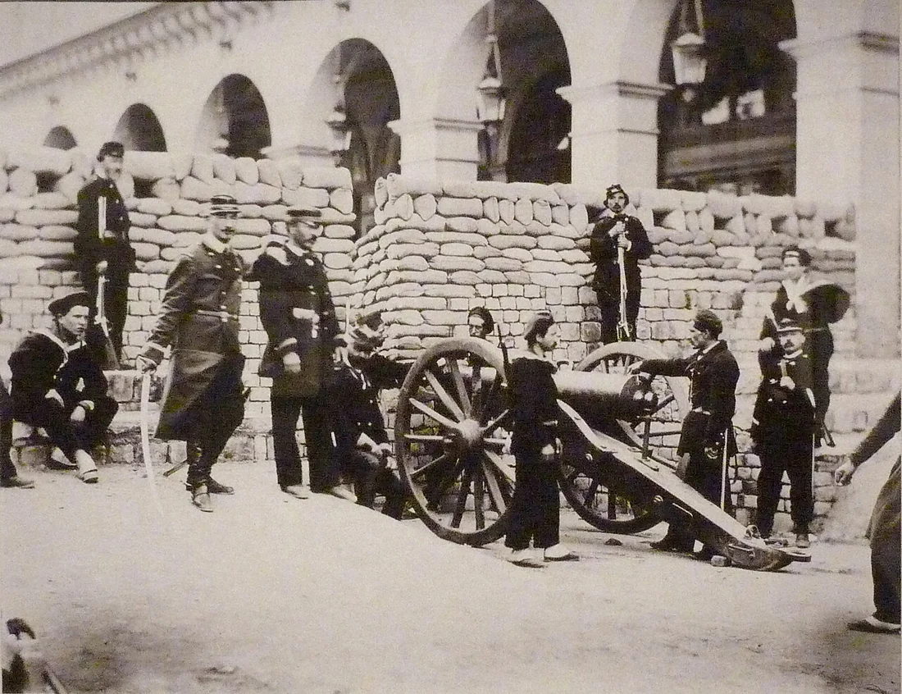

<PhilosophyTopic topic-id="nha-nuoc-va-cach-mang">

<template #notes>

Một cộng đồng có thể có người điều hành công việc chung mà chưa có nhà nước theo nghĩa đầy đủ. Điểm cần giải thích là khi nào xuất hiện một tổ chức quyền lực đặc biệt, có bộ máy chuyên nghiệp và khả năng đặt ra những quy tắc bắt buộc đối với toàn xã hội.

## Nhà nước là một hiện tượng lịch sử

Chủ nghĩa duy vật lịch sử giải thích nguồn gốc nhà nước từ sự biến đổi của sản xuất và quan hệ xã hội. Khi xã hội phân hóa thành những giai cấp có lợi ích căn bản đối lập, cách tự quản dựa vào quan hệ cộng đồng ban đầu không còn đủ để duy trì trật tự.

Nguyên nhân sâu xa là sự phát triển lực lượng sản xuất, sự xuất hiện của cải dư thừa tương đối và chế độ tư hữu. Nguyên nhân trực tiếp là những mâu thuẫn giai cấp trở nên không thể điều hòa trong trật tự hiện có. Nhà nước hình thành như một quyền lực công đặc biệt để duy trì xã hội trong một trật tự xác định.

Cách giải thích ấy không quy nhà nước về tham vọng của một người hay một thỏa thuận thuần túy trong tư tưởng. Nó đặt tổ chức quyền lực trong những điều kiện kinh tế và tương quan lực lượng cụ thể. Nhà nước vì thế có nguồn gốc lịch sử, không được xem là hình thức tổ chức tồn tại từ khi có con người.

## Bản chất giai cấp và chức năng xã hội

Trong lý luận Mác - Lênin, **nhà nước** là tổ chức quyền lực chính trị đặc biệt, gắn với việc duy trì trật tự xã hội và sự thống trị giai cấp. Giai cấp giữ địa vị thống trị về kinh tế sử dụng quyền lực nhà nước để bảo vệ những quan hệ và lợi ích cơ bản của mình.

Bản chất giai cấp không chỉ thể hiện qua người đứng đầu xuất thân từ đâu. Cần xem nhà nước bảo vệ quan hệ sở hữu nào, tổ chức quyền lực ra sao và những quyết định chủ yếu phục vụ lợi ích nào. Trong một số tương quan lực lượng, bộ máy nhà nước có thể có mức độ độc lập tương đối với những giai cấp đang đối lập.

Nhà nước đồng thời thực hiện những công việc chung như điều hành giao thông, thủy lợi, giáo dục và y tế. Đó là chức năng xã hội, góp phần duy trì những điều kiện sống chung. Không thể vì có chức năng này mà kết luận mọi lợi ích đều được thực hiện ngang nhau.

Hai chức năng thống trị chính trị và quản lý xã hội gắn bó với nhau. Cách tổ chức công việc chung chịu ảnh hưởng của quan hệ quyền lực và lợi ích. Ngược lại, một quyền lực muốn duy trì lâu dài phải có khả năng tổ chức đời sống chung, chứ không chỉ sử dụng cưỡng chế.

Nhà nước còn có chức năng đối nội và đối ngoại. Đối nội liên quan đến tổ chức đời sống trong phạm vi quốc gia. Đối ngoại liên quan đến quan hệ với những nhà nước và tổ chức bên ngoài. Hai mặt tác động qua lại, vì điều kiện trong nước ảnh hưởng đến đối ngoại và quan hệ bên ngoài ảnh hưởng đến đời sống trong nước.

## Những đặc trưng phân biệt nhà nước với tổ chức khác

Nhà nước quản lý dân cư theo lãnh thổ, thay vì chỉ theo quan hệ huyết thống. Quyền lực của nó có hiệu lực đối với những cá nhân và tổ chức trong phạm vi xác định. Điều này giúp phân biệt nhà nước với một dòng họ hoặc một cộng đồng tự nguyện có thành viên phân tán.

Nhà nước có bộ máy quyền lực chuyên nghiệp và những phương tiện cưỡng chế. Hệ thống chính quyền, cơ quan bảo vệ pháp luật và lực lượng vũ trang thực hiện những nhiệm vụ khác nhau. Quy tắc nhà nước không chỉ được duy trì bằng uy tín cá nhân hay sự đồng tình tự nguyện.

Nhà nước còn huy động nguồn lực tài chính, đặc biệt qua hệ thống thuế, để duy trì bộ máy và thực hiện chức năng. Ba đặc trưng về lãnh thổ, quyền lực chuyên nghiệp và thuế khóa cần được xem trong sự liên hệ. Một tổ chức có thu phí hay có người lãnh đạo chưa vì thế trở thành nhà nước.

Một câu lạc bộ sinh viên cũng có ban điều hành, nội quy và quỹ hoạt động. Tuy nhiên, quyền của ban điều hành gắn với phạm vi tham gia câu lạc bộ, không phải quyền lực công đối với toàn bộ dân cư trên một lãnh thổ. Việc thu một khoản đóng góp của thành viên cũng khác với quyền tổ chức hệ thống thuế của nhà nước.

Nếu một thành viên rời câu lạc bộ, những nghĩa vụ công dân của người ấy không vì thế chấm dứt. Sự khác nhau này làm rõ đặc trưng của quyền lực nhà nước hơn việc chỉ tìm xem tổ chức nào có người lãnh đạo. Câu hỏi cần đặt là quyền lực áp dụng đối với ai, trong phạm vi nào và được bảo đảm bằng những phương tiện gì.

## Phân biệt kiểu nhà nước và hình thức nhà nước

Kiểu nhà nước được phân biệt dựa trên bản chất giai cấp và cơ sở kinh tế. Lý luận khái quát các kiểu nhà nước chủ nô, phong kiến, tư sản và vô sản. Hình thức nhà nước chỉ cách tổ chức và thực hiện quyền lực, chẳng hạn quân chủ hay cộng hòa.

Cùng một kiểu có thể có nhiều hình thức. Thay đổi cách lựa chọn người đứng đầu chưa tự chứng minh bản chất kinh tế và giai cấp của nhà nước đã thay đổi. Ngược lại, những khác biệt hình thức vẫn có tác động thực tế đến cách quyền lực vận hành, nên không được coi là hoàn toàn không có ý nghĩa.

Quan niệm Mác - Lênin xem nhà nước xã hội chủ nghĩa gắn với quyền lực của giai cấp công nhân và nhân dân lao động, cùng nhiệm vụ cải tạo xã hội. Nhà nước tiêu vong được đặt trong điều kiện những cơ sở của sự phân chia giai cấp đã được khắc phục và xã hội không còn giai cấp. Điều này không đồng nghĩa xóa bỏ mọi hoạt động quản lý xã hội.

Hãy xét việc tổ chức một hệ thống thủy lợi dùng chung. Dòng nước không dừng ở ranh giới từng thửa ruộng, nên việc điều phối cần vượt khỏi quyết định riêng lẻ của mỗi người. Nhiệm vụ ấy cho thấy ý nghĩa của chức năng xã hội: Tổ chức những điều kiện mà nhiều người cùng cần nhưng khó tự giải quyết khi đứng riêng.

Tuy nhiên, quyết định đặt cống ở đâu, thu chi phí từ ai và ưu tiên khu vực nào cũng phân bố lợi ích. Có công việc chung không có nghĩa các phương án đều có tác dụng ngang nhau đối với mọi nhóm. Khi nghiên cứu quyền lực, cần đọc cả mục tiêu được tuyên bố lẫn cách quyết định được thực hiện. Những người chịu tác động có thể tham gia bằng cách nào, và trách nhiệm của người điều hành được xác định ra sao?

## Nhà nước, chính quyền và nhiệm vụ tổ chức đời sống chung

Nhà nước cần được phân biệt với riêng một cơ quan hoặc một nhóm người đang giữ chức vụ. Nó là tổ chức quyền lực có hệ thống thiết chế, phương tiện và quy tắc hoạt động. Thay người đứng đầu một cơ quan có thể ảnh hưởng việc điều hành, nhưng chưa tự làm biến đổi toàn bộ cấu trúc quyền lực.

Chính vì vậy, việc phân tích bản chất nhà nước phải đi xa hơn câu chuyện nhân sự. Cần xác định cơ sở kinh tế, những quan hệ được bảo vệ, cách quyền lực được tổ chức và nội dung các chức năng. Phẩm chất người thực thi có ý nghĩa, song không thay thế việc nghiên cứu những quan hệ ấy.

Trong quan niệm Mác - Lênin, nhà nước xã hội chủ nghĩa có nhiệm vụ tổ chức xây dựng xã hội mới cùng nhiệm vụ bảo vệ những điều kiện của quá trình ấy. Xây dựng kinh tế, phát triển văn hóa và nâng cao đời sống không phải phần việc nằm ngoài lý luận về nhà nước. Đó là nội dung quan trọng để hiểu mục tiêu của quyền lực mới.

Điều này cũng giúp hiểu nhà nước tiêu vong khác với một chính quyền bị lật đổ. Tiêu vong được đặt trong viễn cảnh những cơ sở của đối kháng giai cấp không còn và chức năng cưỡng chế chính trị mất lý do tồn tại. Các công việc phối hợp, quản lý và tổ chức đời sống chung không vì thế tự biến mất.

Bởi vậy, không thể dùng khái niệm tiêu vong để biện minh cho việc tùy ý xóa bỏ thiết chế khi các điều kiện lịch sử chưa có. Cũng không thể chỉ thấy bộ máy tồn tại mà bỏ qua nhiệm vụ phát triển các quan hệ và năng lực xã hội. Cách giải thích lịch sử đòi hỏi xét cả cơ sở tồn tại và những điều kiện làm chức năng thay đổi.

## Cách mạng xã hội thay đổi điều gì?

**Cách mạng xã hội**, theo nghĩa rộng, là sự biến đổi căn bản về chất của toàn bộ đời sống xã hội, dẫn tới thay thế hình thái kinh tế - xã hội đã lỗi thời bằng hình thái cao hơn. Theo nghĩa hẹp, khái niệm nhấn mạnh việc lật đổ chế độ chính trị lỗi thời và thiết lập quyền lực của lực lượng cách mạng.

Hai nghĩa gắn nhau nhưng không trùng phạm vi. Giành chính quyền là một bước có ý nghĩa quyết định về chính trị. Việc biến đổi các quan hệ kinh tế, tổ chức đời sống và xây dựng những điều kiện xã hội mới còn là quá trình rộng và lâu dài hơn.

Cải cách thay đổi một hoặc một số mặt trong khuôn khổ xã hội hiện có. Nó có thể có tác dụng lớn nhưng chưa đồng nghĩa thay thế hình thái kinh tế - xã hội. Đảo chính chủ yếu thay nhóm nắm quyền bằng sự chuyển dịch quyền lực từ phía trên, không tự bao hàm biến đổi căn bản nền tảng xã hội.

Vì thế, quy mô biến động hoặc mức độ bạo lực không phải tiêu chí duy nhất để xác định cách mạng. Cần xem những quan hệ nào được thay đổi, lực lượng nào tham gia và trật tự nào hình thành. Một biến cố gây chấn động vẫn có thể chỉ thay người cầm quyền.

<!-- philosophy-figure -->
<figure class="philosophy-figure">
  
  <figcaption>Hình 3.4: Chiến lũy tại phố Castiglione trong Công xã Paris năm 1871.</figcaption>
</figure>

Một chiến lũy cho thấy xung đột đã đi vào đời sống vật chất của thành phố. Tuy nhiên, đánh giá tính chất một cuộc cách mạng không thể chỉ dựa vào mức độ đối đầu nhìn thấy. Còn phải xác định lực lượng tham gia, mục tiêu chính trị và sự thay đổi của những quan hệ xã hội. Hình thức của một biến cố và nội dung lịch sử của nó cần được phân biệt.

## Nguyên nhân, điều kiện và vai trò của chủ thể

Nguyên nhân sâu xa của cách mạng xã hội, trong cách giải thích duy vật lịch sử, là mâu thuẫn giữa lực lượng sản xuất phát triển và quan hệ sản xuất đã trở thành trở lực. Trong xã hội có đối kháng, mâu thuẫn ấy biểu hiện qua những lực lượng xã hội có lợi ích đối lập.

Tuy nhiên, một mâu thuẫn kinh tế không tự biến thành cách mạng ở bất kỳ thời điểm nào. Điều kiện khách quan còn liên quan đến khủng hoảng chính trị, sự suy yếu của trật tự hiện có và hoạt động của quần chúng. Lý luận về tình thế cách mạng phân tích trạng thái đặc biệt khi những mâu thuẫn ấy trở nên gay gắt.

V.I. Lênin khái quát các dấu hiệu gồm khủng hoảng của tầng lớp thống trị, đời sống của các tầng lớp bị áp bức trở nên khó khăn hơn và tính tích cực của quần chúng tăng rõ rệt. Các dấu hiệu này nói về một hoàn cảnh khách quan, không phải công thức dự đoán mọi biến động xã hội.

Nhân tố chủ quan gồm trình độ nhận thức, mục tiêu, năng lực tổ chức, khả năng tập hợp và hành động của lực lượng cách mạng. Có tình thế cách mạng chưa đủ bảo đảm cách mạng nổ ra hoặc thành công. Ngược lại, ý chí mạnh cũng không tự tạo ra những điều kiện khách quan còn thiếu.

Lý luận Mác - Lênin phân tích cả phương pháp bạo lực và khả năng chuyển biến bằng phương pháp hòa bình khi có điều kiện. Phương pháp phải được xem xét trong hoàn cảnh lịch sử cụ thể. Không thể lấy mức độ sử dụng bạo lực làm thước đo mặc nhiên của tính tiến bộ.

Sự phân biệt giữa thay người và thay quan hệ cũng có thể thấy trong những tổ chức quen thuộc. Một tập thể đổi người phụ trách nhưng giữ nguyên cách ra quyết định, phân công và giải trình có thể tiếp tục gặp những trở ngại cũ. Ngược lại, sửa một quy tắc có thể tạo tác dụng lớn mà chưa làm thay đổi toàn bộ bản chất của tổ chức.

Trường hợp ấy chỉ giúp nhận ra sự khác nhau giữa nhân sự và cấu trúc, không phải mô hình thu nhỏ đầy đủ của cách mạng xã hội. Khi trở lại lịch sử, cần xác định sự biến đổi đã đi đến những quan hệ nào: Quyền sở hữu, tổ chức quyền lực hay chỉ một vị trí cầm quyền? Chính nội dung thay đổi, cùng điều kiện và lực lượng thực hiện, mới cho phép đánh giá ý nghĩa của biến cố.

## Ý nghĩa của cách tiếp cận lịch sử

Nghiên cứu nhà nước và cách mạng đòi hỏi nối kinh tế với chính trị, lợi ích với tổ chức và điều kiện khách quan với hoạt động chủ thể. Cách tiếp cận này giúp phân biệt thay đổi nhân sự, cải cách thiết chế và biến đổi nền tảng xã hội. Nó cũng ngăn cách giải thích lịch sử chỉ bằng phẩm chất của vài cá nhân.

</template>

<template #exercises>

<!-- workbook: WB3-MC52; PDF 91 -->

::: exercise Bài 1

Theo quan điểm của triết học Mác – Lênin, sự ra đời của nhà nước là do:

- A. Nguyện vọng của giai cấp thống trị.
- B. Nguyện vọng của mỗi quốc gia, dân tộc.
- C. Tất yếu, khách quan, do nguyên nhân kinh tế.
- D. Do sự phát triển của xã hội.

:::

::: solution

Đáp án: C.

Nhà nước ra đời từ những điều kiện kinh tế - xã hội khách quan: Lực lượng sản xuất phát triển, chế độ tư hữu xuất hiện và mâu thuẫn giai cấp không thể điều hòa. D quá chung, chưa chỉ ra điều kiện làm cho một tổ chức quyền lực công đặc biệt trở nên cần thiết trong trật tự đó.

:::

<!-- workbook: WB3-MC53; PDF 91 -->

::: exercise Bài 2

Phát biểu nào sau đây phản ánh đúng bản chất của nhà nước theo quan điểm mácxít?

- A. Công cụ quyền lực quản lý xã hội vì mục đích chung.
- B. Công cụ quyền lực thực hiện chuyên chính giai cấp của giai cấp thống trị.
- C. Công cụ quyền lực thực hiện chuyên chính giai cấp.
- D. Công cụ quyền lực của giai cấp thống trị.

:::

::: solution

B diễn đạt đầy đủ nhất vai trò công cụ chuyên chính của giai cấp thống trị. Tuy nhiên, C và D cũng nêu những nội dung đúng, chỉ ít cụ thể hơn. Vì câu hỏi không yêu cầu chọn phát biểu đầy đủ nhất, ba phương án này chồng lấn và không đủ cơ sở để chấm duy nhất một lựa chọn. A chỉ nêu chức năng quản lý việc chung mà bỏ qua bản chất giai cấp.

:::

<!-- workbook: WB3-MC54; PDF 91 -->

::: exercise Bài 3

Theo quan điểm của chủ nghĩa duy vật lịch sử, nguyên nhân trực tiếp làm xuất hiện nhà nước là:

- A. Sự thỏa thuận của mọi tầng lớp trong xã hội.
- B. Những mâu thuẫn giai cấp không thể điều hòa được.
- C. Tham vọng quyền lực của các chính trị gia.
- D. Lý tưởng cao đẹp của những người ưu tú trong xã hội.

:::

::: solution

Đáp án: B.

Những mâu thuẫn giai cấp không thể điều hòa trong trật tự hiện có dẫn đến sự ra đời của một quyền lực công đặc biệt để duy trì trật tự đó. Cần phân biệt nguyên nhân trực tiếp này với nguyên nhân sâu xa nằm trong sự phát triển sản xuất, sản phẩm dư thừa và chế độ tư hữu.

:::

<!-- workbook: WB3-MC55; PDF 91, 92 -->

::: exercise Bài 4

Theo quan điểm của chủ nghĩa duy vật lịch sử, nguyên nhân sâu xa làm xuất hiện nhà nước là:

- A. Sự thỏa thuận của mọi tầng lớp trong xã hội.
- B. Sự ra đời của chế độ tư hữu.
- C. Mong ước của nhân dân vì một xã hội tốt đẹp.
- D. Đấu tranh giai cấp.

:::

::: solution

Đáp án: B.

Trong các lựa chọn, chế độ tư hữu là căn cứ kinh tế dẫn đến phân hóa và đối kháng giai cấp. Đi sâu hơn, chính lực lượng sản xuất phát triển và sản phẩm dư thừa tương đối tạo điều kiện cho tư hữu xuất hiện. Mâu thuẫn giai cấp không thể điều hòa là nguyên nhân trực tiếp của nhà nước.

:::

<!-- workbook: WB3-MC57; PDF 92 -->

::: exercise Bài 5

Điền vào chỗ trống: “Theo quan điểm của chủ nghĩa duy vật lịch sử, nhà nước xuất hiện và tồn tại ...”.

- A. Ngay khi xã hội loài người xuất hiện.
- B. Trong một giai đoạn lịch sử nhất định.
- C. Từ trước khi xã hội có giai cấp.
- D. Trong mọi giai đoạn lịch sử.

:::

::: solution

Đáp án: B.

Nhà nước là phạm trù lịch sử, gắn với sự xuất hiện của chế độ tư hữu và những mâu thuẫn giai cấp không thể điều hòa. Cộng đồng người có thể có tổ chức tự quản trước khi nhà nước ra đời. Lý luận Mác cũng đặt ra khả năng nhà nước tiêu vong khi những điều kiện tồn tại của nó được khắc phục.

:::

<!-- workbook: WB3-MC58; PDF 92 -->

::: exercise Bài 6

Chức năng giai cấp của nhà nước theo quan điểm của chủ nghĩa duy vật lịch sử là:

- A. Củng cố, mở rộng cơ sở chính trị xã hội cho sự thống trị của giai cấp cầm quyền.
- B. Tổ chức kiến tạo kết cấu giai cấp của xã hội.
- C. Thực hiện chuyên chính, trấn áp các giai cấp đối lập.
- D. Thúc đẩy sự hình thành và phát triển của các giai cấp mới.

:::

::: solution

C nêu trực tiếp nội dung chuyên chính và trấn áp lực lượng đối lập. A cũng mô tả hoạt động phục vụ duy trì sự thống trị của giai cấp cầm quyền, nên thuộc phương diện chức năng giai cấp. B và D không phải định nghĩa của chức năng này. Nếu yêu cầu một đáp án duy nhất, đề cần bổ sung tiêu chí phân biệt A với C thay vì coi A hoàn toàn sai.

:::

<!-- workbook: WB3-MC59; PDF 92 -->

::: exercise Bài 7

Căn cứ để phân loại kiểu nhà nước theo quan điểm của chủ nghĩa duy vật lịch sử là:

- A. Chức năng của nhà nước.
- B. Bản chất giai cấp của nhà nước.
- C. Nguồn gốc của nhà nước.
- D. Cách thức tổ chức quyền lực nhà nước.

:::

::: solution

Đáp án: B.

Kiểu nhà nước được phân biệt theo bản chất giai cấp và cơ sở kinh tế tương ứng. Cách thức tổ chức quyền lực dùng để nhận diện hình thức nhà nước, chẳng hạn quân chủ hoặc cộng hòa. Hai cách phân loại trả lời những câu hỏi khác nhau nên không thể đồng nhất.

:::

<!-- workbook: WB3-MC60; PDF 92 -->

::: exercise Bài 8

Nhà nước trong thời kỳ quá độ lên chủ nghĩa xã hội là:

- A. Nhà nước dân chủ cộng hòa.
- B. Nhà nước dân chủ tư sản.
- C. Cộng hòa đại nghị.
- D. Nhà nước dân chủ nhân dân.

:::

::: solution

Cần xác định bản chất là nhà nước kiểu mới của giai cấp công nhân và nhân dân lao động, không lấy một hình thức tổ chức làm định nghĩa chung cho mọi trường hợp quá độ. D gợi đến một hình thức lịch sử của nhà nước dân chủ nhân dân nhưng chưa đủ để khẳng định đó là tên gọi phổ quát. A và C cũng là các cách gọi về hình thức tổ chức, còn B không thể hiện bản chất cần xác định. Vì các lựa chọn lẫn tiêu chí, câu hỏi chưa có một đáp án chung đủ chính xác.

:::

<!-- workbook: WB3-MC61; PDF 92, 93 -->

::: exercise Bài 9

Xu hướng phát triển của nhà nước trong chủ nghĩa cộng sản là:

- A. Củng cố vững chắc quyền lực giai cấp.
- B. Chuyển hóa thành nhà nước cộng sản.
- C. Chuyển hóa thành nhà nước toàn cầu.
- D. Nhà nước tự tiêu vong.

:::

::: solution

Đáp án: D.

Trong lý luận Mác – Lênin, khi những điều kiện kinh tế - xã hội làm nảy sinh đối kháng giai cấp được khắc phục, nhà nước với tư cách bộ máy thống trị giai cấp sẽ dần tiêu vong. Đây là một quá trình có điều kiện, không phải quyết định xóa nhà nước ngay lập tức. Việc tổ chức những công việc chung của xã hội vẫn cần được thực hiện.

:::

<!-- workbook: WB3-MC62; PDF 93 -->

::: exercise Bài 10

Việc lật đổ một chế độ chính trị đã lỗi thời và thiết lập một chế độ chính trị tiến bộ hơn của giai cấp cách mạng được gọi là gì?

- A. Đảo chính.
- B. Cách mạng xã hội.
- C. Bạo loạn.
- D. Cách mạng văn hóa.

:::

::: solution

Đáp án: B.

B phù hợp nhất với nội dung thay đổi chế độ và quyền lực chính trị. Tuy nhiên, cách mạng xã hội có nghĩa rộng hơn việc thay người cầm quyền: Đó là biến đổi căn bản về chất của xã hội, gắn với quan hệ kinh tế và kiến trúc thượng tầng. Một cuộc đảo chính chỉ thay nhóm nắm quyền chưa đủ tạo thành cách mạng xã hội.

:::

<!-- workbook: WB3-TF10; PDF 97 -->

::: exercise Bài 11

Xác định đúng hoặc sai và giải thích ngắn gọn: Nhà nước là bộ máy hành chính đứng trên mọi giai cấp, bảo vệ quyền lợi của mọi cá nhân trong xã hội.

:::

::: solution

Đáp án: Sai.

Lý luận Mác – Lênin xác định nhà nước mang bản chất giai cấp, bảo vệ những quan hệ kinh tế và trật tự xã hội nhất định. Nhà nước có thể có mức độ độc lập tương đối và thực hiện những công việc chung, nhưng từ đó không thể suy ra mọi lợi ích cá nhân đều được bảo vệ như nhau hoặc quyền lực đứng ngoài các quan hệ giai cấp.

:::

<!-- workbook: WB3-TF11; PDF 97 -->

::: exercise Bài 12

Xác định đúng hoặc sai và giải thích ngắn gọn: Nhà nước của giai cấp vô sản về bản chất cũng chỉ là bộ máy chuyên chế để thực hiện mục tiêu chính trị của giai cấp này.

:::

::: solution

Đáp án: Sai.

Từ “chỉ” thu hẹp nhà nước kiểu mới vào một chức năng. Trong quan niệm Mác – Lênin, nhà nước của giai cấp công nhân và nhân dân lao động còn có nhiệm vụ tổ chức xây dựng xã hội, phát triển sản xuất và mở rộng quyền làm chủ của nhân dân. Không thể dùng bản chất giai cấp để phủ nhận chức năng xã hội và mục tiêu giải phóng con người.

:::

</template>

</PhilosophyTopic>

## Tài liệu tham khảo

1. Hội đồng biên soạn, Phạm Văn Đức (chủ biên, 2019). *Giáo trình Triết học Mác – Lênin*. Dành cho bậc đại học, khối các ngành ngoài lý luận chính trị. Hà Nội. Chương 3, tr. 144–254.
2. Khoa Triết học, Trường Đại học Khoa học Xã hội và Nhân văn (2024). *Bài tập Triết học Mác - Lênin*. Hà Nội. Chương 3, phần Bài tập.
3. Bruno Braquehais. [Chiến lũy tại phố Castiglione trong Công xã Paris năm 1871.](https://commons.wikimedia.org/wiki/File:Commune_de_Paris_barricade_de_la_rue_de_Castiglione.jpg). Phạm vi công cộng. Bản thu nhỏ.
