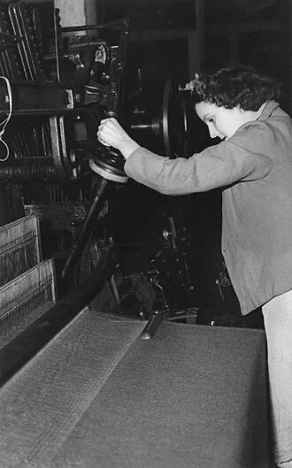

<PhilosophyTopic topic-id="san-xuat-vat-chat">

<template #notes>

Một trường học cần thầy cô, tri thức và mục tiêu giáo dục. Nhưng trường cũng cần lương thực, điện, phòng học, thiết bị và những người tạo ra các điều kiện ấy. Từ quan hệ đơn giản này, chủ nghĩa duy vật lịch sử đặt câu hỏi về nền tảng của toàn bộ đời sống xã hội.

## Sản xuất và tái sản xuất đời sống xã hội

Con người không chỉ sử dụng những gì tự nhiên có sẵn. Họ chế tạo công cụ, cải biến vật liệu và tổ chức lao động để làm ra những sản phẩm cần thiết. **Sản xuất vật chất** là quá trình con người sử dụng công cụ lao động, tác động trực tiếp hoặc gián tiếp vào tự nhiên để tạo ra của cải đáp ứng nhu cầu sống và phát triển.

Đời sống xã hội còn bao gồm sản xuất tinh thần và sản xuất ra bản thân con người. Sản xuất tinh thần tạo nên tri thức, tác phẩm nghệ thuật, quan niệm và những giá trị tinh thần khác. Sản xuất ra bản thân con người bao gồm sinh thành, nuôi dưỡng, giáo dục và phát triển các thế hệ.

Các phương diện ấy gắn bó với nhau. Con người cần sống để sáng tạo, nhưng tri thức và giáo dục cũng giúp họ cải tiến sản xuất. Gọi sản xuất vật chất là cơ sở có nghĩa nó tạo ra những điều kiện tồn tại mà các hoạt động khác không thể thiếu.

Vai trò nền tảng còn thể hiện ở việc lao động buộc con người hợp tác, phân công và trao đổi. Trong những quan hệ ấy, ngôn ngữ, tư duy và các quy tắc ứng xử được hình thành, phát triển. Con người vừa tạo ra sản phẩm, vừa phát triển năng lực và quan hệ xã hội của chính mình.

Luận điểm này không có nghĩa mọi tư tưởng đều chỉ là biểu hiện trực tiếp của lợi ích kinh tế. Chính trị, văn hóa, khoa học và đạo đức có cách vận động riêng, đồng thời tác động trở lại sản xuất. Muốn giải thích xã hội, cần tìm nền tảng vật chất nhưng vẫn phải phân tích những sự tác động qua lại đó.

Trong một bữa cơm gia đình, có thể nhận ra sự đan xen ấy. Gạo được gieo trồng, vận chuyển rồi chế biến. Việc chăm sóc và dạy trẻ ăn uống lại góp phần nuôi dưỡng một thế hệ mới. Một câu chuyện được kể quanh mâm cơm có thể truyền lại ký ức và cách ứng xử. Các hoạt động không vì cùng diễn ra ở một nơi mà mất đi sự khác nhau về vai trò.

Nếu chỉ tính những gì bán được thành tiền, công việc chăm sóc ấy sẽ được nhìn nhận ra sao? Câu hỏi nhắc ta phân biệt vai trò xã hội của một hoạt động với hình thức trả công cho nó. Khẳng định cơ sở vật chất của đời sống cần đi cùng việc nhận ra những công việc đang duy trì chính con người làm ra của cải.

## Phương thức sản xuất có hai mặt

Cùng làm ra vải nhưng một hộ dệt thủ công và một nhà máy sử dụng dây chuyền có cách sản xuất khác nhau. Sự khác nhau liên quan cả công cụ, tay nghề lẫn cách con người hợp tác và hưởng thành quả. **Phương thức sản xuất** là cách thức con người thực hiện sản xuất vật chất trong một giai đoạn lịch sử nhất định.

Phương thức sản xuất thống nhất hai mặt. Lực lượng sản xuất thể hiện năng lực thực tiễn của con người trong việc cải biến tự nhiên. Quan hệ sản xuất thể hiện những quan hệ kinh tế giữa người với người trong công việc ấy. Không có sản xuất hiện thực chỉ gồm máy móc mà không có quan hệ giữa những người sử dụng chúng.

## Lực lượng sản xuất và vai trò của người lao động

**Lực lượng sản xuất** là sự kết hợp giữa người lao động và tư liệu sản xuất, tạo thành năng lực sản xuất của xã hội. Người lao động tham gia với sức lực, tri thức, kinh nghiệm, kỹ năng và khả năng sáng tạo. Vì thế, không thể đánh giá lực lượng sản xuất chỉ bằng số lượng máy móc.

Tư liệu sản xuất gồm đối tượng lao động và tư liệu lao động. Đối tượng lao động là phần tự nhiên hoặc vật liệu mà lao động tác động vào, chẳng hạn đất canh tác hay gỗ dùng đóng bàn. Tư liệu lao động là những phương tiện con người sử dụng để tác động vào đối tượng ấy.

Trong tư liệu lao động, công cụ lao động trực tiếp truyền tác động của con người đến đối tượng. Máy cưa là công cụ, còn nhà xưởng và hệ thống vận chuyển hỗ trợ quá trình sử dụng công cụ. Phân biệt này giúp xác định mỗi yếu tố tham gia quá trình sản xuất bằng cách nào.

Người lao động giữ vai trò hàng đầu vì con người sáng tạo, lựa chọn, sử dụng và cải tiến công cụ. Công cụ là yếu tố vật chất có tính năng động, phản ánh trình độ chinh phục tự nhiên. Một thiết bị hiện đại chưa tự tạo thành năng lực sản xuất cao nếu thiếu người vận hành, bảo trì và tổ chức sử dụng phù hợp.

Trình độ lực lượng sản xuất thể hiện ở công cụ, kỹ năng lao động, ứng dụng khoa học, phân công và tổ chức lao động xã hội. Tính chất của lực lượng sản xuất cho biết hoạt động ấy mang tính cá nhân hay được xã hội hóa đến mức nào. Sản xuất có thể liên kết nhiều người, nhiều đơn vị cùng làm ra một sản phẩm.

Khoa học trở thành lực lượng sản xuất trực tiếp khi tri thức được đưa vào chính quá trình sản xuất. Tri thức có thể kết tinh trong máy móc, quy trình, vật liệu và năng lực người lao động. Điều đó không biến khoa học thành một thực thể tự hoạt động ngoài con người và những điều kiện vật chất.

<!-- philosophy-figure -->
<figure class="philosophy-figure">
  
  <figcaption>Hình 3.1: Một công nhân vận hành máy dệt tại Ipswich, Australia, năm 1940.</figcaption>
</figure>

Có thể nhìn thấy máy và người vận hành trong cùng một khuôn hình. Nhưng một bức ảnh chưa cho biết ai sở hữu máy, ai tổ chức công việc và sản phẩm được phân chia thế nào. Những câu hỏi ấy giúp phân biệt năng lực sản xuất với quan hệ sản xuất. Cùng một loại thiết bị có thể được sử dụng trong những cách tổ chức xã hội khác nhau.

## Quan hệ sản xuất gồm những quan hệ nào?

**Quan hệ sản xuất** là tổng hợp những quan hệ kinh tế giữa người với người trong quá trình sản xuất vật chất. Nó có ba mặt liên hệ với nhau.

- Quan hệ sở hữu tư liệu sản xuất xác định ai nắm giữ, sử dụng và định đoạt những điều kiện vật chất chủ yếu của sản xuất.
- Quan hệ tổ chức, quản lý xác định cách phân công, điều hành và phối hợp hoạt động giữa những người tham gia.
- Quan hệ phân phối xác định cách thức và quy mô hưởng sản phẩm, thu nhập hay thành quả lao động.

Quan hệ sở hữu giữ vai trò cơ bản vì quyền đối với tư liệu sản xuất tạo cơ sở chi phối việc quản lý và phân phối. Tuy nhiên, hai mặt còn lại vẫn có tác động thực tế. Cùng điều kiện sở hữu, cách tổ chức bất hợp lý có thể gây lãng phí, còn phân phối không phù hợp có thể làm suy giảm động lực lao động.

## Sở hữu tư liệu sản xuất và cách tổ chức lao động cần được phân biệt

Quan hệ sản xuất không chỉ là việc nhiều người có mặt trong cùng một nơi làm việc. Nó nói đến những quan hệ kinh tế quy định họ tham gia quá trình sản xuất bằng cách nào, ai có quyền quyết định và thành quả được phân chia ra sao. Cùng một động tác kỹ thuật có thể được thực hiện trong những quan hệ sản xuất khác nhau.

Chẳng hạn, người thợ sử dụng máy móc cần có kỹ năng vận hành. Xét về lực lượng sản xuất, kỹ năng ấy kết hợp với công cụ để tạo năng lực sản xuất. Nhưng khi xét người thợ là chủ sở hữu hay người làm thuê, ai quyết định tổ chức công việc và cách hưởng sản phẩm, ta đang phân tích quan hệ sản xuất.

Cách tổ chức lao động có mặt kỹ thuật và mặt xã hội gắn bó. Việc sắp xếp công đoạn cần đáp ứng yêu cầu của thiết bị và vật liệu. Đồng thời, quyền điều hành, trách nhiệm và quan hệ giữa những người tham gia lại thuộc mặt quan hệ kinh tế. Không thể tách hai mặt thành những hoạt động hoàn toàn không liên quan.

Đổi mới công nghệ vì thế có thể đặt ra yêu cầu tổ chức và đào tạo mới, nhưng chưa tự chứng minh quan hệ sở hữu đã biến đổi. Ngược lại, thay đổi quyền sở hữu chưa tự tạo ra công cụ tốt hơn hay kỹ năng cao hơn. Muốn đánh giá sự phù hợp, cần theo dõi những thay đổi thực ở cả năng lực sản xuất lẫn quan hệ giữa người với người.

Sự phân biệt này giúp hiểu vai trò của người lao động đầy đủ hơn. Con người là chủ thể sử dụng và cải tiến công cụ, đồng thời tham gia những quan hệ quyền hạn, trách nhiệm và lợi ích. Phát huy năng lực của họ đòi hỏi quan tâm đến cả điều kiện kỹ thuật, trình độ và những quan hệ xã hội trong sản xuất.

Giả sử một tiệm bánh mua lò nướng tự động. Máy mới có thể điều chỉnh nhiệt tốt hơn, nhưng người làm vẫn cần hiểu nguyên liệu, phát hiện sai lệch và phối hợp các công đoạn. Nếu chưa ai được hướng dẫn, lò hiện đại chưa bảo đảm bánh tốt hơn. Ở đây, năng lực sản xuất nằm trong sự kết hợp giữa phương tiện và người sử dụng, chứ không nằm nguyên vẹn trong chiếc máy.

Cũng tại tiệm ấy, hãy xét ba việc khác nhau. Ai có quyền quyết định bán lò hoặc thế chấp tài sản? Ai phân ca và tổ chức công việc? Tiền thu được sẽ được chia như thế nào? Những câu hỏi đưa ta lần lượt đến sở hữu, tổ chức và phân phối. Người được giao phân ca chưa chắc là chủ sở hữu. Tăng công suất máy cũng chưa tự quyết định phần thu nhập của mỗi người.

## Sự phù hợp giữa lực lượng sản xuất và quan hệ sản xuất

Lực lượng sản xuất phát triển thông qua nhu cầu mới, cải tiến công cụ và sự tích lũy năng lực của con người. Quan hệ sản xuất tương đối ổn định vì gắn với cách tổ chức, lợi ích và quyền hạn đã được xác lập. Vì vậy, quan hệ từng tạo điều kiện cho sản xuất có thể trở thành trở lực khi năng lực sản xuất thay đổi.

Trong cách giải thích của chủ nghĩa duy vật lịch sử, lực lượng sản xuất quyết định quan hệ sản xuất. Nghĩa là trình độ sản xuất đặt ra yêu cầu khách quan đối với hình thức tổ chức xã hội của nó. Quan hệ sản xuất tác động trở lại, có thể thúc đẩy hoặc kìm hãm việc sử dụng và phát triển năng lực ấy.

Sự phù hợp không phải trạng thái mọi khác biệt đều biến mất. Đó là sự kết hợp cho phép các yếu tố sản xuất phát huy tác dụng và tiếp tục phát triển. Quan hệ sản xuất đi sau yêu cầu thực tế có thể gây cản trở. Việc áp đặt quan hệ chưa có điều kiện thực hiện cũng không tạo ra sự phù hợp.

Xét một cơ sở chế tạo chuyển từ làm sản phẩm riêng lẻ sang dây chuyền có nhiều công đoạn phụ thuộc nhau. Nếu mỗi bộ phận chỉ theo đuổi sản lượng riêng mà không phối hợp, công đoạn sau có thể thiếu vật liệu hoặc nhận sản phẩm không dùng được. Công cụ mới đặt ra yêu cầu thay đổi cách tổ chức và đánh giá kết quả.

Ví dụ này minh họa sự tác động giữa năng lực kỹ thuật và quan hệ tổ chức. Nó không đủ để suy ra chỉ một thay đổi quản lý sẽ làm biến đổi toàn bộ phương thức sản xuất. Những biến đổi xã hội lớn còn liên quan đến sở hữu, lợi ích và các thiết chế bảo vệ những quan hệ ấy.

Một nhóm hộ trồng rau dùng chung hệ thống tưới còn cho thấy vấn đề phối hợp. Khi việc tưới của mỗi ruộng ảnh hưởng đến áp lực nước của những ruộng khác, quyền tự quyết hoàn toàn riêng rẽ có thể gây xung đột. Nhóm cần thống nhất lịch vận hành, trách nhiệm bảo dưỡng và cách góp chi phí. Nhu cầu tổ chức nảy sinh từ chính mức độ phụ thuộc kỹ thuật của công việc.

Nhưng nếu chỉ lập một quy chế chung mà không sửa đường ống hỏng, rau vẫn thiếu nước. Ngược lại, có đường ống tốt mà không ai nhận trách nhiệm vận hành cũng chưa tạo được năng suất. Khi một kế hoạch phát triển gặp trở ngại, điều đang thiếu là phương tiện, kỹ năng hay quan hệ phối hợp? Tách được câu hỏi ấy giúp việc điều chỉnh có căn cứ hơn.

## Ý nghĩa khi xem xét sự phát triển

Muốn phát triển sản xuất, cần đồng thời bồi dưỡng con người, cải tiến công cụ và tạo điều kiện tổ chức phù hợp. Không thể chỉ thay tên hình thức sở hữu rồi cho rằng năng suất tự tăng. Cũng không thể chỉ mua máy móc mà bỏ qua quyền lợi, động lực và khả năng phối hợp của người lao động.

Quan hệ giữa lực lượng sản xuất và quan hệ sản xuất giải thích vì sao đổi mới kinh tế luôn có mặt kỹ thuật và mặt xã hội. Từ đó, vấn đề tiếp theo là những quan hệ kinh tế ấy gắn với nhà nước, pháp luật và đời sống tư tưởng như thế nào.

</template>

<template #exercises>

<!-- workbook: WB3-MC01; PDF 82 -->

::: exercise Bài 1

Xã hội có các loại hình sản xuất cơ bản là:

- A. Sản xuất ra văn hóa, con người và đời sống tinh thần.
- B. Sản xuất ra của cải vật chất, đời sống tinh thần và nghệ thuật.
- C. Sản xuất vật chất, sản xuất tinh thần, sản xuất ra bản thân con người.
- D. Sản xuất vật chất, sản xuất tinh thần, sản xuất văn hóa.

:::

::: solution

Đáp án: C.

Ba phương diện là sản xuất vật chất, sản xuất tinh thần và sản xuất ra bản thân con người. Văn hóa, nghệ thuật thuộc đời sống tinh thần nên không thay thế được phương diện tái sản xuất con người. Ba phương diện liên hệ với nhau, trong đó sản xuất vật chất tạo điều kiện tồn tại cơ bản cho đời sống xã hội.

:::

<!-- workbook: WB3-MC03; PDF 82 -->

::: exercise Bài 2

Điền thêm từ để hoàn thiện nhận định sau đây và xác định đó là nhận định của ai: “Điểm khác biệt căn bản giữa xã hội loài người với xã hội loài vật là ở chỗ: Loài vật may mắn lắm chỉ hái lượm trong khi con người lại ...(1)...” (...(2)...).

- A. 1) Biết sáng tạo, 2) Ph. Ăngghen.
- B. 1) Sản xuất, 2) Ph. Ăngghen.
- C. 1) Tiến hành lao động, 2) C. Mác.
- D. 1) Tư duy, 2) V.I. Lênin.

:::

::: solution

Đáp án: B.

Hai chỗ trống tương ứng với “sản xuất” và Ph. Ăngghen. Điểm cần hiểu là con người tạo ra tư liệu sinh hoạt bằng hoạt động sản xuất có công cụ và có tính xã hội. Nhận định không phủ nhận các dạng hoạt động hay sử dụng vật thể ở động vật.

:::

<!-- workbook: WB3-MC04; PDF 82 -->

::: exercise Bài 3

Điền từ còn thiếu vào chỗ trống: ... là cơ sở của sự tồn tại và phát triển của xã hội loài người, và xét đến cùng quyết định toàn bộ sự vận động, phát triển của đời sống xã hội.

- A. Hoạt động tinh thần.
- B. Sản xuất tinh thần.
- C. Hoạt động vật chất.
- D. Sản xuất vật chất.

:::

::: solution

Đáp án: D.

Sản xuất vật chất tạo ra tư liệu sinh hoạt, phương tiện lao động và những điều kiện để các hoạt động xã hội khác được duy trì. “Xét đến cùng” chỉ vai trò nền tảng, không có nghĩa mọi sự kiện chính trị, nghệ thuật hay đạo đức đều do kinh tế tác động trực tiếp và duy nhất.

:::

<!-- workbook: WB3-MC05; PDF 82 -->

::: exercise Bài 4

Tiêu chuẩn quan trọng nhất để phân biệt các thời đại kinh tế là:

- A. Thể chế chính trị.
- B. Hình thức nhà nước.
- C. Phương thức sản xuất.
- D. Hình thức tôn giáo.

:::

::: solution

Đáp án: C.

Phương thức sản xuất cho biết con người sản xuất bằng những lực lượng nào và trong những quan hệ kinh tế nào. Vì vậy, đây là căn cứ để phân biệt các thời đại kinh tế. Thể chế chính trị, hình thức nhà nước và tôn giáo không thay thế được căn cứ kinh tế ấy.

:::

<!-- workbook: WB3-MC06; PDF 83 -->

::: exercise Bài 5

Phương thức sản xuất là:

- A. Cách thức con người tiến hành mọi hoạt động sản xuất qua các giai đoạn lịch sử.
- B. Cách thức con người sản xuất ra của cải vật chất cho xã hội.
- C. Cách thức con người thực hiện các quan hệ xã hội ở những giai đoạn lịch sử nhất định của xã hội loài người.
- D. Cách thức con người thực hiện trong quá trình sản xuất vật chất ở những giai đoạn lịch sử nhất định của xã hội loài người.

:::

::: solution

D nêu rõ cả sản xuất vật chất lẫn tính lịch sử nên diễn đạt sát định nghĩa đầy đủ hơn. B cũng nêu nội dung cốt lõi là cách thức sản xuất của cải vật chất, nhưng lược mất điều kiện lịch sử. Vì đề không yêu cầu chọn cách diễn đạt đầy đủ nhất, B và D chưa được phân biệt đủ chặt để chấm như một câu chỉ có một đáp án. Khái niệm cần nhớ là sự thống nhất giữa lực lượng sản xuất và quan hệ sản xuất trong một giai đoạn lịch sử nhất định.

:::

<!-- workbook: WB3-MC07; PDF 83 -->

::: exercise Bài 6

Điền từ còn thiếu vào chỗ trống: ... là tổng hợp các yếu tố vật chất và tinh thần tạo thành sức mạnh thực tiễn cải biến giới tự nhiên theo nhu cầu sinh tồn, phát triển của con người.

- A. Công cụ lao động.
- B. Lực lượng sản xuất.
- C. Người lao động.
- D. Tư liệu sản xuất.

:::

::: solution

Đáp án: B.

Lực lượng sản xuất biểu hiện năng lực thực tiễn cải biến tự nhiên của con người. Năng lực ấy hình thành từ sự kết hợp người lao động với tư liệu sản xuất, bao gồm tri thức, kinh nghiệm, kỹ năng và những phương tiện vật chất. Một công cụ hoặc riêng người lao động chưa diễn tả toàn bộ sự kết hợp này.

:::

<!-- workbook: WB3-MC08; PDF 83 -->

::: exercise Bài 7

Lực lượng sản xuất bao gồm các nhân tố nào?

- A. Người lao động và tư liệu sản xuất.
- B. Người lao động và công cụ lao động.
- C. Người lao động và tư liệu lao động.
- D. Người lao động và đối tượng lao động.

:::

::: solution

Đáp án: A.

Tư liệu sản xuất bao gồm tư liệu lao động và đối tượng lao động. Kết hợp chúng với người lao động mới tạo thành lực lượng sản xuất. B, C và D đều chỉ nêu một bộ phận của tư liệu sản xuất nên chưa đầy đủ.

:::

<!-- workbook: WB3-MC09; PDF 83 -->

::: exercise Bài 8

Tư liệu sản xuất bao gồm những yếu tố nào?

- A. Tư liệu lao động và đối tượng lao động.
- B. Công cụ lao động và tư liệu lao động.
- C. Phương tiện lao động và công cụ lao động.
- D. Công cụ lao động và đối tượng lao động.

:::

::: solution

Đáp án: A.

Đối tượng lao động là cái được con người tác động vào, còn tư liệu lao động là phương tiện để thực hiện tác động ấy. Công cụ lao động nằm trong tư liệu lao động, bên cạnh nhà xưởng, hệ thống vận chuyển và các phương tiện hỗ trợ. D vì thế chưa bao quát toàn bộ tư liệu lao động.

:::

<!-- workbook: WB3-MC10; PDF 83 -->

::: exercise Bài 9

Yếu tố phản ánh rõ nhất trình độ phát triển của lực lượng sản xuất là:

- A. Phương tiện lao động.
- B. Công cụ lao động.
- C. Đối tượng lao động.
- D. Sản phẩm của lao động.

:::

::: solution

Đáp án: B.

Công cụ lao động thể hiện rõ trình độ con người tác động vào tự nhiên và là yếu tố động trong tư liệu sản xuất. Cần phân biệt câu này với câu hỏi về yếu tố quan trọng nhất của lực lượng sản xuất: Vai trò chủ thể sáng tạo vẫn thuộc về người lao động.

:::

<!-- workbook: WB3-MC11; PDF 83, 84 -->

::: exercise Bài 10

Điền từ còn thiếu vào chỗ trống: “... là nội dung vật chất của quá trình sản xuất”.

- A. Lực lượng sản xuất.
- B. Quan hệ sản xuất.
- C. Phương thức sản xuất.
- D. Sản xuất vật chất.

:::

::: solution

Đáp án: A.

Lực lượng sản xuất là nội dung vật chất, biểu hiện năng lực thực tế của quá trình sản xuất. Quan hệ sản xuất là hình thức xã hội của quá trình ấy. Phương thức sản xuất là sự thống nhất của cả hai mặt.

:::

<!-- workbook: WB3-MC12; PDF 84 -->

::: exercise Bài 11

Quan hệ sản xuất là:

- A. Mối quan hệ giữa con người với đối tượng lao động.
- B. Mối quan hệ giữa con người với công cụ lao động.
- C. Mối quan hệ giữa con người với tư liệu sản xuất.
- D. Mối quan hệ giữa người với người trong quá trình sản xuất.

:::

::: solution

Đáp án: D.

Quan hệ sản xuất là quan hệ kinh tế giữa người với người, bao gồm sở hữu tư liệu sản xuất, tổ chức và quản lý lao động, phân phối sản phẩm. Quan hệ sở hữu được biểu hiện qua quyền đối với vật, nhưng bản chất vẫn là quan hệ xã hội giữa những người có quyền và nghĩa vụ khác nhau đối với vật đó.

:::

<!-- workbook: WB3-MC13; PDF 84 -->

::: exercise Bài 12

Quan hệ cơ bản nhất, đóng vai trò quyết định trong hệ thống quan hệ sản xuất là:

- A. Quan hệ tổ chức sản xuất.
- B. Quan hệ quản lý sản xuất.
- C. Quan hệ phân phối.
- D. Quan hệ sở hữu về tư liệu sản xuất.

:::

::: solution

Đáp án: D.

Quan hệ sở hữu về tư liệu sản xuất quy định ai có quyền kiểm soát những điều kiện sản xuất chủ yếu, qua đó chi phối tổ chức lao động và phân phối kết quả. Tổ chức, quản lý và phân phối vẫn có tính độc lập tương đối và tác động trở lại quan hệ sở hữu.

:::

<!-- workbook: WB3-MC14; PDF 84 -->

::: exercise Bài 13

Mối quan hệ “song trùng” của nền sản xuất vật chất mà C. Mác nhắc đến là quan hệ nào sau đây?

- A. Quan hệ giữa con người với tự nhiên và quan hệ giữa con người với sản phẩm của quá trình sản xuất vật chất.
- B. Quan hệ giữa con người với tự nhiên và quan hệ giữa con người với tư liệu sản xuất.
- C. Quan hệ giữa con người với tự nhiên và quan hệ giữa người với người trong quá trình sản xuất vật chất.
- D. Quan hệ giữa người với người trong sản xuất vật chất và quan hệ giai cấp trong xã hội.

:::

::: solution

Đáp án: C.

Sản xuất vừa là quá trình con người cải biến tự nhiên, vừa là quá trình họ liên kết với nhau trong những quan hệ kinh tế. Mặt thứ nhất được biểu hiện ở lực lượng sản xuất, mặt thứ hai ở quan hệ sản xuất. Hai mặt chỉ tồn tại trong sự thống nhất của hoạt động sản xuất hiện thực.

:::

<!-- workbook: WB3-MC15; PDF 84 -->

::: exercise Bài 14

Sự biến đổi của quan hệ sản xuất do yếu tố nào quyết định?

- A. Sự phong phú của đối tượng lao động.
- B. Thể chế chính trị.
- C. Trình độ của lực lượng sản xuất.
- D. Trình độ của người lao động.

:::

::: solution

Đáp án: C.

Trình độ lực lượng sản xuất đặt ra yêu cầu đối với sở hữu, tổ chức và phân phối. Trình độ người lao động là một yếu tố quan trọng nhưng chưa đại diện cho toàn bộ lực lượng sản xuất. Chính trị có thể tác động mạnh đến quá trình biến đổi, song không thay thế được căn cứ vật chất ấy.

:::

<!-- workbook: WB3-MC16; PDF 84 -->

::: exercise Bài 15

Điền các từ còn thiếu: “...(1)... và ...(2)... là hai mặt cơ bản, tất yếu của quá trình sản xuất”.

- A. Cơ sở hạ tầng / kiến trúc thượng tầng.
- B. Cơ sở hạ tầng / quan hệ sản xuất.
- C. Lực lượng sản xuất / quan hệ sản xuất.
- D. Lực lượng sản xuất / kiến trúc thượng tầng.

:::

::: solution

Đáp án: C.

Lực lượng sản xuất là nội dung vật chất, quan hệ sản xuất là hình thức xã hội của quá trình sản xuất. Cơ sở hạ tầng và kiến trúc thượng tầng chỉ một quan hệ khác, rộng hơn, giữa cơ cấu kinh tế với đời sống tư tưởng và các thiết chế tương ứng.

:::

<!-- workbook: WB3-MC17; PDF 85 -->

::: exercise Bài 16

Phát biểu nào sau đây phản ánh đúng đắn mối quan hệ giữa lực lượng sản xuất và quan hệ sản xuất?

- A. Lực lượng sản xuất phụ thuộc vào quan hệ sản xuất.
- B. Quan hệ sản xuất phụ thuộc vào trình độ phát triển của lực lượng sản xuất.
- C. Quan hệ sản xuất và lực lượng sản xuất tồn tại độc lập với nhau.
- D. Quan hệ sản xuất và lực lượng sản xuất đều hoàn toàn phụ thuộc vào quyền lực nhà nước.

:::

::: solution

Đáp án: B.

Vai trò quyết định thuộc lực lượng sản xuất, vì quan hệ sản xuất phải phù hợp với trình độ phát triển của nó. Quan hệ sản xuất đồng thời tác động trở lại, có thể thúc đẩy hoặc kìm hãm lực lượng sản xuất. B đúng về chiều quyết định nhưng không bao quát toàn bộ sự tác động hai chiều.

:::

<!-- workbook: WB3-MC18; PDF 85 -->

::: exercise Bài 17

Điền từ còn thiếu: “... là hình thức xã hội của quá trình sản xuất”.

- A. Lực lượng sản xuất.
- B. Quan hệ sản xuất.
- C. Phương thức sản xuất.
- D. Sản xuất vật chất.

:::

::: solution

Đáp án: B.

Quan hệ sản xuất xác định cách con người liên kết với nhau về kinh tế để thực hiện sản xuất. Nó là hình thức xã hội, còn lực lượng sản xuất là nội dung vật chất. Cả hai thống nhất trong một phương thức sản xuất.

:::

<!-- workbook: WB3-MC19; PDF 85 -->

::: exercise Bài 18

Yếu tố quan trọng nhất trong lực lượng sản xuất là:

- A. Công cụ lao động.
- B. Tư liệu sản xuất.
- C. Người lao động.
- D. Tài nguyên khoáng sản.

:::

::: solution

Đáp án: C.

Người lao động chế tạo, sử dụng và cải tiến công cụ bằng tri thức, kỹ năng và kinh nghiệm. Tài nguyên và máy móc chỉ trở thành sức mạnh sản xuất hiện thực trong sự kết hợp với hoạt động của con người. Vai trò ấy không có nghĩa người lao động có thể bỏ qua những điều kiện vật chất.

:::

<!-- workbook: WB3-MC20; PDF 85 -->

::: exercise Bài 19

Theo quan niệm của triết học Mác – Lênin, quan hệ sản xuất:

- A. Hoàn toàn bị quy định bởi những người lãnh đạo các cơ sở sản xuất.
- B. Hoàn toàn bị quy định bởi chế độ chính trị xã hội.
- C. Hoàn toàn bị quy định bởi truyền thống và tập tục.
- D. Tồn tại khách quan và không phụ thuộc vào ý thức của con người.

:::

::: solution

Đáp án: D.

Tính khách quan nghĩa là quan hệ sản xuất không thể được lựa chọn tùy ý, vì chịu sự quy định của trình độ lực lượng sản xuất và những điều kiện lịch sử. Quan hệ ấy vẫn được con người xác lập, duy trì và cải biến bằng hoạt động có ý thức. “Không phụ thuộc vào ý thức” vì thế không đồng nghĩa không chịu tác động của con người.

:::

<!-- workbook: WB3-MC21; PDF 85 -->

::: exercise Bài 20

Điền từ còn thiếu: “Trong một ...(1)... thì ...(2)... là yếu tố thường xuyên biến đổi, còn ...(3)... là yếu tố tương đối ổn định”.

- A. 1) Quan hệ sản xuất, 2) Quan hệ phân phối, 3) Quan hệ sở hữu.
- B. 1) Lực lượng sản xuất, 2) Người lao động, 3) Tư liệu sản xuất.
- C. 1) Phương thức sản xuất, 2) Lực lượng sản xuất, 3) Quan hệ sản xuất.
- D. 1) Phương thức sản xuất, 2) Quan hệ sản xuất, 3) Tư liệu sản xuất.

:::

::: solution

Đáp án: C.

Trong phương thức sản xuất, lực lượng sản xuất thường xuyên được cải tiến thông qua lao động và tích lũy tri thức. Quan hệ sản xuất gắn với sở hữu, tổ chức và lợi ích nên có độ ổn định tương đối. “Tương đối ổn định” không có nghĩa quan hệ sản xuất bất biến.

:::

<!-- workbook: WB3-MC22; PDF 85, 86 -->

::: exercise Bài 21

Theo quan điểm của chủ nghĩa duy vật lịch sử, quan hệ sản xuất tác động trở lại lực lượng sản xuất thông qua yếu tố nào của lực lượng sản xuất?

- A. Công cụ lao động.
- B. Tư liệu sản xuất.
- C. Người lao động.
- D. Đối tượng lao động.

:::

::: solution

Đáp án: C.

Sở hữu, tổ chức và phân phối ảnh hưởng đến lợi ích, động cơ, khả năng hợp tác và sáng tạo của người lao động. Thông qua hoạt động của họ, những quan hệ ấy thúc đẩy hoặc kìm hãm việc sử dụng và cải tiến công cụ, vật liệu và kỹ thuật.

:::

<!-- workbook: WB3-MC23; PDF 86 -->

::: exercise Bài 22

Sự tồn tại nền kinh tế hàng hóa nhiều thành phần trong thời kỳ quá độ lên chủ nghĩa xã hội ở Việt Nam là do:

- A. Đặc điểm tự nhiên của Việt Nam quy định.
- B. Thành phần giai cấp trong xã hội Việt Nam quy định.
- C. Trình độ của lực lượng sản xuất của Việt Nam quy định.
- D. Nhận thức chính trị của Việt Nam quy định.

:::

::: solution

Đáp án: C.

Trình độ lực lượng sản xuất đa dạng và không đồng đều tạo cơ sở khách quan cho nhiều hình thức sở hữu, tổ chức sản xuất và thành phần kinh tế cùng tồn tại. Chính sách cần nhận thức đặc điểm ấy và tạo sự phù hợp, thay vì đồng nhất mọi đơn vị sản xuất bằng một hình thức duy nhất.

:::

<!-- workbook: WB3-MC24; PDF 86 -->

::: exercise Bài 23

Trong thời kỳ quá độ lên chủ nghĩa xã hội, Việt Nam cần:

- A. Chủ động thiết lập quan hệ sản xuất trước, sau đó phát triển lực lượng sản xuất phù hợp.
- B. Chủ động xây dựng lực lượng sản xuất trước, sau đó phát triển quan hệ sản xuất phù hợp.
- C. Kết hợp đồng thời phát triển lực lượng sản xuất với xác lập quan hệ sản xuất phù hợp.
- D. Tôn trọng quy luật khách quan và tuyệt đối không can thiệp vào sự phát triển của lực lượng sản xuất và quan hệ sản xuất.

:::

::: solution

Đáp án: C.

Phát triển lực lượng sản xuất và từng bước xác lập quan hệ sản xuất phù hợp phải gắn bó với nhau. Không thể áp đặt một quan hệ vượt xa điều kiện vật chất, cũng không nên bỏ mặc những quan hệ đã cản trở sản xuất. Tôn trọng quy luật vẫn đòi hỏi hoạt động chủ động của con người.

:::

<!-- workbook: WB3-MC72; PDF 94, 95 -->

::: exercise Bài 24

Xét đến cùng, nhân tố quyết định sự thắng lợi của một chế độ xã hội mới theo quan điểm của chủ nghĩa duy vật lịch sử là:

- A. Sức mạnh của nhà nước.
- B. Sức mạnh của pháp luật.
- C. Năng suất lao động xã hội.
- D. Hiệu quả hoạt động của hệ thống chính trị.

:::

::: solution

Đáp án: C.

Năng suất lao động xã hội biểu hiện khả năng tạo ra những điều kiện vật chất để duy trì và phát triển đời sống. Trong lập luận này, ưu thế của một chế độ phải được thể hiện trên nền tảng sản xuất hiện thực. “Xét đến cùng” không loại bỏ vai trò tổ chức của nhà nước, pháp luật và những điều kiện lịch sử khác.

:::

<!-- workbook: WB3-TF01; PDF 96 -->

::: exercise Bài 25

Xác định đúng hoặc sai và giải thích ngắn gọn: Sản xuất vật chất là hoạt động cơ bản phân biệt giữa con người với các loài động vật.

:::

::: solution

Đáp án: Đúng.

Con người sản xuất tư liệu sinh hoạt bằng công cụ, có mục đích và trong những quan hệ hợp tác được truyền lại qua các thế hệ. Chính hoạt động sản xuất xã hội ấy tạo nền tảng cho ngôn ngữ, tư duy và các quan hệ người. Nhận định không phủ nhận động vật có hoạt động kiếm ăn hay những hành vi sử dụng vật thể.

:::

<!-- workbook: WB3-TF02; PDF 96 -->

::: exercise Bài 26

Xác định đúng hoặc sai và giải thích ngắn gọn: Điều kiện tự nhiên là yếu tố quyết định sự phát triển của sản xuất vật chất và do đó là yếu tố quyết định sự phát triển của xã hội loài người.

:::

::: solution

Đáp án: Sai.

Điều kiện tự nhiên là tiền đề thường xuyên, có thể thuận lợi hoặc gây trở ngại, nhưng tác dụng của nó được thực hiện thông qua trình độ sản xuất và tổ chức xã hội. Những xã hội có điều kiện tự nhiên gần nhau vẫn có thể có con đường phát triển khác nhau. Không thể dùng địa lý làm nhân tố duy nhất quyết định lịch sử.

:::

<!-- workbook: WB3-TF03; PDF 96 -->

::: exercise Bài 27

Xác định đúng hoặc sai và giải thích ngắn gọn: Trình độ của lực lượng sản xuất nói lên trình độ chinh phục tự nhiên của con người.

:::

::: solution

Đáp án: Đúng.

Ở đây “chinh phục” được hiểu là năng lực nhận thức và cải biến tự nhiên để tạo ra tư liệu sinh hoạt, biểu hiện qua người lao động, công cụ, tri thức và tổ chức kỹ thuật. Năng lực ấy vẫn chịu các quy luật tự nhiên và giới hạn sinh thái, không có nghĩa con người được tùy ý phá hủy điều kiện sống của mình.

:::

<!-- workbook: WB3-TF04; PDF 96 -->

::: exercise Bài 28

Xác định đúng hoặc sai và giải thích ngắn gọn: Quan hệ sản xuất là mối quan hệ giữa con người với con người trong lĩnh vực sản xuất, do đó nó phụ thuộc vào con người và mang tính chủ quan.

:::

::: solution

Đáp án: Sai.

Vế đầu đúng nhưng kết luận không đúng. Quan hệ do con người thực hiện vẫn chịu sự quy định khách quan của lực lượng sản xuất và điều kiện lịch sử. Hoạt động có ý thức có thể cải biến các quan hệ ấy, nhưng không tạo ra bất cứ kiểu quan hệ sản xuất nào chỉ bằng mong muốn.

:::

<!-- workbook: WB3-TF05; PDF 96 -->

::: exercise Bài 29

Xác định đúng hoặc sai và giải thích ngắn gọn: Sự phát triển của lực lượng sản xuất chỉ bị kìm hãm khi quan hệ sản xuất lạc hậu hơn so với trình độ phát triển của lực lượng sản xuất.

:::

::: solution

Đáp án: Sai.

Sự không phù hợp không chỉ có dạng quan hệ sản xuất lạc hậu. Việc áp đặt những quan hệ vượt quá điều kiện vật chất có thể làm suy yếu động lực, hợp tác và hiệu quả sản xuất. Điều cần xem là sự phù hợp thực chất với trình độ và tính chất lực lượng sản xuất, không phải một tên gọi được coi là tiến bộ.

:::

</template>

</PhilosophyTopic>

## Tài liệu tham khảo

1. Hội đồng biên soạn, Phạm Văn Đức (chủ biên, 2019). *Giáo trình Triết học Mác – Lênin*. Dành cho bậc đại học, khối các ngành ngoài lý luận chính trị. Hà Nội. Chương 3, tr. 144–254.
2. Khoa Triết học, Trường Đại học Khoa học Xã hội và Nhân văn (2024). *Bài tập Triết học Mác - Lênin*. Hà Nội. Chương 3, phần Bài tập.
3. State Library of Queensland. [Một công nhân vận hành máy dệt tại Ipswich, Australia, năm 1940.](https://commons.wikimedia.org/wiki/File:StateLibQld_1_153955_Woman_factory_worker_operating_the_weaving_loom,_Ipswich,_1940.jpg). Phạm vi công cộng. Bản thu nhỏ.
