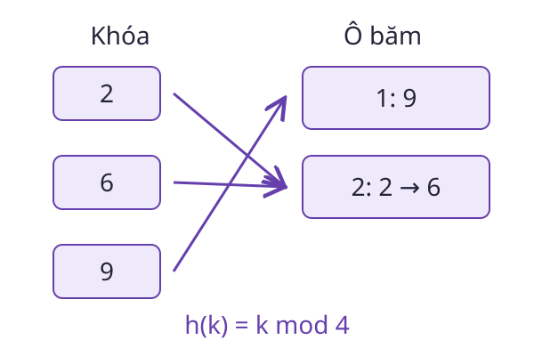

# Hàm băm

Một từ điển cần tìm nhanh giá trị ứng với một khóa. **Hàm băm** chuyển khóa thành một giá trị hữu hạn để chọn vùng lưu trữ. Nó giúp khoanh vùng tìm kiếm, nhưng không thay thế việc kiểm tra khóa.

<WikiUsage />



## Giải thích kỹ thuật

Nếu miền đầu vào có nhiều phần tử hơn miền giá trị băm, ít nhất hai đầu vào phải trùng kết quả. Đó là va chạm, một hệ quả của nguyên lý Dirichlet chứ không tự là lỗi cài đặt.

Bảng băm có thể xử lý va chạm bằng cách lưu nhiều khóa trong cùng một vùng hoặc thăm dò các vị trí khác. Sau khi chọn vùng, vẫn phải so sánh khóa đầy đủ để xác định đúng phần tử.

Chi phí kỳ vọng hằng số cần các giả thiết về hàm băm, phân bố khóa và hệ số tải. Trong trường hợp xấu, nhiều khóa cùng vùng có thể làm tra cứu chậm đi đáng kể.

Hàm băm phục vụ tra cứu không tự có tính chất bảo mật. Chống tìm đầu vào từ kết quả băm, chống va chạm có chủ đích và phân bố đều là những yêu cầu khác nhau.

## Ví dụ có lời giải

Xét quy tắc đơn giản $h(k)=k\bmod4$. Ta có $h(2)=h(6)=2$, còn $h(9)=1$.

Nếu tìm khóa 6, bảng đi tới vùng 2 rồi đối chiếu lần lượt với các khóa trong vùng. Gặp khóa 2 chưa đủ để kết luận đã tìm thấy, dù giá trị băm giống nhau.

```python
buckets = [[] for _ in range(4)]
for key in [2, 6, 9]:
    buckets[key % 4].append(key)
assert buckets[2] == [2, 6]
assert 6 in buckets[6 % 4]
```

Đây là minh họa xử lý va chạm bằng nhóm khóa, không phải hàm băm thích hợp cho mọi dữ liệu.

## Câu hỏi ôn lại

Hai file có cùng giá trị băm có chứng minh chúng giống nhau tuyệt đối không?

::: details Xem lời giải
Không. Miền kết quả hữu hạn vẫn cho phép va chạm. Trong các ứng dụng bảo mật, mức độ khó tạo va chạm có chủ đích là một thuộc tính phải được phân tích riêng.
:::

## Đọc tiếp

- [Dictionary](./dictionary.md)
- [Cặp khóa–giá trị](./khoa-gia-tri.md)
- [Độ phức tạp](./do-phuc-tap.md)

## Tài liệu tham khảo

- [Princeton, Algorithms, Hash Tables](https://algs4.cs.princeton.edu/34hash/).
