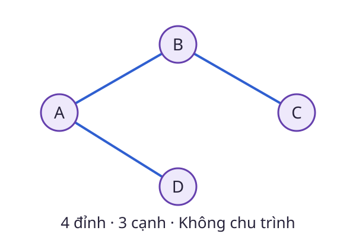

# Cây

Muốn nối nhiều trạm mà không tạo vòng thừa, ta gặp cấu trúc **cây**. Trong đồ thị vô hướng, cây là đồ thị liên thông và không có chu trình.

<WikiUsage />

## Giải thích kỹ thuật

Giữa hai đỉnh bất kỳ của cây có đúng một đường đi đơn. Nếu có hai đường khác nhau, chúng sẽ tạo một chu trình. Nếu không có đường nào, đồ thị không liên thông.

Với cây hữu hạn có $n\ge1$ đỉnh, số cạnh bằng $n-1$. Tuy nhiên, chỉ đếm đủ $n-1$ cạnh chưa đủ để kết luận một đồ thị tùy ý là cây: Còn cần điều kiện như liên thông.

Khi chọn một đỉnh làm gốc, mỗi đỉnh khác gốc có một cha. Khái niệm cha, con và độ sâu phụ thuộc lựa chọn gốc, còn các cạnh của cây không tự thay đổi.

Cây nhị phân cho phép mỗi nút có nhiều nhất hai con. Cây tìm kiếm nhị phân còn thêm quy tắc thứ tự khóa. Hai thuật ngữ không đồng nghĩa.

## Ví dụ có lời giải

Từ đồ thị trong [mục Đồ thị](./do-thi.md), giữ ba cạnh A–B, B–C và A–D như hình trên. Bốn đỉnh được nối bằng ba cạnh và không còn chu trình, nên ta được một cây khung.

Thêm lại cạnh D–C tạo chu trình A–B–C–D–A. Bỏ một cạnh bất kỳ khỏi cây ban đầu sẽ làm ít nhất hai phần không còn nối với nhau.

Trong cây có gốc A, B và D là con của A, còn C là con của B. Độ sâu của C bằng 2 cạnh.

## Câu hỏi ôn lại

Một đồ thị gồm một tam giác và một đỉnh cô lập có 4 đỉnh, 3 cạnh. Có phải cây không?

::: details Xem lời giải
Không. Nó vừa có chu trình tam giác vừa không liên thông. Ví dụ chỉ ra vì sao số cạnh bằng số đỉnh trừ một chưa đủ nếu đứng riêng.
:::

## Đọc tiếp

- [Đồ thị](./do-thi.md)
- [Đệ quy](./de-quy.md)
- [Hàng đợi](./hang-doi.md)

## Tài liệu tham khảo

- [Princeton, Algorithms, Undirected Graphs](https://algs4.cs.princeton.edu/41graph/).
