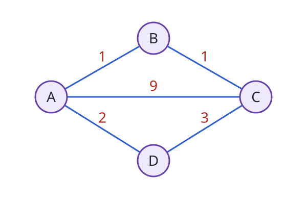

# Đồ thị

Một mạng đường đi, các trang web liên kết và quan hệ phụ thuộc giữa công việc đều có thể được mô tả bằng **đồ thị**. Mỗi đối tượng là một đỉnh, còn mối nối được quan tâm là một cạnh.

<WikiUsage />

## Giải thích kỹ thuật

Đồ thị viết là $G=(V,E)$, với tập đỉnh $V$ và tập cạnh $E$. Đồ thị có hướng phân biệt cạnh từ A tới B với cạnh từ B tới A. Đồ thị vô hướng không phân biệt hai chiều này.

Trọng số trên cạnh có thể mô tả khoảng cách, thời gian hoặc chi phí. Phải chọn đơn vị và ý nghĩa trước khi cộng trọng số trên một đường đi. Bài toán ít cạnh nhất khác bài toán tổng trọng số nhỏ nhất.

Danh sách kề lưu láng giềng của từng đỉnh. Với biểu diễn thích hợp, bộ nhớ có độ lớn $O(|V|+|E|)$. Ma trận kề dùng $|V|^2$ ô, thuận tiện kiểm tra một cạnh nhưng có thể tốn hơn nhiều trên đồ thị thưa.

BFS tìm đường ngắn nhất theo số cạnh trên đồ thị không trọng số. Với trọng số không âm khác nhau, cần thuật toán phù hợp như Dijkstra. Không giữ nguyên kết luận về khoảng cách nếu chỉ đổi nhãn cạnh thành các chi phí bất kỳ.

## Ví dụ có lời giải

Trong hình, cạnh trực tiếp A–C có chi phí 9. Đường A–B–C gồm hai cạnh, mỗi cạnh chi phí 1, nên tổng chỉ bằng 2. Đường A–D–C có chi phí $2+3=5$.

Vì vậy, đường ít cạnh nhất là A–C nhưng đường rẻ nhất là A–B–C. Mô hình “mỗi cạnh bằng nhau” và mô hình có trọng số trả lời hai câu hỏi khác nhau.

Nếu biểu diễn bằng danh sách kề, A có các láng giềng B, C, D. Trong đồ thị vô hướng, mỗi cạnh phải xuất hiện ở danh sách của cả hai đầu mút.

## Câu hỏi ôn lại

Nếu có đường đi từ A tới B trong đồ thị có hướng, có chắc có đường đi từ B về A không?

::: details Xem lời giải
Không. Một cạnh duy nhất A tới B đã là phản ví dụ. Phải kiểm tra tính đạt tới theo từng hướng, hoặc điều kiện liên thông mạnh nếu cần cả hai chiều.
:::

## Đọc tiếp

- [Cây](./cay.md)
- [Hàng đợi](./hang-doi.md)
- [Ngăn xếp](./ngan-xep.md)
- [Trạng thái](./trang-thai.md)

## Tài liệu tham khảo

- [Princeton, Algorithms, Undirected Graphs](https://algs4.cs.princeton.edu/41graph/).
