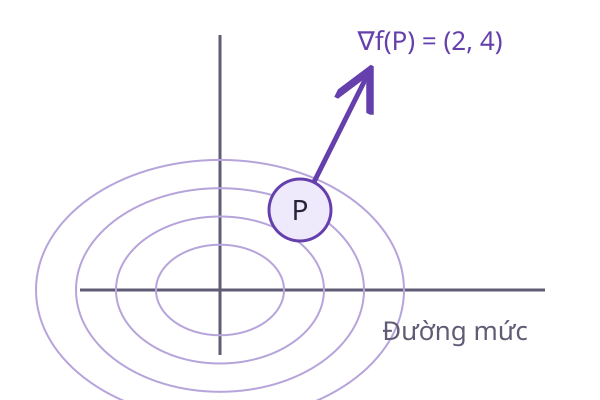

# Gradient

Trên một bản đồ độ cao, biết dốc theo hướng đông và hướng bắc giúp chọn hướng leo nhanh nhất. **Gradient** gom các đạo hàm riêng thành vector để mô tả sự thay đổi cục bộ của một hàm nhiều biến.

<WikiUsage />

## Giải thích kỹ thuật

Với hàm khả vi $f(x,y)$:

$$
\nabla f=\begin{bmatrix}\partial f/\partial x\\\partial f/\partial y\end{bmatrix}.
$$

Theo một hướng đơn vị $u=(u_1,u_2)$, tốc độ thay đổi là:

$$
D_uf=\frac{\partial f}{\partial x}u_1+\frac{\partial f}{\partial y}u_2.
$$

Đây là tích vô hướng $\nabla f\cdot u$. Khi gradient khác không, hướng tăng nhanh nhất là hướng của gradient, còn hướng giảm nhanh nhất là hướng đối diện. Yêu cầu $\|u\|_2=1$ giữ cùng độ dài bước để so sánh các hướng công bằng.

Gradient vuông góc với đường mức tại điểm chính quy. Dọc đường mức, giá trị hàm không đổi nên đạo hàm theo tiếp tuyến bằng 0. Khi gradient bằng 0, kết luận về một hướng tăng nhanh nhất không còn được xác định chỉ từ đạo hàm bậc nhất.

## Ví dụ có lời giải

Cho $f(x,y)=x^2+2y^2$. Tại $P=(1,1)$:

$$
\nabla f(P)=(2,4)^T.
$$

Đi ngang với $u=(1,0)$ cho tốc độ tăng bằng 2. Đi dọc với $v=(0,1)$ cho tốc độ tăng bằng 4. Hướng gradient chuẩn hóa cho tốc độ tăng lớn nhất bằng $\sqrt{20}$.

Một bước hạ gradient với $\eta=0{,}1$ đưa $P$ tới $(0{,}8;0{,}6)$. Giá trị hàm giảm từ 3 xuống $1{,}36$. Nếu dùng $\eta=1$, điểm mới là $(-1,-3)$ và giá trị tăng lên 19. Hướng giảm đúng không bảo đảm mọi độ dài bước đều đúng.

## Câu hỏi ôn lại

Ở điểm gradient bằng 0, hàm có nhất thiết đạt cực tiểu không?

::: details Xem lời giải
Không. Hàm $f(x,y)=x^2-y^2$ có gradient bằng 0 tại gốc. Đi theo trục ngang làm hàm tăng, còn theo trục dọc làm hàm giảm. Gốc là điểm yên ngựa.
:::

## Đọc tiếp

- [Đạo hàm](./dao-ham.md)
- [Tích vô hướng](./tich-vo-huong.md)
- [Hessian](./hessian.md)
- [Tìm kiếm đường và backtracking](./tim-kiem-duong.md)

## Tài liệu tham khảo

- [OpenStax, Calculus Volume 3, Directional Derivatives and the Gradient](https://openstax.org/books/calculus-volume-3/pages/4-6-directional-derivatives-and-the-gradient).
