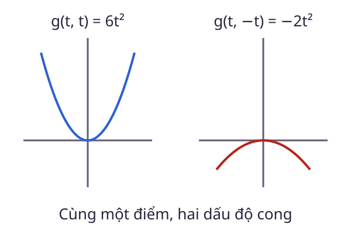

# Hessian

Hai vị trí có cùng độ dốc vẫn có thể cần bước đi khác nhau: Một nơi gần như phẳng, nơi còn lại cong mạnh. **Hessian** mô tả thông tin đạo hàm bậc hai, tức sự thay đổi của gradient theo các hướng.

<WikiUsage />

## Giải thích kỹ thuật

Với $f$ có đạo hàm bậc hai liên tục trên miền mở, Hessian có phần tử $H_{ij}=\partial^2f/(\partial x_i\partial x_j)$. Khi chỉ có hai biến:

$$
H=\begin{bmatrix}f_{xx}&f_{xy}\\f_{yx}&f_{yy}\end{bmatrix}.
$$

Tính liên tục của đạo hàm bậc hai bảo đảm $f_{xy}=f_{yx}$, nên $H$ đối xứng. Độ cong theo độ dời $d$ được đo bởi dạng toàn phương $d^THd$.

Tại một điểm dừng, Hessian dương xác định bảo đảm cực tiểu địa phương nghiêm ngặt. Hessian không xác định cho điểm yên ngựa. Nếu Hessian chỉ nửa xác định dương, riêng phép thử bậc hai có thể chưa kết luận được.

Muốn chứng minh hàm lồi trên miền mở lồi, phải kiểm tra Hessian nửa xác định dương trên mọi điểm của miền. Kiểm tra tại một điểm không thay thế được điều kiện toàn miền.

## Ví dụ có lời giải

Với $f(x,y)=x^2+3y^2$:

$$
H=\begin{bmatrix}2&0\\0&6\end{bmatrix}.
$$

Độ cong theo trục dọc lớn hơn theo trục ngang. Với $g(x,y)=x^2+4xy+y^2$, Hessian là:

$$
H_g=\begin{bmatrix}2&4\\4&2\end{bmatrix}.
$$

Theo $u=(1,1)^T$, ta có $u^TH_gu=12$. Theo $v=(1,-1)^T$, kết quả bằng $-4$. Các phần tử trên đường chéo đều dương nhưng ma trận vẫn không xác định. Chỉ nhìn đường chéo là chưa đủ.

## Câu hỏi ôn lại

Với $f(x,y)=x^4+y^4$, Hessian tại gốc bằng 0. Có thể kết luận gốc không phải cực tiểu không?

::: details Xem lời giải
Không. Ta có $f(x,y)\ge0$ và chỉ bằng 0 tại gốc, nên gốc là cực tiểu toàn cục nghiêm ngặt. Phép thử Hessian tại gốc chỉ không cung cấp đủ thông tin.
:::

## Đọc tiếp

- [Gradient](./gradient.md)
- [Ma trận nửa xác định dương](./ma-tran-psd.md)
- [Trị riêng & vector riêng](./tri-rieng.md)
- [Hàm lồi](./ham-loi.md)

## Tài liệu tham khảo

- [S. Boyd và L. Vandenberghe, Convex Optimization](https://web.stanford.edu/~boyd/cvxbook/).
