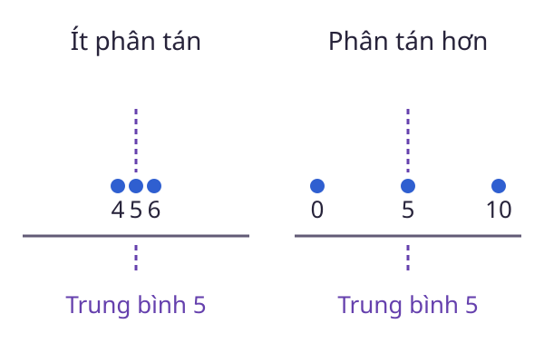

# Kỳ vọng

Một trò chơi có nhiều kết quả với xác suất khác nhau. **Kỳ vọng** không hỏi kết quả nào chắc chắn xuất hiện, mà hỏi trung bình có trọng số theo mô hình xác suất là bao nhiêu.

<WikiUsage />

## Giải thích kỹ thuật

Nếu $X$ nhận các giá trị hữu hạn $x_1,\ldots,x_k$, mỗi giá trị có xác suất $p_i$, thì:

$$
\mathbb E[X]=x_1p_1+\cdots+x_kp_k.
$$

Viết gọn:

$$
\mathbb E[X]=\sum_{i=1}^k x_ip_i.
$$

Các xác suất không âm và có tổng bằng 1. Chúng là trọng số của phép bình quân, không phải các hệ số tùy chọn.

Khi các kỳ vọng liên quan tồn tại hữu hạn, tính tuyến tính cho:

$$
\mathbb E[aX+bY]=a\mathbb E[X]+b\mathbb E[Y].
$$

Không cần độc lập cho công thức này. Ngược lại, đẳng thức kỳ vọng của tích bằng tích kỳ vọng cần điều kiện riêng. Với phân phối vô hạn, phải kiểm tra tính khả tích, chẳng hạn $\mathbb E[|X|]<\infty$, trước khi tính như một số hữu hạn.

## Ví dụ có lời giải

Giả sử $X$ nhận 0, 2, 4 với xác suất tương ứng $1/4,1/2,1/4$. Khi đó:

$$
\mathbb E[X]=0\cdot\tfrac14+2\cdot\tfrac12+4\cdot\tfrac14=2.
$$

Một xúc xắc cân bằng có kỳ vọng $3{,}5$, dù không có mặt ghi số đó. Vì vậy, kỳ vọng không nhất thiết là kết quả có thể xảy ra trong một lần thử.

Nếu $Y=10-X$, tính tuyến tính cho $\mathbb E[Y]=10-2=8$. Không cần liệt kê lại toàn bộ phân phối của $Y$.

## Câu hỏi ôn lại

Tổng điểm của hai xúc xắc cân bằng có kỳ vọng bao nhiêu? Tính tuyến tính cần hai xúc xắc độc lập không?

::: details Xem lời giải
Kỳ vọng bằng $3{,}5+3{,}5=7$. Tính tuyến tính không yêu cầu độc lập. Tuy nhiên, nếu muốn tính toàn bộ phân phối của tổng từ hai phân phối riêng, quan hệ phụ thuộc lại rất quan trọng.
:::

## Đọc tiếp

- [Biến ngẫu nhiên](./bien-ngau-nhien.md)
- [Phương sai](./phuong-sai.md)
- [Tích phân](./tich-phan.md)

## Tài liệu tham khảo

- [OpenStax, Introductory Statistics 2e, Mean or Expected Value and Standard Deviation](https://openstax.org/books/introductory-statistics-2e/pages/4-2-mean-or-expected-value-and-standard-deviation).
