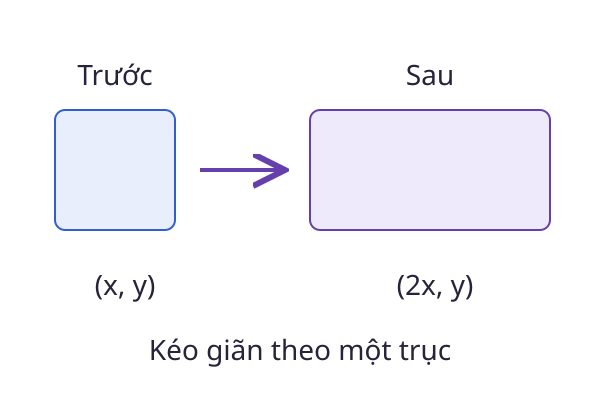

# Ma trận

Một ảnh số có nhiều điểm ảnh, còn một hệ phương trình có nhiều hệ số. **Ma trận** gom các số vào hàng và cột để biểu diễn dữ liệu hoặc một phép biến đổi có cấu trúc.

<WikiUsage />

## Giải thích kỹ thuật

Ma trận $A\in\mathbb R^{m\times n}$ có $m$ hàng và $n$ cột. Ký hiệu $A_{ij}$ chỉ phần tử ở hàng $i$, cột $j$. Khi nhân với vector $x\in\mathbb R^n$, mỗi hàng tạo một thành phần của $y=Ax$.

Ở trường hợp hai cột:

$$
y_i=A_{i1}x_1+A_{i2}x_2.
$$

Với $n$ cột, phép cộng trên được viết gọn:

$$
y_i=\sum_{j=1}^n A_{ij}x_j.
$$

Chỉ số $j$ chạy qua các cột. Chỉ số $i$ chọn hàng đang tính. Như vậy, vector đầu ra có $m$ thành phần, không phụ thuộc việc $m$ có bằng $n$ hay không.

Một cách nhìn khác là xem các cột của $A$ như ảnh của những vector cơ sở. Từ đó, $Ax$ là tổ hợp tuyến tính của các cột, với trọng số là các thành phần của $x$. Hai cách nhìn theo hàng và theo cột mô tả cùng một phép tính.

## Ví dụ có lời giải

Cho:

$$
A=\begin{bmatrix}1&2\\0&3\end{bmatrix},\quad
x=\begin{bmatrix}2\\1\end{bmatrix}.
$$

Tính từng hàng:

$$
\begin{aligned}
y_1&=1\cdot2+2\cdot1=4,\\
y_2&=0\cdot2+3\cdot1=3.
\end{aligned}
$$

Do đó $Ax=(4,3)^T$. Hình minh họa dùng ma trận đường chéo $D=\operatorname{diag}(2,1)$: Nó kéo giãn trục ngang gấp đôi và giữ nguyên trục dọc.

Phép nhân ma trận có thứ tự. Nếu $A$ có kích thước $2\times3$ và $B$ có kích thước $3\times4$, tích $AB$ xác định và có kích thước $2\times4$. Tích $BA$ không xác định trong trường hợp này.

## Câu hỏi ôn lại

Ma trận $3\times2$ nhân vector hai thành phần tạo vector bao nhiêu thành phần? Có cần ma trận khả nghịch không?

::: details Xem lời giải
Kết quả có ba thành phần vì có ba hàng. Không cần tính khả nghịch. Khả nghịch chỉ đặt ra cho ma trận vuông và là yêu cầu khác với điều kiện xác định phép nhân.
:::

## Đọc tiếp

- [Vector](./vector.md)
- [Tích vô hướng](./tich-vo-huong.md)
- [Hệ phương trình tuyến tính](./he-phuong-trinh.md)
- [Trị riêng & vector riêng](./tri-rieng.md)

## Tài liệu tham khảo

- [MIT OpenCourseWare, 18.06 Linear Algebra](https://ocw.mit.edu/courses/18-06-linear-algebra-spring-2010/).
