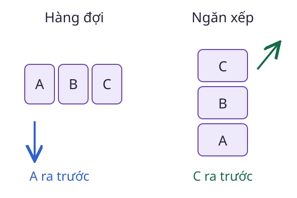

# Ngăn xếp

Khi bấm Hoàn tác trong trình soạn thảo, thao tác được thực hiện gần nhất thường phải được đảo ngược trước. **Ngăn xếp** lưu phần tử theo quy tắc vào sau, ra trước (LIFO).

<WikiUsage />



## Giải thích kỹ thuật

Hai thao tác cơ bản là `push`, thêm phần tử lên đỉnh, và `pop`, lấy phần tử ở đỉnh ra. Thao tác `peek` chỉ xem đỉnh mà không xóa. Không được lấy phần tử từ một ngăn xếp rỗng nếu chưa quy định cách báo lỗi.

Ngăn xếp là kiểu dữ liệu trừu tượng, không đồng nhất với một cách cài đặt. Có thể dùng mảng động hoặc danh sách liên kết. Với mảng động, thêm ở cuối thường có chi phí hằng số theo phân tích khấu hao, nhưng một lần mở rộng mảng có thể cần sao chép nhiều phần tử.

Ngăn xếp lời gọi hàm lưu ngữ cảnh của những lời gọi chưa hoàn tất. Đệ quy sâu có thể làm cạn vùng nhớ dành cho ngăn xếp. Thay đệ quy bằng vòng lặp chỉ an toàn khi vẫn giữ đầy đủ trạng thái cần quay lại.

## Ví dụ có lời giải

Thêm lần lượt A, B, C, rồi lấy ra một phần tử:

```python
stack = []
for item in ["A", "B", "C"]:
    stack.append(item)
assert stack.pop() == "C"
assert stack == ["A", "B"]
```

Để kiểm tra chuỗi ngoặc, mỗi dấu mở được đẩy lên ngăn xếp. Khi gặp dấu đóng, ta đối chiếu với dấu mở gần nhất chưa được ghép. Chuỗi `([])` hợp lệ nhưng `([)]` không hợp lệ, dù số lượng dấu mở và đóng bằng nhau.

## Câu hỏi ôn lại

Sau `push(A)`, `push(B)`, `pop()`, `push(C)`, phần tử tiếp theo được lấy ra là gì?

::: details Xem lời giải
Là C. Lần pop trước đã bỏ B, nên ngăn xếp đi từ [A, B] về [A], rồi thành [A, C].
:::

## Đọc tiếp

- [Hàng đợi](./hang-doi.md)
- [Đệ quy](./de-quy.md)
- [Trạng thái](./trang-thai.md)

## Tài liệu tham khảo

- [Princeton, Algorithms, Bags, Queues, and Stacks](https://algs4.cs.princeton.edu/13stacks/).
