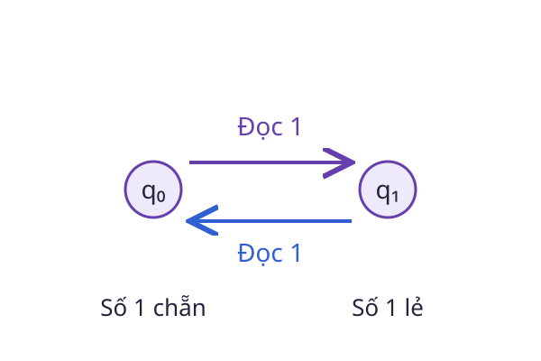

# Alan Turing: Mô tả chính xác một phép tính

Một thủ tục gồm những bước nào, lưu được điều gì và khi nào dừng? Trước khi hỏi máy chạy nhanh bao nhiêu, cần nói rõ máy được phép làm gì. Đó là cách biến trực giác về tính toán thành một đối tượng có thể nghiên cứu.

## Dấu mốc năm 1936

Alan Turing hoàn thành bản thảo *On Computable Numbers* năm 1936. Kho lưu trữ tại King's College, Cambridge ghi nhận công trình này trong quá trình ông nghiên cứu nền tảng tính toán. Sau chiến tranh, ông tiếp tục làm việc về máy tính tại National Physical Laboratory và Manchester.

Mô hình máy Turing mô tả tính toán qua trạng thái, ký hiệu trên băng và quy tắc chuyển. Giá trị của mô hình nằm ở sự tường minh. Khi các thao tác đã được xác định, ta có thể đặt câu hỏi về những bài toán giải được và những giới hạn của thuật toán.

## Bắt đầu từ một máy nhỏ hơn

Xét máy hữu hạn đọc chuỗi bit từ trái sang phải. Nó chỉ cần nhớ số ký hiệu 1 đã gặp là chẵn hay lẻ:



Đọc 0 thì giữ trạng thái. Đọc 1 thì đổi trạng thái. Với chuỗi `1011`, trạng thái lần lượt là chẵn, lẻ, lẻ, chẵn, lẻ.

```python
odd = False
for bit in "1011":
    if bit == "1":
        odd = not odd
assert odd is True
```

Hai trạng thái đủ vì ta chỉ cần biết tính chẵn lẻ, không cần nhớ toàn bộ số lượng. Đây là máy hữu hạn minh họa quy tắc chuyển trạng thái. Máy Turing tổng quát còn có băng nhớ có thể đọc và ghi, nên hai mô hình có năng lực khác nhau.

## Điều cần phân biệt

Một bài toán có thuật toán giải chưa chắc giải được nhanh với dữ liệu lớn. Tính giải được và độ phức tạp là hai câu hỏi khác nhau. Ngược lại, không tìm ra lời giải sau nhiều lần thử chưa chứng minh rằng không có thuật toán.

## Câu hỏi tự kiểm

Nếu chỉ lưu một bit chẵn lẻ, máy có trả lời chính xác đã đọc bao nhiêu ký hiệu 1 không?

::: details Xem gợi ý
Không. Các số lượng 1, 3 và 5 đều dẫn tới trạng thái lẻ. Thông tin đã được gộp lại vì bài toán ban đầu chỉ yêu cầu tính chẵn lẻ.
:::

## Đọc tiếp

- [Trạng thái](../trang-thai.md)
- [Độ phức tạp](../do-phuc-tap.md)
- [Hàm trong lập trình](../ham-lap-trinh.md)
- [Khám phá Wiki](../index.md)

## Tài liệu tham khảo

- King's College, Cambridge. [About Alan Turing](https://turingarchive.kings.cam.ac.uk/about-alan-turing).
