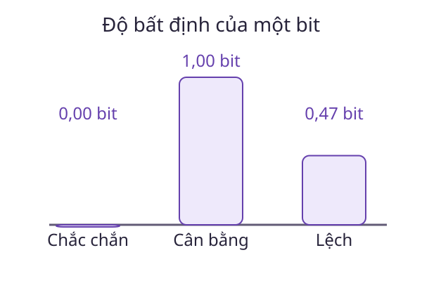

# Claude Shannon: Đo độ bất định

Một cảm biến luôn gửi cùng một ký hiệu có mang nhiều thông tin mới như một cảm biến có nhiều kết quả khó đoán? Để nghiên cứu việc mã hóa và truyền tin, ta cần một đại lượng đo được mức bất định của nguồn.

## Dấu mốc năm 1948

Claude Shannon công bố *A Mathematical Theory of Communication* năm 1948. Công trình đặt nền tảng toán học để nghiên cứu nguồn tin, mã hóa và kênh truyền. Trong mô hình này, thông tin được khảo sát qua phân bố xác suất của ký hiệu, tách khỏi việc diễn giải ý nghĩa của từng thông điệp.

## Hai kết quả có thể xảy ra

Nguồn phát ký hiệu A với xác suất $p_1$ và B với xác suất $p_2$, trong đó $p_1+p_2=1$. Entropy của nguồn là:

$$
H=-p_1\log_2p_1-p_2\log_2p_2.
$$

Đây là tổng của hai đóng góp, mỗi đóng góp phụ thuộc xác suất của một ký hiệu. Quy ước $0\log_2 0=0$ được hiểu theo giới hạn. Với logarit cơ số 2, đơn vị là bit.

Nếu hai ký hiệu đồng xác suất, mỗi kết quả khó đoán như nhau và entropy bằng 1 bit. Nếu A có xác suất $0{,}9$, entropy xấp xỉ $0{,}469$ bit. Nếu nguồn luôn phát A, entropy bằng 0.

Số $0{,}469$ không có nghĩa mỗi thông điệp đơn lẻ được viết bằng một phần của bit. Entropy liên quan đến giới hạn độ dài mã trung bình khi mã hóa nhiều thông điệp trong mô hình thích hợp.

## Điều cần phân biệt

Thông điệp bất ngờ chưa chắc có ý nghĩa hữu ích. Một chuỗi ngẫu nhiên có thể khó dự đoán nhưng không trả lời câu hỏi của người đọc. Entropy cũng phụ thuộc mô hình xác suất đã chọn, không chỉ phụ thuộc hình thức chuỗi ký tự.

## Câu hỏi tự kiểm

Một đồng xu cân bằng được tung độc lập 10 lần. Vì sao biết kết quả lần đầu không giúp đoán lần tiếp theo tốt hơn?

::: details Xem gợi ý
Độc lập giữ nguyên phân bố có điều kiện của lần tiếp theo. Xác suất mỗi mặt vẫn bằng một nửa. Nếu các lần tung có phụ thuộc, lập luận này không còn áp dụng.
:::

## Đọc tiếp

- [Biến ngẫu nhiên](../bien-ngau-nhien.md)
- [Xác suất có điều kiện](../xac-suat-co-dieu-kien.md)
- [Kỳ vọng](../ky-vong.md)
- [Khám phá Wiki](../index.md)

## Tài liệu tham khảo

- C. E. Shannon. [A Mathematical Theory of Communication](https://www.nokia.com/bell-labs/publications-and-media/publications/a-mathematical-theory-of-communication/), 1948.
