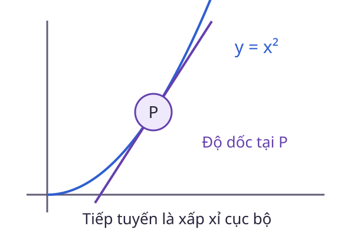

# Isaac Newton: Từ lực đến thay đổi chuyển động

Đẩy một xe hàng theo cùng một cách, vì sao xe đầy và xe rỗng thay đổi vận tốc khác nhau? Muốn trả lời định lượng, ta phải nối lực tác dụng, khối lượng và gia tốc trong cùng một mô hình.

## Dấu mốc năm 1687

Isaac Newton công bố *Philosophiæ Naturalis Principia Mathematica* năm 1687. Công trình trình bày ba định luật chuyển động và lý thuyết hấp dẫn. Newton Project tại Đại học Oxford cung cấp mốc thời gian và tư liệu về công trình này.

Trong cơ học Newton với khối lượng không đổi, xét trong hệ quy chiếu quán tính:

$$
\mathbf F_{\mathrm{net}}=m\mathbf a.
$$

Lực ở đây là tổng vector của các lực ngoài tác dụng lên vật. Chỉ biết một lực riêng chưa đủ nếu còn ma sát, trọng lực hoặc lực từ các vật khác.

## Một phép tính có giả thiết rõ

Xét vật khối lượng $2\,\mathrm{kg}$ chuyển động trên trục ngang. Tổng lực không đổi là $6\,\mathrm N$ theo chiều dương. Gia tốc bằng:

$$
a=\frac6{2}=3\,\mathrm{m/s^2}.
$$

Nếu vận tốc ban đầu là $1\,\mathrm{m/s}$, sau $2\,\mathrm s$ ta có:

$$
v=1+3\cdot2=7\,\mathrm{m/s}.
$$

Kết quả dùng giả thiết tổng lực và khối lượng không đổi trong suốt khoảng thời gian ấy. Nếu lực thay đổi, cần mô tả gia tốc theo thời gian rồi tích phân để tìm biến thiên vận tốc.

## Đạo hàm xuất hiện ở đâu?

Vận tốc là tốc độ thay đổi vị trí, còn gia tốc là tốc độ thay đổi vận tốc. Đạo hàm giúp phát biểu các quan hệ này tại từng thời điểm. Một độ dốc trên đồ thị vận tốc theo thời gian có đơn vị gia tốc.

## Câu hỏi tự kiểm

Tổng lực bằng 0 có buộc vận tốc bằng 0 không?

::: details Xem gợi ý
Không. Trong mô hình đang xét, tổng lực bằng 0 kéo theo gia tốc bằng 0. Vật có thể đứng yên hoặc chuyển động thẳng đều với vận tốc khác 0.
:::

## Đọc tiếp

- [Lực](../luc.md)
- [Đạo hàm](../dao-ham.md)
- [Công và năng lượng](../cong-nang-luong.md)
- [Khám phá Wiki](../index.md)

## Tài liệu tham khảo

- University of Oxford, Newton Project. [His Life and Work at a Glance](https://www.newtonproject.ox.ac.uk/his-life-and-work-at-a-glance).
