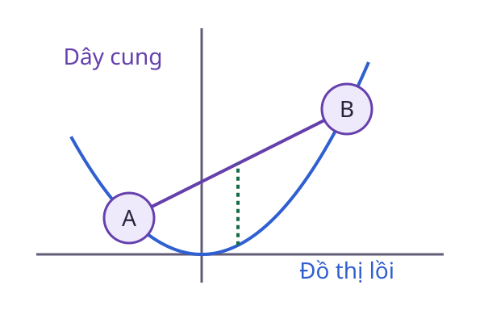

# Tập lồi

Hai phương án phân bổ nguồn lực đều hợp lệ. Nếu trộn chúng theo bất kỳ tỷ lệ nào vẫn hợp lệ, miền phương án có một tính chất rất hữu ích: **Tính lồi**.

<WikiUsage />

## Giải thích kỹ thuật

Tập $C$ là lồi nếu với mọi $x,y\in C$ và mọi $\theta\in[0,1]$, điểm:

$$
z=\theta x+(1-\theta)y
$$

cũng thuộc $C$. Khi $\theta=0$, ta nhận $y$. Khi $\theta=1$, ta nhận $x$. Các tỷ lệ ở giữa quét toàn bộ đoạn nối hai điểm.

Điều kiện yêu cầu mọi cặp điểm và mọi tỷ lệ, không chỉ một trung điểm được chọn. Thử vài cặp có thể tìm được phản ví dụ, nhưng không chứng minh tính lồi cho toàn tập.

Giao của các tập lồi là lồi: Một đoạn nối hai điểm thuộc giao phải nằm trong từng tập thành phần. Ngược lại, hợp của các tập lồi có thể không lồi nếu có khoảng trống giữa chúng.

## Ví dụ có lời giải

Miền phân bổ hai nguồn lực $x_1,x_2\ge0$ với $x_1+x_2\le10$ là lồi. Hai phương án $(2,6)$ và $(6,2)$ đều hợp lệ, và mọi trung bình có trọng số của chúng vẫn không vượt ngân sách.

Một đường tròn chỉ gồm đường biên không lồi. Hai điểm đối diện có trung điểm ở tâm, mà tâm không nằm trên đường tròn. Hình tròn gồm cả phần bên trong thì lồi.

Trong tối ưu, miền khả thi lồi giúp đường nối hai phương án không xuyên qua vùng cấm. Điều này khác với giả thiết về hàm mục tiêu lồi, vốn cần kiểm tra riêng.

## Câu hỏi ôn lại

Tập gồm đúng hai điểm phân biệt có lồi không?

::: details Xem lời giải
Không. Trung điểm hai điểm khác cả hai đầu mút nên không thuộc tập. Tập chỉ có một điểm thì lồi vì mọi tổ hợp của điểm đó vẫn là chính nó.
:::

## Đọc tiếp

- [Tổ hợp lồi](./to-hop-loi.md)
- [Hàm lồi](./ham-loi.md)
- [Điểm và miền khả thi](./mien-kha-thi.md)

## Tài liệu tham khảo

- [S. Boyd và L. Vandenberghe, Convex Optimization](https://web.stanford.edu/~boyd/cvxbook/).
