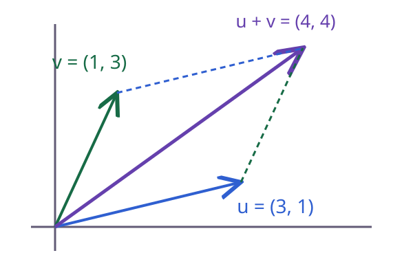

# Vector

Một robot đi sang phải 3 mét rồi tiến lên 1 mét. Độ dời không thể được mô tả đầy đủ bằng một số đo độ dài, vì hướng đi cũng cần được giữ lại. **Vector** biểu diễn đồng thời các thành phần của một đại lượng, chẳng hạn vị trí, vận tốc hoặc bộ đặc trưng của một mẫu dữ liệu.

<WikiUsage />

## Giải thích kỹ thuật

Trong mặt phẳng, viết $u=(u_1,u_2)$. Hai thành phần là tọa độ của vector theo hệ trục đã chọn. Cộng vector nghĩa là cộng các thành phần tương ứng:

$$
u+v=(u_1+v_1,u_2+v_2).
$$

Nhân với số $a$ cho $au=(au_1,au_2)$. Với $a>0$, hướng được giữ nguyên. Với $a<0$, hướng đảo lại. Khi $a=0$, kết quả là vector không.

Một điểm và một vector có thể dùng cùng dạng tọa độ nhưng giữ vai trò khác nhau. Điểm $P$ nói “ở đâu”, còn vector $\overrightarrow{PQ}$ nói “dịch chuyển thế nào từ $P$ tới $Q$”. Khi đổi gốc tọa độ, tọa độ điểm thay đổi nhưng độ dời giữa hai điểm không thay đổi.

Trong học máy, vector đặc trưng có thể chứa tuổi, chiều cao và số lần mua hàng. Các thành phần không nhất thiết có cùng đơn vị. Vì vậy, độ dài Euclid của vector đó chỉ có ý nghĩa sau khi đã chọn thang đo thích hợp.

## Ví dụ có lời giải

Xét $u=(3,1)$ và $v=(1,3)$. Hai đường đi có cùng tổng độ dời:

$$
u+v=(4,4)=v+u.
$$

Hình bình hành minh họa vì sao thứ tự hai độ dời không làm đổi điểm cuối. Tuy nhiên, độ dài của tổng không bằng tổng độ dài nói chung. Hai vector ngược hướng có thể triệt tiêu nhau.

Với $w=(-3,-1)$, ta có $u+w=(0,0)$. Độ dài kết quả bằng 0 dù từng độ dời đều khác 0.

## Câu hỏi ôn lại

Cho $u=(2,-1)$ và $v=(-1,4)$. Tính $2u-v$ và giải thích vì sao thứ tự các thành phần không được đổi tùy ý.

::: details Xem lời giải
Ta được $2u=(4,-2)$, do đó $2u-v=(5,-6)$. Thành phần thứ nhất và thứ hai gắn với hai trục hoặc hai đặc trưng đã xác định. Đổi thứ tự nghĩa là đổi cách mô tả đối tượng, không chỉ đổi cách viết.
:::

## Đọc tiếp

- [Ma trận](./ma-tran.md)
- [Tích vô hướng](./tich-vo-huong.md)
- [Chuẩn vector](./chuan.md)

## Tài liệu tham khảo

- [OpenStax, Calculus Volume 3, Vectors in the Plane](https://openstax.org/books/calculus-volume-3/pages/2-1-vectors-in-the-plane).
