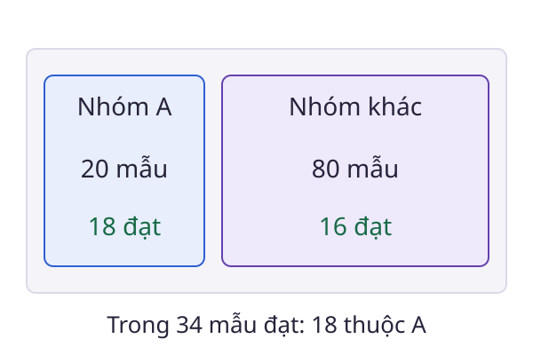

# Xác suất có điều kiện

Một bộ lọc báo “đạt” cho một mẫu. Muốn đoán mẫu thuộc nhóm nào, ta phải đổi tập đối tượng đang xét: Chỉ nhìn những mẫu đã đạt. **Xác suất có điều kiện** mô tả phép thu hẹp không gian xét ấy.

<WikiUsage />

## Giải thích kỹ thuật

Với biến cố $B$ có $P(B)>0$:

$$
P(A\mid B)=\frac{P(A\cap B)}{P(B)}.
$$

Mẫu số đổi từ toàn bộ không gian sang phần $B$. Vì vậy, $P(A\mid B)$ và $P(B\mid A)$ không có lý do bằng nhau.

Công thức Bayes đổi chiều điều kiện:

$$
P(A\mid B)=\frac{P(B\mid A)P(A)}{P(B)}.
$$

Tử số tính xác suất vừa thuộc $A$ vừa xảy ra $B$. Đặt $C=A^c$. Hai biến cố $A$ và $C$ chia toàn bộ không gian thành hai phần rời nhau, nên:

$$
P(B)=P(A\cap B)+P(C\cap B).
$$

Khi $P(A)>0$ và $P(C)>0$, từng phần được tính bằng:

$$
\begin{aligned}
&P(A\cap B)=P(B\mid A)P(A),\\
&P(C\cap B)=P(B\mid C)P(C).
\end{aligned}
$$

Cộng hai phần này cho mẫu số của công thức Bayes.

Công thức này không cho phép suy luận nhân quả chỉ từ sự liên hệ xác suất. Thấy kết quả rồi suy ngược nguyên nhân vẫn cần mô hình và các giả thiết bổ sung.

## Ví dụ có lời giải

Trong 100 mẫu, 20 mẫu thuộc nhóm $A$ và 80 mẫu thuộc nhóm còn lại. Bộ lọc báo đạt cho 18 mẫu nhóm $A$ và 16 mẫu nhóm còn lại.

Trong nhóm đạt có tổng cộng 34 mẫu. Do đó:

$$
P(A\mid\text{đạt})=\frac{18}{34}=\frac9{17}.
$$

Giá trị xấp xỉ $52{,}94\%$, trong khi $P(\text{đạt}\mid A)=18/20=90\%$. Hai mẫu số khác nhau tạo hai câu trả lời khác nhau. Cách đếm bằng tần số tự nhiên giúp nhìn rõ mẫu số trước khi dùng công thức.

## Câu hỏi ôn lại

Nếu nhóm A vẫn có tỷ lệ đạt 90% nhưng rất ít mẫu thuộc A, tỷ lệ mẫu A trong nhóm đạt có nhất thiết gần 90% không?

::: details Xem lời giải
Không. Còn phải tính số mẫu đạt đến từ nhóm khác. Tỷ lệ ban đầu của A và khả năng đạt trong các nhóm còn lại cùng tham gia vào mẫu số Bayes.
:::

## Đọc tiếp

- [Độc lập](./doc-lap.md)
- [Likelihood](./likelihood.md)
- [Không gian mẫu](./khong-gian-mau.md)

## Tài liệu tham khảo

- [OpenStax, Introductory Statistics 2e, Independent and Mutually Exclusive Events](https://openstax.org/books/introductory-statistics-2e/pages/3-2-independent-and-mutually-exclusive-events).
