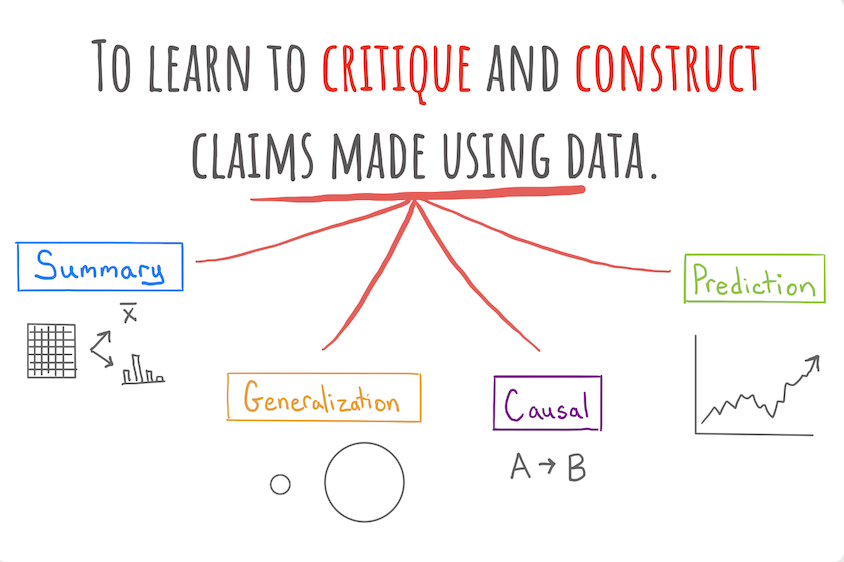

<div class="lecture-notes-content">

“70% người tham gia khảo sát chưa có kinh nghiệm viết mã lập trình” và “70% sinh viên toàn trường chưa có kinh nghiệm viết mã lập trình” cùng nêu ra một con số. Tuy nhiên, câu thứ nhất chỉ phản ánh nhóm người đã trực tiếp trả lời phiếu hỏi, trong khi câu thứ hai khẳng định về toàn thể sinh viên, bao gồm hàng nghìn người chưa từng được hỏi ý kiến. Dữ liệu thực tế cho phép chúng ta đưa ra những kết luận nào, và làm thế nào để bảo vệ tính xác đáng của các kết luận đó?

Mục tiêu trọng tâm của học phần này là trang bị năng lực **xây dựng và phản biện các phát biểu dựa trên dữ liệu** (construct and critique claims made using data). Khi đối diện với các báo cáo khoa học, phân tích kinh doanh hay tin tức xã hội, bước phân tích đầu tiên luôn là xác định: Phát biểu đó thuộc loại nào, và nó cần những bằng chứng thực nghiệm tối thiểu nào để đứng vững?

## 1. Vòng đời dữ liệu và bốn loại phát biểu

Trong quy trình phân tích thống kê, dữ liệu đóng vai trò làm cầu nối giữa các hiện tượng thực tế và tri thức khoa học. Từ dữ liệu thu thập được, ta có thể xây dựng bốn loại phát biểu cơ bản:



**Hình 1.1:** Bốn loại phát biểu cơ bản được xây dựng từ dữ liệu trong phân tích thống kê.

### 1.1. Mô tả dữ liệu (Summary)

**Mô tả dữ liệu** là việc mô tả một khía cạnh của tập dữ liệu đang có trong tay bằng con số, đồ thị hoặc lời văn.

Đặc điểm quyết định của phát biểu mô tả là nó chỉ phản ánh những đối tượng đã được đo lường thực tế. Nó không tìm cách nói về bất kỳ đối tượng nào nằm ngoài tập dữ liệu hiện có.

::: example Ví dụ về mô tả dữ liệu
Xét kết quả khảo sát mở đầu môn học: Trong số 100 sinh viên hoàn thành phiếu khảo sát, có 70 sinh viên cho biết mình chưa từng học một ngôn ngữ lập trình nào trước đây.

Phát biểu: “Dựa trên dữ liệu khảo sát lớp học, tỷ lệ sinh viên tham gia khảo sát chưa có kinh nghiệm lập trình là 70%.”

Phát biểu này là một mô tả dữ liệu chuẩn xác: Nó tóm tắt trung thực đặc điểm của 100 sinh viên đã nộp phiếu, không khẳng định điều gì về những người vắng mặt hay sinh viên các khóa khác.
:::

### 1.2. Suy rộng thống kê (Generalization)

**Suy rộng thống kê** là việc sử dụng dữ liệu đã ghi nhận từ một tập hợp hạn chế để mô tả hoặc đưa ra kết luận về một tập đối tượng rộng lớn hơn.

Trong thống kê học:
- **Mẫu (Sample)**: Là tập hợp các đối tượng quan sát mà ta trực tiếp thu thập được dữ liệu.
- **Tổng thể (Population)**: Là toàn bộ tập hợp các đối tượng mà ta muốn tìm hiểu và hướng kết luận tới.

Một phát biểu suy rộng luôn mang tính suy diễn: Nó vượt qua ranh giới của dữ liệu thực tế để khẳng định về những đối tượng mà ta chưa từng đo lường.

::: example Ví dụ về suy rộng thống kê
Vẫn từ dữ liệu khảo sát của lớp học trên, ta đưa ra kết luận: “70% sinh viên toàn trường chưa có kinh nghiệm viết mã lập trình.”

Con số 70% được tính toán từ lớp học, nhưng phạm vi đối tượng đã được mở rộng ra toàn thể sinh viên trong trường. Đây là một phát biểu suy rộng thống kê. Để phát biểu này có căn cứ vững chắc, mẫu khảo sát phải đại diện được cho toàn trường, tức không bị thiên lệch bởi ngành học hay năm học.
:::

### 1.3. Kết luận nhân quả (Causal Claim)

**Kết luận nhân quả** là phát biểu khẳng định rằng việc chủ động thay đổi giá trị của một biến (thực hiện can thiệp) sẽ dẫn đến sự thay đổi giá trị của một biến khác.

Trong khi mô tả và suy rộng chỉ ghi nhận trạng thái tự nhiên của các biến số, kết luận nhân quả trả lời câu hỏi can thiệp: “Nếu ta chủ động tác động vào biến $X$, biến $Y$ có thay đổi tương ứng hay không?”

::: example Ví dụ về kết luận nhân quả
Trong một thử nghiệm y học: Các nhà nghiên cứu phân ngẫu nhiên bệnh nhân nhiễm khuẩn thành hai nhóm: Nhóm can thiệp được dùng một loại kháng sinh mới, còn nhóm đối chứng dùng giả dược. Kết quả cho thấy tỷ lệ khỏi bệnh ở nhóm can thiệp đạt 99%, cao hơn vượt trội so với nhóm đối chứng.

Phát biểu: “Dữ liệu từ thử nghiệm ngẫu nhiên có đối chứng cho thấy việc sử dụng kháng sinh mới giúp loại bỏ hơn 99% các ca nhiễm khuẩn.”

Phát biểu này khẳng định tác động trực tiếp của thuốc lên khả năng tiêu diệt vi khuẩn, chứ không dừng lại ở mối liên hệ quan sát đơn thuần.
:::

### 1.4. Dự đoán (Prediction)

**Dự đoán** là việc ước tính hoặc phán đoán giá trị của một biến chưa biết dựa trên thông tin đã biết của các biến khác.

Dự đoán khai thác mối liên hệ thống kê giữa các biến số. Đáng chú ý, biến chưa biết không nhất thiết phải nằm ở tương lai: Đó có thể là một giá trị ở hiện tại hoặc quá khứ mà ta chưa thể tiếp cận hoặc chưa có điều kiện đo lường trực tiếp.

::: example Ví dụ về dự đoán
Quan sát thị trường tài chính: Dựa trên bản tin kinh tế buổi sáng và mức giá đóng cửa hôm nay của cổ phiếu công nghệ, một chuyên viên phân tích ước lượng rằng giá cổ phiếu đó ngày mai sẽ tăng 1.2%.

Tin tức và thị giá hôm nay là thông tin đã biết, còn mức biến động giá ngày mai là giá trị chưa biết cần dự đoán.
:::

## 2. Tiêu chuẩn đánh giá và căn cứ của từng loại phát biểu

Việc phân loại phát biểu không đơn thuần là phân loại từ ngữ, mà nhằm xác định loại bằng chứng thực nghiệm tối thiểu cần có để bảo vệ kết luận đó trước sự phản biện khoa học.

### 2.1. Phân biệt mô tả mẫu và suy rộng về tổng thể

Để hiểu rõ ranh giới giữa mô tả và suy rộng, ta xét ví dụ định lượng sau: Một phiếu khảo sát ngẫu nhiên thu về phản hồi từ $n = 10$ sinh viên, trong đó có $k = 7$ bạn cho biết chưa từng học lập trình. Toàn trường có $N = 5000$ sinh viên.

::: example Tính toán tỷ lệ mẫu
Tỷ lệ sinh viên chưa từng học lập trình trong nhóm trả lời được tính bằng:

$$
\frac{k}{n} \times 100\% = \frac{7}{10} \times 100\% = 70\%.
$$

Phát biểu: “Trong 10 sinh viên tham gia khảo sát, có 70% bạn chưa từng học lập trình.”
:::

Phép chia $7 / 10 = 70\%$ là một phép tính số học chính xác trên dữ liệu mẫu. Câu mô tả này hoàn toàn có căn cứ vững chắc và không thể bị bác bỏ về mặt số liệu.

Tuy nhiên, nếu viết: “70% sinh viên toàn trường chưa từng học lập trình”, phát biểu đã chuyển hóa thành suy rộng thống kê. Phép tính số học vẫn đúng trên mẫu, nhưng không tự động đảm bảo rằng tỷ lệ của toàn trường cũng bằng 70%.

Để bảo vệ kết luận suy rộng, người nghiên cứu bắt buộc phải chứng minh phương pháp chọn mẫu không mắc phải **độ lệch chọn mẫu (selection bias)**. Nếu 10 sinh viên trên được hỏi ngẫu nhiên trong khuôn viên thư viện vào giờ học chuyên ngành, cấu cấu mẫu có thể khác xa tổng thể sinh viên toàn trường. Cỡ mẫu lớn cũng không thể cứu vãn được kết luận nếu quy trình chọn mẫu bị thiên lệch ngay từ đầu.

### 2.2. Quan sát đồng biến và can thiệp nhân quả

Xét một trường hợp quan sát: Dữ liệu ghi nhận cho thấy những sinh viên thường xuyên uống cà phê có điểm trung bình học tập cao hơn những sinh viên không uống cà phê.

Nếu kết luận: “Sinh viên uống cà phê trong mẫu có điểm trung bình cao hơn”, ta đang đưa ra một **mô tả dữ liệu**.

Nhưng nếu khẳng định: “Uống cà phê giúp nâng cao điểm trung bình của sinh viên”, phát biểu đã trở thành **kết luận nhân quả**. Kết luận này rất dễ sai lầm, bởi vì giữa việc uống cà phê và điểm số có thể tồn tại **biến gây nhiễu (confounding variable)**: Những sinh viên học nhiều giờ hơn vào ban đêm thường có xu hướng uống cà phê nhiều hơn, và chính số giờ tự học mới là nguyên nhân nâng cao điểm số.

Để khẳng định quan hệ nhân quả, phương pháp chuẩn mực nhất là thực hiện **Thí nghiệm ngẫu nhiên có đối chứng (Randomized Controlled Trial - RCT)**: Phân bổ ngẫu nhiên người tham gia vào hai nhóm để triệt tiêu ảnh hưởng của mọi biến gây nhiễu tiềm ẩn.

### 2.3. Bản chất của giá trị chưa biết trong bài toán dự đoán

Nhiều người lầm tưởng rằng dự đoán bắt buộc phải nói về tương lai. Trong khoa học dữ liệu, dự đoán áp dụng cho bất kỳ đại lượng nào chưa được quan sát:
- Dự đoán bệnh lý của bệnh nhân dựa trên hình ảnh chụp cộng hưởng từ (giá trị bệnh lý đã tồn tại trong cơ thể nhưng cần mô hình để chẩn đoán).
- Dự đoán điểm thi của một bài luận đã nộp nhưng giảng viên chưa chấm điểm.
- Ước lượng mức tiêu thụ năng lượng của một thiết bị dựa trên các cảm biến nhiệt độ và công suất.

## 3. Công cụ phân tích: Môi trường lập trình thống kê R

Để hiện thực hóa quy trình từ câu hỏi đến kết luận dữ liệu, người làm khoa học dữ liệu cần một công cụ đáp ứng hai chức năng nền tảng: Lưu trữ dữ liệu có cấu trúc và thực thi các phép tính toán quy mô lớn.

Ngôn ngữ lập trình R và môi trường RStudio là công cụ tiêu chuẩn toàn cầu trong thống kê học hiện đại. R là ngôn ngữ nguồn mở, sở hữu hệ sinh thái phong phú với hàng chục nghìn gói thư viện chuyên dụng cho trực quan hóa, suy diễn thống kê và học máy.

Khi nhập một biểu thức tính toán vào cửa sổ dòng lệnh (console), R tính toán và in kết quả ngay lập tức:

```r
# Phép tính số học cơ bản
1 + 2
#> [1] 3

# Phép chia và lũy thừa
7 / 10
#> [1] 0.7

2 ^ 4
#> [1] 16
```

Ký hiệu `[1]` ở đầu dòng kết quả biểu thị rằng phần tử xuất hiện đầu tiên trên dòng đó là phần tử thứ nhất của vector kết quả. Khả năng xử lý vector và bảng dữ liệu lớn của R là nền tảng để chúng ta phân tích các tập dữ liệu thực nghiệm trong suốt học phần.

## Tài liệu tham khảo

- Andrew Bray et al., *Understanding the World with Data – Stat 20*, Department of Statistics, University of California, Berkeley.
- Joseph K. Blitzstein và Jessica Hwang, *Introduction to Probability*, ấn bản 2, Chapman & Hall/CRC Press.

</div>

<div class="lecture-exercises-content">

Phần bài tập rèn luyện khả năng phân loại, thẩm định và phản biện các phát biểu thống kê thông qua các tình huống thực tiễn trích từ phiếu học tập của học phần.

## Bài tập rèn luyện tư duy phân loại phát biểu

::: exercise Bài tập 1: Tính năng định giá trên sàn đấu giá trực tuyến
Một sàn đấu giá trực tuyến triển khai tính năng mang tên "Trợ lý định giá" (Price Genie). Khi người bán nhập các thông tin mô tả về món đồ cần thanh lý (thương hiệu, tình trạng sử dụng, năm sản xuất), hệ thống sẽ tự động hiển thị một mức giá gợi ý để người bán bắt đầu phiên đấu giá. Mức giá này được tính toán tự động dựa trên cơ sở dữ liệu các phiên đấu giá thành công của những món đồ tương tự trong quá khứ.

Hỏi: Tính năng này đang đưa ra loại phát biểu nào?
:::

::: hint Gợi ý tư duy
Hãy phân tích: Mức giá gợi ý có phải là dữ liệu của món đồ hiện tại không? Nó dùng dữ liệu quá khứ để ước lượng cho một đại lượng chưa xảy ra (mức giá người mua sẵn sàng trả cho món đồ này).
:::

::: solution Lời giải chi tiết
Tính năng "Trợ lý định giá" đang đưa ra một **Dự đoán (Prediction)**.

Phân tích chi tiết:
- Thông tin đã biết: Thuộc tính của món đồ hiện tại và lịch sử giá bán của các món đồ tương tự trong quá khứ.
- Đại lượng chưa biết: Mức giá thị trường hợp lý mà người mua sẽ chấp nhận trả cho món đồ cụ thể này.
- Hệ thống khai thác mối quan hệ giữa đặc trưng sản phẩm và giá bán trong quá khứ để đưa ra một con số ước lượng. Món đồ này chưa được đấu giá thành công, do đó giá gợi ý là một giá trị phán đoán trước phiên giao dịch.
:::

::: exercise Bài tập 2: Khảo sát cử tri của tổ chức Morning Consult
Tổ chức nghiên cứu Morning Consult thực hiện một cuộc thăm dò ý kiến trên một mẫu đại diện gồm 1.256 cử tri Đảng Cộng hòa đã đăng ký vào ngày 24 tháng 8 năm 2023. Khi được hỏi về ứng viên mà họ dự định bỏ phiếu trong cuộc bầu cử sơ bộ, 58% người trả lời chọn ông Trump và 14% chọn ông DeSantis. Một hãng tin lớn đã đăng tải bài viết với tiêu đề trang nhất: "Ông Trump dẫn trước ông DeSantis 44 điểm phần trăm trong toàn bộ cử tri Đảng Cộng hòa".

Hỏi: Đoạn thông tin trên chứa đựng những loại phát biểu nào?
:::

::: hint Gợi ý tư duy
Phân biệt hai vế thông tin:
1. Con số 58% và 14% nói về ai?
2. Tiêu đề bài báo khẳng định về đối tượng nào?
:::

::: solution Lời giải chi tiết
Đoạn thông tin trên kết hợp hai loại phát biểu: **Mô tả dữ liệu (Summary)** và **Suy rộng thống kê (Generalization)**.

Phân tích chi tiết:
- **Mô tả dữ liệu**: Số liệu “58% người trả lời chọn ông Trump và 14% chọn ông DeSantis” là một phát biểu mô tả. Con số này phản ánh trung thực kết quả đo lường trực tiếp trên 1.256 người tham gia khảo sát.
- **Suy rộng thống kê**: Tiêu đề bài báo “Ông Trump dẫn trước ông DeSantis 44 điểm phần trăm trong toàn bộ cử tri Đảng Cộng hòa” là một phát biểu suy rộng thống kê. Mẫu số ban đầu chỉ có 1.256 cử tri, nhưng tiêu đề đã mở rộng kết luận cho toàn thể cử tri Đảng Cộng hòa trên toàn quốc (hàng chục triệu người).
- Để tiêu đề này có căn cứ vững chắc, phương pháp chọn mẫu của Morning Consult phải đảm bảo tính ngẫu nhiên và tính đại diện, tránh các sai lệch về nhân khẩu học, độ tuổi và khu vực địa lý.
:::

::: exercise Bài tập 3: Bảng điều khiển thử nghiệm lâm sàng của hãng dược phẩm
Hãng dược phẩm Eli Lilly phát triển một trang thông tin nội bộ mang tên "Bảng điều khiển khám phá" (Discovery Dashboard). Hệ thống này cho phép các nhà khoa học trong công ty theo dõi nhanh tiến độ của các thử nghiệm lâm sàng đã và đang diễn ra. Khi quan sát đồ thị đường biểu diễn theo chuỗi thời gian, một nhà nghiên cứu thốt lên: "Thật bất ngờ, tôi không nhận ra rằng chúng ta đã triển khai nhiều thử nghiệm giai đoạn II đến thế vào tháng 1 vừa qua!"

Hỏi: Nhận xét của nhà nghiên cứu thuộc loại phát biểu nào?
:::

::: hint Gợi ý tư duy
Đồ thị biểu diễn dữ liệu của các thử nghiệm đã được ghi nhận trong hệ thống hay suy đoán cho các thử nghiệm tương lai?
:::

::: solution Lời giải chi tiết
Nhận xét của nhà nghiên cứu là một **Mô tả dữ liệu (Summary)**.

Phân tích chi tiết:
- Đồ thị đường tóm tắt số lượng các thử nghiệm lâm sàng giai đoạn II thực tế đã được đăng ký và triển khai trong cơ sở dữ liệu của công ty vào tháng 1.
- Câu cảm thán của nhà nghiên cứu chỉ ghi nhận một sự thật lịch sử đã được đo lường và hiển thị trên màn hình. Nó không đưa ra suy đoán về tương lai, không khẳng định hiệu quả can thiệp của thuốc và không khái quát hóa ra ngoài phạm vi công ty.
:::

::: exercise Bài tập 4: Thí nghiệm hai phiên bản đề thi của giáo sư sinh học
Một giáo sư sinh học chuẩn bị hai phiên bản cho bài thi giữa kỳ: Phiên bản A gồm toàn bộ các câu hỏi trắc nghiệm, còn phiên bản B kết hợp cả câu hỏi trắc nghiệm và câu hỏi tự luận ngắn. Trong giờ thi, giáo sư phát ngẫu nhiên hai phiên bản đề thi này cho 100 sinh viên trong lớp. Sau khi chấm bài, giáo sư tổng hợp điểm số và phiên bản đề thi của toàn bộ 100 sinh viên. Nhận thấy điểm trung bình của phiên bản A cao hơn rõ rệt so với phiên bản B, giáo sư kết luận rằng: "Việc đưa câu hỏi tự luận ngắn vào đề thi gây khó khăn hơn cho sinh viên so với việc chỉ dùng câu hỏi trắc nghiệm."

Hỏi: Kết luận của giáo sư thuộc loại phát biểu nào? Kết luận đó có căn cứ vững chắc không?
:::

::: hint Gợi ý tư duy
Giáo sư có chủ động can thiệp vào dạng đề thi không? Việc phát đề ngẫu nhiên có vai trò gì trong việc kiểm soát năng lực sinh viên?
:::

::: solution Lời giải chi tiết
Kết luận của vị giáo sư là một **Kết luận nhân quả (Causal Claim)** có căn cứ thực nghiệm vững chắc.

Phân tích chi tiết:
- **Loại phát biểu**: Khẳng định sự thay đổi định dạng đề thi (can thiệp từ trắc nghiệm thuần túy sang kết hợp tự luận) là nguyên nhân trực tiếp làm giảm điểm số của sinh viên.
- **Tính xác đáng của căn cứ**: Kết luận này có độ tin cậy khoa học rất cao vì nó bắt nguồn từ một **Thí nghiệm ngẫu nhiên có đối chứng**:
  - Giáo sư đã chủ động **phát đề ngẫu nhiên** cho sinh viên.
  - Phép ngẫu nhiên hóa giúp cân bằng năng lực học tập, kiến thức tích lũy và tâm lý thi cử giữa hai nhóm sinh viên nhận đề A và đề B.
  - Nhờ đó, giáo sư loại trừ được biến gây nhiễu (chẳng hạn như sinh viên giỏi vô tình chọn phải một đề cụ thể), đảm bảo rằng sự chênh lệch điểm trung bình thực sự bắt nguồn từ bản chất định dạng câu hỏi tự luận ngắn.
:::

## Tài liệu tham khảo

- University of California, Berkeley, *STAT 20 Worksheet 01: Understanding the World with Data*.
- Hugh D. Young và Roger A. Freedman, *University Physics with Modern Physics*, ấn bản 15, Pearson.

</div>

