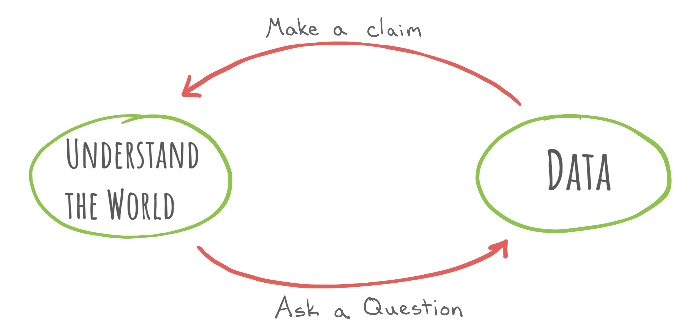
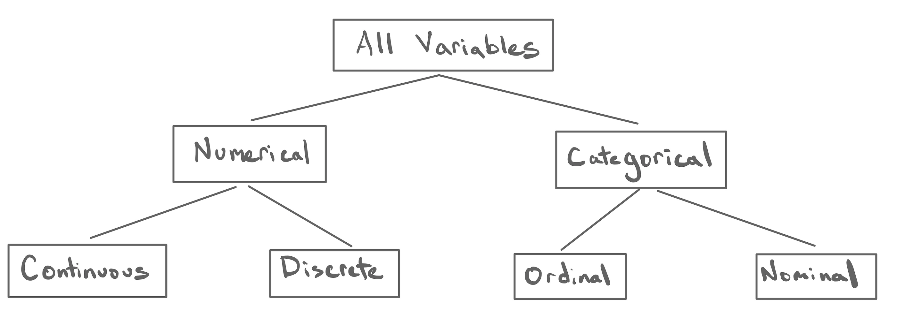
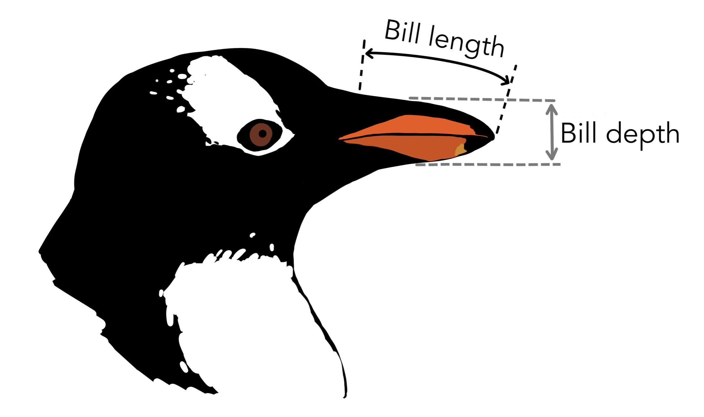
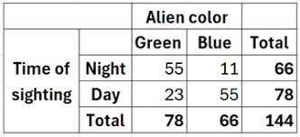
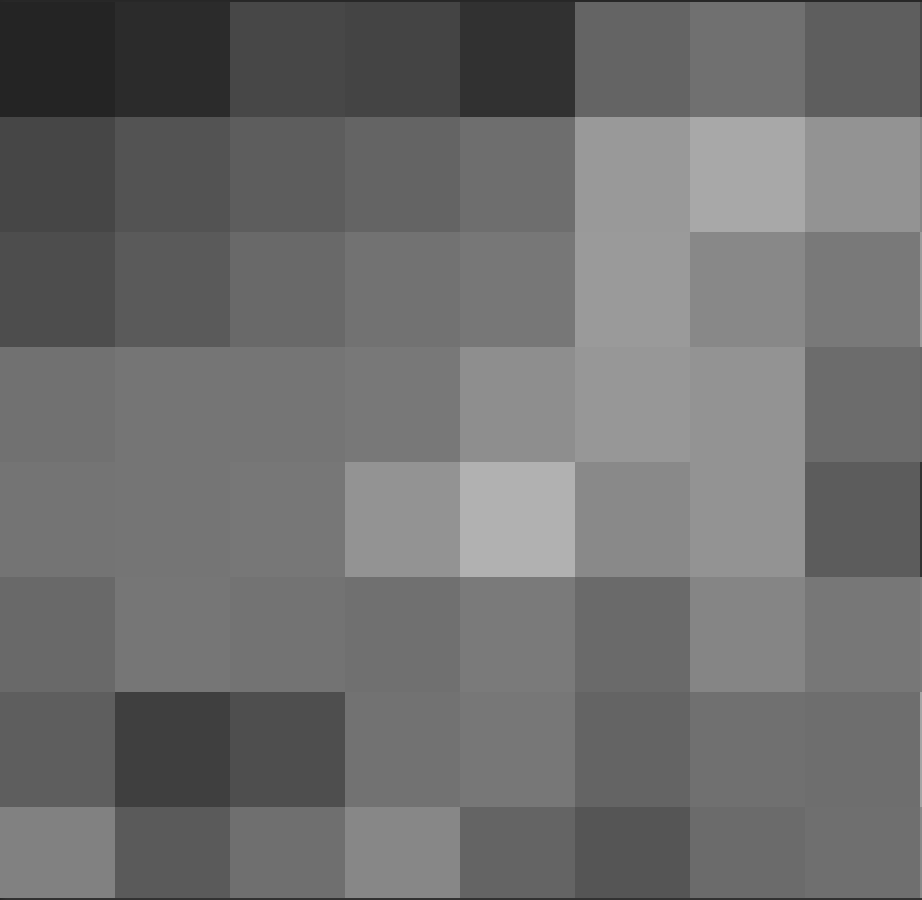
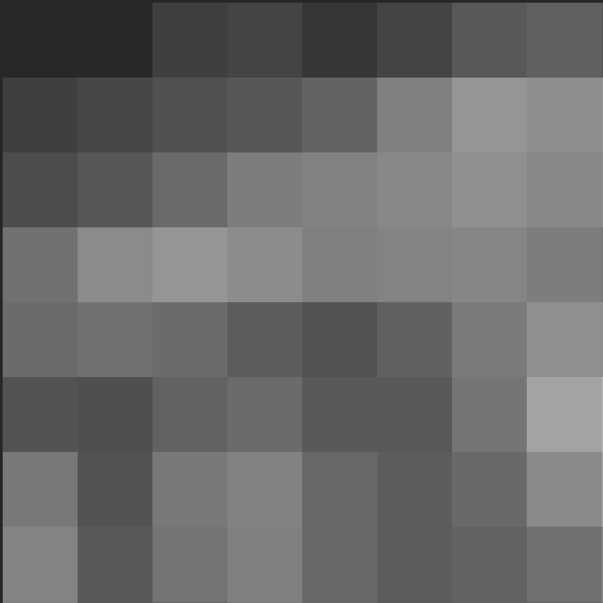

<div class="lecture-notes-content">

Khởi nguồn của nhận thức khoa học bắt đầu từ đâu: Dữ liệu có trước rồi từ đó hình thành nhận thức về thế giới, hay nhận thức có trước để từ đó nảy sinh những câu hỏi cần dữ liệu giải đáp? Trong thực tế nghiên cứu, đây là một câu hỏi mở mang tính triết học. Dù xuất phát từ đầu nào, người làm khoa học dữ liệu cũng sẽ đứng ở một bên và tìm cách vượt qua cây cầu phương pháp luận để đi đến bờ bên kia.



**Hình 2.1:** Vòng đời khoa học dữ liệu thể hiện mối liên hệ qua lại liên tục giữa việc đặt câu hỏi về thế giới và việc thu thập, xử lý dữ liệu thực nghiệm.

Yếu tố định hình căn bản của ngành khoa học dữ liệu là đặt dữ liệu ở vị trí trung tâm nhằm mở rộng nhận thức của con người. Để xây dựng các mô hình phân tích chuẩn xác, bước đi đầu tiên là thiết lập một hệ thống phân loại dữ liệu khoa học và xác định quy chuẩn cấu trúc dữ liệu nền tảng.

---

## 1. Dữ liệu và Biến số

### 1.1. Dữ liệu là gì?

**Dữ liệu (Data)** là tập hợp các thông tin (chủ yếu ở dạng số học hoặc định lượng) thu được qua quá trình nghiên cứu khoa học, khảo sát hoặc quan sát thực nghiệm, được lưu trữ và tổng hợp nhằm mục đích tra cứu, phân tích hoặc tính toán.

Thuật ngữ này bắt nguồn từ danh từ số ít trong tiếng Latin là *datum*, mang nghĩa là “điều được ban cho” hoặc “sự thật khách quan”. Định nghĩa rộng mở này cho phép dữ liệu tồn tại dưới vô số hình thái đa dạng trong đời sống:
- Kết quả đo áp suất và nhiệt độ của một khối khí ghi nhận trong sổ tay thí nghiệm vật lý.
- Danh sách họ tên, mã số sinh viên và chuyên ngành được lưu trữ trên cổng thông tin đào tạo của nhà trường.
- Hàng triệu mức cường độ ánh sáng được Kính viễn vọng Không gian James Webb ghi nhận điểm ảnh theo điểm ảnh khi quan sát các thiên hà xa xôi.

Sự đa dạng phong phú của dữ liệu thực chất phản ánh sự đa dạng của các loại **biến số** được đo lường trong tập dữ liệu đó.

### 1.2. Khái niệm biến số

**Biến số (Variable)** là một đặc tính hoặc đặc trưng của một đối tượng quan sát có thể đo lường và ghi nhận được.

Sở dĩ đại lượng này được gọi là biến số vì giá trị đo được của nó thường biến thiên khi ta chuyển từ đối tượng quan sát này sang đối tượng quan sát khác:
- Trong sổ tay thí nghiệm vật lý: Nhiệt độ và áp suất là hai biến số được đo lường trên các khối khí.
- Trên hệ thống thông tin đào tạo: Họ tên, ngành học và năm học là các biến số được ghi nhận trên mỗi sinh viên. Nếu khảo sát sinh viên thứ nhất, giá trị của biến họ tên là “Nguyễn Văn An”, nhưng khi chuyển sang sinh viên kế tiếp, giá trị biến số này sẽ mang một chuỗi ký tự khác.

---

## 2. Hệ thống phân loại dữ liệu (Taxonomy of Data)

Tuy các biến số trong thế giới thực là vô tận, chúng luôn tuân theo các quy luật lặp lại nhất định. Việc nhóm các biến số có chung đặc tính toán học thành các nhóm bền vững được gọi là **hệ thống phân loại (Taxonomy)**, tương tự như cách sinh học phân loại các loài sinh vật trong tự nhiên.



**Hình 2.2:** Hệ thống phân loại dữ liệu (Taxonomy of Data) trong thống kê học hiện đại.

### 2.1. Biến định lượng (Numerical Variables)

**Biến định lượng** là biến số nhận giá trị là các con số, trong đó độ lớn của con số mang ý nghĩa định lượng thực tế.

Mọi biến định lượng được phân thành hai nhóm con:

#### a. Biến định lượng liên tục (Continuous Numerical Variable)
Là biến định lượng có thể nhận bất kỳ giá trị nào trên một khoảng liên tục của trục số thực.

::: example Ví dụ về biến định lượng liên tục
Nhiệt độ không khí ngoài trời tại một trạm khí tượng: Giá trị nhiệt độ đo bằng độ Celsius (°C) có thể dao động mượt mà từ $-10.5^\circ\text{C}$ đến $+42.3^\circ\text{C}$. Dù thiết bị đo có thể làm tròn đến một chữ số thập phân, bản chất vật lý của nhiệt độ biến thiên liên tục không có bước nhảy đứt đoạn.
:::

#### b. Biến định lượng rời rạc (Discrete Numerical Variable)
Là biến định lượng chỉ nhận các giá trị riêng biệt có khoảng nhảy cách quãng giữa các giá trị kế tiếp.

::: example Ví dụ về biến định lượng rời rạc
Quy mô nhân khẩu của một hộ gia đình trong dữ liệu tổng điều tra dân số: Một hộ gia đình có thể gồm 1 người, 2 người, 3 người hoặc 4 người. Số nhân khẩu không thể là $2.84$ người. Khoảng cách giữa các giá trị khả dĩ là các bước nhảy số nguyên nguyên vẹn.
:::

Điểm gắn kết cốt lõi của cả hai loại biến định lượng là: Ta có thể thực hiện các phép toán số học như cộng, trừ, nhân, chia trên các giá trị của chúng, và kết quả đầu ra luôn mang ý nghĩa thực tế. Chẳng hạn, ta có thể tính nhiệt độ trung bình của ba trạm khí tượng, hoặc tính tổng số nhân khẩu của mười hộ gia đình trong một khu phố.

### 2.2. Biến định tính (Categorical Variables)

**Biến định tính** là biến số nhận giá trị là các nhãn danh mục hoặc nhóm phân loại. Mỗi danh mục duy nhất được gọi là một **mức (level)**.

Mọi biến định tính được chia thành hai nhóm con:

#### a. Biến định tính thứ bậc (Ordinal Categorical Variable)
Là biến định tính mà giữa các mức tồn tại một thứ tự sắp xếp tự nhiên rõ ràng.

::: example Ví dụ về biến định tính thứ bậc
Các câu hỏi khảo sát mức độ hài lòng với thang đo Likert 5 mức: “Rất không hài lòng”, “Không hài lòng”, “Trung lập”, “Hài lòng”, “Rất hài lòng”. Các mức này có thứ bậc tự nhiên: Mức “Rất hài lòng” xếp cao hơn mức “Hài lòng”, và mức “Hài lòng” gần với “Trung lập” hơn là “Rất không hài lòng”.
:::

#### b. Biến định tính danh nghĩa (Nominal Categorical Variable)
Là biến định tính mà giữa các mức hoàn toàn không có thứ tự sắp xếp tự nhiên nào.

::: example Ví dụ về biến định tính danh nghĩa
Biến số chuyên ngành đào tạo của sinh viên: Gồm các mức như “Khoa học máy tính”, “Toán tin”, “Hệ thống thông tin”, “Kỹ thuật robot”. Các mức này chỉ đóng vai trò phân loại định danh, không có mức nào cao hơn hay thấp hơn về mặt toán học. Tên gọi này bắt nguồn từ chữ *nomen* trong tiếng Latin, có nghĩa là “tên gọi”.
:::

Khi chuyển sang biến định tính, khả năng thực hiện phép toán số học trực tiếp bị triệt tiêu: Ta không thể lấy trung bình cộng giữa hai chuyên ngành hay cộng hai nhãn khảo sát lại với nhau theo nghĩa số học thông thường.

---

## 3. Nghiên cứu thực nghiệm: Bộ dữ liệu Palmer Penguins

Để thấy rõ cách nhận diện từng kiểu biến số trong thực tế, ta cùng xem xét nghiên cứu sinh thái học nổi tiếng tại Nam Cực do Tiến sĩ Kristen Gorman chủ trì.

<div style="display: flex; gap: 16px; margin: 16px 0; justify-content: center; flex-wrap: wrap;">
  <div style="flex: 1; min-width: 280px; max-width: 440px; text-align: center;">
    
    <p style="font-size: 0.9em; color: var(--vp-c-text-2); margin-top: 6px;">Tiến sĩ Kristen Gorman ghi chép số liệu chim cánh cụt ngoài thực địa.</p>
  </div>
  <div style="flex: 1; min-width: 280px; max-width: 440px; text-align: center;">
    
    <p style="font-size: 0.9em; color: var(--vp-c-text-2); margin-top: 6px;">Toàn cảnh Trạm nghiên cứu Palmer tại Nam Cực.</p>
  </div>
</div>

**Hình 2.3:** Công tác nghiên cứu và thu thập dữ liệu sinh thái học tại Trạm nghiên cứu Palmer, Nam Cực.

Tại Trạm nghiên cứu Palmer do Quỹ Khoa học Quốc gia Hoa Kỳ (NSF) vận hành, nhóm nghiên cứu đã ghi chép số liệu đo đạc chi tiết trên hàng trăm cá thể chim cánh cụt nhằm tìm hiểu cấu trúc quần thể và sinh thái sinh sản của chúng:

<div style="display: flex; gap: 16px; margin: 16px 0; justify-content: center; flex-wrap: wrap; align-items: center;">
  <div style="flex: 1; min-width: 280px; max-width: 400px; text-align: center;">
    
  </div>
  <div style="flex: 1.2; min-width: 300px;">
    <ul>
      <li><strong>Chiều dài mỏ (bill_length_mm)</strong> và <strong>Độ sâu sống mỏ (bill_depth_mm)</strong>: Đo kích thước mỏ chim bằng đơn vị milimet. Đây là các <strong>biến định lượng liên tục</strong>, vì các số đo này có ý nghĩa về độ lớn số học và biến thiên mượt mà trên trục số đo thực tế.</li>
    </ul>
  </div>
</div>

**Hình 2.4:** Định nghĩa phép đo chiều dài sống mỏ và độ sâu mỏ của chim cánh cụt.

<div style="display: flex; gap: 16px; margin: 16px 0; justify-content: center; flex-wrap: wrap; align-items: center;">
  <div style="flex: 1; min-width: 280px; max-width: 400px; text-align: center;">
    
  </div>
  <div style="flex: 1.2; min-width: 300px;">
    <ul>
      <li><strong>Loài chim cánh cụt (species)</strong>: Gồm ba mức giá trị cụ thể là “Adelie”, “Chinstrap” và “Gentoo”. Đây là một <strong>biến định tính danh nghĩa</strong>, bởi ba loài sinh học này đóng vai trò phân loại cá thể và không có trật tự hơn kém tự nhiên nào.</li>
    </ul>
  </div>
</div>

**Hình 2.5:** Ba loài chim cánh cụt thuộc chi Pygoscelis được khảo sát trong nghiên cứu.

Bộ dữ liệu Palmer Penguins là minh chứng tiêu biểu cho thấy: Quy trình thu thập dữ liệu cẩn trọng kết hợp với lập luận thống kê chặt chẽ có thể mở rộng nhận thức của con người về những vùng thiên nhiên hoang dã hẻo lánh bậc nhất trên Trái Đất.

---

## 4. Tại sao phân loại kiểu biến số lại mang tính quyết định?

Hệ thống phân loại dữ liệu là kim chỉ nam điều hướng toàn bộ quy trình phân tích:
1. **Lựa chọn biểu đồ trực quan phù hợp**: Biến định tính thường được thể hiện bằng biểu đồ thanh (bar plot), trong khi biến định lượng liên tục đòi hỏi biểu đồ phân bố tần số (histogram) hoặc biểu đồ mật độ (density plot). Biểu diễn nhầm một biến thứ bậc thành biến danh nghĩa sẽ làm mất trật tự thông tin quý giá.
2. **Lựa chọn tham số thống kê tương ứng**: Ta có thể tính trung bình cộng ($\bar{x}$) và độ lệch chuẩn ($s$) cho biến định lượng, nhưng với biến định tính thì trung vị thứ bậc hoặc tỷ lệ phần trăm các mức mới là đại lượng phản ánh đúng bản chất.
3. **Tính phụ thuộc vào ngữ cảnh đo lường**: Cùng một đại lượng vật lý như tuổi tác có thể thuộc các kiểu biến số khác nhau tùy theo cách ta thu thập và xử lý:
   - Tuổi thọ bóng đèn đo bằng giờ hoạt động liên tục: Biến định lượng liên tục.
   - Tuổi của sinh viên tính theo số năm tròn: Biến định lượng rời rạc.
   - Nhóm tuổi của khán giả truyền hình (18–24, 25–34, 35–49): Biến định tính thứ bậc.

---

## 5. Cấu trúc tổ chức dữ liệu: Khung dữ liệu (Data Frame)

Khi đối diện với hiện tượng thực tế phức tạp, ta hiếm khi chỉ đo lường một biến đơn lẻ. Nghiên cứu chim cánh cụt cần ghi nhận hàng chục đặc trưng hình thái, cũng như hệ thống quản lý đào tạo phải ghi nhận hàng loạt thông tin của sinh viên. Để lưu trữ dữ liệu này một cách khoa học, cấu trúc trung tâm được sử dụng trong toàn bộ ngành khoa học dữ liệu là **Khung dữ liệu (Data Frame)**.

### 5.1. Định nghĩa Data Frame

**Khung dữ liệu (Data Frame)** là một mảng hai chiều liên kết các **quan sát** (xếp theo các hàng) với các **biến số** được đo lường trên từng quan sát đó (xếp theo các cột). Mỗi ô trong bảng lưu trữ giá trị cụ thể của một biến số tương ứng với một quan sát xác định.

Dưới đây là một trích đoạn gồm 8 quan sát từ bộ dữ liệu chim cánh cụt:

| bill_length_mm | bill_depth_mm | species |
| :---: | :---: | :---: |
| 43.5 | 18.1 | Chinstrap |
| 48.1 | 15.1 | Gentoo |
| 49.0 | 19.5 | Chinstrap |
| 45.4 | 18.7 | Chinstrap |
| 34.6 | 21.1 | Adelie |
| 49.8 | 17.3 | Chinstrap |
| 40.9 | 18.9 | Adelie |
| 45.3 | 13.7 | Gentoo |

Dù trông giống một bảng tính thông thường, Data Frame tuân thủ một chuẩn giao tiếp dữ liệu nghiêm ngặt: Mỗi cột đại diện cho duy nhất một biến số, và mỗi hàng đại diện cho duy nhất một đơn vị quan sát.

### 5.2. Đơn vị quan sát (Unit of Observation)

**Đơn vị quan sát (Unit of Observation)** là đối tượng hoặc thực thể cụ thể mà trên đó các biến số được đo lường và ghi nhận.

- Trong bảng dữ liệu chim cánh cụt ở trên: Đơn vị quan sát là **một cá thể chim cánh cụt** được khảo sát gần Trạm Palmer. Hàng thứ nhất chứa các chỉ số đo đạc của con chim thứ nhất, hàng thứ hai là của con chim thứ hai.
- Trong danh sách sinh viên lớp học: Đơn vị quan sát là **một sinh viên cụ thể**.
- Trong bảng thời tiết hàng ngày: Đơn vị quan sát là **một ngày cụ thể tại một địa phương**.

### 5.3. Nhận diện định dạng không phải là Data Frame

Không phải mọi bảng số liệu trong đời sống đều là một Data Frame. Xét bảng tổng hợp sau về số lượng ghi nhận vật thể lạ ngoài hành tinh:

<div style="text-align: center; margin: 16px 0;">
  
</div>

**Hình 2.6:** Bảng tần số chéo (Contingency Table) ghi nhận số lần quan sát.

Bảng này không thỏa mãn định nghĩa của một Data Frame vì:
- Các cột “Xanh lá” và “Xanh dương” không phải là tên biến số đo lường trên một cá thể: Nếu màu sắc là một biến số, nó phải nhận giá trị là chuỗi phân loại, chứ không thể nhận giá trị là số đếm tổng hợp trong các ô.
- Cột “Tổng” (Total) không phản ánh một phép đo trên một đơn vị quan sát đơn lẻ, mà là một phép tính tổng hợp gộp trên toàn bộ tập dữ liệu.
- Đây là một **bảng tần số chéo (Contingency Table)** dùng để trình bày tóm tắt kết quả, không phải là dạng cấu trúc dữ liệu nguyên thủy (tidy data) để đưa vào các thuật toán phân tích.

---

## 6. Mở rộng tư duy: Dữ liệu hình ảnh dưới góc nhìn thống kê

Dữ liệu không chỉ giới hạn ở bảng tính và con số văn bản. Mọi hình ảnh kỹ thuật số đều là các cấu trúc dữ liệu định lượng chính xác.

### 6.1. Ảnh màu RGB và mảng số học ba chiều

Một bức ảnh kỹ thuật số thực chất là một lưới gồm hàng nghìn đến hàng triệu điểm ảnh (pixels).

<div style="text-align: center; margin: 16px 0;">
  
</div>

**Hình 2.7:** Bức ảnh màu chụp loài chim mỏ giày kích thước $1520 \times 1012$ điểm ảnh.

Trong một bức ảnh màu tiêu chuẩn:
- Không gian ảnh được chia thành ba dải màu cơ bản: Đỏ (Red), Xanh lá (Green) và Xanh dương (Blue).
- Mỗi điểm ảnh tại tọa độ $(x, y)$ được biểu diễn bằng một bộ ba giá trị số nguyên $(R, G, B)$ nằm trong đoạn $[0, 255]$.
- Nếu bức ảnh có kích thước $1520 \times 1012$ điểm ảnh, dữ liệu thực tế lưu trữ trong máy tính là một mảng ba chiều gồm:

$$
1520 \times 1012 \times 3 = 4{,}614{,}720 \text{ giá trị số nguyên.}
$$

### 6.2. Ảnh thang xám (Grayscale)

Nếu chuyển đổi bức ảnh trên sang dạng ảnh thang xám, mỗi điểm ảnh chỉ còn cần một kênh duy nhất biểu thị cường độ sáng: Giá trị $0$ tương ứng với màu đen hoàn toàn, và giá trị $255$ tương ứng với màu trắng thuần khiết.

<div style="display: flex; gap: 16px; margin: 16px 0; justify-content: center; flex-wrap: wrap; align-items: center;">
  <div style="flex: 1; min-width: 260px; max-width: 400px; text-align: center;">
    
    <p style="font-size: 0.9em; color: var(--vp-c-text-2); margin-top: 6px;">Ảnh thang xám $1520 \times 1012 \times 1$.</p>
  </div>
  <div style="flex: 0.8; min-width: 220px; max-width: 300px; text-align: center;">
    
    <p style="font-size: 0.9em; color: var(--vp-c-text-2); margin-top: 6px;">Ảnh thang xám thu nhỏ $8 \times 8$.</p>
  </div>
</div>

**Hình 2.8:** Quá trình chuyển đổi từ ảnh màu sang ảnh thang xám độ phân giải cao và ảnh thu nhỏ $8 \times 8$.

Số lượng giá trị cần lưu trữ cho bức ảnh thang xám đầy đủ là:

$$
1520 \times 1012 \times 1 = 1{,}538{,}240 \text{ giá trị.}
$$

### 6.3. Đưa dữ liệu hình ảnh vào một Data Frame

Giả sử ta thu thập được 3 bức ảnh chim mỏ giày khác nhau, và mỗi bức ảnh được thu nhỏ về độ phân giải $8 \times 8$ điểm ảnh thang xám:

<div style="display: flex; gap: 12px; margin: 16px 0; justify-content: center; flex-wrap: wrap;">
  <div style="flex: 1; min-width: 160px; max-width: 240px; text-align: center;">
    
    <p style="font-size: 0.85em; color: var(--vp-c-text-2);">Ảnh quan sát số 1</p>
  </div>
  <div style="flex: 1; min-width: 160px; max-width: 240px; text-align: center;">
    
    <p style="font-size: 0.85em; color: var(--vp-c-text-2);">Ảnh quan sát số 2</p>
  </div>
  <div style="flex: 1; min-width: 160px; max-width: 240px; text-align: center;">
    
    <p style="font-size: 0.85em; color: var(--vp-c-text-2);">Ảnh quan sát số 3</p>
  </div>
</div>

**Hình 2.9:** Ba bức ảnh quan sát được chuyển thành dữ liệu điểm ảnh $8 \times 8$.

Nếu ta muốn tổ chức dữ liệu từ 3 bức ảnh này vào một Data Frame để huấn luyện một thuật toán học máy:
- **Đơn vị quan sát**: Là **một bức ảnh** cụ thể. Do đó, tập dữ liệu sẽ có đúng $3$ hàng.
- **Biến số**: Mỗi điểm ảnh trong tổng số $8 \times 8 = 64$ điểm ảnh là một biến số độc lập (tương ứng với các cột $\text{pixel}_1, \text{pixel}_2, \dots, \text{pixel}_{64}$).
- **Kích thước Data Frame**: Bảng dữ liệu hoàn chỉnh sẽ có kích thước $3 \times 64$ (3 hàng quan sát và 64 cột biến số).

Ví dụ trực quan này làm sáng tỏ quy tắc cốt lõi: Dù dữ liệu gốc là bảng biểu, âm thanh hay hình ảnh thị giác, việc chuyển đổi thành công về cấu trúc Data Frame chuẩn mực chính là nền tảng khởi đầu cho mọi phân tích thống kê hiện đại.

---

## 7. Tổng kết

1. **Dữ liệu và biến số**: Dữ liệu là tập hợp các thông tin thực nghiệm; biến số là đặc trưng đo lường được trên từng đối tượng và biến thiên giữa các đối tượng.
2. **Hệ thống phân loại dữ liệu**:
   - Biến định lượng gồm liên tục (nhiệt độ, kích thước mỏ) và rời rạc (nhân khẩu, số đếm).
   - Biến định tính gồm thứ bậc (mức độ hài lòng) và danh nghĩa (loài sinh vật, chuyên ngành).
3. **Cấu trúc Data Frame**: Mảng hai chiều chuẩn mực với hàng là các đơn vị quan sát và cột là các biến số đo lường. Không nhầm lẫn Data Frame với bảng tần số chéo gộp nhóm.

---

## Tài liệu tham khảo

- Gorman KB, Williams TD, Fraser WR (2014). *Ecological sexual dimorphism and environmental variability within a community of Antarctic penguins (genus Pygoscelis)*. PLoS ONE 9(3): e90081.
- Department of Statistics, UC Berkeley (2026). *STAT 20: Introduction to Probability and Statistics - The Taxonomy of Data*, Lecture Notes & Slides.

</div>

<div class="lecture-exercises-content">

## Bài tập rèn luyện tư duy thống kê

::: exercise Bài tập 1: Phân loại đa chiều biến số tuổi tác (Age)
Cùng biểu thị khái niệm “tuổi tác”, hãy xác định kiểu biến số chính xác nhất trong Hệ thống phân loại dữ liệu (Taxonomy of Data) cho từng tình huống thực tế sau đây và giải thích căn cứ:
1. Độ tuổi của khán giả truyền hình được các công ty truyền thông phân thành các nhóm: 18–24, 25–34, 35–49, và trên 50 tuổi.
2. Tuổi của các sinh viên theo học tại trường đại học, được ghi nhận dưới dạng số nguyên dương theo năm sinh (ví dụ: 19, 20, 21 tuổi).
3. Tuổi thọ của một bóng đèn sợi đốt, được định nghĩa là khoảng thời gian hoạt động liên tục từ lúc bật sáng cho đến khi dây tóc bị đứt hoàn toàn.
:::

::: hint Gợi ý Bài tập 1
Hãy chú ý đến cách thức dữ liệu được đo lường và ghi nhận trong thực tế: Các giá trị là khoảng nhóm có thứ tự, các bước nhảy số nguyên đứt đoạn, hay một thang đo thời gian liên tục trên trục số thực?
:::

::: solution Lời giải chi tiết Bài tập 1
Phân tích từng trường hợp dựa trên hệ thống phân loại:
1. **Nhóm tuổi khán giả truyền hình (18–24, 25–34, ...)**:
   - Kiểu biến số: **Biến định tính thứ bậc (Ordinal Categorical Variable)**.
   - Căn cứ: Dữ liệu được ghi nhận dưới dạng các nhãn nhóm danh mục, và giữa các nhóm tuổi này có một trật tự sắp xếp thời gian tự nhiên rõ ràng từ trẻ đến già.
2. **Tuổi của sinh viên tính theo năm (19, 20, 21, ...)**:
   - Kiểu biến số: **Biến định lượng rời rạc (Discrete Numerical Variable)**.
   - Căn cứ: Dữ liệu nhận giá trị là các con số có ý nghĩa về độ lớn, và có bước nhảy số nguyên đứt đoạn giữa các năm tuổi (không ghi nhận sinh viên 19.34 tuổi trong hồ sơ hành chính).
3. **Tuổi thọ hoạt động của bóng đèn sợi đốt**:
   - Kiểu biến số: **Biến định lượng liên tục (Continuous Numerical Variable)**.
   - Căn cứ: Thời gian hoạt động cho đến khi hỏng hóc vật lý là một đại lượng biến thiên liên tục trên trục thời gian thực (có thể là $1245.82$ giờ). Đại lượng này không bị giới hạn bởi các bước nhảy cố định nào.
:::

---

::: exercise Bài tập 2: Dự đoán hành vi và quy tắc ép kiểu dữ liệu trong R
Trong ngôn ngữ R, các kiểu dữ liệu cơ bản tương ứng trực tiếp với các phân loại trong hệ thống phân loại dữ liệu. Hãy dự đoán điều gì sẽ xảy ra khi thực thi từng đoạn mã nguồn sau đây trong bảng điều khiển R, và giải thích bản chất thống kê/lập trình của hiện tượng đó:

```r
# Tình huống A
1 + "one"

# Tình huống B
a <- c(1, 2, 3, 4)
sqrt(log(a))

# Tình huống C
a <- c(1, 3.14, "seven")
class(a)
```
:::

::: hint Gợi ý Bài tập 2
- Trong R, phép toán số học `+` đòi hỏi cả hai toán hạng phải có kiểu số (numeric). Chuỗi ký tự `"one"` có tự động chuyển thành con số 1 được không?
- Vector trong R là cấu trúc dữ liệu đồng nhất (homogeneous). Nếu kết hợp số thực với chuỗi ký tự trong cùng một vector thì kiểu dữ liệu chung sẽ bị biến đổi như thế nào?
:::

::: solution Lời giải chi tiết Bài tập 2
Phân tích kết quả thực thi từng đoạn mã:

1. **Tình huống A: `1 + "one"`**:
   - Kết quả: R sẽ báo lỗi: `Error in 1 + "one" : non-numeric argument to binary operator`.
   - Giải thích: Chuỗi ký tự `"one"` là kiểu ký tự (character), hoàn toàn không có mối liên kết ngữ nghĩa số học tự động nào với con số $1$. Toán tử số học `+` đòi hỏi cả hai vế phải là kiểu định lượng, nên phép toán bị từ chối thực thi.

2. **Tình huống B: `sqrt(log(a))` với `a <- c(1, 2, 3, 4)`**:
   - Kết quả: R trả về một vector số thực gồm 4 phần tử: `[1] 0.0000000 0.8325546 1.0481471 1.1774100`.
   - Giải thích:
     - Biến `a` là một vector số học có độ dài $4$.
     - Các hàm toán học `log()` (logarit tự nhiên) và `sqrt()` (căn bậc hai) trong R hoạt động theo cơ chế vector hóa (vectorization), áp dụng lần lượt lên từng phần tử.
     - Hàm được đánh giá từ trong ra ngoài:
       
       \begin{aligned}
       &\ln(a) = (\ln(1), \ln(2), \ln(3), \ln(4))\\
       &\quad \approx (0, 0.6931, 1.0986, 1.3863).
       \end{aligned}
       
       Sau đó, hàm sqrt() lấy căn bậc hai từng kết quả để tạo ra vector đầu ra cùng độ dài.

3. **Tình huống C: `class(a)` với `a <- c(1, 3.14, "seven")`**:
   - Kết quả: R trả về chuỗi `[1] "character"`.
   - Giải thích: Định nghĩa cơ bản của vector nguyên tử (atomic vector) trong R bắt buộc mọi phần tử phải có cùng một kiểu dữ liệu. Vì không có cơ chế nào để tự động diễn giải chuỗi `"seven"` thành một con số hợp lệ, R buộc phải áp dụng quy tắc ép kiểu tự động (implicit type coercion): Biến đổi tất cả các phần tử số $1$ và $3.14$ thành chuỗi ký tự tương ứng là `"1"` và `"3.14"`. Do đó toàn bộ vector chuyển thành kiểu chuỗi. Trong thực tế, đây là nguyên nhân rất phổ biến khiến các cột số liệu trong bảng dữ liệu bị đọc nhầm thành dạng ký tự khi có một vài ô chứa ký tự đặc biệt hoặc chữ cái viết nhầm.
:::

---

::: exercise Bài tập 3: Cấu trúc hóa tập dữ liệu hình ảnh vào Data Frame
Một phòng thí nghiệm thị giác máy tính thu thập một tập hợp gồm $N = 500$ bức ảnh vệ tinh chụp độ phủ rừng cây. Mỗi bức ảnh là một ảnh thang xám có kích thước chiều ngang $64$ điểm ảnh và chiều dọc $64$ điểm ảnh. Ngoài ra, với mỗi bức ảnh, các chuyên gia còn gắn thêm hai thông tin: Tọa độ vĩ độ của tâm ảnh (đơn vị độ) và phân loại mật độ rừng gồm ba mức: “Thưa”, “Trung bình”, “Dày đặc”.

Nếu toàn bộ tập dữ liệu trên được tổ chức thành một Data Frame chuẩn mực:
1. Đơn vị quan sát của Data Frame này là gì?
2. Bảng dữ liệu sẽ có bao nhiêu hàng?
3. Bảng dữ liệu sẽ có bao nhiêu cột? Hãy phân tích chi tiết các cột tương ứng với các biến số nào.
4. Trong các cột đó, có bao nhiêu biến định lượng liên tục, bao nhiêu biến định lượng rời rạc, và bao nhiêu biến định tính?
:::

::: hint Gợi ý Bài tập 3
- Mỗi bức ảnh độc lập đóng vai trò là một quan sát.
- Mỗi điểm ảnh trong lưới $64 \times 64$ đóng vai trò là một biến số đo cường độ sáng. Hãy cộng thêm các thông tin bổ sung được đo trên từng bức ảnh.
:::

::: solution Lời giải chi tiết Bài tập 3
Phân tích cấu trúc Data Frame:
1. **Đơn vị quan sát**: Là **một bức ảnh vệ tinh** cụ thể trong tập hợp nghiên cứu.
2. **Số lượng hàng**: Đúng bằng số lượng quan sát, tức $N = 500$ hàng.
3. **Số lượng cột**:
   - Số lượng điểm ảnh của mỗi bức ảnh là:
     $$
     64 \times 64 = 4096 \text{ điểm ảnh.}
     $$
     Mỗi điểm ảnh tương ứng với một biến số đo cường độ sáng (từ $\text{pixel}_1$ đến $\text{pixel}_{4096}$).
   - Thông tin vĩ độ tâm ảnh: $1$ biến số.
   - Phân loại mật độ rừng: $1$ biến số.
   - Tổng số cột của Data Frame là:
     $$
     4096 + 1 + 1 = 4098 \text{ cột.}
     $$
   - Kích thước hoàn chỉnh của Data Frame là $500 \times 4098$.
4. **Phân loại các biến số**:
   - $4096$ biến điểm ảnh: Là các biến định lượng rời rạc (nếu lưu dưới dạng số nguyên từ $0$ đến $255$) hoặc biến định lượng liên tục (nếu đã chuẩn hóa về đoạn số thực $[0, 1]$).
   - $1$ biến vĩ độ: Là biến định lượng liên tục (tọa độ địa lý trên trục số thực).
   - $1$ biến mật độ rừng: Là biến định tính thứ bậc (có trật tự tự nhiên từ “Thưa” đến “Dày đặc”).
:::

</div>

