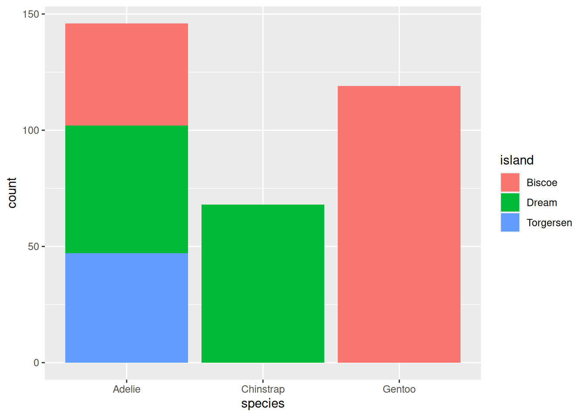
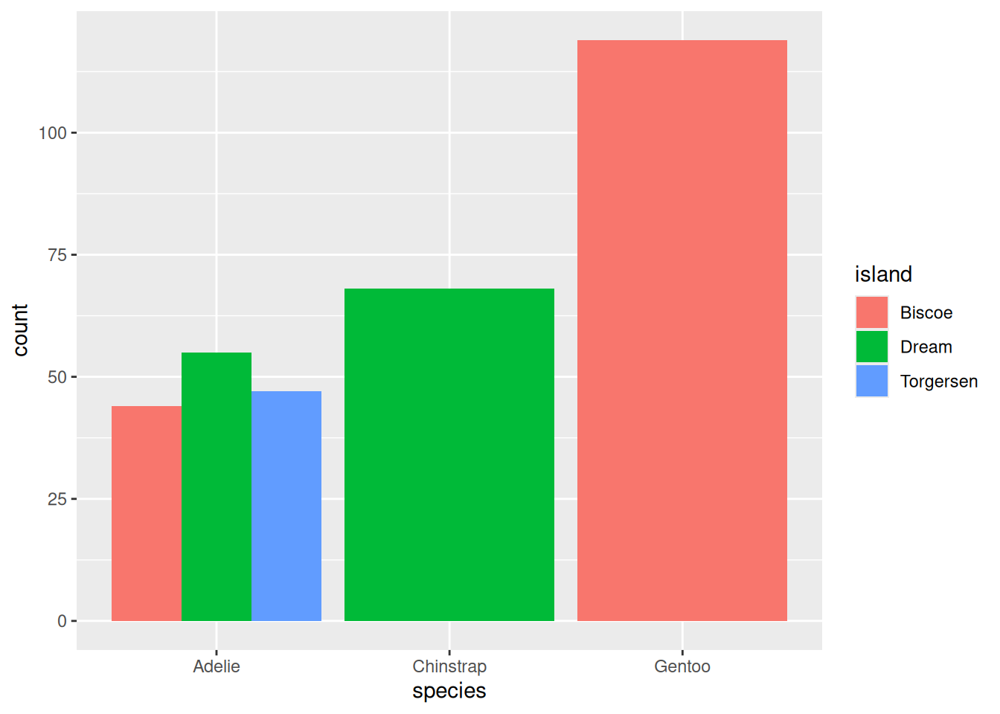
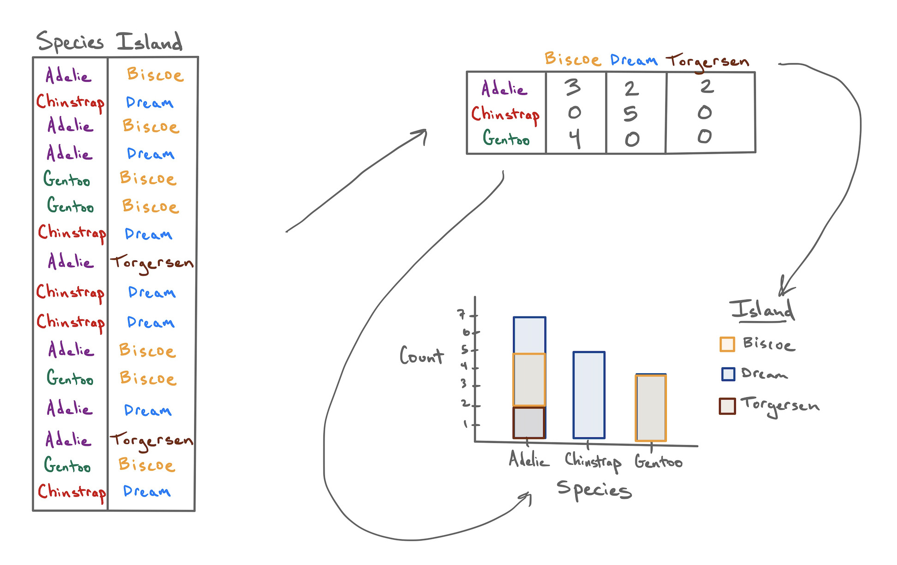
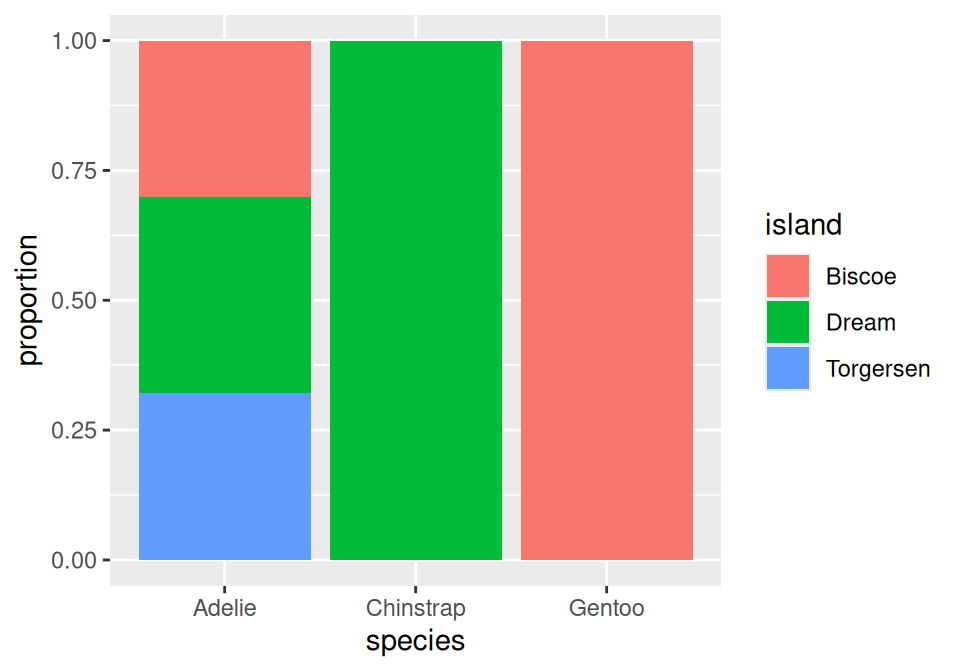
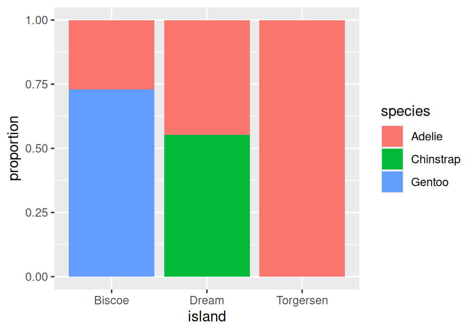
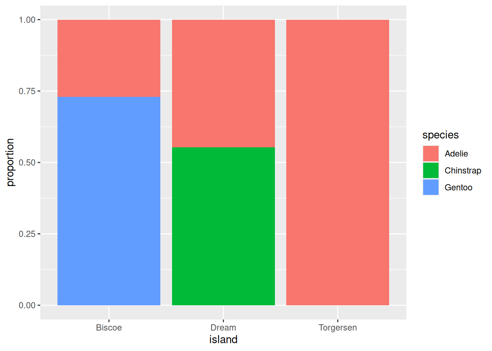
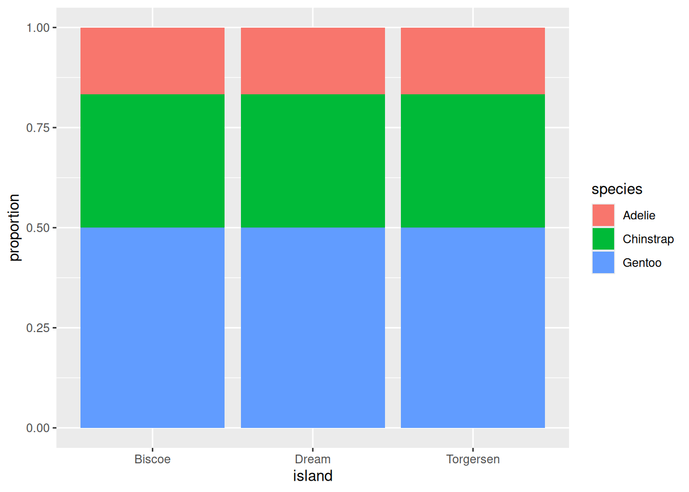
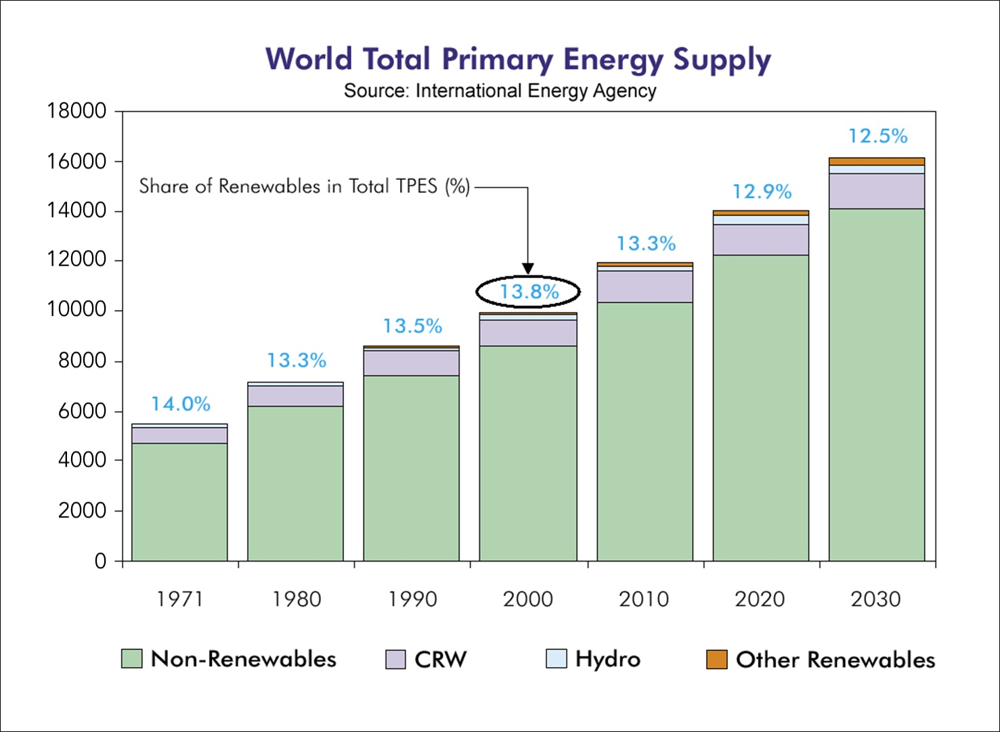
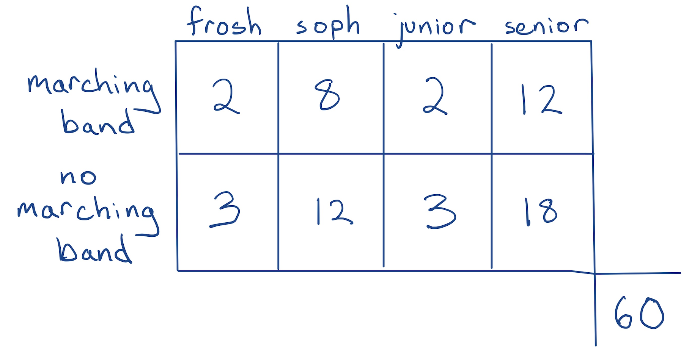

---

course: xac-suat-thong-ke

lecture: 03-tom-tat-du-lieu-dinh-tinh

section: lecture

title: "Tóm tắt dữ liệu định tính & Biểu đồ thanh"

prerequisites: []

lessonStatus: ready

hasChapterExercises: true

description: "Bảng tần số chéo, tỷ lệ đồng thời, tỷ lệ biên, tỷ lệ điều kiện, biểu đồ thanh và nhận diện mối liên hệ giữa các biến định tính."

---

Sau khi đã xác định được kiểu biến số và tổ chức dữ liệu vào Khung dữ liệu (Data Frame), bước tiếp theo trong quy trình phân tích là tóm tắt dữ liệu (summarizing data) thành các số đo định lượng súc tích và đồ thị trực quan.

Hệ thống công cụ tóm tắt trong thống kê học được chia thành hai nhánh độc lập:

1. Các công cụ chuyên dụng dành cho **dữ liệu định tính (Categorical Data)**.

2. Các công cụ chuyên dụng dành cho **dữ liệu định lượng (Numerical Data)**.

Trong bài giảng này, ta tập trung vào dữ liệu định tính: Từ bảng dữ liệu thô chuyển thành bảng tần số chéo, và từ bảng tần số chéo chuyển hóa thành các dạng biểu đồ thanh trực quan.

---

## 1. Từ Khung dữ liệu đến Bảng tần số chéo (Contingency Table)

Trong nghiên cứu sinh thái học tại Nam Cực, Tiến sĩ Kristen Gorman đã thu thập thông tin trên $333$ cá thể chim cánh cụt trưởng thành. Dưới đây là trích đoạn $10$ hàng đầu tiên của tập dữ liệu:

| species | island | bill_length_mm | bill_depth_mm | flipper_length_mm | body_mass_g | sex | year |

| :--- | :--- | :---: | :---: | :---: | :---: | :---: | :---: |

| Chinstrap | Dream | 42.4 | 17.3 | 181 | 3600 | female | 2007 |

| Chinstrap | Dream | 52.2 | 18.8 | 197 | 3450 | male | 2009 |

| Chinstrap | Dream | 47.0 | 17.3 | 185 | 3700 | female | 2007 |

| Gentoo | Biscoe | 43.4 | 14.4 | 218 | 4600 | female | 2009 |

| Gentoo | Biscoe | 51.1 | 16.3 | 220 | 6000 | male | 2008 |

| Adelie | Biscoe | 39.6 | 20.7 | 191 | 3900 | female | 2009 |

| Chinstrap | Dream | 46.4 | 17.8 | 191 | 3700 | female | 2008 |

| Adelie | Biscoe | 40.5 | 17.9 | 187 | 3200 | female | 2007 |

| Gentoo | Biscoe | 42.6 | 13.7 | 213 | 4950 | female | 2008 |

| Gentoo | Biscoe | 48.4 | 16.3 | 220 | 5400 | male | 2008 |

Hai cột đầu tiên là các biến định tính danh nghĩa:

- **Loài (species)**: Gồm ba mức là Adelie, Chinstrap và Gentoo.

- **Đảo cư trú (island)**: Gồm ba mức là Biscoe, Dream và Torgersen.

Nếu nhìn vào tập dữ liệu thô gồm $333$ hàng, việc nhận định mối quan hệ giữa loài và hòn đảo nơi chúng sinh sống là bất khả thi, bởi lượng thông tin chi tiết quá lớn. Do các biến này nhận giá trị nhãn danh mục chứ không phải giá trị số, ta không thể tính giá trị trung bình hay trung vị.

Phương pháp duy nhất và tự nhiên nhất là: Đếm số lượng cá thể xuất hiện ở từng tổ hợp mức (combination of levels) và sắp xếp chúng vào một bảng số liệu hai chiều.

| Loài / Đảo | Biscoe | Dream | Torgersen | **Tổng hàng** |

| :--- | :---: | :---: | :---: | :---: |

| **Adelie** | 44 | 55 | 47 | **146** |

| **Chinstrap** | 0 | 68 | 0 | **68** |

| **Gentoo** | 119 | 0 | 0 | **119** |

| **Tổng cột** | **163** | **123** | **47** | **333** |

Quan sát bảng số liệu này, ba đặc điểm sinh thái quan trọng lập tức lộ diện:

1. Loài Chinstrap chỉ xuất hiện duy nhất trên đảo Dream ($68$ con) và hoàn toàn vắng bóng ở Biscoe hay Torgersen.

2. Loài Adelie là loài có số lượng đông đảo nhất trong nghiên cứu với tổng cộng $146$ con, phân bố tương đối đồng đều trên cả ba hòn đảo.

3. Nhóm cá thể tập trung đông nhất tại một địa điểm duy nhất là loài Gentoo trên đảo Biscoe với $119$ con.

Bảng số liệu dạng này được gọi là **Bảng tần số chéo (Contingency Table)**:

::: info Định nghĩa Bảng tần số chéo

**Bảng tần số chéo (Contingency Table)** là bảng hiển thị số đếm hoặc tần số xuất hiện của các quan sát ứng với mọi tổ hợp mức giữa hai biến định tính. Bảng này được sử dụng để trình bày và đánh giá mối liên hệ qua lại giữa hai biến định tính.

:::

---

## 2. Biểu diễn đồ họa: Các dạng biểu đồ thanh (Bar Charts)

Bên cạnh bảng số liệu, ta có thể trực quan hóa số đếm bằng biểu đồ thanh (Bar Chart). Khi biểu diễn đồng thời hai biến định tính, có hai kỹ thuật sắp đặt thanh phổ biến:

  

Biểu đồ thanh xếp chồng (Stacked Bar Chart).

  

  

Biểu đồ thanh ghép cạnh (Dodged / Side-by-Side Bar Chart).

  

**Hình 3.1:** Hai phương pháp biểu diễn số lượng cá thể của hai biến định tính trên biểu đồ thanh.

Mỗi phương pháp phục vụ một mục đích truyền đạt thông tin riêng biệt:

- **Biểu đồ thanh xếp chồng (Stacked Bar Chart)**: Đặt biến loài trên trục hoành và xếp chồng các dải màu đại diện cho hòn đảo lên trục tung. Ưu điểm nổi bật là làm rõ **tổng số lượng quan sát của từng loài** (chiều cao toàn cột Adelie đạt $146$, tương ứng với tổng hàng đầu tiên trong bảng tần số chéo).

- **Biểu đồ thanh ghép cạnh (Dodged Bar Chart)**: Đặt các thanh của từng hòn đảo cạnh nhau thay vì xếp chồng. Dạng biểu đồ này làm mờ đi tổng số lượng cá thể của loài, nhưng lại giúp người đọc dễ dàng so sánh quy mô số lượng tương đối giữa các đảo đối với cùng một loài.

  

**Hình 3.2:** Sơ đồ quy trình chuyển đổi: Từ Khung dữ liệu thô (Data Frame) $\to$ Bảng tần số chéo (Contingency Table) $\to$ Biểu đồ thanh xếp chồng (Stacked Bar Chart).

---

## 3. Từ số đếm đến tỷ lệ (From Counts to Proportions)

Số đếm thô phản ánh quy mô tuyệt đối, nhưng khi kích thước các nhóm có sự chênh lệch lớn, tỷ lệ (proportions) mới là đại lượng làm nổi bật quy mô tương đối.

Để chuyển đổi, ta chia số đếm ở từng ô cho tổng số quan sát $N = 333$:

| Loài / Đảo | Biscoe | Dream | Torgersen | **Tỷ lệ biên loài** |

| :--- | :---: | :---: | :---: | :---: |

| **Adelie** | 0.132 | 0.165 | 0.141 | **0.438** |

| **Chinstrap** | 0.000 | 0.204 | 0.000 | **0.204** |

| **Gentoo** | 0.357 | 0.000 | 0.000 | **0.357** |

| **Tỷ lệ biên đảo** | **0.489** | **0.369** | **0.141** | **1.000** |

Bảng này chứa hai loại tỷ lệ ở hai vị trí khác nhau: Ở các ô trung tâm và ở đường viền (lề) của bảng. Từ hai loại này, ta thiết lập thêm loại tỷ lệ thứ ba:

### 3.1. Tỷ lệ đồng thời (Joint Proportion)

Là tỷ lệ các quan sát cùng thỏa mãn đồng thời một tổ hợp mức xác định của cả hai biến số (nằm ở các ô trung tâm của bảng).

::: example Ví dụ về tỷ lệ đồng thời

Tỷ lệ cá thể vừa thuộc loài Adelie vừa cư trú trên đảo Biscoe:

$$
\begin{aligned}
&P(\text{Adelie} \cap \text{Biscoe}) = \frac{44}{333} \\
&\approx 0.132 \\
&(13.2\%).
\end{aligned}
$$

:::

### 3.2. Tỷ lệ biên (Marginal Proportion)

Là tỷ lệ các quan sát thuộc về một mức duy nhất của một biến số, tính gộp trên toàn bộ các mức của biến còn lại (nằm ở lề ngoài cùng của bảng).

::: example Ví dụ về tỷ lệ biên

Tỷ lệ cá thể chim cánh cụt sống tại đảo Biscoe trong toàn bộ nghiên cứu:

$$
\begin{aligned}
&P(\text{Biscoe}) = \frac{44 + 0 + 119}{333} \\
&= \frac{163}{333} \\
&\approx 0.489 \\
&(48.9\%).
\end{aligned}
$$

Tương tự, tỷ lệ biên của loài Adelie là:

$$
\begin{aligned}
&P(\text{Adelie}) = \frac{44 + 55 + 47}{333} \\
&= \frac{146}{333} \\
&\approx 0.438 \\
&(43.8\%).
\end{aligned}
$$

:::

### 3.3. Tỷ lệ có điều kiện (Conditional Proportion)

Là tỷ lệ các quan sát thuộc về một mức của biến thứ nhất, tính riêng trong phạm vi các đối tượng đã thỏa mãn một mức xác định của biến thứ hai.

::: example Ví dụ về tỷ lệ có điều kiện

Trong số các cá thể chim cánh cụt cư trú tại đảo Biscoe, tỷ lệ thuộc loài Gentoo là:

$$
\begin{aligned}
&P(\text{Gentoo} \mid \text{Biscoe}) = \frac{119}{163} \\
&\approx 0.730 \\
&(73.0\%).
\end{aligned}
$$

Phép tính này tương đương với việc lấy tỷ lệ đồng thời chia cho tỷ lệ biên:

$$
\begin{aligned}
\frac{P(\text{Gentoo} \cap \text{Biscoe})}{P(\text{Biscoe})} &= \frac{0.357}{0.489} \\
&\approx 0.730.
\end{aligned}
$$

:::

Sự phân biệt ba loại tỷ lệ này có ý nghĩa thực tế sâu sắc, bởi một thay đổi nhỏ trong cách diễn đạt ngôn ngữ sẽ dẫn tới một con số hoàn toàn khác nhau:

- Câu “Toàn bộ chim cánh cụt Chinstrap đều sống tại đảo Dream” phản ánh một **tỷ lệ có điều kiện**: $68 / 68 = 1.000$ ($100\%$).

- Câu “Adelie là loài phổ biến nhất” phản ánh một **tỷ lệ biên**: $43.8\%$ so với $20.4\%$ của Chinstrap và $35.7\%$ của Gentoo.

- Câu “Nhóm cá thể phổ biến nhất là chim Gentoo sống tại đảo Biscoe” phản ánh một **tỷ lệ đồng thời**: $35.7\%$ (hay $119$ trên tổng số $333$ cá thể).

---

## 4. Biểu đồ thanh chuẩn hóa (Normalized Stacked Bar Chart)

Khi quan tâm đến cơ cấu thành phần thay vì số lượng tuyệt đối, ta sử dụng **biểu đồ thanh chuẩn hóa (Normalized Stacked Bar Chart)**: Chiều cao của mọi cột được kéo dãn chuẩn hóa về $1.0$ ($100\%$), và trục tung biểu thị các tỷ lệ.

Điểm mấu chốt là: Biểu đồ chuẩn hóa luôn hiển thị các **tỷ lệ có điều kiện**. Tùy thuộc vào biến số nào được chọn làm mẫu số (điều kiện hóa), câu chuyện thống kê được truyền tải sẽ hoàn toàn khác biệt:

  

Chuẩn hóa theo Loài: $P(\text{Island} \mid \text{Species})$.

  

  

Chuẩn hóa theo Đảo: $P(\text{Species} \mid \text{Island})$.

  

**Hình 3.3:** Biểu đồ thanh chuẩn hóa theo loài (trái) và chuẩn hóa theo đảo (phải).

1. **Biểu đồ bên trái (Chuẩn hóa theo Loài)**:

   - Biến điều kiện nằm ở trục hoành là Loài (species).

   - Chiều cao dải màu xanh dương ở góc dưới bên trái thể hiện tỷ lệ chim Adelie sống trên đảo Torgersen: $47 / 146 \approx 0.322$ ($32.2\%$).

2. **Biểu đồ bên phải (Chuẩn hóa theo Đảo)**:

   - Biến điều kiện nằm ở trục hoành là Đảo (island).

   - Chiều cao dải màu xanh dương ở góc dưới bên trái thể hiện tỷ lệ cá thể sống tại đảo Biscoe thuộc loài Gentoo: $119 / 163 \approx 0.730$ ($73.0\%$).

::: tip Bài học sư phạm then chốt

Nếu muốn trả lời câu hỏi: *“Cơ cấu các loài chim trên đảo Dream phân bố như thế nào?”*, ta bắt buộc phải sử dụng biểu đồ bên phải (chuẩn hóa theo đảo). Cột giữa của biểu đồ bên phải chỉ rõ: Trên đảo Dream có khoảng $55.3\%$ là Chinstrap và $44.7\%$ là Adelie.

Nếu chỉ nhìn vào biểu đồ bên trái (chuẩn hóa theo loài), ta hoàn toàn không thể giải đáp được câu hỏi này: Khi chuẩn hóa theo từng loài, ta đã triệt tiêu sự chênh lệch về tổng số lượng giữa các loài. Do đó ta không biết có bao nhiêu cá thể mỗi loài để suy ngược lại cơ cấu trên đảo Dream.

:::

---

## 5. Nhận diện mối liên hệ thống kê (Association)

Liệu có mối liên hệ nào giữa loài chim cánh cụt và hòn đảo nơi chúng sinh sống hay không?

::: info Định nghĩa Mối liên hệ thống kê giữa hai biến định tính

Hai biến định tính được gọi là **có mối liên hệ (Association)** nếu các tỷ lệ có điều kiện thay đổi khi ta di chuyển từ mức này sang mức khác của biến điều kiện.

Ngược lại, nếu tỷ lệ có điều kiện giữ nguyên không đổi trên mọi mức của biến điều kiện, hai biến số được gọi là **độc lập thống kê (Independent)** hay không có mối liên hệ.

:::

Để thấy rõ sự tương phản, hãy quan sát biểu đồ dữ liệu thực tế đặt cạnh một kịch bản giả định không có mối liên hệ:

  

Dữ liệu thực tế: Tồn tại mối liên hệ.

  

  

Dữ liệu giả định: Không có mối liên hệ.

  

**Hình 3.4:** Đối chiếu trực quan: Dữ liệu thực tế có mối liên hệ (trái) và dữ liệu độc lập không có liên hệ (phải).

- **Biểu đồ bên phải (Không có liên hệ)**: Khi nhìn từ trái sang phải qua ba hòn đảo Biscoe, Dream và Torgersen, cơ cấu phân bố các loài giống hệt nhau ở mọi cột: Luôn có đúng $50\%$ Gentoo, $33\%$ Chinstrap và $17\%$ Adelie. Biết một cá thể sống ở hòn đảo nào hoàn toàn không cung cấp thêm thông tin để đoán biết loài của nó.

- **Biểu đồ bên trái (Dữ liệu thực tế)**: Cơ cấu phân bố biến đổi hoàn toàn: Ở đảo Biscoe thì loài Gentoo chiếm đa số ($73\%$) và Chinstrap hoàn toàn vắng bóng. Trong khi đó, ở đảo Dream thì loài Gentoo biến mất và Chinstrap chiếm ưu thế ($55.3\%$), còn ở đảo Torgersen thì toàn bộ $100\%$ là loài Adelie. Điều này khẳng định giữa loài chim cánh cụt và địa bàn sinh sống có một **mối liên hệ thống kê mật thiết**.

---

## 6. Cạm bẫy trực quan: Nhầm lẫn giữa số lượng tuyệt đối và tỷ lệ thành phần

Việc kết hợp không cẩn trọng giữa số đếm tuyệt đối và tỷ lệ phần trăm trên cùng một đồ thị có thể gây ra những hiểu lầm nghiêm trọng trong thực tế.

  

**Hình 3.5:** Biểu đồ nguồn cung năng lượng sơ cấp toàn cầu do Cơ quan Năng lượng Quốc tế (IEA) công bố.

Biểu đồ này chứa đựng một nghịch lý thị giác dễ gây hiểu lầm:

- Chiều cao các cột thể hiện **tổng sản lượng năng lượng toàn cầu** (đang tăng liên tục từ năm 1971 đến năm 2030).

- Các phần màu tím, xanh lam và cam ở đỉnh cột đại diện cho năng lượng tái tạo (CRW, Thủy điện và các nguồn tái tạo khác). Chiều cao tuyệt đối của các dải này rõ ràng đang **tăng lên đều đặn qua các năm**.

- Tuy nhiên, con số tỷ lệ phần trăm in trên đỉnh mỗi cột lại có xu hướng **giảm sút**: Từ $14.0\%$ (năm 1971) xuống $13.8\%$ (năm 2000) và dự báo chỉ còn $12.5\%$ (năm 2030).

Nguyên nhân xuất phát từ công thức tính tỷ lệ:

Gọi $Q_R$ là sản lượng năng lượng tái tạo và $Q$ là tổng sản lượng toàn cầu, với $Q>0$. Tỷ trọng cần tìm là:

$$
r = \frac{Q_R}{Q}.
$$

Dù tử số (sản lượng tái tạo) tăng trưởng thực tế, nhưng mẫu số (tổng nhu cầu năng lượng từ nhiên liệu hóa thạch) tăng với tốc độ nhanh hơn rất nhiều. Nếu người đọc chỉ nhìn vào con số phần trăm đang sụt giảm, họ sẽ ngộ nhận sai lầm rằng con người đang sử dụng ít năng lượng tái tạo hơn so với quá khứ.

---

## 7. Tổng kết

1. **Bảng tần số chéo (Contingency Table)**: Công cụ cơ bản nhất để tóm tắt mối quan hệ giữa hai biến định tính bằng số đếm quan sát ở từng tổ hợp mức.

2. **Ba loại tỷ lệ cốt lõi**:

   - Tỷ lệ đồng thời (Joint): Số quan sát ở một tổ hợp mức chia cho toàn bộ tập dữ liệu.

   - Tỷ lệ biên (Marginal): Số quan sát ở một mức đơn lẻ chia cho toàn bộ tập dữ liệu.

   - Tỷ lệ có điều kiện (Conditional): Số quan sát ở một tổ hợp mức chia cho tổng số quan sát của biến điều kiện.

3. **Biểu đồ thanh chuẩn hóa**: Luôn biểu diễn các tỷ lệ có điều kiện. Việc lựa chọn biến số nào để điều kiện hóa sẽ quyết định thông điệp và khả năng trả lời các câu hỏi thực tế.

4. **Mối liên hệ thống kê (Association)**: Xuất hiện khi tỷ lệ có điều kiện biến thiên rõ rệt giữa các mức của biến điều kiện, trái lại hai biến được coi là độc lập khi tỷ lệ này giữ nguyên không đổi.

---

## Tài liệu tham khảo

- Gorman KB, Williams TD, Fraser WR (2014). *Ecological sexual dimorphism and environmental variability within a community of Antarctic penguins (genus Pygoscelis)*. PLoS ONE 9(3): e90081.

- International Energy Agency (IEA). *World Total Primary Energy Supply Statistics*.

- Department of Statistics, UC Berkeley (2026). *STAT 20: Introduction to Probability and Statistics - Summarizing Categorical Data*, Lecture Notes & Slides.

## Bài tập rèn luyện tư duy thống kê

::: exercise Bài tập 1: Phân tích khảo sát ban nhạc diễu hành (Marching Band Survey)

Một cuộc khảo sát được thực hiện trên một lớp học gồm $N = 60$ sinh viên đại học nhằm tìm hiểu về năm học và sự tham gia vào ban nhạc diễu hành của nhà trường. Kết quả được tổng hợp trong bảng tần số chéo sau:

  

Bảng gồm các năm học: Năm 1 (frosh), Năm 2 (soph), Năm 3 (junior), Năm 4 (senior) và hai trạng thái tham gia: Có tham gia ban nhạc (marching band), Không tham gia ban nhạc (no marching band).

Hãy trả lời các câu hỏi sau:

1. Tỷ lệ sinh viên trong toàn bộ lớp học tham gia vào ban nhạc diễu hành là bao nhiêu? Cho biết đây là loại tỷ lệ nào.

2. Trong số các sinh viên có tham gia ban nhạc diễu hành, tỷ lệ sinh viên năm thứ ba (junior) là bao nhiêu? Cho biết đây là loại tỷ lệ nào.

3. Tỷ lệ sinh viên năm thứ hai (sophomore) không tham gia ban nhạc diễu hành chiếm bao nhiêu phần trăm trong toàn bộ lớp học? Cho biết đây là loại tỷ lệ nào.

4. Tập dữ liệu thô (Data Frame) ban đầu dùng để tạo ra bảng tần số chéo này có kích thước bao nhiêu hàng và bao nhiêu cột?

5. Hãy nhận xét về mối liên hệ thống kê (association) giữa năm học của sinh viên và việc tham gia ban nhạc diễu hành. Hai biến số này có liên hệ với nhau hay độc lập?

:::

::: hint Gợi ý Bài tập 1

- Tính tổng số sinh viên theo từng hàng và theo từng cột trước khi tính tỷ lệ.

- Phân biệt rõ mẫu số của từng câu hỏi: Mẫu số là toàn thể lớp học ($60$), hay chỉ là nhóm sinh viên trong ban nhạc?

- Để kiểm tra mối liên hệ, hãy tính tỷ lệ tham gia ban nhạc trong từng năm học riêng biệt: Tỷ lệ ở năm một, năm hai, năm ba và năm bốn.

:::

::: solution Lời giải chi tiết Bài tập 1

Lập bảng tổng hợp các số đếm hàng và cột:

| Trạng thái / Năm học | Frosh (Năm 1) | Soph (Năm 2) | Junior (Năm 3) | Senior (Năm 4) | **Tổng hàng** |

| :--- | :---: | :---: | :---: | :---: | :---: |

| **Marching band** | 2 | 8 | 2 | 12 | **24** |

| **No marching band** | 3 | 12 | 3 | 18 | **36** |

| **Tổng cột** | **5** | **20** | **5** | **30** | **60** |

Trả lời từng câu hỏi:

1. **Tỷ lệ sinh viên toàn lớp tham gia ban nhạc diễu hành**:

   - Đây là một **tỷ lệ biên (Marginal Proportion)** của biến trạng thái tham gia ban nhạc.

   - Phép tính:

$$
\begin{aligned}
&P(\text{marching band}) = \frac{24}{60} \\
&= 0.40 \\
&(40.0\%).
\end{aligned}
$$

2. **Tỷ lệ sinh viên năm thứ ba trong số những người tham gia ban nhạc**:

   - Đây là một **tỷ lệ có điều kiện (Conditional Proportion)** với biến điều kiện là tham gia ban nhạc.

   - Phép tính:

Gọi $J$ là biến cố học sinh năm ba và $B$ là biến cố tham gia ban nhạc.

$$
\begin{aligned}
P(J\mid B)&=\frac{2}{24} \\
&=\frac{1}{12} \\
&\approx0{,}0833.
\end{aligned}
$$

3. **Tỷ lệ sinh viên năm thứ hai không tham gia ban nhạc trong toàn lớp**:

   - Đây là một **tỷ lệ đồng thời (Joint Proportion)** giữa hai mức: Năm thứ hai và không tham gia ban nhạc.

   - Phép tính:

Gọi $S$ là biến cố học sinh năm hai và $B$ là biến cố tham gia ban nhạc.

$$
P(S\cap B^c)=\frac{12}{60}=0{,}20.
$$

4. **Kích thước của Data Frame thô ban đầu**:

   - Có $60$ sinh viên tham gia khảo sát, nên tập dữ liệu có $60$ hàng quan sát.

   - Bảng được tạo từ $2$ biến định tính: Biến năm học (`year`) và biến tham gia ban nhạc (`band_status`).

   - Do đó, Data Frame thô có kích thước là $60 \times 2$ (60 hàng và 2 cột).

5. **Đánh giá mối liên hệ thống kê (Association)**:

   - Ta xét tỷ lệ tham gia ban nhạc có điều kiện theo từng năm học:

Ký hiệu $B$ là tham gia ban nhạc. Các biến cố $F,S,J,R$ lần lượt chỉ học sinh năm một, hai, ba và bốn.

$$
\begin{aligned}
&P(B\mid F)=2/5=0{,}40, \\
&P(B\mid S)=8/20=0{,}40, \\
&P(B\mid J)=2/5=0{,}40, \\
&P(B\mid R)=12/30=0{,}40.
\end{aligned}
$$

   - Nhận xét: Tỷ lệ tham gia ban nhạc ở cả bốn năm học đều bằng nhau tuyệt đối ($40\%$).

   - Kết luận: Hai biến số này **hoàn toàn độc lập thống kê (không có mối liên hệ)**. Việc biết một sinh viên đang học năm thứ mấy hoàn toàn không làm thay đổi xác suất sinh viên đó tham gia vào ban nhạc diễu hành.

:::

---

::: exercise Bài tập 2: Lựa chọn biểu đồ thanh trong khảo sát cử tri

Một viện nghiên cứu xã hội học tiến hành khảo sát $N = 500$ công dân về mối quan hệ giữa khuynh hướng chính trị (Đảng Dân chủ, Đảng Cộng hòa, Độc lập) và trình độ học vấn (Có bằng đại học, Chưa có bằng đại học).

1. Nếu mục tiêu nghiên cứu là so sánh xem: *“Tỷ lệ cử tri có bằng đại học ở Đảng Dân chủ cao hơn hay thấp hơn so với Đảng Cộng hòa?”*, ta nên lựa chọn dạng biểu đồ thanh nào và chuẩn hóa theo biến số nào?

2. Nếu sử dụng biểu đồ thanh xếp chồng chuẩn hóa theo khuynh hướng chính trị, liệu người đọc có thể xác định được nhóm cử tri nào (ví dụ: Cử tri Đảng Cộng hòa có bằng đại học) có số lượng người đông nhất trong khảo sát hay không? Tại sao?

:::

::: hint Gợi ý Bài tập 2

- Xem lại câu hỏi: Tỷ lệ cử tri có bằng đại học được tính riêng cho từng đảng phái chính trị.

- Biểu đồ chuẩn hóa đưa chiều cao mọi cột về $100\%$, điều này có giữ lại thông tin về tổng số cử tri của từng đảng hay không?

:::

::: solution Lời giải chi tiết Bài tập 2

1. **Lựa chọn biểu đồ**:

   - Ta cần sử dụng **Biểu đồ thanh xếp chồng chuẩn hóa (Normalized Stacked Bar Chart)** và **chuẩn hóa theo biến Khuynh hướng chính trị** (tức đặt biến khuynh hướng chính trị ở trục hoành).

   - Khi đó, mỗi cột đại diện cho một đảng phái chính trị và có chiều cao $100\%$. Phân đoạn màu đại diện cho tỷ lệ cử tri có bằng đại học: $P(\text{College degree} \mid \text{Democrat})$ và $P(\text{College degree} \mid \text{Republican})$. So sánh chiều cao phân đoạn này giữa hai cột sẽ trả lời trực tiếp câu hỏi nghiên cứu.

2. **Khả năng xác định nhóm đông nhất**:

   - Không thể xác định được nhóm nào đông nhất nếu chỉ nhìn vào biểu đồ chuẩn hóa này.

   - Lý do: Biểu đồ chuẩn hóa đã kéo dãn tất cả các cột về cùng độ cao $100\%$, làm triệt tiêu hoàn toàn thông tin về quy mô số lượng tuyệt đối của từng đảng phái. Một đảng nhỏ có tỷ lệ cử tri có bằng đại học cao vẫn có thể có số lượng người ít hơn một đảng lớn có tỷ lệ thấp. Để so sánh số lượng người tuyệt đối, bắt buộc phải dùng biểu đồ thanh đếm số lượng thực tế (Unnormalized Bar Chart) hoặc bảng tần số chéo ban đầu.

:::

---

::: exercise Bài tập 3: Phân tích nghịch lý toán học trong tỷ lệ nguồn cung năng lượng

Dựa trên biểu đồ Nguồn cung Năng lượng Sơ cấp Toàn cầu của IEA (Hình 3.5), hãy giải thích bằng lập luận toán học:

1. Tại sao tỷ lệ đóng góp của năng lượng tái tạo lại giảm từ $14.0\%$ xuống $12.5\%$ trong khi sản lượng tuyệt đối của năng lượng tái tạo lại tăng trưởng liên tục qua các thập kỷ?

2. Đặt $R_t$ là sản lượng năng lượng tái tạo tại năm $t$, và $F_t$ là sản lượng năng lượng từ nhiên liệu không tái tạo tại năm $t$. Hãy thiết lập điều kiện toán học về tốc độ tăng trưởng của $R_t$ và $F_t$ để tỷ lệ $\frac{R_t}{R_t + F_t}$ giảm dần theo thời gian.

:::

::: hint Gợi ý Bài tập 3

Xét tỷ lệ $P_t = \frac{R_t}{R_t + F_t} = \frac{1}{1 + \frac{F_t}{R_t}}$. Để $P_t$ giảm thì tỷ số $\frac{F_t}{R_t}$ phải biến động như thế nào?

:::

::: solution Lời giải chi tiết Bài tập 3

1. **Bản chất của nghịch lý**:

   - Tỷ lệ phần trăm của năng lượng tái tạo là một tỷ số giữa sản lượng tái tạo (tử số) và tổng sản lượng năng lượng toàn cầu (mẫu số).

   - Mặc dù tử số tăng trưởng liên tục, nhưng mẫu số (tổng năng lượng tiêu thụ toàn cầu, chủ yếu thúc đẩy bởi sự bùng nổ của nhiên liệu hóa thạch) lại tăng trưởng với tốc độ vượt trội hơn. Khi mẫu số tăng nhanh hơn tử số, giá trị của phân số buộc phải sụt giảm.

2. **Điều kiện toán học**:

   - Xét tỷ lệ tại thời điểm $t$:

$$
P_t = \frac{R_t}{R_t + F_t} = \frac{1}{1 + \frac{F_t}{R_t}}.
$$

   - Để tỷ lệ $P_t$ giảm theo thời gian, mẫu số $1 + \frac{F_t}{R_t}$ phải tăng lên, điều này tương đương với:

$$
\frac{F_t}{R_t} \text{ increases with time } t.
$$

   - Lấy đạo hàm theo thời gian hoặc xét tốc độ tăng trưởng tương đối:

$$
\begin{aligned}
\frac{d}{dt} \left( \frac{F_t}{R_t} \right) &= \frac{F'_t R_t - F_t R'_t}{R_t^2} \\
&> 0 \\
&\iff \frac{F'_t}{F_t} \\
&> \frac{R'_t}{R_t}.
\end{aligned}
$$

   - Kết luận: Tỷ lệ năng lượng tái tạo sẽ sụt giảm khi và chỉ khi **tốc độ tăng trưởng tương đối của năng lượng không tái tạo lớn hơn tốc độ tăng trưởng tương đối của năng lượng tái tạo** ($\frac{F'_t}{F_t} > \frac{R'_t}{R_t}$), bất kể sản lượng tuyệt đối của năng lượng tái tạo tăng nhanh đến mức nào.

:::

