

“Một chàng hoàng tử giả điên, chiêm nghiệm lẽ sinh tử và tìm cách báo thù.”  
“Người con trai trả thù cho cha, và toàn bộ diễn biến chỉ vỏn vẹn trong bốn giờ kịch.”  
“Một bi kịch do đại văn hào người Anh sáng tác vào khoảng năm 1600.”  
“$29{,}551$ từ in trên các trang giấy.”

Cả bốn câu trên đều là những cách tóm tắt vở kịch bất hủ *Hamlet* của Shakespeare. Không câu nào sai, nhưng mỗi câu lại tập trung vào một khía cạnh hoàn toàn khác biệt. Việc tóm tắt một đối tượng phức tạp như *Hamlet* luôn đòi hỏi sự chọn lọc khắt khe: Ta giảm thiểu $29{,}551$ từ xuống còn một câu đơn lẻ. Tóm tắt không chỉ là lược bỏ thông tin mà còn là việc đưa ra quyết định sáng suốt về những gì cần giữ lại:
- **Những gì nên đưa vào bản tóm tắt**: Các đặc tính liên quan trực tiếp đến câu hỏi nghiên cứu hoặc phát biểu ta đang bảo vệ; các đặc trưng chạm đúng vào sự quan tâm của người tiếp nhận.
- **Những gì nên lược bỏ**: Các chi tiết gây xao nhãng, vụn vặt hoặc có nguy cơ làm sai lệch bản chất; các thông tin trùng lặp.

Quy tắc chọn lọc này là kim chỉ nam xuyên suốt khi ta xây dựng các bản tóm tắt dữ liệu định lượng bằng đồ thị, lời văn và các đại lượng thống kê.

---

## 1. Trực quan hóa dữ liệu định lượng: Tiêu chuẩn và công cụ

Trở lại với bộ dữ liệu sinh thái học Palmer Penguins. Một trong các biến định lượng được đo lường trên các cá thể chim cánh cụt là **chiều dài mỏ (bill length)** tính bằng milimet. Dưới đây là giá trị đo đạc trên $16$ cá thể đầu tiên:

| Chỉ số quan sát ($i$) | 1 | 2 | 3 | 4 | 5 | 6 | 7 | 8 | 9 | 10 | 11 | 12 | 13 | 14 | 15 | 16 |
| :---: | :---: | :---: | :---: | :---: | :---: | :---: | :---: | :---: | :---: | :---: | :---: | :---: | :---: | :---: | :---: | :---: |
| Chiều dài mỏ (mm) | 39.1 | 39.5 | 40.3 | 36.7 | 39.3 | 38.9 | 39.2 | 41.1 | 38.6 | 34.6 | 36.6 | 38.7 | 42.5 | 34.4 | 46.0 | 37.8 |

Để trực quan hóa dãy số này, ta có nhiều lựa chọn đồ thị khác nhau. Việc chọn dạng đồ thị nào phụ thuộc vào **tiêu chuẩn mong muốn (Desiderata)** mà ta đặt ra cho bản tóm tắt.

### 1.1. Tiêu chuẩn 1: Bảo toàn nguyên vẹn thông tin quan sát

Nếu ta yêu cầu đồ thị phải lưu giữ trọn vẹn từng điểm dữ liệu thô mà không làm mất mát bất kỳ thông tin nào, công cụ chuẩn mực là **Biểu đồ chấm (Dot Plot)**:

  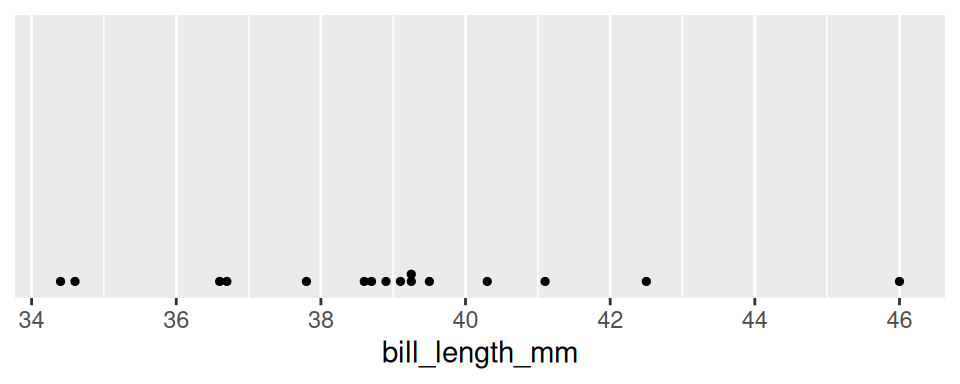

**Hình 4.1:** Biểu đồ chấm (Dot Plot) biểu diễn chiều dài mỏ của 16 cá thể chim cánh cụt.

Biểu đồ chấm thực chất là một biểu đồ phân tán một chiều: Mỗi quan sát được biểu diễn bằng một dấu chấm tại vị trí giá trị tương ứng trên trục hoành. Nhìn vào biểu đồ này, ta có thể khôi phục lại chính xác từng con số của tập dữ liệu ban đầu.

Tuy nhiên, khi kích thước mẫu tăng lên hàng nghìn quan sát, các chấm sẽ chồng chất dày đặc và trở nên rối mắt. Khi đó, mục tiêu của ta chuyển dịch sang việc nắm bắt **hình dạng tổng thể của phân phối (Distribution)**.

---

### 1.2. Biểu đồ phân bố tần số (Histogram)

Để cân bằng giữa hình dạng tổng thể và mật độ quan sát, ta sử dụng **Histogram**:

  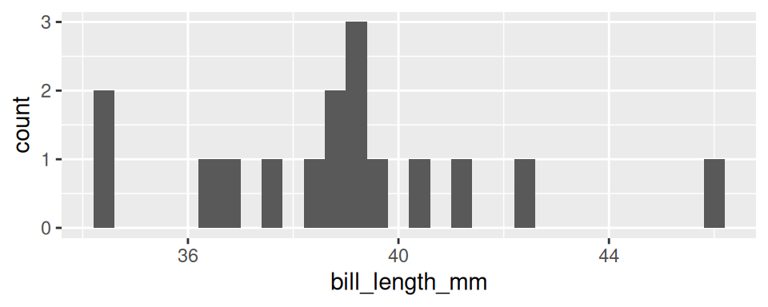

**Hình 4.2:** Biểu đồ phân bố tần số (Histogram) chia dữ liệu thành các khoảng gộp đều nhau.

Dù thoạt nhìn giống biểu đồ thanh, Histogram có cơ chế toán học hoàn toàn khác:
1. **Phân chia khoảng (Binning)**: Trục giá trị liên tục được chia thành các khoảng con có độ rộng bằng nhau gọi là các **thùng (bins)**.
2. **Gộp nhóm số đếm (Aggregation)**: Đếm số lượng quan sát rơi vào từng khoảng và dựng cột có chiều cao tỷ lệ với số đếm đó.

Cột cao nhất trong đồ thị trên (chiều cao bằng $3$) gộp chung ba quan sát rơi vào khoảng $[39.09, 39.30]$: Gồm $39.1, 39.2$ và $39.3\text{ mm}$.

Mức độ gộp nhóm phụ thuộc hoàn toàn vào **độ rộng khoảng (Binwidth)**:

  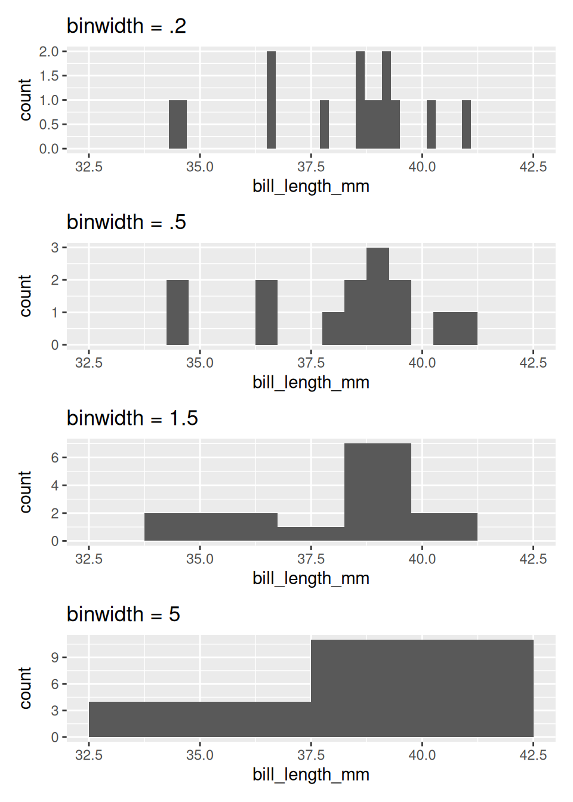

**Hình 4.3:** Tác động của độ rộng khoảng (Binwidth) lên hình dạng Histogram: Từ chi tiết rời rạc đến khái quát trơn tru.

Dân gian có câu: *“Không thấy rừng vì mải nhìn cây”* (chỉ thấy chi tiết vụn vặt mà bỏ quên bức tranh toàn cảnh). Histogram chính là công cụ giải quyết bài toán này:
- Binwidth nhỏ: Nhìn rõ từng cái cây (từng điểm dữ liệu chi tiết).
- Binwidth lớn: Nhìn thấy toàn bộ cánh rừng (cấu trúc hình dạng chung của phân phối).

---

### 1.3. Biểu đồ mật độ (Density Plot)

Hãy hình dung ta đặt một sợi mì spaghetti đã luộc chín uốn lượn phủ lên trên đỉnh của các cột Histogram: Đường cong mềm mại tạo thành chính là **Biểu đồ mật độ (Density Plot)**.

  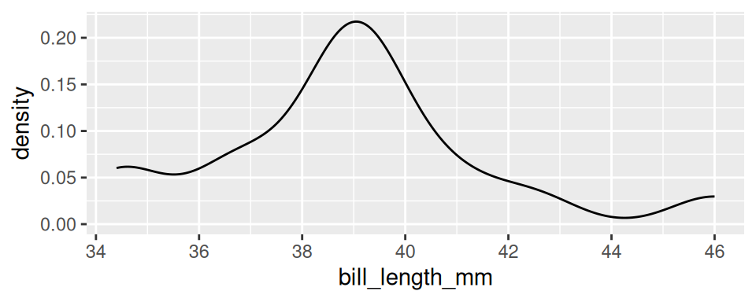

**Hình 4.4:** Biểu đồ mật độ (Density Plot) biểu diễn hàm mật độ xác suất thực nghiệm trơn tru.

Trên biểu đồ mật độ:
- Trục tung biểu thị đại lượng gọi là **mật độ (density)**. Diện tích tích phân dưới toàn bộ đường cong luôn được chuẩn hóa bằng đúng $1.0$.
- Giá trị tuyệt đối trên trục tung ít khi mang ý nghĩa trực tiếp; thông tin giá trị nhất là **tỷ lệ diện tích tương đối**: Vùng đường cong có mật độ cao gấp đôi vùng khác chứa số lượng quan sát nhiều gấp khoảng hai lần.
- Tham số điều chỉnh độ mịn của đường cong được gọi là **độ rộng băng thông (Bandwidth)**:

  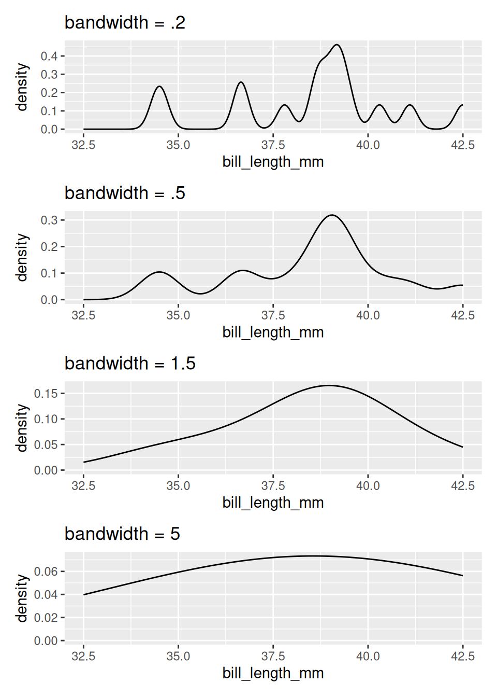

**Hình 4.5:** Ảnh hưởng của tham số băng thông (Bandwidth) lên độ nhẵn của đường cong mật độ.

---

### 1.4. So sánh giữa các nhóm: Biểu đồ vĩ cầm (Violin Plot) và Biểu đồ hộp (Box Plot)

Khi cần so sánh phân phối của một biến định lượng giữa nhiều nhóm danh mục khác nhau, hai công cụ trực quan mạnh mẽ nhất là **Violin Plot** và **Box Plot**:

  

    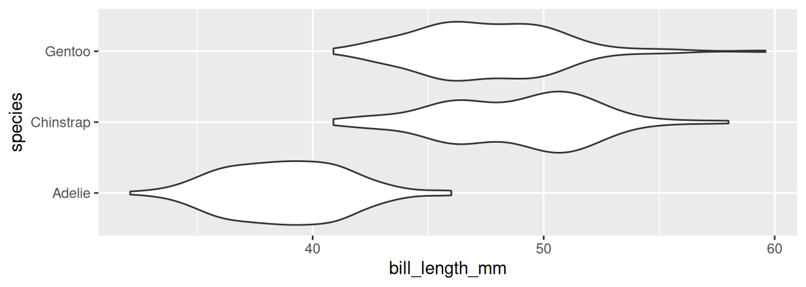
    
Biểu đồ vĩ cầm (Violin Plot).

  

  

    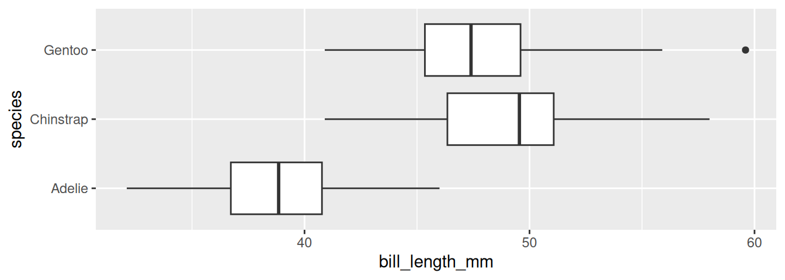
    
Biểu đồ hộp (Box Plot).

  

**Hình 4.6:** So sánh phân phối chiều dài mỏ giữa ba loài chim bằng Violin Plot và Box Plot.

- **Biểu đồ vĩ cầm (Violin Plot)**: Tạo thành bằng cách phản chiếu đường cong mật độ qua trục đối xứng. Nó cung cấp cái nhìn chi tiết về hình dạng phân phối của từng nhóm mà không làm mất thông tin đa đỉnh.
- **Biểu đồ hộp (Box Plot)**: Tóm tắt dữ liệu qua bộ năm số tóm tắt (Giá trị nhỏ nhất không ngoại lai, $Q_1$, Trung vị, $Q_3$, Giá trị lớn nhất không ngoại lai) và các điểm ngoại lai riêng biệt.

---

## 2. Mô tả hình dạng của phân phối (Shape of Distribution)

Khi mô tả phân phối của một biến định lượng bằng lời văn khoa học, ta luôn xem xét hai đặc trưng cốt lõi: **Tính đa mốt (Modality)** và **Độ lệch (Skewness)**.

### 2.1. Tính đa mốt (Modality)
Số lượng các đỉnh nhô cao rõ rệt (các mốt) xuất hiện trên đường cong phân phối:
- **Đơn mốt (Unimodal)**: Phân phối chỉ có một đỉnh nổi bật duy nhất.
- **Hai mốt (Bimodal)**: Phân phối có hai đỉnh rõ rệt.
- **Đa mốt (Multimodal)**: Phân phối có từ ba đỉnh trở lên.

  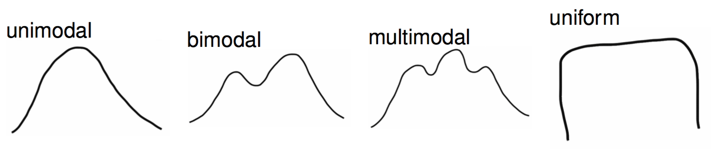

**Hình 4.7:** Các dạng mốt của phân phối dữ liệu.

::: tip Trực giác thống kê quan trọng
Sự xuất hiện của nhiều đỉnh (Bimodal / Multimodal) là dấu hiệu kinh điển cho thấy **tập dữ liệu đang bị pha trộn bởi nhiều nhóm đối tượng tiềm ẩn** có tính chất khác nhau. 

Chẳng hạn, phân phối chiều dài mỏ của $16$ con chim Adelie là đơn đỉnh (đỉnh quanh $39\text{ mm}$). Nhưng khi gộp chung toàn bộ $344$ con chim của cả ba loài, đồ thị lập tức biến thành hai đỉnh (bimodal): Đỉnh bên trái do loài Adelie nhỏ con chiếm ưu thế, còn đỉnh bên phải phản ánh hai loài Chinstrap và Gentoo to lớn hơn.
:::

  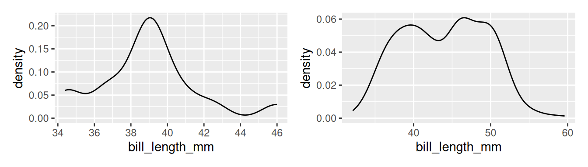

**Hình 4.8:** Đối chiếu giữa phân phối đơn mốt của một loài đơn lẻ (trái) và phân phối hai mốt khi gộp ba loài (phải).

---

### 2.2. Độ lệch (Skewness)
Mô tả hành vi kéo dài của các đuôi phân phối về hai phía:
- **Lệch phải (Right-skewed / Positive skew)**: Đuôi bên phải kéo dài ra xa; đa số dữ liệu tập trung ở vùng giá trị thấp, trong khi có một số ít giá trị cực lớn kéo dài về bên phải.
- **Đối xứng (Symmetric)**: Hai đuôi cân bằng đối xứng qua tâm phân phối.
- **Lệch trái (Left-skewed / Negative skew)**: Đuôi bên trái kéo dài ra xa về vùng giá trị thấp.

  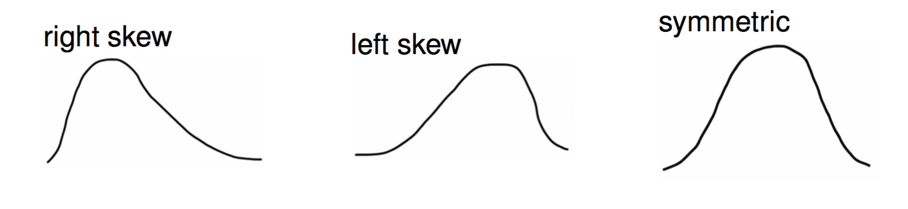

**Hình 4.9:** Ba dạng độ lệch của phân phối: Lệch trái (đuôi trái dài), đối xứng, và lệch phải (đuôi phải dài).

Một ví dụ thực tế tiêu biểu của phân phối lệch phải nghiêm trọng là **thu nhập của các hộ gia đình**:

  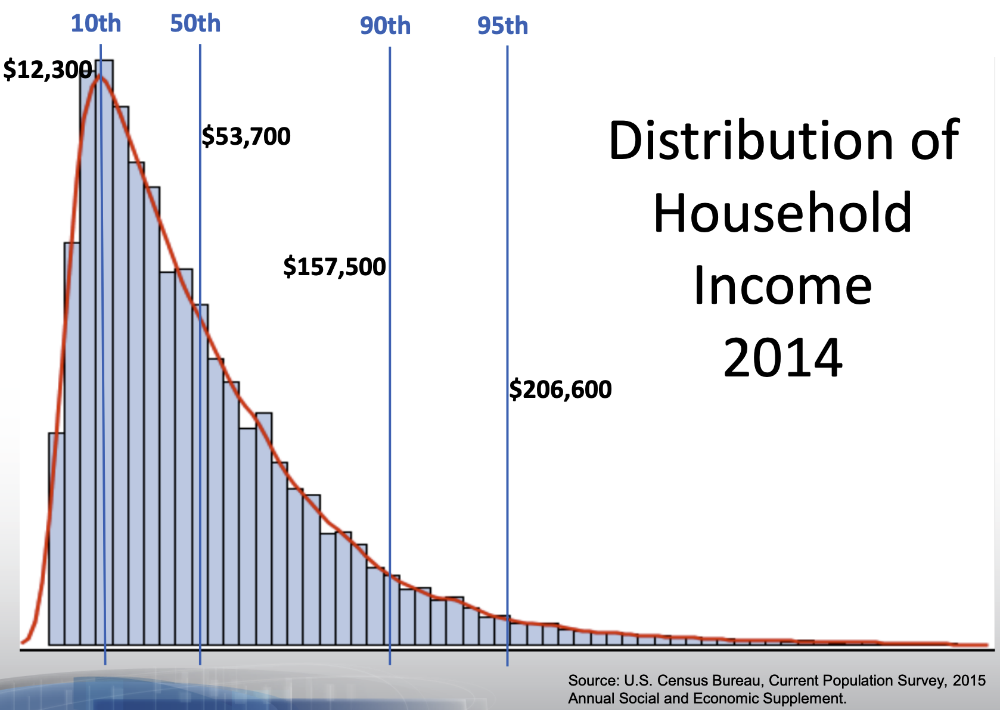

**Hình 4.10:** Phân bố thu nhập hộ gia đình tại Hoa Kỳ: Đa số hộ gia đình có thu nhập trung bình hoặc thấp, trong khi nhóm tỷ phú giàu có kéo chiếc đuôi bên phải dài ra vô tận.

---

## 3. Các số đo xu hướng trung tâm (Measures of Center)

Bên cạnh hình dạng, hai thông số định lượng căn bản nhất của dữ liệu là **tâm (Center)** và **độ phân tán (Spread)**. 

Mọi đại lượng tóm tắt số học đều là một **thống kê (Statistic)**: Một hàm toán học nhận đầu vào là tập dữ liệu mẫu và cho ra đầu ra là một con số duy nhất.

  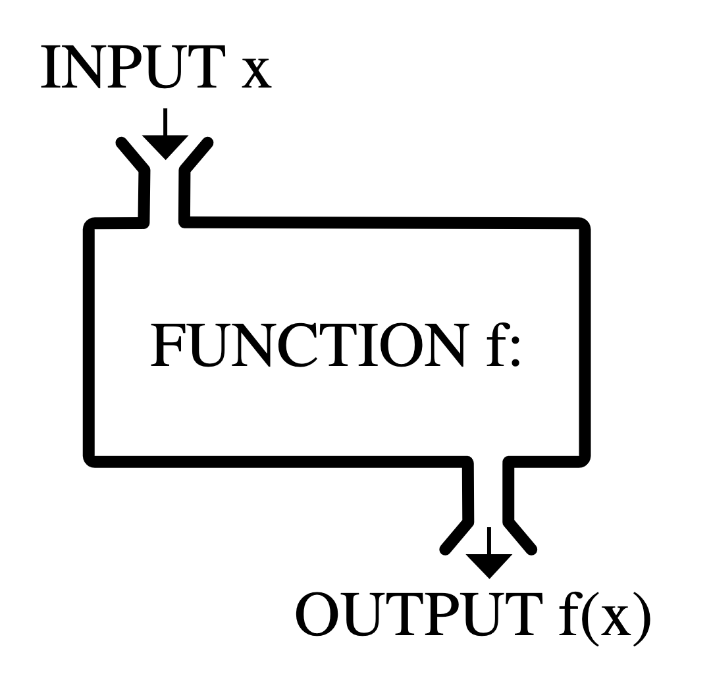

**Hình 4.11:** Mô hình cỗ máy thống kê: Ánh xạ từ tập dữ liệu thô sang một giá trị tóm tắt cô đọng.

Để khảo sát các tính chất toán học, ta xét dãy $11$ số nguyên mẫu sau:

$$
x = (8, 11, 7, 7, 8, 11, 9, 6, 10, 7, 9), \quad n = 11.
$$

Sắp xếp theo thứ tự tăng dần:

$$
x_{\text{sorted}} = (6, 7, 7, 7, 8, \mathbf{8}, 9, 9, 10, 11, 11).
$$

---

### 3.1. Số trung bình cộng (Sample Mean: $\bar{x}$)

**Trung bình cộng** tổng hợp độ lớn số học của toàn bộ $n$ quan sát bằng cách lấy tổng các giá trị chia cho cỡ mẫu:

$$
\bar{x} = \frac{1}{n} \sum_{i=1}^n x_i = \frac{x_1 + x_2 + \dots + x_n}{n}.
$$

Với dãy số trên:

$$
\bar{x} = \frac{8 + 11 + 7 + 7 + 8 + 11 + 9 + 6 + 10 + 7 + 9}{11} = \frac{93}{11} \approx 8.45.
$$

::: danger Nhược điểm cốt tử của số trung bình: Nhạy cảm trước điểm ngoại lai
Giả sử do nhầm lẫn nhập liệu hoặc hiện tượng cực đoan, giá trị $6$ bị thay thế bằng $-200$. Số trung bình mới sẽ trở thành:

$$
\bar{x}_{\text{mới}} = \frac{93 - 6 + (-200)}{11} = \frac{-113}{11} \approx -10.27.
$$

Chỉ vì một giá trị ngoại lai duy nhất, số trung bình đã lao dốc xuống $-10.27$, một con số hoàn toàn không còn đại diện cho bất kỳ giá trị nào trong số $10$ quan sát còn lại!
:::

---

### 3.2. Số trung vị (Sample Median: $M$)

**Số trung vị** là giá trị nằm chính giữa dãy số sau khi đã sắp xếp theo thứ tự tăng dần.

- Nếu $n$ lẻ: Trung vị là phần tử thứ $\frac{n+1}{2}$.
- Nếu $n$ chẵn: Trung vị là trung bình cộng của hai phần tử chính giữa thứ $\frac{n}{2}$ và $\frac{n}{2} + 1$.

Với dãy số gồm $11$ phần tử của chúng ta, phần tử thứ $\frac{11+1}{2} = 6$ là:

$$
\text{Median} = 8.
$$

::: tip Tính bền vững (Robustness) của số trung vị
Khi thay giá trị $6$ bằng $-200$, dãy số được sắp xếp lại thành:

$$
(-200, 7, 7, 7, 8, \mathbf{8}, 9, 9, 10, 11, 11).
$$

Phần tử chính giữa ở vị trí số 6 **vẫn giữ nguyên là $8$**! Trung vị hoàn toàn không bị lay chuyển bởi độ lớn của các điểm cực đoan ở đuôi phân phối. Do đó, đối với các dữ liệu bị lệch nặng (như thu nhập, giá nhà đất), **trung vị luôn là số đo tâm chuẩn xác và đáng tin cậy hơn nhiều so với số trung bình**.
:::

---

### 3.3. Yếu vị (Mode)

**Yếu vị** là giá trị xuất hiện với tần số lớn nhất trong tập dữ liệu.
Trong dãy số trên, giá trị $7$ xuất hiện $3$ lần (nhiều nhất), nên $\text{Mode} = 7$.

Trong dữ liệu định lượng liên tục, các giá trị đo đạc hầu như không bao giờ lặp lại chính xác từng chữ số thập phân, khiến khái niệm yếu vị số học trở nên ít hữu dụng. Tuy nhiên, với dữ liệu định tính, yếu vị lại là số đo xu hướng trung tâm duy nhất có thể xác định được (ví dụ loài chim phổ biến nhất là Adelie).

---

## 4. Các số đo độ phân tán (Measures of Spread)

Biết được tâm của phân phối là chưa đủ: Hai tập dữ liệu có thể có cùng số trung bình nhưng độ phân tán hoàn toàn khác biệt. Một số đo phân tán lý tưởng cần thỏa mãn ba tiêu chuẩn:
1. Đạt giá trị thấp khi các phần tử rất gần nhau hoặc giống hệt nhau.
2. Đạt giá trị cao khi các phần tử cách xa nhau.
3. Không tự động tăng hay giảm chỉ vì cỡ mẫu $n$ tăng lên.

---

### 4.1. Khoảng biến thiên (Range)

$$
\text{Range} = x_{\max} - x_{\min}.
$$

Với dãy số trên: $\text{Range} = 11 - 6 = 5$.  
Khoảng biến thiên vi phạm tiêu chuẩn số 3 và cực kỳ nhạy cảm với ngoại lai: Cỡ mẫu càng lớn, xác suất bắt gặp các giá trị cực trị càng cao, khiến khoảng biến thiên có xu hướng tăng theo $n$.

---

### 4.2. Phương sai mẫu ($s^2$) và Độ lệch chuẩn mẫu ($s$)

Để đo khoảng cách trung bình từ các quan sát đến tâm, ta xét các độ lệch $(x_i - \bar{x})$. Vì tổng các độ lệch luôn triệt tiêu về $0$ ($\sum (x_i - \bar{x}) = 0$), ta bình phương các độ lệch để triệt tiêu dấu âm:

**Phương sai mẫu (Sample Variance)**:

$$
s^2 = \frac{1}{n - 1} \sum_{i=1}^n (x_i - \bar{x})^2.
$$

**Độ lệch chuẩn mẫu (Sample Standard Deviation)**:

$$
s = \sqrt{s^2} = \sqrt{\frac{1}{n - 1} \sum_{i=1}^n (x_i - \bar{x})^2}.
$$

::: info Tại sao chia cho $n - 1$ thay vì $n$?
Đại lượng $\frac{1}{n-1}$ được gọi là hiệu chỉnh Bessel. Việc chia cho $n-1$ (bậc tự do) bù đắp cho việc ta đã sử dụng trung bình mẫu $\bar{x}$ thay vì trung bình tổng thể chưa biết $\mu$, giúp $s^2$ trở thành một **ước lượng không chệch** của phương sai tổng thể $\sigma^2$.
:::

Với dãy số gồm $11$ phần tử của chúng ta:

$$
\begin{aligned}
s^2 &\approx 2.87, \\
s &\approx \sqrt{2.87} \approx 1.69.
\end{aligned}
$$

Độ lệch chuẩn $s = 1.69$ có cùng đơn vị đo lường với biến gốc, cho biết các quan sát cách số trung bình khoảng $1.7$ đơn vị.

---

### 4.3. Khoảng tứ phân vị (Interquartile Range: IQR)

Phương sai $s^2$ và độ lệch chuẩn $s$ sử dụng bình phương sai số, nên chúng cũng **rất nhạy cảm với các điểm ngoại lai**. Để đo độ phân tán của dữ liệu lệch hoặc có ngoại lai, ta sử dụng **Khoảng tứ phân vị (IQR)**:

$$
\text{IQR} = Q_3 - Q_1,
$$

trong đó $Q_1$ là tứ phân vị thứ nhất (trung vị của nửa dưới) và $Q_3$ là tứ phân vị thứ ba (trung vị của nửa trên).

Chia dãy số đã sắp xếp thành hai nửa (bỏ qua trung vị $8$ ở vị trí chính giữa):
- Nửa dưới ($5$ số): $(6, 7, \mathbf{7}, 7, 8) \implies Q_1 = 7$.
- Nửa trên ($5$ số): $(9, 9, \mathbf{10}, 11, 11) \implies Q_3 = 10$.
- Khoảng tứ phân vị:

$$
\text{IQR} = 10 - 7 = 3.
$$

*(Lưu ý: Một số phần mềm thống kê như R dùng nội suy hàm phân vị tuyến tính cho $Q_3 = 9.5 \implies \text{IQR} = 2.5$).*

IQR đại diện cho độ dài của khoảng chứa $50\%$ dữ liệu ở trung tâm và hoàn toàn bền vững trước các giá trị ngoại lai ở hai đuôi.

---

### 4.4. Độ lệch tuyệt đối trung bình (Mean Absolute Deviation: MAD)

Một phương án khác để tránh bình phương sai số là lấy trực tiếp giá trị tuyệt đối:

$$
\text{MAD} = \frac{1}{n} \sum_{i=1}^n |x_i - \bar{x}|.
$$

Với dãy số trên:

$$
\text{MAD} \approx 1.40.
$$

Dấu trị tuyệt đối $|x_i - \bar{x}|$ giữ cho các độ lệch luôn dương mà không phóng đại quá mức các khoảng cách lớn như phép bình phương.

---

## 5. Bảng tổng kết các cặp số đo thống kê

| Thuộc tính phân phối | Số đo tâm | Số đo phân tán | Khi nào nên sử dụng? |
| :--- | :---: | :---: | :--- |
| **Dữ liệu đối xứng, không ngoại lai** | Trung bình ($\bar{x}$) | Độ lệch chuẩn ($s$) | Phân phối chuẩn, dữ liệu đo đạc vật lý chuẩn mực. |
| **Dữ liệu lệch hoặc có ngoại lai** | Trung vị ($M$) | Khoảng tứ phân vị ($\text{IQR}$) | Thu nhập, giá nhà, thời gian phản hồi máy chủ. |
| **Dữ liệu định tính** | Yếu vị ($\text{Mode}$) | Không áp dụng | Khảo sát ý kiến, loài sinh vật, chuyên ngành. |

---

## Tài liệu tham khảo

- Gorman KB, Williams TD, Fraser WR (2014). *Ecological sexual dimorphism and environmental variability within a community of Antarctic penguins (genus Pygoscelis)*. PLoS ONE 9(3): e90081.
- Department of Statistics, UC Berkeley (2026). *STAT 20: Introduction to Probability and Statistics - Summarizing Numerical Data*, Lecture Notes & Slides.

## Bài tập rèn luyện tư duy thống kê

::: exercise Bài tập 1: Quyết định dịch vụ giao đồ ăn và ý nghĩa của độ phân tán
Tại khu đô thị đại học, có hai ứng dụng giao đồ ăn mới cùng hoạt động là Oski Eats và Cal Cravings. Một sinh viên thống kê thu thập thời gian giao hàng thực tế của hai ứng dụng qua $100$ đơn hàng và ghi nhận các tham số sau:
- **Oski Eats**: Thời gian giao hàng trung bình là $\bar{x}_1 = 29\text{ phút}$, với độ lệch chuẩn $s_1 = 1.5\text{ phút}$. Dữ liệu phân bố đối xứng và dao động trong khoảng từ $26$ đến $32$ phút.
- **Cal Cravings**: Thời gian giao hàng trung bình là $\bar{x}_2 = 27\text{ phút}$, với độ lệch chuẩn $s_2 = 12.0\text{ phút}$. Dữ liệu phân bố lệch phải và dao động từ $10$ phút đến tận $65$ phút.

Hãy trả lời các câu hỏi sau:
1. Nếu chỉ nhìn vào số trung bình, người tiêu dùng sẽ chọn dịch vụ nào?
2. Giả sử bạn chỉ có đúng $35$ phút nghỉ giữa hai ca thi để ăn trưa trước khi vào phòng thi tiếp theo. Bạn nên đặt đồ ăn từ ứng dụng nào? Giải thích căn cứ dựa trên độ phân tán.
3. Trong trường hợp nào thì việc chọn Cal Cravings là một quyết định hợp lý?
:::

::: hint Gợi ý Bài tập 1
- So sánh $27$ phút và $29$ phút trong điều kiện bình thường.
- Xem xét rủi ro vượt ngưỡng $35$ phút: Hãy tính xác suất vượt ngưỡng dựa trên độ lệch chuẩn và khoảng biến thiên thực tế của từng bên.
:::

::: solution Lời giải chi tiết Bài tập 1
1. **Lựa chọn theo số trung bình**:
   - Nếu chỉ nhìn vào số trung bình, người tiêu dùng sẽ chọn **Cal Cravings** vì $\bar{x}_2 = 27\text{ phút} < \bar{x}_1 = 29\text{ phút}$ (nhanh hơn trung bình 2 phút).

2. **Quyết định khi có giới hạn thời gian 35 phút**:
   - Ta bắt buộc phải chọn **Oski Eats**.
   - Căn cứ: Oski Eats có độ phân tán cực nhỏ ($s_1 = 1.5\text{ phút}$, tối đa chỉ $32\text{ phút}$). Do đó thời gian giao hàng được bảo đảm gần như chắc chắn sẽ hoàn tất trước mốc $35$ phút.
   - Ngược lại, Cal Cravings có độ biến thiên rất lớn ($s_2 = 12\text{ phút}$, kéo dài tới $65\text{ phút}$). Khoảng thời gian $35$ phút chỉ cách số trung bình $27$ phút một khoảng $8\text{ phút} < 1 \times s_2$. Xác suất đơn hàng đến sau $35$ phút là rất cao, dẫn tới rủi ro bị trễ giờ thi.
   - Bài học: Độ phân tán đo lường **mức độ tin cậy và khả năng dự báo** của một quá trình thực tế.

3. **Khi nào nên chọn Cal Cravings**:
   - Khi người đặt hàng không bị áp lực thời gian (ví dụ buổi tối thảnh thơi tại ký túc xá) và sẵn sàng chấp nhận rủi ro để có cơ hội nhận hàng siêu nhanh (ở đuôi trái $10$–$15$ phút).
:::

---

::: exercise Bài tập 2: Tác động của điểm ngoại lai lên các thống kê tóm tắt
Cho tập dữ liệu gồm $n = 9$ quan sát về giá trị giao dịch của một cửa hàng (đơn vị: Nghìn đồng):

$$
y = (12, 15, 16, 18, 20, 22, 25, 28, 30).
$$

1. Hãy tính số trung bình $\bar{y}$, trung vị $M$, và khoảng tứ phân vị $\text{IQR}$ của tập dữ liệu này.
2. Giả sử phát sinh một giao dịch sai sót hệ thống khiến giá trị cuối cùng $30$ bị ghi nhầm thành $3000$. Hãy tính lại các giá trị $\bar{y}_{\text{mới}}$, $M_{\text{mới}}$ và $\text{IQR}_{\text{mới}}$.
3. So sánh mức độ biến động phần trăm của từng đại lượng thống kê và rút ra kết luận về tính bền vững (robustness).
:::

::: hint Gợi ý Bài tập 2
- Dãy số đã được sắp xếp tăng dần. Xác định vị trí trung vị ở phần tử thứ 5.
- Khi thay $30$ bằng $3000$, thứ tự sắp xếp của các phần tử từ vị trí 1 đến 8 có thay đổi không?
:::

::: solution Lời giải chi tiết Bài tập 2
1. **Dữ liệu ban đầu**:
   - Tổng các quan sát:
     $$
     \sum_{i=1}^9 y_i = 12 + 15 + 16 + 18 + 20 + 22 + 25 + 28 + 30 = 186.
     $$
   - Số trung bình: $\bar{y} = 186 / 9 \approx 20.67$.
   - Số trung vị ($n = 9$ lẻ): Phần tử thứ $5$ là $M = 20$.
   - Các tứ phân vị:
     $$
     \begin{aligned}
     Q_1 &= \frac{15 + 16}{2} = 15.5, \\
     Q_3 &= \frac{25 + 28}{2} = 26.5.
     \end{aligned}
     $$
   - Khoảng tứ phân vị: $\text{IQR} = 26.5 - 15.5 = 11.0$.

2. **Dữ liệu sau khi có ngoại lai ($30 \to 3000$)**:
   - Dãy số mới: $(12, 15, 16, 18, 20, 22, 25, 28, 3000)$.
   - Tổng mới: $\sum y_i = 186 - 30 + 3000 = 3156$.
   - Số trung bình mới: $\bar{y}_{\text{mới}} = 3156 / 9 \approx 350.67$.
   - Số trung vị mới: Phần tử thứ $5$ vẫn là $M_{\text{mới}} = 20$.
   - Tứ phân vị mới: Nửa dưới giữ nguyên nên $Q_1 = 15.5$, nửa trên gồm $(22, 25, 28, 3000)$ cho $Q_3 = 26.5$.
   - Khoảng tứ phân vị mới: $\text{IQR}_{\text{mới}} = 26.5 - 15.5 = 11.0$.
3. **So sánh mức độ biến động**:
   - Số trung bình: Tăng từ $20.67$ lên $350.67$ (tăng gần $1600\%$).
   - Số trung vị và IQR: Biến động đúng $0\%$ (hoàn toàn không đổi).
   - Kết luận: Trung vị và IQR có tính bền vững tuyệt đối trước các giá trị ngoại lai đơn lẻ, trong khi trung bình cộng bị bóp méo nghiêm trọng.
:::

---

::: exercise Bài tập 3: Đọc hiểu phân phối hai đỉnh (Bimodal Distribution)
Một bác sĩ nghiên cứu thời gian nằm viện (tính theo ngày) của $200$ bệnh nhân điều trị nội trú tại một khoa cấp cứu. Khi vẽ biểu đồ Histogram và Density Plot, đồ thị xuất hiện hai đỉnh nhô cao rõ rệt: Đỉnh thứ nhất ở mốc $2.5\text{ ngày}$ và đỉnh thứ hai ở mốc $14.0\text{ ngày}$.
1. Phân phối này thuộc loại đơn mốt, hai mốt hay đa mốt?
2. Bác sĩ tính ra thời gian nằm viện trung bình là $\bar{x} = 8.2\text{ ngày}$. Con số $8.2\text{ ngày}$ này có phản ánh tốt thời gian nằm viện của một bệnh nhân điển hình hay không? Tại sao?
3. Hãy đề xuất một giả thuyết lâm sàng để giải thích nguyên nhân xuất hiện hai đỉnh phân phối trên.
:::

::: hint Gợi ý Bài tập 3
- Xem lại Hình 4.8 về sự pha trộn của các quần thể con tiềm ẩn.
- Ở mốc $8.2$ ngày, mật độ bệnh nhân trên thực tế là cao hay thấp (thung lũng giữa hai đỉnh)?
:::

::: solution Lời giải chi tiết Bài tập 3
1. **Phân loại**:
   - Phân phối có hai đỉnh rõ rệt nên đây là **phân phối hai mốt (Bimodal Distribution)**.

2. **Đánh giá giá trị trung bình $\bar{x} = 8.2\text{ ngày}$**:
   - Con số $8.2$ ngày **hoàn toàn không phản ánh một bệnh nhân điển hình**.
   - Lý do: Mốc $8.2$ ngày rơi đúng vào “vùng thung lũng” trũng thấp nằm giữa hai đỉnh. Trên thực tế, hầu như rất ít bệnh nhân xuất viện vào khoảng ngày thứ 8. Đa số bệnh nhân hoặc là ra viện rất sớm (quanh 2–3 ngày), hoặc phải ở lại điều trị rất lâu (quanh 14 ngày). Việc dùng một con số trung bình duy nhất cho phân phối hai đỉnh sẽ che giấu đi sự thật lâm sàng.

3. **Giả thuyết giải thích hiện tượng hai đỉnh**:
   - Tập bệnh nhân thực chất gồm hai nhóm bệnh lý riêng biệt bị gộp chung:
     - Nhóm 1 (Đỉnh 2.5 ngày): Các bệnh nhân nhẹ, chỉ cần theo dõi cấp tính hoặc can thiệp nhỏ rồi xuất viện sớm.
     - Nhóm 2 (Đỉnh 14 ngày): Các bệnh nhân chấn thương nặng hoặc phẫu thuật lớn đòi hỏi liệu trình kháng sinh và hồi phục dài ngày.
   - Để phân tích chính xác, bác sĩ cần phân rã tập dữ liệu theo biến định tính “mức độ nghiêm trọng của bệnh” (Conditioning) và vẽ riêng đồ thị cho từng nhóm.
:::

