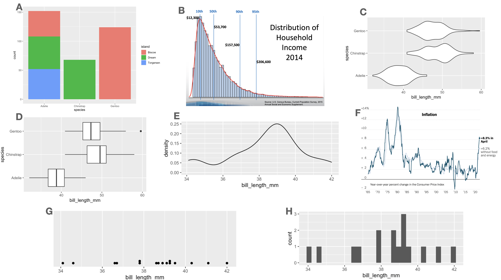
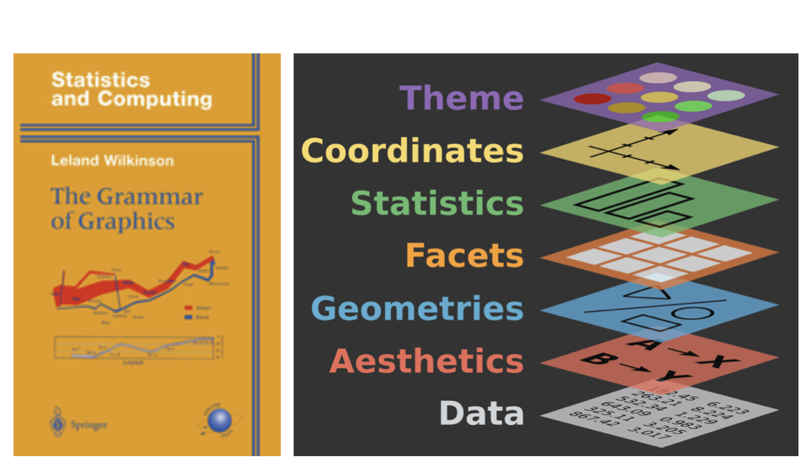
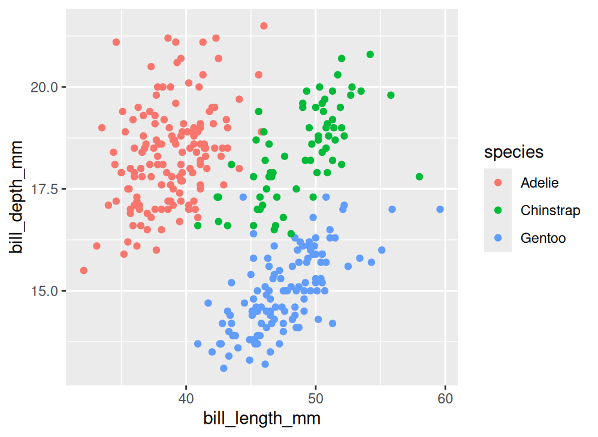
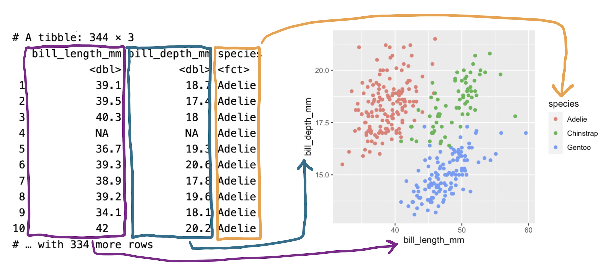
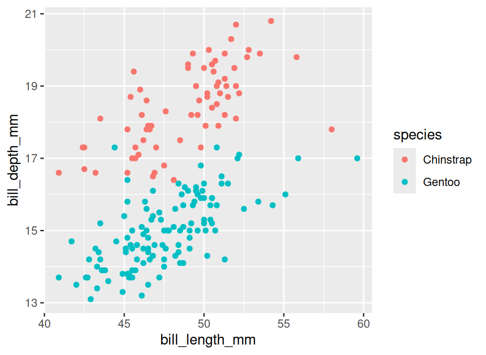
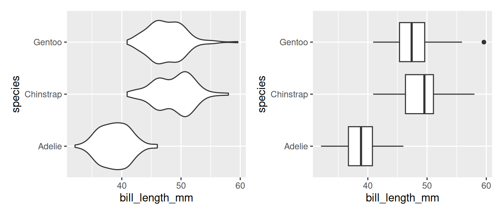
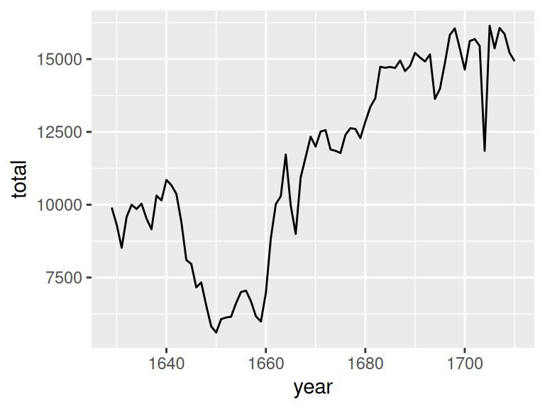
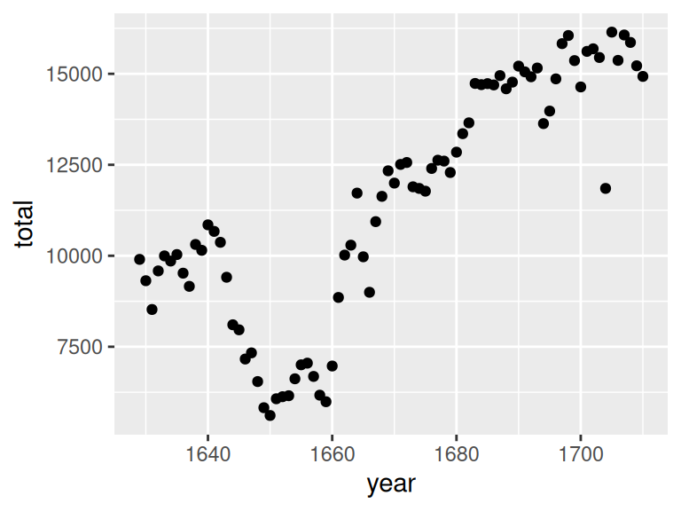
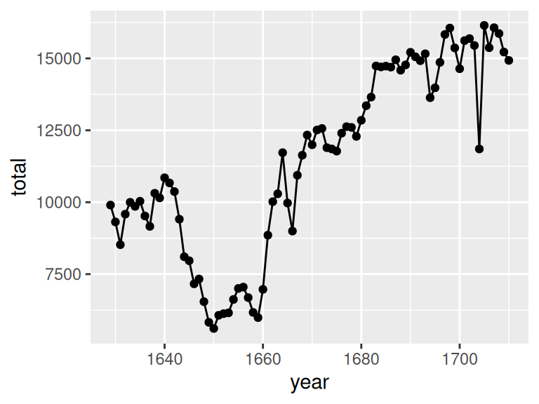
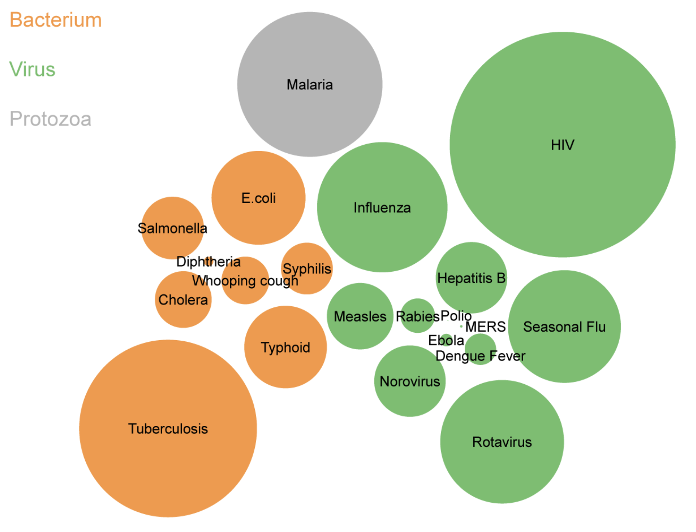

---

course: xac-suat-thong-ke

lecture: 05-ngu-phap-do-hoa

section: lecture

title: "Ngữ pháp đồ họa & Khung phân tích trực quan hóa"

prerequisites: []

lessonStatus: ready

hasChapterExercises: true

description: "Nguyên lý The Grammar of Graphics: Dữ liệu (Data), Ánh xạ thẩm mỹ (Aesthetics) và Hình học biểu diễn (Geometries) trong ggplot2."

---

<div class="lecture-notes-content">

Trong các bài học trước, ta đã thấy một khía cạnh của Thống kê học mang đậm dấu ấn kỹ thuật: Các thống kê tóm tắt như số trung vị, độ lệch chuẩn hay khoảng tứ phân vị IQR là những công cụ được chế tác tinh vi nhằm nắm bắt các đặc tính cụ thể của dữ liệu.

Bên cạnh khía cạnh kỹ thuật, thống kê học còn sở hữu một phân nhánh mang tính khoa học cơ bản: Tìm kiếm các quy luật phổ quát để giải thích và tổ chức vô số hiện tượng đa dạng dưới một hệ thống lý thuyết bao trùm. Phân nhánh khoa học đó chính là **Trực quan hóa dữ liệu (Data Visualization)**.

<div style="text-align: center; margin: 16px 0;">

  

</div>

**Hình 5.1:** Sự phong phú của các dạng đồ thị thống kê: Từ biểu đồ chấm, phân bố tần số, mật độ đến biểu đồ vĩ cầm, biểu đồ hộp và biểu đồ cột.

Sự đa dạng về hình thái của các biểu đồ trên dễ khiến ta ngộ nhận rằng mỗi loại biểu đồ là một cấu trúc hoàn toàn riêng biệt. Tuy nhiên, khi đào sâu bản chất toán học:

- Một nửa số biểu đồ trong Hình 5.1 biểu diễn phân phối của **duy nhất một biến số**, trong khi nửa còn lại biểu diễn mối liên hệ giữa **hai biến số**.

- Các biến thể đều sử dụng các tín hiệu thị giác quen thuộc: Tọa độ trục hoành ($x$), tọa độ trục tung ($y$), màu sắc, và kích thước.

- Ba biểu đồ ở hàng giữa sử dụng chung một biến dữ liệu, cùng khai thác các tín hiệu thị giác, và chỉ khác biệt duy nhất ở **hình khối hình học** dùng để biểu diễn các điểm quan sát.

Việc khám phá ra những cấu trúc lặp lại này đã dẫn tới sự ra đời của một khung lý thuyết thống nhất nổi tiếng: **Ngữ pháp đồ họa (The Grammar of Graphics)**.

---

## 1. Ngữ pháp đồ họa (The Grammar of Graphics)

Năm 1999, nhà thống kê học Leland Wilkinson đã xuất bản cuốn sách mang tính bước ngoặt có nhan đề *The Grammar of Graphics*. Đúng như tên gọi, nếu ngữ pháp của một ngôn ngữ tự nhiên định nghĩa các quy tắc kết hợp từ loại thành câu văn hoàn chỉnh, thì ngữ pháp đồ họa định nghĩa các nguyên lý kết hợp các thành phần dữ liệu thành một biểu đồ trực quan chuẩn mực.

<div style="text-align: center; margin: 20px 0;">

  

</div>

**Hình 5.2:** Kiến trúc phân tầng của Ngữ pháp đồ họa (The Grammar of Graphics).

Hầu hết các công cụ và thư viện trực quan hóa dữ liệu hiện đại ngày nay đều chịu ảnh hưởng sâu sắc từ tư tưởng của Wilkinson: Từ Tableau, Plotly đến các thư viện Python như Altair, Seaborn hay Plotnine. Bản hiện thực hóa trọn vẹn và chuẩn mực nhất của ngữ pháp này là gói thư viện `ggplot2` trong ngôn ngữ R do nhà thống kê học Hadley Wickham phát triển.

Trong kiến trúc của Wickham, mọi biểu đồ thống kê đều có thể phân rã thành **ba thành phần nguyên tử cốt lõi**:

1. **Dữ liệu (Data)**: Bảng dữ liệu chứa các biến số cần biểu diễn.

2. **Ánh xạ thẩm mỹ (Aesthetic Mappings)**: Cơ chế kết nối các cột dữ liệu vào các tín hiệu thị giác.

3. **Hình học biểu diễn (Geometries)**: Các hình khối toán học dùng để hiển thị các quan sát trên không gian biểu đồ.

---

## 2. Thành phần 1: Dữ liệu (Data)

Để minh họa, ta cùng phân tích một biểu đồ phân tán (Scatter Plot) quen thuộc khảo sát kích thước mỏ của chim cánh cụt:

<div style="text-align: center; margin: 16px 0;">

  

</div>

**Hình 5.3:** Biểu đồ phân tán (Scatter Plot) thể hiện mối liên hệ giữa chiều dài mỏ, độ sâu mỏ và loài chim cánh cụt.

Những biến số nào là bắt buộc để vẽ được biểu đồ này?

- Chiều dài mỏ (`bill_length_mm`): Hiển thị trên trục hoành $x$.

- Độ sâu mỏ (`bill_depth_mm`): Hiển thị trên trục tung $y$.

- Loài chim (`species`): Xác định màu sắc của từng điểm dữ liệu.

Như vậy, tập dữ liệu đầu vào bắt buộc phải là một Khung dữ liệu (Data Frame) chứa đầy đủ ba cột này:

| bill_length_mm | bill_depth_mm | species |
| :---: | :---: | :---: |
| 39.1 | 18.7 | Adelie |
| 39.5 | 17.4 | Adelie |
| 40.3 | 18.0 | Adelie |
| 36.7 | 19.3 | Adelie |
| 39.3 | 20.6 | Adelie |
| ... | ... | ... |

::: tip Yêu cầu tiên quyết về dữ liệu

Mọi biến số xuất hiện trên đồ thị bắt buộc phải cùng nằm trong một Khung dữ liệu duy nhất với cấu trúc chuẩn mực (mỗi cột là một biến số, mỗi hàng là một đơn vị quan sát). Nếu cấu trúc bảng bị phân mảnh hoặc không đồng nhất, đồ thị sẽ không thể dựng thành công.

:::

---

## 3. Thành phần 2: Ánh xạ thẩm mỹ (Aesthetics)

Quyết định mang tính quyết định nhất khi thiết kế biểu đồ là: **Mã hóa từng biến số trong bảng dữ liệu thành tín hiệu thị giác tương ứng nào?** Quá trình này được gọi là **Ánh xạ thẩm mỹ (Aesthetic Mapping)**.

<div style="text-align: center; margin: 20px 0;">

  

</div>

**Hình 5.4:** Quy trình ánh xạ thẩm mỹ: Cột dữ liệu $\to$ Thuộc tính thị giác tương ứng.

Trong biểu đồ chim cánh cụt ở Hình 5.3:

- Cột `bill_length_mm` được ánh xạ vào **tọa độ trục hoành ($x$)**: Chim có mỏ càng dài thì điểm biểu diễn càng nằm lệch về bên phải.

- Cột `bill_depth_mm` được ánh xạ vào **tọa độ trục tung ($y$)**: Chim có mỏ càng sâu thì điểm biểu diễn càng nằm lệch lên trên.

- Cột `species` được ánh xạ vào **màu sắc (color)**: Ba loài sinh học tương ứng với ba màu sắc phân biệt (đỏ cam cho Adelie, xanh lá cho Chinstrap, và xanh dương cho Gentoo).

Bảng các thuộc tính thẩm mỹ (Aesthetic Attributes) phổ biến nhất trong trực quan hóa dữ liệu:

| Thuộc tính thẩm mỹ | Ý nghĩa thị giác | Kiểu biến số phù hợp nhất |
| :--- | :--- | :--- |
| **`x`** | Tọa độ vị trí theo phương ngang | Định lượng hoặc Định tính |
| **`y`** | Tọa độ vị trí theo phương đứng | Định lượng hoặc Định tính |
| **`color`** | Màu sắc viền của hình khối hoặc điểm | Định tính hoặc Định lượng liên tục |
| **`fill`** | Màu tô đầy bên trong hình khối (thanh bar, diện tích) | Định tính |
| **`size`** | Độ lớn kích thước của điểm hoặc độ dày đường nét | Định lượng |
| **`shape`** | Hình dạng của điểm biểu diễn (tròn, vuông, tam giác) | Định tính danh nghĩa (dưới 6 mức) |
| **`alpha`** | Độ trong suốt của điểm (từ $0$ là trong suốt hoàn toàn đến $1$ là mờ đục) | Định lượng hoặc giải quyết đè điểm (overplotting) |

---

## 4. Thành phần 3: Hình học biểu diễn (Geometries)

Sau khi đã nạp dữ liệu và thiết lập các ánh xạ thẩm mỹ, câu hỏi cuối cùng là: **Các quan sát sẽ được vẽ lên đồ thị dưới hình dạng toán học cụ thể nào?** Thành phần này được gọi là **Hình học biểu diễn (Geometry / Geom)**.

Trong biểu đồ chim cánh cụt ở Hình 5.3, mỗi con chim được biểu diễn bằng một chấm tròn nhỏ, tức sử dụng hình học điểm (`geom_point`).

Sức mạnh của Ngữ pháp đồ họa thể hiện ở chỗ: **Cùng một bộ dữ liệu và cùng một bộ ánh xạ thẩm mỹ, chỉ cần thay đổi hình học biểu diễn là ta thu được các dạng biểu đồ hoàn toàn khác biệt**.

<div style="text-align: center; margin: 16px 0;">

  

</div>

**Hình 5.5:** Hai biểu đồ có cùng dữ liệu và cùng ánh xạ thẩm mỹ (`bill_length_mm` vào $x$, `species` vào $y$): Bên trái sử dụng hình học vĩ cầm (`geom_violin`), bên phải sử dụng hình học hộp (`geom_boxplot`).

Danh mục các hình học cơ bản trong thống kê:

- `point`: Biểu diễn từng quan sát riêng biệt bằng điểm phân tán.

- `bar`: Biểu diễn số đếm hoặc tần số của biến định tính.

- `line`: Biểu diễn xu thế liên tục theo thứ tự (chuỗi thời gian).

- `histogram`: Biểu diễn phân phối định lượng qua các cột khoảng gộp.

- `density`: Biểu diễn hàm mật độ trơn của biến định lượng.

- `violin`: Biểu diễn mật độ đối xứng qua trục cho từng nhóm.

- `boxplot`: Biểu diễn bộ năm số tóm tắt và ngoại lai.

---

## 5. Nghiên cứu thực nghiệm: Dữ liệu sinh nở tại London thế kỷ 17

Để thấy rõ cách tư duy theo Ngữ pháp đồ họa giúp cải tiến việc kể chuyện bằng dữ liệu, hãy xét tập dữ liệu lịch sử ghi nhận số ca sinh tại London, nước Anh trong thế kỷ 17 gồm $82$ quan sát:

| year | total |
| :---: | :---: |
| 1629 | 9901 |
| 1630 | 9315 |
| 1631 | 8524 |
| 1632 | 9584 |
| 1633 | 9997 |
| 1634 | 9855 |

Ta phân rã quy trình tạo biểu đồ chuỗi thời gian:

- **Data**: Tập dữ liệu 82 năm.

- **Aesthetics**: Biến `year` ánh xạ vào $x$, biến `total` ánh xạ vào $y$.

- **Geometry**: Biểu diễn các quan sát bằng đường gấp khúc (`geom_line`).

<div style="text-align: center; margin: 16px 0;">

  

</div>

**Hình 5.6:** Biểu đồ đường (`geom_line`) thể hiện xu thế biến động số ca sinh nở qua thời gian.

Điều gì xảy ra nếu ta đổi hình học biểu diễn sang dạng điểm (`geom_point`)?

<div style="text-align: center; margin: 16px 0;">

  

</div>

**Hình 5.7:** Biểu đồ điểm (`geom_point`) thể hiện giá trị đo lường rời rạc tại từng năm riêng biệt.

Biểu đồ nào ưu việt hơn? Câu trả lời hoàn toàn phụ thuộc vào mục tiêu truyền tải:

- Hình học đường (`geom_line`) làm nổi bật **xu thế biến động liên tục và nhịp điệu thăng trầm** qua các giai đoạn lịch sử.

- Hình học điểm (`geom_point`) làm nổi bật **giá trị cụ thể của từng năm riêng lẻ** và cho thấy rõ mật độ quan sát thực tế được ghi chép.

### Xếp chồng các lớp hình học (Layering Geometries)

Trong Ngữ pháp đồ họa, các hình học tương thích có thể được kết hợp chồng lớp lên nhau trên cùng một hệ trục tọa độ:

<div style="display: flex; gap: 16px; margin: 16px 0; justify-content: center; flex-wrap: wrap;">

  <div style="flex: 1; min-width: 280px; max-width: 440px; text-align: center;">



<p style="font-size: 0.9em; color: var(--vp-c-text-2); margin-top: 6px;">Kết hợp `geom_line() + geom_point()`.</p>

  </div>

  <div style="flex: 1; min-width: 280px; max-width: 440px; text-align: center;">



<p style="font-size: 0.9em; color: var(--vp-c-text-2); margin-top: 6px;">Kết hợp `geom_histogram() + geom_density()`.</p>

  </div>

</div>

**Hình 5.8:** Kỹ thuật xếp chồng nhiều lớp hình học (Layering): Kết hợp đường với điểm (trái) và kết hợp mật độ với cột phân bố tần số (phải).

Việc kết hợp nhiều hình học mang lại thông tin phong phú hơn nhưng cũng khiến biểu đồ trở nên phức tạp hơn. Người thiết kế cần cân nhắc kỹ để tránh làm rối mắt người đọc khi một thông điệp đơn giản là đủ rõ ràng.

---

## 6. Mở rộng: Biểu đồ bong bóng (Bubble Chart) và Trực quan hóa Hans Rosling

### 6.1. Biểu đồ bong bóng bệnh truyền nhiễm (1989)

Xem xét biểu đồ trực quan về tỷ lệ mắc bệnh truyền nhiễm toàn cầu năm 1989:

<div style="text-align: center; margin: 20px 0;">

  

</div>

**Hình 5.9:** Biểu đồ bong bóng (Bubble Chart) biểu diễn tỷ lệ mắc các bệnh truyền nhiễm toàn cầu năm 1989.

Phân rã biểu đồ này theo Ngữ pháp đồ họa:

- **Đơn vị quan sát**: Là một loại bệnh truyền nhiễm cụ thể.

- **Aesthetic Mappings**:

  - `size`: Ánh xạ vào tỷ lệ mắc bệnh trong cộng đồng (prevalence) $\implies$ Bong bóng càng to thì số ca mắc càng đông.

  - `color`: Ánh xạ vào phân loại tác nhân gây bệnh (vi khuẩn, virus, động vật nguyên sinh).

- **Geometry**: Hình học điểm (`geom_point`).

::: info Lưu ý về tọa độ vị trí trong Bubble Chart

Vị trí tọa độ $x$ và $y$ của các bong bóng trong biểu đồ trên không phản ánh bất kỳ cột dữ liệu nào trong bảng! Chúng được sắp đặt tự động thông qua một thuật toán đóng gói hình tròn (circle packing algorithm) nhằm gom các bong bóng lại gần nhau mà không bị đè lấp. Vì vậy, tọa độ vị trí ở đây **không phải là một ánh xạ thẩm mỹ từ dữ liệu**.

:::

### 6.2. Nghiên cứu kinh điển của Hans Rosling (Gapminder)

Bài giảng trực quan hóa huyền thoại của Giáo sư y tế công cộng Hans Rosling mô tả sự biến động về chất lượng sống toàn cầu trong thế kỷ 20 là đỉnh cao của việc ứng dụng Ngữ pháp đồ họa:

| Tín hiệu thị giác (Aesthetic) | Biến số dữ liệu tương ứng | Kiểu biến số |
| :--- | :--- | :--- |
| **Trục hoành ($x$)** | Tỷ lệ sinh sản (Fertility rate) | Định lượng liên tục |
| **Trục tung ($y$)** | Tuổi thọ bình quân (Life expectancy) | Định lượng liên tục |
| **Kích thước ($size$)** | Quy mô dân số (Population) | Định lượng liên tục |
| **Màu sắc ($color$)** | Khu vực địa lý / Châu lục (Region) | Định tính danh nghĩa |
| **Khung hình chuyển động ($time$)** | Năm ghi nhận (Year) | Định lượng rời rạc |

Chỉ với một biểu đồ điểm duy nhất (`geom_point`), việc kết hợp hài hòa năm ánh xạ thẩm mỹ đã kể trọn vẹn câu chuyện biến đổi vĩ mô của nhân loại qua hơn hai thế kỷ mà không cần đến những bảng số liệu khô khan.

---

## 7. Tổng kết

1. **Ngữ pháp đồ họa (The Grammar of Graphics)**: Khung lý thuyết thống nhất mọi dạng biểu đồ trực quan thành các thành phần cấu thành cơ bản.

2. **Bộ ba trụ cột**:

   - Dữ liệu (Data): Khung dữ liệu nguồn chứa các biến số cần vẽ.

   - Ánh xạ thẩm mỹ (Aesthetics): Ánh xạ từ các biến số sang tín hiệu thị giác ($x, y, \text{color}, \text{fill}, \text{size}, \text{shape}, \text{alpha}$).

   - Hình học (Geometries): Hình thức toán học biểu thị quan sát (`geom_point`, `geom_line`, `geom_bar`, `geom_histogram`, `geom_density`, `geom_boxplot`, `geom_violin`).

3. **Kỹ thuật xếp chồng (Layering)**: Kết hợp linh hoạt nhiều lớp hình học để tăng cường khả năng truyền tải thông tin.

---

## Tài liệu tham khảo

- Wilkinson, Leland (2005). *The Grammar of Graphics*. Springer Science & Business Media, 2nd Edition.

- Wickham, Hadley (2010). *A layered grammar of graphics*. Journal of Computational and Graphical Statistics, 19(1), 3–28.

- Rosling, Hans (2006). *Debunking third-world myths with the best stats you've ever seen*. TED Conference.

- Department of Statistics, UC Berkeley (2026). *STAT 20: Introduction to Probability and Statistics - A Grammar of Graphics*, Lecture Notes & Slides.

</div>

<div class="lecture-exercises-content">

## Bài tập rèn luyện tư duy thống kê

::: exercise Bài tập 1: Phân tích mã nguồn ggplot2 và lỗi ánh xạ kép (Double Mapping)

Một sinh viên muốn trực quan hóa số lượng chim cánh cụt theo từng hòn đảo và viết đoạn mã sau trong R:

```r

ggplot(penguins, aes(x = island, fill = island)) +

  geom_bar()

```

1. Hãy phân rã biểu đồ trên theo ba thành phần cốt lõi của Ngữ pháp đồ họa: Dữ liệu (Data), Ánh xạ thẩm mỹ (Aesthetics), và Hình học (Geometry).

2. Việc ánh xạ cùng một biến `island` cho cả vị trí $x$ và màu tô `fill` được gọi là hiện tượng gì? Tại sao các chuyên gia thiết kế trực quan hóa lại khuyến cáo không nên lạm dụng cách làm này?

3. Nếu mục tiêu chỉ đơn thuần là muốn đổi màu các thanh cột cho đẹp mắt mà không gắn với thông tin biến số mới, lập trình viên nên sửa đoạn mã như thế nào?

:::

::: hint Gợi ý Bài tập 1

- Phân biệt giữa ánh xạ thẩm mỹ bên trong hàm `aes()` (mapping a variable) và gán thuộc tính cố định bên ngoài `aes()` (setting a constant attribute).

- Tín hiệu màu sắc có mang lại thêm bất kỳ thông tin nào mới cho người đọc không khi các thanh vốn đã được tách riêng trên trục hoành?

:::

::: solution Lời giải chi tiết Bài tập 1

1. **Phân rã theo Ngữ pháp đồ họa**:

   - **Data**: Bảng dữ liệu `penguins`.

   - **Aesthetics**: Biến `island` được ánh xạ vào trục hoành $x$, và đồng thời biến `island` cũng được ánh xạ vào màu tô `fill`.

   - **Geometry**: Hình học thanh đếm số lượng (`geom_bar`).

2. **Hiện tượng Ánh xạ kép (Double Mapping)**:

   - Đoạn mã trên mắc hiện tượng **Ánh xạ kép (Double Mapping)**: Cùng một biến phân loại được biểu diễn hai lần bằng hai tín hiệu thị giác khác nhau (vị trí trên trục hoành và màu sắc).

   - Lý do không khuyến khích:

     - Làm thừa thãi thông tin thị giác (redundant visual cues) và tự động tạo ra một bảng chú giải (legend) vô ích, làm tốn diện tích đồ thị.

     - Lãng phí kênh màu sắc: Màu sắc là một trong những tín hiệu thị giác mạnh mẽ nhất, nên được để dành cho việc biểu diễn một biến số thứ hai (như loài chim `species`) thay vì lặp lại thông tin của trục hoành.

3. **Cách khắc phục chuẩn mực**:

   - Nếu chỉ muốn tô màu cố định (ví dụ màu xanh thép) cho toàn bộ các thanh: Gán thuộc tính `fill` bên ngoài hàm `aes()`:

     ```r

     ggplot(penguins, aes(x = island)) +

       geom_bar(fill = "steelblue")

     ```

   - Đoạn mã này sẽ tạo ra các thanh có màu sắc trang nhã mà không làm sinh ra bảng chú giải thừa và không gây lãng phí tài nguyên ánh xạ.

:::

---

::: exercise Bài tập 2: Tái thiết kế Khung dữ liệu từ đồ thị Hans Rosling (Gapminder)

Trong bài giảng nổi tiếng của Giáo sư Hans Rosling, mỗi bong bóng trên màn hình đại diện cho một quốc gia tại một năm cụ thể. Các đặc trưng thị giác bao gồm:

- Vị trí trục hoành ($x$): Tỷ lệ sinh sản (số con trung bình trên một phụ nữ).

- Vị trí trục tung ($y$): Tuổi thọ trung bình khi sinh (năm).

- Diện tích bong bóng ($size$): Tổng dân số quốc gia.

- Màu sắc bong bóng ($color$): Châu lục.

- Dòng thời gian ($time$): Năm khảo sát (từ năm 1800 đến năm 2020).

Hãy trả lời các câu hỏi sau:

1. Đơn vị quan sát (Unit of Observation) của tập dữ liệu tạo nên biểu đồ trên là gì?

2. Bảng dữ liệu thô (Data Frame) cần có ít nhất bao nhiêu cột biến số? Hãy liệt kê tên các biến số đó cùng kiểu biến số tương ứng theo Hệ thống phân loại dữ liệu (Taxonomy of Data).

3. Biểu đồ trên sử dụng hình học biểu diễn (Geometry) nào?

:::

::: hint Gợi ý Bài tập 2

- Chú ý: Dữ liệu biến đổi theo từng năm và theo từng quốc gia.

- Một hàng trong Data Frame đo lường điều gì?

:::

::: solution Lời giải chi tiết Bài tập 2

1. **Đơn vị quan sát (Unit of Observation)**:

   - Đơn vị quan sát là **một quốc gia tại một năm xác định** (Country-Year pair, ví dụ: Việt Nam năm 2020, Nhật Bản năm 1950).

2. **Cấu trúc Data Frame và phân loại biến số**:

   - Bảng dữ liệu thô cần tối thiểu $6$ cột biến số:

     1. `country` (Tên quốc gia): Biến định tính danh nghĩa (Nominal Categorical).

     2. `continent` / `region` (Châu lục): Biến định tính danh nghĩa (Nominal Categorical).

     3. `year` (Năm khảo sát): Biến định lượng rời rạc (Discrete Numerical).

     4. `fertility_rate` (Tỷ lệ sinh): Biến định lượng liên tục (Continuous Numerical).

     5. `life_expectancy` (Tuổi thọ trung bình): Biến định lượng liên tục (Continuous Numerical).

     6. `population` (Dân số): Biến định lượng rời rạc hoặc liên tục (Numerical).

3. **Hình học biểu diễn (Geometry)**:

   - Sử dụng **hình học điểm (point geometry)**. Kích thước điểm được phóng to tương ứng với dân số nên đồ thị được gọi tên thông dụng là Biểu đồ bong bóng (Bubble Chart).

:::

---

::: exercise Bài tập 3: Đọc hiểu và phân rã biểu đồ bong bóng bệnh truyền nhiễm (Hình 5.9)

Quan sát biểu đồ bong bóng về tỷ lệ mắc bệnh truyền nhiễm toàn cầu năm 1989 (Hình 5.9), hãy giải thích:

1. Mỗi bong bóng đại diện cho đơn vị quan sát nào?

2. Tại sao ta không thể đọc được tọa độ số học cụ thể trên hai trục $x$ và $y$ từ biểu đồ này?

3. So sánh ưu điểm và nhược điểm của dạng biểu đồ bong bóng này so với một biểu đồ cột thông thường có cùng nội dung.

:::

::: hint Gợi ý Bài tập 3

- Vị trí của các bong bóng được quyết định bởi thuật toán nén hình học hay bởi giá trị của một cột trong Data Frame?

- Việc so sánh diện tích các hình tròn có dễ dàng và chính xác như so sánh chiều dài các thanh thẳng đứng không?

:::

::: solution Lời giải chi tiết Bài tập 3

1. **Đơn vị quan sát**:

   - Mỗi bong bóng đại diện cho **một căn bệnh truyền nhiễm cụ thể** (như sốt rét, sởi, lao...).

2. **Vấn đề tọa độ trục $x$ và $y$**:

   - Biểu đồ hoàn toàn không có trục tọa độ số học $x$ hay $y$. Vị trí của các bong bóng được tính toán bởi thuật toán đóng gói hình tròn (circle packing) để gom các khối tròn nằm khít nhau mà không đè lên nhau. Tọa độ $(x, y)$ của các bong bóng là kết quả của thuật toán đồ họa chứ không ánh xạ từ bất kỳ biến số thực nghiệm nào trong bảng dữ liệu.

3. **So sánh với biểu đồ cột (Bar Chart)**:

   - **Ưu điểm**: Biểu đồ bong bóng tạo ấn tượng thị giác mạnh mẽ, trực quan, thu hút sự chú ý của công chúng và cho thấy ngay bức tranh tổng thể về tỷ trọng các nhóm bệnh.

   - **Nhược điểm**: Mắt người rất khó ước lượng chính xác tỷ lệ diện tích của các hình tròn (so với việc đối chiếu chiều dài thẳng đứng trên trục số của biểu đồ cột). Các bệnh có tỷ lệ mắc gần tương đương nhau sẽ rất khó phân biệt thứ hạng hơn kém nếu chỉ nhìn vào kích thước bong bóng.

:::

</div>
