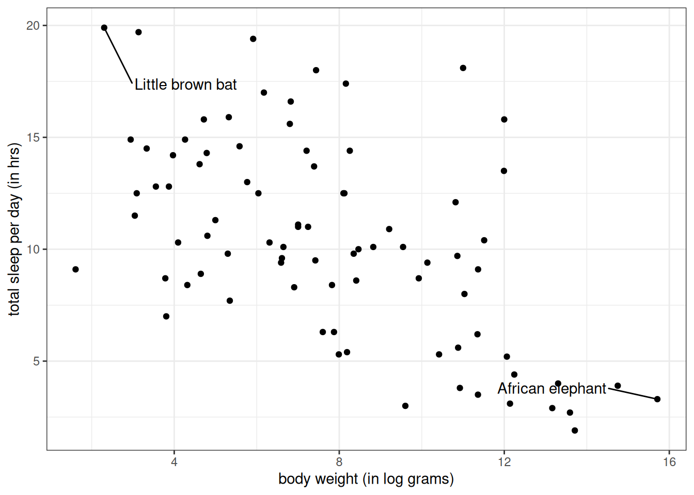
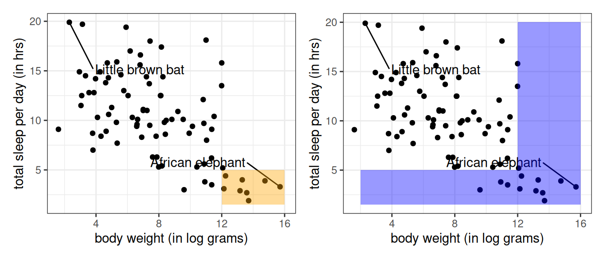
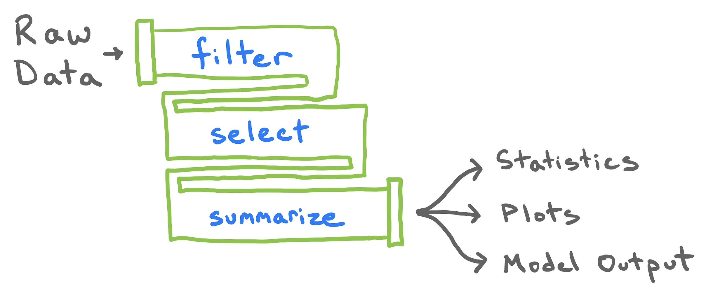
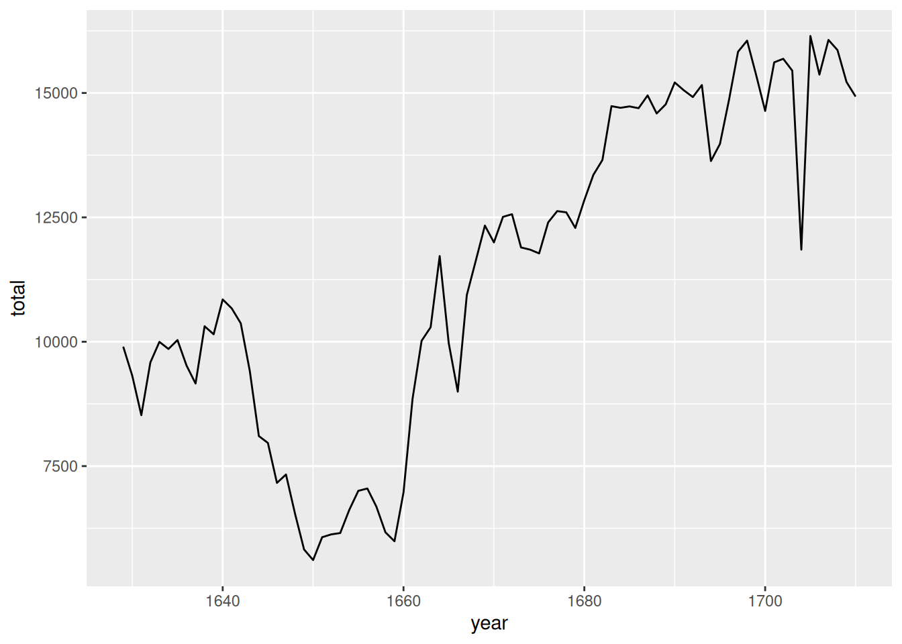
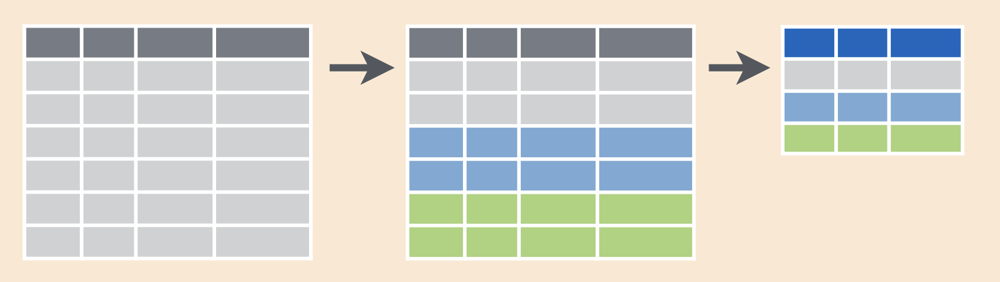

---
course: xac-suat-thong-ke
lecture: 06-phan-tich-co-dieu-kien
section: lecture
title: "Phân tích có điều kiện: Lọc dữ liệu, Thao tác nhóm & Đường ống phân tích"
prerequisites: []
supportingConcepts: ["thong-ke-mo-ta", "dataframe"]
lessonStatus: ready
hasChapterExercises: true
description: "Kỹ thuật phân tích có điều kiện: Lọc hàng (filter), các phép toán logic và so sánh, bản chất kiểu dữ liệu Logical, thao tác theo nhóm (group_by) và xây dựng đường ống phân tích (Data Pipelines)."
---

<div class="lecture-notes-content">

Trong kỷ nguyên dữ liệu lớn, một ngộ nhận thường gặp là cho rằng quy mô dữ liệu càng đồ sộ thì kết luận rút ra càng giá trị. Tuy nhiên, trong thực hành thống kê, dữ liệu càng lớn thì nhiễu càng nhiều và các mối liên hệ thực sự giữa các biến số càng dễ bị che lấp bởi sự không đồng nhất của tổng thể.

Việc giới hạn phạm vi khảo sát vào một tập con các quan sát thỏa mãn những tiêu chí cụ thể được gọi là **Phân tích có điều kiện (Conditioning)**. Kỹ thuật này mang lại hai lợi ích nền tảng:
1. **Gia tăng tính cụ thể và độ tin cậy cho phát biểu thống kê**: Thay vì đưa ra những nhận định chung chung cho toàn bộ quần thể, ta phát biểu chính xác kết luận cho từng nhóm đối tượng cụ thể.
2. **Làm sáng tỏ mối liên hệ nội tại giữa các biến số**: Giúp loại bỏ các yếu tố gây nhiễu, làm nổi bật tương quan thực sự mà khi nhìn trên toàn bộ dữ liệu gộp ta không thể phát hiện được.

Để thấu hiểu sức mạnh của phân tích có điều kiện, ta cùng nghiên cứu công trình thực nghiệm kinh điển của Savage và West (2007) về giấc ngủ của động vật có vú (*A qualitative, theoretical framework for understanding mammalian sleep* đăng trên tạp chí *PNAS*). Mục tiêu của nghiên cứu là xây dựng khung định lượng liên kết các thông số giấc ngủ với tốc độ trao đổi chất và khối lượng cơ thể của các loài thú. Dưới đây là 10 hàng đầu tiên trong bảng dữ liệu khảo sát 83 loài động vật:

```text
# Bảng dữ liệu msleep: 83 loài x 5 biến số
   name                       sleep_total log_bodywt vore  conservation
   <chr>                            <dbl>      <dbl> <chr> <chr>       
 1 Cheetah                           12.1      10.8  carni lc          
 2 Owl monkey                        17         6.17 omni  <NA>        
 3 Mountain beaver                   14.4       7.21 herbi nt          
 4 Greater short-tailed shrew        14.9       2.94 omni  lc          
 5 Cow                                4        13.3  herbi domesticated
 6 Three-toed sloth                  14.4       8.26 herbi <NA>        
 7 Northern fur seal                  8.7       9.93 carni vu          
 8 Vesper mouse                       7         3.81 <NA>  <NA>        
 9 Dog                               10.1       9.55 carni domesticated
10 Roe deer                           3         9.60 herbi lc          
# ... 73 loài tiếp theo
```

Trong tập dữ liệu này:
- **Đơn vị quan sát (Unit of Observation)**: Từng loài động vật có vú cụ thể.
- **Các biến số khảo sát**: Tên loài (`name`), tổng thời gian ngủ trung bình mỗi ngày tính bằng giờ (`sleep_total`), logarit tự nhiên của khối lượng cơ thể trung bình (`log_bodywt`), chế độ dinh dưỡng (`vore`: Ăn thịt `carni`, ăn cỏ `herbi`, ăn tạp `omni`, ăn côn trùng `insecti`), và tình trạng bảo tồn (`conservation`).

<div style="text-align: center; margin: 16px 0;">
  
</div>

**Hình 6.1:** Biểu đồ phân tán (Scatter Plot) khảo sát mối liên hệ giữa logarit khối lượng cơ thể (`log_bodywt`) và tổng thời gian ngủ mỗi ngày (`sleep_total`) trên toàn bộ 83 loài thú.

Quan sát đồ thị tổng thể trong Hình 6.1, ta thấy sự phân tán cực kỳ rộng lớn: Từ loài dơi nâu bé nhỏ chìm trong giấc ngủ gần 20 giờ mỗi ngày, đến loài voi châu Phi khổng lồ chỉ ngủ chợp mắt chưa đầy 4 giờ. Xu hướng chung cho thấy các loài động vật to lớn dường như ngủ ít hơn các loài nhỏ bé. Tuy nhiên, bức tranh toàn cảnh này vẫn còn quá nhiều điểm phân tán hỗn loạn. Để giải mã sâu sắc hơn, ta cần thu hẹp phân tích vào từng tập con dữ liệu thông qua các phép lọc.

---

## 1. Cơ chế lọc dữ liệu (Filtering)

Khi thao tác với một khung dữ liệu hai chiều (Data Frame), có hai hướng tiếp cận cơ bản để phân rã dữ liệu thành các tập con nhỏ hơn:
1. **Phân rã theo chiều dọc (theo cột)**: Chọn ra một tập con các biến số quan tâm. Thao tác này được gọi là **Chọn cột (Selecting)**, hiện thực hóa bằng hàm `select()`. Ta chọn cột theo tên biến vì thứ tự cột trong bảng dữ liệu thường mang tính tùy ý.
2. **Phân rã theo chiều ngang (theo hàng)**: 
   - Nếu trích xuất các hàng dựa vào chỉ số thứ tự dòng, thao tác được gọi là **Cắt lát (Slicing)** thông qua hàm `slice()`. Tuy nhiên, vì thứ tự sắp xếp của các quan sát ban đầu thường ngẫu nhiên nên cách này ít mang giá trị phân tích sâu.
   - Nếu trích xuất các hàng dựa vào **giá trị nội dung của các biến số**, thao tác được gọi là **Lọc dữ liệu (Filtering)** thông qua hàm `filter()`.

::: info Khái niệm: Lọc dữ liệu (Filtering)
Lọc dữ liệu là thao tác trích xuất một tập con các hàng trong bảng dữ liệu thỏa mãn một hoặc nhiều điều kiện logic xác định trên các biến số khảo sát.
:::

Sức mạnh của bộ lọc nằm ở chỗ nó rà soát trực tiếp giá trị của từng dòng dữ liệu, nơi lưu trữ phần lớn thông tin thực nghiệm. Trọng tâm của mỗi bộ lọc là một biểu thức điều kiện. 

Chẳng hạn, ta muốn lọc ra duy nhất quan sát của loài dơi nâu:

```r
filter(msleep, name == "Little brown bat")
```

Kết quả trả về:

```text
# A tibble: 1 x 5
  name             sleep_total log_bodywt vore    conservation
  <chr>                  <dbl>      <dbl> <chr>   <chr>       
1 Little brown bat        19.9       2.30 insecti <NA>        
```

Trong câu lệnh trên, biểu thức `name == "Little brown bat"` là điều kiện lọc. Cú pháp này so sánh giá trị của cột `name` ở vế trái với chuỗi ký tự ở vế phải. Chỉ những hàng nào thỏa mãn điều kiện so sánh mới được giữ lại trong kết quả.

### Bảng các toán tử so sánh (Comparison Operators)

Phép lọc dơi nâu sử dụng điều kiện so sánh bằng trực diện nhất. Trong thực tế, ta có thể xây dựng đa dạng các phép so sánh số học và phân loại thông qua các toán tử chuẩn sau:

| Toán tử | Ý nghĩa toán học & logic | Ví dụ minh họa |
| :---: | :--- | :--- |
| `==` | Bằng chính xác (Equal to) | `vore == "carni"` |
| `!=` | Khác / Không bằng (Not equal to) | `conservation != "lc"` |
| `<` | Nhỏ hơn (Less than) | `sleep_total < 8` |
| `>` | Lớn hơn (Greater than) | `log_bodywt > 12` |
| `<=` | Nhỏ hơn hoặc bằng (Less than or equal to) | `sleep_total <= 12` |
| `>=` | Lớn hơn hoặc bằng (Greater than or equal to) | `log_bodywt >= 10` |

::: tip Lưu ý quan trọng: Phân biệt `==` và `=`
Trong ngôn ngữ R cũng như nhiều ngôn ngữ lập trình thống kê, dấu bằng đơn `=` đã được dành riêng cho việc thiết lập giá trị của tham số trong hàm hoặc gán biến. Để kiểm tra xem hai vế có giá trị bằng nhau hay không, ta bắt buộc phải dùng hai dấu bằng liên tiếp `==`. Khi đọc mã nguồn, hãy đọc `==` là *"bằng chính xác với"*.
:::

Xét ví dụ lọc các loài động vật to lớn, định nghĩa là những loài có logarit khối lượng cơ thể vượt quá 12:

```r
filter(msleep, log_bodywt > 12)
```

Kết quả trả về 9 loài động vật to lớn:

```text
# A tibble: 9 x 5
  name                 sleep_total log_bodywt vore  conservation
  <chr>                      <dbl>      <dbl> <chr> <chr>       
1 Cow                          4         13.3 herbi domesticated
2 Asian elephant               3.9       14.8 herbi en          
3 Horse                        2.9       13.2 herbi domesticated
4 Donkey                       3.1       12.1 herbi domesticated
5 Giraffe                      1.9       13.7 herbi cd          
6 Pilot whale                  2.7       13.6 carni cd          
7 African elephant             3.3       15.7 herbi vu          
8 Brazilian tapir              4.4       12.2 herbi vu          
9 Bottle-nosed dolphin         5.2       12.1 carni <NA>        
```

Tất cả 9 loài này đều là những loài thú có thể trọng khổng lồ như bò, voi, ngựa, hươu cao cổ, cá voi và cá heo.

---

## 2. Toán tử logic và Đại số tập hợp (Logical Operators & Set Theory)

Điều gì sẽ xảy ra nếu bài toán đòi hỏi phải thỏa mãn đồng thời nhiều tiêu chí, hoặc thỏa mãn ít nhất một trong các tiêu chí đưa ra? Để kết hợp nhiều biểu thức so sánh, ta sử dụng các toán tử logic:
- Toán tử `&`: Phép VÀ logic (AND), tương ứng với phép giao trong lý thuyết tập hợp.
- Toán tử `|`: Phép HOẶC logic (OR), tương ứng với phép hợp trong lý thuyết tập hợp.
- Toán tử `%in%`: Phép kiểm tra thuộc tập hợp (Value Matching).

### Phép giao (Toán tử `&`)

Giả sử ta muốn tìm những loài động vật vừa có khối lượng lớn (`log_bodywt > 12`), vừa có thời gian ngủ rất ít (`sleep_total < 5`):

```r
filter(msleep, log_bodywt > 12 & sleep_total < 5)
```

Kết quả trả về 8 loài:

```text
# A tibble: 8 x 5
  name             sleep_total log_bodywt vore  conservation
  <chr>                  <dbl>      <dbl> <chr> <chr>       
1 Cow                      4         13.3 herbi domesticated
2 Asian elephant           3.9       14.8 herbi en          
3 Horse                    2.9       13.2 herbi domesticated
4 Donkey                   3.1       12.1 herbi domesticated
5 Giraffe                  1.9       13.7 herbi cd          
6 Pilot whale              2.7       13.6 carni cd          
7 African elephant         3.3       15.7 herbi vu          
8 Brazilian tapir          4.4       12.2 herbi vu          
```

So với tập hợp 9 loài động vật lớn trước đó, tập hợp này ít hơn đúng 1 loài: Cá heo mũi chai (`Bottle-nosed dolphin`) có thời gian ngủ trung bình là 5.2 giờ nên không thỏa mãn vế thứ hai.

Trong cú pháp của thư viện dữ liệu, việc ngăn cách các điều kiện bằng dấu phẩy `,` có ý nghĩa hoàn toàn tương đương với toán tử `&`:

```r
filter(msleep, log_bodywt > 12, sleep_total < 5)
```

### Phép hợp (Toán tử `|`)

Nếu ta muốn mở rộng tập quan sát để thu thập mọi loài động vật hoặc có khối lượng cơ thể lớn, hoặc có thời gian ngủ ít dưới 5 giờ mỗi ngày, hoặc thỏa mãn cả hai tiêu chí trên, ta sử dụng toán tử gạch đứng `|`:

```r
filter(msleep, log_bodywt > 12 | sleep_total < 5)
```

Kết quả trả về 12 loài động vật:

```text
# A tibble: 12 x 5
   name                 sleep_total log_bodywt vore  conservation
   <chr>                      <dbl>      <dbl> <chr> <chr>       
 1 Cow                          4        13.3  herbi domesticated
 2 Roe deer                     3         9.60 herbi lc          
 3 Asian elephant               3.9      14.8  herbi en          
 4 Horse                        2.9      13.2  herbi domesticated
 5 Donkey                       3.1      12.1  herbi domesticated
 6 Giraffe                      1.9      13.7  herbi cd          
 7 Pilot whale                  2.7      13.6  carni cd          
 8 African elephant             3.3      15.7  herbi vu          
 9 Sheep                        3.8      10.9  herbi domesticated
10 Caspian seal                 3.5      11.4  carni vu          
11 Brazilian tapir              4.4      12.2  herbi vu          
12 Bottle-nosed dolphin         5.2      12.1  carni <NA>        
```

Danh sách mở rộng xuất hiện thêm các loài thú có khối lượng trung bình nhưng thời gian ngủ cực ngắn như nai hoẵng (`Roe deer`, 3 giờ), cừu (`Sheep`, 3.8 giờ) và hải cẩu Caspian (`Caspian seal`, 3.5 giờ).

<div style="text-align: center; margin: 16px 0;">
  
</div>

**Hình 6.2:** Sơ đồ Venn minh họa đại số tập hợp: Phép giao $A \cap B$ (dùng `&`, phần diện tích màu cam) luôn có số quan sát nhỏ hơn hoặc bằng phép hợp $A \cup B$ (dùng `|`, toàn bộ diện tích màu xanh).

Về mặt toán học tập hợp: Gọi $A$ là tập các loài có $\text{log\_bodywt} > 12$ ($|A| = 9$), và $B$ là tập các loài có $\text{sleep\_total} < 5$ ($|B| = 11$). Ta có công thức lực lượng tập hợp:

$$\begin{aligned}
|A \cup B| &= |A| + |B| - |A \cap B| \\
&= 9 + 11 - 8 \\
&= 12
\end{aligned}$$

Phép giao luôn là tập con của phép hợp, do đó số hàng trả về từ điều kiện `&` không bao giờ vượt quá số hàng trả về từ điều kiện `|`.

### Toán tử kiểm tra phần tử `%in%`

Khi làm việc với các biến định tính danh nghĩa, nếu muốn giữ lại nhiều mức giá trị khác nhau, cách viết truyền thống bằng phép hợp `|` dễ trở nên dài dòng:

```r
filter(msleep, name == "Little brown bat" | name == "African elephant")
```

Để mã nguồn ngắn gọn và sáng sủa hơn, ta sử dụng toán tử `%in%` kết hợp với một vector các giá trị cần so khớp:

```r
filter(msleep, name %in% c("Little brown bat", "African elephant"))
```

Câu lệnh trên rà soát từng dòng và giữ lại các hàng có giá trị `name` nằm trong danh sách đã liệt kê.

---

## 3. Bản chất toán học của Kiểu dữ liệu Logic (Logicals)

Đằng sau các phép so sánh trên, hệ thống tính toán thực sự xử lý điều gì? Để trả lời câu hỏi này, ta cần tìm hiểu cấu trúc dữ liệu cơ sở: **Vector logic (Logical vector)**.

Xét một vector số học gồm bốn số nguyên dương:

```r
a <- c(2, 4, 6, 8)
```

Khi áp dụng toán tử so sánh `a < 5`, ngôn ngữ sẽ thực hiện phép so sánh trên từng phần tử:

```r
a < 5
# Kết quả: [1]  TRUE  TRUE FALSE FALSE
```

Kết quả trả về là một vector có cùng chiều dài với vector ban đầu, trong đó mỗi phần tử mang giá trị chân lý: `TRUE` (Đúng) hoặc `FALSE` (Sai).

```r
class(a < 5)
# Kết quả: [1] "logical"
```

### Bản chất nhị phân của kiểu Logic

Một vector logic chỉ nhận hai giá trị `TRUE` và `FALSE`. Điểm đặc sắc mang tính quyết định trong tính toán thống kê là: **Giá trị logic có biểu diễn kép dạng nhị phân (Binary representation)**:
- `TRUE` được mã hóa tương đương với số nguyên $1$.
- `FALSE` được mã hóa tương đương với số nguyên $0$.

Cơ chế này cho phép ta thực hiện các phép toán số học trực tiếp trên các biến logic:

```r
TRUE + TRUE
# [1] 2

TRUE * FALSE
# [1] 0
```

### Ứng dụng: Đếm số lượng và tính tỷ lệ điều kiện

Nhờ biểu diễn số học nhị phân, ta có hai công thức tính toán thống kê cực kỳ tiện lợi:

1. **Đếm số lượng quan sát thỏa mãn điều kiện**: Áp dụng hàm `sum()` trên biểu thức điều kiện:
   $$\begin{aligned}
   n_{\text{thỏa}} &= \sum_{i=1}^n \mathbf{1}_{\{x_i \in E\}} \\
   &= \mathbf{1}_{\{x_1 \in E\}} + \mathbf{1}_{\{x_2 \in E\}} + \dots + \mathbf{1}_{\{x_n \in E\}}
   \end{aligned}$$
   với hàm chỉ thị $\mathbf{1}_{\{E\}}$ nhận giá trị $1$ nếu biến cố xảy ra và $0$ nếu không xảy ra.
   
   Chẳng hạn: `sum(a < 5)` cho kết quả là $1 + 1 + 0 + 0 = 2$.

2. **Tính tỷ lệ (Proportion) thỏa mãn điều kiện**: Áp dụng hàm tính trung bình `mean()` trên biểu thức điều kiện:
   $$\begin{aligned}
   p &= \frac{1}{n} \sum_{i=1}^n \mathbf{1}_{\{x_i \in E\}} \\
   &= \frac{\mathbf{1}_{\{x_1 \in E\}} + \mathbf{1}_{\{x_2 \in E\}} + \dots + \mathbf{1}_{\{x_n \in E\}}}{n}
   \end{aligned}$$
   
   Chẳng hạn: `mean(a < 5)` cho kết quả là $\frac{2}{4} = 0.5$ ($50\%$).

Đây là một kỹ thuật tóm tắt dữ liệu kinh điển: Hàm `mean()` khi tác động lên một vector logic không tính trung bình số học thông thường, mà tính chính xác **tỷ lệ phần trăm các trường hợp đạt điều kiện**.

---

## 4. Xây dựng đường ống dữ liệu (Data Pipelines)

Trong các bài toán thực tế, một phân tích dữ liệu hiếm khi chỉ dừng lại ở một câu lệnh đơn lẻ. Người phân tích thường phải xâu chuỗi nhiều thao tác liên tiếp: Lọc hàng, biến đổi cột, nhóm dữ liệu và tóm tắt thống kê.

<div style="text-align: center; margin: 20px 0;">
  
</div>

**Hình 6.3:** Khái niệm đường ống dữ liệu (Data Pipeline): Bảng dữ liệu ban đầu chảy qua các trạm biến đổi tuần tự để tạo ra kết quả phân tích cuối cùng.

### So sánh ba phong cách lập trình chuỗi thao tác

Giả sử ta cần lấy ra các loài động vật to lớn (`log_bodywt > 12`) và sắp xếp chúng theo khối lượng giảm dần:

1. **Phong cách 1: Lồng hàm (Nesting)**:
   ```r
   arrange(filter(msleep, log_bodywt > 12), desc(log_bodywt))
   ```
   *Nhược điểm*: Phải đọc ngược từ trong ra ngoài. Càng nhiều thao tác lồng nhau thì cú pháp càng rối rắm, rất khó theo dõi các đối số tương ứng.

2. **Phong cách 2: Gán biến trung gian từng bước (Step-by-step)**:
   ```r
   msleep_large <- filter(msleep, log_bodywt > 12)
   arrange(msleep_large, desc(log_bodywt))
   ```
   *Nhược điểm*: Phải lặp lại tên bảng dữ liệu nhiều lần và làm tràn ngập môi trường làm việc bằng các đối tượng trung gian không cần thiết.

3. **Phong cách 3: Đường ống phân tích với toán tử Pipe (`|>`)**:
   ```r
   msleep |>
     filter(log_bodywt > 12) |>
     arrange(desc(log_bodywt))
   ```
   *Ưu điểm*: Luồng xử lý diễn ra tự nhiên từ trên xuống dưới theo đúng tiến trình tư duy: *"Lấy bảng dữ liệu `msleep`, sau đó lọc các loài có khối lượng trên 12, sau đó sắp xếp theo thứ tự giảm dần"*.

Toán tử đường ống `|>` tự động lấy kết quả đầu ra của hàm phía trước và truyền vào làm đối số đầu tiên của hàm kế tiếp. Nhờ đó, ở hàm `filter()` và `arrange()`, ta không cần phải gõ lại tên bảng dữ liệu nữa.

### Ứng dụng thực tế của đường ống dữ liệu

**Ví dụ 1: Xác định tỷ lệ động vật ăn thịt ngủ nhiều hơn 8 giờ mỗi ngày**

Ta xâu chuỗi hai thao tác: Lọc lấy các loài ăn thịt (`vore == "carni"`), sau đó tóm tắt dữ liệu bằng hàm `summarize()` kết hợp với việc tính tỷ lệ bằng `mean(sleep_total > 8)` và ghi nhận cỡ mẫu bằng `n()`:

```r
msleep |>
  filter(vore == "carni") |>
  summarize(
    p_gt_8hrs = mean(sleep_total > 8),
    n = n()
  )
```

Kết quả tính toán:

```text
# A tibble: 1 x 2
  p_gt_8hrs     n
      <dbl> <int>
1     0.684    19
```

Trong số 19 loài thú ăn thịt có mặt trong tập dữ liệu, có đúng 13 loài ngủ trên 8 giờ mỗi ngày, tương ứng tỷ lệ xấp xỉ $68.4\%$.

**Ví dụ 2: Tìm năm có tổng số lễ rửa tội cao nhất tại London thế kỷ 17 (Dữ liệu Arbuthnot)**

Bảng dữ liệu `arbuthnot` ghi nhận số lượng trẻ em nam (`boys`) và nữ (`girls`) được làm lễ rửa tội tại các giáo xứ London từ năm 1629 đến 1710. Để tìm các năm có quy mô sinh lớn nhất, ta xây dựng đường ống:
1. Tạo cột tổng số bằng `mutate(total = boys + girls)`.
2. Sắp xếp giảm dần theo tổng số bằng `arrange(desc(total))`.
3. Chỉ chọn hai cột cần thiết bằng `select(year, total)`.

```r
arbuthnot |>
  mutate(total = boys + girls) |>
  arrange(desc(total)) |>
  select(year, total)
```

Kết quả hiển thị rõ năm 1705 dẫn đầu với $16{,}145$ trẻ em, tiếp theo là các năm 1707 ($16{,}066$) và 1698 ($16{,}052$).

**Ví dụ 3: Kết nối đường ống trực tiếp vào biểu đồ trực quan hóa**

Vì hàm `ggplot()` nhận đối số đầu tiên là một bảng dữ liệu, ta hoàn toàn có thể đẩy kết quả của đường ống thẳng vào biểu đồ trực quan hóa:

```r
arbuthnot |>
  mutate(total = boys + girls) |>
  ggplot(aes(x = year, y = total)) +
  geom_line()
```

<div style="text-align: center; margin: 16px 0;">
  
</div>

**Hình 6.4:** Biểu đồ đường (Line Plot) theo dõi tổng số lễ rửa tội tại London từ năm 1629 đến 1710: Sự sụt giảm nghiêm trọng vào giai đoạn 1640–1660 phản ánh biến động của cuộc Nội chiến Anh và trận Đại dịch hạch 1665.

::: tip Quy tắc cú pháp quan trọng
Khi chuyển từ đường ống xử lý dữ liệu sang xây dựng biểu đồ `ggplot2`, ta dùng toán tử đường ống `|>` để đưa dữ liệu vào `ggplot()`, nhưng các tầng đồ thị kế tiếp bên trong `ggplot` bắt buộc phải được kết nối bằng dấu cộng `+`, không dùng `|>`.
:::

---

## 5. Thao tác theo nhóm (Groupwise Operations)

Ở Ví dụ 1, ta đã tính toán tỷ lệ ngủ trên 8 giờ cho duy nhất một nhóm là thú ăn thịt (`vore == "carni"`). Nếu bài toán yêu cầu so sánh chỉ số này trên toàn bộ các nhóm chế độ ăn khác nhau, việc sao chép và chạy lại đoạn mã 4 hay 5 lần sẽ vô cùng cồng kềnh và dễ dẫn đến sai sót khi quy mô danh mục mở rộng.

Để giải quyết bài toán tính toán đồng thời trên mọi nhóm quan sát, ta sử dụng hàm **Nhóm theo biến số (`group_by()`)**.

```r
msleep |>
  group_by(vore) |>
  summarize(
    p_gt_8hrs = mean(sleep_total > 8),
    n = n()
  )
```

Kết quả thu được là một bảng thống kê cô đọng theo từng nhóm:

```text
# A tibble: 5 x 3
  vore    p_gt_8hrs     n
  <chr>       <dbl> <int>
1 carni       0.684    19
2 herbi       0.594    32
3 insecti     1         5
4 omni        0.95     20
5 <NA>        0.714     7
```

### Cơ chế hoạt động của `group_by()`

Hàm `group_by()` hoạt động như thế nào dưới góc độ cấu trúc dữ liệu? Nếu ta dừng đường ống ngay sau lệnh `group_by()` để quan sát bảng dữ liệu:

```r
msleep |>
  group_by(vore)
```

Bảng dữ liệu trả về trông hoàn toàn giống với bảng dữ liệu gốc, ngoại trừ một dòng thông tin bổ sung ở phần đầu: `# Groups: vore [5]`.

<div style="text-align: center; margin: 20px 0;">
  
</div>

**Hình 6.5:** Cơ chế chia tách, tính toán và hợp nhất (Split-Apply-Combine) của bộ đôi `group_by()` và `summarize()`: Bảng dữ liệu gốc được gắn nhãn phân nhóm, sau đó hàm tóm tắt nén từng nhóm thành một hàng duy nhất.

Về bản chất kỹ thuật:
1. `group_by()` không hề thay đổi nội dung hay thứ tự các hàng dữ liệu. Nó chỉ gắn thêm **siêu dữ liệu phân nhóm (Grouping metadata)** vào cấu trúc bảng.
2. Siêu dữ liệu này làm thay đổi triệt để hành vi của các hàm tính toán phía sau. Khi truyền bảng đã nhóm vào hàm `summarize()`, hàm này không tính toán trên toàn bộ 83 dòng gộp nữa, mà tự động chia nhỏ bảng dữ liệu theo từng nhóm, tính toán các thống kê tóm tắt độc lập cho từng nhóm, rồi gộp các kết quả lại thành một bảng duy nhất với mỗi nhóm là một dòng.

### Đọc hiểu kết quả sinh thái học từ bảng dữ liệu phân nhóm

Nhìn vào bảng tóm tắt kết quả:
- Nhóm ăn côn trùng (`insecti`): $100\%$ các loài ($5/5$) ngủ nhiều hơn 8 giờ mỗi ngày.
- Nhóm ăn tạp (`omni`): $95\%$ các loài ($19/20$) ngủ trên 8 giờ.
- Nhóm ăn thịt (`carni`): $68.4\%$ các loài ($13/19$) ngủ trên 8 giờ.
- Nhóm ăn cỏ (`herbi`): Chỉ có $59.4\%$ các loài ($19/32$) ngủ trên 8 giờ.

Kết quả này hé lộ một góc nhìn sinh thái học sâu sắc: Các loài ăn cỏ thường phải dành rất nhiều thời gian trong ngày để tìm kiếm và nhai thức ăn thô, đồng thời luôn phải cảnh giác trước kẻ săn mồi nên có thời gian ngủ bình quân ít nhất. Ngược lại, các loài ăn côn trùng và thú săn mồi hấp thu nguồn năng lượng đậm đặc hơn nên có thể dành nhiều thời gian hơn để nghỉ ngơi.

---

## 6. Tóm tắt chương

1. **Phân tích có điều kiện**: Là việc thu hẹp phân tích vào một tập con các quan sát thỏa mãn các tiêu chí định trước nhằm tăng tính cụ thể cho phát biểu và làm sáng tỏ các mối quan hệ giữa các biến số.
2. **Cơ chế lọc hàng (`filter`)**: Rà soát từng hàng dữ liệu dựa trên một hoặc nhiều biểu thức so sánh logic (`==`, `!=`, `<`, `>`, `<=`, `>=`).
3. **Toán tử logic**: Phép giao `&` (hoặc dấu phẩy `,`) tìm phần chung giữa các điều kiện; phép hợp `|` lấy tập hợp tất cả các quan sát thỏa mãn ít nhất một điều kiện; toán tử `%in%` kiểm tra sự tồn tại trong một danh sách giá trị.
4. **Bản chất của kiểu dữ liệu Logic**: Mang giá trị nhị phân `TRUE` ($1$) và `FALSE` ($0$). Phép tính `sum()` trên điều kiện logic giúp đếm số lượng quan sát thỏa mãn; phép tính `mean()` trên điều kiện logic giúp tính trực tiếp **tỷ lệ điều kiện (conditional proportion)**.
5. **Đường ống phân tích (`|>`)**: Kết nối các thao tác xử lý dữ liệu theo dòng chảy tự nhiên, giúp mã nguồn mạch lạc, dễ đọc và loại bỏ các biến trung gian thừa.
6. **Thao tác theo nhóm (`group_by`)**: Gắn siêu dữ liệu phân tầng vào bảng dữ liệu, kết hợp với `summarize()` để thực hiện nguyên lý Chia tách - Áp dụng - Hợp nhất (Split-Apply-Combine) trên toàn bộ các nhóm quan sát cùng lúc.

## Tài liệu tham khảo

- Savage, V. M., & West, G. B. (2007). *A qualitative, theoretical framework for understanding mammalian sleep*. Proceedings of the National Academy of Sciences, 104(3), 1051-1056.
- Wickham, H., & Grolemund, G. (2017). *R for Data Science: Import, Tidy, Transform, Visualize, and Model Data*. O'Reilly Media.
- UC Berkeley STAT 20: *Introduction to Probability and Statistics*, Department of Statistics, UC Berkeley.

</div>

<div class="lecture-exercises-content">

::: exercise Bài tập 1: Bản chất vector logic & Phân rã lỗi trong đường ống dữ liệu
1. Xét dòng lệnh sau trong môi trường lập trình thống kê:
   ```r
   c("apple", "orange", "banana") == "orange"
   ```
   Dòng lệnh này trả về kết quả gì? Kiểu dữ liệu của kết quả là gì? Nếu áp dụng hàm `mean()` lên kết quả này thì giá trị nhận được bằng bao nhiêu và mang ý nghĩa thống kê gì?

2. Một nhà phân tích muốn lọc dữ liệu khảo sát sinh viên `survey` (gồm 800 quan sát và 15 biến số) để tìm những sinh viên năm nhất có điểm kỹ năng lập trình dưới 3, sau đó chỉ giữ lại biến thời gian tự học (`study_hours`). Nhà phân tích viết đường ống sau nhưng gặp thông báo lỗi:
   ```r
   survey |>
     select(study_hours) |>
     filter(year == "First year", coding_score < 3)
   ```
   Thông báo lỗi phát sinh là gì? Hãy giải thích nguyên nhân gốc rễ và viết lại đường ống dữ liệu chuẩn xác.
:::

::: hint Gợi ý Bài tập 1
- Phép so sánh chuỗi trên một vector ký tự sẽ thực hiện so sánh từng phần tử. Hãy nhớ lại cơ chế biểu diễn nhị phân của kiểu dữ liệu logic khi tính `mean()`.
- Để lọc hàng dựa trên một biến số, biến số đó bắt buộc phải tồn tại trong bảng dữ liệu đi vào hàm `filter()`. Hãy xem hàm `select(study_hours)` ở bước trước đã làm gì với các cột `year` và `coding_score`.
:::

::: solution Lời giải chi tiết Bài tập 1
1. **Phân tích vector logic**:
   - Dòng lệnh so sánh từng phần tử của vector với chuỗi `"orange"`.
   - Kết quả trả về là một vector logic gồm 3 phần tử:
     ```r
     [1] FALSE  TRUE FALSE
     ```
   - Kiểu dữ liệu của kết quả: Kiểu Logic (`logical`).
   - Khi áp dụng hàm `mean()`:
     $$\begin{aligned}
     \bar{x}_{\text{logic}} &= \frac{0 + 1 + 0}{3} \\
     &= \frac{1}{3} \approx 0.333
     \end{aligned}$$
   - **Ý nghĩa thống kê**: Giá trị này đại diện cho tỷ lệ phần trăm các phần tử trong vector thỏa mãn điều kiện là `"orange"` (đạt $33.33\%$).

2. **Phân tích lỗi đường ống và cách khắc phục**:
   - **Thông báo lỗi**: Hệ thống sẽ báo lỗi `Error in filter(): object 'year' not found` (hoặc `'coding_score' not found`).
   - **Nguyên nhân gốc rễ**: 
     - Đường ống thực thi tuần tự từ trên xuống dưới.
     - Lệnh `select(study_hours)` ở bước đầu tiên đã loại bỏ tất cả 14 cột còn lại của bảng dữ liệu, chỉ giữ lại duy nhất cột `study_hours`.
     - Khi dữ liệu được truyền vào hàm `filter()`, hai biến `year` và `coding_score` không còn tồn tại trong bảng dữ liệu nữa, dẫn đến việc bộ lọc không thể định vị được các biến để kiểm tra điều kiện.
   - **Đường ống chuẩn xác**: Phải thực hiện lọc hàng trước khi chọn cột:
     ```r
     survey |>
       filter(year == "First year", coding_score < 3) |>
       select(study_hours)
     ```
:::

---

::: exercise Bài tập 2: So sánh lực lượng tập hợp & Phân nhóm đa biến
1. Giả sử tập dữ liệu `survey` có $800$ dòng. Xét hai câu lệnh lọc sau:
   - **Lệnh A**:
     ```r
     filter(survey, year == "First year", coding_score < 3)
     ```
   - **Lệnh B**:
     ```r
     filter(survey, year == "First year" | coding_score < 3)
     ```
   Gọi $N_A$ và $N_B$ lần lượt là số hàng trả về từ Lệnh A và Lệnh B. Mối quan hệ toán học giữa $N_A$ và $N_B$ là gì ($N_A \le N_B$ hay $N_A \ge N_B$)? Khi nào thì $N_A = N_B$?

2. Nếu nhà phân tích thực hiện phân nhóm theo hai biến số phân loại cùng lúc:
   ```r
   survey |>
     group_by(year, major) |>
     summarize(
       avg_study = mean(study_hours, na.rm = TRUE),
       n = n()
     )
   ```
   Cấu trúc của bảng kết quả đầu ra sẽ như thế nào? Mỗi hàng trong bảng tóm tắt đại diện cho điều gì?
:::

::: hint Gợi ý Bài tập 2
- Sử dụng sơ đồ Venn và đại số tập hợp giữa phép giao ($A \cap B$) và phép hợp ($A \cup B$).
- Khi gom nhóm theo $k$ biến phân loại, mỗi nhóm duy nhất là một tổ hợp các giá trị của các biến đó.
:::

::: solution Lời giải chi tiết Bài tập 2
1. **Quan hệ lực lượng tập hợp giữa Lệnh A và Lệnh B**:
   - Gọi $E_1$ là biến cố sinh viên là năm nhất (`year == "First year"`).
   - Gọi $E_2$ là biến cố sinh viên có điểm kỹ năng lập trình dưới 3 (`coding_score < 3`).
   - Lệnh A tương ứng với phép giao hai điều kiện: $E_A = E_1 \cap E_2$.
   - Lệnh B tương ứng với phép hợp hai điều kiện: $E_B = E_1 \cup E_2$.
   - Vì phép giao luôn là tập con của phép hợp ($E_1 \cap E_2 \subseteq E_1 \cup E_2$), ta luôn có:
     $$N_A \le N_B$$
   - **Điều kiện để $N_A = N_B$**:
     - Đẳng thức $N_A = N_B$ chỉ xảy ra khi và chỉ khi hai tập hợp trùng khớp hoàn toàn ($E_1 = E_2$).
     - Nghĩa là mọi sinh viên năm nhất đều có điểm lập trình dưới 3, và đồng thời mọi sinh viên có điểm lập trình dưới 3 đều là sinh viên năm nhất. Nếu có bất kỳ một sinh viên năm nhất nào có điểm $\ge 3$, hoặc có bất kỳ sinh viên khóa trên nào có điểm $< 3$, thì chắc chắn $N_A < N_B$.

2. **Cấu trúc bảng khi nhóm theo hai biến số**:
   - Khi áp dụng `group_by(year, major)`, dữ liệu được phân chia thành các tổ hợp phân tầng chéo giữa năm học và chuyên ngành.
   - **Mỗi hàng trong bảng tóm tắt** đại diện cho **một tổ hợp duy nhất giữa một năm học và một chuyên ngành cụ thể** (chẳng hạn: Hàng 1 cho sinh viên Năm nhất ngành Khoa học máy tính, Hàng 2 cho sinh viên Năm nhất ngành Kinh tế...).
   - Bảng kết quả sẽ gồm 4 cột: Cột `year`, cột `major`, cột thời gian học trung bình `avg_study`, và cột số lượng sinh viên trong tổ hợp đó `n`.
:::

---

::: exercise Bài tập 3: Thiết kế đường ống phân tích giấc ngủ động vật theo nhóm dinh dưỡng
Cho bảng dữ liệu `msleep` (83 loài). Hãy viết các đoạn mã đường ống dữ liệu chuẩn mực để thực hiện các yêu cầu sau:

1. Lọc ra các loài động vật đã xác định rõ chế độ dinh dưỡng (tức là loại bỏ các hàng có giá trị `vore` bị khuyết thiếu `is.na(vore) == FALSE`).
2. Nhóm các loài theo chế độ dinh dưỡng `vore`.
3. Với mỗi nhóm chế độ dinh dưỡng, tính toán các chỉ số thống kê sau:
   - Số lượng loài trong nhóm ($n$).
   - Thời gian ngủ trung bình mỗi ngày ($\bar{x}$).
   - Số trung vị của thời gian ngủ ($\text{Med}$).
   - Độ lệch chuẩn của thời gian ngủ ($s$).
   - Tỷ lệ các loài ngủ nhiều hơn hoặc bằng 12 giờ mỗi ngày ($p_{\ge 12}$).
4. Sắp xếp bảng kết quả theo thời gian ngủ trung bình giảm dần.
5. Dựa trên kết quả thu được, hãy đưa ra nhận xét định tính về sự khác biệt trong mô hình giấc ngủ giữa nhóm động vật ăn thịt (`carni`) và nhóm động vật ăn cỏ (`herbi`).
:::

::: hint Gợi ý Bài tập 3
- Để loại bỏ giá trị khuyết thiếu trong bộ lọc, sử dụng điều kiện `!is.na(vore)`.
- Các hàm thống kê trong `summarize`: `n()`, `mean()`, `median()`, `sd()`, và tính tỷ lệ qua `mean(sleep_total >= 12)`.
- Sắp xếp giảm dần dùng `arrange(desc(...))`.
:::

::: solution Lời giải chi tiết Bài tập 3
1, 2, 3, 4. **Đoạn mã đường ống dữ liệu hoàn chỉnh**:

```r
msleep |>
  filter(!is.na(vore)) |>
  group_by(vore) |>
  summarize(
    n = n(),
    mean_sleep = mean(sleep_total),
    median_sleep = median(sleep_total),
    sd_sleep = sd(sleep_total),
    p_sleep_ge_12 = mean(sleep_total >= 12)
  ) |>
  arrange(desc(mean_sleep))
```

**Bảng kết quả tính toán chi tiết**:

```text
# A tibble: 4 x 6
  vore        n mean_sleep median_sleep sd_sleep p_sleep_ge_12
  <chr>   <int>      <dbl>        <dbl>    <dbl>         <dbl>
1 insecti     5      14.9         18.1      5.92         0.800
2 omni       20      10.9          9.9      4.37         0.400
3 carni      19      10.4         10.4      4.67         0.368
4 herbi      32       9.51         10.3     4.88         0.344
```

5. **Nhận xét thống kê và ý nghĩa sinh thái học**:
   - **Về xu hướng trung tâm**:
     - Nhóm ăn thịt (`carni`) có thời gian ngủ trung bình ($10.4$ giờ) và trung vị ($10.4$ giờ) đều cao hơn nhóm ăn cỏ (`herbi`) với trung bình $9.51$ giờ.
     - Nhóm ăn côn trùng (`insecti`) có thời gian ngủ cao vượt trội (trung vị đạt tới $18.1$ giờ, và $80\%$ các loài ngủ trên 12 giờ).
   - **Về tỷ lệ ngủ nhiều ($p_{\ge 12}$)**:
     - Tỷ lệ các loài ngủ trên 12 giờ ở nhóm ăn thịt ($36.8\%$) cao hơn so với nhóm ăn cỏ ($34.4\%$).
   - **Ý nghĩa sinh học**:
     - Động vật ăn cỏ phải dành phần lớn thời gian trong ngày để kiếm ăn do hàm lượng dinh dưỡng trong thực vật thấp, đồng thời là đối tượng săn mồi nên chu kỳ ngủ ngắn và gián đoạn.
     - Ngược lại, động vật ăn thịt tiêu thụ nguồn thức ăn giàu protein và năng lượng, ít bị đe dọa trực tiếp khi ngủ nên duy trì được thời lượng giấc ngủ sâu và dài hơn.
:::

</div>

