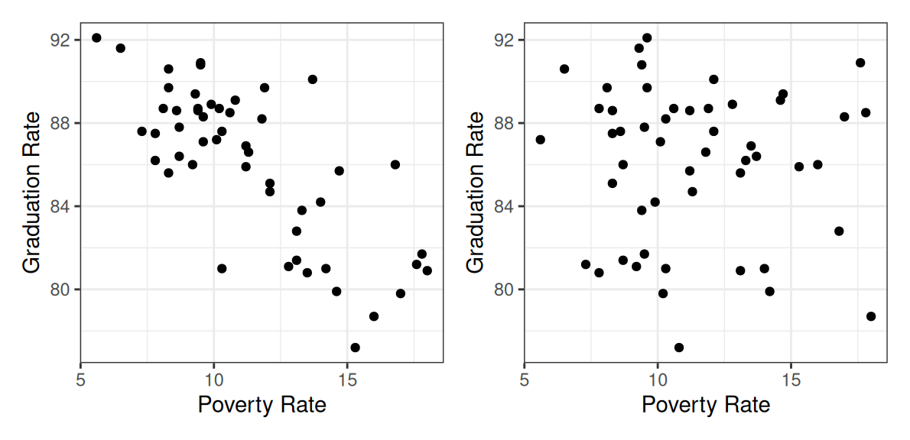
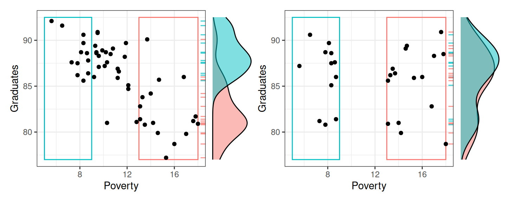
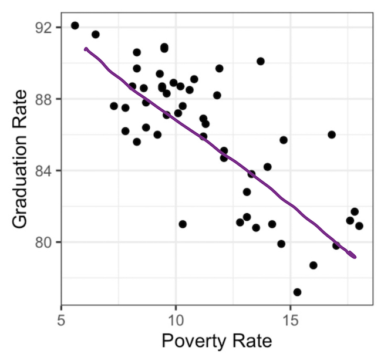
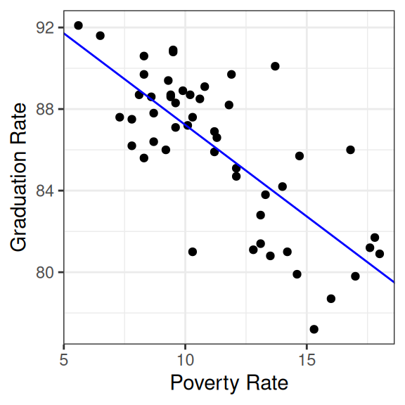
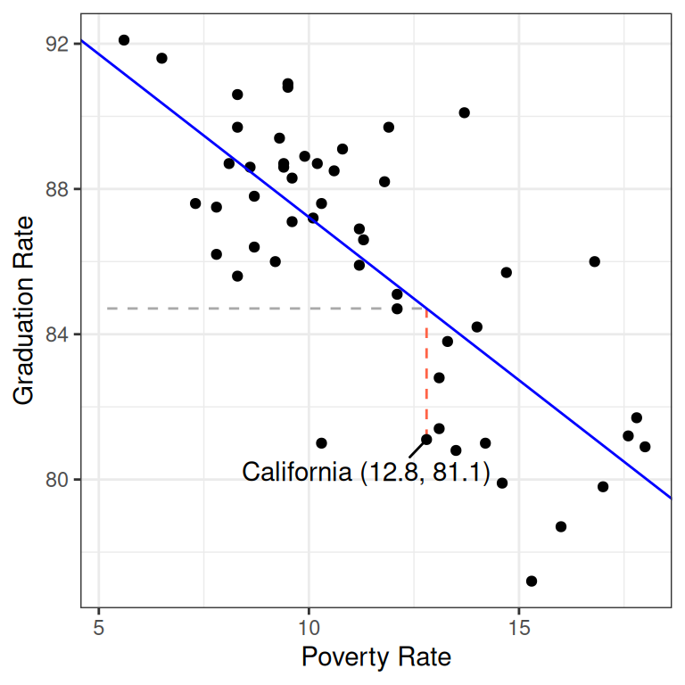

---

course: xac-suat-thong-ke

lecture: 07-tom-tat-lien-he-bien-so

section: lecture

title: "Tóm tắt mối liên hệ định lượng: Hệ số tương quan & Mô hình tuyến tính đơn"

prerequisites: []

supportingConcepts: ["thong-ke-mo-ta", "phuong-sai"]

lessonStatus: ready

hasChapterExercises: true

description: "Khảo sát mối liên hệ giữa hai biến định lượng: Biểu đồ phân tán, hệ số tương quan Pearson r, đường hồi quy bình phương tối thiểu và phần dư (residuals)."

---

<div class="lecture-notes-content">

Trong các bài học trước, ta đã làm quen với việc tóm tắt phân phối của một biến số đơn lẻ (thống kê đơn biến) và khảo sát mối liên hệ giữa các biến định tính. Trong thực tế phân tích kinh tế, xã hội và tự nhiên, câu hỏi cốt lõi thường xoay quanh **mối liên hệ giữa hai biến số định lượng**: Liệu tỷ lệ hộ nghèo có đi đôi với tỷ lệ tốt nghiệp trung học phổ thông thấp hơn? Liệu tăng chi phí nghiên cứu phát triển có thúc đẩy doanh thu doanh nghiệp?

Để mở đầu, hãy quan sát hai biểu đồ phân tán dưới đây và thử suy đoán: Biểu đồ nào phản ánh dữ liệu thực tế về mối quan hệ giữa tỷ lệ tốt nghiệp trung học (`Graduates`, %) và tỷ lệ hộ nghèo (`Poverty`, %) tại 50 bang của Hoa Kỳ?

<div style="text-align: center; margin: 16px 0;">

  

</div>

**Hình 7.1:** Khảo sát mối liên hệ giữa tỷ lệ nghèo đói và tỷ lệ tốt nghiệp: Biểu đồ bên trái thể hiện dữ liệu thực tế, trong khi biểu đồ bên phải là dữ liệu đã bị xáo trộn ngẫu nhiên.

Biểu đồ bên trái chính là bức tranh thực tế: Các bang có tỷ lệ nghèo đói càng cao thì tỷ lệ tốt nghiệp trung học có xu hướng càng thấp. Đây là một minh chứng sống động cho hiện tượng **Mối liên hệ thống kê (Association)**.

::: info Khái niệm: Mối liên hệ thống kê (Association)

Hai biến số được gọi là có mối liên hệ thống kê nếu **phân phối có điều kiện (conditional distribution)** của một biến số thay đổi khi ta dịch chuyển qua các giá trị khác nhau của biến số còn lại.

:::

---

## 1. Nhận diện mối liên hệ qua Biểu đồ phân tán (Scatter Plot)

Ta có thể phát hiện mối liên hệ định lượng trên biểu đồ phân tán bằng cách quét mắt từ trái sang phải dọc theo trục hoành ($x$) và quan sát xem phân phối của biến trên trục tung ($y$) biến đổi như thế nào.

<div style="text-align: center; margin: 16px 0;">

  

</div>

**Hình 7.2:** Cơ chế phân tích phân phối có điều kiện: Khi chuyển từ nhóm bang có tỷ lệ nghèo thấp ($x < 9$, khung xanh) sang nhóm bang nghèo cao ($x > 15$, khung đỏ), đường cong mật độ của tỷ lệ tốt nghiệp bị dịch chuyển rõ rệt về phía giá trị thấp hơn.

Quan sát Hình 7.2:

- Ở nhóm bang có tỷ lệ nghèo thấp (khung chữ nhật xanh bên trái), đường cong mật độ có điều kiện nằm lệch hẳn lên phía trên: Đa số các bang này đạt tỷ lệ tốt nghiệp cao từ $85\%$ đến $90\%$.

- Khi dịch chuyển sang nhóm bang có tỷ lệ nghèo cao (khung chữ nhật đỏ bên phải), đường cong mật độ bị kéo tụt xuống: Tỷ lệ tốt nghiệp tập trung ở vùng $80\%$.

- Trái lại, ở biểu đồ bên phải của Hình 7.1, dù ta xét nhóm có tỷ lệ nghèo thấp hay cao thì phân phối của tỷ lệ tốt nghiệp vẫn giữ nguyên hình dạng và tâm điểm. Hai biến số này hoàn toàn không có mối liên hệ.

Khi phân tích cấu trúc của một biểu đồ phân tán, người làm thống kê cần nắm bắt ba đặc trưng hình thái cốt lõi:

1. **Độ mạnh của mối liên hệ (Strength)**: Phân phối của $y$ biến đổi mạnh hay yếu khi $x$ thay đổi? Các điểm dữ liệu bám sát một quỹ đạo rõ rệt hay rải rác hỗn loạn?

2. **Hình dạng của mối liên hệ (Form / Shape)**: Xu hướng biến thiên mang dạng đường thẳng (tuyến tính) hay đường cong (phi tuyến như parabol, hàm mũ, logistic)?

3. **Chiều hướng của mối liên hệ tuyến tính (Direction)**: Xu hướng đồng biến (dương, $x$ tăng thì $y$ tăng) hay nghịch biến (âm, $x$ tăng thì $y$ giảm)?

Tuy nhiên, việc chỉ dừng lại ở đánh giá trực quan bằng mắt thường dễ dẫn đến những kết luận cảm tính tùy thuộc vào cách chia tỷ lệ các trục tọa độ. Ta cần những đại lượng số học chính xác để đo lường: **Hệ số tương quan Pearson** và **Mô hình tuyến tính đơn**.

---

## 2. Hệ số tương quan Pearson (Pearson Correlation Coefficient)

Để đo lường độ mạnh và chiều hướng của mối liên hệ tuyến tính giữa hai biến định lượng $x$ và $y$, nhà toán học Karl Pearson đã xây dựng nên đại lượng kinh điển: **Hệ số tương quan mẫu $r$ (Pearson correlation)**.

### Định nghĩa toán học và dạng khai triển tường minh

Cho một mẫu gồm $n$ quan sát cặp $(x_1, y_1), (x_2, y_2), \dots, (x_n, y_n)$. Hệ số tương quan Pearson $r$ được định nghĩa bằng tích trung bình của các điểm chuẩn hóa ($z$-scores):

$$
\begin{aligned}
&z_{x,i}=\frac{x_i-\bar{x}}{s_x}, \\
&z_{y,i}=\frac{y_i-\bar{y}}{s_y}, \\
&r=\frac{1}{n-1}\sum_{i=1}^n z_{x,i}z_{y,i}.
\end{aligned}
$$

Khai triển tường minh biểu thức cộng dồn trên:

Mỗi $u_i$ là tích hai giá trị đã chuẩn hóa của cùng một quan sát, với $i=1,dots,n$.

$$
\begin{aligned}
&u_i=z_{x,i}z_{y,i}, \\
&r=\frac{u_1+u_2+\dots+u_n}{n-1}.
\end{aligned}
$$

trong đó:

- $\bar{x}, \bar{y}$ lần lượt là giá trị trung bình mẫu của biến $x$ và biến $y$.

- $s_x, s_y$ lần lượt là độ lệch chuẩn mẫu của biến $x$ và biến $y$:

$$
\begin{aligned}
&s_x = \sqrt{\frac{1}{n-1} \sum_{i=1}^n (x_i - \bar{x})^2} \\
&s_y = \sqrt{\frac{1}{n-1} \sum_{i=1}^n (y_i - \bar{y})^2}
\end{aligned}
$$

- $z_{x, i} = \frac{x_i - \bar{x}}{s_x}$ và $z_{y, i} = \frac{y_i - \bar{y}}{s_y}$ là độ lệch chuẩn hóa của điểm dữ liệu thứ $i$ so với trung bình.

### Trực giác hình học về các góc phần tư

Tại sao công thức trên lại đo lường được xu hướng đồng biến hay nghịch biến? Hãy tưởng tượng ta vẽ hai trục tọa độ phụ đi qua điểm trọng tâm $(\bar{x}, \bar{y})$, chia không gian biểu đồ thành bốn góc phần tư:

1. **Góc phần tư I ($x_i > \bar{x}$ và $y_i > \bar{y}$)**: Cả hai điểm chuẩn hóa đều dương ($z_{x, i} > 0, z_{y, i} > 0$), do đó tích $z_{x, i} z_{y, i} > 0$.

2. **Góc phần tư III ($x_i < \bar{x}$ và $y_i < \bar{y}$)**: Cả hai điểm chuẩn hóa đều âm ($z_{x, i} < 0, z_{y, i} < 0$), do đó tích $z_{x, i} z_{y, i} > 0$.

3. **Góc phần tư II ($x_i < \bar{x}$ và $y_i > \bar{y}$)**: Một biến âm, một biến dương, tích $z_{x, i} z_{y, i} < 0$.

4. **Góc phần tư IV ($x_i > \bar{x}$ và $y_i < \bar{y}$)**: Tương tự, tích $z_{x, i} z_{y, i} < 0$.

Khi hai biến có xu hướng đồng biến, phần lớn các điểm rơi vào góc I và III, khiến tổng tích chuẩn hóa mang dấu dương lớn ($r > 0$). Khi hai biến nghịch biến, phần lớn các điểm rơi vào góc II và IV, khiến tổng tích chuẩn hóa mang dấu âm ($r < 0$). Nếu dữ liệu phân bố tản mạn ngẫu nhiên khắp bốn góc phần tư, các tích dương và âm sẽ triệt tiêu lẫn nhau, dẫn đến $r \approx 0$.

### Tính toán thực nghiệm trên tập dữ liệu nghèo đói

Áp dụng hàm tính tương quan `cor()` trên bảng dữ liệu `poverty` gồm 51 bang của Mỹ:

```r

poverty |>

  summarize(r = cor(Poverty, Graduates))

```

Kết quả trả về:

```text

# A tibble: 1 x 1

       r

   <dbl>

1 -0.747

```

Giá trị $r = -0.747$ cho thấy giữa tỷ lệ nghèo đói và tỷ lệ tốt nghiệp có **mối liên hệ tuyến tính nghịch biến khá mạnh**.

Nếu tính toán trên tập dữ liệu bị xáo trộn ngẫu nhiên `poverty_shuffled`:

```r

poverty_shuffled |>

  summarize(r = cor(Poverty, Graduates))

```

Kết quả thu được: $r = -0.0546$, một giá trị xấp xỉ 0 cho thấy tương quan tuyến tính mẫu rất yếu.

### Các tính chất cốt lõi của hệ số tương quan tuyến tính

1. **Miền giá trị chuẩn hóa**: $-1 \le r \le 1$.

   - $r = 1$: Tương quan dương hoàn hảo, mọi điểm nằm chính xác trên một đường thẳng dốc lên.

   - $r = -1$: Tương quan âm hoàn hảo, mọi điểm nằm chính xác trên một đường thẳng dốc xuống.

   - $r = 0$: Không có liên hệ tuyến tính trong tập mẫu quan sát.

2. **Ảnh hưởng của phép biến đổi afin (Scale and Location Transformation)**:

   - Vì $r$ được tính toán hoàn toàn dựa trên các giá trị chuẩn hóa $z$-score, hệ số $r$ là một **đại lượng phi thứ nguyên (không có đơn vị đo)**.

   - Khi áp dụng phép biến đổi afin $x' = a x + b$ và $y' = c y + d$ (với $a, c \neq 0$):

     - Nếu $a \cdot c > 0$ (phép co giãn cùng dấu, chẳng hạn đổi từ mét sang xentimét với $a = 100 > 0$, hoặc đổi thang đo nhiệt độ từ Celsius sang Fahrenheit với $c = 1{,}8 > 0$): Hệ số tương quan được bảo toàn nguyên vẹn cả độ lớn lẫn dấu, tức $r(x', y') = r(x, y)$.

     - Nếu $a \cdot c < 0$ (có một biến bị nhân với hệ số âm, làm đảo ngược chiều biến thiên): Độ lớn của tương quan được giữ nguyên nhưng dấu bị đảo ngược, tức $r(x', y') = -r(x, y)$.

3. **Tính đối xứng**: Hệ số tương quan giữa $x$ và $y$ bằng chính hệ số tương quan giữa $y$ và $x$: $r(x, y) = r(y, x)$.

4. **Giới hạn kỹ thuật và phân biệt mẫu - tổng thể**:

   - **Tương quan mẫu bằng 0 không chứng minh không có liên hệ ở tổng thể**:

     - Hệ số tương quan mẫu $r = 0$ chỉ cho thấy không có liên hệ tuyến tính *trong tập dữ liệu mẫu cụ thể đang xét*. Do biến thiên chọn mẫu, một mẫu ngẫu nhiên rút từ tổng thể có hệ số tương quan $\rho \neq 0$ vẫn có thể cho $r \approx 0$ và ngược lại; do đó $r = 0$ không chứng minh $\rho = 0$ nếu chưa kiểm định giả thuyết thống kê.

     - Hệ số $r$ **chỉ đo lường mối liên hệ tuyến tính**. Một mối quan hệ phi tuyến hoàn hảo (chẳng hạn $y = x^2$ đối xứng qua trục tung trên đoạn $[-1, 1]$) vẫn cho hệ số tương quan tuyến tính $r = 0$.

   - Hệ số $r$ rất nhạy cảm với các điểm ngoại lai (Outliers). Một điểm ngoại lai nằm xa trung tâm có thể làm sai lệch hoàn toàn giá trị của $r$.

   - **Tương quan không đồng nghĩa với nhân quả (Correlation is not causation)**: Hai biến có hệ số tương quan cao không đồng nghĩa với việc biến này gây ra biến kia. Chúng có thể cùng chịu tác động từ một biến ẩn (Lurking / Confounding variable).

---

## 3. Mô hình tuyến tính đơn & Đường bình phương tối thiểu (The Least Squares Line)

Hệ số tương quan $r$ cho biết mức độ gắn kết tuyến tính, nhưng nó chưa cung cấp cho ta một công thức để **dự báo giá trị của $y$ khi biết trước $x$**. Để đạt được mục tiêu đó, ta xây dựng một đường thẳng xấp xỉ dữ liệu: **Mô hình tuyến tính đơn (Simple Linear Model)**.

<div style="text-align: center; margin: 16px 0;">

  

</div>

**Hình 7.3:** Một đường thẳng mô hình tuyến tính đơn đóng vai trò như một bản tóm tắt đồ họa kết hợp số học: Được xác định bởi hệ số chặn và hệ số độ dốc.

### Phương trình mô hình tuyến tính

Phương trình đường thẳng hồi quy mô tả giá trị dự báo $\hat{y}$ (đọc là *$y$ mũ* hay *fitted value*) theo biến dự báo $x$:

$$
\hat{y} = b_0 + b_1 x
$$

trong đó:

- $b_1$: Hệ số độ dốc (Slope).

- $b_0$: Hệ số chặn (y-intercept).

Ước lượng bằng mắt thường có thể cho ra các kết quả sai khác nhau giữa những người quan sát. Để tìm ra đường thẳng tối ưu một cách khách quan, toán học sử dụng phương pháp **Đường bình phương tối thiểu (Least Squares Regression Line)**.

### Công thức tính hệ số độ dốc và hệ số chặn

Đường thẳng bình phương tối thiểu có các hệ số được tính toán trực tiếp từ các đại lượng thống kê mẫu quen thuộc:

$$
\begin{aligned}
&b_1 = r \frac{s_y}{s_x} \\
&b_0 = \bar{y} - b_1 \bar{x}
\end{aligned}
$$

<div style="text-align: center; margin: 16px 0;">

  

</div>

**Hình 7.4:** Đường hồi quy bình phương tối thiểu được khớp chính xác bằng thuật toán tối ưu trên tập dữ liệu nghèo đói và tốt nghiệp.

Trong môi trường R, hàm `lm()` (viết tắt của *Linear Model*) sử dụng cú pháp công thức `y ~ x` để khớp mô hình:

```r

lm(Graduates ~ Poverty, data = poverty)

```

Kết quả hệ thống hiển thị:

```text

Coefficients:

(Intercept)      Poverty

    96.2022      -0.8979

```

Phương trình đường thẳng bình phương tối thiểu thu được là:

$$
\hat{y} = 96.2022 - 0.8979 x
$$

### Ý nghĩa thực tiễn của các tham số

1. **Hệ số độ dốc $b_1 = -0.8979$**:

   - Cho biết mức thay đổi kỳ vọng của biến $y$ khi biến $x$ tăng thêm $1$ đơn vị đo lường.

   - Cụ thể trong bài toán: Cứ khi tỷ lệ nghèo đói của một bang tăng thêm $1$ điểm phần trăm, tỷ lệ tốt nghiệp trung học bình quân của bang đó có xu hướng **giảm đi khoảng $0.90$ điểm phần trăm**.

   - **Phân biệt $b_1$ và $r$**: Hệ số tương quan $r$ là đại lượng phi thứ nguyên, trong khi độ dốc $b_1$ luôn mang đơn vị cụ thể là $\frac{\mathrm{unit}(y)}{\mathrm{unit}(x)}$.

2. **Hệ số chặn $b_0 = 96.2022$**:

   - Cho biết giá trị dự báo của biến $y$ khi biến $x$ nhận giá trị bằng $0$.

   - Trong mô hình này, nếu một bang có tỷ lệ nghèo đói bằng $0\%$ thì tỷ lệ tốt nghiệp được dự báo đạt $96.2\%$.

   - *Lưu ý thực tế*: Trong kinh tế học, một bang với tỷ lệ nghèo đói tuyệt đối bằng $0$ là điều không tưởng. Giá trị chặn $b_0$ ở đây đóng vai trò như một điểm neo toán học để xác lập phương trình đường thẳng chứ không mang ý nghĩa thực tiễn khả thi. Điểm hữu dụng quan trọng nhất của nó là làm cơ sở tính toán phần dư.

---

## 4. Phần dư (Residuals)

Đường thẳng hồi quy biểu diễn xu hướng chung, nhưng hầu hết các điểm dữ liệu thực tế đều không nằm chính xác trên đường thẳng. Khoảng chênh lệch giữa giá trị quan sát thực tế và giá trị kỳ vọng từ mô hình được gọi là **Phần dư (Residual)**.

::: info Khái niệm: Phần dư (Residual)

Phần dư $\hat{e}_i$ của điểm dữ liệu thứ $i$ là hiệu số giữa giá trị quan sát thực nghiệm $y_i$ và giá trị dự báo tương ứng từ mô hình $\hat{y}_i$:

$$
\hat{e}_i = y_i - \hat{y}_i
$$

:::

### Phân tích trường hợp cụ thể: Bang California

Hãy xét dòng dữ liệu của bang California:

```text

       State  Graduates  Poverty

1 California       81.1     12.8

```

- Giá trị thực nghiệm quan sát được: $y = 81.1\%$.

- Tỷ lệ nghèo đói của bang: $x = 12.8\%$.

Thay giá trị $x = 12.8$ vào phương trình đường thẳng hồi quy để tìm giá trị dự báo:

$$
\begin{aligned}
\hat{y} &= 96.2022 - 0.8979 \times 12.8 \\
&= 96.2022 - 11.49312 \\
&= 84.70908 \approx 84.71\%
\end{aligned}
$$

Từ đó, ta tính được phần dư của California:

$$
\begin{aligned}
\hat{e}_{\text{CA}} &= y - \hat{y} \\
&= 81.1 - 84.70908 \\
&= -3.60908 \approx -3.61\%
\end{aligned}
$$

<div style="text-align: center; margin: 16px 0;">

  

</div>

**Hình 7.5:** Minh họa hình học của phần dư: Đường đứt nét nằm ngang biểu diễn giá trị dự báo $\hat{y} = 84.71\%$, trong khi đoạn thẳng đứng màu đỏ biểu diễn phần dư $\hat{e} = -3.61\%$ nối từ đường hồi quy xuống điểm dữ liệu thực tế của California.

### Ý nghĩa thống kê của dấu phần dư

Phần dư mở ra một công cụ đánh giá cá thể sâu sắc:

- **Phần dư âm ($\hat{e}_i < 0$)**: Điểm quan sát nằm phía dưới đường hồi quy. Giá trị thực tế thấp hơn mức kỳ vọng đối với các bang có cùng tỷ lệ nghèo (Underperforming). California có tỷ lệ tốt nghiệp thấp hơn $3.61$ điểm phần trăm so với mức kỳ vọng chung của một bang có tỷ lệ nghèo $12.8\%$.

- **Phần dư dương ($\hat{e}_i > 0$)**: Điểm quan sát nằm phía trên đường hồi quy. Giá trị thực tế vượt trội hơn mức kỳ vọng của mô hình (Outperforming).

- Nếu bảng dữ liệu có $n$ quan sát, ta sẽ tính được chính xác $n$ phần dư tương ứng. Một mô hình bình phương tối thiểu chuẩn mực luôn có tổng các phần dư bằng 0:

$$
\sum_{i=1}^n \hat{e}_i = 0
$$

---

## 5. Tóm tắt chương

1. **Mối liên hệ định lượng**: Được nhận diện trực quan qua biểu đồ phân tán khi phân phối có điều kiện của $y$ biến đổi theo sự dịch chuyển của $x$. Ba đặc trưng cần phân tích gồm: Độ mạnh, hình dạng và chiều hướng.

2. **Hệ số tương quan Pearson $r$**: Là trung bình tích của các điểm chuẩn hóa $z$-score, chuẩn hóa trong đoạn $[-1, 1]$. Nó phản ánh độ mạnh và chiều của mối liên hệ tuyến tính, hoàn toàn độc lập với đơn vị đo lường.

3. **Mô hình tuyến tính đơn**: Mô tả xu hướng bằng phương trình $\hat{y} = b_0 + b_1 x$. Độ dốc $b_1 = r \frac{s_y}{s_x}$ đo lường mức thay đổi của $y$ trên mỗi đơn vị $x$, trong khi hệ số chặn $b_0 = \bar{y} - b_1 \bar{x}$ xác định điểm cắt trục tung. Đường hồi quy luôn đi qua điểm trọng tâm $(\bar{x}, \bar{y})$.

4. **Phần dư $\hat{e}_i = y_i - \hat{y}_i$**: Khoảng cách thẳng đứng đo lường độ chênh lệch giữa thực nghiệm và kỳ vọng mô hình, cho phép định vị các quan sát vượt kỳ vọng hoặc kém kỳ vọng.

## Tài liệu tham khảo

- Pearson, K. (1895). *Notes on regression and inheritance in the case of two parents*. Proceedings of the Royal Society of London, 58, 240-242.

- Wickham, H., & Grolemund, G. (2017). *R for Data Science: Import, Tidy, Transform, Visualize, and Model Data*. O'Reilly Media.

- UC Berkeley STAT 20: *Introduction to Probability and Statistics*, Department of Statistics, UC Berkeley.

</div>

<div class="lecture-exercises-content">

::: exercise Bài tập 1: Tính toán chi tiết Hệ số Pearson & Kiểm tra tính bất biến đơn vị

Một nhóm nghiên cứu thu thập dữ liệu về số giờ ôn tập mỗi tuần ($x$, giờ) và điểm bài thi giữa kỳ ($y$, thang điểm 10) của một nhóm gồm $n=5$ sinh viên:

| Sinh viên | Số giờ ôn tập ($x$) | Điểm bài thi ($y$) |
| :---: | :---: | :---: |
| 1 | 1 | 2 |
| 2 | 2 | 3 |
| 3 | 3 | 5 |
| 4 | 4 | 6 |
| 5 | 5 | 9 |

1. Hãy tính giá trị trung bình mẫu $\bar{x}, \bar{y}$ và độ lệch chuẩn mẫu $s_x, s_y$ của hai biến số trên.

2. Lập bảng tính các giá trị chuẩn hóa $z_{x, i}, z_{y, i}$, tích $z_{x, i} z_{y, i}$ cho từng sinh viên, và từ đó tính hệ số tương quan Pearson $r$. Phân tích dấu của các tích chuẩn hóa.

3. Nếu giảng viên chuyển thang điểm từ hệ 10 sang hệ 100 bằng công thức $y' = 10 y$, và người nghiên cứu đổi đơn vị thời gian từ giờ sang phút bằng công thức $x' = 60 x$, thì hệ số tương quan $r(x', y')$ mới nhận giá trị bằng bao nhiêu? Hãy chứng minh bằng lý thuyết đại số chuẩn hóa.

:::

::: hint Gợi ý Bài tập 1

- Áp dụng các công thức mẫu: $\bar{x} = \frac{1}{n} \sum x_i$, $s_x = \sqrt{\frac{1}{n-1} \sum (x_i - \bar{x})^2}$.

- Hệ số Pearson được tính bằng công thức tích: $r = \frac{1}{n-1} \sum_{i=1}^n z_{x, i} z_{y, i}$.

- Điểm chuẩn hóa $z$ của biến đổi tuyến tính $a x + b$ với $a > 0$ có gì thay đổi so với biến ban đầu?

:::

::: solution Lời giải chi tiết Bài tập 1

1. **Tính các thống kê tóm tắt mẫu**:

   - Với biến $x$:

Gọi $A_x=\sum_{i=1}^5(x_i-\bar{x})^2$ là tổng bình phương độ lệch. Các độ lệch lần lượt là $-2,-1,0,1,2$.

$$
\begin{aligned}
&\bar{x}=\frac{1+2+3+4+5}{5}=3, \\
&A_x=4+1+0+1+4=10, \\
&s_x=\sqrt{A_x/4} \\
&=\sqrt{2{,}5}\approx1{,}5811.
\end{aligned}
$$

   - Với biến $y$:

Gọi $A_y=\sum_{i=1}^5(y_i-\bar{y})^2$. Các độ lệch lần lượt là $-3,-2,0,1,4$.

$$
\begin{aligned}
&\bar{y}=\frac{2+3+5+6+9}{5}=5, \\
&A_y = 9+4+0+1+16 \\
&= 30, \\
&s_y=\sqrt{A_y/4} \\
&=\sqrt{7{,}5}\approx2{,}7386.
\end{aligned}
$$

2. **Lập bảng chuẩn hóa và tính hệ số tương quan $r$**:

   - Bảng tính chi tiết:

| $i$ | $x_i$ | $y_i$ | $z_{x, i} = \frac{x_i - 3}{\sqrt{2.5}}$ | $z_{y, i} = \frac{y_i - 5}{\sqrt{7.5}}$ | Tích $z_{x, i} z_{y, i}$ |
| :---: | :---: | :---: | :---: | :---: | :---: |
| 1 | 1 | 2 | $-1.2649$ | $-1.0954$ | $+1.3856$ |
| 2 | 2 | 3 | $-0.6325$ | $-0.7303$ | $+0.4619$ |
| 3 | 3 | 5 | $0.0000$ | $0.0000$ | $0.0000$ |
| 4 | 4 | 6 | $+0.6325$ | $+0.3651$ | $+0.2309$ |
| 5 | 5 | 9 | $+1.2649$ | $+1.4606$ | $+1.8475$ |

   - Tổng các tích chuẩn hóa:

\sum_{i=1}^5 z_{x, i} z_{y, i} = 1.3856 + 0.4619 + 0.0000 + 0.2309 + 1.8475 = 3.9259.

   - Tính hệ số tương quan $r$:

$$
\begin{aligned}
r &= \frac{1}{5-1} \times 3.9259 \\
&= \frac{3.9259}{4} \\
&\approx 0.9815
\end{aligned}
$$

   - **Phân tích dấu**: Cả 4 sinh viên lệch khỏi trung bình đều có tích $z_{x, i} z_{y, i} > 0$ (sinh viên 1, 2 rơi vào góc phần tư III, còn sinh viên 4, 5 rơi vào góc phần tư I). Tất cả các số hạng đều mang dấu dương, tạo nên hệ số tương quan đồng biến mạnh mẽ đạt $r \approx 0.9815$.

3. **Tính bất biến khi đổi đơn vị đo**:

   - Xét phép biến đổi $x'_i = 60 x_i$ và $y'_i = 10 y_i$.

   - Vì phép nhân với hằng số dương $a > 0$ làm trung bình tăng $a$ lần và độ lệch chuẩn tăng $a$ lần:

z_{x', i} = \frac{x'_i - \bar{x}'}{s_{x'}} = \frac{60(x_i - \bar{x})}{60 s_x} = \frac{x_i - \bar{x}}{s_x} = z_{x, i}.

   - Tương tự, $z_{y', i} = z_{y, i}$.

   - Do điểm chuẩn hóa không hề thay đổi, hệ số tương quan mới hoàn toàn giữ nguyên:

$$
r(x', y') = r(x, y) \approx 0.9815
$$

:::

---

::: exercise Bài tập 2: Khớp phương trình hồi quy & Phân tích phần dư

Sử dụng dữ liệu và các thống kê tóm tắt đã tính toán từ Bài tập 1 ($\bar{x} = 3.0$, $\bar{y} = 5.0$, $s_x = \sqrt{2.5}$, $s_y = \sqrt{7.5}$, $r \approx 0.9815$):

1. Hãy xác định hệ số độ dốc $b_1$ và hệ số chặn $b_0$ của đường hồi quy bình phương tối thiểu $\hat{y} = b_0 + b_1 x$.

2. Hãy giải thích ý nghĩa thực tế của hệ số độ dốc $b_1$.

3. Chứng minh rằng đường hồi quy bình phương tối thiểu luôn đi qua điểm trọng tâm $(\bar{x}, \bar{y})$.

4. Tính giá trị dự báo $\hat{y}$ và phần dư $\hat{e}_i$ cho từng sinh viên trong mẫu $n=5$. Kiểm tra xem tổng các phần dư $\sum_{i=1}^5 \hat{e}_i$ có bằng 0 hay không. Sinh viên nào có kết quả học tập vượt kỳ vọng nhiều nhất?

:::

::: hint Gợi ý Bài tập 2

- Công thức độ dốc: $b_1 = r \frac{s_y}{s_x}$.

- Công thức hệ số chặn: $b_0 = \bar{y} - b_1 \bar{x}$.

- Để chứng minh đường đi qua $(\bar{x}, \bar{y})$, hãy thay $x = \bar{x}$ vào phương trình hồi quy.

- Phần dư: $\hat{e}_i = y_i - \hat{y}_i$.

:::

::: solution Lời giải chi tiết Bài tập 2

1. **Xác định các hệ số hồi quy**:

   - Hệ số độ dốc:

b_1 = r \frac{s_y}{s_x} = 0.9815 \times \sqrt{\frac{7.5}{2.5}} = 0.9815 \times \sqrt{3} \approx 1.7000.

*(Lưu ý: Ta cũng có thể tính chính xác qua hiệp phương sai: $b_1 = \frac{\sum (x_i - \bar{x})(y_i - \bar{y})}{\sum (x_i - \bar{x})^2} = \frac{17}{10} = 1.7$).*

   - Hệ số chặn:

b_0 = \bar{y} - b_1 \bar{x} = 5.0 - 1.7 \times 3.0 = -0.1.

   - Phương trình hồi quy bình phương tối thiểu:

$$
\hat{y} = -0.1 + 1.7 x
$$

2. **Ý nghĩa thực tế của $b_1 = 1.7$**:

   - Cứ mỗi giờ ôn tập thêm mỗi tuần, điểm thi giữa kỳ dự kiến của sinh viên sẽ **tăng thêm $1.7$ điểm**.

3. **Chứng minh đường hồi quy luôn đi qua $(\bar{x}, \bar{y})$**:

   - Khi $x = \bar{x}$, giá trị dự báo từ mô hình là:

\hat{y} = b_0 + b_1 \bar{x} = (\bar{y} - b_1 \bar{x}) + b_1 \bar{x} = \bar{y}.

   - Như vậy, tọa độ $(\bar{x}, \bar{y})$ luôn thỏa mãn phương trình đường thẳng hồi quy với mọi bộ dữ liệu.

4. **Tính toán giá trị dự báo và phần dư**:

   - Lập bảng tính chi tiết:

| $i$ | $x_i$ | $y_i$ | Giá trị dự báo $\hat{y}_i = -0.1 + 1.7 x_i$ | Phần dư $\hat{e}_i = y_i - \hat{y}_i$ | Nhận xét vị trí |
| :---: | :---: | :---: | :---: | :---: | :---: |
| 1 | 1 | 2 | $-0.1 + 1.7(1) = 1.6$ | $2 - 1.6 = +0.4$ | Vượt kỳ vọng |
| 2 | 2 | 3 | $-0.1 + 1.7(2) = 3.3$ | $3 - 3.3 = -0.3$ | Dưới kỳ vọng |
| 3 | 3 | 5 | $-0.1 + 1.7(3) = 5.0$ | $5 - 5.0 = 0.0$ | Khớp kỳ vọng |
| 4 | 4 | 6 | $-0.1 + 1.7(4) = 6.7$ | $6 - 6.7 = -0.7$ | Dưới kỳ vọng |
| 5 | 5 | 9 | $-0.1 + 1.7(5) = 8.4$ | $9 - 8.4 = +0.6$ | Vượt kỳ vọng |

   - Kiểm tra tổng phần dư:

$$
\begin{aligned}
&A=0{,}4-0{,}3=0{,}1, \\
&B=0-0{,}7+0{,}6=-0{,}1, \\
&\sum_{i=1}^5\hat e_i=A+B=0.
\end{aligned}
$$

   - Tổng phần dư triệt tiêu hoàn toàn về 0. Sinh viên thứ 5 ($x=5, y=9$) có phần dư dương lớn nhất ($\hat{e}_5 = +0.6$), là người đạt kết quả thi vượt trội nhất so với kỳ vọng của mô hình.

:::

---

::: exercise Bài tập 3: Cạm bẫy trong diễn giải Tương quan & Điểm ngoại lai đòn bẩy

1. **Bẫy phi tuyến**: Xét tập dữ liệu gồm $5$ điểm: $(-2, 4), (-1, 1), (0, 0), (1, 1), (2, 4)$.

   - Nhận xét mối quan hệ hàm số xác định giữa $y$ và $x$.

   - Tính hệ số tương quan Pearson $r$. Giải thích tại sao một mối liên hệ phụ thuộc toán học hoàn hảo lại có thể cho kết quả $r = 0$.

2. **Tác động của điểm ngoại lai đòn bẩy (High Leverage Outlier)**:

   - Giả sử một tập dữ liệu có mối tương quan dương rất chặt chẽ ($r \approx 0.9$). Nếu ta bổ sung thêm một điểm ngoại lai duy nhất có tọa độ $x$ cực lớn nhưng $y$ cực nhỏ (nằm rất xa về phía bên phải và dưới thấp), hệ số tương quan $r$ sẽ thay đổi như thế nào?

   - Rút ra bài học sư phạm khi phân tích tương quan và hồi quy trong thực tế.

:::

::: hint Gợi ý Bài tập 3

- Quan sát phương trình parabol $y = x^2$. Kiểm tra tính đối xứng của các tích $(x_i - \bar{x})(y_i - \bar{y})$ qua gốc tọa độ.

- Điểm ngoại lai ở vị trí đòn bẩy cao có khoảng cách rất lớn tới trọng tâm $(\bar{x}, \bar{y})$, tạo ra một tích chuẩn hóa âm khổng lồ.

:::

::: solution Lời giải chi tiết Bài tập 3

1. **Phân tích bẫy quan hệ phi tuyến**:

   - **Mối quan hệ xác định**: Các điểm dữ liệu tuân theo chính xác hàm số bậc hai $y = x^2$. Khi biết $x$, ta xác định được chính xác $100\%$ giá trị của $y$.

   - **Tính hệ số tương quan $r$**:

     - $\bar{x} = \frac{-2 - 1 + 0 + 1 + 2}{5} = 0$.

     - $\bar{y} = \frac{4 + 1 + 0 + 1 + 4}{5} = 2$.

     - Tính tổng tích sai lệch:

$$
\begin{aligned}
&A = (-2)(2)+(-1)(-1) \\
&= -3, \\
&B=0(0)+1(-1)+2(2)=3, \\
&\sum_{i=1}^5 (x_i-\bar x)(y_i-\bar y)=A+B \\
&=0.
\end{aligned}
$$

- Do tổng tử số bằng 0, ta có $r = 0$.

   - **Giải thích bản chất**: Hệ số Pearson $r$ chỉ có năng lực đo lường **mức độ bám vào một đường thẳng**. Đồ thị của hàm $y = x^2$ là một đường cong đối xứng hình chữ U: Nhánh bên trái nghịch biến ($r < 0$) triệt tiêu hoàn toàn nhánh bên phải đồng biến ($r > 0$). Do đó, $r = 0$ chỉ khẳng định không có tương quan tuyến tính, tuyệt đối không đồng nghĩa với việc hai biến độc lập hay không có mối liên hệ.

2. **Tác động của điểm ngoại lai đòn bẩy**:

   - Một điểm ngoại lai có tọa độ $x$ cực lớn sẽ có $z_{x, \text{outlier}} \gg 0$, và nếu $y$ của nó cực nhỏ thì $z_{y, \text{outlier}} \ll 0$.

   - Tích $z_{x} z_{y}$ của riêng điểm ngoại lai này sẽ là một giá trị âm có độ lớn khổng lồ, đủ sức lấn át tổng dương của tất cả các điểm dữ liệu còn lại trong mẫu.

   - Hệ quả: Một điểm ngoại lai đòn bẩy cao có thể kéo tụt hệ số tương quan từ dương mạnh ($r \approx 0.9$) xuống sát 0 hoặc thậm chí đảo chiều thành âm.

   - **Bài học thực tiễn**: Trước khi tính toán và tin tưởng vào hệ số tương quan $r$ hay mô hình hồi quy, người phân tích luôn phải **vẽ biểu đồ phân tán (Scatter Plot)** để kiểm tra hình dạng mối liên hệ (có phi tuyến hay không) và phát hiện các điểm ngoại lai có tầm ảnh hưởng lớn.

:::

</div>
