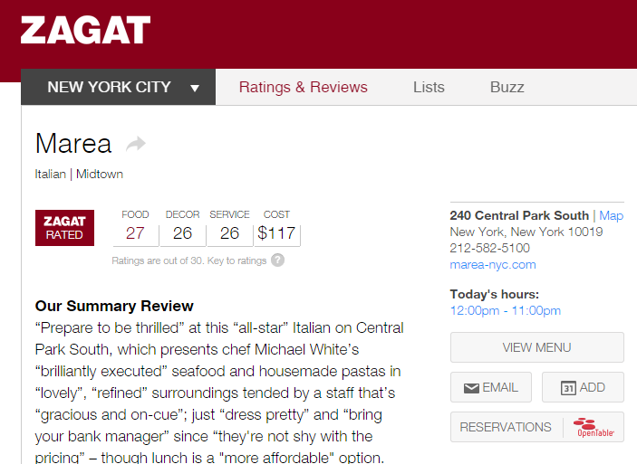
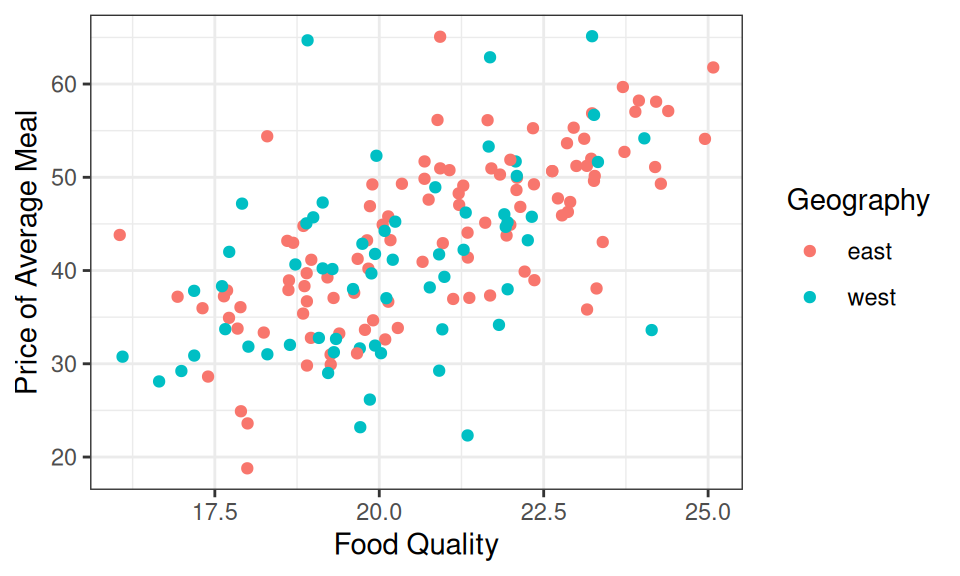
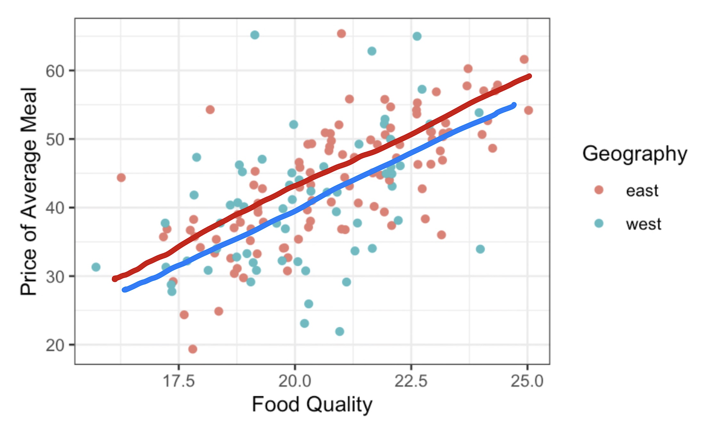
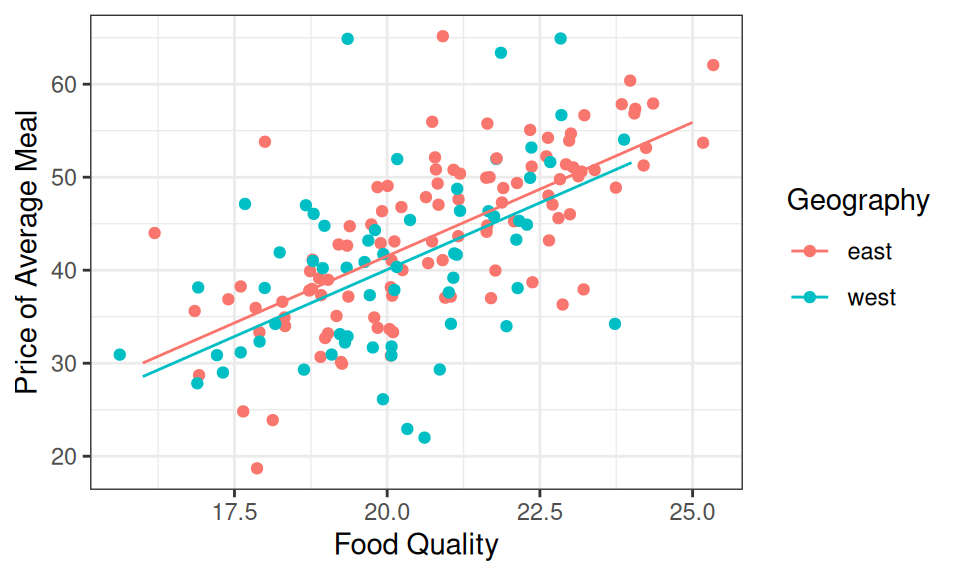
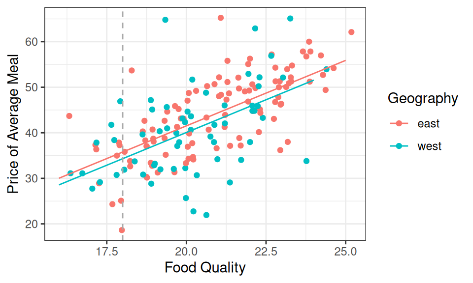

---

course: xac-suat-thong-ke

lecture: 08-hoi-quy-tuyen-tinh-boi

section: lecture

title: "Hồi quy tuyến tính bội: Mô hình hóa mối quan hệ đa chiều"

prerequisites: []

supportingConcepts: ["thong-ke-mo-ta", "phuong-sai"]

lessonStatus: ready

hasChapterExercises: true

description: "Mở rộng mô hình tuyến tính lên nhiều chiều: Hồi quy với biến định lượng và biến định tính (biến giả dummy), giải thích hệ số hồi quy riêng phần và kiểm soát biến số."

---

<div class="lecture-notes-content">

Trong bài học trước, ta đã làm quen với mô hình tuyến tính đơn: Một phương trình đường thẳng mô tả mối liên hệ giữa một biến giải thích duy nhất và một biến phản hồi. Tuy nhiên, các hiện tượng kinh tế, xã hội và khoa học trong thực tế hiếm khi vận hành đơn giản như vậy. Một hiện tượng thường chịu sự tác động đồng thời của nhiều yếu tố đa dạng: Giá nhà không chỉ phụ thuộc vào diện tích mà còn vào vị trí, số phòng ngủ và năm xây dựng. Tương tự, mức lương của một kỹ sư không chỉ dựa vào số năm kinh nghiệm mà còn phụ thuộc vào trình độ học vấn, chứng chỉ nghề nghiệp và quy mô doanh nghiệp.

Khi dữ liệu mở rộng sang nhiều chiều, hệ thống thị giác của con người gặp phải rào cản sinh học: Ta không thể vẽ đồ thị trực quan vượt quá 3 chiều không gian. Để phân tích và định lượng các mối quan hệ đa chiều phức tạp đó, thống kê học cung cấp một công cụ mạnh mẽ: **Mô hình Hồi quy tuyến tính bội (Multiple Linear Regression)**.

---

## 1. Khung toán học của Hồi quy tuyến tính bội

::: info Khái niệm: Hồi quy tuyến tính bội (Multiple Linear Regression)

Hồi quy tuyến tính bội là phương pháp mô hình hóa một biến phản hồi định lượng liên tục $y$ dưới dạng hàm tuyến tính của $p$ biến giải thích $x_1, x_2, \dots, x_p$:

$$
\hat{y} = b_0 + b_1 x_1 + b_2 x_2 + \dots + b_p x_p
$$

:::

Khai triển tường minh bằng ký hiệu tổng dồn:

$$
\begin{aligned}
\hat{y} &= b_0 + \sum_{j=1}^p b_j x_j \\
&= b_0 + b_1 x_1 + b_2 x_2 + \dots + b_p x_p
\end{aligned}
$$

trong đó:

- $\hat{y}$: Giá trị dự báo (Fitted value) của biến phản hồi.

- $b_0$: Hệ số chặn (Intercept), là giá trị kỳ vọng của $y$ khi toàn bộ các biến giải thích $x_1, \dots, x_p$ đều đồng thời nhận giá trị bằng 0.

- $b_j$ ($j = 1, \dots, p$): Các hệ số hồi quy riêng phần (Partial regression coefficients).

- $x_j$: Các biến giải thích, có thể là biến định lượng hoặc biến định tính đã được mã hóa.

Trong môi trường R, phương pháp bình phương tối thiểu cho hồi quy bội được thực hiện bằng hàm `lm()`, trong đó các biến giải thích được kết nối với nhau bằng dấu cộng `+`:

```r

lm(y ~ x1 + x2 + ... + xp, data = my_data)

```

Để thấu hiểu sâu sắc bản chất hình học và ý nghĩa thống kê của mô hình hồi quy bội, ta sẽ lần lượt phân tích hai kịch bản phân tích kinh điển:

1. **Kịch bản 1**: Mô hình kết hợp giữa các biến định lượng và biến định tính.

2. **Kịch bản 2**: Mô hình gồm nhiều biến định lượng liên tục (Mặt phẳng hồi quy).

---

## 2. Kịch bản 1: Kết hợp Biến định lượng & Biến định tính (Biến giả Dummy)

Để có một bối cảnh thực nghiệm sinh động, ta cùng nghiên cứu bảng dữ liệu đánh giá ẩm thực nổi tiếng từ cẩm nang Zagat (*Zagat Survey*). Zagat đánh giá các nhà hàng dựa trên điểm số chuyên nghiệp từ thang điểm 30 cho ba tiêu chí: Chất lượng đồ ăn (`food`), phong cách bài trí (`decor`), chất lượng phục vụ (`service`), cùng với mức giá trung bình của một bữa ăn (`price`, USD) và khu vực địa lý (`geo`).

<div style="text-align: center; margin: 16px 0;">

  

</div>

**Hình 8.1:** Đánh giá ẩm thực của Zagat đối với nhà hàng Marea tại New York: Điểm số đồ ăn đạt 27/30, khu vực Midtown, đi kèm các mô tả chi tiết về chi phí và trải nghiệm.

Xét tập dữ liệu gồm $168$ nhà hàng Ý tại Manhattan:

```text

# Bảng dữ liệu zagat: 168 nhà hàng x 6 biến số

   restaurant          price  food decor service geo

   <chr>               <dbl> <dbl> <dbl>   <dbl> <chr>

 1 Daniella Ristorante    43    22    18      20 west

 2 Tello's Ristorante     32    20    19      19 west

 3 Biricchino             34    21    13      18 west

 4 Bottino                41    20    20      17 west

 5 Da Umberto             54    24    19      21 west

 6 Le Madri               52    22    22      21 west

 7 Le Zie                 34    22    16      21 west

 8 Pasticcio              34    20    18      21 east

 9 Belluno                39    22    19      22 east

10 Cinque Terre           44    21    17      19 east

# ... 158 nhà hàng tiếp theo

```

Trong bảng dữ liệu này, biến vị trí địa lý `geo` là một biến định tính danh nghĩa (Nominal Categorical) nhận hai mức giá trị: Bờ Đông (`east`) hoặc Bờ Tây (`west`) Manhattan.

<div style="text-align: center; margin: 16px 0;">

  

</div>

**Hình 8.2:** Biểu đồ phân tán khảo sát mối liên hệ giữa chất lượng đồ ăn (`food`) và giá bữa ăn (`price`), được tô màu phân biệt theo vị trí địa lý (`geo`: Bờ Đông màu đỏ, bờ Tây màu xanh lam).

Quan sát Hình 8.2, ta nhận thấy:

- Có một mối tương quan dương khá rõ giữa chất lượng đồ ăn và giá tiền: Đồ ăn càng ngon thì giá bữa ăn càng đắt.

- Khi quan sát kỹ theo màu sắc, các nhà hàng ở bờ Tây dường như có mức giá nằm thấp hơn một chút so với các nhà hàng ở bờ Đông có cùng mức điểm đồ ăn.

<div style="text-align: center; margin: 16px 0;">

  

</div>

**Hình 8.3:** Ước lượng đồ họa bằng hai đường thẳng song song: Một đường cho bờ Đông và một đường cho bờ Tây.

### Cơ chế hoạt động của Biến giả (Dummy / Indicator Variable)

Theo hệ thống phân loại dữ liệu, các phép toán đại số như phép nhân và phép cộng chỉ được định nghĩa trên các biến định lượng. Làm thế nào để đưa một biến định tính như `geo` vào phương trình hồi quy?

Giải pháp toán học mẫu mực là sử dụng **Biến giả (Dummy Variable hay Indicator Variable)**:

::: info Khái niệm: Biến giả (Dummy Variable)

Biến giả là một biến số nhị phân nhận giá trị $1$ nếu quan sát thuộc về một mức phân loại cụ thể và nhận giá trị $0$ nếu không thuộc về mức đó. Một biến định tính có $k$ mức phân loại sẽ được biểu diễn đầy đủ bởi $k-1$ biến giả.

:::

Hệ thống thống kê tự động chọn một mức làm **Mức cơ sở (Reference level)** và tạo biến giả cho các mức còn lại. Vì chữ cái `east` đứng trước `west` trong bảng chữ cái tiếng Anh, R mặc định chọn `east` làm mức cơ sở và tạo ra biến giả `geowest`:

$$
D_{\text{west}} = \begin{cases} 1 & \text{if West} \\ 0 & \text{if East} \end{cases}
$$

Khớp mô hình hồi quy trong R:

```r

lm(price ~ food + geo, data = zagat)

```

Kết quả ước lượng các hệ số:

```text

Coefficients:

(Intercept)         food      geowest

    -15.970        2.875       -1.459

```

Phương trình hồi quy cụ thể:

Trong công thức, $\hat P$ là giá dự báo, $F$ là điểm món ăn và $W$ là biến chỉ thị khu vực phía tây.

$$
\hat P = -15.97 + 2.87F - 1.46W
$$

### Bản chất hình học: Hai đường thẳng song song

Để giải mã hình học của phương trình trên, ta thay giá trị của biến giả $D_{\text{west}}$ cho từng khu vực:

1. **Với các nhà hàng ở bờ Tây ($D_{\text{west}} = 1$)**:

$$
\begin{aligned}
\hat P &= -15.97 + 2.87F - 1.46 \times 1 \\
&= (-15.97 - 1.46) + 2.87F \\
&= -17.43 + 2.87F
\end{aligned}
$$

2. **Với các nhà hàng ở bờ Đông ($D_{\text{west}} = 0$)**:

$$
\begin{aligned}
\hat P &= -15.97 + 2.87F - 1.46 \times 0 \\
&= -15.97 + 2.87F
\end{aligned}
$$

<div style="text-align: center; margin: 16px 0;">

  

</div>

**Hình 8.4:** Mô hình hồi quy bội tạo ra hai đường thẳng song song hoàn hảo: Chúng có chung độ dốc ($b_{\text{food}} = 2.87$) nhưng có hệ số chặn khác nhau phản ánh khoảng chênh lệch giữa hai khu vực.

<div style="text-align: center; margin: 16px 0;">

  

</div>

**Hình 8.5:** Bản chất của việc kiểm soát biến số: Tại bất kỳ lát cắt thẳng đứng nào (ví dụ tại $\text{food} = 18$), khoảng cách thẳng đứng giữa hai đường song song luôn cố định chính xác bằng $|-1.46| = 1.46$ USD.

### Đổi mức cơ sở (Changing Reference Level)

Nếu ta đổi mức cơ sở từ `east` sang `west` (đặt câu hỏi *"Nhà hàng có nằm ở bờ Đông hay không?"*), phương trình mô hình sẽ trở thành:

Đặt $E=D_{\text{east}}$ là biến chỉ thị khu vực phía đông.

$$
\hat P = -17.43 + 2.87F + 1.46E
$$

Độ dốc của chất lượng đồ ăn hoàn toàn không đổi ($2.87$), nhưng hệ số của biến giả đổi dấu từ âm sang dương ($+1.46$), cho thấy việc ở bờ Đông làm giá tăng thêm \$1.46 so với bờ Tây.

---

## 3. Kịch bản 2: Ba biến định lượng & Mặt phẳng hồi quy

Khi mô hình có từ hai biến giải thích định lượng trở lên, quỹ đạo hình học không còn là các đường thẳng song song nữa.

Xét mô hình giải thích giá bữa ăn (`price`) đồng thời bằng cả điểm chất lượng đồ ăn (`food`) và điểm phong cách bài trí (`decor`):

```r

lm(price ~ food + decor, data = zagat)

```

Kết quả ước lượng tham số:

```text

Coefficients:

(Intercept)         food        decor

    -24.500        1.646        1.882

```

Phương trình mô hình hồi quy:

Đặt $D$ là điểm trang trí. Giữ ký hiệu $\hat P$ cho giá dự báo và $F$ cho điểm món ăn.

$$
\hat P = -24.50 + 1.65F + 1.88D
$$

### Hình học của Mặt phẳng hồi quy trong không gian 3 chiều

Vì cả `food` và `decor` đều là các biến định lượng liên tục, mô hình phương trình trên mô tả một **Mặt phẳng hồi quy (Regression Plane)** trong không gian tọa độ 3 chiều $(\text{food}, \text{decor}, \text{price})$:

- Điểm cắt trục tung trong không gian 3 chiều: Khi cả điểm đồ ăn và bài trí đều bằng 0, mặt phẳng cắt trục giá tại $b_0 = -24.50$.

- Độ dốc theo trục `decor` ($1.88$) lớn hơn độ dốc theo trục `food` ($1.65$), biểu thị rằng mặt phẳng nghiêng dốc hơn về phía biến phong cách bài trí.

---

## 4. Nghệ thuật giải thích hệ số hồi quy: Điều kiện "Giữ các yếu tố khác không đổi"

Điểm mấu chốt sâu sắc nhất khi bước từ hồi quy đơn sang hồi quy bội nằm ở **cách diễn giải các hệ số $b_j$**.

Trong hồi quy bội, mỗi hệ số hồi quy $b_j$ là một **hệ số hồi quy riêng phần (Partial regression coefficient)**. Ý nghĩa của nó chỉ có hiệu lực dưới điều kiện giả định kinh điển của khoa học: **Giữ các biến số còn lại trong mô hình không đổi (Ceteris Paribus / Controlling for other variables)**.

### Diễn giải các hệ số trong mô hình hai biến định lượng

Xét lại phương trình mô hình:

$$
\hat P = -24.50 + 1.65F + 1.88D
$$

1. **Hệ số $b_{\text{food}} = 1.65$**:

   - *Cách diễn giải chuẩn mực*: **Khi kiểm soát phong cách bài trí (`decor` giữ không đổi)**, cứ mỗi điểm tăng thêm trong chất lượng đồ ăn, giá bữa ăn dự kiến sẽ **tăng thêm \$1.65**.

   - Nói cách khác: Nếu so sánh hai nhà hàng có không gian bài trí đẹp như nhau, nhà hàng có điểm đồ ăn cao hơn 1 điểm sẽ có giá đắt hơn trung bình \$1.65.

2. **Hệ số $b_{\text{decor}} = 1.88$**:

   - *Cách diễn giải chuẩn mực*: **Khi kiểm soát chất lượng đồ ăn (`food` giữ không đổi)**, cứ mỗi điểm tăng thêm trong phong cách bài trí, giá bữa ăn dự kiến sẽ **tăng thêm \$1.88**.

   - Bài học kinh tế thú vị: Tại Manhattan, việc đầu tư thêm một điểm bài trí không gian thậm chí còn đem lại mức tăng giá cao hơn (+\$1.88) so với việc cải thiện chất lượng món ăn (+\$1.65).

### So sánh với hồi quy đơn biến & Hiện tượng Biến gây nhiễu

Hãy chú ý sự biến thiên của hệ số `food`:

- Trong mô hình hồi quy đơn chỉ gồm biến `food`: $\widehat{\text{price}} = -15.97 + 2.87 \times \text{food}$ (hệ số là **$2.87$**).

- Trong mô hình hồi quy bội có thêm biến `decor`: Hệ số của `food` giảm xuống còn **$1.65$**.

Tại sao lại có sự sụt giảm này? Lý do là trong thực tế, các nhà hàng có đồ ăn ngon thường cũng đầu tư không gian bài trí đẹp mắt. Trong mô hình đơn biến, biến `food` đã vô tình "gánh" luôn cả hiệu ứng tăng giá do không gian bài trí đem lại. Khi ta đưa `decor` vào mô hình bội, hiệu ứng của bài trí được bóc tách riêng ra, giúp ta đo lường được **tác động thuần túy của chất lượng đồ ăn khi không gian bài trí đã được cố định**.

---

## 5. Tóm tắt chương

1. **Hồi quy tuyến tính bội**: Mở rộng mô hình tuyến tính lên $p$ biến giải thích dưới dạng $\hat{y} = b_0 + \sum_{j=1}^p b_j x_j$, cho phép nghiên cứu mối quan hệ đa chiều vượt qua giới hạn thị giác của con người.

2. **Biến giả (Dummy variable)**: Mã hóa biến định tính gồm $k$ mức thành $k-1$ biến nhị phân $0/1$. Mô hình kết hợp giữa một biến định lượng và một biến giả hai mức sẽ tạo ra **hai đường thẳng hồi quy song song** có chung độ dốc nhưng khác hệ số chặn.

3. **Mặt phẳng hồi quy**: Khi mô hình gồm hai biến giải thích định lượng, quỹ đạo hình học là một mặt phẳng trong không gian 3 chiều, với độ nghiêng theo từng trục được quyết định bởi hệ số tương ứng.

4. **Nguyên lý kiểm soát biến số (Ceteris Paribus)**: Hệ số hồi quy riêng phần $b_j$ phản ánh mức thay đổi kỳ vọng của $y$ trên mỗi đơn vị tăng thêm của $x_j$ **khi tất cả các biến giải thích còn lại trong mô hình được giữ nguyên cố định**.

## Tài liệu tham khảo

- James, G., Witten, D., Hastie, T., & Tibshirani, R. (2021). *An Introduction to Statistical Learning: With Applications in R* (2nd ed.). Springer.

- Wickham, H., & Grolemund, G. (2017). *R for Data Science: Import, Tidy, Transform, Visualize, and Model Data*. O'Reilly Media.

- UC Berkeley STAT 20: *Introduction to Probability and Statistics*, Department of Statistics, UC Berkeley.

</div>

<div class="lecture-exercises-content">

::: exercise Bài tập 1: Giải mã Biến giả Đa mức & Hệ phương trình Hồi quy song song

Một nhà nghiên cứu sinh thái học khảo sát thời gian ngủ trung bình mỗi ngày ($y$, giờ) của các loài thú dựa trên khối lượng cơ thể ($x_1 = \text{log\_bodywt}$) và chế độ dinh dưỡng ($x_2 = \text{vore}$, gồm ba nhóm: Ăn thịt `carni`, ăn cỏ `herbi`, ăn tạp `omni`).

Chọn nhóm ăn thịt (`carni`) làm mức cơ sở. Nhà nghiên cứu định nghĩa hai biến giả:

- $D_{\text{herbi}} = 1$ nếu loài ăn cỏ, và $0$ cho các trường hợp khác.

- $D_{\text{omni}} = 1$ nếu loài ăn tạp, và $0$ cho các trường hợp khác.

Kết quả khớp mô hình hồi quy tuyến tính bội thu được:

Đặt $H$ là biến chỉ thị động vật ăn cỏ và $O$ là biến chỉ thị động vật ăn tạp. Nhóm ăn thịt là nhóm đối chứng.

$$
\hat{y} = 15.2 - 0.45 x_1 - 1.8H + 0.6O
$$

1. Hãy viết phương trình hồi quy dự báo thời gian ngủ theo $x_1$ cho từng nhóm động vật riêng biệt (`carni`, `herbi`, `omni`).

2. Nhận xét về mối quan hệ hình học giữa ba đường hồi quy trên mặt phẳng tọa độ $(x_1, y)$.

3. Khi hai loài động vật có cùng khối lượng cơ thể ($x_1$ bằng nhau), thời gian ngủ của loài ăn cỏ dự kiến chênh lệch bao nhiêu giờ so với loài ăn thịt? So với loài ăn tạp?

:::

::: hint Gợi ý Bài tập 1

- Với nhóm ăn thịt (`carni`), cả hai biến giả $D_{\text{herbi}}$ và $D_{\text{omni}}$ đều nhận giá trị $0$.

- Với nhóm ăn cỏ (`herbi`), $D_{\text{herbi}} = 1$ và $D_{\text{omni}} = 0$.

- Các đường thẳng có cùng hệ số trước $x_1$ sẽ song song với nhau.

:::

::: solution Lời giải chi tiết Bài tập 1

1. **Viết phương trình hồi quy cho từng nhóm động vật**:

   - **Nhóm ăn thịt (`carni`)**: Đây là mức cơ sở, $D_{\text{herbi}} = 0$ và $D_{\text{omni}} = 0$:

$$
\begin{aligned}
\hat y_C &= 15.2 - 0.45 x_1 - 0 \\
&= 15.2 - 0.45 x_1
\end{aligned}
$$

   - **Nhóm ăn cỏ (`herbi`)**: Ứng với $D_{\text{herbi}} = 1$ và $D_{\text{omni}} = 0$:

$$
\begin{aligned}
\hat y_H &= 15.2 - 0.45 x_1 - 1.80 \\
&= (15.2 - 1.80) - 0.45 x_1 \\
&= 13.4 - 0.45 x_1
\end{aligned}
$$

   - **Nhóm ăn tạp (`omni`)**: Ứng với $D_{\text{herbi}} = 0$ và $D_{\text{omni}} = 1$:

$$
\begin{aligned}
\hat y_O &= 15.2 - 0.45 x_1 - 0 + 0.60 \\
&= (15.2 + 0.60) - 0.45 x_1 \\
&= 15.8 - 0.45 x_1
\end{aligned}
$$

2. **Mối quan hệ hình học**:

   - Cả ba phương trình đều có chung hệ số độ dốc $b_1 = -0.45$.

   - Trên mặt phẳng tọa độ $(x_1, y)$, ba phương trình này mô tả **ba đường thẳng song song hoàn hảo**, dốc xuống từ trái qua phải. Đường của nhóm ăn tạp nằm trên cùng (hệ số chặn $15.8$), tiếp theo là đường của nhóm ăn thịt (hệ số chặn $15.2$), và thấp nhất là đường của nhóm ăn cỏ (hệ số chặn $13.4$).

3. **So sánh chênh lệch thời gian ngủ khi kiểm soát khối lượng cơ thể**:

   - Giữa loài ăn cỏ và loài ăn thịt:

$$
\hat{y}_{\text{herbi}} - \hat{y}_{\text{carni}} = -1.80 \text{ h}
$$

Khi có cùng khối lượng cơ thể, loài ăn cỏ dự kiến ngủ **ít hơn $1.80$ giờ mỗi ngày** so với loài ăn thịt.

   - Giữa loài ăn cỏ và loài ăn tạp:

$$
\begin{aligned}
\hat{y}_{\text{herbi}} - \hat{y}_{\text{omni}} &= 13.4 - 15.8 \\
&= -2.40 \text{ h}
\end{aligned}
$$

Khi có cùng khối lượng cơ thể, loài ăn cỏ dự kiến ngủ **ít hơn $2.40$ giờ mỗi ngày** so với loài ăn tạp.

:::

---

::: exercise Bài tập 2: Phân tích Cơ chế Biến gây nhiễu & Bóc tách Tác động

Một chuyên gia kinh tế lao động nghiên cứu mức lương khởi điểm ($y$, triệu đồng/tháng) của các kỹ sư mới tốt nghiệp. Chuyên gia xem xét hai mô hình hồi quy:

- **Mô hình A (Hồi quy đơn)**:

$$
\hat{y} = 10.5 + 2.4 x_1
$$

  trong đó $x_1$ là điểm trung bình tích lũy GPA đại học (thang điểm 4).

- **Mô hình B (Hồi quy bội)**:

$$
\hat{y} = 6.0 + 1.1 x_1 + 3.2 x_2
$$

  trong đó $x_2$ là số lượng dự án thực tế sinh viên đã hoàn thành trong thời gian học.

1. Hãy diễn giải ý nghĩa của hệ số $2.4$ trong Mô hình A và hệ số $1.1$ trong Mô hình B.

2. Tại sao khi bổ sung biến số dự án thực tế $x_2$ vào mô hình, hệ số của biến GPA lại giảm mạnh từ $2.4$ xuống còn $1.1$?

3. Nếu một sinh viên có GPA bằng 3.5 và đã hoàn thành 4 dự án thực tế, mức lương dự báo theo Mô hình B là bao nhiêu? Nếu mức lương thực tế sinh viên này nhận được là $28.0$ triệu đồng/tháng thì phần dư bằng bao nhiêu? Sinh viên này đạt mức lương trên hay dưới kỳ vọng của mô hình?

:::

::: hint Gợi ý Bài tập 2

- Chú ý cụm từ điều kiện bắt buộc *"Khi kiểm soát số lượng dự án thực tế"* khi diễn giải Mô hình B.

- Sinh viên có GPA cao thường có xu hướng hoàn thành nhiều dự án thực tế hơn (mối tương quan giữa $x_1$ và $x_2$).

- Tính giá trị dự báo: $\hat{y} = 6.0 + 1.1(3.5) + 3.2(4)$, sau đó tính phần dư $e = y - \hat{y}$.

:::

::: solution Lời giải chi tiết Bài tập 2

1. **Diễn giải các hệ số**:

   - Trong Mô hình A ($b_1 = 2.4$): Mỗi điểm GPA tăng thêm đi kèm với mức tăng lương khởi điểm kỳ vọng là **$2.4$ triệu đồng/tháng**.

   - Trong Mô hình B ($b_1 = 1.1$): **Khi kiểm soát số lượng dự án thực tế ($x_2$ giữ không đổi)**, mỗi điểm GPA tăng thêm đi kèm với mức tăng lương khởi điểm kỳ vọng là **$1.1$ triệu đồng/tháng**.

2. **Giải thích sự sụt giảm của hệ số GPA**:

   - Trong thực tế, các sinh viên chăm chỉ có điểm GPA cao thường cũng tích cực tham gia và hoàn thành nhiều dự án thực nghiệm hơn ($x_1$ và $x_2$ có tương quan dương mạnh).

   - Trong Mô hình A, biến số dự án $x_2$ bị bỏ sót (Omitted variable). Hệ số $2.4$ của GPA đã vô tình hấp thu cả phần tác động tăng lương đến từ kỹ năng thực chiến của các dự án.

   - Khi đưa $x_2$ vào Mô hình B, tác động của kinh nghiệm dự án được bóc tách độc lập (+$3.2$ triệu đồng/dự án). Hệ số $1.1$ phản ánh chính xác tác động thuần túy của kiến thức lý thuyết học thuật khi kinh nghiệm dự án đã được cố định ngang nhau.

3. **Tính giá trị dự báo và phần dư**:

   - Thay $x_1 = 3.5$ và $x_2 = 4$ vào Mô hình B:

$$
\begin{aligned}
\hat{y} &= 6.0 + 1.1(3.5) + 3.2(4) \\
&= 6.0 + 3.85 + 12.8 \\
&= 22.65 \text{ million VND/month}
\end{aligned}
$$

   - Tính phần dư:

$$
\begin{aligned}
\hat{e} &= y - \hat{y} \\
&= 28.0 - 22.65 \\
&= +5.35 \text{ million VND/month}
\end{aligned}
$$

   - **Kết luận**: Phần dư mang dấu dương ($\hat{e} = +5.35 > 0$), chứng tỏ sinh viên này có mức lương thực tế **vượt trội hơn hẳn so với mức kỳ vọng chung** của mô hình đối với một người có cùng mức GPA và số lượng dự án tương đương.

:::

---

::: exercise Bài tập 3: Mô hình Hồi quy Doanh thu & Ứng dụng Quản trị Kinh doanh

Một chuỗi cửa hàng bán lẻ xây dựng mô hình hồi quy bội để dự báo doanh thu hàng tháng ($y$, trăm triệu đồng) dựa trên:

- $x_1$: Diện tích mặt sàn kinh doanh ($m^2$, đơn vị: $100\text{ m}^2$).

- $x_2$: Ngân sách tiếp thị quảng cáo trực tuyến (triệu đồng/tháng).

- $x_3$: Vị trí cửa hàng (`location`, gồm hai mức: Trung tâm thương mại `mall` và Mặt phố độc lập `street`). Chọn mặt phố độc lập `street` làm mức cơ sở ($D_{\text{mall}} = 1$ nếu nằm trong TTTM, $0$ nếu mặt phố).

Phương trình hồi quy ước lượng được:

Đặt $M$ là biến chỉ thị cửa hàng trong trung tâm thương mại.

$$
\hat{y} = 1.2 + 0.85 x_1 + 0.04 x_2 + 2.1M
$$

1. Hãy giải thích ý nghĩa thực tế của hệ số $b_1 = 0.85$, $b_2 = 0.04$, và $b_{\text{mall}} = 2.10$.

2. Cửa hàng A có diện tích $200\text{ m}^2$ ($x_1 = 2$), ngân sách tiếp thị $50$ triệu đồng/tháng ($x_2 = 50$), đặt tại trung tâm thương mại. Doanh thu dự báo của cửa hàng A là bao nhiêu?

3. Nếu chủ chuỗi cửa hàng muốn tăng doanh thu dự báo của một cửa hàng mặt phố thêm $1.7$ trăm triệu đồng (170 triệu đồng) mà không thay đổi ngân sách tiếp thị, cửa hàng đó cần mở rộng diện tích thêm bao nhiêu mét vuông?

:::

::: hint Gợi ý Bài tập 3

- Hệ số $b_2 = 0.04$ trăm triệu đồng tương đương với bao nhiêu triệu đồng doanh thu trên mỗi triệu đồng tiếp thị?

- Với câu 3: Sử dụng mối liên hệ $\Delta \hat{y} = b_1 \times \Delta x_1$.

:::

::: solution Lời giải chi tiết Bài tập 3

1. **Giải thích các hệ số mô hình**:

   - $b_1 = 0.85$: Khi kiểm soát ngân sách tiếp thị và vị trí cửa hàng, cứ mỗi $100\text{ m}^2$ diện tích mặt sàn mở rộng thêm, doanh thu hàng tháng của cửa hàng dự kiến **tăng thêm $0.85$ trăm triệu đồng (85 triệu đồng)**.

   - $b_2 = 0.04$: Khi kiểm soát diện tích và vị trí, cứ mỗi 1 triệu đồng chi thêm cho tiếp thị quảng cáo, doanh thu dự kiến **tăng thêm $0.04$ trăm triệu đồng (4 triệu đồng)**. Tỷ suất doanh thu trên chi phí tiếp thị đạt $4:1$.

   - $b_{\text{mall}} = 2.10$: Khi hai cửa hàng có cùng diện tích mặt sàn và cùng ngân sách tiếp thị, cửa hàng đặt tại trung tâm thương mại dự kiến đạt doanh thu hàng tháng **cao hơn $2.10$ trăm triệu đồng (210 triệu đồng)** so với cửa hàng đặt tại mặt phố độc lập.

2. **Dự báo doanh thu cho cửa hàng A**:

   - Cửa hàng A có $x_1 = 2$, $x_2 = 50$, $D_{\text{mall}} = 1$:

$$
\begin{aligned}
\hat y_A&=1{,}2+1{,}7+2+2{,}1 \\
&=1{,}2+1{,}70+2+2{,}10 \\
&=7.
\end{aligned}
$$

Đơn vị của kết quả là trăm triệu đồng, tức 700 triệu đồng mỗi tháng.

3. **Tính diện tích cần mở rộng**:

   - Khi vị trí và ngân sách tiếp thị không đổi, độ tăng doanh thu liên hệ với độ tăng diện tích qua công thức:

$$
\Delta \hat{y} = b_1 \times \Delta x_1
$$

   - Để $\Delta \hat{y} = 1.7$ trăm triệu đồng:

$$
\Delta x_1 = \frac{\Delta \hat{y}}{b_1} = \frac{1.7}{0.85} = 2.0
$$

   - Vì đơn vị của $x_1$ là $100\text{ m}^2$, mức tăng diện tích cần thiết là:

$$
\begin{aligned}
\Delta \mathrm{Area} &= 2.0 \times 100\text{ m}^2 \\
&= 200\text{ m}^2
\end{aligned}
$$

   - **Kết luận**: Cửa hàng cần mở rộng thêm đúng $200\text{ m}^2$ diện tích sàn kinh doanh.

:::

</div>
