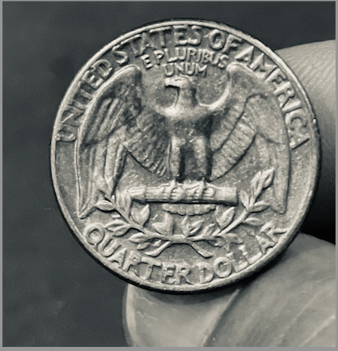
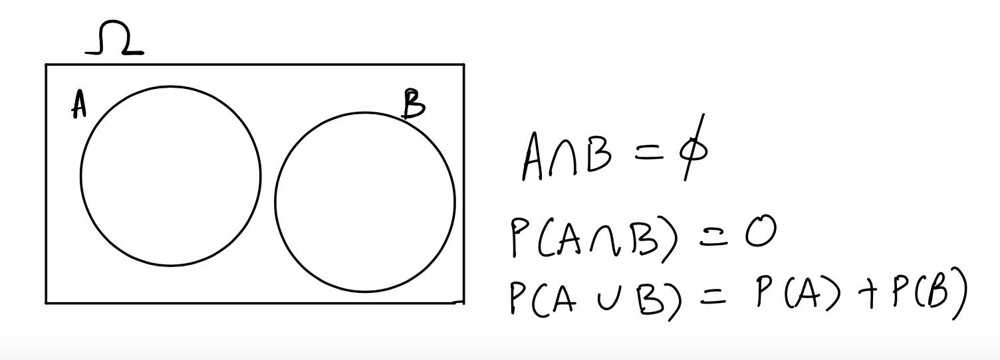
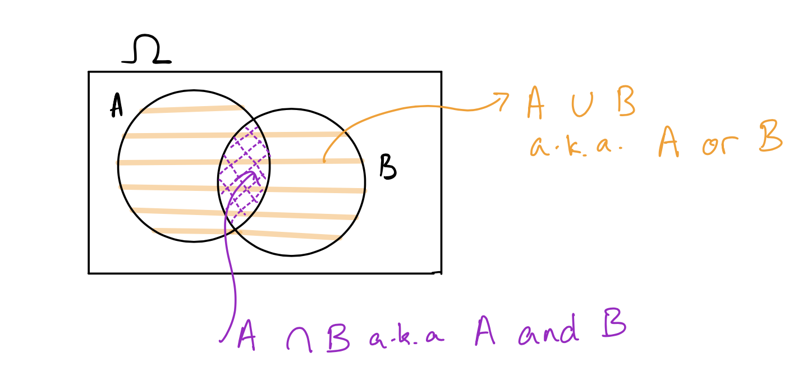
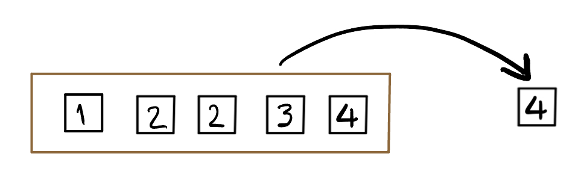
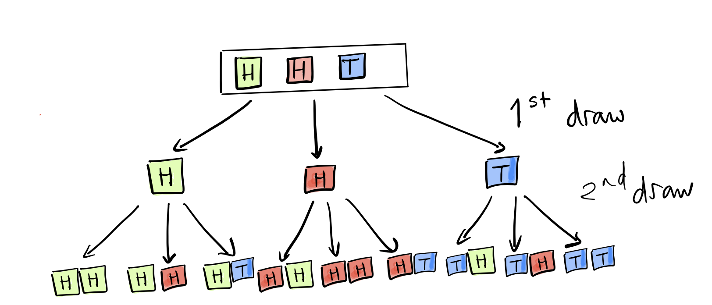

Trong hai phần học trước, ta đã làm chủ các kỹ thuật tóm tắt dữ liệu: Từ các bảng số liệu thực nghiệm thu thập được, ta vẽ biểu đồ, tính trung bình, độ lệch chuẩn, hệ số tương quan và khớp mô hình hồi quy. Tất cả những thao tác đó được gọi chung là **Thống kê mô tả (Descriptive Statistics)**: Ta mô tả chính xác những gì đã quan sát được trong mẫu dữ liệu hiện có.

Tuy nhiên, mục tiêu tối thượng của khoa học dữ liệu không chỉ dừng lại ở việc mô tả quá khứ. Ta muốn dùng dữ liệu mẫu để **suy rộng (Generalization)** ra toàn bộ quần thể lớn hơn: Từ kết quả khảo sát 1,000 cử tri để dự đoán kết quả bầu cử tổng thống, hoặc từ thử nghiệm lâm sàng trên 500 bệnh nhân để đánh giá hiệu quả của một loại vaccine mới cho hàng triệu người.

  

**Hình 9.1:** Bảng xếp hạng các tổ chức thăm dò dư luận của FiveThirtyEight: Sự chênh lệch về độ tin cậy bắt nguồn từ phương pháp luận và cách thức kiểm soát sai số ngẫu nhiên khi lấy mẫu.

Vấn đề cốt lõi khi suy rộng là: Mỗi lần lấy một mẫu ngẫu nhiên mới, ta sẽ thu được một kết quả ước lượng khác nhau. Sự biến động ngẫu nhiên này được gọi là **Biến thiên do lấy mẫu (Sampling variation)**. Để kiểm soát và đo lường được mức độ tin cậy của các suy rộng, ta bắt buộc phải hiểu được cơ chế sinh ra sự biến thiên đó. Và ngôn ngữ toán học duy nhất cho phép định lượng sự ngẫu nhiên chính là **Lý thuyết Xác suất (Probability Theory)**.

---

## 1. Nghịch lý Chevalier de Méré & Khởi nguồn của Lý thuyết Xác suất

Lý thuyết xác suất cổ điển không bắt đầu từ những phương trình trừu tượng trong phòng thí nghiệm, mà nảy sinh từ các trò chơi may rủi với đồng xu và xúc xắc vào thế kỷ 17.

  

**Hình 9.2:** Trò chơi xúc xắc may rủi vào thế kỷ 17: Nơi khơi nguồn cho những tranh luận toán học đầu tiên giữa Antoine Gombaud, Blaise Pascal và Pierre de Fermat.

Tại nước Pháp thế kỷ 17, Antoine Gombaud (thường được gọi là Hiệp sĩ De Méré - *Chevalier de Méré*) là một quý tộc ham mê cờ bạc và tự nhận mình am hiểu toán học. Ông thường tham gia hai trò chơi cá cược:

### Trò chơi 1: Gieo một con xúc xắc bốn lần
De Méré đặt cược rằng: Trong 4 lần gieo một con xúc xắc 6 mặt công bằng, sẽ xuất hiện **ít nhất một lần mặt 6 điểm**.
- Ông lập luận: Xác suất ra mặt 6 trong một lần gieo là $\frac{1}{6}$. Vậy trong 4 lần gieo, xác suất thắng cuộc là:
  $$4 \times \frac{1}{6} = \frac{4}{6} = \frac{2}{3} \approx 66.7\%$$
- Trên thực tế, khi đặt cược dài hạn vào trò chơi này, De Méré luôn thắng nhiều hơn thua. Ông tin chắc rằng phép tính của mình hoàn toàn đúng đắn.

### Trò chơi 2: Gieo một cặp xúc xắc hai mươi tư lần
Sau đó, De Méré chuyển sang một trò chơi mới có tiền thưởng lớn hơn: Gieo đồng thời một cặp xúc xắc (hai con) trong 24 lần liên tiếp, và đặt cược rằng sẽ xuất hiện **ít nhất một lần cặp (6, 6)** (được gọi là *double six*).
- Ông lập luận: Không gian khả năng khi gieo hai con xúc xắc có $6 \times 6 = 36$ kết quả. Xác suất xuất hiện cặp (6, 6) trong một lần gieo là $\frac{1}{36}$. Do đó, gieo 24 lần thì xác suất thắng cuộc sẽ là:
  $$24 \times \frac{1}{36} = \frac{24}{36} = \frac{2}{3}$$
- De Méré đinh ninh rằng hai trò chơi có cơ hội thắng hoàn toàn ngang nhau (đều bằng $2/3$). Thế nhưng, khi tham gia cá cược thực tế trong thời gian dài, ông kinh hoàng nhận ra mình **thua nhiều hơn thắng** và dần bị mất tiền!

### Giải mã nghịch lý
Quá bế tắc, De Méré đã viết thư gửi nhà toán học thiên tài Blaise Pascal vào năm 1654 để nhờ giải thích. Pascal cùng Pierre de Fermat đã tiến hành mổ xẻ bài toán và chỉ ra sai lầm nghiêm trọng trong suy luận của De Méré:

1. **Ở Trò chơi 1**: Các lần xuất hiện mặt 6 ở các lượt gieo khác nhau **không phải là các biến cố xung khắc** (ta có thể đổ ra mặt 6 ở cả lượt thứ nhất lẫn lượt thứ hai). Phép cộng $1/6 + 1/6 + 1/6 + 1/6$ đã làm lặp lại nhiều lần các kết quả giao nhau. Xác suất thực tế phải được tính qua biến cố đối (không có lần nào ra mặt 6):
   $$P(\text{Win 1}) = 1 - \left(\frac{5}{6}\right)^4 = 1 - \frac{625}{1296} = \frac{671}{1296} \approx 0.5177 > 0.5$$
   Vì $51.77\% > 50\%$, De Méré thắng trong dài hạn là nhờ lợi thế nhỏ $1.77\%$, chứ không phải vì xác suất đạt tới $66.7\%$.

2. **Ở Trò chơi 2**: Xác suất thực tế qua biến cố đối (không có lần nào ra cặp 6, 6 trong 24 lượt) là:
   $$P(\text{Win 2}) = 1 - \left(\frac{35}{36}\right)^{24} \approx 1 - 0.5086 = 0.4914 < 0.5$$
   Vì $49.14\% < 50\%$, xác suất thắng nhỏ hơn $50\%$, khiến De Méré chắc chắn phải chịu thua lỗ khi chơi dài hạn!

Cuộc trao đổi thư từ lịch sử giữa Pascal và Fermat xung quanh Nghịch lý De Méré đã đặt nền móng khai sinh cho toàn bộ ngành Xác suất học hiện đại.

---

## 2. Các Khái niệm Cơ sở: Phép thử, Không gian mẫu và Biến cố

Để xây dựng một hệ thống toán học chặt chẽ, ta cần thống nhất các định nghĩa và ký hiệu chuẩn mực.

### 1. Phép thử ngẫu nhiên (Random Experiment)
Là một hành động hoặc quá trình thực nghiệm mang tính chất ngẫu nhiên, có thể lặp lại nhiều lần trong các điều kiện xác định, mà kết quả cụ thể của mỗi lần thực hiện không thể biết trước một cách chắc chắn, dù ta biết trước tập hợp tất cả các kết quả có thể xảy ra.
- *Ví dụ*: Tung một đồng xu, gieo một con xúc xắc, rút một lá bài từ bộ bài chuẩn 52 lá, hoặc đo chiều dài mỏ của một chú chim cánh cụt.

  

**Hình 9.3:** Phép thử tung đồng xu: Kết quả mỗi lần tung chỉ có thể là mặt ngửa (Heads, $H$) hoặc mặt sấp (Tails, $T$).

### 2. Không gian mẫu (Sample Space / Outcome Space)
Là tập hợp tất cả các kết quả có thể xảy ra của một phép thử ngẫu nhiên. Không gian mẫu thường được ký hiệu bằng chữ cái Hy Lạp in hoa $\Omega$ (Omega) hoặc chữ cái $S$.
- Phép thử tung một đồng xu: $\Omega = \\{\text{H}, \text{T}\\}$.
- Phép thử gieo một con xúc xắc 6 mặt: $\Omega = \{1, 2, 3, 4, 5, 6\}$.
- Phép thử tung đồng xu 2 lần liên tiếp: $\Omega = \{HH, HT, TH, TT\}$.

### 3. Biến cố ngẫu nhiên (Event)
Một biến cố là một tập hợp con bất kỳ của không gian mẫu $\Omega$, ký hiệu bằng các chữ cái in hoa $A, B, C, \dots$ ($A \subseteq \Omega$).
- Ta nói biến cố $A$ xảy ra khi kết quả thực tế của phép thử là một phần tử thuộc tập $A$.
- *Ví dụ*: Trong phép thử gieo xúc xắc với $\Omega = \{1, 2, 3, 4, 5, 6\}$:
  - Biến cố $A$: *"Xuất hiện mặt có số điểm chẵn"*, tập hợp tương ứng là $A = \{2, 4, 6\}$.
  - Biến cố $B$: *"Xuất hiện số nguyên tố"*, tập hợp tương ứng là $B = \{2, 3, 5\}$.
- **Biến cố không thể (Impossible Event)**: Là tập hợp rỗng $\emptyset$, không chứa bất kỳ kết quả nào. Xác suất của biến cố không thể luôn bằng 0: $P(\emptyset) = 0$.
- **Biến cố chắc chắn (Certain Event)**: Chính là toàn bộ không gian mẫu $\Omega$. Xác suất của biến cố chắc chắn luôn bằng 1: $P(\Omega) = 1$.

---

## 3. Xác suất Cổ điển trên Không gian Kết quả Đồng khả năng

Khi một phép thử có không gian mẫu hữu hạn gồm $n$ kết quả, và do tính đối xứng vật lý (như đồng xu cân đối, xúc xắc đồng chất), không có kết quả nào có khả năng xuất hiện ưu thế hơn các kết quả khác, ta gọi đó là **Không gian kết quả đồng khả năng (Equally likely outcomes)**.

Mỗi kết quả cơ bản đều có xác suất xuất hiện ngang nhau và bằng $\frac{1}{n}$.

::: info Định nghĩa: Xác suất cổ điển (Classical Probability)
Nếu không gian mẫu $\Omega$ gồm $n$ kết quả đồng khả năng và biến cố $A$ chứa $k$ kết quả thuận lợi ($|A| = k$), thì xác suất xảy ra của biến cố $A$, ký hiệu là $P(A)$, được xác định bởi tỷ số:

$$P(A) = \frac{|A|}{|\Omega|} = \frac{k}{n}$$
:::

### Ví dụ minh họa: Gieo xúc xắc đồng chất
Với $\Omega = \{1, 2, 3, 4, 5, 6\}$, ta có $|\Omega| = 6$:
- Biến cố số chẵn $A = \{2, 4, 6\}$ có $|A| = 3$.
- Xác suất của biến cố $A$ là:
  $$P(A) = \frac{3}{6} = \frac{1}{2} = 50\%$$

---

## 4. Hệ Tiên đề Xác suất Kolmogorov (Axioms of Probability)

Năm 1933, nhà toán học người Nga Andrey Kolmogorov đã xuất bản công trình nền tảng *Grundbegriffe der Wahrscheinlichkeitsrechnung*, chính thức đưa lý thuyết xác suất trở thành một phân nhánh toán học thuần túy dựa trên Lý thuyết độ đo (Measure Theory). Mọi định lý xác suất từ đơn giản đến phức tạp đều được suy dẫn từ **ba tiên đề Kolmogorov**:

::: info Ba Tiên đề Kolmogorov
1. **Tiên đề 1 (Tính không âm - Non-negativity)**: Với mọi biến cố $A \subseteq \Omega$, xác suất luôn là một số thực không âm:
   $$P(A) \ge 0$$
   *(Không tồn tại xác suất âm).*

2. **Tiên đề 2 (Tính chuẩn hóa - Normalization)**: Xác suất của toàn bộ không gian mẫu luôn bằng 1:
   $$P(\Omega) = 1$$
   *(Chắc chắn có ít nhất một kết quả trong $\Omega$ xảy ra, tương ứng với $100\%$).*

3. **Tiên đề 3 (Tính cộng tính - Additivity)**: Nếu hai biến cố $A$ và $B$ là **xung khắc (Mutually exclusive)**, tức là chúng không có phần tử chung ($A \cap B = \emptyset$), thì:
   $$P(A \cup B) = P(A) + P(B)$$
:::

  

**Hình 9.4:** Sơ đồ Venn hai biến cố xung khắc: $A$ và $B$ hoàn toàn tách biệt ($A \cap B = \emptyset$). Diện tích hợp của chúng bằng tổng diện tích hai hình tròn.

---

## 5. Các Quy tắc Toán học Cơ bản của Xác suất

Từ ba tiên đề trên, ta suy diễn ra các quy tắc tính toán nền tảng:

### 1. Quy tắc Biến cố đối (The Complement Rule)
Biến cố đối của $A$, ký hiệu là $A^c$ (hoặc $\bar{A}$), là tập hợp tất cả các kết quả trong $\Omega$ không thuộc về $A$.

Vì $A \cup A^c = \Omega$ và $A \cap A^c = \emptyset$, áp dụng Tiên đề 2 và Tiên đề 3:

$$P(A \cup A^c) = P(A) + P(A^c) = P(\Omega) = 1$$

Suy ra công thức tính xác suất biến cố đối:

$$P(A^c) = 1 - P(A)$$

::: tip Giá trị sư phạm của Quy tắc biến cố đối
Trong vô số bài toán thực tế, việc tính trực tiếp xác suất của biến cố $A$ đòi hỏi phải liệt kê hàng chục trường hợp phức tạp (đặc biệt là các bài toán chứa cụm từ *"có ít nhất một"*). Trong khi đó, biến cố đối $A^c$ (*"không có cái nào"*) thường chỉ có duy nhất một trường hợp cơ sở. Khi đó, tính $1 - P(A^c)$ là con đường nhanh chóng và chính xác nhất.
:::

### 2. Quy tắc Cộng Tổng quát (General Addition Rule)
Khi hai biến cố $A$ và $B$ không xung khắc (có phần giao $A \cap B \neq \emptyset$), nếu cộng trực tiếp $P(A) + P(B)$ thì phần diện tích giao nhau sẽ bị tính lặp lại hai lần.

  

**Hình 9.5:** Sơ đồ Venn tổng quát: Phần giao $A \cap B$ nằm ở vùng chồng lấn giữa hai hình tròn.

Để khử phần đếm lặp, ta có **Quy tắc cộng tổng quát**:

$$P(A \cup B) = P(A) + P(B) - P(A \cap B)$$

*Ví dụ*: Gieo một con xúc xắc 6 mặt. Tìm xác suất được số chẵn ($A = \{2, 4, 6\}$) hoặc số nguyên tố ($B = \{2, 3, 5\}$):
- $P(A) = 3/6$, $P(B) = 3/6$.
- Phần giao là mặt số 2: $A \cap B = \{2\} \implies P(A \cap B) = 1/6$.
- Xác suất hợp:
  $$P(A \cup B) = \frac{3}{6} + \frac{3}{6} - \frac{1}{6} = \frac{5}{6}$$
- Nếu áp dụng sai công thức cộng trực tiếp, ta sẽ nhận được $3/6 + 3/6 = 6/6 = 1$, bỏ sót khả năng đổ ra mặt 1 không thỏa mãn bất kỳ điều kiện nào!

### Cảnh báo nghiêm cấm về mặt ký hiệu
- $A$ và $B$ là các **tập hợp** (biến cố), các phép toán hợp lệ trên tập hợp là $\cup, \cap, \setminus, A^c$.
- $P(A)$ và $P(B)$ là các **con số thực** nằm trong khoảng $[0, 1]$, các phép toán hợp lệ trên số thực là $+ , -, \times, /$.
- Tuyệt đối không viết những biểu thức vô nghĩa như: $P(A) \cup P(B)$, $P(A) \cap P(B)$, hay $A + B$, $A - B$.

---

## 6. Mô hình Hộp (Box Model) & Xử lý Trường hợp Không đồng khả năng

Trong thực tế, không phải hiện tượng ngẫu nhiên nào cũng có các kết quả đồng khả năng. Chẳng hạn, một đồng xu bị làm lệch trọng tâm khiến khả năng ra mặt ngửa cao gấp đôi mặt sấp. Làm thế nào để áp dụng xác suất cổ điển cho trường hợp này?

Nhà thống kê học Jerzy Neyman đã sáng tạo ra phương pháp tư duy kinh điển: **Mô hình Hộp (The Box Model)**.

  

**Hình 9.6:** Mô hình Hộp (Box Model): Mọi quá trình ngẫu nhiên đều có thể được mô phỏng như việc rút ngẫu nhiên các tấm vé từ một chiếc hộp được trộn đều.

### Biểu diễn đồng xu lệch qua Mô hình Hộp
Nếu mặt ngửa ($H$) có khả năng xảy ra gấp đôi mặt sấp ($T$), ta không thể viết $\Omega = \{H, T\}$ với xác suất mỗi mặt $1/2$. Thay vào đó, ta mô hình hóa quá trình này bằng việc rút một tấm vé từ một chiếc hộp chứa 3 tấm vé đồng khả năng:

$$\fbox{H, H, T}$$

Khi đó:
- Xác suất rút được vé $H$: $P(H) = \frac{2}{3}$.
- Xác suất rút được vé $T$: $P(T) = \frac{1}{3}$.

### Tung đồng xu lệch hai lần liên tiếp
Phép thử tung đồng xu lệch 2 lần tương đương với việc rút vé hai lần **có hoàn lại (with replacement)** từ chiếc hộp $\fbox{H, H, T}$.

  

**Hình 9.7:** Không gian mẫu gồm $3 \times 3 = 9$ kết quả đồng khả năng khi tung đồng xu lệch hai lần liên tiếp.

Từ bảng phân tích Hình 9.7:
- Có $2 \times 2 = 4$ ô cho kết quả $HH \implies P(HH) = \frac{4}{9}$.
- Có $2 \times 1 = 2$ ô cho kết quả $HT \implies P(HT) = \frac{2}{9}$.
- Có $1 \times 2 = 2$ ô cho kết quả $TH \implies P(TH) = \frac{2}{9}$.
- Có $1 \times 1 = 1$ ô cho kết quả $TT \implies P(TT) = \frac{1}{9}$.
- Kiểm tra tính chuẩn hóa:
  $$P(HH) + P(HT) + P(TH) + P(TT) = \frac{4}{9} + \frac{2}{9} + \frac{2}{9} + \frac{1}{9} = \frac{9}{9} = 1$$

### Ví dụ thực tế: Trò chơi Roulette kiểu Mỹ
Một bàn quay Roulette chuẩn của Mỹ gồm 38 ô số phân bổ đều trên vòng tròn: $18$ ô màu đỏ, $18$ ô màu đen, và $2$ ô màu xanh lá (số $0$ và $00$).

  

**Hình 9.8:** Bàn quay Roulette kiểu Mỹ gồm 38 ô số đồng khả năng.

Khi quả bóng kim loại dừng ngẫu nhiên tại một trong 38 ô:
- Xác suất rơi vào ô màu đỏ:
  $$P(\text{Red}) = \frac{18}{38} = \frac{9}{19} \approx 0.4737 \text{ (47.37\%) }$$
- Xác suất không rơi vào ô màu đỏ:
  $$P(\text{Not red}) = 1 - P(\text{Red}) = 1 - \frac{18}{38} = \frac{20}{38} \approx 0.5263 \text{ (52.63\%) }$$
- Sự chênh lệch giữa $52.63\%$ và $47.37\%$ chính là **Lợi thế nhà cái (House Edge)**, đảm bảo sòng bạc luôn có lãi trong dài hạn.

---

## 7. Tóm tắt chương

1. **Ý nghĩa của Lý thuyết Xác suất**: Là nền tảng toán học đo lường và kiểm soát sự biến thiên ngẫu nhiên phát sinh khi lấy mẫu, phục vụ cho mục tiêu suy rộng từ mẫu lên quần thể.
2. **Khung khái niệm cơ sở**: Phép thử ngẫu nhiên dẫn đến Không gian mẫu $\Omega$; Biến cố $A$ là tập con của $\Omega$ ($A \subseteq \Omega$).
3. **Xác suất cổ điển**: Khi các kết quả là đồng khả năng, $P(A) = \frac{|A|}{|\Omega|}$.
4. **Hệ tiên đề Kolmogorov**: (1) $P(A) \ge 0$; (2) $P(\Omega) = 1$; (3) $P(A \cup B) = P(A) + P(B)$ khi $A \cap B = \emptyset$.
5. **Quy tắc biến cố đối**: $P(A^c) = 1 - P(A)$, đặc biệt tối ưu cho các bài toán tìm xác suất *"có ít nhất một"*.
6. **Quy tắc cộng tổng quát**: $P(A \cup B) = P(A) + P(B) - P(A \cap B)$.

## Tài liệu tham khảo

- Kolmogorov, A. N. (1933). *Foundations of the Theory of Probability*. Chelsea Publishing Company.
- Kahneman, D. (2011). *Thinking, Fast and Slow*. Farrar, Straus and Giroux.
- UC Berkeley STAT 20: *Introduction to Probability and Statistics*, Department of Statistics, UC Berkeley.

::: exercise Bài tập 1: Giải mã Chi tiết Nghịch lý Chevalier de Méré
Hãy vận dụng kiến thức về không gian mẫu và quy tắc biến cố đối để giải quyết trọn vẹn bài toán lịch sử của Chevalier de Méré:

1. **Trò chơi 1 (Gieo 1 xúc xắc 4 lần)**:
   - Hãy xác định số phần tử trong không gian mẫu $|\Omega_1|$ của phép thử gieo 1 xúc xắc 4 lần liên tiếp.
   - Gọi $A$ là biến cố *"Xuất hiện ít nhất một lần mặt 6 điểm trong 4 lần gieo"*. Hãy mô tả biến cố đối $A^c$ và tính xác suất $P(A^c)$.
   - Từ đó, tính chính xác xác suất $P(A)$ dưới dạng phân số tối giản và số thập phân.
2. **Trò chơi 2 (Gieo 1 cặp xúc xắc 24 lần)**:
   - Trong một lần gieo 1 cặp xúc xắc, có bao nhiêu kết quả khả dĩ? Xác suất không xuất hiện cặp (6, 6) trong một lần gieo là bao nhiêu?
   - Gọi $B$ là biến cố *"Xuất hiện ít nhất một lần cặp (6, 6) trong 24 lần gieo"*. Hãy tính $P(B^c)$ và suy ra $P(B)$ dưới dạng số thập phân.
3. So sánh $P(A)$ và $P(B)$ với ngưỡng cân bằng $0.5$. Giải thích tại sao De Méré lại thắng ở trò chơi 1 nhưng thất bại ở trò chơi 2. Sai lầm toán học căn bản trong phép tính $4 \times (1/6)$ và $24 \times (1/36)$ của ông là gì?
:::

::: hint Gợi ý Bài tập 1
- Sử dụng quy tắc nhân để tính số phần tử không gian mẫu: Gieo 4 lần xúc xắc có $6^4$ kết quả.
- Biến cố đối của "ít nhất một lần ra 6" là "cả 4 lần đều không ra 6" (chỉ ra các mặt từ 1 đến 5).
- Các lần gieo xúc xắc là độc lập với nhau.
:::

::: solution Lời giải chi tiết Bài tập 1
1. **Phân tích Trò chơi 1**:
   - Số phần tử của không gian mẫu: Mỗi lần gieo có 6 kết quả, do đó gieo 4 lần liên tiếp có:
     $$|\Omega_1| = 6 \times 6 \times 6 \times 6 = 6^4 = 1{,}296 \text{ equally likely outcomes}$$
   - Biến cố đối $A^c$ là: *"Cả 4 lần gieo đều không xuất hiện mặt 6"*.
   - Ở mỗi lần gieo, có 5 kết quả thuận lợi cho $A^c$ (các mặt $\{1, 2, 3, 4, 5\}$).
   - Số kết quả thuận lợi cho $A^c$ là:
     $$|A^c| = 5 \times 5 \times 5 \times 5 = 5^4 = 625$$
   - Xác suất của biến cố đối:
     $$P(A^c) = \frac{625}{1{,}296} \approx 0.482253$$
   - Xác suất thắng ở Trò chơi 1:
     $$
\begin{aligned}
P(A) &= 1 - P(A^c) \\
&= 1 - \frac{625}{1{,}296} \\
&= \frac{671}{1{,}296} \approx 0.517747 \text{ (51.77\%)}
\end{aligned}
$$

2. **Phân tích Trò chơi 2**:
   - Khi gieo một cặp xúc xắc, có $6 \times 6 = 36$ kết quả khả dĩ, trong đó chỉ có duy nhất 1 kết quả là cặp $(6, 6)$.
   - Xác suất để một lần gieo không xuất hiện cặp $(6, 6)$ là $\frac{35}{36}$.
   - Biến cố đối $B^c$ là: *"Cả 24 lần gieo đều không xuất hiện cặp (6, 6)"*.
   - Xác suất của biến cố đối:
     $$P(B^c) = \left(\frac{35}{36}\right)^{24} \approx 0.508596$$
   - Xác suất thắng ở Trò chơi 2:
     $$
\begin{aligned}
P(B) &= 1 - P(B^c) \\
&= 1 - 0.508596 \approx 0.491404 \text{ (49.14\%)}
\end{aligned}
$$

3. **Kết luận sư phạm & Sai lầm của De Méré**:
   - So sánh với ngưỡng $0.5$:
     $$P(A) \approx 0.5177 > 0.5 > P(B) \approx 0.4914$$
   - Ở Trò chơi 1, xác suất thắng lớn hơn $50\%$ ($51.77\%$). Nhờ vào luật số lớn, khi cá cược hàng nghìn ván, tỷ lệ thắng của De Méré hội tụ về con số dương nhỏ này, giúp ông tích lũy tiền thưởng.
   - Ở Trò chơi 2, xác suất thắng dưới $50\%$ ($49.14\%$). Lợi thế nghiêng về phía đối thủ, khiến De Méré chắc chắn mất vốn trong dài hạn.
   - **Sai lầm toán học cốt lõi**: Phép tính $4 \times \frac{1}{6}$ và $24 \times \frac{1}{36}$ của De Méré là việc áp dụng quy tắc cộng xác suất một cách mù quáng cho các biến cố **không xung khắc**. Nếu áp dụng cách tính của ông cho 6 lần gieo thì xác suất ra mặt 6 sẽ là $6 \times (1/6) = 1$ ($100\%$), một kết luận vô lý vì ta hoàn toàn có thể gieo xúc xắc 6 lần mà không ra mặt 6 nào.
:::

---

::: exercise Bài tập 2: Vấn đề Linda & Ngụy biện Hợp (The Conjunction Fallacy)
Trong nghiên cứu tâm lý học nhận thức nổi tiếng năm 1983 của hai nhà khoa học Daniel Kahneman và Amos Tversky, người tham gia được cung cấp đoạn mô tả sau:

> *"Linda 31 tuổi, độc thân, thẳng thắn và rất thông minh. Cô tốt nghiệp chuyên ngành triết học. Khi còn là sinh viên, cô rất quan tâm sâu sắc đến các vấn đề phân biệt đối xử và công bằng xã hội, đồng thời từng tham gia các cuộc biểu tình chống phổ biến vũ khí hạt nhân."*

Sau đó, người tham gia được hỏi: Mệnh đề nào sau đây có **xác suất xảy ra cao hơn**?
- **Mệnh đề A**: *"Linda là một nhân viên giao dịch ngân hàng."*
- **Mệnh đề B**: *"Linda là một nhân viên giao dịch ngân hàng và tích cực tham gia phong trào nữ quyền."*

1. Hãy biểu diễn hai mệnh đề trên dưới dạng các tập hợp biến cố trong lý thuyết xác suất.
2. Dựa vào các tiên đề xác suất và tính chất tập hợp, hãy chứng minh một cách chặt chẽ rằng $P(B) \le P(A)$.
3. Khi khảo sát thực tế, có tới 85% đến 90% sinh viên đại học đã lựa chọn Mệnh đề B là có xác suất cao hơn Mệnh đề A. Hãy giải thích tại sao trực giác con người lại dễ mắc phải sai lầm này (Ngụy biện Hợp - Conjunction Fallacy).
:::

::: hint Gợi ý Bài tập 2
- Đặt $E_1$ là biến cố "Linda là nhân viên ngân hàng", $E_2$ là biến cố "Linda tích cực tham gia phong trào nữ quyền".
- Mệnh đề B tương ứng với phép giao $E_1 \cap E_2$.
- Tính đơn điệu của xác suất: Nếu tập $X \subseteq Y$ thì $P(X) \le P(Y)$.
:::

::: solution Lời giải chi tiết Bài tập 2
1. **Biểu diễn biến cố dưới dạng tập hợp**:
   - Gọi không gian mẫu $\Omega$ là tập hợp tất cả các kịch bản nghề nghiệp và xã hội khả dĩ của Linda.
   - Đặt biến cố $A$: *"Linda là một nhân viên giao dịch ngân hàng"*.
   - Đặt biến cố $F$: *"Linda tích cực tham gia phong trào nữ quyền"*.
   - Khi đó, Mệnh đề B chính là biến cố giao của hai điều kiện: $B = A \cap F$.

2. **Chứng minh toán học $P(B) \le P(A)$**:
   - Theo định nghĩa phép giao trong lý thuyết tập hợp, ta luôn có:
     $$A \cap F \subseteq A$$
   - Ta có thể phân rã tập hợp $A$ thành hai phần xung khắc:
     $$A = (A \cap F) \cup (A \cap F^c)$$
     với $(A \cap F) \cap (A \cap F^c) = \emptyset$.
   - Áp dụng Tiên đề 3 Kolmogorov (tính cộng cho biến cố xung khắc):
     $$P(A) = P(A \cap F) + P(A \cap F^c)$$
   - Áp dụng Tiên đề 1 Kolmogorov (tính không âm của xác suất): $P(A \cap F^c) \ge 0$.
   - Do đó:
     $$P(A) \ge P(A \cap F) = P(B)$$
   - Đẳng thức $P(B) = P(A)$ chỉ xảy ra khi $P(A \cap F^c) = 0$, tức là mọi nhân viên giao dịch ngân hàng trên đời đều chắc chắn $100\%$ tham gia phong trào nữ quyền. Trong mọi tình huống thực tế, $P(B) < P(A)$.

3. **Giải thích Ngụy biện Hợp (Conjunction Fallacy)**:
   - Con người thường không tư duy xác suất theo quy tắc logic toán học tập hợp, mà bị chi phối bởi **Tính đại diện (Representativeness heuristic)**.
   - Đoạn mô tả về Linda (chuyên ngành triết học, quan tâm công bằng xã hội, chống hạt nhân) rất khớp với khuôn mẫu định kiến về một nhà hoạt động nữ quyền, nhưng lại có vẻ tương phản với hình ảnh một nhân viên ngân hàng thông thường.
   - Khi đọc Mệnh đề B, não bộ tự động thấy bức chân dung này "giống Linda hơn", dẫn đến việc ngộ nhận rằng nó "có khả năng xảy ra cao hơn", bất chấp quy luật toán học cơ bản: Xác suất của hai điều kiện đồng thời không bao giờ có thể lớn hơn xác suất của một điều kiện đơn lẻ.
:::

---

::: exercise Bài tập 3: Mô hình Hộp & Tính Xác suất trên Tập dữ liệu Palmer Penguins
Tập dữ liệu khảo sát quần thể chim cánh cụt (*Palmer Penguins*) ghi nhận tổng cộng $344$ cá thể thuộc ba loài:
- Loài Adelie ($A$): $152$ cá thể.
- Loài Chinstrap ($C$): $68$ cá thể.
- Loài Gentoo ($G$): $124$ cá thể.

Giả sử ta chọn ngẫu nhiên đồng khả năng một cá thể chim cánh cụt từ quần thể trên.

1. Hãy mô tả không gian mẫu $\Omega$ dưới dạng Mô hình Hộp (Box Model).
2. Tính xác suất chọn được một cá thể thuộc loài Adelie ($P(A)$) và xác suất chọn được loài Chinstrap ($P(C)$).
3. Biến cố $A$, $C$, và $G$ có xung khắc với nhau không? Vì sao?
4. Sử dụng Quy tắc cộng biến cố xung khắc và Quy tắc biến cố đối để tính xác suất chọn được một cá thể thuộc loài Gentoo ($P(G)$).
:::

::: hint Gợi ý Bài tập 3
- Chiếc hộp chứa $344$ tấm vé, mỗi tấm vé ghi tên loài tương ứng.
- Một cá thể chim cánh cụt tại một thời điểm chỉ có thể thuộc về duy nhất một loài sinh học xác định.
- $P(G) = 1 - P(G^c) = 1 - P(A \cup C)$.
:::

::: solution Lời giải chi tiết Bài tập 3
1. **Mô tả Mô hình Hộp (Box Model)**:
   - Phép thử chọn ngẫu nhiên tương đương với việc rút một tấm vé từ một chiếc hộp lớn chứa đúng $344$ tấm vé giống hệt nhau về hình thức, gồm:
     $$\fbox{152 Adelie, 68 Chinstrap, 124 Gentoo}$$
   - Mỗi tấm vé có xác suất được rút đồng khả năng bằng $\frac{1}{344}$.

2. **Tính xác suất các loài $A$ và $C$**:
   - Xác suất chọn được chim cánh cụt Adelie:
     $$P(A) = \frac{152}{344} = \frac{19}{43} \approx 0.44186 \text{ (44.19\%)} $$
   - Xác suất chọn được chim cánh cụt Chinstrap:
     $$P(C) = \frac{68}{344} = \frac{17}{86} \approx 0.19767 \text{ (19.77\%)} $$

3. **Tính xung khắc của các biến cố**:
   - Các biến cố $A$, $C$, $G$ là **đôi một xung khắc** ($A \cap C = \emptyset, A \cap G = \emptyset, C \cap G = \emptyset$).
   - Lý do: Một cá thể chim cánh cụt cụ thể chỉ có thể thuộc duy nhất một loài sinh học, không thể có cá thể nào vừa là Adelie vừa là Chinstrap.
   - Đồng thời, ba loài này vét cạn toàn bộ quần thể ($A \cup C \cup G = \Omega$).

4. **Tính $P(G)$ qua Quy tắc cộng và Biến cố đối**:
   - Biến cố đối của $G$ là $G^c$: *"Cá thể được chọn không phải là Gentoo"*.
   - Do tính vét cạn và xung khắc, $G^c$ chính là biến cố chọn được Adelie hoặc Chinstrap:
     $$G^c = A \cup C$$
   - Áp dụng Quy tắc cộng biến cố xung khắc:
     $$
\begin{aligned}
P(G^c) &= P(A \cup C) = P(A) + P(C) \\
&= \frac{152}{344} + \frac{68}{344} = \frac{220}{344} = \frac{55}{86} \approx 0.63953
\end{aligned}
$$
   - Áp dụng Quy tắc biến cố đối:
     $$
\begin{aligned}
P(G) &= 1 - P(G^c) \\
&= 1 - \frac{220}{344} = \frac{124}{344} = \frac{31}{86} \approx 0.36047 \text{ (36.05\%)}
\end{aligned}
$$
   - Kết quả thu được hoàn toàn trùng khớp với việc tính trực tiếp $\frac{124}{344}$.
:::

