

## 1. Mở đầu: Cái giá sinh mạng của sự ngộ nhận toán học

Trong đời sống xã hội và khoa học thực nghiệm, việc ước lượng sai xác suất không chỉ dẫn đến những phán đoán sai lầm trong kinh doanh hay kỹ thuật, mà đôi khi còn cướp đi tự do và tính mạng của con người. Một trong những minh chứng bi kịch và nổi tiếng nhất của lịch sử tư pháp hiện đại là vụ án oan của nữ luật sư Sally Clark tại Anh quốc vào cuối thế kỷ 20.

  
  
Hình 10.1: Sally Clark trước cổng tòa án sau phiên phúc thẩm minh oan năm 2003.

Vào tháng 11 năm 1999, Sally Clark bị tòa án kết án tù chung thân vì tội danh sát hại hai người con trai sơ sinh của mình. Người con đầu lòng, Christopher, qua đời khi mới 11 tuần tuổi vào năm 1996; người con thứ hai, Harry, qua đời khi 8 tuần tuổi vào tháng 1 năm 1998. Cả hai bé đều được kết luận sơ bộ là nạn nhân của hội chứng đột tử ở trẻ sơ sinh (Sudden Infant Death Syndrome – SIDS). Khi đứa trẻ thứ hai qua đời trong cũi, cảnh sát đã bắt giữ người mẹ với cáo buộc giết người.

Nhân chứng then chốt của bên công tố là Giáo sư Sir Roy Meadow, một bác sĩ nhi khoa danh tiếng thời bấy giờ. Trước bồi thẩm đoàn, ông đã trích dẫn một câu cách ngôn do chính mình đặt ra, sau này được gọi là "Quy luật Meadow" (Meadow's Law):

> *"Một cái chết đột tử ở trẻ sơ sinh là bi kịch; hai cái chết là đáng ngờ; và ba cái chết là giết người cho đến khi chứng minh được điều ngược lại."*

Để thuyết phục bồi thẩm đoàn, bác sĩ Meadow đã đưa ra một phép tính số học ngắn gọn:
- Theo các báo cáo thống kê dịch tễ học tại Anh, xác suất một đứa trẻ sơ sinh trong một gia đình khá giả, không hút thuốc như gia đình Clark tử vong vì SIDS là khoảng 1 trên 8.543.
- Vì gia đình Clark có hai đứa con tử vong liên tiếp, Meadow thực hiện phép nhân trực tiếp:
$$
\begin{aligned}
\frac{1}{8.543} \times \frac{1}{8.543} &\approx \frac{1}{72.982.849} \\
&\approx \frac{1}{73\text{ triệu}}
\end{aligned}
$$
Meadow tuyên bố trước tòa rằng xác suất hai cái chết tự nhiên xảy ra trong cùng một gia đình là 1 trên 73 triệu. Con số chấn động này khiến bồi thẩm đoàn tin rằng khả năng hai đứa trẻ chết tự nhiên gần như là con số không, và Sally Clark bị kết tội. Phải mất hơn 3 năm ngồi tù trong đau khổ tột cùng, Hiệp hội Thống kê Hoàng gia Anh (Royal Statistical Society - RSS) mới chính thức lên tiếng can thiệp, vạch trần hai sai lầm toán học nghiêm trọng của bên công tố:
1. **Ngộ nhận về tính độc lập**: Meadow đã nhân hai xác suất lại với nhau mà không hề hay biết rằng hai cái chết trong cùng một gia đình không độc lập về mặt di truyền và môi trường.
2. **Ngụy biện công tố viên (Prosecutor's Fallacy)**: Nhầm lẫn tai hại giữa xác suất xảy ra bằng chứng khi bị cáo vô tội với xác suất bị cáo vô tội khi đã có bằng chứng.

Để không bao giờ lặp lại những sai lầm chết người như vậy, chúng ta cần xây dựng nền tảng toán học chuẩn xác về **xác suất có điều kiện**, **quy tắc nhân** và **khái niệm độc lập thống kê**.

---

## 2. Mô hình hóa rút thăm: Có hoàn lại và không hoàn lại

Trước khi đi sâu vào các công thức giải tích, hãy bắt đầu từ một thí nghiệm ngẫu nhiên cơ bản bằng mô hình hộp rút thăm (Box Model).

Xét một chiếc hộp chứa 4 tấm thẻ giống hệt nhau về kích thước và chất liệu, gồm 2 tấm thẻ màu đỏ và 2 tấm thẻ màu xanh:

  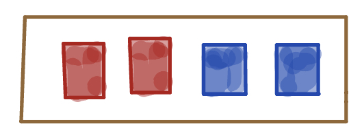
  
Hình 10.2: Chiếc hộp chứa 2 thẻ đỏ ($R$) và 2 thẻ xanh ($B$).

Giả sử ta tiến hành rút ngẫu nhiên 3 lần liên tiếp từ hộp. Có hai phương thức rút thẻ mang bản chất xác suất hoàn toàn khác biệt:

### Phương thức 1: Rút có hoàn lại (With Replacement)

Sau mỗi lần rút một tấm thẻ ra để ghi nhận màu sắc, ta bỏ tấm thẻ đó trở lại hộp và xáo đều trước khi rút tấm tiếp theo.

Vì mỗi tấm thẻ trong mỗi lần rút đều có khả năng được chọn như nhau, toàn bộ $2 \times 2 \times 2 = 8$ chuỗi kết quả có thể xảy ra gồm:
$$
\Omega_{\text{hl}} = \{RRR, RRB, RBR, RBB, BRR, BRB, BBR, BBB\}
$$

  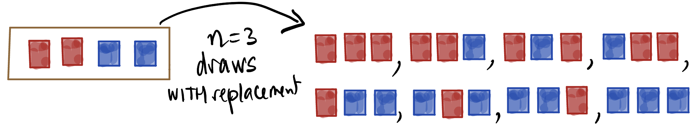
  
Hình 10.3: Không gian mẫu gồm 8 kết quả đồng khả năng khi rút có hoàn lại.

Mỗi nhánh trong 8 chuỗi kết quả trên đều có xác suất xuất hiện bằng nhau:
$$
P(\omega) = \frac{1}{8}, \quad \forall \omega \in \Omega_{\text{hl}}
$$
Để tìm xác suất quan sát thấy chính xác 2 thẻ đỏ trong 3 lần rút, ta chỉ cần đếm số kết quả thuận lợi có đúng 2 chữ cái $R$:
$$
A = \{RRB, RBR, BRR\} \implies |A| = 3
$$
Do đó:
$$
P(\text{chính xác 2 thẻ đỏ khi rút có hoàn lại}) = \frac{3}{8} = 0{,}375
$$

### Phương thức 2: Rút không hoàn lại (Without Replacement)

Bây giờ, ta lặp lại thí nghiệm nhưng không bỏ thẻ trở lại hộp sau mỗi lần rút. Mỗi lần rút xong, chiếc hộp sẽ mất đi một tấm thẻ:

  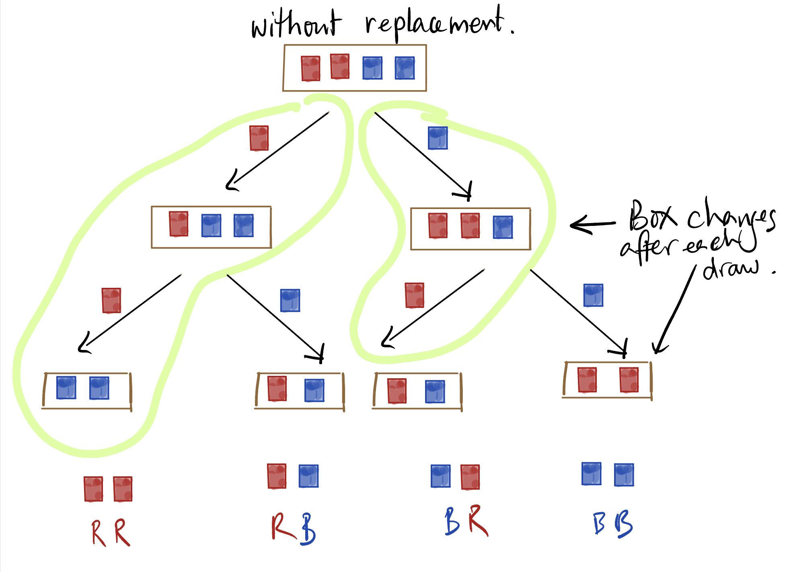
  
Hình 10.4: Cơ cấu thành phần trong hộp thay đổi sau mỗi lần rút không hoàn lại.

Quan sát điều gì xảy ra: Trong hộp ban đầu chỉ có 2 thẻ đỏ và 2 thẻ xanh. Do đó:
- Không bao giờ có thể rút được 3 thẻ đỏ ($RRR$) vì sau 2 lần rút đỏ, trong hộp không còn thẻ đỏ nào!
- Không bao giờ có thể rút được 3 thẻ xanh ($BBB$) vì lý do tương tự.

  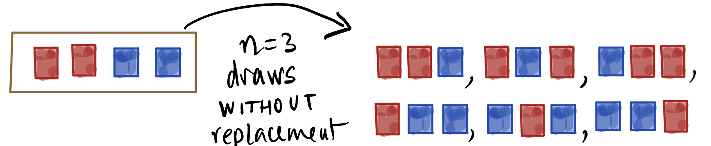
  
Hình 10.5: Các kết quả khả dĩ khi rút 3 lần không hoàn lại từ hộp 4 thẻ.

Số lượng chuỗi kết quả khả dĩ lúc này chỉ còn 6 chuỗi:
$$
\Omega_{\text{khl}} = \{RRB, RBR, RBB, BRR, BRB, BBR\}
$$
Xác suất rút được đúng 2 thẻ đỏ lúc này là:
$$
P(\text{chính xác 2 thẻ đỏ khi rút không hoàn lại}) = \frac{3}{6} = \frac{1}{2} = 0{,}50
$$

### So sánh phân phối xác suất số thẻ đỏ

Hãy lập bảng so sánh đầy đủ xác suất của biến ngẫu nhiên $X$ là "số thẻ đỏ rút được trong 3 lần" giữa hai cơ chế:

| Số thẻ đỏ nhận được ($X$) | Rút có hoàn lại | Rút không hoàn lại |
| :---: | :---: | :---: |
| **0 thẻ đỏ** | $\frac{1}{8} = 0{,}125$ | $0$ (Không thể xảy ra) |
| **1 thẻ đỏ** | $\frac{3}{8} = 0{,}375$ | $\frac{3}{6} = 0{,}500$ |
| **2 thẻ đỏ** | $\frac{3}{8} = 0{,}375$ | $\frac{3}{6} = 0{,}500$ |
| **3 thẻ đỏ** | $\frac{1}{8} = 0{,}125$ | $0$ (Không thể xảy ra) |

Tại sao có sự khác biệt sâu sắc này? Bởi vì khi **rút không hoàn lại**, kết quả của lần rút trước làm thay đổi trực tiếp cơ cấu thành phần của hộp ở lần rút sau. Xác suất rút được thẻ đỏ ở lần thứ hai phụ thuộc chặt chẽ vào việc lần thứ nhất ta đã rút ra thẻ màu gì. Khái niệm này dẫn trực tiếp tới **xác suất có điều kiện**.

---

## 3. Xác suất có điều kiện (Conditional Probability)

### Định nghĩa hình thức

Giả sử ta tiến hành một phép thử ngẫu nhiên với không gian mẫu $\Omega$. Xét hai biến cố $A$ và $B$ với $P(A) > 0$.

::: tip Định nghĩa: Xác suất có điều kiện
**Xác suất có điều kiện** của biến cố $B$ khi biết biến cố $A$ đã xảy ra, ký hiệu là $P(B \mid A)$, được định nghĩa bằng tỷ số:
$$
P(B \mid A) = \frac{P(A \cap B)}{P(A)}
$$
:::

### Trực giác hình học: Sự thu hẹp của không gian mẫu

Ý nghĩa bản chất của công thức trên là gì? 
- Trước khi có thông tin, không gian mẫu toàn cục là $\Omega$ với tổng xác suất $P(\Omega) = 1$.
- Khi đã biết chắc chắn rằng $A$ đã xảy ra, mọi kết quả nằm ngoài $A$ (tức là thuộc $A^c$) đều bị loại bỏ hoàn toàn. Tập $A$ trở thành **không gian mẫu cục bộ mới** của bài toán.
- Trong không gian mẫu mới $A$, biến cố $B$ chỉ có thể xảy ra ở phần giao thoa chung giữa $A$ và $B$, tức là $A \cap B$.
- Phép chia cho $P(A)$ chính là thao tác chuẩn hóa (normalization), đảm bảo rằng tổng xác suất trong không gian mới bằng $1$:
$$
P(A \mid A) = \frac{P(A \cap A)}{P(A)} = \frac{P(A)}{P(A)} = 1
$$

  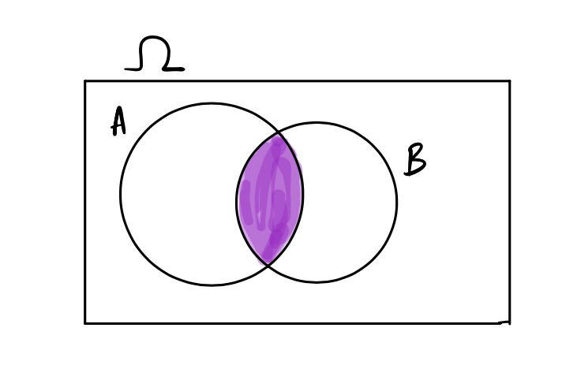
  
Hình 10.6: Biến cố giao $A \cap B$ (vùng màu tím) nằm gọn bên trong cả $A$ và $B$.

### Xác suất có điều kiện vs Xác suất không điều kiện

Hãy quay lại chiếc hộp 4 thẻ (2 đỏ, 2 xanh) khi rút không hoàn lại:
- Đặt $A$ là biến cố: "Lần rút thứ nhất được thẻ xanh".
- Đặt $B$ là biến cố: "Lần rút thứ hai được thẻ đỏ".

Nếu biết lần 1 rút được thẻ xanh (biến cố $A$ xảy ra), trong hộp còn lại 3 thẻ gồm 2 đỏ và 1 xanh. Khi đó:
$$
P(B \mid A) = \frac{2}{3}
$$
Ngược lại, nếu lần 1 rút được thẻ đỏ (biến cố $A^c$ xảy ra), trong hộp còn lại 3 thẻ gồm 1 đỏ và 2 xanh:
$$
P(B \mid A^c) = \frac{1}{3}
$$

Thế nhưng, nếu ta **hoàn toàn không có thông tin gì** về kết quả lần rút thứ nhất (người rút rút tấm thẻ thứ nhất rồi úp kín trên bàn), thì xác suất để lần thứ hai rút được thẻ đỏ là bao nhiêu?
- Đây là **xác suất không điều kiện** $P(B)$.
- Hãy tưởng tượng 4 tấm thẻ được xáo đều và xếp ngẫu nhiên vào 4 vị trí từ 1 đến 4. Do tính đối xứng đồng khả năng, mỗi vị trí (kể cả vị trí số 2) đều có cơ hội nhận tấm thẻ đỏ ngang nhau:
$$
P(B) = \frac{2}{4} = \frac{1}{2}
$$
Rõ ràng, việc biết hay không biết thông tin về lần rút thứ nhất làm thay đổi xác suất của lần rút thứ hai: Từ $1/2$ nhảy lên $2/3$ hoặc tụt xuống $1/3$.

### Cảnh báo cốt tử: $P(A \mid B)$ và $P(B \mid A)$ hoàn toàn khác biệt!

Một trong những sai sót phổ biến nhất là hoán đổi vị trí của điều kiện: Coi $P(A \mid B)$ tương đương với $P(B \mid A)$.

Quan sát biểu đồ Venn dưới đây:

  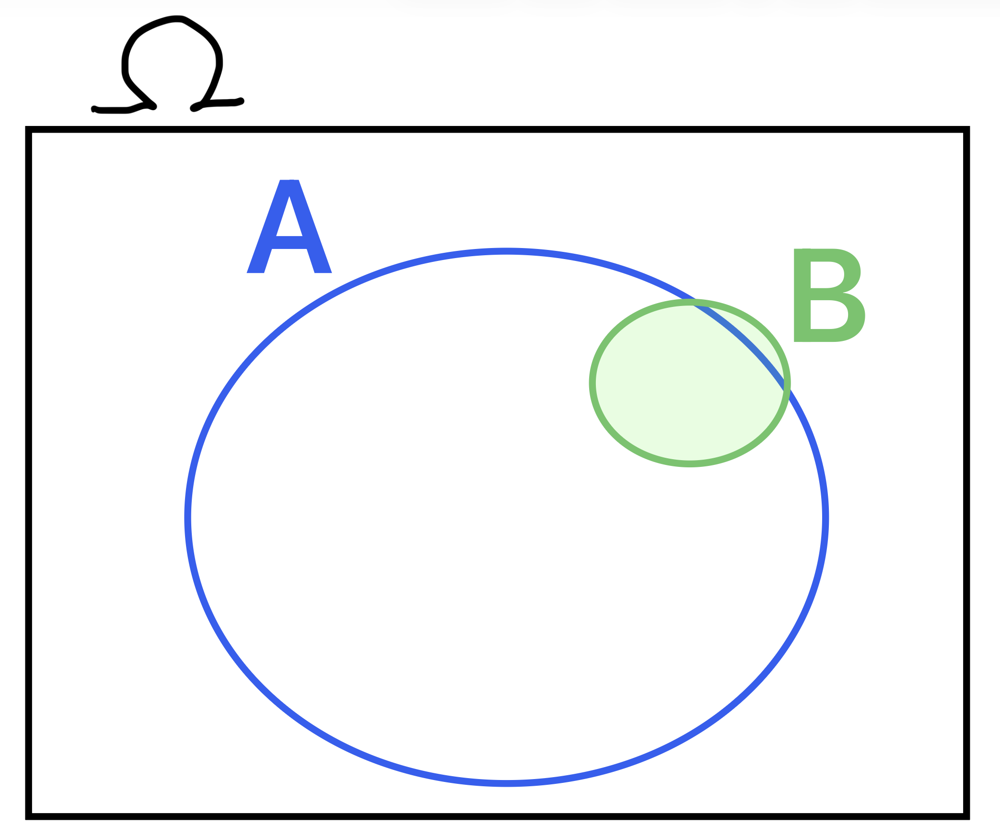
  
Hình 10.7: Biến cố $B$ có diện tích rất nhỏ và nằm gần như trọn vẹn bên trong $A$.

Giả sử vòng tròn $B$ rất nhỏ và nằm gần như hoàn toàn bên trong vòng tròn lớn $A$:
- Xét $P(A \mid B)$: Cho biết ta đang đứng bên trong vòng tròn nhỏ $B$. Vì $B$ gần như nằm trọn trong $A$, nên ta hầu như chắc chắn cũng đang nằm trong $A$:
$$
P(A \mid B) = \frac{P(A \cap B)}{P(B)} \approx \frac{P(B)}{P(B)} = 1
$$
- Ngược lại, xét $P(B \mid A)$: Cho biết ta đang đứng bên trong vòng tròn lớn $A$. Diện tích của $B$ chỉ chiếm một phần rất nhỏ bên trong $A$, do đó xác suất rơi trúng $B$ là cực kỳ bé:
$$
P(B \mid A) = \frac{P(A \cap B)}{P(A)} \approx \frac{P(B)}{P(A)} \ll 1
$$

**Ví dụ thực tế**:
- Đặt $A$ là biến cố: "Một người là công dân Việt Nam".
- Đặt $B$ là biến cố: "Một người là sinh viên trường Đại học Công nghệ (UET)".
- Khi đó $P(A \mid B) \approx 1$ (Biết một người là sinh viên UET thì gần như 100% người đó là công dân Việt Nam).
- Tuy nhiên $P(B \mid A) = \frac{15.000}{100.000.000} \approx 0{,}00015$ (Biết một người là công dân Việt Nam thì xác suất người đó là sinh viên UET là cực kỳ nhỏ).

Đánh tráo hai đại lượng này là nguồn gốc trực tiếp của ngụy biện pháp đình trong vụ án Sally Clark.

---

## 4. Quy tắc nhân xác suất (The Multiplication Rule)

Từ định nghĩa của xác suất có điều kiện, bằng cách nhân chéo mẫu số, ta thu được quy tắc nhân xác suất để tính xác suất đồng thời xảy ra của hai biến cố:

::: tip Quy tắc nhân xác suất
Với hai biến cố bất kỳ $A$ và $B$:
$$
P(A \cap B) = P(A) \cdot P(B \mid A) = P(B) \cdot P(A \mid B)
$$
:::

### Mở rộng quy tắc nhân cho chuỗi nhiều biến cố

Quy tắc nhân có thể mở rộng tự nhiên cho một chuỗi tuần tự $k$ biến cố $A_1, A_2, \dots, A_k$:
$$
\begin{aligned}
P(A_1 \cap A_2 \cap \dots \cap A_k) &= P(A_1) \cdot P(A_2 \mid A_1) \cdot P(A_3 \mid A_1 \cap A_2) \\
&\quad \cdots P(A_k \mid A_1 \cap A_2 \cap \dots \cap A_{k-1})
\end{aligned}
$$

**Ví dụ tính toán**: Rút ngẫu nhiên liên tiếp 2 thẻ không hoàn lại từ hộp có 2 đỏ và 2 xanh. Xác suất để thẻ thứ nhất màu đỏ ($A$) VÀ thẻ thứ hai màu xanh ($B$) là:
$$
P(A \cap B) = P(A) \cdot P(B \mid A) = \frac{2}{4} \times \frac{2}{3} = \frac{4}{12} = \frac{1}{3}
$$
Trực giác tần suất dài hạn: Về lâu dài, khoảng một nửa số lần thử ta sẽ rút được thẻ đỏ ở lần đầu. Trong số những lần đó, khoảng hai phần ba số lần ta sẽ rút tiếp được thẻ xanh ở lần hai. Như vậy, tỷ lệ lần rút được cả Đỏ rồi Xanh là hai phần ba của một nửa, tức một phần ba tổng số lần thử!

---

## 5. Khái niệm độc lập thống kê (Independence)

### Định nghĩa toán học

Hai biến cố được gọi là độc lập nếu việc biết biến cố này đã xảy ra hoàn toàn không cung cấp bất kỳ thông tin nào làm thay đổi xác suất xảy ra của biến cố kia.

::: tip Định nghĩa: Biến cố độc lập
Hai biến cố $A$ và $B$ được gọi là **độc lập thống kê** (statistically independent) nếu và chỉ nếu:
$$
P(B \mid A) = P(B)
$$
hoặc tương đương:
$$
P(A \mid B) = P(A)
$$
Khi đó và chỉ khi đó, quy tắc nhân trở thành dạng rút gọn:
$$
P(A \cap B) = P(A) \cdot P(B)
$$
:::

Nếu $P(A \cap B) \neq P(A) \cdot P(B)$, hai biến cố được gọi là **phụ thuộc** (dependent).

### Tiêu chuẩn kiểm tra tính độc lập

Để kiểm tra xem hai biến cố $A$ và $B$ có độc lập với nhau hay không, phương pháp tính toán nhanh nhất và tổng quát nhất là so sánh trực tiếp:
$$
\text{Kiểm tra đẳng thức: } P(A \cap B) \stackrel{?}{=} P(A) \times P(B)
$$
Nếu đẳng thức thỏa mãn, hai biến cố độc lập; nếu không bằng nhau, chúng phụ thuộc.

### Các ví dụ so sánh trực quan

#### 1. Tung đồng xu liên tiếp: Độc lập
Tung một đồng xu cân bằng 2 lần. Đặt $A$ là "Lần 1 xuất hiện mặt ngửa" ($P(A) = 0{,}5$), $B$ là "Lần 2 xuất hiện mặt ngửa" ($P(B) = 0{,}5$).
Dù lần 1 ra ngửa hay sấp, đồng xu không hề có "trí nhớ". Xác suất lần 2 ra ngửa vẫn luôn giữ nguyên là $0{,}5$:
$$
P(B \mid A) = P(B \mid A^c) = P(B) = 0{,}5
$$
Do đó hai lần tung đồng xu là độc lập, và xác suất cả 2 lần đều ngửa là:
$$
P(A \cap B) = P(A) \cdot P(B) = 0{,}5 \times 0{,}5 = 0{,}25
$$

#### 2. Ngủ quên và đi học muộn: Phụ thuộc
Đặt $A$ là biến cố "Ngủ quên báo thức", giả sử một sinh viên hiếm khi ngủ quên nên $P(A) = 0{,}02$.
Đặt $B$ là biến cố "Đi học muộn", giả sử sinh viên này cũng ít khi đi muộn nên $P(B) = 0{,}10$.
Tuy nhiên, nếu người này đã ngủ quên (biến cố $A$ xảy ra), khả năng cao người đó sẽ trễ học:
$$
P(B \mid A) = 0{,}60 > P(B) = 0{,}10
$$
Vì $P(B \mid A) \neq P(B)$, hai biến cố này phụ thuộc lẫn nhau.

#### 3. Bài toán chọn ban đại diện 2 người từ nhóm 5 người
Xét một nhóm gồm 5 người: Alex, Emi, Fred, Max và Nan. Ta chọn ngẫu nhiên 2 người không hoàn lại để lập một ban đại diện gồm 2 thành viên.

  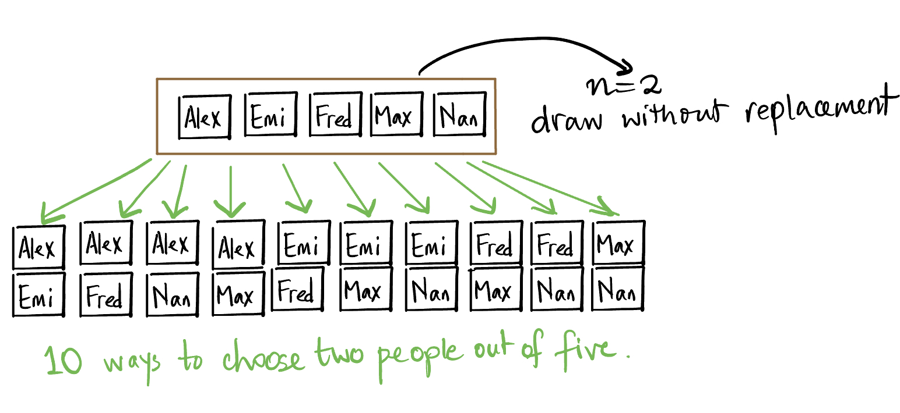
  
Hình 10.8: Không gian mẫu gồm 10 cặp thành viên phân biệt khi chọn 2 từ 5 người.

Tính xác suất để cả Alex và Emi cùng được chọn vào ban đại diện:
- **Cách 1: Đếm tổ hợp**:
  Số cách chọn 2 người bất kỳ từ 5 người là:
  $$
  \binom{5}{2} = \frac{5 \times 4}{2 \times 1} = 10 \text{ cặp phân biệt}
  $$
  Cặp (Alex, Emi) là 1 trong 10 cặp đồng khả năng đó, do đó xác suất là:
  $$
  P(\text{Alex và Emi}) = \frac{1}{10} = 0{,}10
  $$
- **Cách 2: Áp dụng quy tắc nhân và cộng**:
  Cặp (Alex, Emi) được chọn nếu rút được Alex trước rồi Emi sau, HOẶC Emi trước rồi Alex sau:
  $$
  \begin{aligned}
  P(\text{Alex trước} \cap \text{Emi sau}) &= \frac{1}{5} \times \frac{1}{4} = \frac{1}{20} \\
  P(\text{Emi trước} \cap \text{Alex sau}) &= \frac{1}{5} \times \frac{1}{4} = \frac{1}{20} \\
  P(\text{Alex và Emi}) &= \frac{1}{20} + \frac{1}{20} = \frac{2}{20} = \frac{1}{10}
  \end{aligned}
  $$

#### 4. Thẻ có màu và số: Độc lập hay phụ thuộc?

Xét Hộp 1 chứa các tấm thẻ có cả màu sắc (Đỏ/Xanh) và con số (1, 2, 3, 4) như hình vẽ:

  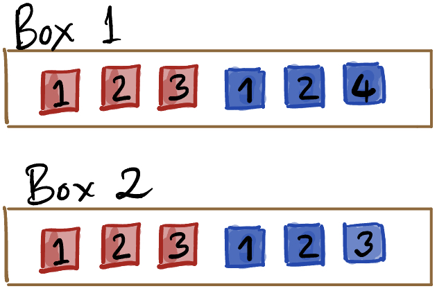
  
Hình 10.9: Phân bố số và màu sắc trên các thẻ của Hộp 1.

Hỏi biến cố "Màu sắc" và "Con số" có độc lập với nhau hay không?
- Ta tính xác suất rút được thẻ số 3 khi biết thẻ đó màu đỏ:
$$
P(\text{Số 3} \mid \text{Đỏ}) = \frac{1}{3}
$$
- Tuy nhiên, trong số các thẻ màu xanh, hoàn toàn không có thẻ số 3 nào:
$$
P(\text{Số 3} \mid \text{Xanh}) = 0
$$
Vì $P(\text{Số 3} \mid \text{Đỏ}) \neq P(\text{Số 3} \mid \text{Xanh})$, màu sắc và con số trong Hộp 1 là hai đặc tính **phụ thuộc**. Chỉ cần một cặp giá trị vi phạm đẳng thức thì toàn bộ hai biến phân loại đó không thể độc lập.

Tiếp tục xét hai hộp chứa các thẻ mang hai chữ số:

  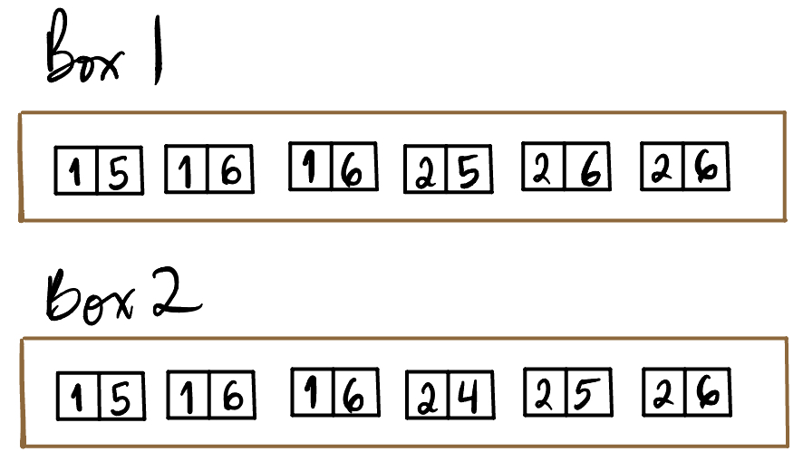
  
Hình 10.10: Cơ cấu hai chữ số trên mỗi tấm thẻ ở Hộp 1 và Hộp 2.

  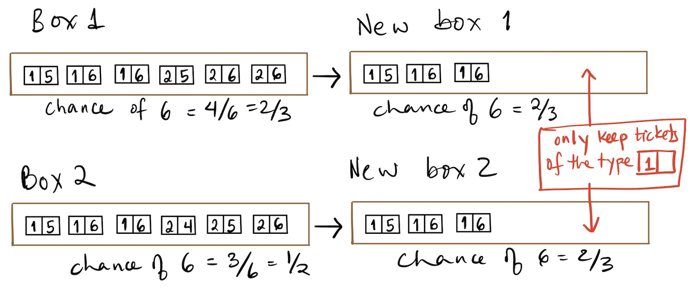
  
Hình 10.11: Không gian mẫu thu hẹp khi biết chữ số thứ nhất là 1.

- Ở Hộp 1: Khi biết chữ số thứ nhất là 1, tỷ lệ thẻ có chữ số thứ hai là 6 vẫn là $1/2$. Do đó hai chữ số ở Hộp 1 là **độc lập**.
- Ở Hộp 2: Tỷ lệ tổng thể có số thứ hai là 6 là $1/2$. Nhưng khi biết số thứ nhất là 1, tỷ lệ số thứ hai là 6 tăng vọt lên $2/3$. Do đó hai chữ số ở Hộp 2 là **phụ thuộc**.

---

## 6. Phân tích toán học vụ án oan Sally Clark

Bây giờ ta có đầy đủ công cụ xác suất để vạch trần thảm kịch pháp đình Sally Clark.

### Sai lầm 1: Giả định độc lập vô căn cứ

Bác sĩ Roy Meadow tuyên bố trước tòa rằng xác suất hai đứa trẻ chết vì SIDS là:
$$
P(S_1 \cap S_2) = P(S_1) \times P(S_2) = \frac{1}{8.543} \times \frac{1}{8.543} \approx \frac{1}{73\text{ triệu}}
$$
Phép tính này ngầm giả định rằng hai cái chết là **độc lập**. Tuy nhiên, hai đứa trẻ là anh em ruột sinh ra trong cùng một gia đình:
- Chúng chia sẻ 50% vốn gen di truyền từ cha mẹ. Nếu có một đột biến gen bẩm sinh làm tăng nguy cơ suy hô hấp hoặc rối loạn nhịp tim khi ngủ, cả hai đứa trẻ đều có khả năng mang đột biến đó.
- Chúng sống trong cùng một điều kiện môi trường: Nhiệt độ phòng, vi khuẩn, phấn hoa, nguồn nước và thói quen sinh hoạt.

Nghiên cứu dịch tễ học thực tế sau đó của các nhà thống kê chỉ ra rằng, đối với một gia đình đã có một đứa con chết vì SIDS, xác suất đứa con thứ hai cũng chết vì SIDS là:
$$
P(S_2 \mid S_1) \approx \frac{1}{60}
$$
Áp dụng đúng quy tắc nhân xác suất có điều kiện:
$$
\begin{aligned}
P(S_1 \cap S_2) &= P(S_1) \cdot P(S_2 \mid S_1) \\
&= \frac{1}{8.543} \times \frac{1}{60} \\
&= \frac{1}{512.580} \approx \frac{1}{513\text{ nghìn}}
\end{aligned}
$$
Con số xác suất thực tế cao hơn con số mà bác sĩ Meadow khai trước tòa tới:
$$
\frac{72.982.849}{512.580} \approx 142{,}4\text{ lần}
$$
Hơn thế nữa, trong quá trình điều tra phúc thẩm, các tài liệu y khoa bị che giấu trước đó được phát hiện: Đứa con thứ hai của Sally Clark mang nồng độ vi khuẩn tụ cầu vàng (*Staphylococcus aureus*) cực cao trong dịch tủy não, cho thấy bé đã chết vì nhiễm trùng đường hô hấp cấp chứ không phải bị ngạt thở do mẹ sát hại.

### Sai lầm 2: Ngụy biện công tố viên (Prosecutor's Fallacy)

Sai lầm nghiêm trọng thứ hai là đánh tráo câu hỏi xác suất.

Giả sử đặt:
- $I$: Bị cáo vô tội (hai đứa trẻ chết tự nhiên vì SIDS hoặc bệnh lý).
- $E$: Bằng chứng thực tế (hai đứa trẻ trong gia đình đã tử vong).

Con số $1/73\text{ triệu}$ (hay kể cả con số chuẩn $1/513\text{ nghìn}$) là xác suất:
$$
P(E \mid I) \quad (\text{Xác suất hai trẻ tử vong tự nhiên trong một gia đình bình thường})
$$
Thế nhưng, bồi thẩm đoàn và cơ quan công tố đã ngộ nhận rằng đây chính là:
$$
P(I \mid E) \quad (\text{Xác suất Sally Clark vô tội khi đã có hai con qua đời})
$$
Đây là sự đánh tráo tai hại giữa $P(E \mid I)$ và $P(I \mid E)$.

Để đánh giá tội trạng của một con người, tòa án không thể chỉ nhìn vào một biến cố hiếm gặp rồi kết luận đó là tội ác. Tòa án bắt buộc phải so sánh độ hợp lý giữa hai giả thuyết cạnh tranh:
1. Giả thuyết $I$: Hai đứa trẻ tử vong vì nguyên nhân tự nhiên hiếm gặp ($E \mid I$).
2. Giả thuyết $M$: Người mẹ là kẻ sát nhân máu lạnh, đã cố tình giết chết cả hai đứa con ruột của mình ($E \mid M$).

Trong thực tế xã hội học và tội phạm học, tỷ lệ một người mẹ không có tiền sử bệnh tâm thần, không có bạo lực gia đình sát hại liên tiếp hai đứa con sơ sinh của mình là cực kỳ hiếm hoi, ước tính khoảng 1 trên 100 triệu đến 1 trên 200 triệu gia đình:
$$
P(M) \approx \frac{1}{100.000.000}
$$
Theo Định lý Bayes, tỷ số khả dĩ hậu nghiệm (Posterior Odds) giữa vô tội và có tội là:
$$
\begin{aligned}
\frac{P(I \mid E)}{P(M \mid E)} &= \frac{P(E \mid I)}{P(E \mid M)} \times \frac{P(I)}{P(M)} \\
&\approx \frac{1/513.000}{1} \times \frac{1}{1/100.000.000} \\
&= \frac{100.000.000}{513.000} \approx 195
\end{aligned}
$$
Nói cách khác, khi đứng trước hiện trường hai đứa trẻ qua đời, xác suất người mẹ vô tội và các bé chết vì bệnh lý tự nhiên cao gấp gần **200 lần** so với xác suất người mẹ là kẻ giết người hàng loạt! 

Việc không hiểu xác suất có điều kiện đã biến một thảm kịch gia đình thành một bản án oan sai chấn động địa cầu.

---

## 7. Giải mã giải tích nghịch lý Chevalier de Méré

Trong bài giảng trước, ta đã dùng phương pháp mô phỏng máy tính (Monte Carlo) để kiểm chứng trực giác đánh bạc của hiệp sĩ De Méré. Bây giờ, với quy tắc nhân và quy tắc biến cố đối, ta hoàn toàn có thể tính toán nghiệm giải tích chính xác tuyệt đối.

### Trò chơi 1: Tung xúc xắc 4 lần, tìm ít nhất một mặt 6

Đặt biến cố $A$ là "Xuất hiện ít nhất một mặt 6 trong 4 lần tung". Biến cố đối $A^c$ là "Không xuất hiện mặt 6 nào trong cả 4 lần tung".

Vì các lần tung xúc xắc là hoàn toàn **độc lập**:
- Xác suất một lần tung không ra mặt 6 là $\frac{5}{6}$.
- Xác suất cả 4 lần tung đều không ra mặt 6 là tích xác suất của 4 lần độc lập:
$$
P(A^c) = \left(\frac{5}{6}\right)^4 = \frac{625}{1.296} \approx 0{,}48225
$$
Áp dụng quy tắc biến cố bù:
$$
\begin{aligned}
P(A) &= 1 - P(A^c) \\
&= 1 - \left(\frac{5}{6}\right)^4 \\
&= 1 - \frac{625}{1.296} = \frac{671}{1.296} \approx 0{,}5177
\end{aligned}
$$
Vì $P(A) \approx 51{,}77\% > 50\%$, De Méré **có lợi thế** về lâu dài khi đặt cược vào trò chơi này.

### Trò chơi 2: Tung cặp xúc xắc 24 lần, tìm ít nhất một cặp (6, 6)

Đặt biến cố $B$ là "Xuất hiện ít nhất một cặp đôi 6 trong 24 lần tung một cặp xúc xắc". Biến cố đối $B^c$ là "Không xuất hiện cặp đôi 6 nào trong cả 24 lần tung".

Khi tung 2 con xúc xắc, có $6 \times 6 = 36$ kết quả đồng khả năng. Cặp $(6, 6)$ chỉ có 1 kết quả thuận lợi.
- Xác suất một lần tung không xuất hiện cặp $(6, 6)$ là $\frac{35}{36}$.
- Do 24 lần tung là độc lập, áp dụng quy tắc nhân:
$$
P(B^c) = \left(\frac{35}{36}\right)^{24} \approx 0{,}5086
$$
Áp dụng quy tắc biến cố bù:
$$
\begin{aligned}
P(B) &= 1 - P(B^c) \\
&= 1 - \left(\frac{35}{36}\right)^{24} \\
&\approx 1 - 0{,}5086 = 0{,}4914
\end{aligned}
$$
Vì $P(B) \approx 49{,}14\% < 50\%$, De Méré **chắc chắn sẽ thua lỗ** khi chơi lâu dài!

Toán học xác suất lý thuyết giải thích hoàn hảo vì sao con số mô phỏng trước đây cho ra xấp xỉ $0{,}514$ và $0{,}487$. Trực giác cộng xác suất ngây thơ của De Méré ($4 \times \frac{1}{6} = \frac{2}{3}$ và $24 \times \frac{1}{36} = \frac{2}{3}$) đã thất bại thảm hại vì các lần thử không hề xung khắc nhau!

---

## 8. Phân biệt: Xung khắc vs Độc lập

Có một sự nhầm lẫn vô cùng phổ biến giữa hai khái niệm: **Xung khắc** (Mutually Exclusive) và **Độc lập** (Independent).

| Tiêu chí | Biến cố xung khắc (Rời nhau) | Biến cố độc lập |
| :--- | :--- | :--- |
| **Bản chất** | Không thể cùng xảy ra trong một lần thử. | Việc biến cố này xảy ra không ảnh hưởng đến xác suất của biến cố kia. |
| **Đặc trưng tập hợp** | $A \cap B = \emptyset$ | $A \cap B \neq \emptyset$ (khi cả hai có xác suất dương) |
| **Quy tắc toán học** | $P(A \cap B) = 0$ | $P(A \cap B) = P(A) \cdot P(B)$ |
| **Quy tắc cộng** | $P(A \cup B) = P(A) + P(B)$ | Phải dùng công thức bao hàm - loại trừ. |

::: important Định lý liên hệ giữa Xung khắc và Độc lập
Nếu hai biến cố $A$ và $B$ đều có xác suất dương ($P(A) > 0$ và $P(B) > 0$) và chúng xung khắc nhau ($A \cap B = \emptyset$), thì chúng **chắc chắn không độc lập** (phụ thuộc chặt chẽ vào nhau).

**Chứng minh**:
Vì $A \cap B = \emptyset$, ta có:
$$
P(A \cap B) = 0
$$
Nhưng vì $P(A) > 0$ và $P(B) > 0$, ta có:
$$
P(A) \cdot P(B) > 0
$$
Do đó:
$$
P(A \cap B) \neq P(A) \cdot P(B)
$$
Trực giác: Nếu biết $A$ đã xảy ra, ta biết chắc 100% rằng $B$ KHÔNG THỂ xảy ra ($P(B \mid A) = 0 \neq P(B)$). Thông tin về $A$ đã làm thay đổi hoàn toàn xác suất của $B$!
:::

---

## 9. Quy tắc cộng tổng quát: Nguyên lý Bao hàm – Loại trừ

Khi hai biến cố $A$ và $B$ không xung khắc (vùng giao nhau khác rỗng), ta không thể dùng công thức cộng đơn thuần $P(A \cup B) = P(A) + P(B)$ vì phần diện tích giao thoa $A \cap B$ sẽ bị tính trùng hai lần.

  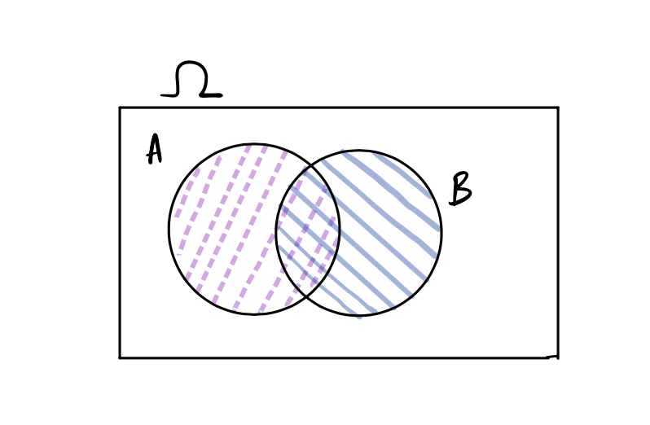
  
Hình 10.12: Phần giao $A \cap B$ bị tính hai lần khi cộng $P(A) + P(B)$, cần phải trừ bớt một lần.

::: tip Quy tắc cộng tổng quát (Inclusion-Exclusion Principle)
Với hai biến cố bất kỳ $A$ và $B$:
$$
P(A \cup B) = P(A) + P(B) - P(A \cap B)
$$
:::

Thay công thức nhân xác suất $P(A \cap B) = P(A) \cdot P(B \mid A)$ vào, ta có thể tính xác suất hợp của hai biến cố dù chúng độc lập hay phụ thuộc.

---

## 10. Tổng kết bài học

1. **Xác suất có điều kiện**: $P(B \mid A) = \frac{P(A \cap B)}{P(A)}$ mô tả xác suất xảy ra của $B$ khi không gian mẫu bị thu hẹp về $A$.
2. **Thứ tự điều kiện**: $P(A \mid B)$ và $P(B \mid A)$ là hai đại lượng hoàn toàn khác biệt. Việc nhầm lẫn giữa chúng dẫn đến ngụy biện công tố viên tai hại.
3. **Quy tắc nhân**:
   - Trường hợp tổng quát: $P(A \cap B) = P(A) \cdot P(B \mid A)$.
   - Trường hợp độc lập: $P(A \cap B) = P(A) \cdot P(B)$.
4. **Kiểm tra tính độc lập**: Hai biến cố độc lập khi và chỉ khi $P(A \cap B) = P(A) \cdot P(B)$ hoặc $P(B \mid A) = P(B)$.
5. **Độc lập khác Xung khắc**: Hai biến cố có xác suất dương nếu xung khắc nhau thì chắc chắn phụ thuộc vào nhau.
6. **Rút thăm**: Rút có hoàn lại tương ứng với các biến cố độc lập; rút không hoàn lại dẫn đến các biến cố phụ thuộc.

---

## Tài liệu tham khảo

1. UC Berkeley STAT 20: *Computing Probabilities*, Department of Statistics, UC Berkeley.
2. The Royal Statistical Society (2001): *Statement on the use of statistical evidence in court cases regarding Sudden Infant Death Syndrome (SIDS)*.
3. Dawid, A. P. (2002): *Commentary on the Sally Clark Case*, RSS News, Vol. 29.
4. Hill, R. (2004): *Multiple Sudden Infant Deaths: A critique of the Meadow Law*, Paediatric and Perinatal Epidemiology.

## Bài tập rèn luyện tư duy xác suất

::: info Hướng dẫn thực hành
Các bài tập dưới đây được thiết kế nhằm rèn luyện tư duy tính toán xác suất có điều kiện, nhận diện tính độc lập, tránh ngụy biện thống kê trong đời sống thực tế và giải quyết các bài toán rút thăm, thi đấu thể thao.
:::

### Bài tập 1: Phân tích xác suất và ngụy biện công tố viên trong vụ án Sally Clark

Một bài báo y khoa công bố xác suất một đứa trẻ sơ sinh tử vong ngẫu nhiên do hội chứng SIDS trong một gia đình bình thường là $p = \frac{1}{8.543}$. Giả sử trong một vụ án, người mẹ có hai con sơ sinh lần lượt qua đời.

1. Hãy chỉ ra sai lầm cốt tử khi tuyên bố: *"Xác suất để một người mẹ vô tội có hai con qua đời là 1 trên 73 triệu, do đó xác suất người mẹ này vô tội chỉ là 1 trên 73 triệu."*
2. Giả sử số liệu dịch tễ học chính xác cho thấy: Do yếu tố môi trường và di truyền, nếu một đứa trẻ trong gia đình đã tử vong vì SIDS thì xác suất đứa trẻ thứ hai trong cùng gia đình đó tử vong vì SIDS tăng lên thành $P(S_2 \mid S_1) = \frac{1}{60}$. Hãy tính xác suất thực tế để cả hai đứa trẻ trong cùng gia đình tử vong tự nhiên vì SIDS.
3. Giả định trong toàn xã hội:
   - Tỷ lệ một người mẹ sát hại cả hai đứa con sơ sinh của mình là $P(M) = 10^{-8}$ (1 trên 100 triệu).
   - Khi người mẹ có ý định sát hại, xác suất cả hai con qua đời là $P(E \mid M) = 1$.
   - Khi người mẹ vô tội, xác suất cả hai con qua đời do nguyên nhân tự nhiên là kết quả vừa tính ở câu 2, tức $P(E \mid I) = \frac{1}{8.543 \times 60}$.
   Hãy tính xác suất người mẹ vô tội khi biết biến cố hai con đã qua đời $P(I \mid E)$ bằng Định lý Bayes.

::: details Lời giải chi tiết
**Câu 1: Nhận diện hai sai lầm cốt tử**:
- Sai lầm 1 (Ngụy biện nhân xác suất): Phép nhân $\frac{1}{8.543} \times \frac{1}{8.543} \approx \frac{1}{73\text{ triệu}}$ giả định hai đứa trẻ sơ sinh trong cùng một gia đình là hoàn toàn độc lập về mặt thống kê. Trong thực tế, anh em ruột chia sẻ 50% vốn gen di truyền và cùng chung sống trong một môi trường, do đó giả định độc lập là hoàn toàn sai.
- Sai lầm 2 (Ngụy biện công tố viên - Prosecutor's Fallacy): Tuyên bố trên đã đánh tráo $P(E \mid I)$ với $P(I \mid E)$. Cho dù xác suất một biến cố tự nhiên xảy ra là rất nhỏ ($P(E \mid I) \ll 1$), điều đó hoàn toàn không đồng nghĩa với việc xác suất bị cáo vô tội là rất nhỏ ($P(I \mid E) \ll 1$), bởi vì hành vi người mẹ sát hại hai đứa con ruột cũng là một biến cố có xác suất tiên nghiệm cực kỳ hiếm ($P(M) \ll 1$).

**Câu 2: Tính xác suất thực tế theo quy tắc nhân**:
Áp dụng quy tắc nhân xác suất có điều kiện:
$$
\begin{aligned}
P(S_1 \cap S_2) &= P(S_1) \cdot P(S_2 \mid S_1) \\
&= \frac{1}{8.543} \times \frac{1}{60} \\
&= \frac{1}{512.580} \approx 1{,}95 \times 10^{-6}
\end{aligned}
$$
Xác suất thực tế cao hơn khoảng 142 lần so với con số 1 trên 73 triệu mà bên công tố đưa ra.

**Câu 3: Tính xác suất vô tội bằng Định lý Bayes**:
Đặt $E$ là biến cố cả hai con qua đời. Ta có hai giả thuyết đối lập: Người mẹ vô tội ($I$) hoặc người mẹ là kẻ sát nhân ($M$).
Vì phần lớn các bà mẹ không phải kẻ sát nhân, ta có $P(I) = 1 - P(M) = 1 - 10^{-8} \approx 1$.
Theo công thức xác suất đầy đủ:
$$
\begin{aligned}
P(E) &= P(I) \cdot P(E \mid I) + P(M) \cdot P(E \mid M) \\
&= 1 \times \frac{1}{512.580} + 10^{-8} \times 1 \\
&= \frac{1}{512.580} + \frac{1}{100.000.000} \\
&\approx 1{,}9509 \times 10^{-6} + 10^{-8} \\
&= 1{,}9609 \times 10^{-6}
\end{aligned}
$$
Áp dụng Định lý Bayes:
$$
\begin{aligned}
P(I \mid E) &= \frac{P(I) \cdot P(E \mid I)}{P(E)} \\
&= \frac{\frac{1}{512.580}}{\frac{1}{512.580} + 10^{-8}} \\
&= \frac{1{,}9509 \times 10^{-6}}{1{,}9609 \times 10^{-6}} \\
&\approx 0{,}9949 \approx 99{,}49\%
\end{aligned}
$$
Kết luận: Khi đã biết biến cố đau lòng là cả hai đứa trẻ qua đời, xác suất người mẹ vô tội vẫn lên tới hơn $99{,}49\%$. Việc kết tội một người mẹ chỉ dựa trên xác suất tự nhiên hiếm gặp mà không có bất kỳ bằng chứng pháp y nào là một sai lầm pháp đình nghiêm trọng.
:::

---

### Bài tập 2: Mô hình hộp rút thăm không hoàn lại và kiểm tra tính độc lập

Một chiếc hộp chứa 9 tấm thẻ được đánh số từ 1 đến 9: $\{1, 2, 3, 4, 5, 6, 7, 8, 9\}$. Ta tiến hành rút ngẫu nhiên liên tiếp 2 tấm thẻ không hoàn lại từ hộp.

Định nghĩa hai biến cố sau:
- $A$: Biến cố "Có ít nhất một tấm thẻ rút được mang số chẵn".
- $B$: Biến cố "Có ít nhất một tấm thẻ rút được mang số nguyên tố" (Lưu ý: Số 1 không phải là số nguyên tố; các số nguyên tố trong hộp là $\{2, 3, 5, 7\}$).

1. Giả sử hai tấm thẻ rút ra được mang số 3 và số 9. Trong các biến cố sau đây, biến cố nào xảy ra và biến cố nào không xảy ra: $A$, $B$, $A \cap B$, $A \cap B^c$, $A^c \cap B$?
2. Tính xác suất $P(A)$, $P(B)$ và xác suất phần giao $P(A \cap B)$.
3. Kiểm tra xem hai biến cố $A$ và $B$ có độc lập với nhau hay không. Giải thích bản chất toán học.

::: details Lời giải chi tiết
**Câu 1: Xác định biến cố khi rút được cặp số $\{3, 9\}$**:
- Số 3 là số lẻ và là số nguyên tố.
- Số 9 là số lẻ và là hợp số (không phải nguyên tố).
- Xét biến cố $A$: Trong hai số 3 và 9, không có số nào là số chẵn. Do đó $A$ không xảy ra, tức biến cố đối $A^c$ xảy ra.
- Xét biến cố $B$: Số 3 là số nguyên tố, do đó có ít nhất một số nguyên tố. Biến cố $B$ xảy ra.
- Suy ra trạng thái của các biến cố:
  - $A$: Không xảy ra.
  - $B$: Xảy ra.
  - $A \cap B$: Không xảy ra (vì $A$ không xảy ra).
  - $A \cap B^c$: Không xảy ra.
  - $A^c \cap B$: Xảy ra (vì $A^c$ xảy ra và $B$ xảy ra).

**Câu 2: Tính toán xác suất $P(A)$, $P(B)$ và $P(A \cap B)$**:
Tổng số cách rút ngẫu nhiên 2 thẻ không thứ tự từ 9 thẻ là:
$$
|\Omega| = \binom{9}{2} = \frac{9 \times 8}{2} = 36
$$
Trong tập $\{1, 2, \dots, 9\}$ có 4 số chẵn $\{2, 4, 6, 8\}$ và 5 số lẻ $\{1, 3, 5, 7, 9\}$.
- Tính $P(A)$: Biến cố đối $A^c$ là "Cả 2 thẻ rút được đều là số lẻ".
  Số cách chọn 2 thẻ lẻ từ 5 thẻ lẻ là $\binom{5}{2} = 10$.
  $$
  P(A^c) = \frac{10}{36} = \frac{5}{18} \implies P(A) = 1 - \frac{5}{18} = \frac{13}{18} \approx 0{,}7222
  $$
- Tính $P(B)$: Trong tập 9 số có 4 số nguyên tố $\{2, 3, 5, 7\}$ và 5 số không nguyên tố $\{1, 4, 6, 8, 9\}$.
  Biến cố đối $B^c$ là "Cả 2 thẻ rút được đều không phải số nguyên tố".
  Số cách chọn 2 thẻ từ 5 thẻ không nguyên tố là $\binom{5}{2} = 10$.
  $$
  P(B^c) = \frac{10}{36} = \frac{5}{18} \implies P(B) = 1 - \frac{5}{18} = \frac{13}{18} \approx 0{,}7222
  $$
- Tính $P(A \cap B)$:
  Ta có $A \cap B = (A^c \cup B^c)^c$, do đó:
  $$
  P(A \cap B) = 1 - P(A^c \cup B^c) = 1 - [P(A^c) + P(B^c) - P(A^c \cap B^c)]
  $$
  Biến cố $A^c \cap B^c$ là "Cả 2 thẻ đều là số lẻ VÀ đều không phải số nguyên tố".
  Các số thỏa mãn đồng thời (vừa lẻ vừa không nguyên tố) trong hộp là $\{1, 9\}$ (gồm đúng 2 số).
  Số cách chọn 2 số từ tập $\{1, 9\}$ là $\binom{2}{2} = 1$.
  Do đó $P(A^c \cap B^c) = \frac{1}{36}$.
  Áp dụng quy tắc bao hàm - loại trừ:
  $$
  P(A^c \cup B^c) = \frac{10}{36} + \frac{10}{36} - \frac{1}{36} = \frac{19}{36}
  $$
  Suy ra:
  $$
  P(A \cap B) = 1 - \frac{19}{36} = \frac{17}{36} \approx 0{,}4722
  $$

**Câu 3: Kiểm tra tính độc lập**:
Ta so sánh tích $P(A) \times P(B)$ với $P(A \cap B)$:
$$
\begin{aligned}
P(A) \times P(B) &= \frac{13}{18} \times \frac{13}{18} = \frac{169}{324} \approx 0{,}5216 \\
P(A \cap B) &= \frac{17}{36} = \frac{153}{324} \approx 0{,}4722
\end{aligned}
$$
Vì:
$$
P(A \cap B) = \frac{153}{324} \neq \frac{169}{324} = P(A) \times P(B)
$$
Kết luận: Hai biến cố $A$ và $B$ **không độc lập** (phụ thuộc thống kê lẫn nhau). Việc biết một thẻ là số chẵn làm thay đổi khả năng thẻ đó mang số nguyên tố vì số 2 là số duy nhất vừa chẵn vừa nguyên tố.
:::

---

### Bài tập 3: Mô hình hóa chuỗi trận chung kết thể thao (Best-of-7 Series)

Trong loạt trận chung kết bóng chày World Series hoặc bóng rổ NBA Finals, hai đội bóng $A$ và $B$ thi đấu theo thể thức "Best-of-7" (đấu tối đa 7 trận, đội nào giành chiến thắng 4 trận trước sẽ vô địch). 

Giả sử trong mỗi trận đấu độc lập, xác suất đội $A$ đánh bại đội $B$ cố định là $p = \frac{2}{3}$ (không có kết quả hòa), và kết quả các trận đấu là hoàn toàn độc lập với nhau.

1. Tính xác suất để đội $A$ giành chức vô địch bằng một chiến thắng tuyệt đối ("Clean sweep", tức thắng trọn vẹn 4-0 trong đúng 4 trận đầu tiên).
2. Tính xác suất để loạt trận chung kết phải kéo dài đúng 5 trận và đội $A$ giành chức vô địch.
3. Nếu hai đội có thực lực hoàn toàn ngang ngửa ($p = 0{,}5$), hãy chứng minh rằng khi loạt trận đã diễn ra được 5 trận, xác suất loạt trận kết thúc ở trận thứ 6 bằng đúng xác suất loạt trận phải kéo dài sang trận thứ 7.

::: details Lời giải chi tiết
**Câu 1: Xác suất đội $A$ thắng tuyệt đối 4-0 ("Clean sweep")**:
Để thắng 4-0, đội $A$ phải thắng trận 1, trận 2, trận 3 và trận 4.
Vì các trận đấu độc lập với nhau, áp dụng quy tắc nhân xác suất cho 4 biến cố độc lập:
$$
P(\text{Thắng 4-0}) = p^4 = \left(\frac{2}{3}\right)^4 = \frac{16}{81} \approx 0{,}1975 \approx 19{,}75\%
$$

**Câu 2: Xác suất đội $A$ vô địch sau đúng 5 trận**:
Để loạt trận kết thúc ở trận thứ 5 với chức vô địch thuộc về đội $A$:
- Đội $A$ bắt buộc phải thắng trận thứ 5.
- Trong 4 trận đầu tiên, đội $A$ phải thắng đúng 3 trận và thua đúng 1 trận.
Số cách sắp xếp 3 trận thắng trong 4 trận đầu là $\binom{4}{3} = 4$.
Xác suất của một kịch bản cụ thể (ví dụ Thắng-Thắng-Thắng-Thua-Thắng) là:
$$
p^3 \cdot (1-p) \cdot p = p^4 (1-p)
$$
Do đó, xác suất đội $A$ vô địch sau đúng 5 trận là:
$$
\begin{aligned}
P(\text{Vô địch ở trận 5}) &= \binom{4}{3} p^4 (1-p) \\
&= 4 \times \left(\frac{2}{3}\right)^4 \times \left(1 - \frac{2}{3}\right) \\
&= 4 \times \frac{16}{81} \times \frac{1}{3} = \frac{64}{243} \approx 0{,}2634 \approx 26{,}34\%
\end{aligned}
$$

**Câu 3: Chứng minh tính cân bằng khi $p = 0{,}5$**:
Khi hai đội ngang tài ngang sức, xác suất mỗi đội thắng trong một trận là $p = 1 - p = 0{,}5$.
Giả sử loạt trận đã diễn ra xong 5 trận và chưa ngã ngũ (tức tỷ số hiện tại là 3-2 nghiêng về một trong hai đội).
- Đội đang dẫn 3-2 chỉ cần thắng trận thứ 6 là loạt trận kết thúc ngay tại trận thứ 6.
  Xác suất đội đang dẫn thắng trận thứ 6 là $0{,}5$.
  Do đó, xác suất loạt trận kết thúc ở trận thứ 6 (cho trước điều kiện đã đấu 5 trận) là $0{,}5$.
- Ngược lại, nếu đội đang bị dẫn thắng trận thứ 6, tỷ số hòa 3-3 và loạt trận bắt buộc phải bước vào trận thứ 7 sinh tử.
  Xác suất đội bị dẫn thắng trận thứ 6 cũng là $1 - 0{,}5 = 0{,}5$.
  Do đó, xác suất loạt trận kéo dài sang trận thứ 7 cũng bằng $0{,}5$.
Hai xác suất này hoàn toàn bằng nhau và đều bằng $50\%$.
:::

