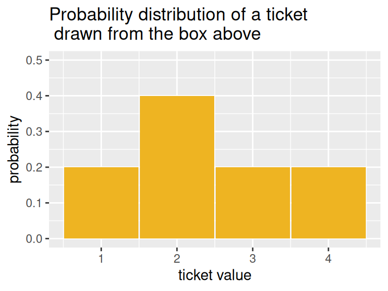
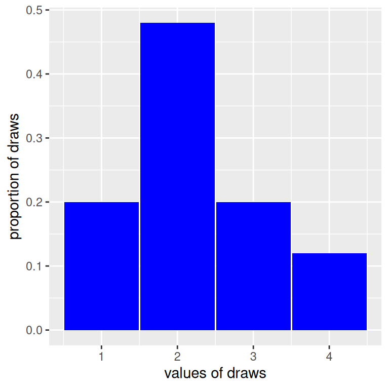
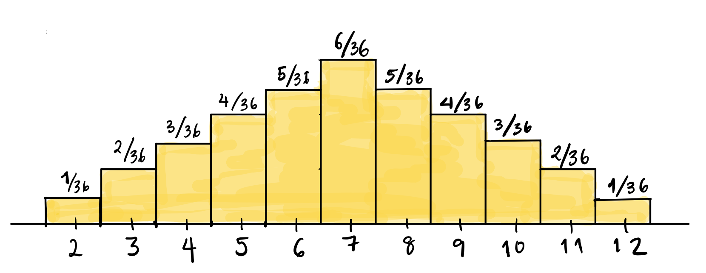
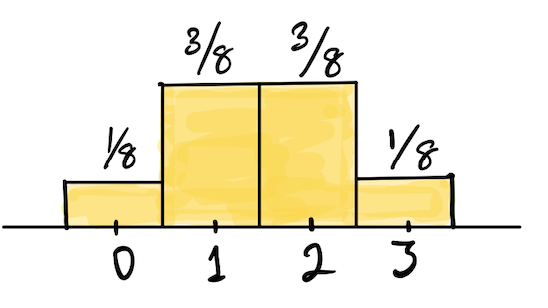
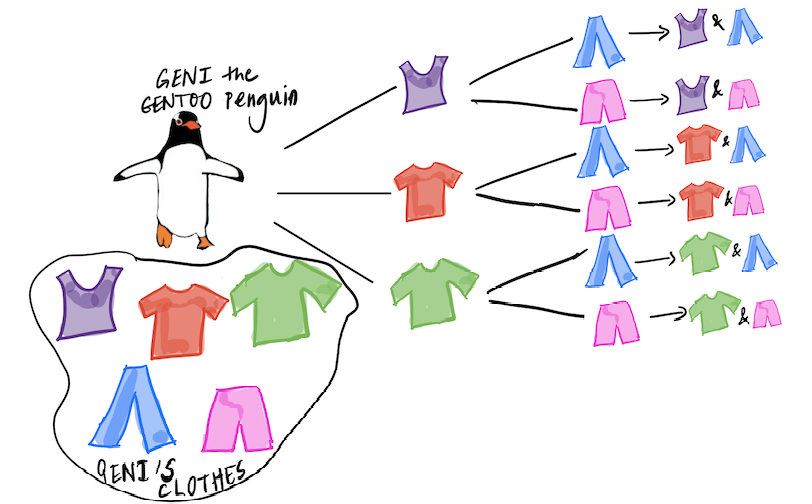
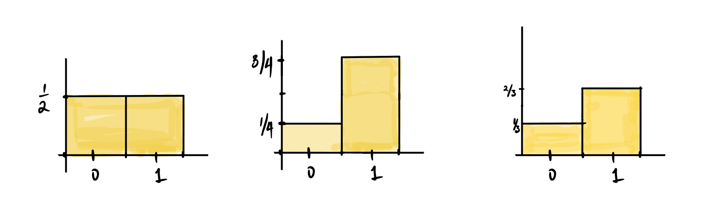
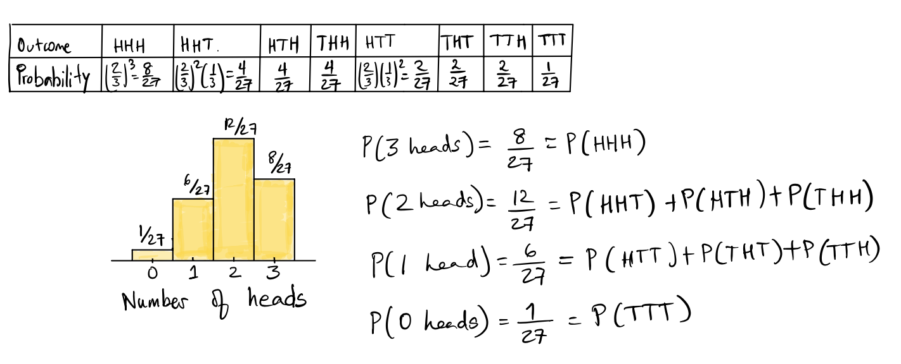

## 1. Mở đầu: Khái niệm phân phối xác suất

Trong các bài học trước, chúng ta đã làm quen với không gian mẫu $\Omega$, biến cố ngẫu nhiên và cách tính xác suất của từng biến cố riêng lẻ bằng các quy tắc cộng và nhân. Tuy nhiên, khi đối diện với một thí nghiệm ngẫu nhiên tổng thể, câu hỏi cốt lõi mà các nhà khoa học và kỹ sư dữ liệu luôn đặt ra là: **Làm thế nào để mô tả toàn bộ bức tranh phân bổ khả năng xảy ra của tất cả các kết quả khả dĩ?**

Khái niệm toán học trả lời cho câu hỏi này chính là **phân phối xác suất** (Probability Distribution).

### Định nghĩa phân phối xác suất

Giả sử một thí nghiệm ngẫu nhiên có tập hợp tất cả các kết quả khả dĩ rời rạc là $\{x_1, x_2, \dots, x_m\}$.

::: tip Định nghĩa: Phân phối xác suất rời rạc
Một **phân phối xác suất** của một biến ngẫu nhiên rời rạc là một danh sách hoặc quy tắc toán học gán cho mỗi kết quả khả dĩ $x_i$ một giá trị xác suất $P(X = x_i)$, thỏa mãn hai điều kiện tiên đề:
1. Xác suất của mỗi kết quả không âm:
$$
P(X = x_i) \ge 0, \quad \forall i = 1, 2, \dots, m
$$
2. Tổng xác suất của tất cả các kết quả khả dĩ bằng đúng $1$ (tương đương $100\%$):
$$
\sum_{i=1}^m P(X = x_i) = P(X = x_1) + P(X = x_2) + \dots + P(X = x_m) = 1
$$
:::

Nói một cách trực quan: Phân phối xác suất cho ta biết chiếc bánh $100\%$ xác suất của toàn bộ vũ trụ biến cố được "cắt lát" và phân bổ cho từng giá trị cụ thể như thế nào.

### Ví dụ chiếc hộp 5 tấm thẻ

Xét một chiếc hộp chứa 5 tấm thẻ số: Một thẻ $\fbox{1}$, hai thẻ $\fbox{2}$, một thẻ $\fbox{3}$ và một thẻ $\fbox{4}$.

  
  
Hình 11.1: Chiếc hộp chứa 5 tấm thẻ mang các giá trị $\{1, 2, 2, 3, 4\}$.

Nếu ta rút ngẫu nhiên 1 tấm thẻ từ hộp, biến ngẫu nhiên $X$ (con số ghi trên thẻ) có 4 giá trị phân biệt. Bảng phân phối xác suất của $X$ được thiết lập như sau:

| Kết quả khả dĩ ($x$) | 1 | 2 | 3 | 4 | Tổng cộng |
| :---: | :---: | :---: | :---: | :---: | :---: |
| **Xác suất $P(X = x)$** | $\frac{1}{5} = 0{,}2$ | $\frac{2}{5} = 0{,}4$ | $\frac{1}{5} = 0{,}2$ | $\frac{1}{5} = 0{,}2$ | **$1{,}0$** |

Vì tấm thẻ mang số $\fbox{2}$ xuất hiện 2 lần trong hộp, nó có cơ hội được chọn gấp đôi so với các con số còn lại, và do đó nó nhận được phần "bánh" xác suất gấp đôi ($40\%$).

---

## 2. Trực quan hóa: Biểu đồ xác suất lý thuyết vs Biểu đồ thực nghiệm

Lập bảng số liệu là một cách biểu diễn chính xác, nhưng để nhìn nhận hình dáng, độ lệch và độ tập trung của xác suất, biểu đồ trực quan hóa đóng vai trò tối quan trọng.

### Biểu đồ xác suất lý thuyết (Probability Histogram)

Để vẽ biểu đồ phân phối xác suất lý thuyết:
- Trục hoành ($x$): Liệt kê các giá trị kết quả khả dĩ.
- Mỗi giá trị được dựng một cột có bề rộng bằng $1$ đơn vị, đặt đối xứng quanh giá trị đó.
- Chiều cao của mỗi cột bằng đúng giá trị xác suất $P(X = x)$.
- **Ý nghĩa diện tích**: Vì bề rộng mỗi cột bằng $1$, nên diện tích của mỗi cột bằng:
$$
\text{Area} = \text{Height} \times \text{Width} = P(X = x) \times 1 = P(X = x)
$$
Tổng diện tích của tất cả các cột trên biểu đồ luôn bằng đúng $1$ (hoặc $100\%$).

  
  
Hình 11.2: Biểu đồ xác suất lý thuyết (Probability Histogram) của chiếc hộp 5 tấm thẻ.

Biểu đồ trên được suy ra hoàn toàn từ mô hình lý thuyết toán học tiên nghiệm, không cần phải thu thập bất kỳ dữ liệu thực tế nào.

### Biểu đồ thực nghiệm (Empirical Histogram)

Điều gì xảy ra nếu ta không biết cơ cấu bên trong chiếc hộp (hộp bị khóa kín)? Để ước lượng xác suất, phương pháp tự nhiên là tiến hành rút ngẫu nhiên có hoàn lại nhiều lần, ghi nhận con số rút được và thống kê tỷ lệ xuất hiện của từng giá trị.

Giả sử ta thực hiện $50$ lần rút có hoàn lại từ chiếc hộp trên. Kết quả thực nghiệm thu được như sau:

| Thẻ số | Số lần rút trúng | Tần suất thực nghiệm | Xác suất lý thuyết |
| :---: | :---: | :---: | :---: |
| $\fbox{1}$ | 10 | $\frac{10}{50} = 0{,}20$ | $0{,}20$ |
| $\fbox{2}$ | 24 | $\frac{24}{50} = 0{,}48$ | $0{,}40$ |
| $\fbox{3}$ | 10 | $\frac{10}{50} = 0{,}20$ | $0{,}20$ |
| $\fbox{4}$ | 6 | $\frac{6}{50} = 0{,}12$ | $0{,}20$ |
| **Tổng** | **50** | **$1{,}00$** | **$1{,}00$** |

Dựng biểu đồ biểu diễn các tỷ lệ thực nghiệm này, ta thu được **biểu đồ thực nghiệm** (Empirical Histogram):

  
  
Hình 11.3: Biểu đồ thực nghiệm (Empirical Histogram) thu được từ 50 lần rút mẫu có hoàn lại.

Quan sát sự tương đồng và khác biệt: Biểu đồ thực nghiệm có hình dáng đại thể giống với biểu đồ lý thuyết (cột số 2 vẫn cao nhất), nhưng các tỷ lệ không trùng khít hoàn toàn do **biến thiên ngẫu nhiên của mẫu** (Sampling Variation). Chẳng hạn, trong mẫu 50 lần rút này, số 2 xuất hiện hơi nhiều hơn kỳ vọng ($48\%$ so với $40\%$), trong khi số 4 xuất hiện ít hơn ($12\%$ so với $20\%$).

::: important Định luật số lớn (Law of Large Numbers)
Khi số lần lặp lại thí nghiệm $n$ tăng dần từ $50$ lên $500$, $5.000$ hay $50.000$ lần, biểu đồ thực nghiệm sẽ ngày càng hội tụ chính xác và tiệm cận về biểu đồ xác suất lý thuyết. Biến thiên chọn mẫu sẽ tiêu tán dần khi cỡ mẫu đủ lớn.
:::

---

## 3. Các ví dụ phân phối điển hình

### Ví dụ 1: Gieo cặp xúc xắc và tính tổng số chấm

Khi gieo đồng thời 2 con xúc xắc 6 mặt cân bằng, không gian mẫu $\Omega$ có $6 \times 6 = 36$ kết quả đồng khả năng. Gọi $S$ là tổng số chấm xuất hiện trên 2 con xúc xắc ($S \in \{2, 3, \dots, 12\}$).

Bảng phân phối xác suất của $S$:

| Tổng $S$ | 2 | 3 | 4 | 5 | 6 | 7 | 8 | 9 | 10 | 11 | 12 |
| :---: | :---: | :---: | :---: | :---: | :---: | :---: | :---: | :---: | :---: | :---: | :---: |
| **Số cách** | 1 | 2 | 3 | 4 | 5 | 6 | 5 | 4 | 3 | 2 | 1 |
| **$P(S)$** | $\frac{1}{36}$ | $\frac{2}{36}$ | $\frac{3}{36}$ | $\frac{4}{36}$ | $\frac{5}{36}$ | $\frac{6}{36}$ | $\frac{5}{36}$ | $\frac{4}{36}$ | $\frac{3}{36}$ | $\frac{2}{36}$ | $\frac{1}{36}$ |

  
  
Hình 11.4: Biểu đồ xác suất của tổng số chấm khi gieo 2 con xúc xắc có dạng hình tháp đối xứng đạt đỉnh tại 7.

Hình dáng biểu đồ hoàn toàn đối xứng hình tam giác quanh giá trị trung tâm $S = 7$. Khả năng tung được tổng bằng 7 là cao nhất ($P(7) = \frac{6}{36} = \frac{1}{6}$), vì có tới 6 cặp kết quả tạo ra tổng 7: $(1,6), (2,5), (3,4), (4,3), (5,2), (6,1)$.

### Ví dụ 2: Tung đồng xu cân bằng 3 lần và đếm số mặt ngửa

Tung một đồng xu 3 lần liên tiếp, có $2^3 = 8$ kết quả đồng khả năng. Gọi $K$ là số mặt ngửa xuất hiện ($K \in \{0, 1, 2, 3\}$).

  
  
Hình 11.5: Biểu đồ xác suất số mặt ngửa khi tung đồng xu cân bằng 3 lần.

Phân phối xác suất của $K$:
$$
\begin{aligned}
P(K = 0) &= P(\{TTT\}) = \frac{1}{8} = 0{,}125 \\
P(K = 1) &= P(\{HTT, THT, TTH\}) = \frac{3}{8} = 0{,}375 \\
P(K = 2) &= P(\{HHT, HTH, THH\}) = \frac{3}{8} = 0{,}375 \\
P(K = 3) &= P(\{HHH\}) = \frac{1}{8} = 0{,}125
\end{aligned}
$$

---

## 4. Quy tắc đếm, Chỉnh hợp và Tổ hợp

Để xây dựng công thức toán học tổng quát cho các họ phân phối xác suất lớn, ta cần hệ thống hóa các quy tắc đếm tổ hợp cơ bản.

### Quy tắc nhân số khả năng (The Multiplication Rule of Counting)

Nếu một hành động gồm $n$ bước liên tiếp, trong đó:
- Bước 1 có $k_1$ cách thực hiện,
- Bước 2 có $k_2$ cách thực hiện (bất kể kết quả của bước 1),
- $\dots$
- Bước $n$ có $k_n$ cách thực hiện,
thì tổng số kết quả khả dĩ của toàn bộ hành động là tích số:
$$
\text{Total outcomes} = k_1 \times k_2 \times \dots \times k_n
$$

  
  
Hình 11.6: Chú chim cánh cụt Geni có 3 chiếc áo phông và 2 chiếc quần, tạo thành $3 \times 2 = 6$ bộ trang phục.

**Ví dụ**: Xét chiếc hộp chứa 5 chữ cái $\{\fbox{C}, \fbox{R}, \fbox{A}, \fbox{T}, \fbox{E}\}$.
- Nếu rút 3 chữ cái **có hoàn lại**, mỗi vị trí đều có 5 lựa chọn:
$$
5 \times 5 \times 5 = 5^3 = 125 \text{ words}
$$
- Nếu rút 3 chữ cái **không hoàn lại** và thứ tự rút có phân biệt: Vị trí đầu có 5 lựa chọn, vị trí hai còn 4, vị trí ba còn 3:
$$
5 \times 4 \times 3 = 60 \text{ distinct words}
$$

### Chỉnh hợp (Permutations)

Số cách chọn có thứ tự $k$ phần tử từ $n$ phần tử phân biệt ($0 \le k \le n$) mà không hoàn lại được gọi là **chỉnh hợp chập $k$ của $n$**:
$$
P(n, k) = \frac{n!}{(n-k)!} = n \times (n-1) \times \dots \times (n-k+1)
$$
với quy ước $n! = n \times (n-1) \times \dots \times 1$ và $0! = 1$.

### Tổ hợp (Combinations)

Nếu ta chỉ quan tâm đến tập hợp các phần tử được chọn mà **không quan tâm đến thứ tự** sắp xếp của chúng (ví dụ: Các từ $CRA, CAR, ARC, ACR, RAC, RCA$ đều tương ứng với cùng một tập gồm ba chữ cái $\{A, C, R\}$):
Vì mỗi bộ $k$ phần tử có $k!$ cách hoán vị nội bộ, ta lấy số chỉnh hợp chia cho $k!$:

::: tip Định nghĩa: Tổ hợp (Hệ số nhị thức)
Số cách chọn một tập con gồm $k$ phần tử từ $n$ phần tử phân biệt không xét thứ tự được gọi là **tổ hợp chập $k$ của $n$**, ký hiệu là $\binom{n}{k}$:
$$
\binom{n}{k} = \frac{n!}{k! \, (n-k)!}
$$
Ký hiệu $\binom{n}{k}$ được đọc là "$n$ chọn $k$" (n choose k).
:::

**Ví dụ**: Số cách chia 5 lá bài từ bộ bài tú lơ khơ 52 lá tiêu chuẩn là:
$$
\binom{52}{5} = \frac{52!}{5! \times 47!} = \frac{52 \times 51 \times 50 \times 49 \times 48}{5 \times 4 \times 3 \times 2 \times 1} = 2.598.960 \text{ ways}
$$

---

## 5. Các họ phân phối xác suất rời rạc chuẩn mực

Một **họ phân phối xác suất** thường được xác định bởi một hoặc nhiều **tham số** (Parameters). Tham số là các hằng số đặc trưng, và khi biết giá trị cụ thể của tham số, ta hoàn toàn xác định được phân phối xác suất của biến ngẫu nhiên đó.

### 1. Phân phối Đều rời rạc (Discrete Uniform Distribution)

Biến ngẫu nhiên $X$ nhận một trong $n$ giá trị rời rạc $\{1, 2, \dots, n\}$ với xác suất bằng nhau tuyệt đối.
- **Tham số**: Số kết quả $n \in \mathbb{N}^*$.
- **Hàm xác suất**:
$$
P(X = k) = \frac{1}{n}, \quad \forall k \in \{1, 2, \dots, n\}
$$
- **Ví dụ**: Mặt xuất hiện khi gieo một con xúc xắc 6 mặt cân bằng ($n = 6$, $P(X = k) = 1/6$).

### 2. Phân phối Bernoulli

Mô tả một phép thử ngẫu nhiên đơn lẻ chỉ có 2 kết quả khả dĩ nhị phân: "Thành công" (ký hiệu là $\fbox{1}$) hoặc "Thất bại" (ký hiệu là $\fbox{0}$).
- **Tham số**: Xác suất thành công $p \in [0, 1]$.
- **Hàm xác suất**:
$$
\begin{aligned}
P(X = 1) &= p \\
P(X = 0) &= 1 - p
\end{aligned}
$$
hoặc viết gọn bằng công thức lũy thừa:
$$
P(X = k) = p^k (1-p)^{1-k}, \quad k \in \{0, 1\}
$$

  
  
Hình 11.7: Biểu đồ xác suất Bernoulli với $p = 1/2$, $p = 3/4$ và $p = 2/3$.

### 3. Phân phối Nhị thức (Binomial Distribution)

Phân phối Nhị thức là một trong những phân phối quan trọng nhất của toàn bộ lý thuyết xác suất và thống kê. Nó mô tả **tổng số lần thành công** trong một chuỗi gồm $n$ phép thử Bernoulli độc lập, trong đó mỗi phép thử đều có cùng xác suất thành công $p$.

::: tip Định lý: Công thức xác suất phân phối Nhị thức
Biến ngẫu nhiên $X$ tuân theo phân phối Nhị thức với hai tham số $n$ (số lần thử) và $p$ (xác suất thành công), ký hiệu $X \sim \text{Binomial}(n, p)$, có hàm khối lượng xác suất:
$$
P(X = k) = \binom{n}{k} p^k (1-p)^{n-k}, \quad k = 0, 1, 2, \dots, n
$$
:::

#### Khai triển và giải thích tường minh từng thành phần:
Công thức trên được cấu thành từ hai nhân tử mang ý nghĩa xác suất riêng biệt:
1. **$p^k (1-p)^{n-k}$**: Là xác suất của **một chuỗi cụ thể** gồm đúng $k$ lần thành công ($S$) và $n-k$ lần thất bại ($F$) theo một thứ tự cố định (ví dụ: $k$ lần đầu thành công rồi $n-k$ lần sau thất bại: $SS\dots SFF\dots F$). Do các phép thử độc lập, xác suất của chuỗi cụ thể này bằng tích các xác suất thành phần:
$$
\underbrace{p \times p \times \dots \times p}_{k \text{ times}} \times \underbrace{(1-p) \times (1-p) \times \dots \times (1-p)}_{n-k \text{ times}} = p^k (1-p)^{n-k}
$$
2. **$\binom{n}{k}$ (Hệ số nhị thức)**: Là **số lượng chuỗi phân biệt** có cùng $k$ lần thành công và $n-k$ lần thất bại. Trong $n$ vị trí của chuỗi, ta có $\binom{n}{k}$ cách chọn ra $k$ vị trí để đặt kết quả thành công.

Vì các chuỗi này xung khắc từng đôi một, ta cộng xác suất của tất cả $\binom{n}{k}$ chuỗi lại với nhau, thu được công thức tổng quát trên.

  
  
Hình 11.8: Phân phối Nhị thức của số mặt ngửa khi tung 3 lần đồng xu lệch có $P(H) = 2/3$.

**Ví dụ tính toán**: Tung 5 lần một đồng xu lệch có xác suất ra ngửa $p = 0{,}7$. Tính xác suất thu được đúng 4 mặt ngửa:
- Số lần thử $n = 5$, số thành công cần tìm $k = 4$, $p = 0{,}7$, $1-p = 0{,}3$.
- Áp dụng công thức:
$$
\begin{aligned}
P(X = 4) &= \binom{5}{4} (0{,}7)^4 \times (0{,}3)^{5-4} \\
&= 5 \times 0{,}2401 \times 0{,}3 \\
&= 0{,}36015 \approx 36{,}02\%
\end{aligned}
$$

---

### 4. Phân phối Siêu bội (Hypergeometric Distribution)

Nếu phân phối Nhị thức tương ứng với cơ chế **rút thăm có hoàn lại** (xác suất $p$ giữ nguyên qua mỗi lần thử), thì phân phối Siêu bội xuất hiện khi ta **rút thăm không hoàn lại** từ một tổng thể hữu hạn.

Xét một tổng thể gồm $N$ phần tử, trong đó có:
- $G$ phần tử thuộc nhóm "thành công" (mang nhãn $\fbox{1}$),
- $N - G$ phần tử thuộc nhóm "thất bại" (mang nhãn $\fbox{0}$).

Ta tiến hành rút ngẫu nhiên không hoàn lại một mẫu kích thước $n$ ($n \le N$). Gọi $X$ là số phần tử thành công quan sát được trong mẫu rút ra.

::: tip Định lý: Công thức xác suất phân phối Siêu bội
Biến ngẫu nhiên $X$ tuân theo phân phối Siêu bội với ba tham số $(N, G, n)$, ký hiệu $X \sim \text{Hypergeometric}(N, G, n)$, có hàm khối lượng xác suất:
$$
P(X = k) = \frac{\binom{G}{k} \times \binom{N-G}{n-k}}{\binom{N}{n}}
$$
với $\max(0, n - (N - G)) \le k \le \min(n, G)$.
:::

#### Giải thích cấu trúc công thức:
- **Tử số $\binom{G}{k} \times \binom{N-G}{n-k}$**: Số cách thuận lợi để chọn đúng $k$ phần tử thành công từ $G$ phần tử thành công có sẵn trong hộp, đồng thời chọn $n-k$ phần tử thất bại từ $N-G$ phần tử thất bại có sẵn.
- **Mẫu số $\binom{N}{n}$**: Tổng số cách chọn bất kỳ $n$ phần tử từ tổng thể $N$ phần tử mà không xét thứ tự.

**Ví dụ**: Một chiếc hộp có 10 tấm thẻ gồm 6 thẻ $\fbox{1}$ và 4 thẻ $\fbox{0}$. Rút ngẫu nhiên không hoàn lại 3 tấm thẻ. Tính xác suất rút được đúng 2 thẻ $\fbox{1}$:
- Tổng thể $N = 10$, số thẻ thành công $G = 6$, số thẻ thất bại $N - G = 4$, cỡ mẫu rút $n = 3$, số thành công cần tìm $k = 2$.
- Áp dụng công thức:
$$
\begin{aligned}
P(X = 2) &= \frac{\binom{6}{2} \times \binom{4}{3-2}}{\binom{10}{3}} \\
&= \frac{15 \times 4}{120} = \frac{60}{120} = \frac{1}{2} = 0{,}50
\end{aligned}
$$

---

## 6. So sánh đối chiếu: Nhị thức vs Siêu bội

Hiểu rõ ranh giới giữa hai phân phối này là kỹ năng quan trọng nhất để không bao giờ chọn sai mô hình trong nghiên cứu thực nghiệm:

| Đặc tính so sánh | Phân phối Nhị thức $\text{Binomial}(n, p)$ | Phân phối Siêu bội $\text{Hypergeometric}(N, G, n)$ |
| :--- | :--- | :--- |
| **Bản chất phép thử** | Độc lập từng lần thử. | Phụ thuộc lẫn nhau qua từng lần rút. |
| **Cơ chế lấy mẫu** | Lấy mẫu **có hoàn lại** (With replacement). | Lấy mẫu **không hoàn lại** (Without replacement). |
| **Xác suất thành công** | Cố định không đổi ($p = \text{const}$). | Thay đổi liên tục sau mỗi lần rút. |
| **Số tham số** | 2 tham số: $(n, p)$. | 3 tham số: $(N, G, n)$. |
| **Kích thước tổng thể $N$** | Coi như vô hạn hoặc không ảnh hưởng. | Hữu hạn và là tham số cốt lõi. |

### Khi nào có thể dùng Nhị thức để xấp xỉ Siêu bội?

Trong các cuộc điều tra xã hội học quy mô lớn (chẳng hạn khảo sát ý kiến cử tri, kiểm tra chất lượng sản phẩm công nghiệp), ta luôn lấy mẫu ngẫu nhiên không hoàn lại. Về mặt lý thuyết chặt chẽ, số người ủng hộ trong mẫu phải tuân theo phân phối Siêu bội.

Tuy nhiên, nếu kích thước tổng thể $N$ rất lớn so với cỡ mẫu $n$:
$$
\frac{n}{N} \le 0{,}05 \quad (\text{Sample size } \le 5\\% \text{ population})
$$
thì việc rút một vài cá nhân ra khỏi hàng triệu người làm thay đổi tỷ lệ tổng thể ở mức độ vô cùng nhỏ (không đáng kể). Khi đó:
$$
\text{Hypergeometric}\left(N, G, n\right) \approx \text{Binomial}\left(n, p = \frac{G}{N}\right)
$$
Phép xấp xỉ này giúp đơn giản hóa việc tính toán các giai thừa khổng lồ mà vẫn đảm bảo độ chính xác thực nghiệm tuyệt vời.

---

## 7. Tổng kết bài học

1. **Phân phối xác suất**: Mô tả cách thức phân bổ $100\%$ xác suất cho toàn bộ các giá trị khả dĩ rời rạc, thỏa mãn $P(X = x) \ge 0$ và $\sum P(X = x) = 1$.
2. **Biểu đồ xác suất lý thuyết vs Thực nghiệm**: Biểu đồ lý thuyết phản ánh mô hình toán học tiên nghiệm, trong khi biểu đồ thực nghiệm phản ánh dữ liệu mẫu. Theo Định luật số lớn, biểu đồ thực nghiệm sẽ tiệm cận về biểu đồ lý thuyết khi số lần lặp lại thí nghiệm đủ lớn.
3. **Quy tắc tổ hợp**: Chọn không hoàn lại có thứ tự là Chỉnh hợp $P(n, k) = \frac{n!}{(n-k)!}$, còn chọn không hoàn lại không xét thứ tự là Tổ hợp $\binom{n}{k} = \frac{n!}{k!(n-k)!}$.
4. **Phân phối Nhị thức**: Mô tả số thành công trong $n$ phép thử độc lập có hoàn lại, $P(X = k) = \binom{n}{k} p^k (1-p)^{n-k}$.
5. **Phân phối Siêu bội**: Mô tả số thành công khi rút $n$ phần tử không hoàn lại từ tổng thể hữu hạn $N$, $P(X = k) = \frac{\binom{G}{k}\binom{N-G}{n-k}}{\binom{N}{n}}$.

---

## Tài liệu tham khảo

1. UC Berkeley STAT 20: *Probability Distributions*, Department of Statistics, UC Berkeley.
2. Pitman, J. (1993): *Probability*, Springer-Verlag New York.
3. Freedman, D., Pisani, R., & Purves, R. (2007): *Statistics*, 4th Edition, W. W. Norton & Company.

## Bài tập rèn luyện tư duy xác suất

::: info Hướng dẫn thực hành
Bộ bài tập dưới đây giúp bạn rèn luyện khả năng nhận diện chính xác các họ phân phối xác suất rời rạc, phân biệt giữa rút có hoàn lại và không hoàn lại, cũng như vận dụng công thức Nhị thức và Siêu bội vào các bài toán kiểm soát chất lượng và khảo sát thực tế.
:::

### Bài tập 1: Nhận diện mô hình phân phối: Nhị thức, Siêu bội hay Dạng khác?

Với mỗi tình huống thực nghiệm dưới đây, hãy xác định xem biến ngẫu nhiên được mô tả tuân theo **Phân phối Nhị thức**, **Phân phối Siêu bội** hay **Không thuộc cả hai dạng trên**. Nêu rõ các tham số tương ứng (nếu có) hoặc giải thích lý do:

1. **Tình huống A**: Gieo một con xúc xắc 10 mặt cân bằng 20 lần độc lập. Đếm số lần xuất hiện mặt là bội số của 3 (các mặt $\{3, 6, 9\}$).
2. **Tình huống B**: Viện thăm dò dư luận YouGov khảo sát ngẫu nhiên 1.500 công dân Mỹ trưởng thành và đếm số người đã đọc ít nhất một cuốn sách trong năm vừa qua. Biết dân số trưởng thành của Mỹ là khoảng 335 triệu người.
3. **Tình huống C**: Gieo đồng thời 2 con xúc xắc 6 mặt một lần duy nhất, kiểm tra xem tổng số chấm xuất hiện có bằng đúng 8 hay không.
4. **Tình huống D**: Một chiếc giỏ đựng 6 quả ăn quả gồm 2 quả xoài, 3 quả táo và 1 quả cam. Một người nhắm mắt rút ngẫu nhiên từng quả một không hoàn lại cho đến khi rút được quả táo đầu tiên thì dừng lại. Đếm số lần rút cần thực hiện.

::: details Lời giải chi tiết
**Tình huống A**:
- Mỗi lần gieo là một phép thử độc lập.
- Xúc xắc 10 mặt có 10 kết quả đồng khả năng $\{1, 2, \dots, 10\}$. Các mặt là bội số của 3 là $\{3, 6, 9\}$ (gồm 3 mặt thuận lợi).
- Xác suất thành công ở mỗi lần gieo là cố định: $p = \frac{3}{10} = 0{,}3$.
- Số lần thử cố định: $n = 20$.
- **Kết luận**: Biến ngẫu nhiên tuân theo **Phân phối Nhị thức** $\text{Binomial}(n = 20, p = 0{,}3)$.

**Tình huống B**:
- Khảo sát người dân thực chất là chọn mẫu ngẫu nhiên không hoàn lại từ một tổng thể hữu hạn $N = 335.000.000$ người.
- Trong tổng thể có $G$ người đã đọc sách (chưa biết trước) và $N - G$ người chưa đọc sách.
- **Kết luận**: Về mặt lý thuyết chính xác, biến ngẫu nhiên tuân theo **Phân phối Siêu bội** với các tham số:
$$
N = 335.000.000, \quad G, \quad n = 1.500
$$
Tuy nhiên, vì tỷ lệ lấy mẫu $\frac{n}{N} \approx 4{,}5 \times 10^{-6} \ll 5\%$, trong thực hành thống kê ta hoàn toàn có thể mô hình hóa xấp xỉ bằng phân phối Nhị thức $\text{Binomial}(n = 1.500, p = G/N)$.

**Tình huống C**:
- Phép thử chỉ thực hiện đúng $n = 1$ lần.
- Kết quả chỉ có hai trạng thái nhị phân: Tổng bằng 8 (Thành công) hoặc Tổng khác 8 (Thất bại).
- Khi gieo 2 con xúc xắc, có 5 cặp cho tổng bằng 8: $(2,6), (3,5), (4,4), (5,3), (6,2)$ trên tổng số 36 kết quả đồng khả năng.
- Do đó xác suất thành công là $p = \frac{5}{36}$.
- **Kết luận**: Biến ngẫu nhiên tuân theo **Phân phối Bernoulli** với tham số $p = \frac{5}{36}$ (hoặc có thể coi là trường hợp suy biến của Phân phối Nhị thức với $n = 1, p = \frac{5}{36}$).

**Tình huống D**:
- Thí nghiệm rút không hoàn lại, nhưng số lần rút **không cố định trước** mà là một biến ngẫu nhiên phụ thuộc vào thời điểm quả táo đầu tiên xuất hiện.
- Cả phân phối Nhị thức và Siêu bội đều yêu cầu số lần thử $n$ phải cố định từ đầu.
- **Kết luận**: **Không thuộc cả hai dạng trên**. Đây là một biến thể của phân phối thời gian dừng / phân phối hình học khi lấy mẫu không hoàn lại.
:::

---

### Bài tập 2: Kiểm định chất lượng xuất xưởng và so sánh sai số xấp xỉ

Một xưởng sản xuất thiết bị điện tử đóng gói các vi mạch bán dẫn thành từng kiện hàng gồm $N = 100$ sản phẩm. Bộ phận kiểm soát chất lượng phát hiện một kiện hàng có chứa đúng $G = 10$ vi mạch bị lỗi kỹ thuật (tỷ lệ lỗi thực tế là $10\%$).

Thanh tra kiểm định chọn ngẫu nhiên không hoàn lại $n = 5$ vi mạch từ kiện hàng này để kiểm tra. Gọi $X$ là số vi mạch lỗi phát hiện được trong mẫu kiểm tra.

1. Hãy tính xác suất chính xác theo phân phối Siêu bội để thanh tra không tìm thấy vi mạch lỗi nào ($X = 0$) và tìm thấy đúng 1 vi mạch lỗi ($X = 1$).
2. Nếu dùng phân phối Nhị thức $\text{Binomial}(n = 5, p = 0{,}10)$ để xấp xỉ, hãy tính các xác suất tương ứng.
3. Tính sai số tuyệt đối giữa giá trị xấp xỉ Nhị thức và giá trị chính xác Siêu bội trong hai trường hợp trên. Nhận xét về độ tin cậy của phép xấp xỉ khi $\frac{n}{N} = 5\%$.

::: details Lời giải chi tiết
**Câu 1: Tính xác suất chính xác theo phân phối Siêu bội**:
Các tham số: Tổng thể $N = 100$, số vi mạch lỗi $G = 10$, số vi mạch chuẩn $N - G = 90$, cỡ mẫu $n = 5$.
Tổng số cách chọn 5 vi mạch từ 100 vi mạch là:
$$
\binom{100}{5} = \frac{100 \times 99 \times 98 \times 97 \times 96}{5 \times 4 \times 3 \times 2 \times 1} = 75.287.520
$$

- Với $X = 0$ (Không có vi mạch lỗi nào):
$$
\begin{aligned}
P(X = 0) &= \frac{\binom{10}{0} \times \binom{90}{5}}{\binom{100}{5}} \\
&= \frac{1 \times 43.949.268}{75.287.520} \approx 0{,}583752 \quad (58{,}38\%)
\end{aligned}
$$

- Với $X = 1$ (Có đúng 1 vi mạch lỗi):
$$
\begin{aligned}
P(X = 1) &= \frac{\binom{10}{1} \times \binom{90}{4}}{\binom{100}{5}} \\
&= \frac{10 \times 2.555.190}{75.287.520} = \frac{25.551.900}{75.287.520} \approx 0{,}339391 \quad (33{,}94\%)
\end{aligned}
$$

**Câu 2: Tính xác suất xấp xỉ theo phân phối Nhị thức**:
Mô hình hóa $X \sim \text{Binomial}(n = 5, p = 0{,}10)$:
- Với $X = 0$:
$$
P_{\text{bin}}(X = 0) = \binom{5}{0} (0{,}1)^0 (0{,}9)^5 = 1 \times 1 \times 0{,}59049 = 0{,}590490 \quad (59{,}05\%)
$$
- Với $X = 1$:
$$
P_{\text{bin}}(X = 1) = \binom{5}{1} (0{,}1)^1 (0{,}9)^4 = 5 \times 0{,}1 \times 0{,}6561 = 0{,}328050 \quad (32{,}81\%)
$$

**Câu 3: Đánh giá sai số tuyệt đối**:
- Sai số tại $X = 0$:
$$
\Delta_0 = |0{,}583752 - 0{,}590490| = 0{,}006738 \approx 0{,}67\%
$$
- Sai số tại $X = 1$:
$$
\Delta_1 = |0{,}339391 - 0{,}328050| = 0{,}011341 \approx 1{,}13\%
$$

**Nhận xét**: 
Tỷ lệ lấy mẫu ở đây là $\frac{n}{N} = \frac{5}{100} = 5\%$, nằm ngay tại ngưỡng khuyến nghị thông thường. Sai số giữa hai phân phối chỉ xấp xỉ khoảng $0{,}7\% - 1{,}1\%$. Như vậy, ngay cả với tổng thể chỉ có 100 sản phẩm, xấp xỉ Nhị thức đã cho kết quả tương đối sát, chứng minh tính hữu dụng cao của phân phối Nhị thức trong thực tiễn công nghiệp.
:::

---

### Bài tập 3: Khảo sát phản ứng sau tiêm chủng và phân phối Nhị thức

Một loại vắc-xin thế hệ mới có tỷ lệ gây phản ứng sốt nhẹ sau tiêm được công bố là $p = 0{,}20$ ($20\%$). Một trung tâm y tế tiêm thử nghiệm cho một nhóm gồm $n = 4$ tình nguyện viên độc lập.

1. Hãy thiết lập bảng phân phối xác suất đầy đủ cho biến ngẫu nhiên $Y$ là "số người bị sốt nhẹ trong nhóm 4 người".
2. Tính xác suất để có **ít nhất một người** trong nhóm gặp phản ứng sốt nhẹ.
3. Nếu một cơ sở y tế khác tiêm cho $n = 10$ người, hãy viết biểu thức và tính xác suất để có đúng 2 người bị sốt nhẹ.

::: details Lời giải chi tiết
**Câu 1: Lập bảng phân phối xác suất của $Y \sim \text{Binomial}(n = 4, p = 0{,}20)$**:
Biến ngẫu nhiên $Y$ nhận các giá trị $k \in \{0, 1, 2, 3, 4\}$.
Áp dụng công thức $P(Y = k) = \binom{4}{k} (0{,}2)^k (0{,}8)^{4-k}$:
- $k = 0$:
$$
P(Y = 0) = \binom{4}{0} (0{,}2)^0 (0{,}8)^4 = 1 \times 1 \times 0{,}4096 = 0{,}4096
$$
- $k = 1$:
$$
P(Y = 1) = \binom{4}{1} (0{,}2)^1 (0{,}8)^3 = 4 \times 0{,}2 \times 0{,}512 = 0{,}4096
$$
- $k = 2$:
$$
P(Y = 2) = \binom{4}{2} (0{,}2)^2 (0{,}8)^2 = 6 \times 0{,}04 \times 0{,}64 = 0{,}1536
$$
- $k = 3$:
$$
P(Y = 3) = \binom{4}{3} (0{,}2)^3 (0{,}8)^1 = 4 \times 0{,}008 \times 0{,}8 = 0{,}0256
$$
- $k = 4$:
$$
P(Y = 4) = \binom{4}{4} (0{,}2)^4 (0{,}8)^0 = 1 \times 0{,}0016 \times 1 = 0{,}0016
$$

Kiểm tra tổng xác suất:
$$
0{,}4096 + 0{,}4096 + 0{,}1536 + 0{,}0256 + 0{,}0016 = 1{,}0000 \quad (\text{Normalized})
$$

Bảng phân phối xác suất:

| Số người bị sốt ($k$) | 0 | 1 | 2 | 3 | 4 | Tổng |
| :---: | :---: | :---: | :---: | :---: | :---: | :---: |
| **Xác suất $P(Y = k)$** | $0{,}4096$ | $0{,}4096$ | $0{,}1536$ | $0{,}0256$ | $0{,}0016$ | **$1{,}0000$** |

**Câu 2: Xác suất có ít nhất một người bị sốt**:
Sử dụng quy tắc biến cố đối:
$$
\begin{aligned}
P(Y \ge 1) &= 1 - P(Y = 0) \\
&= 1 - 0{,}4096 = 0{,}5904 \quad (59{,}04\%)
\end{aligned}
$$

**Câu 3: Xác suất có đúng 2 người bị sốt trong nhóm 10 người**:
Khi $n = 10, p = 0{,}20$:
$$
\begin{aligned}
P(Y = 2) &= \binom{10}{2} (0{,}2)^2 (0{,}8)^8 \\
&= \frac{10 \times 9}{2} \times 0{,}04 \times 0{,}16777216 \\
&= 45 \times 0{,}04 \times 0{,}16777216 \\
&= 1{,}8 \times 0{,}16777216 \approx 0{,}3019899 \approx 30{,}20\%
\end{aligned}
$$
:::

