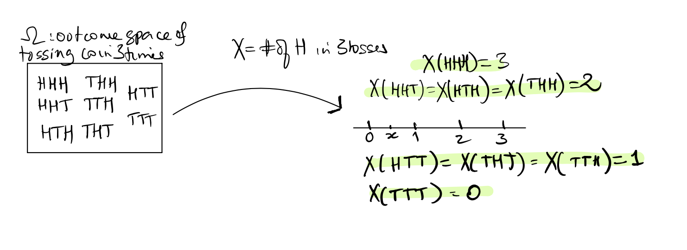
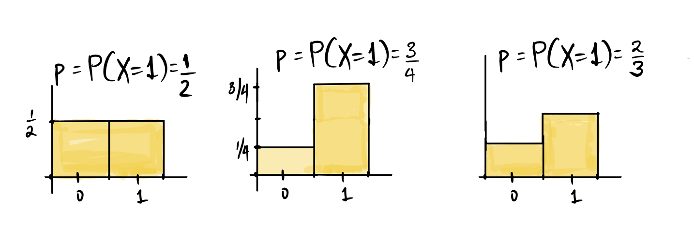
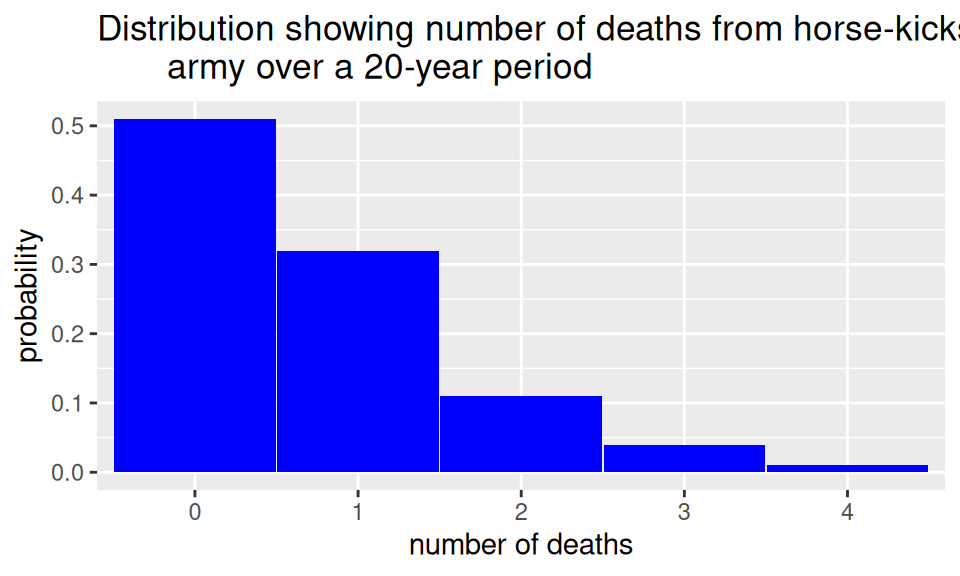
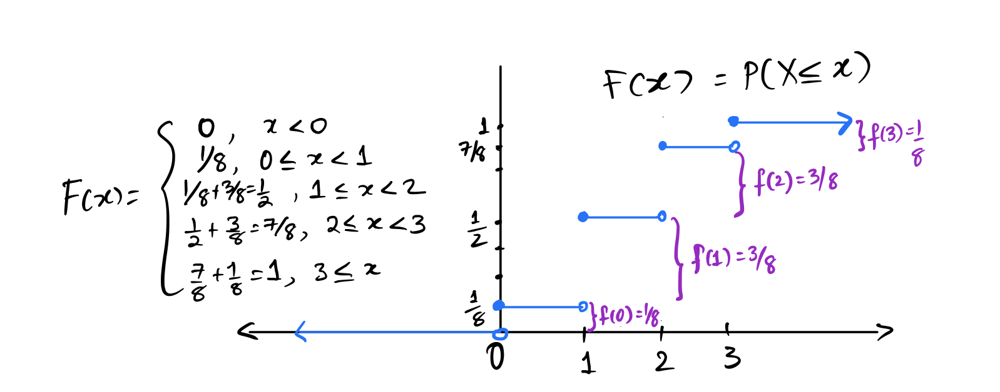
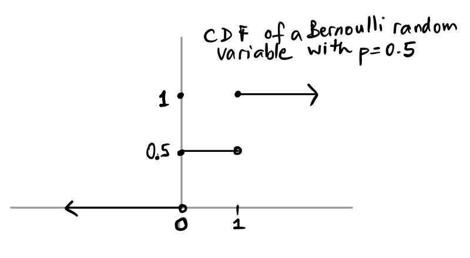
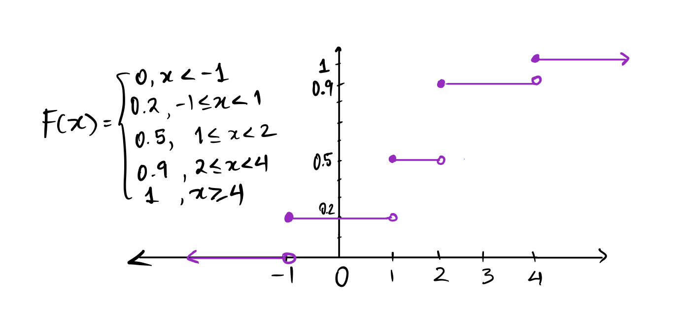

---

course: xac-suat-thong-ke

lecture: 12-bien-ngau-nhien

section: lecture

title: "Biến ngẫu nhiên & Hàm phân phối"

prerequisites: ["bien-ngau-nhien"]

lessonStatus: ready

description: "Định nghĩa biến ngẫu nhiên, phân loại rời rạc và liên tục, hàm khối lượng xác suất PMF, phân phối Poisson và hàm phân phối tích lũy CDF."

---

## 1. Mở đầu: Cầu nối giữa không gian mẫu và trục số thực

Trong các bài học trước, chúng ta đã tiếp cận lý thuyết xác suất thông qua các không gian mẫu $\Omega$ chứa đựng nhiều kết quả mang tính chất định tính: Mặt ngửa hay mặt sấp của đồng xu ($\{H, T\}$), màu sắc của những tấm thẻ trong hộp ($\{\text{Red}, \text{Blue}\}$), hoặc kết quả của một ca xét nghiệm y khoa ($\\{\text{Positive}, \text{Negative}\\}$).

Tuy nhiên, trong phân tích dữ liệu hiện đại và suy rộng thống kê, các nhà khoa học không thể dừng lại ở việc liệt kê các nhãn định tính. Chúng ta cần tính toán số lượng, tính trung bình cộng, đo lường độ lệch chuẩn và thiết lập các mô hình dự báo. Để làm được điều đó, ta cần một cơ chế toán học chuyển đổi mọi kết quả ngẫu nhiên trừu tượng thành các con số thực cụ thể. Cơ chế đó được gọi là **biến ngẫu nhiên** (Random Variable).

  

Hình 12.1: Biến ngẫu nhiên $X$ là một hàm số ánh xạ từ không gian mẫu $\Omega$ sang trục số thực $\mathbb{R}$.

### Định nghĩa hình thức của biến ngẫu nhiên

::: tip Định nghĩa: Biến ngẫu nhiên (Random Variable)

Cho một phép thử ngẫu nhiên với không gian mẫu $\Omega$. Một **biến ngẫu nhiên** $X$ là một hàm số toán học gán mỗi kết quả nguyên sơ $\omega \in \Omega$ với một số thực duy nhất trên trục số thực $\mathbb{R}$:

$$
X: \Omega \to \mathbb{R}, \quad \omega \mapsto X(\omega)
$$

:::

### Tại sao lại gọi là "Biến" và "Ngẫu nhiên"?

- **Là biến (Variable)**: Bởi vì nó có thể nhận nhiều giá trị số thực khác nhau tùy thuộc vào kết quả cụ thể của phép thử.

- **Là ngẫu nhiên (Random)**: Bởi vì giá trị cụ thể mà nó nhận được thừa hưởng tính bất định từ chính phép thử ngẫu nhiên tạo ra nó. Ta không thể biết chắc chắn giá trị trước khi phép thử diễn ra, nhưng ta biết quy luật xác suất chi phối nó.

### Quy ước ký hiệu học thuật

1. **Chữ cái in hoa ($X, Y, Z$)**: Ký hiệu cho bản thân biến ngẫu nhiên (tức quy tắc ánh xạ hàm số).

2. **Chữ cái in thường ($x, y, z$)**: Ký hiệu cho một giá trị số thực cụ thể mà biến ngẫu nhiên đó có thể nhận được.

3. **Biến cố $\{X = x\}$**: Biểu thị tập hợp tất cả các kết quả nguyên sơ trong không gian mẫu được ánh xạ về đúng giá trị $x$:

$$
\{\omega \in \Omega : X(\omega) = x\}
$$

Xác suất để biến ngẫu nhiên nhận giá trị $x$ được viết gọn là $P(X = x)$.

---

## 2. Phân loại biến ngẫu nhiên: Rời rạc vs Liên tục

Tương tự như sự phân chia giữa biến định lượng rời rạc và liên tục trong phân tích dữ liệu, biến ngẫu nhiên được phân thành hai nhóm cơ bản:

### Biến ngẫu nhiên rời rạc (Discrete Random Variables)

Biến ngẫu nhiên $X$ được gọi là **rời rạc** nếu tập giá trị khả dĩ của nó là một tập hợp hữu hạn hoặc đếm được (có thể đánh số thứ tự $x_1, x_2, x_3, \dots$).

- Số mặt ngửa nhận được khi tung một đồng xu 3 lần ($X \in \{0, 1, 2, 3\}$).

- Số lần tung đồng xu cho đến khi xuất hiện mặt ngửa đầu tiên ($X \in \{1, 2, 3, \dots\}$).

- Số lượng khách hàng đến quầy giao dịch ngân hàng trong một buổi sáng ($X \in \{0, 1, 2, \dots\}$).

- Số lỗi chính tả trên một trang tài liệu ($X \in \{0, 1, 2, \dots\}$).

### Biến ngẫu nhiên liên tục (Continuous Random Variables)

Biến ngẫu nhiên $X$ được gọi là **liên tục** nếu tập giá trị khả dĩ của nó lấp đầy một khoảng hoặc toàn bộ trục số thực $\mathbb{R}$. Giữa hai giá trị bất kỳ luôn tồn tại vô số giá trị khả dĩ khác.

- Thời gian chờ đợi giữa hai lượt khách đến máy rút tiền ATM (đo bằng phút/giây).

- Chiều cao hoặc cân nặng của một sinh viên được chọn ngẫu nhiên.

- Giá trị cổ phiếu tại thời điểm đóng cửa sàn giao dịch.

- Lượng mưa đo được trong một tháng tại một lưu vực sông.

### Ví dụ mô hình hóa: Cò quay Roulette và Biến ngẫu nhiên tiền thắng ròng

Bàn cò quay kiểu Mỹ (American Roulette) có tổng cộng 38 ô số gồm: 18 ô màu đỏ, 18 ô màu đen, và 2 ô màu xanh lá cây (mang số 0 và 00).

  

  
Hình 12.2: Bàn cò quay Roulette kiểu Mỹ gồm 38 ô số phân bổ đỏ, đen và xanh.

Một người chơi đặt cược 1 USD vào ô màu Đỏ trong 6 vòng quay liên tiếp độc lập:

- Ở mỗi vòng, nếu bóng rơi vào ô đỏ, người chơi nhận lại tiền cược và lãi thêm 1 USD (thắng 1 USD).

- Nếu bóng rơi vào ô đen hoặc xanh, người chơi mất toàn bộ 1 USD tiền cược (thua 1 USD).

Gọi $Y$ là **tiền thắng ròng** (Net Gain) của người chơi sau 6 vòng cược:

$$
Y = \text{Total winnings} - \text{Total losses}
$$

Hỏi $Y$ có phải là một biến ngẫu nhiên không, và tập giá trị của nó là gì?

- $Y$ chắc chắn là một biến ngẫu nhiên vì giá trị của nó phụ thuộc ngẫu nhiên vào kết quả của 6 vòng quay.

- Gọi $K$ là số vòng quay thắng ($K \in \{0, 1, 2, 3, 4, 5, 6\}$). Khi đó số vòng thua là $6 - K$.

- Tiền thắng ròng được tính bằng:

$$
\begin{aligned}
Y &= (+1) \times K + (-1) \times (6 - K) \\
&= 2K - 6
\end{aligned}
$$

- Thay các giá trị khả dĩ của $K$ vào, ta tìm được tập giá trị của $Y$:

$$
Y \in \{-6, -4, -2, 0, 2, 4, 6\}
$$

Biến ngẫu nhiên $Y$ nhận 7 giá trị rời rạc chẵn từ $-6$ (thua trắng cả 6 ván) đến $+6$ (thắng trọn vẹn cả 6 ván).

---

## 3. Hàm khối lượng xác suất (Probability Mass Function – PMF)

Để mô tả hoàn chỉnh một biến ngẫu nhiên rời rạc, ta sử dụng **hàm khối lượng xác suất**.

::: tip Định nghĩa: Hàm khối lượng xác suất (PMF)

Cho $X$ là một biến ngẫu nhiên rời rạc. **Hàm khối lượng xác suất** (viết tắt là PMF), ký hiệu là $f(x)$, là hàm số xác định xác suất để biến ngẫu nhiên $X$ nhận đúng giá trị $x$:

$$
f(x) = P(X = x), \quad \forall x \in \mathbb{R}
$$

:::

### Các tính chất nền tảng của PMF:

1. $f(x) \ge 0$ với mọi $x \in \mathbb{R}$.

2. $f(x) > 0$ chỉ tại một tập hợp đếm được các điểm $\{x_1, x_2, \dots\}$, và bằng $0$ tại mọi điểm số thực còn lại.

3. Tổng khối lượng xác suất trên toàn không gian bằng $1$:

$$
\sum_{x} f(x) = \sum_{x} P(X = x) = 1
$$

### Biểu diễn PMF dưới dạng giải tích và bảng phân phối

Xét ví dụ tung một đồng xu cân bằng 3 lần, gọi $X$ là số mặt ngửa.

Ta có thể biểu diễn PMF dưới dạng bảng phân phối:

| Giá trị $x$ | 0 | 1 | 2 | 3 |
| :---: | :---: | :---: | :---: | :---: |
| **$f(x) = P(X = x)$** | $\frac{1}{8}$ | $\frac{3}{8}$ | $\frac{3}{8}$ | $\frac{1}{8}$ |

Hoặc dưới dạng biểu thức hàm từng khúc gọn gàng:

$$
f(x) = \begin{cases}

\frac{1}{8}, & x \in \\{0, 3\\} \\

\frac{3}{8}, & x \in \\{1, 2\\} \\

0, & \text{otherwise}

\end{cases}
$$

---

## 4. Các biến ngẫu nhiên rời rạc kinh điển và ứng dụng thực tiễn

### 1. Biến ngẫu nhiên Bernoulli

Chỉ báo cho một sự kiện nhị phân:

$$
f(x) = \begin{cases}

p, & x = 1 \\

1-p, & x = 0 \\

0, & \text{otherwise}

\end{cases}
$$

  

Hình 12.3: Hàm khối lượng xác suất PMF của biến ngẫu nhiên Bernoulli với $p = 0{,}5$, $p = 0{,}75$ và $p = 0{,}67$.

### 2. Biến ngẫu nhiên Nhị thức

Đếm số lần thành công trong $n$ phép thử Bernoulli độc lập có hoàn lại:

$$
\begin{aligned}
f(k) &= P(X=k) \\
&= \binom nkp^k(1-p)^{n-k}.
\end{aligned}
$$

Miền giá trị là $k=0,1,\dots,n$.

#### Ứng dụng thực tế: Thăm dò bầu cử Thượng viện California

Trong cuộc bầu cử sơ bộ Thượng viện Hoa Kỳ tại California năm 2024, một cuộc khảo sát chính sách uy tín ghi nhận tỷ lệ cử tri tiềm năng ủng hộ ứng viên Adam Schiff là $p = 25\%$ ($0{,}25$).

Giả sử ta khảo sát ngẫu nhiên $n = 10$ cử tri (lấy mẫu có hoàn lại từ cơ sở dữ liệu). Tính xác suất có **nhiều hơn 2 cử tri** trong mẫu ủng hộ Adam Schiff.

- Gọi $X$ là số cử tri ủng hộ Schiff trong 10 người, ta có $X \sim \text{Bin}(10, 0{,}25)$.

- Biến cố cần tìm là $\{X > 2\}$. Sử dụng quy tắc biến cố đối:

$$
\begin{aligned}
&q_k=P(X=k), \\
&P(X>2)=1-P(X\le2) \\
&=1-(q_0+q_1+q_2).
\end{aligned}
$$

- Tính từng xác suất thành phần:

$$
\begin{aligned}
&P(X=0)=(0{,}75)^{10} \\
&\approx0{,}056314, \\
&P(X=1)=10(0{,}25)(0{,}75)^9 \\
&\approx0{,}187712, \\
&P(X=2)=45(0{,}25)^2(0{,}75)^8 \\
&\approx0{,}281568.
\end{aligned}
$$

- Cộng dồn lại:

Dùng ba xác suất $q_0,q_1,q_2$ vừa tính:

$$
\begin{aligned}
P(X\le2)&=q_0+q_1+q_2 \\
&\approx0{,}525594.
\end{aligned}
$$

- Suy ra xác suất có nhiều hơn 2 người ủng hộ là:

$$
\begin{aligned}
P(X > 2) &= 1 - 0{,}525594 \\
&= 0{,}474406
\end{aligned}
$$

### 3. Biến ngẫu nhiên Siêu bội

Đếm số lần thành công khi rút không hoàn lại từ tổng thể hữu hạn:

$$
\begin{aligned}
f(k) &= P(X = k) \\
&= \frac{\binom{G}{k} \times \binom{N-G}{n-k}}{\binom{N}{n}}
\end{aligned}
$$

#### Ví dụ mô hình hóa: Lựa chọn nhân viên đi đào tạo

Xét tình huống giả định: Một chuỗi siêu thị lớn gồm $N = 1.000$ nhân viên đủ điều kiện thăng tiến, trong đó cơ cấu giới tính là cân bằng hoàn hảo ($G = 500$ nữ, $N - G = 500$ nam). Trong suốt 10 năm, mỗi năm công ty chọn ngẫu nhiên 1 nhân viên đi đào tạo quản lý cấp cao (tổng cộng $n = 10$ lượt lựa chọn không lặp lại).

Kết quả thực tế cho thấy trong cả 10 năm không có bất kỳ một nhân viên nữ nào được cử đi học. Nhóm nhân viên nữ đã đâm đơn kiện vì cho rằng có sự phân biệt giới tính có hệ thống. Ban giám đốc phủ nhận và khẳng định việc lựa chọn hoàn toàn ngẫu nhiên.

Hãy kiểm định xem: Nếu ban giám đốc thực sự chọn ngẫu nhiên, xác suất không có người phụ nữ nào được chọn ($X = 0$) nhỏ đến mức nào?

- Mô hình hóa $X \sim \text{HG}(N = 1000, G = 500, n = 10)$:

$$
\begin{aligned}
P(X=0)&=\frac{\binom{500}{10}}{\binom{1000}{10}} \\
&\approx0{,}000933.
\end{aligned}
$$

Dưới mô hình chọn đều không hoàn lại đã nêu, kết quả này có xác suất chưa đầy $0{,}1\%$. Điều đó gợi ý cần kiểm tra cơ chế lựa chọn. Riêng phép tính không chứng minh nguyên nhân phân biệt giới tính, vì phải xét tiêu chí đủ điều kiện và quy trình thực tế.

---

### 4. Biến ngẫu nhiên Poisson

Bên cạnh phân phối Nhị thức và Siêu bội, có một phân phối rời rạc xuất hiện liên tục trong thế giới thực để mô tả **tần suất xuất hiện của các biến cố hiếm gặp** trong một đơn vị thời gian hoặc không gian cố định: **Phân phối Poisson**.

Được đặt theo tên nhà toán học Pháp Siméon-Denis Poisson, phân phối này xuất hiện tự nhiên khi số lần thử $n$ rất lớn và xác suất thành công $p$ rất nhỏ, nhưng tích số $\lambda = n p$ hội tụ về một hằng số dương hữu hạn (gọi là luật số hiếm).

::: tip Định nghĩa: Biến ngẫu nhiên Poisson

Biến ngẫu nhiên $X$ tuân theo phân phối Poisson với tham số tốc độ $\lambda > 0$, ký hiệu $X \sim \text{Poisson}(\lambda)$, nếu hàm khối lượng xác suất của nó có dạng:

$$
P(X=k)=e^{-\lambda}\frac{\lambda^k}{k!}.
$$

Miền giá trị là $k=0,1,2,\dots$.

trong đó $e \approx 2{,}71828$ là cơ số logarit tự nhiên.

:::

- **Ý nghĩa của tham số $\lambda$**: Là số lượng biến cố trung bình (kỳ vọng) xuất hiện trong một đơn vị thời gian đang xét.

- Vì mẫu số $k!$ tăng trưởng cực nhanh so với tử số $\lambda^k$, xác suất để $X$ nhận các giá trị nguyên quá lớn sẽ triệt tiêu về $0$ rất nhanh.

  

  
Hình 12.4: Biểu đồ thực nghiệm của số lính kỵ binh Phổ tử vong vì ngựa đá mỗi năm (nghiên cứu kinh điển của Bortkiewicz năm 1898) khớp hoàn hảo với phân phối Poisson lệch phải.

---

## 5. Hàm phân phối tích lũy (Cumulative Distribution Function – CDF)

Bên cạnh PMF, có một công cụ toán học thứ hai toàn diện và tổng quát hơn để mô tả biến ngẫu nhiên (áp dụng thống nhất cho cả biến rời rạc lẫn biến liên tục): **Hàm phân phối tích lũy** (CDF).

::: tip Định nghĩa: Hàm phân phối tích lũy (CDF)

Cho $X$ là một biến ngẫu nhiên bất kỳ. **Hàm phân phối tích lũy** của $X$, ký hiệu là $F(x)$, là hàm số xác định trên toàn bộ trục số thực $\mathbb{R}$, biểu thị tổng xác suất tích lũy từ vô cùng bé lên đến và bao gồm giá trị $x$:

$$
F(x) = P(X \le x), \quad \forall x \in \mathbb{R}
$$

:::

### Cách tính hàm phân phối tích lũy từ hàm khối lượng xác suất

Với biến ngẫu nhiên rời rạc, ta chỉ cần cộng dồn các khối lượng xác suất của mọi giá trị $y$ nhỏ hơn hoặc bằng $x$:

$$
\begin{aligned}
F(x) &= \sum_{y \le x} f(y) \\
&= \sum_{y \le x} P(X = y)
\end{aligned}
$$

### Ví dụ: Hàm CDF của số mặt ngửa trong 3 lần tung đồng xu

Nhắc lại PMF của số mặt ngửa $X$:

$$
\begin{aligned}
&f(0) = \frac{1}{8}, \quad f(1) = \frac{3}{8}, \\
&f(2) = \frac{3}{8}, \quad f(3) = \frac{1}{8}
\end{aligned}
$$

Ta tính giá trị của $F(x)$ trên từng khoảng số thực:

- Khi $x < 0$: Không có kết quả nào nhỏ hơn $0$, nên $F(x) = P(X \le x) = 0$.

- Khi $0 \le x < 1$: Chỉ tích lũy được giá trị $0$, nên $F(x) = f(0) = \frac{1}{8}$.

- Khi $1 \le x < 2$: Tích lũy được $\{0, 1\}$, nên $F(x)=f(0)+f(1)=1/2$.

- Khi $2 \le x < 3$: Tích lũy được $\{0, 1, 2\}$, nên $F(x) = \frac{1}{8} + \frac{3}{8} + \frac{3}{8} = \frac{7}{8}$.

- Khi $x \ge 3$: Tích lũy toàn bộ kết quả $\{0, 1, 2, 3\}$, nên $F(x) = 1$.

Biểu thức hàm từng khúc:

$$
F(x) = \begin{cases}

0, & x < 0 \\

\frac{1}{8}, & 0 \le x < 1 \\

\frac{1}{2}, & 1 \le x < 2 \\

\frac{7}{8}, & 2 \le x < 3 \\

1, & x \ge 3

\end{cases}
$$

  

Hình 12.5: Đồ thị hàm phân phối tích lũy $F(x)$ có dạng bậc thang gián đoạn nhảy cóc tại các điểm có xác suất dương.

### Đồ thị hàm phân phối tích lũy của biến Bernoulli

  

Hình 12.6: Đồ thị CDF của biến Bernoulli($0{,}5$) với hai bước nhảy tại $x = 0$ và $x = 1$.

### Các tính chất toán học cơ bản của hàm CDF:

1. **Tính đơn điệu không giảm**: Nếu $x_1 \le x_2$ thì $F(x_1) \le F(x_2)$.

2. **Giới hạn ở vô cực**:

$$
\lim_{x \to -\infty} F(x) = 0 , \quad \lim_{x \to +\infty} F(x) = 1
$$

3. **Liên tục bên phải (Right-continuous)**: Tại mọi điểm $x$, giới hạn tiến từ bên phải bằng đúng giá trị hàm:

$$
\lim_{t \to x^+} F(t) = F(x)
$$

Trên đồ thị bậc thang, đầu mút bên trái của mỗi bậc thang là dấu chấm tròn đặc ($\bullet$), còn đầu mút bên phải là vòng tròn rỗng ($\circ$).

4. **Độ cao của bước nhảy chính là xác suất tại điểm đó**:

$$
P(X = x) = F(x) - \lim_{t \to x^-} F(t)
$$

Nếu tại điểm $x$ hàm $F$ liên tục (không có bước nhảy), thì xác suất tại đúng điểm đó bằng $0$.

5. **Tính xác suất trên nửa khoảng $(a, b]$**:

$$
P(a < X \le b) = F(b) - F(a)
$$

### Bài tập dựng CDF từ bảng phân phối:

Xét biến ngẫu nhiên $X$ có bảng phân phối:

| Giá trị $x$ | -1 | 1 | 2 | 4 |
| :---: | :---: | :---: | :---: | :---: |
| **$P(X = x)$** | $0{,}2$ | $0{,}3$ | $0{,}4$ | $?$ |

Vì tổng xác suất phải bằng 1:

$$
\begin{aligned}
P(X = 4) &= 1 - (0{,}2 + 0{,}3 + 0{,}4) \\
&= 1 - 0{,}9 = 0{,}1
\end{aligned}
$$

Hàm CDF $F(x)$ tích lũy qua từng bước nhảy:

  

Hình 12.7: Đồ thị hàm tích lũy $F(x)$ với các bước nhảy tại $-1, 1, 2$ và $4$.

$$
F(x) = \begin{cases}

0, & x < -1 \\

0{,}2, & -1 \le x < 1 \\

0{,}5, & 1 \le x < 2 \\

0{,}9, & 2 \le x < 4 \\

1{,}0, & x \ge 4

\end{cases}
$$

---

## 6. Tổng kết bài học

1. **Biến ngẫu nhiên**: Là một hàm số ánh xạ kết quả từ không gian mẫu $\Omega$ sang trục số thực $\mathbb{R}$.

2. **Phân loại**:

   - Biến ngẫu nhiên rời rạc: Nhận các giá trị riêng lẻ rời rạc.

   - Biến ngẫu nhiên liên tục: Nhận các giá trị lấp đầy một khoảng số thực.

3. **Hàm khối lượng xác suất (PMF)**: $f(x) = P(X = x)$, mô tả khối lượng xác suất tại từng điểm rời rạc.

4. **Phân phối Poisson**: $P(X = k) = e^{-\lambda} \frac{\lambda^k}{k!}$, mô tả tần suất xuất hiện của các biến cố hiếm gặp trong một khoảng thời gian/không gian.

5. **Hàm phân phối tích lũy (CDF)**: $F(x) = P(X \le x)$, là hàm số đơn điệu tăng, liên tục phải, nhận giá trị trong đoạn $[0, 1]$, mô tả xác suất tích lũy từ $-\infty$ đến $x$.

6. **Mối liên hệ giữa PMF và CDF**: Chiều cao bước nhảy của đồ thị bậc thang CDF tại điểm $x$ bằng đúng khối lượng xác suất $P(X = x)$ của PMF.

---

## Tài liệu tham khảo

1. UC Berkeley STAT 20: *Random Variables*, Department of Statistics, UC Berkeley.

2. Ross, S. (2014): *A First Course in Probability*, 9th Edition, Pearson.

3. Rice, J. A. (2006): *Mathematical Statistics and Data Analysis*, 3rd Edition, Cengage Learning.

## Bài tập rèn luyện tư duy xác suất

::: info Hướng dẫn thực hành

Các bài tập dưới đây giúp bạn rèn luyện khả năng thiết lập biến ngẫu nhiên, đọc hiểu đồ thị hàm phân phối tích lũy CDF, chuyển đổi qua lại giữa PMF và CDF, cũng như ứng dụng các phân phối Nhị thức và Poisson trong y học và đời sống thực tế.

:::

::: exercise Bài tập 1: Đọc hiểu và khai thác hàm phân phối tích lũy CDF

Cho biến ngẫu nhiên rời rạc $X$ có hàm phân phối tích lũy $F(x)$ được cho bởi biểu thức:

$$
F(x) = \begin{cases}

0, & x < 0 \\

0{,}15, & 0 \le x < 1 \\

0{,}40, & 1 \le x < 2 \\

0{,}75, & 2 \le x < 3 \\

1{,}00, & x \ge 3

\end{cases}
$$

1. Hãy xác định tập các giá trị khả dĩ của biến ngẫu nhiên $X$ và lập bảng hàm khối lượng xác suất PMF $f(x) = P(X = x)$.

2. Tính các xác suất sau bằng cách tra cứu trực tiếp từ hàm CDF $F(x)$:

   - $P(X \le 2)$

   - $P(X < 2)$

   - $P(X = 2)$

   - $P(1 < X \le 3)$

   - $P(X > 1)$

3. Biến ngẫu nhiên $X$ có thể nhận giá trị $x = 1{,}5$ không? Giá trị của $F(1{,}5)$ và $f(1{,}5)$ bằng bao nhiêu?

:::

::: solution

**Câu 1: Xác định tập giá trị và lập bảng PMF**:

Hàm CDF $F(x)$ là hàm bậc thang và chỉ xảy ra bước nhảy tại các điểm gián đoạn: $x \in \{0, 1, 2, 3\}$.

Khối lượng xác suất tại mỗi điểm chính là độ lớn bước nhảy:

Viết $F(k^-)=\lim_{t\to k^-}F(t)$ cho giới hạn bên trái. Các mức nhảy lần lượt là 0,15−0, 0,40−0,15, 0,75−0,40 và 1−0,75.

$$
\begin{aligned}
&f(0)=F(0)-F(0^-)=0{,}15, \\
&f(1)=F(1)-F(1^-)=0{,}25, \\
&f(2)=F(2)-F(2^-)=0{,}35, \\
&f(3)=F(3)-F(3^-)=0{,}25.
\end{aligned}
$$

Kiểm tra: $0{,}15 + 0{,}25 + 0{,}35 + 0{,}25 = 1{,}00$.

Bảng phân phối xác suất PMF của $X$:

| Giá trị $x$ | 0 | 1 | 2 | 3 |
| :---: | :---: | :---: | :---: | :---: |
| **$f(x) = P(X = x)$** | $0{,}15$ | $0{,}25$ | $0{,}35$ | $0{,}25$ |

**Câu 2: Tính toán các xác suất**:

- $P(X \le 2)$: Theo đúng định nghĩa CDF, $P(X \le 2) = F(2) = 0{,}75$.

- $P(X < 2)$: Là giới hạn trái của hàm CDF tại điểm 2:

$$
P(X < 2) = \lim_{t \to 2^-} F(t) = 0{,}40
$$

- $P(X = 2)$: Là độ cao bước nhảy tại điểm 2:

$$
\begin{aligned}
P(X = 2) &= F(2) - P(X < 2) \\
&= 0{,}75 - 0{,}40 = 0{,}35
\end{aligned}
$$

- $P(1 < X \le 3)$: Sử dụng công thức hiệu hai giá trị CDF:

$$
\begin{aligned}
P(1<X\le3)&=F(3)-F(1) \\
&=1-0{,}40 \\
&=0{,}60.
\end{aligned}
$$

Kiểm tra lại bằng PMF:

$$
\begin{aligned}
P(X\in\{2,3\})&=0{,}35+0{,}25 \\
&=0{,}60.
\end{aligned}
$$

- $P(X > 1)$: Theo quy tắc biến cố đối:

$$
\begin{aligned}
P(X > 1) &= 1 - P(X \le 1) \\
&= 1 - F(1) \\
&= 1 - 0{,}40 = 0{,}60
\end{aligned}
$$

**Câu 3: Đánh giá tại điểm $x = 1{,}5$**:

- Vì $1{,}5$ không nằm trong tập giá trị khả dĩ $\{0, 1, 2, 3\}$, biến ngẫu nhiên $X$ không thể nhận giá trị $1{,}5$. Do đó $f(1{,}5) = P(X = 1{,}5) = 0$.

- Tuy nhiên, hàm phân phối tích lũy $F(x)$ được xác định cho **mọi số thực** $x \in \mathbb{R}$. Vì $1 \le 1{,}5 < 2$, ta có:

$$
\begin{aligned}
F(1{,}5) &= P(X \le 1{,}5) \\
&= P(X = 0) + P(X = 1) \\
&= 0{,}15 + 0{,}25 = 0{,}40
\end{aligned}
$$

:::

---

::: exercise Bài tập 2: Thử nghiệm lâm sàng thuốc cảm cúm và phân phối Nhị thức

Một nhóm nghiên cứu thử nghiệm một phương pháp điều trị cảm cúm mới trên một nhóm gồm $n = 10$ bệnh nhân độc lập. Giả sử xác suất khỏi bệnh nhanh của mỗi bệnh nhân được điều trị là $p = 0{,}20$ ($20\%$).

1. Gọi $X$ là số bệnh nhân khỏi bệnh trong nhóm 10 người. Hãy nêu tên phân phối của $X$ và xác định các tham số.

2. Tính xác suất để phương pháp điều trị chữa khỏi bệnh cho **ít nhất một người** ($P(X \ge 1)$).

3. Nếu nhóm nghiên cứu muốn xác suất chữa khỏi cho ít nhất một người đạt tối thiểu $99\%$, thì cần thử nghiệm trên tối thiểu bao nhiêu bệnh nhân ($n$ tối thiểu bằng bao nhiêu)?

:::

::: solution

**Câu 1: Xác định phân phối của $X$**:

Biến ngẫu nhiên $X$ đếm số lần thành công trong $n = 10$ phép thử Bernoulli độc lập có cùng xác suất thành công $p = 0{,}20$.

Do đó, $X \sim \text{Bin}(n = 10, p = 0{,}20)$.

**Câu 2: Xác suất có ít nhất một người khỏi bệnh**:

Áp dụng quy tắc biến cố đối:

$$
\begin{aligned}
P(X\ge1)&=1-P(X=0) \\
&=1-(0{,}80)^{10} \\
&\approx0{,}892626.
\end{aligned}
$$

Xác suất xấp xỉ 89,26%.

**Câu 3: Tìm cỡ mẫu $n$ tối thiểu để $P(X \ge 1) \ge 0{,}99$**:

Ta cần tìm số nguyên dương $n$ nhỏ nhất thỏa mãn bất phương trình:

$$
\begin{aligned}
&1 - (0{,}80)^n \ge 0{,}99 \\
&\iff (0{,}80)^n \le 1 - 0{,}99 = 0{,}01
\end{aligned}
$$

Lấy logarit tự nhiên cả hai vế (lưu ý đổi chiều bất đẳng thức vì $\ln(0{,}80) < 0$):

$$
\begin{aligned}
n \cdot \ln(0{,}80) &\le \ln(0{,}01) \\
&\iff n \ge \frac{\ln(0{,}01)}{\ln(0{,}80)} \\
&= \frac{-4{,}60517}{-0{,}22314} \approx 20{,}64
\end{aligned}
$$

Vì $n$ phải là một số nguyên dương, ta làm tròn lên $n = 21$.

Kết luận: Cần thử nghiệm trên tối thiểu 21 bệnh nhân để đảm bảo khả năng có ít nhất một người khỏi bệnh đạt từ $99\%$ trở lên.

:::

---

::: exercise Bài tập 3: Dòng khách hàng đến cây ATM và phân phối Poisson

Theo số liệu thống kê tại một chi nhánh ngân hàng, số lượng khách hàng đến giao dịch tại cây ATM trong khoảng thời gian từ 12h00 đến 13h00 trưa tuân theo phân phối Poisson với tốc độ trung bình là $\lambda = 3$ khách/giờ.

1. Tính xác suất để trong khoảng thời gian trên không có khách hàng nào đến giao dịch ($P(X = 0)$).

2. Tính xác suất để có đúng 3 khách hàng đến giao dịch ($P(X = 3)$).

3. Tính xác suất để có nhiều hơn 2 khách hàng đến giao dịch ($P(X > 2)$).

:::

::: solution

**Câu 1: Xác suất không có khách hàng nào ($X = 0$)**:

Với $X \sim \text{Poisson}(\lambda = 3)$:

$$
\begin{aligned}
P(X = 0) &= e^{-3} \frac{3^0}{0!} \\
&= e^{-3} \approx 0{,}049787
\end{aligned}
$$

**Câu 2: Xác suất có đúng 3 khách hàng ($X = 3$)**:

$$
\begin{aligned}
P(X=3)&=e^{-3}\frac{3^3}{3!} \\
&=4{,}5e^{-3} \\
&\approx0{,}224042.
\end{aligned}
$$

**Câu 3: Xác suất có nhiều hơn 2 khách hàng ($X > 2$)**:

Sử dụng biến cố bù:

$$
\begin{aligned}
&q_k=P(X=k), \\
&P(X>2)=1-P(X\le2) \\
&=1-(q_0+q_1+q_2).
\end{aligned}
$$

Tính các thành phần còn lại:

$$
\begin{aligned}
&P(X=1) = 3e^{-3} \\
&\approx 0{,}149361, \\
&P(X=2)=4{,}5e^{-3}\approx0{,}224042.
\end{aligned}
$$

Tổng xác suất tích lũy đến 2 là:

$$
\begin{aligned}
P(X \le 2) &= e^{-3} \times (1 + 3 + 4{,}5) \\
&= 8{,}5 \times e^{-3} \\
&\approx 0{,}423190
\end{aligned}
$$

Suy ra:

$$
\begin{aligned}
P(X > 2) &= 1 - 0{,}423190 \\
&= 0{,}576810
\end{aligned}
$$

:::

