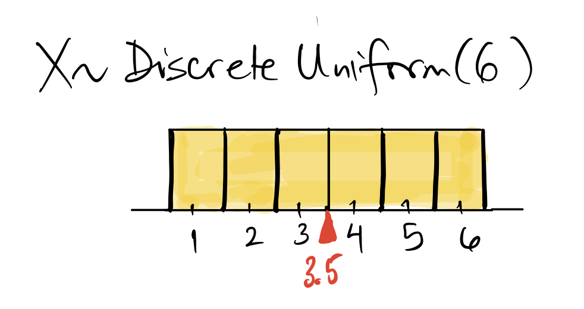
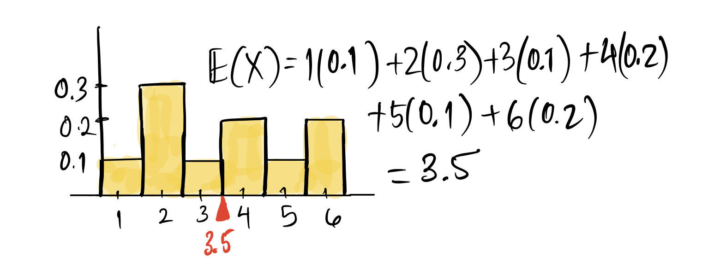
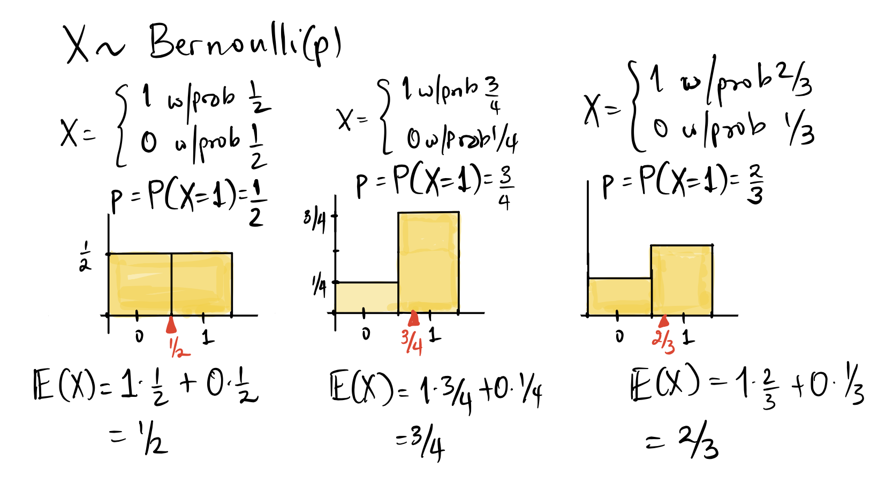

## 1. Mở đầu: Đi tìm giá trị điển hình của phân phối

Khi nghiên cứu một biến ngẫu nhiên $X$, việc liệt kê toàn bộ bảng phân phối xác suất hoặc vẽ đồ thị PMF/CDF cung cấp cho chúng ta một bức tranh chi tiết. Tuy nhiên, trong thực hành khoa học và đời sống thực tế, con người luôn có nhu cầu tóm tắt bức tranh chi tiết đó bằng các con số đặc trưng cô đọng:
- Nếu chơi một trò chơi may rủi lặp đi lặp lại hàng trăm lần, trung bình mỗi ván ta sẽ thắng hay thua bao nhiêu tiền?
- Một sinh viên thi trắc nghiệm ngẫu nhiên thì điểm số trung bình nhận được là bao nhiêu?
- Các kết quả thực tế sẽ dao động quanh giá trị trung tâm đó trong biên độ rộng hay hẹp?

Hai đại lượng thống kê nền tảng để trả lời hai câu hỏi trên lần lượt là **kỳ vọng toán học** (đo lường tâm phân phối) và **phương sai / độ lệch chuẩn** (đo lường độ phân tán).

---

## 2. Kỳ vọng toán học $E(X)$: Trọng tâm của phân phối

### Định nghĩa hình thức

::: tip Định nghĩa: Kỳ vọng toán học (Expected Value)
Cho $X$ là một biến ngẫu nhiên rời rạc có hàm khối lượng xác suất $f(x) = P(X = x)$. **Kỳ vọng toán học** (hay giá trị kỳ vọng, giá trị trung bình) của $X$, ký hiệu là $E(X)$ hoặc $\mu$, là tổng có trọng số của tất cả các giá trị khả dĩ nhân với xác suất tương ứng:
$$
E(X) = \sum_x x \cdot P(X = x) = \sum_x x \cdot f(x)
$$
:::

Kỳ vọng là một **hằng số** duy nhất gắn liền với phân phối xác suất. Nó phản ánh giá trị trung bình dài hạn (long-run average) mà ta kỳ vọng quan sát được nếu thí nghiệm ngẫu nhiên được lặp lại vô hạn lần trong các điều kiện độc lập giống hệt nhau.

### Trực giác vật lý: "Điểm cân bằng" (Balancing Point)

Nếu ta tưởng tượng biểu đồ xác suất lý thuyết (Probability Histogram) là một tấm bản kim loại mỏng đồng chất, trong đó diện tích mỗi cột tương ứng với khối lượng vật lý:
- Kỳ vọng $E(X)$ chính là **trọng tâm** (Center of Mass) của tấm kim loại đó.
- Nếu đặt một điểm tựa hình tam giác tại vị trí $x = E(X)$, tấm biểu đồ sẽ nằm cân bằng hoàn hảo mà không bị nghiêng lệch về bất kỳ phía nào.

  
  
Hình 13.1: Điểm tựa màu đỏ tại $E(X) = 3{,}5$ giữ cân bằng hoàn hảo cho biểu đồ xác suất của xúc xắc cân bằng.

### Ví dụ 1: Gieo xúc xắc 6 mặt cân bằng
Gọi $X$ là số chấm xuất hiện khi gieo một con xúc xắc cân bằng ($X \sim \text{Uniform}(6)$). Vì 6 mặt đồng khả năng ($f(x) = 1/6$):
$$
\begin{aligned}
E(X) &= 1 \times \frac{1}{6} + 2 \times \frac{1}{6} + 3 \times \frac{1}{6} + 4 \times \frac{1}{6} + 5 \times \frac{1}{6} + 6 \times \frac{1}{6} \\
&= \frac{1 + 2 + 3 + 4 + 5 + 6}{6} = \frac{21}{6} = 3{,}5
\end{aligned}
$$
Tổng quát cho biến ngẫu nhiên đều rời rạc trên $\{1, 2, \dots, n\}$:
$$
E(X) = \frac{n + 1}{2}
$$

### Ví dụ 2: Con xúc xắc lệch và bài học sư phạm then chốt
Xét một con xúc xắc bị chế tạo lệch: Xác suất xuất hiện mặt 4 và 6 gấp đôi các mặt lẻ ($P(4) = P(6) = 0{,}2$), xác suất mặt 2 gấp ba các mặt lẻ ($P(2) = 0{,}3$), còn các mặt lẻ có xác suất bằng nhau ($P(1) = P(3) = P(5) = 0{,}1$).

Bảng phân phối xác suất:

| Mặt $x$ | 1 | 2 | 3 | 4 | 5 | 6 |
| :---: | :---: | :---: | :---: | :---: | :---: | :---: |
| **$f(x)$** | $0{,}1$ | $0{,}3$ | $0{,}1$ | $0{,}2$ | $0{,}1$ | $0{,}2$ |

Tính kỳ vọng của con xúc xắc lệch:
$$
\begin{aligned}
E(X) &= 1(0{,}1) + 2(0{,}3) + 3(0{,}1) + 4(0{,}2) + 5(0{,}1) + 6(0{,}2) \\
&= 0{,}1 + 0{,}6 + 0{,}3 + 0{,}8 + 0{,}5 + 1{,}2 = 3{,}5
\end{aligned}
$$

  
  
Hình 13.2: Dù phân phối có hình dạng hoàn toàn khác biệt, điểm cân bằng của con xúc xắc lệch vẫn là $E(X) = 3{,}5$.

::: important Bài học thống kê cốt lõi
Hai biến ngẫu nhiên có hình dạng phân phối hoàn toàn khác biệt vẫn có thể có cùng giá trị kỳ vọng $E(X)$. Kỳ vọng chỉ cho biết điểm cân bằng trung tâm, chứ không phản ánh được mức độ biến động hay độ xòe rộng của phân phối.
:::

### Ví dụ 3: Biến ngẫu nhiên Bernoulli
Với $X \sim \text{Bernoulli}(p)$, nhận giá trị $1$ với xác suất $p$ và nhận $0$ với xác suất $1-p$:
$$
E(X) = 1 \cdot p + 0 \cdot (1 - p) = p
$$
Kỳ vọng của một biến chỉ báo Bernoulli chính là xác suất thành công của biến cố đó!

  
  
Hình 13.3: Điểm cân bằng của biến Bernoulli luôn nằm đúng tại vị trí $x = p$.

---

## 3. Các tính chất đại số của kỳ vọng

Toán tử kỳ vọng $E(\cdot)$ sở hữu những tính chất tuyến tính tuyệt đẹp giúp đơn giản hóa việc tính toán trong các bài toán phức tạp.

### 1. Kỳ vọng của hằng số
Với hằng số thực $c$ bất kỳ, vì giá trị luôn cố định nên:
$$
E(c) = c
$$

### 2. Nhân với hằng số
Với hằng số thực $c$ và biến ngẫu nhiên $X$:
$$
E(c X) = c \cdot E(X)
$$

### 3. Tính cộng tính của kỳ vọng (Additivity)
Với hai biến ngẫu nhiên $X$ và $Y$ bất kỳ:
$$
E(X + Y) = E(X) + E(Y)
$$

::: tip Tính chất đặc biệt: Không cần điều kiện độc lập
Đẳng thức $E(X + Y) = E(X) + E(Y)$ **luôn luôn đúng** trong mọi trường hợp, bất kể $X$ và $Y$ độc lập hay phụ thuộc lẫn nhau. Đây là một trong những định lý quyền năng nhất của lý thuyết xác suất.
:::

### 4. Tính tuyến tính tổng quát (Linearity of Expectation)
Kết hợp hai tính chất trên, với các hằng số $a, b \in \mathbb{R}$:
$$
E(a X + b Y) = a E(X) + b E(Y)
$$

### 5. Kỳ vọng của hàm số $g(X)$ (Quy tắc người thống kê vô thức - LOTUS)
Nếu $Y = g(X)$ là một hàm số của biến ngẫu nhiên $X$, thì kỳ vọng của $Y$ được tính bằng cách áp dụng hàm $g$ lên các giá trị khả dĩ $x$, giữ nguyên xác suất:
$$
E[g(X)] = \sum_x g(x) \cdot P(X = x) = \sum_x g(x) \cdot f(x)
$$

::: caution Cảnh báo nghiêm ngặt
Tuyệt đối không áp dụng hàm $g$ lên xác suất $f(x)$! Khi tính $E(X^2)$, ta bình phương các giá trị $x^2$, nhưng xác suất $P(X = x)$ phải được giữ nguyên vẹn.
:::

**Minh họa tính $E(X^2)$**: Xét biến ngẫu nhiên $X$ có phân phối:

| Giá trị $x$ | $P(X = x)$ | $x \cdot P(X = x)$ | $x^2$ | $x^2 \cdot P(X = x)$ |
| :---: | :---: | :---: | :---: | :---: |
| $-2$ | $0{,}2$ | $-0{,}4$ | $4$ | $0{,}8$ |
| $-1$ | $0{,}1$ | $-0{,}1$ | $1$ | $0{,}1$ |
| $0$ | $0{,}2$ | $0{,}0$ | $0$ | $0{,}0$ |
| $1$ | $0{,}3$ | $0{,}3$ | $1$ | $0{,}3$ |
| $3$ | $0{,}2$ | $0{,}6$ | $9$ | $1{,}8$ |
| **Tổng** | **$1{,}0$** | **$E(X) = 0{,}4$** | - | **$E(X^2) = 3{,}0$** |

---

## 4. Kỳ vọng của các phân phối chuẩn mực

Nhờ tính tuyến tính của kỳ vọng, ta có thể suy ra kỳ vọng của các phân phối phức tạp mà không cần khai triển các chuỗi tổng tổ hợp đồ sộ:

### 1. Phân phối Nhị thức: $X \sim \text{Bin}(n, p)$
Một biến ngẫu nhiên nhị thức $X$ thực chất là tổng của $n$ biến ngẫu nhiên chỉ báo Bernoulli độc lập:
$$
X = X_1 + X_2 + \dots + X_n, \quad \text{with } X_i \sim \text{Bernoulli}(p)
$$
Áp dụng tính cộng tính của kỳ vọng:
$$
\begin{aligned}
E(X) &= E(X_1 + X_2 + \dots + X_n) \\
&= E(X_1) + E(X_2) + \dots + E(X_n) \\
&= \underbrace{p + p + \dots + p}_{n \text{ terms}} = n p
\end{aligned}
$$
Trực giác đời thường: Nếu tung 100 lần một đồng xu cân bằng ($p = 0{,}5$), ta kỳ vọng nhận được $100 \times 0{,}5 = 50$ mặt ngửa.

### 2. Phân phối Siêu bội: $X \sim \text{HG}(N, G, n)$
Dù việc rút thẻ là không hoàn lại (các lần rút phụ thuộc nhau), tính cộng tính của kỳ vọng vẫn áp dụng hoàn hảo:
$$
E(X) = n \times \frac{G}{N}
$$
Kỳ vọng chỉ đơn giản bằng cỡ mẫu $n$ nhân với tỷ lệ thành công ban đầu trong tổng thể.

### 3. Phân phối Poisson: $X \sim \text{Poisson}(\lambda)$
Bằng cách khai triển định nghĩa và chuỗi Maclaurin của hàm số mũ $e^\lambda = \sum_{j=0}^\infty \frac{\lambda^j}{j!}$:
$$
\begin{aligned}
E(X) &= \sum_{k=0}^\infty k \cdot e^{-\lambda} \frac{\lambda^k}{k!} \\
&= e^{-\lambda} \lambda \sum_{k=1}^\infty \frac{\lambda^{k-1}}{(k-1)!} \\
&= e^{-\lambda} \lambda \cdot e^{\lambda} = \lambda
\end{aligned}
$$
Kỳ vọng của biến ngẫu nhiên Poisson bằng đúng tham số tốc độ $\lambda$.

---

## 5. Phương sai $\text{Var}(X)$ và Độ lệch chuẩn $\text{SD}(X)$

Kỳ vọng $\mu = E(X)$ cho biết vị trí trung tâm, nhưng không cho biết các giá trị nằm rải rác xung quanh trung tâm ra sao. Để đo lường độ phân tán, ta xét khoảng cách bình phương giữa biến ngẫu nhiên và kỳ vọng của nó.

::: tip Định nghĩa: Phương sai (Variance)
Cho biến ngẫu nhiên $X$ có kỳ vọng $\mu = E(X)$. **Phương sai** của $X$, ký hiệu là $\text{Var}(X)$ hoặc $\sigma^2$, là kỳ vọng của bình phương độ lệch giữa $X$ và $\mu$:
$$
\text{Var}(X) = E\left[(X - \mu)^2\right] = \sum_x (x - \mu)^2 \cdot P(X = x)
$$
:::

### Độ lệch chuẩn (Standard Deviation)
Do phương sai mang đơn vị đo bình phương (ví dụ: Điểm số bình phương, đô-la bình phương), rất khó để trực tiếp so sánh với giá trị biến ngẫu nhiên. Vì vậy, ta lấy căn bậc hai số học của phương sai:
$$
\text{SD}(X) = \sqrt{\text{Var}(X)}
$$
- $\text{SD}(X)$ có cùng đơn vị đo với biến ngẫu nhiên $X$.
- Ý nghĩa: $\text{SD}(X)$ đóng vai trò như một biên độ "sai số điển hình" (give-or-take) quanh kỳ vọng. Một giá trị điển hình của $X$ sẽ rơi vào khoảng:
$$
\mu \pm \text{SD}(X)
$$

### Công thức tính nhanh phương sai (Computational Shortcut Formula)

Thay vì tính hiệu $(x - \mu)$ ở từng giá trị, ta luôn sử dụng công thức rút gọn:
$$
\begin{aligned}
\text{Var}(X) &= E\left(X^2 - 2\mu X + \mu^2\right) \\
&= E(X^2) - 2\mu E(X) + \mu^2 \\
&= E(X^2) - 2\mu^2 + \mu^2 \\
&= E(X^2) - \mu^2 = E(X^2) - [E(X)]^2
\end{aligned}
$$

::: tip Công thức vàng: Phương sai bằng Kỳ vọng bình phương trừ Bình phương kỳ vọng
$$
\text{Var}(X) = E(X^2) - [E(X)]^2
$$
:::

---

## 6. Các tính chất nền tảng của phương sai

### 1. Phương sai của hằng số bằng $0$
Một hằng số không hề có sự biến thiên ngẫu nhiên:
$$
\text{Var}(c) = 0, \quad \text{SD}(c) = 0
$$

### 2. Nhân với hằng số: Kéo giãn thang đo
Khi nhân biến ngẫu nhiên với hằng số $c$, độ phân tán bị phóng đại lên theo bình phương:
$$
\begin{aligned}
\text{Var}(c X) &= c^2 \cdot \text{Var}(X) \\
\text{SD}(c X) &= |c| \cdot \text{SD}(X)
\end{aligned}
$$

### 3. Cộng với hằng số: Tịnh tiến không làm thay đổi độ phân tán
Nếu cộng thêm một hằng số $c$ vào biến ngẫu nhiên, toàn bộ phân phối chỉ bị dịch chuyển vị trí trên trục số mà không hề bị co giãn:
$$
\begin{aligned}
\text{Var}(X + c) &= \text{Var}(X) \\
\text{SD}(X + c) &= \text{SD}(X)
\end{aligned}
$$

### 4. Tính cộng tính của phương sai đối với biến độc lập
Nếu hai biến ngẫu nhiên $X$ và $Y$ **độc lập thống kê** với nhau:
$$
\begin{aligned}
\text{Var}(X + Y) &= \text{Var}(X) + \text{Var}(Y) \\
\text{Var}(X - Y) &= \text{Var}(X) + \text{Var}(Y)
\end{aligned}
$$

::: caution Chú ý dấu cộng trong $\text{Var}(X - Y)$
Dù ta lấy hiệu hai biến ngẫu nhiên ($X - Y$), sự bất định và dao động tổng thể vẫn tăng lên chứ không hề triệt tiêu nhau. Vì vậy, phương sai của hiệu hai biến độc lập là **tổng** các phương sai:
$$
\text{Var}(X - Y) = \text{Var}(X + (-1)Y) = \text{Var}(X) + (-1)^2 \text{Var}(Y) = \text{Var}(X) + \text{Var}(Y)
$$
Độ lệch chuẩn không có tính cộng tính:
$$
\text{SD}(X + Y) = \sqrt{\text{Var}(X) + \text{Var}(Y)} \neq \text{SD}(X) + \text{SD}(Y)
$$
:::

---

## 7. Phương sai của các phân phối chuẩn mực

### 1. Phân phối Bernoulli: $X \sim \text{Bernoulli}(p)$
Vì $X$ chỉ nhận $0$ hoặc $1$, ta có $X^2 = X$, do đó $E(X^2) = E(X) = p$.
Áp dụng công thức tính nhanh:
$$
\text{Var}(X) = E(X^2) - [E(X)]^2 = p - p^2 = p(1 - p)
$$
Độ lệch chuẩn: $\text{SD}(X) = \sqrt{p(1 - p)}$.
Độ phân tán đạt giá trị cực đại khi $p = 0{,}5$ ($\text{Var} = 0{,}25$), tương ứng với trạng thái bất định cao nhất của đồng xu cân bằng.

### 2. Phân phối Nhị thức: $X \sim \text{Bin}(n, p)$
Vì $X = X_1 + \dots + X_n$ là tổng của $n$ phép thử Bernoulli độc lập, áp dụng tính cộng tính của phương sai:
$$
\text{Var}(X) = \sum_{i=1}^n \text{Var}(X_i) = n p (1 - p)
$$
Độ lệch chuẩn:
$$
\text{SD}(X) = \sqrt{n p (1 - p)}
$$

### 3. Phân phối Poisson: $X \sim \text{Poisson}(\lambda)$
Một đặc trưng độc đáo của phân phối Poisson là phương sai bằng đúng kỳ vọng:
$$
\text{Var}(X) = \lambda \implies \text{SD}(X) = \sqrt{\lambda}
$$

### Bảng tổng kết các đặc trưng số:

| Phân phối | Ký hiệu | Kỳ vọng $E(X)$ | Phương sai $\text{Var}(X)$ | Độ lệch chuẩn $\text{SD}(X)$ |
| :--- | :--- | :---: | :---: | :---: |
| **Đều rời rạc** | $\text{Uniform}(n)$ | $\frac{n+1}{2}$ | $\frac{n^2 - 1}{12}$ | $\sqrt{\frac{n^2 - 1}{12}}$ |
| **Bernoulli** | $\text{Bernoulli}(p)$ | $p$ | $p(1-p)$ | $\sqrt{p(1-p)}$ |
| **Nhị thức** | $\text{Bin}(n, p)$ | $np$ | $np(1-p)$ | $\sqrt{np(1-p)}$ |
| **Siêu bội** | $\text{HG}(N, G, n)$ | $n \frac{G}{N}$ | $n \frac{G}{N}\left(1 - \frac{G}{N}\right)\frac{N-n}{N-1}$ | $\sqrt{\text{Var}(X)}$ |
| **Poisson** | $\text{Poisson}(\lambda)$ | $\lambda$ | $\lambda$ | $\sqrt{\lambda}$ |

---

## 8. Tổng kết bài học

1. **Kỳ vọng $E(X)$**: Là trọng tâm cân bằng của phân phối, được tính bằng tổng có trọng số $E(X) = \sum x f(x)$.
2. **Tính tuyến tính**: $E(aX + bY) = aE(X) + bE(Y)$ luôn đúng với mọi biến ngẫu nhiên, không cần giả thiết độc lập.
3. **Kỳ vọng của hàm $g(X)$**: $E[g(X)] = \sum g(x) f(x)$. Không được biến đổi xác suất $f(x)$.
4. **Phương sai $\text{Var}(X)$**: Đo lường bình phương độ lệch quanh kỳ vọng, $\text{Var}(X) = E(X^2) - [E(X)]^2$.
5. **Tính chất phương sai**: $\text{Var}(cX + d) = c^2 \text{Var}(X)$. Với $X, Y$ độc lập: $\text{Var}(X \pm Y) = \text{Var}(X) + \text{Var}(Y)$.
6. **Độ lệch chuẩn $\text{SD}(X)$**: Cùng đơn vị đo với $X$, biểu thị khoảng dao động điển hình $\mu \pm \text{SD}$.

---

## Tài liệu tham khảo

1. UC Berkeley STAT 20: *Expected Value and Variance*, Department of Statistics, UC Berkeley.
2. Freedman, D., Pisani, R., & Purves, R. (2007): *Statistics*, 4th Edition, W. W. Norton & Company.
3. Blitzstein, J. K., & Hwang, J. (2019): *Introduction to Probability*, 2nd Edition, Chapman & Hall/CRC Press.

## Bài tập rèn luyện tư duy xác suất

::: info Hướng dẫn thực hành
Các bài tập dưới đây giúp bạn rèn luyện kỹ năng tính toán kỳ vọng, phương sai, biến đổi tuyến tính và phi tuyến của biến ngẫu nhiên, cũng như so sánh mô hình hộp rút thăm với các biến ngẫu nhiên rời rạc lý thuyết.
:::

### Bài tập 1: So sánh kỳ vọng giữa biến ngẫu nhiên và mô hình hộp rút thăm

Cho biến ngẫu nhiên $T$ có hàm khối lượng xác suất được cho bởi:
$$
T = \begin{cases}
3, & \text{with prob } 1/3 \\
4, & \text{with prob } 1/4 \\
5, & \text{with prob } 5/12
\end{cases}
$$

Xét một chiếc hộp chứa 12 tấm thẻ ghi các số sau:
$$
\text{Box } U = \{\fbox{3}, \fbox{3}, \fbox{3}, \fbox{4}, \fbox{4}, \fbox{4}, \fbox{4}, \fbox{5}, \fbox{5}, \fbox{5}, \fbox{5}, \fbox{5}\}
$$
(gồm 3 thẻ mang số 3, 4 thẻ mang số 4, và 5 thẻ mang số 5).

Rút ngẫu nhiên một tấm thẻ từ hộp $U$ và gọi biến ngẫu nhiên $U$ là con số ghi trên tấm thẻ đó.

1. Hãy tính kỳ vọng $E(T)$ của biến ngẫu nhiên $T$.
2. Hãy lập bảng phân phối xác suất và tính kỳ vọng $E(U)$ của biến ngẫu nhiên $U$.
3. So sánh $E(T)$ và $E(U)$. Giải thích vì sao dù hai biến ngẫu nhiên nhận cùng các giá trị $\{3, 4, 5\}$, kỳ vọng của chúng lại khác nhau?

::: details Lời giải chi tiết
**Câu 1: Tính kỳ vọng $E(T)$**:
Quy đồng mẫu số chung các xác suất về 12:
- $P(T = 3) = \frac{1}{3} = \frac{4}{12}$
- $P(T = 4) = \frac{1}{4} = \frac{3}{12}$
- $P(T = 5) = \frac{5}{12}$

Áp dụng định nghĩa kỳ vọng:
$$
\begin{aligned}
E(T) &= 3 \times \frac{4}{12} + 4 \times \frac{3}{12} + 5 \times \frac{5}{12} \\
&= \frac{12 + 12 + 25}{12} = \frac{49}{12} \approx 4{,}0833
\end{aligned}
$$

**Câu 2: Phân phối và kỳ vọng của biến ngẫu nhiên $U$**:
Trong hộp có tổng cộng 12 tấm thẻ:
- Xác suất rút được thẻ 3: $P(U = 3) = \frac{3}{12}$
- Xác suất rút được thẻ 4: $P(U = 4) = \frac{4}{12}$
- Xác suất rút được thẻ 5: $P(U = 5) = \frac{5}{12}$

Áp dụng định nghĩa kỳ vọng:
$$
\begin{aligned}
E(U) &= 3 \times \frac{3}{12} + 4 \times \frac{4}{12} + 5 \times \frac{5}{12} \\
&= \frac{9 + 16 + 25}{12} = \frac{50}{12} = \frac{25}{6} \approx 4{,}1667
\end{aligned}
$$

**Câu 3: So sánh và nhận xét**:
Ta thấy:
$$
E(T) = \frac{49}{12} \approx 4{,}0833 < E(U) = \frac{50}{12} \approx 4{,}1667
$$
**Giải thích bản chất**: 
Dù cả hai biến ngẫu nhiên đều nhận các giá trị $\{3, 4, 5\}$, cơ cấu phân bổ trọng số xác suất của chúng khác nhau:
- Biến $T$ dồn trọng số lớn hơn vào giá trị nhỏ ($P(T = 3) = 4/12 > P(U = 3) = 3/12$).
- Biến $U$ dồn trọng số lớn hơn vào giá trị lớn ($P(U = 4) = 4/12 > P(T = 4) = 3/12$).
Trọng số xác suất lớn hơn ở các giá trị cao hơn đã kéo trọng tâm cân bằng của $U$ dịch chuyển sang bên phải nhiều hơn so với $T$.
:::

---

### Bài tập 2: Kỳ vọng và phương sai của biến đổi tuyến tính trong thực tế

Một giảng viên đại học tổ chức buổi giải đáp thắc mắc trực tuyến (Office Hours) qua Zoom vào mỗi chiều thứ Năm. Qua nhiều tuần theo dõi, số lượng sinh viên môn Xác suất Thống kê tham gia buổi học, ký hiệu là biến ngẫu nhiên $X$, tuân theo phân phối Poisson với tốc độ trung bình $\lambda = 2$ sinh viên/buổi ($X \sim \text{Poisson}(2)$).

Ngoài ra, luôn có đúng 1 sinh viên khóa trước cố định tham gia đều đặn mọi buổi để nhờ viết thư giới thiệu học bổng.

Gọi $V$ là **tổng số sinh viên** có mặt trong phòng Zoom trong buổi học đó.

1. Hãy biểu diễn biến ngẫu nhiên $V$ theo $X$.
2. Tính kỳ vọng $E(V)$, phương sai $\text{Var}(V)$ và độ lệch chuẩn $\text{SD}(V)$.
3. Giả sử thời gian giảng viên dành để giải đáp cho mỗi sinh viên trung bình là 15 phút. Gọi $T = 15 V$ là tổng thời gian giảng viên cần làm việc (tính bằng phút). Hãy tính $E(T)$ và $\text{SD}(T)$.

::: details Lời giải chi tiết
**Câu 1: Biểu diễn biến ngẫu nhiên $V$**:
Vì luôn có thêm 1 sinh viên cố định tham gia cùng các sinh viên ngẫu nhiên $X$, ta có:
$$
V = X + 1
$$

**Câu 2: Tính các đặc trưng số của $V$**:
Với $X \sim \text{Poisson}(\lambda = 2)$, theo tính chất của phân phối Poisson:
$$
E(X) = 2 , \quad \text{Var}(X) = 2
$$
- Áp dụng tính chất kỳ vọng khi cộng hằng số:
$$
E(V) = E(X + 1) = E(X) + 1 = 2 + 1 = 3 \text{ students}
$$
- Áp dụng tính chất phương sai khi cộng hằng số (tịnh tiến không làm thay đổi độ biến thiên):
$$
\text{Var}(V) = \text{Var}(X + 1) = \text{Var}(X) = 2
$$
- Độ lệch chuẩn của $V$:
$$
\text{SD}(V) = \sqrt{\text{Var}(V)} = \sqrt{2} \approx 1{,}414 \text{ students}
$$

**Câu 3: Đặc trưng số của thời gian $T = 15 V$**:
- Kỳ vọng thời gian giải đáp:
$$
E(T) = E(15 V) = 15 \cdot E(V) = 15 \times 3 = 45 \text{ min}
$$
- Độ lệch chuẩn của thời gian giải đáp:
$$
\text{SD}(T) = \text{SD}(15 V) = 15 \cdot \text{SD}(V) = 15 \times \sqrt{2} \approx 21{,}21 \text{ min}
$$
:::

---

### Bài tập 3: Kỳ vọng và phương sai của hàm phi tuyến của biến ngẫu nhiên

Cho biến ngẫu nhiên rời rạc $X$ tuân theo phân phối Đều trên tập ba giá trị $\{-1, 0, 1\}$, tức là:
$$
P(X = -1) = P(X = 0) = P(X = 1) = \frac{1}{3}
$$

1. Tính kỳ vọng $E(X)$, phương sai $\text{Var}(X)$ và độ lệch chuẩn $\text{SD}(X)$.
2. Đặt $Y = X^2$. Hãy xác định tập giá trị của $Y$, lập bảng phân phối xác suất của $Y$ và tính $E(Y)$, $\text{Var}(Y)$.
3. Đặt $W = \min(X, 0{,}5)$ (hàm lấy giá trị nhỏ nhất giữa $X$ và $0{,}5$). Hãy xác định các giá trị của $W$ tương ứng với từng giá trị của $X$ và tính kỳ vọng $E(W)$.

::: details Lời giải chi tiết
**Câu 1: Đặc trưng số của biến ngẫu nhiên $X$**:
- Kỳ vọng:
$$
E(X) = (-1) \times \frac{1}{3} + 0 \times \frac{1}{3} + 1 \times \frac{1}{3} = 0
$$
- Kỳ vọng bình phương:
$$
E(X^2) = (-1)^2 \times \frac{1}{3} + 0^2 \times \frac{1}{3} + 1^2 \times \frac{1}{3} = \frac{1}{3} + 0 + \frac{1}{3} = \frac{2}{3}
$$
- Phương sai và độ lệch chuẩn:
$$
\begin{aligned}
\text{Var}(X) &= E(X^2) - [E(X)]^2 = \frac{2}{3} - 0^2 = \frac{2}{3} \approx 0{,}6667 \\
\text{SD}(X) &= \sqrt{\frac{2}{3}} \approx 0{,}8165
\end{aligned}
$$

**Câu 2: Phân phối và đặc trưng số của $Y = X^2$**:
- Khi $X = -1 \implies Y = (-1)^2 = 1$.
- Khi $X = 0 \implies Y = 0^2 = 0$.
- Khi $X = 1 \implies Y = 1^2 = 1$.
Tập giá trị khả dĩ của $Y$ là $\{0, 1\}$.
- Xác suất nhận giá trị 0: $P(Y = 0) = P(X = 0) = \frac{1}{3}$.
- Xác suất nhận giá trị 1: $P(Y = 1) = \frac{1}{3} + \frac{1}{3} = \frac{2}{3}$.

Bảng phân phối xác suất của $Y$:

| Giá trị $y$ | 0 | 1 |
| :---: | :---: | :---: |
| **$P(Y = y)$** | $\frac{1}{3}$ | $\frac{2}{3}$ |

Thực chất $Y \sim \text{Bernoulli}(p = 2/3)$. Do đó:
$$
\begin{aligned}
E(Y) &= p = \frac{2}{3} \approx 0{,}6667 \\
\text{Var}(Y) &= p(1 - p) = \frac{2}{3} \times \left(1 - \frac{2}{3}\right) = \frac{2}{3} \times \frac{1}{3} = \frac{2}{9} \approx 0{,}2222
\end{aligned}
$$

**Câu 3: Kỳ vọng của $W = \min(X, 0{,}5)$**:
Ta xác định giá trị của $W$ theo từng trường hợp của $X$:
- Nếu $X = -1$: $W = \min(-1, 0{,}5) = -1$ với xác suất $\frac{1}{3}$.
- Nếu $X = 0$: $W = \min(0, 0{,}5) = 0$ với xác suất $\frac{1}{3}$.
- Nếu $X = 1$: $W = \min(1, 0{,}5) = 0{,}5$ với xác suất $\frac{1}{3}$.

Áp dụng công thức tính kỳ vọng của hàm $g(X) = \min(X, 0{,}5)$:
$$
\begin{aligned}
E(W) &= (-1) \times \frac{1}{3} + 0 \times \frac{1}{3} + 0{,}5 \times \frac{1}{3} \\
&= \frac{-1 + 0 + 0{,}5}{3} = \frac{-0{,}5}{3} = -\frac{1}{6} \approx -0{,}1667
\end{aligned}
$$
:::

