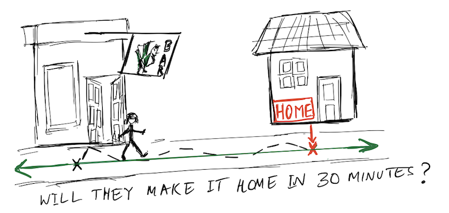
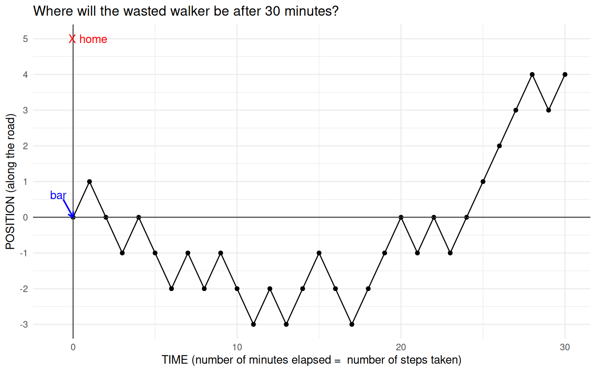
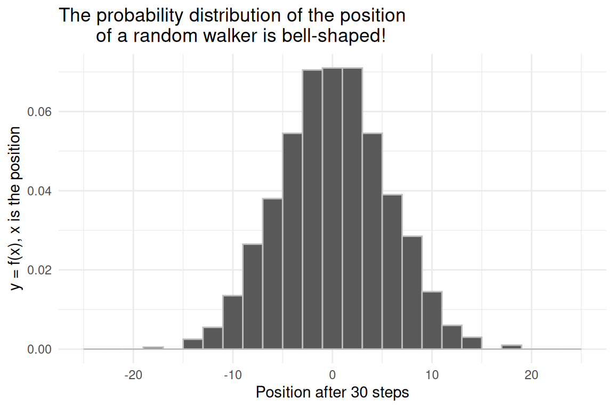
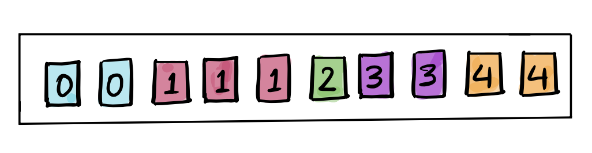
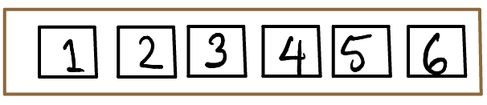
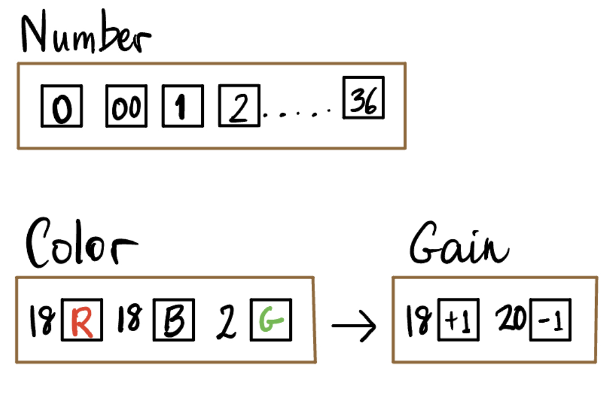
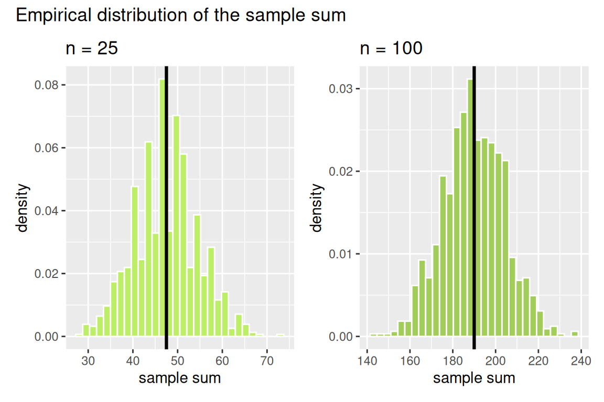
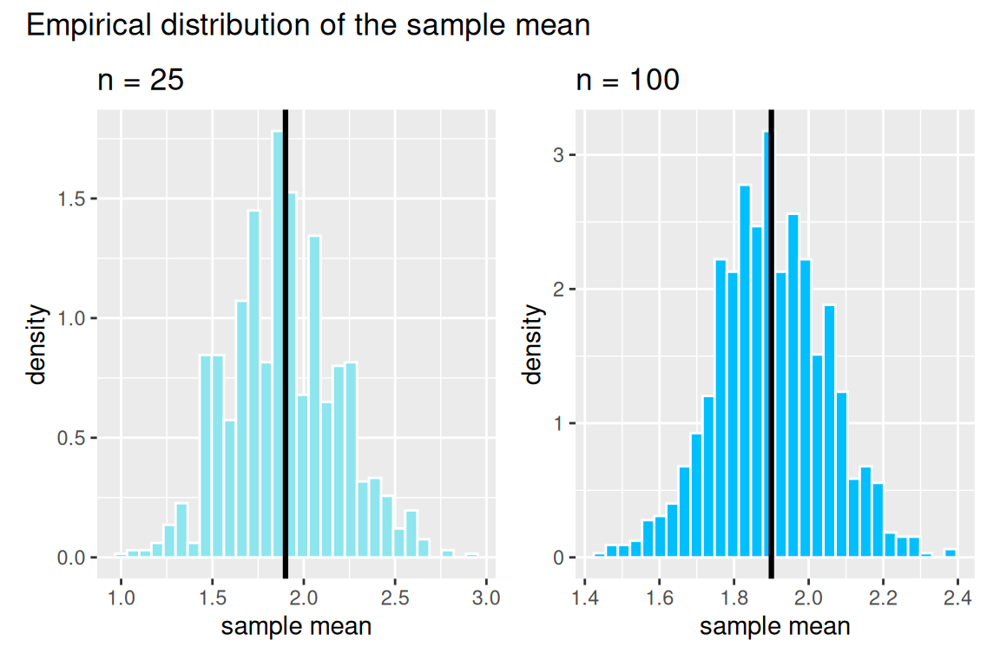
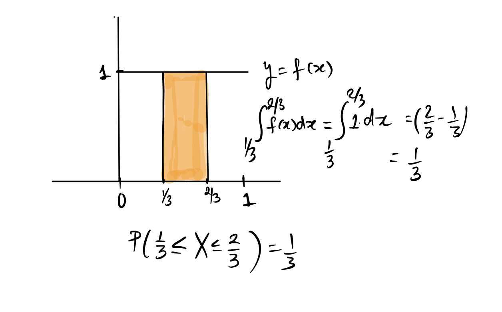
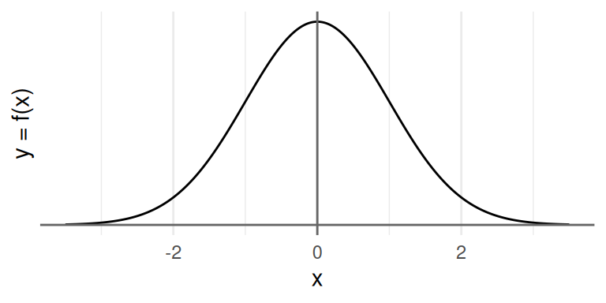

---

course: xac-suat-thong-ke

lecture: 14-phan-phoi-lien-tuc-va-xap-xi-chuan

section: lecture

title: "Phân phối liên tục & Xấp xỉ chuẩn"

prerequisites: ["tich-phan", "bien-ngau-nhien"]

lessonStatus: ready

description: "Mô hình hộp, tổng và trung bình của biến ngẫu nhiên độc lập cùng phân phối (IID), quy luật căn bậc hai, hàm mật độ xác suất PDF, phân phối chuẩn Gauss và Định lý Giới hạn Trung tâm."

---

<div class="lecture-notes-content">

## Dẫn nhập: Bước đi ngẫu nhiên của người say rượu

Hãy tưởng tượng một vị khách quen vừa bước ra khỏi quán rượu sau một đêm tiệc tùng. Khi quán đóng cửa, người này tìm đường trở về nhà. Ngôi nhà thực ra rất gần, nằm ngay trên con đường thẳng tắp phía trước mặt. Nếu người này có thể bước đi vững vàng theo một đường thẳng, họ sẽ về tới nhà chỉ sau ít phút. Nhưng rắc rối duy nhất là: Người này không thể đi thẳng được nữa. Cứ sau mỗi phút, họ lại bước ngẫu nhiên về phía trước hoặc thụt lùi về phía sau với xác suất ngang nhau.

Liệu sau $n$ phút, vị khách này sẽ dừng chân ở vị trí nào? Đây chính là bài toán kinh điển mang tên **Bước đi ngẫu nhiên của người say rượu (The Drunkard's Walk)**.

<p align="center">

  

</p>

<p align="center"><em>Hình 14.1: Bước đi ngẫu nhiên của người say trên trục tọa độ một chiều.</em></p>

Tại mỗi bước thời gian (chẳng hạn mỗi phút), người say bước tiến $(+1)$ hoặc lùi $(-1)$ với cùng xác suất bằng $\frac{1}{2}$. Về mặt toán học, điều này tương đương với chuyển động trên trục số thực $\mathbb{R}$.

Đồ thị dưới đây mô phỏng một quỹ đạo cụ thể của người say trong thời gian $n = 30$ phút:

<p align="center">

  

</p>

<p align="center"><em>Hình 14.2: Một quỹ đạo mô phỏng vị trí của người say qua 30 bước đi ngẫu nhiên.</em></p>

Đồ thị trải dài theo trục hoành nhằm thể hiện số bước thời gian đã trôi qua. Tuy nhiên, người đi bộ thực chất chỉ dao động tiến lùi trên trục tung. Chuyển động này được gọi là **bước đi ngẫu nhiên đơn giản (Simple Random Walk)**.

Mô hình bước đi ngẫu nhiên có ứng dụng sâu rộng trong vật lý và tài chính: Mô hình hóa hạt photon tìm đường thoát khỏi lõi mặt trời, chuyển động Brown của các phân tử lơ lửng trong chất lỏng, hay sự biến động của giá cổ phiếu trên thị trường chứng khoán.

Để mô phỏng quỹ đạo này, ta định nghĩa một biến ngẫu nhiên Bernoulli biến đổi $X$ nhận hai giá trị $-1$ và $+1$ với xác suất bằng nhau:

$$
X = \begin{cases}

-1 & \text{với xác suất } 0{,}5, \\

1 & \text{với xác suất } 0{,}5.

\end{cases}
$$

Kỳ vọng, phương sai và độ lệch chuẩn của một bước đi đơn lẻ được tính toán trực tiếp:

$$
\begin{aligned}
&E(X)=\frac{-1+1}{2}=0, \\
&E(X^2)=\frac{(-1)^2+1^2}{2}=1, \\
&\operatorname{Var}(X)=1-0^2=1, \\
&\operatorname{SD}(X)=1.
\end{aligned}
$$

Trong ngôn ngữ lập trình R, ta có thể mô phỏng khoảng cách di chuyển sau $n$ bước bằng cách lấy mẫu có hoàn lại:

```r

x <- c(-1, 1)      # Cac gia tri nhan cua bien ngau nhien X

px <- c(1/2, 1/2)  # Xac suat tuong ung

sum(sample(x, size = 30, prob = px, replace = TRUE))

```

Trong quỹ đạo cụ thể ở Hình 14.2, sáu bước đầu tiên là: $+1, -1, -1, +1, -1, -1$. Vị trí tại mỗi thời điểm chính là tổng đại số của các bước đã đi, tạo thành dãy vị trí: $+1, 0, -1, 0, -1, -2$. Sau $30$ bước, vị trí dừng chân của người say là $+4$.

Một câu hỏi tự nhiên xuất hiện: Xác suất để người say dừng chân tại đúng vị trí $+4$ sau $30$ phút là bao nhiêu? Để trả lời thắc mắc này, hãy quan sát phân phối thực nghiệm của vị trí sau $n = 30$ bước khi thực hiện mô phỏng hàng chục nghìn lần:

<p align="center">

  

</p>

<p align="center"><em>Hình 14.3: Phân phối thực nghiệm của vị trí cuối cùng sau 30 bước đi ngẫu nhiên.</em></p>

Đồ thị phân phối thực nghiệm mang hình dáng quả chuông đối xứng đẹp mắt. Đây chính là biểu hiện sống động của một kết quả toán học nền tảng: **Định lý Giới hạn Trung tâm**. Để hiểu thấu đáo kết quả này, trước hết ta cần tìm hiểu về các biến ngẫu nhiên độc lập và cùng phân phối.

---

## Biến ngẫu nhiên độc lập và cùng phân phối (IID)

::: info Định nghĩa: Biến ngẫu nhiên độc lập và cùng phân phối (IID)

Cho $n$ biến ngẫu nhiên $X_1, X_2, \dots, X_n$. Nếu các biến ngẫu nhiên này thỏa mãn đồng thời hai điều kiện:

1. **Độc lập (Independent)**: Mọi biến cố liên quan đến biến ngẫu nhiên này đều độc lập thống kê với các biến ngẫu nhiên khác.

2. **Cùng phân phối (Identically Distributed)**: Tất cả đều có chung một hàm khối lượng xác suất $f(x)$ (hoặc hàm mật độ xác suất) và chung hàm phân phối tích lũy $F(x)$.

Khi đó, ta gọi $X_1, X_2, \dots, X_n$ là các **biến ngẫu nhiên độc lập và cùng phân phối** (viết tắt là **i.i.d.** hoặc **IID** - *Independent and Identically Distributed*).

:::

Khái niệm IID là viên gạch nền móng của lý thuyết xác suất và thống kê suy luận:

- Phân phối nhị thức $\text{Binomial}(n, p)$ thực chất là tổng của $n$ biến ngẫu nhiên Bernoulli độc lập cùng phân phối: Biểu thức $S_n = X_1 + X_2 + \dots + X_n$ với $X_i \sim \text{Bernoulli}(p)$.

- Tung một đồng xu $n$ lần và đếm số mặt ngửa: Mỗi lần tung là một biến ngẫu nhiên IID.

### Ví dụ: Rút thăm có hoàn lại từ hộp vé

Xét chiếc hộp chứa 10 tấm vé được minh họa dưới đây:

<p align="center">

  

</p>

<p align="center"><em>Hình 14.4: Hộp vé chứa 10 tấm vé: Hai vé số 0, ba vé số 1, một vé số 2, hai vé số 3 và hai vé số 4.</em></p>

Giả sử ta rút ngẫu nhiên $n = 25$ vé có hoàn lại từ chiếc hộp này. Gọi $X_k$ là giá trị ghi trên tấm vé được rút ở lần thứ $k$.

Do mỗi lần rút đều được hoàn lại vé cũ vào hộp và xáo đều trước khi rút tiếp, kết quả của lần rút này hoàn toàn không ảnh hưởng đến lần rút khác. Đồng thời, cấu trúc các vé trong hộp không bao giờ thay đổi. Do đó, $X_1, X_2, \dots, X_{25}$ là các biến ngẫu nhiên IID, cùng có hàm khối lượng xác suất PMF:

$$
f(x) = \begin{cases}

0.2, & x = 0 \\

0.3, & x = 1 \\

0.1, & x = 2 \\

0.2, & x = 3 \\

0.2, & x = 4

\end{cases}
$$

---

## Mô hình hộp (The Box Model)

Mọi biến ngẫu nhiên rời rạc đều có thể biểu diễn tường minh thông qua một chiếc hộp chứa các tấm vé. Ta thiết kế số lượng vé sao cho xác suất rút được một tấm vé bất kỳ đúng bằng phân phối xác suất của biến ngẫu nhiên cần mô hình.

Khi đó, việc khảo sát $n$ biến ngẫu nhiên IID trở nên trực quan: Đó chính là quá trình rút thăm ngẫu nhiên $n$ lần có hoàn lại từ cùng một chiếc hộp. Biểu diễn này giúp việc lập trình mô phỏng trở nên ngắn gọn thông qua hàm `sample(..., replace = TRUE)` trong R.

Mọi hiện tượng ngẫu nhiên quen thuộc đều có thể quy về mô hình hộp:

- **Đổ xúc xắc**: Hộp gồm 6 tấm vé mang các số $1, 2, 3, 4, 5, 6$. Đổ 2 con xúc xắc tương đương với rút 2 lần có hoàn lại và tính tổng $S = X_1 + X_2$.

<p align="center">

  

</p>

<div class="lecture-caption">

<em>Hình 14.5: Đổ xúc xắc được mô hình hóa bằng việc rút vé từ hộp $\{1, 2, 3, 4, 5, 6\}$.</em>

</div>

- **Quay Roulette Las Vegas**: Bàn quay kiểu Mỹ có tổng cộng 38 ô: 18 ô màu Đỏ, 18 ô màu Đen và 2 ô màu Xanh lá (số 0 và 00). Giả sử ta đặt cược 1 USD vào màu Đỏ: Nếu bóng lăn vào ô Đỏ, ta nhận lại 1 USD cược và thêm 1 USD tiền thắng (lãi ròng $+1$ USD), ngược lại nếu bóng lăn vào ô Đen hoặc Xanh, ta mất 1 USD tiền cược (lãi ròng $-1$ USD).

<div class="lecture-figure-pair">

  

  

</div>

<p align="center"><em>Hình 14.6: Bàn quay Roulette và bàn cược tại sòng bạc.</em></p>

Chiếc hộp mô hình hóa một ván cược Roulette gồm đúng 38 tấm vé:

- 18 vé ghi số $+1$ (thắng cược khi bóng vào ô Đỏ).

- 20 vé ghi số $-1$ (thua cược khi bóng vào ô Đen hoặc ô Xanh).

Nếu chơi $n = 100$ ván cược độc lập, số tiền thắng thua ròng sau 100 ván chính là tổng của 100 lần rút có hoàn lại từ chiếc hộp này.

::: tip Ba câu hỏi then chốt khi xây dựng mô hình hộp

Để thiết lập mô hình hộp cho bất kỳ quá trình ngẫu nhiên nào, ta cần trả lời ba câu hỏi:

1. **Giá trị ghi trên các tấm vé là gì?**: Phản ánh các kết cục số học của một phép thử đơn lẻ.

2. **Mỗi giá trị có bao nhiêu tấm vé?**: Tỉ lệ số vé phản ánh chính xác xác suất xảy ra của từng kết cục.

3. **Cần rút thăm bao nhiêu lần?**: Tương ứng với cỡ mẫu hoặc số lần lặp lại độc lập của thí nghiệm ($n$).

:::

---

## Tổng và Trung bình của các biến ngẫu nhiên IID

Trong thực tế thống kê, hai đại lượng thường được quan tâm nhất chính là **Tổng mẫu** và **Trung bình mẫu** của các quan sát ngẫu nhiên.

### Tổng của các biến ngẫu nhiên IID

Xét $n$ lần rút thăm có hoàn lại từ một chiếc hộp vé. Ta ký hiệu tổng của $n$ biến ngẫu nhiên là:

$$
\begin{aligned}
S_n &= X_1 + X_2 + \dots + X_n \\
&= \sum_{k=1}^n X_k
\end{aligned}
$$

Bản thân $S_n$ cũng là một biến ngẫu nhiên. Khi ta lặp lại thí nghiệm rút $n$ lần, giá trị của $S_n$ sẽ thay đổi qua từng lần thử.

Xét lại chiếc hộp vé ở Hình 14.4 gồm 10 vé: Hai số 0, ba số 1, một số 2, hai số 3, hai số 4. Rút $n = 25$ vé có hoàn lại:

- Giá trị nhỏ nhất có thể của $S_{25}$ là: $25 \times 0 = 0$.

- Giá trị lớn nhất có thể của $S_{25}$ là: $25 \times 4 = 100$.

Đoạn mã R sau đây thực hiện rút 25 vé, tính tổng và lặp lại quá trình này 10 lần bằng hàm `replicate()`:

```r

set.seed(12345)

box <- c(0, 0, 1, 1, 1, 2, 3, 3, 4, 4)

replicate(n = 10, expr = sum(sample(x = box, size = 25, replace = TRUE)))

# Ket qua: 56 50 64 51 49 41 64 44 45 51

```

Vì mỗi vé trong hộp có phân phối xác suất xác định, ta tính được kỳ vọng và phương sai của một lần rút đơn lẻ $X_1$:

$$
\begin{aligned}
&A=0(0{,}2)+1(0{,}3)+2(0{,}1) \\
&=0{,}5, \\
&B=3(0{,}2)+4(0{,}2)=1{,}4, \\
&E(X_1)=A+B=1{,}9.
\end{aligned}
$$

Giá trị này chính bằng trung bình cộng của 10 tấm vé trong hộp:

Gộp các thẻ cùng giá trị theo tần số 2, 3, 1, 2, 2:

$$
\begin{aligned}
\mu &= \frac{0(2)+1(3)+2+3(2)+4(2)}{10} \\
&= 1{,}9.
\end{aligned}
$$

Phương sai của một lần rút đơn lẻ:

$$
\begin{aligned}
&A=0^2(0{,}2)+1^2(0{,}3)+2^2(0{,}1) \\
&=0{,}7, \\
&B=3^2(0{,}2)+4^2(0{,}2)=5, \\
&E(X_1^2)=A+B=5{,}7, \\
&\operatorname{Var}(X_1)=5{,}7-1{,}9^2=2{,}09.
\end{aligned}
$$

Độ lệch chuẩn của một lần rút: $\text{SD}(X_1) = \sqrt{2.09} \approx 1.4457$.

Khi xét tổng của $n$ biến ngẫu nhiên IID:

- Theo tính chất tuyến tính của kỳ vọng:

$$
\begin{aligned}
E(S_n) &= E\left(\sum_{k=1}^n X_k\right) \\
&= \sum_{k=1}^n E(X_k) \\
&= n \cdot E(X_1)
\end{aligned}
$$

- Do các lần rút độc lập, theo tính chất cộng của phương sai:

$$
\begin{aligned}
\text{Var}(S_n) &= \text{Var}\left(\sum_{k=1}^n X_k\right) \\
&= \sum_{k=1}^n \text{Var}(X_k) \\
&= n \cdot \text{Var}(X_1)
\end{aligned}
$$

::: tip Quy luật căn bậc hai cho tổng (Square Root Law for Sums)

Độ lệch chuẩn của tổng $n$ biến ngẫu nhiên IID tăng theo căn bậc hai của cỡ mẫu:

$$
\begin{aligned}
\text{SD}(S_n) &= \sqrt{\text{Var}(S_n)} \\
&= \sqrt{n \cdot \text{Var}(X_1)} \\
&= \sqrt{n} \cdot \text{SD}(X_1)
\end{aligned}
$$

:::

Quy luật này phản ánh một trực giác sâu sắc: Khi số biến ngẫu nhiên được cộng dồn tăng lên gấp $n$ lần, tâm phân bố của tổng $E(S_n)$ tăng nhanh theo tỉ lệ $n$, nhưng độ phân tán của tổng quanh tâm chỉ tăng chậm hơn rất nhiều theo tỉ lệ $\sqrt{n}$.

Quay lại bài toán người say rượu: Ta có $X_k \in \{-1, +1\}$ với $E(X_k) = 0$ và $\text{Var}(X_k) = 1$. Sau $n = 30$ bước:

- Kỳ vọng vị trí: $E(S_{30}) = 30 \times 0 = 0$.

- Phương sai vị trí: $\text{Var}(S_{30}) = 30 \times 1 = 30$.

- Độ lệch chuẩn vị trí: Giá trị $\text{SD}(S_{30}) = \sqrt{30} \approx 5.48$ bước.

### Trung bình của các biến ngẫu nhiên IID

Trung bình mẫu của $n$ quan sát ngẫu nhiên được định nghĩa là:

$$
\begin{aligned}
\bar{X} &= \frac{S_n}{n} \\
&= \frac{X_1 + X_2 + \dots + X_n}{n}
\end{aligned}
$$

Kỳ vọng của trung bình mẫu:

$$
\begin{aligned}
E(\bar{X}) &= E\left(\frac{S_n}{n}\right) \\
&= \frac{1}{n} E(S_n) \\
&= \frac{1}{n} [n \cdot E(X_1)] \\
&= E(X_1)
\end{aligned}
$$

Kỳ vọng của trung bình mẫu không phụ thuộc vào cỡ mẫu $n$, mà luôn luôn bằng đúng kỳ vọng của một quan sát đơn lẻ.

Phương sai của trung bình mẫu:

$$
\begin{aligned}
\text{Var}(\bar{X}) &= \text{Var}\left(\frac{S_n}{n}\right) \\
&= \frac{1}{n^2} \text{Var}(S_n) \\
&= \frac{1}{n^2} [n \cdot \text{Var}(X_1)] \\
&= \frac{1}{n} \text{Var}(X_1)
\end{aligned}
$$

::: tip Quy luật căn bậc hai cho trung bình mẫu

Độ lệch chuẩn của trung bình mẫu tỉ lệ nghịch với căn bậc hai của cỡ mẫu:

$$
\begin{aligned}
\text{SD}(\bar{X}) &= \sqrt{\frac{\text{Var}(X_1)}{n}} \\
&= \frac{1}{\sqrt{n}} \text{SD}(X_1)
\end{aligned}
$$

:::

Khi cỡ mẫu $n$ càng lớn, phương sai và độ lệch chuẩn của trung bình mẫu càng co cụm chặt chẽ quanh giá trị kỳ vọng thực $E(X_1)$. Đây chính là cơ sở toán học trực tiếp của **Luật Số lớn (Law of Large Numbers)**.

### Sai số chuẩn (Standard Error - SE)

Trong thống kê, các đại lượng được tính toán từ dữ liệu mẫu như tổng mẫu $S_n$ hay trung bình mẫu $\bar{X}$ được gọi là **thống kê mẫu (sample statistics)**.

Để phân biệt độ lệch chuẩn của từng cá thể quan sát đơn lẻ $\text{SD}(X_1)$ với độ biến thiên ngẫu nhiên của các thống kê mẫu qua các lần chọn mẫu lặp lại, các nhà thống kê dùng thuật ngữ chuyên biệt: **Sai số chuẩn (Standard Error - SE)**.

- Sai số chuẩn của tổng mẫu: $\text{SE}(S_n) = \sqrt{n} \cdot \text{SD}(X_1)$.

- Sai số chuẩn của trung bình mẫu: $\text{SE}(\bar{X}) = \frac{\text{SD}(X_1)}{\sqrt{n}}$.

### Minh họa mô phỏng: Phân phối của tổng và trung bình

Hãy quan sát phân phối mô phỏng của tổng và trung bình khi rút $n = 25$ vé từ chiếc hộp ở Hình 14.4:

- Đối với tổng $S_{25}$: $E(S_{25}) = 25 \times 1.9 = 47.5$, và $\text{SE}(S_{25}) = 5 \times 1.4457 \approx 7.23$.

- Đối với trung bình $\bar{X}_{25}$: $E(\bar{X}_{25}) = 1.9$, và $\text{SE}(\bar{X}_{25}) = \frac{1.4457}{5} \approx 0.289$.

<div class="lecture-figure-pair">

  

  

</div>

<p align="center"><em>Hình 14.7: Đồ thị mật độ thực nghiệm của tổng mẫu (trái) và trung bình mẫu (phải) cho 25 lần rút có hoàn lại. Đường thẳng đứng màu đen biểu thị giá trị kỳ vọng.</em></p>

Đặc điểm then chốt cần ghi nhận:

1. Cả hai phân phối đều mang dáng dấp quả chuông đối xứng.

2. Trục tung của đồ thị không ghi tần số hay tỉ lệ phần trăm, mà ghi **Mật độ (Density)**. Điều này đảm bảo tổng diện tích của tất cả các cột trong biểu đồ luôn bằng $1$.

3. Biểu đồ này được gọi là **biểu đồ mật độ (density histogram)**, đóng vai trò như một xấp xỉ thực nghiệm của hàm mật độ xác suất liên tục.

---

## Biến ngẫu nhiên liên tục và Hàm mật độ xác suất (PDF)

Cho đến thời điểm này, chúng ta chủ yếu làm việc với các biến ngẫu nhiên rời rạc, nơi xác suất tập trung tại từng điểm giá trị riêng biệt thông qua hàm khối lượng xác suất PMF.

Tuy nhiên, trong thế giới thực, rất nhiều đại lượng có thể nhận bất kỳ giá trị thực nào trong một khoảng liên tục: Chiều cao của sinh viên, thời gian chờ chuyến xe buýt kế tiếp, hay nhiệt độ không khí. Những đại lượng như vậy được gọi là **biến ngẫu nhiên liên tục**.

Đối với biến ngẫu nhiên liên tục, khối lượng xác suất $1$ không còn tập trung tại các điểm rời rạc mà được rải đều trên một khoảng số thực, tạo thành một đường cong trơn gọi là đường cong mật độ.

::: info Định nghĩa: Hàm mật độ xác suất (Probability Density Function - PDF)

Hàm số $f(x)$ được gọi là **hàm mật độ xác suất (PDF)** của biến ngẫu nhiên liên tục $X$ nếu thỏa mãn đồng thời hai tiên đề:

1. **Tính không âm**: Luôn thỏa mãn $f(x) \ge 0$ với mọi $x \in \mathbb{R}$.

2. **Tổng diện tích dưới đường cong bằng 1**:

$$
\int_{-\infty}^{+\infty} f(x) \, dx = 1
$$

:::

### Xác suất rơi vào một khoảng

Vì trong một khoảng số thực bất kỳ luôn chứa vô số giá trị không đếm được, xác suất để một biến ngẫu nhiên liên tục nhận chính xác một giá trị đơn lẻ luôn bằng 0:

$$
P(X = c) = 0, \quad \forall c \in \mathbb{R}
$$

Xác suất chỉ có ý nghĩa khi xét trên một khoảng giá trị $[a, b]$, và được xác định bằng diện tích dưới đường cong mật độ $f(x)$ trên khoảng đó:

$$
P(a \le X \le b) = \int_a^b f(x) \, dx
$$

Vì xác suất tại một điểm đơn lẻ bằng 0, việc có lấy hay không lấy dấu đẳng thức tại các đầu mút hoàn toàn không làm thay đổi giá trị xác suất:

$$
\begin{aligned}
P(a < X < b) &= P(a \le X < b) \\
&= P(a < X \le b) \\
&= P(a \le X \le b)
\end{aligned}
$$

### Hàm phân phối tích lũy (Cumulative Distribution Function - CDF)

Tương tự như biến ngẫu nhiên rời rạc, hàm phân phối tích lũy $F(x)$ của biến ngẫu nhiên liên tục đo lường xác suất tích lũy từ $-\infty$ cho đến điểm $x$:

$$
\begin{aligned}
F(x) &= P(X \le x) \\
&= \int_{-\infty}^x f(t) \, dt
\end{aligned}
$$

Về mặt hình học, $F(x)$ chính là diện tích phần mặt phẳng nằm dưới đường cong mật độ $y = f(t)$ tính từ vô cực bên trái trải dài đến hoành độ $x$. Theo Định lý Cơ bản của Giải tích:

$$
f(x) = \frac{d}{dx} F(x) = F'(x)
$$

---

## Các phân phối liên tục tiêu biểu

### Phân phối Đều liên tục

Phân phối đơn giản nhất về mặt hình học là phân phối Đều trên đoạn $[0, 1]$, ký hiệu là $X \sim U(0, 1)$.

Hàm mật độ xác suất có dạng hình chữ nhật nằm ngang:

$$
f(x) = \begin{cases}

1, & 0 \le x \le 1 \\

0, & x < 0 \text{ or } x > 1

\end{cases}
$$

<p align="center">

  

</p>

<div class="lecture-caption">

<em>Hình 14.8: Đường cong mật độ của phân phối Đều $U(0, 1)$. Diện tích hình chữ nhật trên khoảng $(a, b)$ đúng bằng độ dài khoảng $b - a$.</em>

</div>

Vì hàm mật độ là một đường thẳng nằm ngang có chiều cao bằng $1$, diện tích trên bất kỳ khoảng con $(a, b) \subseteq [0, 1]$ đơn giản bằng diện tích hình chữ nhật:

$$
\begin{aligned}
P(a \le X \le b) &= \text{height} \times \text{width} \\
&= 1 \times (b - a) \\
&= b - a
\end{aligned}
$$

Hàm phân phối tích lũy CDF của $U(0, 1)$ là hàm tuyến tính:

Với $x\in[0,1]$, ta có:

$$
\begin{aligned}
F(x)&=P(X\le x) \\
&=\int_0^x1\,dt=x.
\end{aligned}
$$

### Phân phối Chuẩn (Normal / Gaussian Distribution)

Phân phối Chuẩn, còn được gọi là phân phối Gauss theo tên nhà toán học lừng danh người Đức Carl Friedrich Gauss, là phân phối xác suất quan trọng và phổ biến nhất trong toàn bộ ngành thống kê.

Biến ngẫu nhiên $X$ tuân theo phân phối Chuẩn với kỳ vọng $\mu$ và phương sai $\sigma^2$, ký hiệu là $X \sim \mathcal{N}(\mu, \sigma^2)$, có hàm mật độ xác suất dạng quả chuông:

$$
\begin{aligned}
f(x) &= \frac{1}{\sigma \sqrt{2\pi}} \exp\left(-\frac{(x - \mu)^2}{2\sigma^2}\right) \\
&= \frac{1}{\sigma \sqrt{2\pi}} e^{-\frac{1}{2}\left(\frac{x - \mu}{\sigma}\right)^2}
\end{aligned}
$$

Đường cong phân phối chuẩn hoàn toàn được xác định bởi hai tham số:

- **Kỳ vọng $\mu$**: Quyết định vị trí tâm đối xứng của đường cong.

- **Độ lệch chuẩn $\sigma$**: Quyết định độ bè rộng và chiều cao của đỉnh quả chuông.

<p align="center">

  

</p>

<div class="lecture-caption">

<em>Hình 14.9: Phân phối chuẩn tắc $\mathcal{N}(0, 1)$ cùng các ngưỡng độ lệch chuẩn $\pm 1\sigma, \pm 2\sigma, \pm 3\sigma$.</em>

</div>

### Đơn vị chuẩn (Standard Units) và Phân phối chuẩn tắc

Mọi phân phối chuẩn bất kỳ $X \sim \mathcal{N}(\mu, \sigma^2)$ đều có thể quy về **phân phối chuẩn tắc (Standard Normal Distribution)** $\mathcal{N}(0, 1)$ thông qua phép đổi biến sang đơn vị chuẩn (Z-score):

$$
Z = \frac{X - \mu}{\sigma} \sim \mathcal{N}(0, 1)
$$

Bản chất của phép biến đổi này gồm hai thao tác hình học:

1. **Dịch chuyển tâm**: Trừ đi $\mu$ để đưa tâm phân phối về gốc tọa độ $0$.

2. **Co giãn tỉ lệ**: Chia cho $\sigma$ để đưa độ lệch chuẩn về đúng $1$.

### Quy tắc thực nghiệm 68-95-99.7 (The Empirical Rule)

Đối với bất kỳ biến ngẫu nhiên nào tuân theo phân phối chuẩn, diện tích dưới đường cong trong các khoảng đối xứng quanh tâm luôn tuân thủ quy tắc thực nghiệm:

| Khoảng giá trị | Độ lệch quanh tâm | Tỉ lệ diện tích (Xác suất) |
| :--- | :--- | :--- |
| $[\mu - \sigma, \mu + \sigma]$ | Trong vòng $1$ độ lệch chuẩn | $\approx 68.27\% \approx 68\%$ |
| $[\mu - 2\sigma, \mu + 2\sigma]$ | Trong vòng $2$ độ lệch chuẩn | $\approx 95.45\% \approx 95\%$ |
| $[\mu - 3\sigma, \mu + 3\sigma]$ | Trong vòng $3$ độ lệch chuẩn | $\approx 99.73\% \approx 99.7\%$ |

---

## Định lý Giới hạn Trung tâm (Central Limit Theorem - CLT)

Tại sao phân phối Chuẩn lại xuất hiện khắp mọi nơi trong tự nhiên, từ sai số đo đạc thiên văn, chỉ số thông minh, chiều cao con người cho đến doanh thu tài chính?

Câu trả lời nằm ở một trong những định lý vĩ đại và đáng kinh ngạc nhất của khoa học toán học: **Định lý Giới hạn Trung tâm (Central Limit Theorem)**.

::: info Định lý Giới hạn Trung tâm (Central Limit Theorem)

Cho $X_1, X_2, \dots, X_n$ là dãy các biến ngẫu nhiên độc lập và cùng phân phối (IID) có kỳ vọng hữu hạn $E(X_i) = \mu$ và phương sai hữu hạn $\text{Var}(X_i) = \sigma^2 > 0$.

Khi cỡ mẫu $n$ tiến ra vô cùng ($n \to \infty$):

1. **Tổng mẫu** $S_n = \sum_{i=1}^n X_i$ có phân phối tiệm cận phân phối chuẩn:

Giả sử các số hạng độc lập cùng phân phối, có kỳ vọng $\mu$ và phương sai hữu hạn $0<\sigma^2<\infty$. Hội tụ phân phối của biến chuẩn hóa dẫn đến xấp xỉ chuẩn cho tổng khi $n$ đủ lớn:

$$
\begin{aligned}
&Z_n=\frac{S_n-n\mu}{\sigma\sqrt n}, \\
&Z_n\xrightarrow{d}\mathcal N(0,1), \\
&S_n\approx\mathcal N(n\mu,n\sigma^2).
\end{aligned}
$$

2. **Trung bình mẫu** $\bar{X} = \frac{S_n}{n}$ có phân phối tiệm cận phân phối chuẩn:

$$
\begin{aligned}
&Z_n=\frac{\bar X-\mu}{\sigma/\sqrt n}, \\
&Z_n\xrightarrow{d}\mathcal N(0,1), \\
&\bar X\approx\mathcal N(\mu,\sigma^2/n).
\end{aligned}
$$

:::

### Ý nghĩa sư phạm và trực giác sâu xa của CLT

Điểm cốt lõi của Định lý Giới hạn Trung tâm là sự **hội tụ theo phân phối của tổng chuẩn hóa**:

- Biến ngẫu nhiên gốc có thể mang phân phối bất kỳ (rời rạc, liên tục, lệch hoặc đa đỉnh), miễn là có kỳ vọng $\mu$ và phương sai $\sigma^2$ hữu hạn.

- CLT khẳng định rằng biến chuẩn hóa $Z_n = \frac{S_n - n\mu}{\sigma\sqrt{n}}$ hội tụ theo phân phối về phân phối chuẩn tắc $\mathcal{N}(0, 1)$ khi $n \to \infty$.

- Đối với cỡ mẫu hữu hạn $n$, phân phối của $S_n$ chỉ là một **xấp xỉ phân phối**, không bảo đảm triệt tiêu hoàn toàn tính gián đoạn trên lưới rời rạc hay độ lệch hình học để thành một "quả chuông hoàn hảo".

### Giải mã bài toán người say rượu bằng CLT và hiệu chỉnh liên tục

Xét vị trí của người say sau $n = 30$ bước: $S_{30} = \sum_{k=1}^{30} X_k$ với $X_k \in \{-1, +1\}$.

- Kỳ vọng: $E(S_{30}) = 0$.

- Phương sai và độ lệch chuẩn: $\text{Var}(S_{30}) = 30$, $\text{SD}(S_{30}) = \sqrt{30} \approx 5.477$ bước.

- **Tính chất rời rạc trên lưới chẵn**: Vì $S_{30} = 2K - 30$ với $K \sim \text{Binomial}(30, 0.5)$ là số bước tiến, $S_{30}$ chỉ nhận các giá trị nguyên chẵn trên lưới $\{-30, -28, \dots, 0, \dots, 28, 30\}$.

Biến cố người say đi xa hơn $1$ độ lệch chuẩn về phía trước là $S_{30} > \sqrt{30} \approx 5.477$. Do $S_{30}$ chỉ nhận số nguyên chẵn, điều kiện này tương đương chính xác với $S_{30} \ge 6$, tức $K \ge 18$.

1. **Xác suất chính xác theo phân phối Nhị thức**:

$$
\begin{aligned}
P(S_{30} \ge 6) &= P(K \ge 18) \\
&= \sum_{k=18}^{30} \binom{30}{k} (0{,}5)^{30} \\
&\approx 0{,}1807973040
\end{aligned}
$$

2. **Xấp xỉ chuẩn có hiệu chỉnh liên tục trên lưới (Lattice Continuity Correction)**:

Vì các giá trị khả dĩ là các số chẵn cách nhau $2$ đơn vị (bước lưới $2$), ranh giới giữa giá trị $4$ và $6$ là trung điểm $5$. Để xấp xỉ biến cố rời rạc $S_{30} \ge 6$, ta tích phân biến chuẩn liên tục từ điểm cắt $5$:

$$
\begin{aligned}
P(S_{30} \ge 6) &\approx P(Y_{\text{cont}} \ge 5) \\
&= 1 - \Phi\left(\frac{5}{\sqrt{30}}\right) \\
&\approx 0{,}1806552143
\end{aligned}
$$

Kết quả này xấp xỉ cực kỳ sát giá trị chính xác $0{,}1808$.

3. **So sánh với quy tắc thô 68-95-99.7 không hiệu chỉnh**:

Nếu áp dụng thô quy tắc kinh nghiệm của phân phối liên tục thuần túy và bỏ qua tính rời rạc của lưới chẵn, ta thu được đuôi chuẩn chưa hiệu chỉnh:

$$
1 - \Phi(1) \approx 0{,}158655 \quad (\approx 16\%).
$$

Con số xấp xỉ thô khoảng $16\%$ này thấp hơn đáng kể so với xác suất thực tế $18{,}08\%$ vì đã bỏ qua phần diện tích giữa hoành độ $5$ và $5{,}48$.

4. **Xác suất chính xác trong phạm vi $1$ độ lệch chuẩn**:

Biến cố $|S_{30}| \le \sqrt{30} \approx 5{,}477$ tương đương với $S_{30} \in \{-4, -2, 0, 2, 4\}$, ứng với $K \in \{13, 14, 15, 16, 17\}$. Xác suất chính xác là:

$$
\begin{aligned}
&q_k=\binom{30}{k}2^{-30}, \\
&P(|S_{30}|\le\sqrt{30})=\sum_{k=13}^{17}q_k \\
&\approx0{,}6384053919.
\end{aligned}
$$

chứ không phải con số lý thuyết $68\%$ của biến ngẫu nhiên liên tục chuẩn.

### Tính toán phân phối chuẩn trong ngôn ngữ R

Trong môi trường phân tích dữ liệu, ta sử dụng các hàm tích hợp sẵn của R với điểm cắt $5$ đã hiệu chỉnh liên tục:

- `pnorm(q, mean, sd)`: Tính xác suất tích lũy $P(X \le q)$ (diện tích bên trái điểm $q$).

- `qnorm(p, mean, sd)`: Tìm phân vị (quantile) ứng với diện tích tích lũy $p$.

- `dnorm(x, mean, sd)`: Tính tung độ của hàm mật độ xác suất tại $x$.

- `rnorm(n, mean, sd)`: Sinh ngẫu nhiên $n$ giá trị từ phân phối chuẩn.

```r

# Tinh xac suat nguoi say di xa ve phia truoc hon sqrt(30) (tuc S_30 >= 6):

# Su dung diem cat hieu chinh lien tuc 5 giua 4 va 6:

# P(S_30 >= 6) ~ P(Y_cont >= 5) = 1 - P(Y_cont <= 5)

1 - pnorm(5, mean = 0, sd = sqrt(30))

# Ket qua hieu chinh: 0.180655 (xap xi cuc sat gia tri thuc te 0.180797)

```

---

## Tóm tắt kiến thức cốt lõi

1. **Biến ngẫu nhiên IID**: Độc lập và cùng phân phối xác suất.

2. **Mô hình hộp**: Quy đổi mọi quá trình ngẫu nhiên rời rạc về việc rút thăm có hoàn lại từ một chiếc hộp vé.

3. **Quy luật căn bậc hai**:

   - Đối với tổng: $E(S_n) = n\mu$, $\text{SE}(S_n) = \sqrt{n}\sigma$.

   - Đối với trung bình: $E(\bar{X}) = \mu$, $\text{SE}(\bar{X}) = \frac{\sigma}{\sqrt{n}}$.

4. **Biến ngẫu nhiên liên tục**: Được định nghĩa bởi hàm mật độ xác suất $f(x) \ge 0$ với $\int_{-\infty}^\infty f(x) dx = 1$. Xác suất tại một điểm luôn bằng 0, trong khi xác suất trên một khoảng bằng tích phân diện tích.

5. **Quy tắc 68-95-99.7**: Trong phân phối chuẩn, khoảng $\pm 1\sigma, \pm 2\sigma, \pm 3\sigma$ lần lượt chứa xấp xỉ $68\%, 95\%, 99.7\%$ tổng khối lượng xác suất.

6. **Định lý Giới hạn Trung tâm (CLT)**: Tổng và trung bình của các biến ngẫu nhiên IID tiệm cận phân phối chuẩn khi cỡ mẫu $n$ đủ lớn, bất kể hình dạng phân phối ban đầu của từng biến đơn lẻ.

</div>

<div class="lecture-exercises-content">

## Bài tập rèn luyện

::: exercise Bài tập 1: Nhận diện phân phối mẫu và kỳ vọng của tổng

Xét hai biến ngẫu nhiên:

- $X \sim \text{Binomial}(10, 0.2)$.

- $Y$ là giá trị của một tấm vé rút ngẫu nhiên từ chiếc hộp chứa 5 tấm vé: $\fbox{0}, \fbox{2}, \fbox{3}, \fbox{4}, \fbox{6}$.

Thực hiện lấy tổng của 100 biến ngẫu nhiên độc lập cùng phân phối đối với cả hai biến, ký hiệu lần lượt là $S_{X, 100} = \sum_{i=1}^{100} X_i$ và $S_{Y, 100} = \sum_{i=1}^{100} Y_i$.

1. Tính kỳ vọng và sai số chuẩn của $S_{X, 100}$ và $S_{Y, 100}$.

2. Giả sử ta vẽ hai biểu đồ phân phối thực nghiệm của $S_{X, 100}$ và $S_{Y, 100}$, làm thế nào để nhận biết biểu đồ nào thuộc về biến ngẫu nhiên nào?

:::

::: solution

**1. Tính kỳ vọng và sai số chuẩn:**

- **Đối với biến ngẫu nhiên $X$**:

  $X \sim \text{Binomial}(n_0 = 10, p = 0.2)$.

$$
\begin{aligned}
&E(X) = n_0 p = 10 \times 0.2 = 2 \\
&\text{Var}(X) = n_0 p (1 - p) \\
&= 10 \times 0.2 \times 0.8 \\
&= 1.6 \\
&\text{SD}(X) = \sqrt{1.6} \approx 1.2649
\end{aligned}
$$

  Tổng của 100 biến ngẫu nhiên $X$ độc lập:

$$
\begin{aligned}
&E(S_{X, 100}) = 100 \times E(X) \\
&= 100 \times 2 \\
&= 200 \\
&\text{Var}(S_{X, 100}) = 100 \times \text{Var}(X) \\
&= 100 \times 1.6 \\
&= 160 \\
&\text{SE}(S_{X, 100}) = \sqrt{160} \\
&= 4\sqrt{10} \\
&\approx 12.65
\end{aligned}
$$

- **Đối với biến ngẫu nhiên $Y$**:

  Hộp gồm 5 vé $\{0, 2, 3, 4, 6\}$. Mỗi vé có xác suất rút là $0.2$.

  Kỳ vọng của một lần rút:

$$
\begin{aligned}
E(Y) &= \frac{0 + 2 + 3 + 4 + 6}{5} \\
&= \frac{15}{5} \\
&= 3
\end{aligned}
$$

  Phương sai của một lần rút:

$$
\begin{aligned}
&\text{Var}(Y) = \frac{9 + 1 + 0 + 1 + 9}{5} \\
&= \frac{20}{5} = 4 \\
&\text{SD}(Y) = \sqrt{4} = 2
\end{aligned}
$$

  Tổng của 100 biến ngẫu nhiên $Y$ độc lập:

$$
\begin{aligned}
&E(S_{Y, 100}) = 100 \times E(Y) \\
&= 100 \times 3 \\
&= 300 \\
&\text{Var}(S_{Y, 100}) = 100 \times \text{Var}(Y) \\
&= 100 \times 4 \\
&= 400 \\
&\text{SE}(S_{Y, 100}) = \sqrt{100} \times \text{SD}(Y) \\
&= 10 \times 2 \\
&= 20
\end{aligned}
$$

**2. Nhận diện biểu đồ phân phối thực nghiệm:**

- Biểu đồ phân phối thực nghiệm có tâm đối xứng tập trung quanh giá trị $200$ và có dải biến thiên xấp xỉ trong đoạn $[162, 238]$ (ứng với khoảng $\mu \pm 3\text{SE}$) chính là phân phối của $S_{X, 100}$.

- Biểu đồ có tâm đối xứng tập trung quanh giá trị $300$ và dải biến thiên rộng hơn trong đoạn $[240, 360]$ chính là phân phối của $S_{Y, 100}$.

:::

---

::: exercise Bài tập 2: Rút thăm 100 lần từ hộp vé

Một chiếc hộp chứa 5 tấm vé mang các giá trị: $\fbox{-10}, \fbox{0}, \fbox{5}, \fbox{10}, \fbox{20}$.

Thực hiện rút 100 lần ngẫu nhiên có hoàn lại từ chiếc hộp này. Gọi $S_{100}$ là tổng của 100 lần rút và $\bar{X}_{100}$ là trung bình của 100 lần rút.

1. Tính kỳ vọng và sai số chuẩn của tổng $S_{100}$.

2. Tính kỳ vọng và sai số chuẩn của trung bình mẫu $\bar{X}_{100}$.

3. Dùng xấp xỉ phân phối chuẩn, ước lượng xác suất để tổng $S_{100}$ vượt quá 600.

:::

::: solution

**1. Kỳ vọng và sai số chuẩn của tổng $S_{100}$:**

Trước hết ta tính trung bình và độ lệch chuẩn của các vé trong hộp:

$$
\begin{aligned}
\mu &= \frac{-10 + 0 + 5 + 10 + 20}{5} \\
&= \frac{25}{5} \\
&= 5
\end{aligned}
$$

Phương sai của chiếc hộp:

$$
\begin{aligned}
\sigma^2 &= \frac{225 + 25 + 0 + 25 + 225}{5} \\
&= \frac{500}{5} = 100
\end{aligned}
$$

Độ lệch chuẩn của chiếc hộp: $\sigma = \sqrt{100} = 10$.

Với $n = 100$ lần rút có hoàn lại:

$$
\begin{aligned}
&E(S_{100}) = n\mu \\
&= 100 \times 5 \\
&= 500 \\
&\text{SE}(S_{100}) = \sqrt{n}\sigma \\
&= \sqrt{100} \times 10 \\
&= 10 \times 10 \\
&= 100
\end{aligned}
$$

**2. Kỳ vọng và sai số chuẩn của trung bình mẫu $\bar{X}_{100}$:**

$$
\begin{aligned}
&E(\bar{X}_{100}) = \mu = 5 \\
&\text{SE}(\bar{X}_{100}) = \frac{\sigma}{\sqrt{n}} \\
&= \frac{10}{\sqrt{100}} \\
&= \frac{10}{10} \\
&= 1
\end{aligned}
$$

**3. Ước lượng xác suất $P(S_{100} > 600)$:**

Theo Định lý Giới hạn Trung tâm, vì $n = 100$ là cỡ mẫu lớn, tổng $S_{100}$ xấp xỉ tuân theo phân phối chuẩn $\mathcal{N}(500, 100^2)$.

Chuẩn hóa giá trị 600 sang đơn vị chuẩn (Z-score):

$$
\begin{aligned}
Z &= \frac{600 - E(S_{100})}{\text{SE}(S_{100})} \\
&= \frac{600 - 500}{100} \\
&= \frac{100}{100} \\
&= 1
\end{aligned}
$$

Giá trị $600$ nằm cách kỳ vọng đúng $1$ sai số chuẩn về phía bên phải.

Theo quy tắc thực nghiệm 68-95-99.7:

- Diện tích giữa $-1$ và $+1$ là khoảng $68\%$.

- Phần diện tích nằm ngoài hai phía là $100\% - 68\% = 32\%$.

- Do tính đối xứng, phần diện tích vượt quá $+1$ là:

$$
\begin{aligned}
P(S_{100} > 600) &\approx P(Z > 1) \\
&\approx \frac{32\%}{2} \\
&= 16\% \\
&= 0.16
\end{aligned}
$$

  (Nếu tính chính xác qua hàm chuẩn tắc, $P(Z > 1) \approx 0.1587$).

:::

---

::: exercise Bài tập 3: Trò chơi đổ xúc xắc và Quy luật căn bậc hai

Một người tham gia một trò chơi đổ một con xúc xắc cân đối 6 mặt $n$ lần. Người chơi cần đoán trước tổng số nút sau $n$ lần đổ. Với mỗi nút mà giá trị thực tế sai lệch so với dự đoán, người chơi sẽ bị phạt 1 USD tiền mặt (ví dụ: Người chơi đoán 200 mà tổng thực tế là 215 thì bị phạt 15 USD).

Người chơi được quyền tự do lựa chọn số lần đổ: Chọn $n = 50$ lần hoặc $n = 100$ lần.

1. Bạn sẽ khuyên người chơi nên chọn $n = 50$ hay $n = 100$ để giảm thiểu số tiền phạt kỳ vọng? Giải thích bản chất dựa trên quy luật căn bậc hai.

2. Giả sử luật chơi thay đổi: Người chơi cần đoán **trung bình số nút** của mỗi lần đổ thay vì tổng số nút, và tiền phạt tỉ lệ thuận với độ lệch của giá trị trung bình. Khi đó người chơi nên chọn $n = 50$ hay $n = 100$?

:::

::: solution

**1. Trường hợp đoán tổng số nút:**

Một con xúc xắc cân đối có các mặt mang giá trị từ 1 đến 6.

Trung bình và phương sai của một lần đổ:

$$
\begin{aligned}
&\mu = \frac{1 + 2 + 3 + 4 + 5 + 6}{6} \\
&= 3.5 \\
&\sigma^2 = \frac{1}{6} \sum_{i=1}^6 (i - 3.5)^2 \\
&= \frac{35}{12} \\
&\approx 2.9167 \\
&\implies \sigma \\
&\approx 1.7078
\end{aligned}
$$

Để tối thiểu hóa tiền phạt kỳ vọng, dự đoán tối ưu của người chơi là chọn đúng giá trị kỳ vọng của tổng: $\text{Prediction} = E(S_n) = n\mu$.

Khi đó, độ sai lệch thực tế trung bình giữa tổng quan sát và dự đoán được đo lường chính xác bằng sai số chuẩn $\text{SE}(S_n)$.

Theo quy luật căn bậc hai cho tổng:

$$
\text{SE}(S_n) = \sqrt{n} \cdot \sigma
$$

- Khi $n = 50$:

$$
\begin{aligned}
\text{SE}(S_{50}) &= \sqrt{50} \times 1.7078 \\
&\approx 7.071 \times 1.7078 \\
&\approx 12.08  \text{ nút}
\end{aligned}
$$

- Khi $n = 100$:

$$
\begin{aligned}
\text{SE}(S_{100}) &= \sqrt{100} \times 1.7078 \\
&= 10 \times 1.7078 \\
&\approx 17.08  \text{ nút}
\end{aligned}
$$

Vì $\text{SE}(S_{50}) < \text{SE}(S_{100})$, độ biến thiên của tổng ở 50 lần đổ nhỏ hơn nhiều so với 100 lần đổ. Do đó, người chơi **nên chọn $n = 50$ lần đổ** để chịu mức phạt kỳ vọng thấp hơn đáng kể (khoảng 12 USD so với 17 USD).

**2. Trường hợp đoán trung bình số nút:**

Khi luật chơi yêu cầu đoán trung bình số nút $\bar{X}_n$, dự đoán tối ưu vẫn là kỳ vọng $\mu = 3.5$.

Tuy nhiên, độ sai lệch trung bình của trung bình mẫu quanh kỳ vọng tuân theo quy luật căn bậc hai ở mẫu số:

$$
\text{SE}(\bar{X}_n) = \frac{\sigma}{\sqrt{n}}
$$

- Khi $n = 50$: Sai số chuẩn $\text{SE}(\bar{X}_{50}) = \frac{1.7078}{\sqrt{50}} \approx 0.2415$ nút.

- Khi $n = 100$: Sai số chuẩn $\text{SE}(\bar{X}_{100}) = \frac{1.7078}{10} \approx 0.1708$ nút.

Khi cỡ mẫu $n$ tăng, trung bình mẫu càng co cụm sát về kỳ vọng $3.5$. Vì vậy, nếu đoán trung bình số nút, người chơi **nên chọn $n = 100$ lần đổ** để giảm thiểu sai số dự đoán.

:::

## Tài liệu tham khảo

- UC Berkeley STAT 20: *Introduction to Probability and Statistics*, Department of Statistics, UC Berkeley.

- Freedman, D., Pisani, R., & Purves, R. (2007). *Statistics* (4th ed.). W. W. Norton & Company.

</div>
