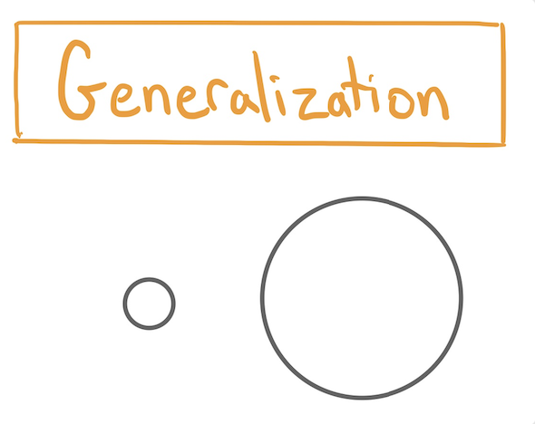
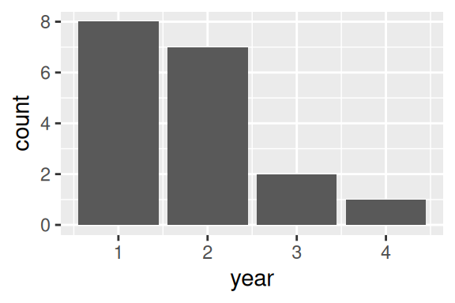
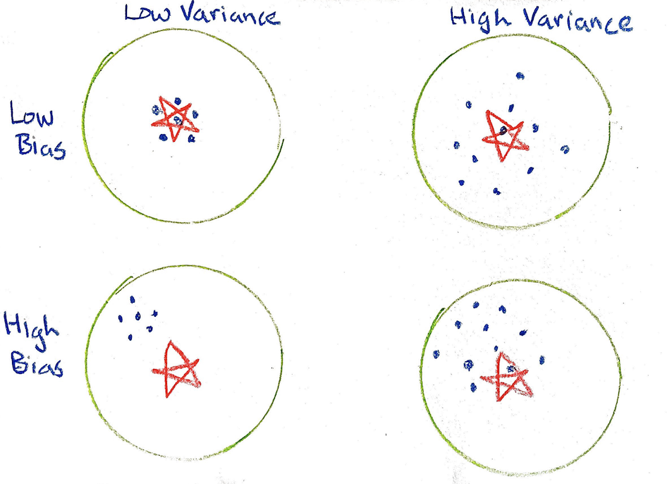
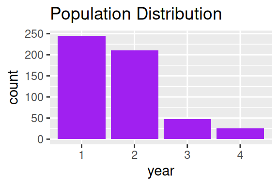
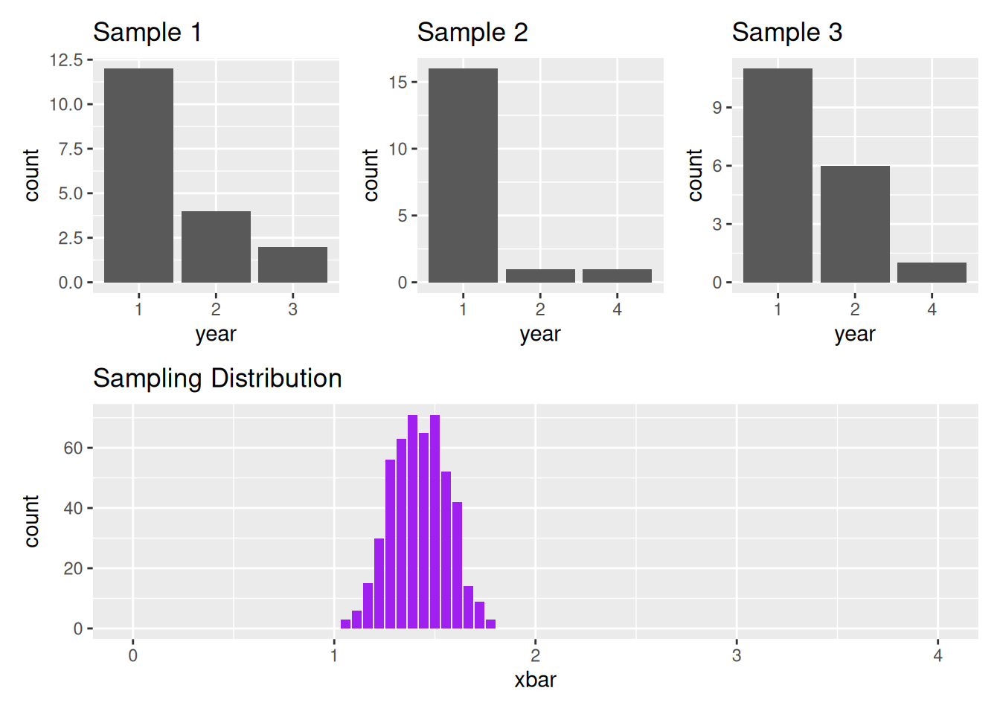

---

course: xac-suat-thong-ke

lecture: 15-tu-mau-den-tong-the

section: lecture

title: "Từ mẫu đến tổng thể"

prerequisites: ["mau-tong-the", "suy-rong-thong-ke"]

lessonStatus: ready

description: "Quá trình suy rộng thống kê, phân biệt mẫu và tổng thể, thống kê và tham số, các nguồn gốc sai số: Độ lệch (Bias) và Độ biến thiên (Variability), và phân phối chọn mẫu (Sampling Distribution)."

---

## Bản chất của Suy rộng Thống kê

Suy rộng thống kê (**Generalization**) là tiến trình sử dụng một tập hợp thông tin bộ phận thu thập được để rút ra kết luận mang tính quy luật về một tập hợp rộng lớn hơn hoặc về một hiện tượng tổng quát.

Đây là công cụ mang sức mạnh to lớn của khoa học dữ liệu: Nó cho phép chúng ta hiểu được những điều chưa từng quan sát trực tiếp. Tuy nhiên, suy rộng cũng là một nghệ thuật đầy cạm bẫy. Nếu không thấu hiểu các nguồn gốc phát sinh sai số, những kết luận suy diễn từ dữ liệu rất dễ trở nên sai lệch và gây ngộ nhận nghiêm trọng.

  

<em>Hình 15.1: Tiến trình suy rộng từ dữ liệu mẫu quan sát được sang tổng thể mục tiêu.</em>

Để thiết lập nền tảng lý luận chặt chẽ, ta cần phân biệt rành mạch bốn khái niệm nền tảng có mối liên hệ mật thiết:

::: info Bốn khái niệm cốt lõi của suy rộng thống kê

1. **Mẫu (Sample)**: Tập hợp con các đơn vị quan sát được thu thập, đo lường và đưa vào phân tích thực nghiệm. Ta thường ký hiệu kích thước mẫu là $n$.

2. **Tổng thể (Population)**: Tập hợp đầy đủ của tất cả các đơn vị mà nhà nghiên cứu hướng tới để thấu hiểu và là nguồn gốc mà mẫu được rút ra. Kích thước của tổng thể được ký hiệu là $N$.

3. **Thống kê mẫu (Sample Statistic)**: Một đại lượng tóm tắt số học được tính toán hoàn toàn từ dữ liệu của mẫu quan sát. Ví dụ: Trung bình mẫu $\bar{x}$, trung vị mẫu, tỉ lệ mẫu $\hat{p}$, độ lệch chuẩn mẫu $s$, hoặc hệ số góc hồi quy mẫu $\hat{\beta}_1$.

4. **Tham số tổng thể (Population Parameter)**: Một đại lượng tóm tắt số học đặc trưng cho toàn bộ tổng thể. Mỗi thống kê mẫu đều có một đại lượng tham số tương ứng trong tổng thể: Trung bình tổng thể $\mu$, tỉ lệ tổng thể $p$, độ lệch chuẩn tổng thể $\sigma$.

:::

---

## Tình huống thực tế: Sinh viên trong giảng đường học năm mấy?

Để làm sáng tỏ mối quan hệ giữa bốn khái niệm trên và nhận diện các nguồn gốc sai số khi chuyển từ mẫu sang tổng thể, hãy cùng phân tích một tình huống cụ thể diễn ra tại giảng đường đại học.

Vào buổi học đầu tiên của học kỳ, vị giáo sư bước vào giảng đường Pimentel Hall để bắt đầu bài giảng cho khóa sinh viên mới.

  

<em>Hình 15.2: Giảng đường Pimentel Hall với sức chứa 527 chỗ ngồi.</em>

Giảng đường Pimentel có đúng 527 chỗ ngồi. Trong buổi khai giảng, toàn bộ 527 sinh viên đăng ký môn học đều có mặt đông đủ, phủ kín mọi dãy ghế ($N = 527$).

Với mong muốn điều chỉnh nhịp điệu và nội dung bài giảng sao cho phù hợp nhất với kinh nghiệm học tập của sinh viên, vị giáo sư muốn biết sinh viên trong lớp hiện đang theo học năm thứ mấy tại trường (năm 1, năm 2, năm 3 hay năm 4).

Thay vì điểm danh và hỏi từng người trong suốt 527 sinh viên, vị giáo sư quyết định gọi một sinh viên ngồi ngay giữa hàng ghế đầu tiên và hỏi: *"Em đang là sinh viên năm thứ mấy?"*. Bạn sinh viên trả lời: *"Em là sinh viên năm hai"*. Giáo sư ghi số 2 lên bảng. Tiếp tục, giáo sư hỏi lần lượt toàn bộ 18 bạn sinh viên ngồi ở hàng ghế đầu tiên của giảng đường.

Kết thúc cuộc khảo sát ngắn, trên bảng xuất hiện một bảng dữ liệu gồm một cột và 18 dòng, bắt đầu bằng các giá trị: $2, 1, 1, \dots$

Vốn là một nhà thống kê, giáo sư lập tức vẽ biểu đồ cột thể hiện phân phối dữ liệu và tính được giá trị trung bình mẫu:

$$
\bar{x} = 1.77
$$

  

<em>Hình 15.3: Phân phối năm học của 18 sinh viên ngồi ở hàng ghế đầu tiên.</em>

Con số $1.77$ này có phải là câu trả lời tốt cho câu hỏi ban đầu của giáo sư: *"Sinh viên trong giảng đường của tôi học năm mấy?"* hay không?

### Nhận diện các thành phần thống kê trong tình huống

- **Tổng thể**: Tập hợp toàn bộ $N = 527$ sinh viên có mặt trong giảng đường Pimentel.

- **Mẫu**: Nhóm $n = 18$ sinh viên ngồi ở hàng ghế đầu tiên được phỏng vấn trực tiếp.

- **Thống kê mẫu**: Giá trị trung bình mẫu $\bar{x} = 1.77$. Bên cạnh đó, từ mẫu này ta còn có thể tính trung vị (2) hoặc mode (1).

- **Tham số tổng thể**: Giá trị trung bình thực sự của cả 527 sinh viên trong lớp, ký hiệu là $\mu$. Giá trị này là mục tiêu cốt lõi mà giáo sư muốn biết nhưng hiện tại chưa thể quan sát đầy đủ.

Khi dùng $\bar{x} = 1.77$ để ước lượng $\mu$, ta đã mắc phải bao nhiêu sai số và sai số đó xuất phát từ những nguyên nhân nào?

---

## Hai nguồn gốc của Sai số: Độ lệch (Bias) và Độ biến thiên (Variability)

Để hiểu rõ bản chất của sai số ước lượng, hãy liên tưởng tới trò chơi ném phi tiêu vào tâm bia:

- **Tâm bia (Bullseye)**: Đại diện cho tham số tổng thể đích thực $\mu$ mà ta khao khát bắn trúng.

- **Mỗi phi tiêu ném ra**: Đại diện cho một thống kê mẫu $\bar{x}$ tính được từ một mẫu dữ liệu cụ thể.

  

<em>Hình 15.4: Bốn kịch bản sai số trên bia phi tiêu phân loại theo Độ lệch (Bias) và Độ biến thiên (Variance).</em>

Một tay ném có thể bắn trượt tâm bia theo hai cơ chế hoàn toàn độc lập:

1. **Độ lệch (Bias)**: Các phát ném có xu hướng chệch một cách có hệ thống về một phía nào đó (chẳng hạn luôn bay lệch chếch sang góc trên bên trái của tâm bia).

2. **Độ biến thiên (Variability / Variance)**: Lực ném và tay cầm không ổn định, khiến các phát ném tản mát rải rác khắp nơi, mỗi lần ném một hướng khác nhau.

Một phép lấy mẫu được coi là **đại diện cho tổng thể (representative)** khi nó không chứa độ lệch (tương ứng với hàng trên cùng của bia phi tiêu).

---

## Các dạng Độ lệch Thống kê (Statistical Bias)

Độ lệch thống kê phát sinh khi phương pháp thu thập dữ liệu khiến thống kê mẫu có xu hướng lệch hệ thống khỏi giá trị tham số thực tế. Ba dạng độ lệch phổ biến nhất gồm:

### 1. Độ lệch chọn mẫu (Selection Bias)

Độ lệch chọn mẫu xuất hiện khi cơ chế chọn các đơn vị vào mẫu khiến cho một số nhóm đối tượng có xác suất được chọn cao hơn hẳn các nhóm khác. Nói cách khác, không phải mọi đơn vị trong tổng thể đều có cơ hội vào mẫu như nhau.

- **Mẫu thuận tiện (Convenience sample)**: Chỉ lấy mẫu từ những đối tượng dễ tiếp cận nhất. Vấn đề nảy sinh khi những người dễ tiếp cận có những đặc điểm hành vi khác biệt căn bản so với những người khó tiếp cận.

- **Mẫu tự nguyện (Voluntary response sample)**: Nghiên cứu dựa trên người tự nguyện tham gia. Những người có ý kiến cực đoan hoặc quan tâm đặc biệt đến vấn đề thường tự nguyện tham gia nhiều hơn, gây méo mó kết quả.

### 2. Độ lệch đo lường (Measurement Bias)

Độ lệch đo lường xuất hiện khi chính quy trình đo đạc biến số bị lệch có hệ thống theo một chiều nhất định.

- Thiết bị cân đo bị trôi thang chuẩn theo thời gian hoặc độ ẩm môi trường làm sai lệch kết quả quan trắc khí tượng.

- Trong điều tra xã hội học: Câu hỏi khảo sát dùng từ ngữ mớm cung, gây định kiến hoặc người trả lời có tâm lý nói dối vì sợ phán xét xã hội (Social Desirability Bias).

### 3. Độ lệch không phản hồi (Non-response Bias)

Độ lệch không phản hồi xuất hiện khi một bộ phận đối tượng được chọn vào mẫu từ chối trả lời hoặc không thể liên lạc được, và nhóm người không trả lời này có đặc tính khác biệt rõ rệt so với nhóm người đồng ý trả lời.

Khi có độ lệch không phản hồi, cỡ mẫu thực tế thu được sẽ nhỏ hơn cỡ mẫu dự kiến ban đầu, đồng thời làm mất đi tính đại diện của mẫu.

### Nhận diện Độ lệch trong Giảng đường Pimentel

Phương pháp thu thập dữ liệu của vị giáo sư mắc phải độ lệch nào?

- **Độ lệch chọn mẫu**: Mẫu gồm 18 sinh viên hàng đầu là một **mẫu thuận tiện điển hình**. Sinh viên các năm học không có xác suất ngồi ở hàng đầu như nhau. Sinh viên năm nhất, với sự hào hứng và bỡ ngỡ của ngày đầu nhập học, thường có xu hướng đến sớm và chọn ngồi ngay hàng ghế đầu. Nếu đúng như vậy, mẫu sẽ bị thiên lệch nặng về sinh viên năm nhất, kéo theo giá trị trung bình mẫu $\bar{x} = 1.77$ bị ước lượng **thấp hơn đáng kể** so với thực tế của cả lớp.

- **Độ lệch đo lường**: Quy trình đo lường ở đây là hỏi miệng trực tiếp trước cả lớp. Liệu có khả năng sinh viên năm nhất vì ngại bị coi là quá non nớt nên đã khai man thành năm hai? Nếu điều này xảy ra, nhiều số 2 ghi trên bảng thực chất là số 1, khiến giá trị $1.77$ bị ước lượng **cao hơn** thực tế.

- **Độ lệch không phản hồi**: Dạng sai số này hầu như không đáng lo ngại trong lớp học, bởi sinh viên rất khó từ chối trả lời khi giáo sư trực tiếp đứng trước mặt và cất lời hỏi.

---

## Các dạng Độ biến thiên (Variability)

Cho dù nghiên cứu có loại bỏ được hoàn toàn độ lệch thì dữ liệu thực tế vẫn luôn luôn biểu hiện tính biến thiên ngẫu nhiên.

### 1. Biến thiên lấy mẫu (Sampling Variability)

Nếu mẫu được rút ra từ tổng thể có chứa yếu tố ngẫu nhiên, giá trị của thống kê mẫu sẽ dao động từ mẫu này sang mẫu khác.

Trong giảng đường Pimentel: Dù giả định sinh viên ngồi hoàn toàn ngẫu nhiên (không có độ lệch chọn mẫu), thì vào buổi học hôm nay, tình cờ có nhiều bạn năm nhất ngồi hàng đầu do ngẫu nhiên thuần túy ($\bar{x} = 1.77$). Ngày mai, cũng do ngẫu nhiên, hàng đầu lại tình cờ tập trung nhiều bạn năm ba, khiến trung bình mẫu nhảy vọt lên $\bar{x} = 2.7$. Sự chênh lệch này chính là **biến thiên lấy mẫu**.

### 2. Biến thiên đo lường (Measurement Variability)

Khi tiến hành đo đạc nhiều lần trên cùng một đối tượng, các kết quả đo lường có thể dao động nhẹ quanh nhau do giới hạn độ phân giải của dụng cụ hoặc sự biến thiên nhất thời của môi trường đo.

---

## Phân phối chọn mẫu (Sampling Distribution)

Khái niệm cốt lõi nhất để hiểu thấu đáo sai số ước lượng trong thống kê chính là **Phân phối chọn mẫu**.

::: info Định nghĩa: Phân phối chọn mẫu (Sampling Distribution)

**Phân phối chọn mẫu** là phân phối xác suất của một thống kê mẫu khi tiến hành lấy mẫu lặp đi lặp lại vô số lần với cùng kích thước $n$ từ cùng một tổng thể.

:::

Cần phân biệt rõ ba tầng phân phối trong tư duy thống kê:

1. **Phân phối của tổng thể (Population Distribution)**: Phân phối của tất cả $N$ cá thể trong tổng thể (thường là bất biến nhưng ta không biết được giá trị thực).

2. **Phân phối của dữ liệu mẫu (Sample Data Distribution)**: Phân phối thực nghiệm của $n$ quan sát thu được trong một mẫu duy nhất cụ thể.

3. **Phân phối chọn mẫu của thống kê (Sampling Distribution of the Statistic)**: Phân phối lý thuyết của chính đại lượng thống kê (như $\bar{x}$) khi rút ra hàng nghìn mẫu khác nhau từ tổng thể đó.

### Thí nghiệm mô phỏng trên giảng đường Pimentel

Để nhìn thấy hình hài cụ thể của phân phối chọn mẫu, hãy cùng thực hiện một thí nghiệm tư duy: Giả sử chúng ta nắm trong tay dữ liệu của toàn bộ $N = 527$ sinh viên trong lớp.

Biểu đồ dưới đây thể hiện phân phối thực sự của năm học trong toàn bộ giảng đường:

  

<em>Hình 15.5: Phân phối thực tế của năm học trong toàn bộ tổng thể 527 sinh viên.</em>

Để mô phỏng hiện tượng độ lệch chọn mẫu khi giáo sư chỉ gọi 18 sinh viên hàng ghế đầu, ta gán cho mỗi sinh viên một điểm số "nhiệt huyết" (Eagerness score) phản ánh xác suất ngồi ở hàng đầu:

- Sinh viên năm nhất: 10 điểm nhiệt huyết.

- Sinh viên năm hai: 6 điểm nhiệt huyết.

- Sinh viên năm ba: 3 điểm nhiệt huyết.

- Sinh viên năm tư: 1 điểm nhiệt huyết.

Như vậy, một sinh viên năm nhất có xác suất được chọn vào hàng đầu cao gấp hơn 3.33 lần so với một sinh viên năm ba ($10 / 3 \approx 3.33$).

Tiến hành rút mẫu 18 sinh viên theo trọng số nhiệt huyết này:

- Lần lấy mẫu thứ nhất: Thu được mẫu 1 với $\bar{x}_1 = 1.3$.

- Lần lấy mẫu thứ hai: Thu được mẫu 2 với $\bar{x}_2 = 1.2$.

- Lần lấy mẫu thứ ba: Thu được mẫu 3 với $\bar{x}_3 = 1.5$.

- Lặp lại quy trình này $500$ lần và vẽ biểu đồ của $500$ giá trị trung bình mẫu $\bar{x}$:

  

<em>Hình 15.6: Hàng trên: Phân phối của ba mẫu cụ thể gồm 18 sinh viên. Hàng dưới: Phân phối chọn mẫu của 500 giá trị trung bình mẫu $\bar{x}$. Đường thẳng đứng màu xanh lam biểu thị tham số thực $\mu$ của tổng thể.</em>

Quan sát Hình 15.6, ta nhận thấy hai kết luận then chốt:

1. **Biến thiên lấy mẫu**: Các giá trị $\bar{x}$ dao động từ khoảng $1.0$ đến $1.8$. Mỗi lần lấy mẫu ta nhận được một con số khác nhau.

2. **Độ lệch chọn mẫu**: Tâm của phân phối chọn mẫu nằm quanh giá trị $1.4$, lệch hẳn về bên trái so với đường màu xanh biểu diễn tham số thực $\mu$ của cả lớp. Phương pháp lấy mẫu hàng đầu đã đánh giá thấp một cách có hệ thống năm học thực tế của sinh viên!

---

## Tóm tắt kiến thức cốt lõi

1. **Mục tiêu suy rộng**: Sử dụng thống kê mẫu (tính từ $n$ quan sát) để ước lượng tham số tổng thể (của $N$ cá thể).

2. **Hai nhóm sai số cơ bản**:

   - **Độ lệch (Bias)**: Sai số hệ thống làm lệch tâm phân phối khỏi giá trị thực. Bao gồm độ lệch chọn mẫu, độ lệch đo lường và độ lệch không phản hồi.

   - **Độ biến thiên (Variability)**: Sự dao động ngẫu nhiên giữa các lần lấy mẫu hoặc giữa các lần đo.

3. **Phân phối chọn mẫu (Sampling Distribution)**: Phân phối của đại lượng thống kê qua vô số lần lặp lại quy trình lấy mẫu.

4. **Giải pháp khắc phục độ lệch**: Sử dụng phương pháp **lấy mẫu ngẫu nhiên đơn giản (Simple Random Sample - SRS)** để đảm bảo mọi cá thể đều có cơ hội vào mẫu như nhau, từ đó triệt tiêu độ lệch chọn mẫu và đưa tâm của phân phối chọn mẫu trùng khít với tham số tổng thể $\mu$.

## Bài tập rèn luyện

::: exercise Bài tập 1: Khắc phục độ lệch chọn mẫu bằng mô hình hộp

Xét lại tình huống khảo sát tại giảng đường Pimentel Hall với $N = 527$ sinh viên. Trong kịch bản 1, giáo sư gọi 18 sinh viên ở hàng ghế đầu và thu được phân phối chọn mẫu tập trung quanh giá trị $1.4$ (bị lệch thấp so với tham số thực $\mu$).

Giả sử giáo sư chuyển sang phương án sau: Giáo sư viết tên của tất cả $527$ sinh viên lên $527$ tấm vé, bỏ vào một chiếc hộp lớn, xáo trộn thật kỹ rồi rút ngẫu nhiên không hoàn lại đúng 18 tấm vé để phỏng vấn.

1. Phương pháp mới này được gọi là phương pháp lấy mẫu gì trong thống kê?

2. Phân phối chọn mẫu của trung bình mẫu $\bar{X}_{18}$ sẽ thay đổi như thế nào so với kịch bản ban đầu? Thay đổi nào là rõ rệt và mang tính quyết định nhất?

3. Nếu mục tiêu là triệt tiêu hoàn toàn độ biến thiên lấy mẫu (sampling variability) thì cần phải làm gì?

:::

::: solution

**1. Tên gọi phương pháp lấy mẫu:**

Phương pháp bỏ toàn bộ danh sách tổng thể vào hộp, xáo đều và rút ngẫu nhiên không hoàn lại được gọi là **Lấy mẫu ngẫu nhiên đơn giản (Simple Random Sampling - SRS)**. Mỗi sinh viên trong tổng thể đều có cơ hội được chọn vào mẫu hoàn toàn ngang nhau bằng $\frac{18}{527}$.

**2. Sự thay đổi của phân phối chọn mẫu:**

- Thay đổi mang tính quyết định nhất là **triệt tiêu độ lệch chọn mẫu (Selection Bias)**: Tâm của phân phối chọn mẫu sẽ dịch chuyển sang phải để trùng khớp chính xác với tham số trung bình thực tế $\mu$ của toàn bộ 527 sinh viên.

- Phân phối chọn mẫu sẽ trở nên đối xứng và chuẩn hóa quanh $\mu$ theo Định lý Giới hạn Trung tâm, thay vì bị lệch về phía sinh viên năm nhất như khi lấy mẫu hàng đầu.

**3. Triệt tiêu hoàn toàn biến thiên lấy mẫu:**

- Biến thiên lấy mẫu xuất hiện vì ta chỉ quan sát một tập hợp con gồm 18 người thay vì toàn bộ lớp học.

- Để triệt tiêu hoàn toàn biến thiên lấy mẫu ($\text{SE} = 0$), cách duy nhất là tiến hành **tổng điều tra (census)**, tức là đo lường toàn bộ $N = 527$ sinh viên trong lớp. Khi đó không còn yếu tố ngẫu nhiên của việc chọn mẫu và ta thu được chính xác tham số $\mu$.

:::

---

::: exercise Bài tập 2: Tác động của cỡ mẫu lên phân phối chọn mẫu

Sau khi đã áp dụng phương pháp lấy mẫu ngẫu nhiên đơn giản (SRS) bằng cách rút vé từ hộp chứa $527$ sinh viên, giáo sư phân vân giữa hai phương án cỡ mẫu:

- **Phương án A**: Rút $n = 18$ sinh viên.

- **Phương án B**: Rút $n = 8$ sinh viên.

1. Tâm đối xứng của phân phối chọn mẫu trong hai phương án có khác nhau không? Vì sao?

2. Độ biến thiên (đo bằng sai số chuẩn $\text{SE}(\bar{X})$) của phân phối chọn mẫu trong phương án B sẽ lớn hơn hay nhỏ hơn so với phương án A? Tính tỉ số sai số chuẩn giữa phương án B và phương án A.

3. Trong trường hợp nào thì độ lệch (bias) của nghiên cứu sẽ tăng lên khi giảm cỡ mẫu từ 18 xuống 8?

:::

::: solution

**1. Tâm đối xứng của phân phối chọn mẫu:**

Tâm đối xứng của phân phối chọn mẫu trong cả hai phương án là **hoàn toàn giống nhau** và đều bằng đúng tham số thực $\mu$ của tổng thể. Lý do là cả hai phương án đều sử dụng lấy mẫu ngẫu nhiên đơn giản (SRS), mà trong SRS thì trung bình mẫu là một ước lượng không chệch (unbiased estimator) của trung bình tổng thể, thỏa mãn $E(\bar{X}) = \mu$ với mọi kích thước mẫu $n \ge 1$.

**2. So sánh độ biến thiên:**

Theo quy luật căn bậc hai cho trung bình mẫu, sai số chuẩn tỉ lệ nghịch với căn bậc hai của cỡ mẫu:

$$
\text{SE}(\bar{X}) \approx \frac{\sigma}{\sqrt{n}}
$$

(Do lấy mẫu không hoàn lại từ tổng thể hữu hạn $N = 527$, công thức chính xác có kèm thừa số hiệu chỉnh tổng thể hữu hạn FPC: $\sqrt{\frac{N - n}{N - 1}}$, tuy nhiên tỉ số $n/N$ rất nhỏ nên sai số chuẩn vẫn tỉ lệ xấp xỉ với $1/\sqrt{n}$).

Khi giảm cỡ mẫu từ $n = 18$ xuống $n = 8$:

- Cỡ mẫu nhỏ hơn đồng nghĩa với việc độ biến thiên lấy mẫu **lớn hơn**.

- Tỉ số sai số chuẩn giữa phương án B và phương án A xấp xỉ bằng:

$$
\frac{\text{SE}_B}{\text{SE}_A} \approx \sqrt{\frac{18}{8}} = \sqrt{2.25} = 1.5
$$

  Sai số chuẩn khi lấy mẫu 8 sinh viên tăng khoảng $50\%$ so với khi lấy mẫu 18 sinh viên.

**3. Khả năng phát sinh độ lệch khi giảm cỡ mẫu:**

Trong điều kiện lấy mẫu ngẫu nhiên đơn giản thực sự, việc giảm cỡ mẫu **không làm phát sinh hay làm tăng độ lệch**. Độ lệch là sai số mang tính hệ thống trong thiết kế lấy mẫu, chứ không phụ thuộc vào cỡ mẫu $n$. Giảm cỡ mẫu chỉ làm tăng phương sai (độ phân tán), chứ không làm lệch tâm phân phối.

:::

---

::: exercise Bài tập 3: Phân tích sự ổn định vị trí ngồi theo thời gian

Quay trở lại phương pháp lấy mẫu ban đầu của giáo sư: Gọi 18 sinh viên ngồi ở hàng ghế đầu tiên.

Giả sử vào đầu học kỳ, sinh viên chưa quen nhau nên mỗi buổi học họ ngồi một vị trí ngẫu nhiên khác nhau. Tuy nhiên, đến cuối học kỳ, $90\%$ sinh viên đã chọn cho mình một vị trí cố định và ngồi đúng chiếc ghế đó trong mọi buổi học.

1. Khi sinh viên đã ngồi cố định ghế vào cuối học kỳ, độ biến thiên lấy mẫu (sampling variability) của trung bình mẫu $\bar{X}$ qua các buổi học sẽ tăng lên, giảm đi hay giữ nguyên?

2. Độ lệch chọn mẫu (selection bias) của phương pháp phỏng vấn hàng đầu có tự động biến mất khi sinh viên ngồi cố định không? Vì sao?

3. Phân biệt rõ sự khác nhau giữa việc *"kết quả thu được có độ lặp lại cao (ổn định)"* và việc *"kết quả thu được là chính xác (không có độ lệch)"* thông qua mô hình bia phi tiêu.

:::

::: solution

**1. Sự thay đổi của độ biến thiên lấy mẫu:**

Khi $90\%$ sinh viên ngồi cố định một chỗ mỗi ngày, những sinh viên ngồi ở hàng ghế đầu tiên hầu như không thay đổi từ buổi học này sang buổi học khác.

Do đó, dữ liệu của mẫu 18 sinh viên qua các ngày lặp lại gần như trùng khít nhau, dẫn tới việc giá trị trung bình mẫu $\bar{x}$ qua các buổi học hầu như không biến động. Hệ quả là **độ biến thiên lấy mẫu (sampling variability) giảm đi rõ rệt, tiệm cận về 0**.

**2. Độ lệch chọn mẫu có biến mất không:**

Độ lệch chọn mẫu **hoàn toàn không biến mất**, thậm chí còn trở nên cố định và trầm trọng hơn. Những sinh viên ngồi cố định ở hàng đầu vẫn là nhóm sinh viên có tính cách, mức độ chuyên cần hoặc năm học đặc thù, không đại diện cho toàn bộ giảng đường. Việc họ ngồi cố định chỉ làm cho mẫu trở nên "bất biến", nhưng sự bất biến đó vẫn bị lệch hệ thống so với tham số thực $\mu$.

**3. Minh họa trên mô hình bia phi tiêu:**

- Tình huống cuối học kỳ tương ứng với ô **High Bias, Low Variance (Độ lệch cao, Phương sai thấp)** trên bia phi tiêu: Tất cả các mũi tên đều cắm chụm sát vào nhau tại cùng một điểm (tính ổn định cao, phương sai cực nhỏ), nhưng điểm chụm đó lại nằm lệch hẳn khỏi tâm bia (độ lệch cao).

- Một phương pháp đo lường có độ lặp lại cao và ổn định (độ tin cậy cao - high reliability) hoàn toàn không đồng nghĩa với việc nó phản ánh đúng sự thật khách quan (độ giá trị cao - high validity).

:::

## Tài liệu tham khảo

- UC Berkeley STAT 20: *Introduction to Probability and Statistics*, Department of Statistics, UC Berkeley.

- Freedman, D., Pisani, R., & Purves, R. (2007). *Statistics* (4th ed.). W. W. Norton & Company.

