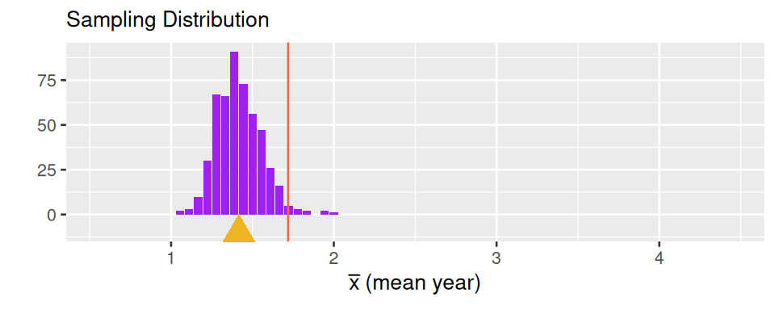
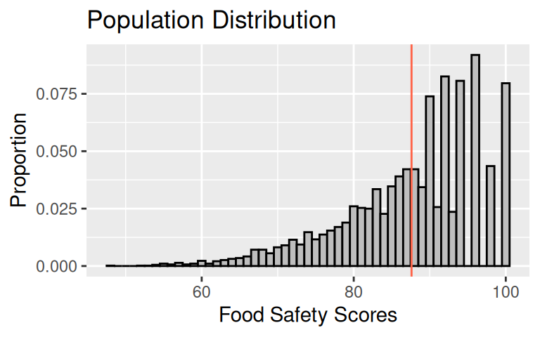
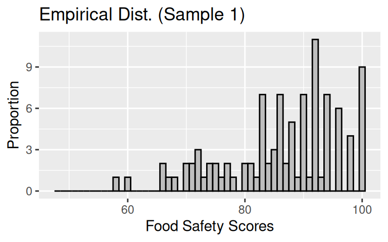
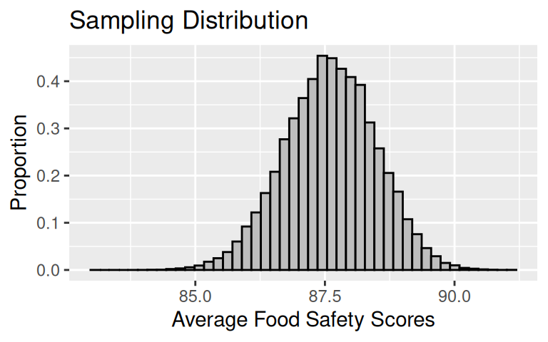
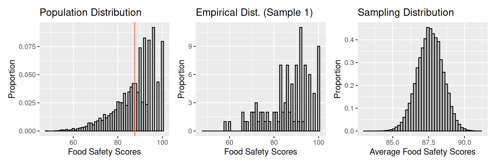
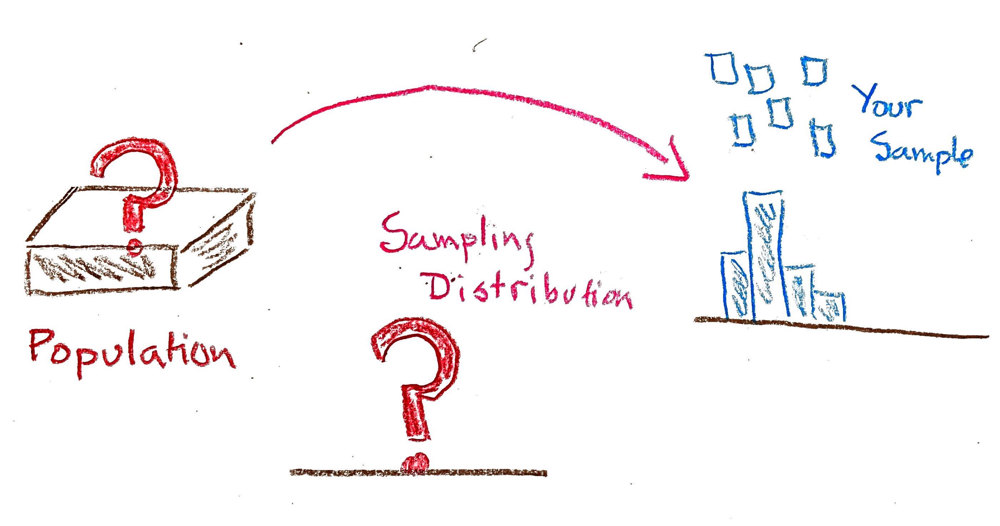
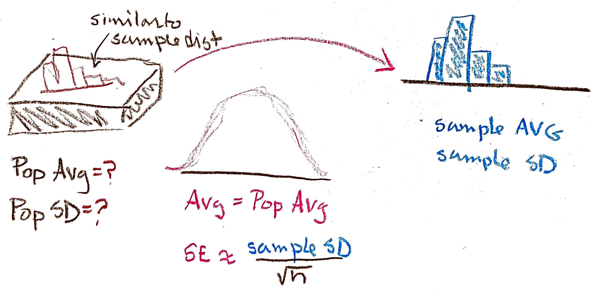
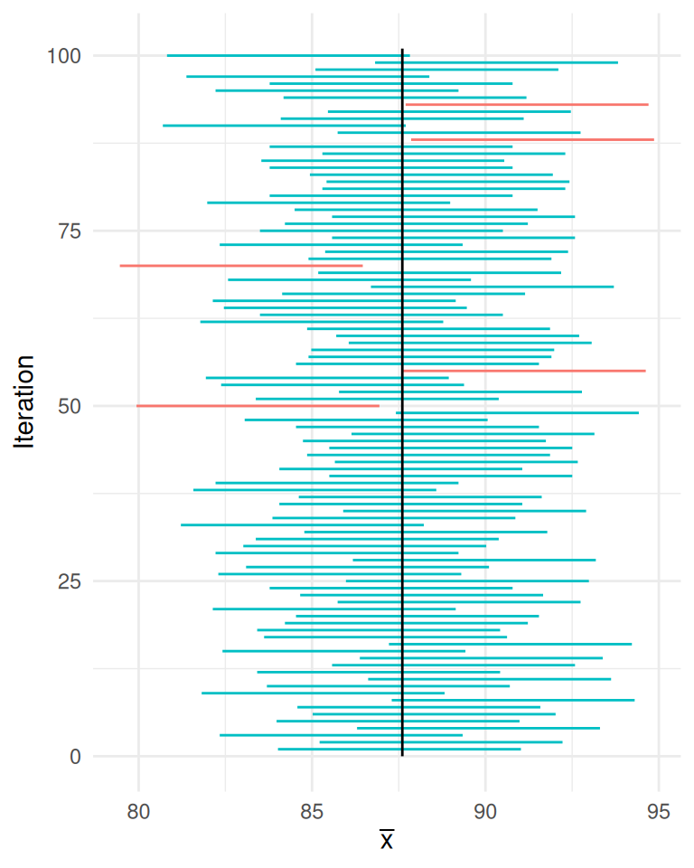
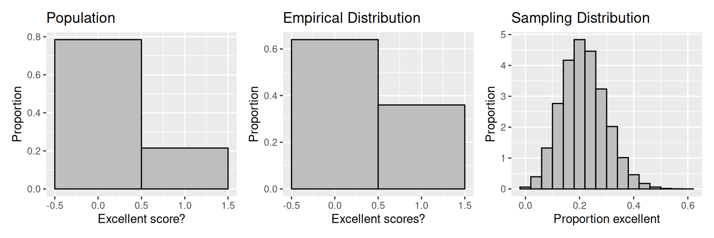

---

course: xac-suat-thong-ke

lecture: 16-khoang-tin-cay

section: lecture

title: "Khoảng tin cậy"

prerequisites: ["mau-tong-the", "suy-rong-thong-ke"]

lessonStatus: ready

description: "Định lượng độ biến thiên lấy mẫu, sai số chuẩn SE, bộ ba bức tranh thống kê, xây dựng khoảng tin cậy 95% bằng xấp xỉ chuẩn và giải thích đúng chuẩn mức độ tin cậy."

---

## Dẫn nhập: Định lượng độ bất định trong suy rộng

Tiến trình suy rộng từ một đại lượng thống kê của mẫu sang một tham số chưa biết của tổng thể được gọi là **Suy diễn thống kê (Statistical Inference)**.

Tham số mà chúng ta quan tâm có thể là giá trị trung bình $\mu$, trung vị, tỉ lệ $p$, hệ số tương quan $r$, hoặc các hệ số hồi quy tuyến tính $\beta_1$. Khi ta tiến hành ước lượng tham số đó bằng cách tính toán thống kê mẫu từ một mẫu ngẫu nhiên gồm $n$ quan sát, hành động này sẽ kích hoạt một **phân phối chọn mẫu (Sampling Distribution)**.

  

<em>Hình 16.1: Phân phối chọn mẫu thâu tóm hai nguồn gốc sai số: Độ lệch (khoảng cách ngang từ đường thẳng đứng đỏ biểu thị tham số thực đến tam giác vàng biểu thị tâm phân phối) và Độ biến thiên (độ dàn trải của phân phối).</em>

Để định lượng chính xác độ biến thiên lấy mẫu khi phương pháp thu thập dữ liệu không chứa độ lệch, các nhà thống kê sử dụng hai công cụ tiêu chuẩn:

::: info Hai công cụ định lượng độ biến thiên lấy mẫu

1. **Sai số chuẩn (Standard Error - SE)**: Độ lệch chuẩn của phân phối chọn mẫu của một đại lượng thống kê.

2. **Khoảng tin cậy (Confidence Interval - CI)**: Một khoảng ngẫu nhiên $[L(\mathbf{X}), U(\mathbf{X})]$ được tính toán từ dữ liệu mẫu, có tính chất bao phủ tham số cố định chưa biết của tổng thể với một xác suất định trước $1 - \alpha$ (mức độ tin cậy) trong các lần lặp lại độc lập của quy trình lấy mẫu. Khoảng tin cậy không phải là khoảng trung tâm cố định của phân phối chọn mẫu (vốn xoay quanh tham số $\mu$ chưa biết), mà là một khoảng biến thiên theo từng mẫu để nắm bắt tham số thực.

:::

Để tập trung sâu sắc vào độ biến thiên lấy mẫu mà không bị phân tâm bởi độ lệch, chúng ta sẽ khảo sát một nghiên cứu điển hình sử dụng phương pháp **lấy mẫu ngẫu nhiên đơn giản (Simple Random Sampling - SRS)**.

---

## Nghiên cứu thực tế: Điểm an toàn thực phẩm tại San Francisco

Hằng năm, Sở Y tế thành phố San Francisco tiến hành thanh tra toàn bộ các nhà hàng trên địa bàn thành phố về tiêu chuẩn vệ sinh an toàn thực phẩm. Mỗi nhà hàng sau khi kiểm tra sẽ được chấm một điểm số từ 48 (nguy cơ ô nhiễm nghiêm trọng) đến 100 (hoàn toàn sạch sẽ, đạt chuẩn tuyệt đối).

Bộ dữ liệu năm 2016 được công khai trực tuyến trên cổng thông tin thành phố. Đây là một cơ hội hiếm có để ta xây dựng từng mảnh ghép của bức tranh thống kê.

### 1. Phân phối của Tổng thể (Population Distribution)

Tổng thể nghiên cứu bao gồm toàn bộ các nhà hàng hoạt động tại San Francisco. Vì dữ liệu hành chính được ghi nhận cho toàn bộ nhà hàng trong phạm vi thành phố, tập dữ liệu này đóng vai trò như một cuộc tổng điều tra (census) trên phạm vi khảo sát.

  

<em>Hình 16.2: Phân phối tổng thể của điểm an toàn thực phẩm tại San Francisco (lệch trái với đuôi dài về bên trái).</em>

Phân phối của tổng thể bị lệch trái rõ rệt với đuôi dài kéo về phía điểm thấp. Điểm số tối đa là 100. Đáng chú ý, các điểm chẵn xuất hiện phổ biến hơn các điểm lẻ ở vùng trên 90 điểm (thực tế hoàn toàn không có điểm 99, 97 hay 95).

Từ tổng thể này, ta tính được hai **tham số tổng thể** (thường ký hiệu bằng chữ cái Hy Lạp):

- **Điểm trung bình tổng thể**: $\mu = 87.6$.

- **Độ lệch chuẩn tổng thể**: $\sigma = 8.9$.

### 2. Phân phối Thực nghiệm của Mẫu (Empirical Distribution)

Dù trên thực tế thành phố lưu trữ hồ sơ của mọi nhà hàng, hãy tưởng tượng bạn là một thanh tra viên độc lập chỉ có đủ nguồn lực để đến kiểm tra một **mẫu ngẫu nhiên đơn giản gồm $n = 100$ nhà hàng**. Nghĩa là bạn rút thăm ngẫu nhiên không hoàn lại 100 lần từ danh sách tổng thể, mỗi nhà hàng đều có xác suất được chọn ngang nhau. Thiết kế này bảo đảm quy trình lấy mẫu là không chệch (unbiased sampling mechanism) và loại bỏ sai lệch chọn mẫu. Tuy nhiên, quy trình không chệch không bảo đảm mọi mẫu cụ thể rút ra đều tự động đại diện hoàn hảo: Do biến thiên ngẫu nhiên (sampling variability), một mẫu riêng lẻ bất kỳ vẫn có thể tình cờ mang giá trị không điển hình.

Phân phối thực nghiệm của mẫu 100 nhà hàng này có dạng:

  

<em>Hình 16.3: Phân phối thực nghiệm của một mẫu ngẫu nhiên gồm 100 nhà hàng.</em>

Từ mẫu này, ta tính được hai **thống kê mẫu** (thường ký hiệu bằng chữ cái Latinh):

- **Trung bình mẫu**: $\bar{x} = 86.27$.

- **Độ lệch chuẩn mẫu**: $s = 9.9$.

Trong lần rút mẫu cụ thể này, hình dạng của phân phối thực nghiệm phản ánh tương đối sát hình dạng của tổng thể (cùng có đuôi lệch trái). Các đại lượng thống kê $\bar{x} = 86.27$ và $s = 9.9$ cũng xấp xỉ gần với các tham số tổng thể tương ứng $\mu = 87.6$ và $\sigma = 8.9$, dù trong một mẫu ngẫu nhiên khác các con số này hoàn toàn có thể dao động xa hơn.

### 3. Phân phối Chọn mẫu (Sampling Distribution)

Nếu một thanh tra viên khác cũng rút một mẫu ngẫu nhiên đơn giản gồm 100 nhà hàng, mẫu của người đó chắc chắn không trùng hệt với bạn. Điểm trung bình mẫu $\bar{x}$ của họ có thể là $88.1$, hay $87.3$.

Tập hợp tất cả các giá trị có thể có của $\bar{x}$ khi rút mẫu ngẫu nhiên 100 nhà hàng tạo nên **phân phối chọn mẫu của trung bình mẫu**.

Để quan sát hình dạng của phân phối này, ta thực hiện mô phỏng máy tính bằng cách lặp lại quy trình rút mẫu 100 nhà hàng $100{,}000$ lần:

  

<em>Hình 16.4: Phân phối chọn mẫu của trung bình mẫu $\bar{x}$ qua 100.000 mẫu ngẫu nhiên gồm 100 nhà hàng.</em>

Các chỉ số tóm tắt của phân phối chọn mẫu:

- **Tâm của phân phối chọn mẫu**: $87.6$ (trùng khít với $\mu$).

- **Độ lệch chuẩn của phân phối chọn mẫu (Sai số chuẩn - SE)**: $\text{SE}(\bar{x}) \approx 0.89 \approx 0.9$.

Quan sát Hình 16.4, ta thấy phân phối chọn mẫu không hề bị lệch trái như tổng thể hay mẫu đơn lẻ! Trái lại, nó hoàn toàn đối xứng, mang hình quả chuông chuẩn tắc hoàn mỹ với độ phân tán cực kỳ hẹp quanh $\mu$. Độ lớn nhỏ của $\text{SE}$ phản ánh thực tế rằng trung bình mẫu $\bar{x}$ luôn dao động rất sát quanh trung bình thực $\mu$.

---

## Bộ ba bức tranh Thống kê (The Three Panels)

Hãy đặt ba khía cạnh của quá trình thống kê này cạnh nhau để so sánh trực diện:

  

<em>Hình 16.5: Bộ ba bức tranh thống kê: Phân phối tổng thể (trái), Phân phối thực nghiệm mẫu (giữa) và Phân phối chọn mẫu (phải).</em>

| Đặc trưng | Tổng thể (Population) | Dữ liệu mẫu (Empirical Sample) | Phân phối chọn mẫu (Sampling Dist.) |
| :--- | :--- | :--- | :--- |
| **Bản chất** | Toàn bộ $N$ cá thể | $n$ quan sát trong một mẫu | Hàng nghìn thống kê $\bar{x}$ qua các mẫu |
| **Hình dạng** | Lệch trái nặng | Lệch trái (giống tổng thể) | Dạng chuông đối xứng (Chuẩn Gauss) |
| **Tâm (Trung bình)**| $\mu = 87.6$ | $\bar{x} = 86.27$ | $E(\bar{X}) = \mu = 87.6$ |
| **Độ phân tán** | $\sigma = 8.9$ | $s = 9.9$ | $\text{SE}(\bar{x}) = \frac{\sigma}{\sqrt{n}} \approx 0.89$ |

Ba quy luật nền tảng xuất hiện:

1. $E(\bar{X}) = \mu$: Tâm của phân phối chọn mẫu luôn bằng đúng trung bình tổng thể.

2. $\text{SE}(\bar{x}) \approx \frac{\sigma}{\sqrt{n}}$: Sai số chuẩn tỉ lệ nghịch với căn bậc hai của cỡ mẫu.

3. **Định lý Giới hạn Trung tâm**: Dù tổng thể lệch trái rõ rệt, phân phối chọn mẫu của trung bình mẫu $n = 100$ vẫn mang hình quả chuông chuẩn tắc đối xứng.

---

## Bài toán thực tế: Khi ta chỉ nhìn thấy một bức tranh duy nhất

Trong thực tế nghiên cứu khoa học và kinh doanh, chúng ta **không bao giờ có bức tranh tổng thể** và cũng **không thể rút hàng trăm nghìn mẫu để vẽ phân phối chọn mẫu**.

Chúng ta chỉ có duy nhất một bức tranh ở giữa: **Một mẫu dữ liệu thực nghiệm duy nhất**!

  

<em>Hình 16.6: Thực tế nghiên cứu khoa học: Tổng thể và Phân phối chọn mẫu đều là những thực thể ẩn giấu, trong khi ta chỉ nắm giữ duy nhất một mẫu dữ liệu thực nghiệm.</em>

Làm thế nào để suy diễn về tham số tổng thể $\mu$ và định lượng sai số chuẩn $\text{SE}$ khi chỉ có duy nhất một mẫu?

### Phép thế Thống kê (Statistical Substitution)

Lời giải đến từ chính mối quan hệ giữa ba bức tranh:

1. Vì $n$ tương đối lớn ($n = 100$), ta dùng $\bar{x}$ làm **ước lượng điểm (point estimate)** cho $\mu$: $\mu \approx \bar{x}$.

2. Độ lệch chuẩn mẫu $s$ được dùng làm ước lượng điểm nhất quán cho độ lệch chuẩn tổng thể $\sigma$: $\sigma \approx s$.

3. Do đó, ta thay thế $\sigma$ bằng $s$ vào công thức sai số chuẩn:

$$
\widehat{\text{SE}}(\bar{x}) \approx \frac{s}{\sqrt{n}}
$$

  

<em>Hình 16.7: Nguyên lý thế thống kê: Sử dụng thống kê mẫu ($\bar{x}, s$) để lấp đầy những khoảng trống chưa biết trong phân phối chọn mẫu.</em>

Trong nghiên cứu các nhà hàng San Francisco với mẫu $n = 100$:

$$
\begin{aligned}
\widehat{\text{SE}}(\bar{x}) &\approx \frac{9.9}{\sqrt{100}} \\
&= \frac{9.9}{10} \\
&\approx 0.99 \\
&\approx 1.0
\end{aligned}
$$

Nhà nghiên cứu có thể công bố: Dựa trên mẫu ngẫu nhiên 100 nhà hàng, điểm an toàn thực phẩm trung bình của thành phố ước lượng là $86.3$ với sai số chuẩn khoảng $1.0$ điểm.

---

## Cỡ mẫu, Quy mô Tổng thể và Độ chính xác

Một câu hỏi thường gặp: Giả sử một nhà nghiên cứu khác khảo sát 100 nhà hàng tại New York (nơi có hơn 50,000 nhà hàng). Liệu ước lượng của họ có kém chính xác hơn gấp nhiều lần vì tổng thể New York lớn hơn San Francisco gấp hàng chục lần hay không?

Hãy quan sát bảng so sánh sai số chuẩn dưới đây:

| Quy mô tổng thể ($N$) | $n = 25$ | $n = 100$ | $n = 400$ |
| :--- | :--- | :--- | :--- |
| **$N = 500$** | $\text{SE} \approx \sigma / 5$ | $\text{SE} \approx \sigma / 10$ | $\text{SE} \approx \sigma / 20$ |
| **$N = 5{,}000$** | $\text{SE} \approx \sigma / 5$ | $\text{SE} \approx \sigma / 10$ | $\text{SE} \approx \sigma / 20$ |
| **$N = 50{,}000$** | $\text{SE} \approx \sigma / 5$ | $\text{SE} \approx \sigma / 10$ | $\text{SE} \approx \sigma / 20$ |

::: tip Quy luật về quy mô tổng thể và cỡ mẫu

1. **Quy mô tổng thể $N$ hầu như không ảnh hưởng đến độ chính xác của ước lượng**, miễn là cỡ mẫu $n$ nhỏ hơn nhiều so với tổng thể ($n \le 5\% N$). Một mẫu $100$ người tại New York cho độ chính xác tương đương một mẫu $100$ người tại San Francisco!

2. **Độ chính xác chỉ phụ thuộc vào cỡ mẫu $n$**: Mẫu $n = 400$ có sai số chuẩn nhỏ bằng một nửa mẫu $n = 100$, tức là độ chính xác tăng gấp đôi, theo đúng quy luật $1 / \sqrt{n}$.

:::

*(Lưu ý kỹ thuật: Khi lấy mẫu không hoàn lại mà $n$ chiếm tỉ lệ đáng kể so với $N$, ta nhân thêm hệ số hiệu chỉnh tổng thể hữu hạn $\text{FPC} = \sqrt{\frac{N - n}{N - 1}}$).*

---

## Xây dựng Khoảng tin cậy 95% (95% Confidence Interval)

Thay vì chỉ đưa ra một ước lượng điểm đơn độc $\bar{x}$, ta muốn đưa ra một **khoảng ước lượng (interval estimate)** kết hợp với mức độ tin cậy được bảo đảm bằng toán học.

Nhờ Định lý Giới hạn Trung tâm, phân phối chọn mẫu có dạng phân phối chuẩn. Theo tính chất phân phối chuẩn, khoảng đối xứng chứa đúng $95\%$ diện tích trung tâm có biên độ đúng bằng $1.96$ lần sai số chuẩn:

Đặt $Z=(\bar X-\mu)/\mathrm{SE}$, với sai số chuẩn đã biết. Khi $Z$ có phân phối chuẩn tắc, ta có:

$$
P(-1{,}96\le Z\le1{,}96)\approx0{,}95.
$$

Biến đổi bất đẳng thức trên về tham số $\mu$:

Biến đổi bất đẳng thức trên, đặt $L=\bar X-1{,}96\,\mathrm{SE}$ và $U=\bar X+1{,}96\,\mathrm{SE}$. Đây là hai đầu mút ngẫu nhiên của khoảng:

$$
P(L\le\mu\le U)\approx0{,}95.
$$

::: info Công thức: Khoảng tin cậy 95% cho Trung bình tổng thể

Khoảng tin cậy 95% cho trung bình tổng thể $\mu$ được xác định bởi:

$$
\left[ \bar{x} - 1.96 \cdot \frac{s}{\sqrt{n}}, \; \bar{x} + 1.96 \cdot \frac{s}{\sqrt{n}} \right]
$$

:::

Áp dụng cho mẫu 100 nhà hàng San Francisco ($\bar{x} = 86.27, s = 9.9, n = 100$):

$$
\begin{aligned}
&m=1{,}96(0{,}99)=1{,}9404, \\
&L=86{,}27-m\approx84{,}33, \\
&U=86{,}27+m\approx88{,}21, \\
&\mathrm{CI}_{95\%}=[L,U].
\end{aligned}
$$

Phát biểu chuẩn mực học thuật: *"Chúng ta tin tưởng 95% rằng điểm an toàn thực phẩm trung bình của toàn bộ các nhà hàng tại San Francisco nằm trong khoảng từ 84.3 đến 88.2 điểm"*.

---

## Bản chất của "Độ tin cậy" (Confidence vs Probability)

Tại sao ta lại dùng từ **"tin cậy" (confidence)** mà không nói **"xác suất để $\mu$ rơi vào khoảng là 95%"**?

Đây là một ranh giới khái niệm tối quan trọng:

- Tham số tổng thể $\mu$ là một **hằng số cố định của tự nhiên**, không phải là một biến ngẫu nhiên. Nó không hề di chuyển.

- Khi mẫu dữ liệu đã được thu thập và khoảng $[84.3, 88.2]$ đã được tính ra, hai đầu mút của khoảng đã trở thành các con số cố định.

- Do đó, khoảng cụ thể này **hoặc chứa $\mu$, hoặc không chứa $\mu$**. Không còn bất kỳ sự may rủi nào ở đây. Xác suất để khoảng này chứa $\mu$ chỉ có thể là $1$ hoặc $0$, chứ không phải $0.95$.

Yếu tố ngẫu nhiên $95\%$ nằm ở **quy trình tạo ra khoảng**: Nếu chúng ta lấy 100 mẫu độc lập khác nhau và tính 100 khoảng tin cậy tương ứng, thì khoảng 95 khoảng sẽ bao phủ được $\mu$, và khoảng 5 khoảng sẽ trượt ra ngoài.

  

<em>Hình 16.8: Mô phỏng 100 khoảng tin cậy 95% từ 100 mẫu ngẫu nhiên độc lập. Có đúng 95 khoảng bao phủ tham số thực $\mu$ (đường thẳng đứng màu đen) và 5 khoảng trượt ra ngoài.</em>

---

## Suy diễn cho Tỉ lệ Tổng thể (Population Proportion)

Phương pháp xây dựng khoảng tin cậy chuẩn tắc áp dụng tương tự cho **tỉ lệ tổng thể $p$**.

Giả sử ta chỉ muốn đến ăn tại các nhà hàng có điểm an toàn thực phẩm "xuất sắc" (trên 95 điểm). Ta quan tâm đến tỉ lệ các nhà hàng đạt chuẩn xuất sắc trong toàn thành phố.

Đây là trường hợp của **mô hình hộp 0-1**:

- Mỗi nhà hàng được gán nhãn 1 (nếu điểm $> 95$) hoặc 0 (nếu điểm $\le 95$).

- Rút mẫu ngẫu nhiên $n$ nhà hàng. Gọi $\hat{p}$ là tỉ lệ nhà hàng đạt chuẩn xuất sắc trong mẫu.

- Thống kê $\hat{p}$ thực chất là trung bình mẫu của các số 0 và 1:

$$
E(\hat{p}) = p, \quad \text{Var}(\hat{p}) = \frac{p(1 - p)}{n}
$$

- Sai số chuẩn của tỉ lệ mẫu:

$$
\begin{aligned}
\text{SE}(\hat{p}) &= \sqrt{\frac{p(1 - p)}{n}} \\
&\approx \sqrt{\frac{\hat{p}(1 - \hat{p})}{n}}
\end{aligned}
$$

::: info Công thức: Khoảng tin cậy 95% cho Tỉ lệ tổng thể

$$
\begin{aligned}
&s=\sqrt{\hat p(1-\hat p)/n}, \\
&m=1{,}96s, \\
&\mathrm{CI}_{95\%}=[\hat p-m,\hat p+m].
\end{aligned}
$$

:::

Ví dụ: Trong một mẫu $n = 25$ nhà hàng, quan sát thấy có 9 nhà hàng đạt chuẩn xuất sắc $\implies \hat{p} = \frac{9}{25} = 0.36$.

Sai số chuẩn ước lượng:

$$
\begin{aligned}
\widehat{\text{SE}}(\hat{p}) &= \sqrt{\frac{0.36 \times (1 - 0.36)}{25}} \\
&= \sqrt{\frac{0.36 \times 0.64}{25}} \\
&= \frac{0.6 \times 0.8}{5} \\
&= \frac{0.48}{5} \\
&= 0.096
\end{aligned}
$$

Khoảng tin cậy 95%:

$$
\begin{aligned}
&m=1{,}96(0{,}096)\approx0{,}188, \\
&L=0{,}36-m\approx0{,}172, \\
&U=0{,}36+m\approx0{,}548.
\end{aligned}
$$

Khoảng xấp xỉ là $[L,U]=[0{,}172,0{,}548]$.

  

<em>Hình 16.9: Bộ ba bức tranh cho bài toán ước lượng tỉ lệ: Hộp 0-1 của tổng thể (trái), mẫu dữ liệu (giữa) và phân phối chọn mẫu chuẩn tắc của tỉ lệ mẫu (phải).</em>

---

## Tóm tắt kiến thức cốt lõi

1. **Bộ ba bức tranh**: Phân biệt rành mạch giữa Phân phối tổng thể (chứa tham số $\mu, \sigma$), Phân phối thực nghiệm mẫu (chứa thống kê $\bar{x}, s$), và Phân phối chọn mẫu (chứa sai số chuẩn $\text{SE}$).

2. **Nguyên lý thế thống kê**: Vì ta chỉ quan sát được một mẫu duy nhất, ta dùng $s$ thay thế cho $\sigma$ để ước lượng sai số chuẩn: $\widehat{\text{SE}}(\bar{x}) \approx s / \sqrt{n}$.

3. **Quy luật cỡ mẫu**: Độ chính xác ước lượng tỉ lệ với $\sqrt{n}$, không phụ thuộc vào quy mô tổng thể $N$ (khi $N \gg n$). Muốn tăng độ chính xác lên gấp $k$ lần, phải tăng cỡ mẫu lên gấp $k^2$ lần.

4. **Khoảng tin cậy 95%**: $\bar{x} \pm 1.96\,\text{SE}$. Độ tin cậy 95% mô tả khả năng bao phủ tham số thực của quy trình lấy mẫu lặp lại trong dài hạn, không phải xác suất của một khoảng cố định cụ thể.

## Bài tập rèn luyện

::: exercise Bài tập 1: Ước lượng thời gian bay bằng khoảng tin cậy 95%

Một nhà phân tích dữ liệu hàng không rút ngẫu nhiên một mẫu gồm $n = 30$ chuyến bay từ cơ sở dữ liệu các chuyến bay khởi hành từ New York và thu được kết quả tóm tắt sau:

- Trung bình thời gian bay trong mẫu: $\bar{x} = 118.0$ phút.

- Độ lệch chuẩn trong mẫu: $s = 81.5$ phút.

1. Tính sai số chuẩn ước lượng $\widehat{\text{SE}}(\bar{x})$ của trung bình thời gian bay.

2. Xây dựng khoảng tin cậy 95% cho thời gian bay trung bình của toàn bộ các chuyến bay.

3. Nhà phân tích muốn tăng độ chính xác của ước lượng lên gấp 3 lần (tức là giảm sai số chuẩn đi 3 lần). Hỏi cần phải thu thập một mẫu có kích thước bằng bao nhiêu?

:::

::: solution

**1. Tính sai số chuẩn ước lượng:**

Áp dụng công thức tính sai số chuẩn cho trung bình mẫu:

$$
\begin{aligned}
\widehat{\text{SE}}(\bar{x}) &= \frac{s}{\sqrt{n}} \\
&= \frac{81.5}{\sqrt{30}} \\
&\approx \frac{81.5}{5.4772} \\
&\approx 14.88 \text{ min}
\end{aligned}
$$

**2. Xây dựng khoảng tin cậy 95%:**

Dựa trên xấp xỉ chuẩn tắc của Định lý Giới hạn Trung tâm, khoảng tin cậy 95% là:

Dùng công thức $m=1{,}96\,\widehat{\mathrm{SE}}(\bar x)$. Các đầu mút đều có đơn vị phút.

$$
\begin{aligned}
&m=1{,}96(14{,}88)\approx29{,}16, \\
&L=118-m\approx88{,}84, \\
&U=118+m\approx147{,}16, \\
&\mathrm{CI}_{95\%}=[L,U].
\end{aligned}
$$

Kết luận: Ta tin tưởng 95% rằng thời gian bay trung bình của toàn bộ các chuyến bay nằm trong khoảng từ $88.84$ phút đến $147.16$ phút.

**3. Xác định cỡ mẫu để tăng độ chính xác lên 3 lần:**

Độ chính xác của ước lượng tỉ lệ nghịch với sai số chuẩn. Muốn độ chính xác tăng gấp 3 lần, sai số chuẩn mới phải bằng $1/3$ sai số chuẩn cũ:

$$
\begin{aligned}
\mathrm{SE}_{\mathrm{new}} &= \frac{1}{3} \mathrm{SE}_{\mathrm{old}} \\
&\implies \frac{s}{\sqrt{n_{\mathrm{new}}}} \\
&= \frac{1}{3} \frac{s}{\sqrt{n_{\mathrm{old}}}} \\
&\implies \sqrt{n_{\mathrm{new}}} \\
&= 3\sqrt{n_{\mathrm{old}}}
\end{aligned}
$$

Bình phương hai vế:

$$
\begin{aligned}
n_{\mathrm{new}} &= 3^2 \times n_{\mathrm{old}} \\
&= 9 \times n_{\mathrm{old}} \\
&= 9 \times 30 \\
&= 270 \text{ flights}
\end{aligned}
$$

Do đó, nhà phân tích cần khảo sát một mẫu gồm $270$ chuyến bay.

:::

---

::: exercise Bài tập 2: Quy mô tổng thể và chi phí sinh hoạt gia đình

Một nhà kinh tế học muốn ước lượng chi phí mua sắm thực phẩm trung bình hằng tuần của mỗi hộ gia đình tại hai thành phố thuộc bang California:

- **Thành phố Oakland**: Quy mô dân số khoảng $400{,}000$ hộ gia đình ($N_1 = 400{,}000$).

- **Thành phố Fremont**: Quy mô dân số khoảng $200{,}000$ hộ gia đình ($N_2 = 200{,}000$).

Giả sử độ lệch chuẩn về chi phí thực phẩm giữa các hộ gia đình ở cả hai thành phố là tương đương nhau ($\sigma_1 \approx \sigma_2 = \sigma$). Nhà kinh tế học tiến hành lấy mẫu ngẫu nhiên đơn giản $n = 100$ hộ gia đình tại mỗi thành phố và xây dựng khoảng tin cậy 95% cho chi phí trung bình.

1. Khoảng tin cậy của Oakland sẽ rộng hơn, hẹp hơn hay có độ rộng tương đương so với khoảng tin cậy của Fremont? Giải thích cặn kẽ.

2. Giả sử nghiên cứu được thực hiện tại hai thị trấn nhỏ: Thị trấn Grimes ($N_A = 400$ hộ) và Thị trấn Tranquility ($N_B = 800$ hộ), cùng lấy mẫu $n = 100$ hộ tại mỗi thị trấn. Khi đó khoảng tin cậy của Tranquility sẽ rộng hơn hay hẹp hơn so với Grimes? Rộng hơn khoảng bao nhiêu phần trăm?

:::

::: solution

**1. So sánh độ rộng khoảng tin cậy giữa Oakland và Fremont:**

Tại cả hai thành phố, kích thước tổng thể đều rất lớn ($N_1 = 400{,}000, N_2 = 200{,}000$), trong khi cỡ mẫu chỉ là $n = 100$ (tỉ lệ lấy mẫu $n/N < 0.05\%$).

Khi $n \ll N$, hệ số hiệu chỉnh tổng thể hữu hạn $\text{FPC} = \sqrt{\frac{N - n}{N - 1}} \approx 1$.

Do đó, sai số chuẩn tại cả hai thành phố đều được tính theo công thức:

$$
\text{SE} \approx \frac{\sigma}{\sqrt{100}} = \frac{\sigma}{10}
$$

Vì độ lệch chuẩn $\sigma$ và cỡ mẫu $n = 100$ là như nhau, sai số chuẩn và biên độ khoảng tin cậy $95\%$ ($2 \times 1.96\,\text{SE}$) tại cả hai thành phố là **hoàn toàn tương đương nhau (cùng độ rộng)**. Quy mô tổng thể lớn hơn gấp đôi không làm tăng độ rộng của khoảng tin cậy.

**2. Trường hợp hai thị trấn nhỏ Grimes và Tranquility:**

Ở hai thị trấn nhỏ này, cỡ mẫu $n = 100$ chiếm tỉ lệ đáng kể trong tổng thể:

- Thị trấn Grimes: $n / N_A = 100 / 400 = 25\%$.

- Thị trấn Tranquility: $n / N_B = 100 / 800 = 12.5\%$.

Bắt buộc phải áp dụng hệ số hiệu chỉnh tổng thể hữu hạn $\text{FPC} = \sqrt{\frac{N - n}{N - 1}}$:

- Đối với Grimes ($N = 400$):

$$
\begin{aligned}
\mathrm{FPC}_{\mathrm{Grimes}} &= \sqrt{\frac{400 - 100}{400 - 1}} \\
&= \sqrt{\frac{300}{399}} \\
&\approx \sqrt{0.7519} \\
&\approx 0.8671
\end{aligned}
$$

- Đối với Tranquility ($N = 800$):

$$
\begin{aligned}
\mathrm{FPC}_{\mathrm{Tranq}} &= \sqrt{\frac{800 - 100}{800 - 1}} \\
&= \sqrt{\frac{700}{799}} \\
&\approx \sqrt{0.8761} \\
&\approx 0.9360
\end{aligned}
$$

So sánh độ rộng khoảng tin cậy:

$$
\begin{aligned}
\frac{\text{Width}_{\mathrm{Tranq}}}{\text{Width}_{\mathrm{Grimes}}} &= \frac{\mathrm{FPC}_{\mathrm{Tranq}}}{\mathrm{FPC}_{\mathrm{Grimes}}} \\
&= \frac{0.9360}{0.8671} \\
&\approx 1.0795 \\
&\approx 1.08
\end{aligned}
$$

Khoảng tin cậy của Tranquility sẽ **rộng hơn khoảng 8% (gần 10%)** so với Grimes. Lý do là việc lấy mẫu $100$ hộ trên tổng số $400$ hộ ở Grimes đã giúp quan sát tới $1/4$ dân số, giúp triệt tiêu nhiều biến thiên chọn mẫu hơn so với khi lấy mẫu trên $800$ hộ.

:::

---

::: exercise Bài tập 3: Phân tích các phát biểu ngộ nhận về khoảng tin cậy

Sau khi khảo sát một mẫu ngẫu nhiên gồm 100 sinh viên tại một trường đại học, nhóm nghiên cứu công bố khoảng tin cậy 95% cho số giờ ngủ trung bình mỗi đêm của sinh viên là $[6.4, \; 7.2]$ giờ.

Hãy đánh giá tính ĐÚNG / SAI về mặt khoa học của các phát biểu sau và giải thích cặn kẽ:

1. *"Có 95% sinh viên của trường đại học này ngủ từ 6.4 đến 7.2 giờ mỗi đêm"*.

2. *"Xác suất để số giờ ngủ trung bình của toàn bộ sinh viên trong trường nằm trong khoảng [6.4, 7.2] là 95%"*.

3. *"Nếu lặp lại cuộc khảo sát này nhiều lần với các mẫu ngẫu nhiên cùng cỡ mẫu 100, khoảng 95% các khoảng tin cậy được tính toán sẽ chứa số giờ ngủ trung bình thực sự của sinh viên"*.

:::

::: solution

**1. Phát biểu 1 là SAI HOÀN TOÀN:**

- Khoảng tin cậy là ước lượng cho **tham số trung bình của tổng thể $\mu$**, chứ không phải là khoảng chứa $95\%$ các cá thể sinh viên trong trường.

- Phân phối của từng cá nhân sinh viên có độ biến thiên lớn hơn nhiều (được đo bởi $\sigma$), trong khi khoảng tin cậy dao động theo sai số chuẩn của trung bình mẫu ($\sigma / \sqrt{n}$ nhỏ hơn rất nhiều). Do đó, khoảng $[6.4, 7.2]$ không thể chứa $95\%$ số sinh viên của trường.

**2. Phát biểu 2 là SAI VỀ MẶT BẢN CHẤT XÁC SUẤT:**

- Tham số trung bình của toàn trường $\mu$ là một hằng số xác định (dù ta chưa biết giá trị chính xác). Khoảng $[6.4, 7.2]$ cũng là một khoảng với hai đầu mút cố định sau khi đã tính toán từ dữ liệu mẫu.

- Một hằng số cố định nằm trong một khoảng cố định thì không còn tính ngẫu nhiên: Nó hoặc nằm trong đó (xác suất bằng 1) hoặc không nằm trong đó (xác suất bằng 0). Việc gán xác suất $95\%$ cho một biến cố đã hoàn thành là ngộ nhận triết học thống kê phổ biến.

**3. Phát biểu 3 là ĐÚNG CHUẨN MỰC HỌC THUẬT:**

- Đây là định nghĩa và cách diễn giải chính xác duy nhất của mức độ tin cậy $95\%$: Độ tin cậy là thuộc tính của **quy trình suy diễn trong dài hạn**.

- Nếu tiến hành lặp lại quy trình lấy mẫu ngẫu nhiên độc lập 100 lần và tính 100 khoảng tin cậy khác nhau, thì trung bình sẽ có khoảng 95 khoảng bao bọc đúng tham số thực $\mu$.

:::

## Tài liệu tham khảo

- UC Berkeley STAT 20: *Introduction to Probability and Statistics*, Department of Statistics, UC Berkeley.

- Freedman, D., Pisani, R., & Purves, R. (2007). *Statistics* (4th ed.). W. W. Norton & Company.

