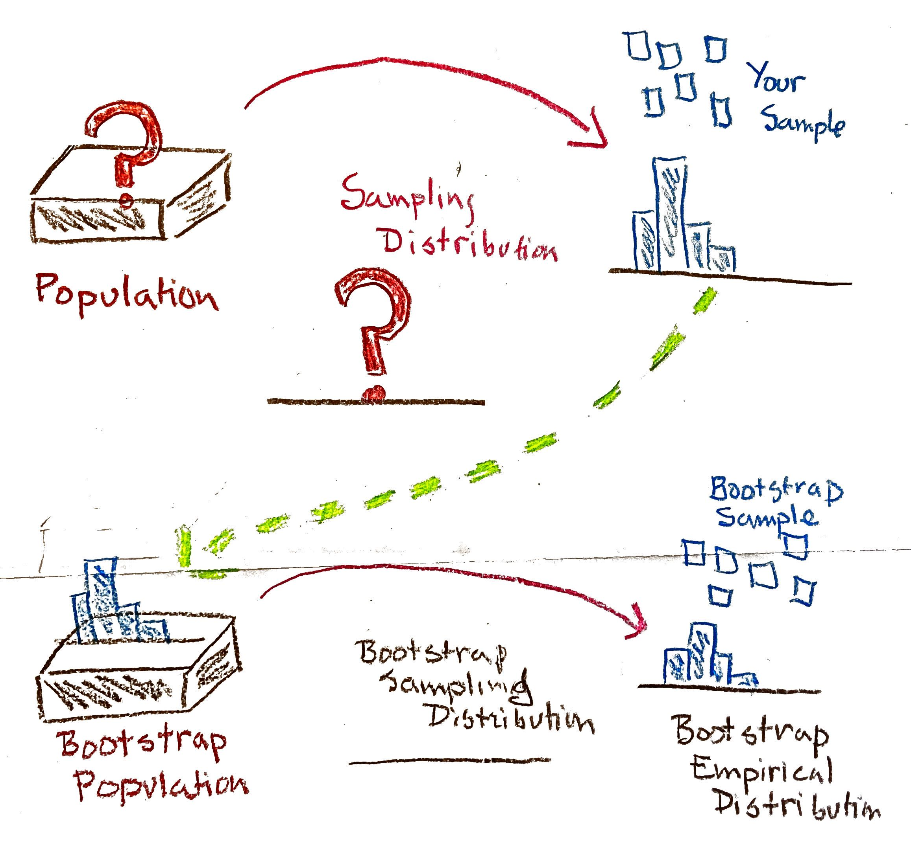
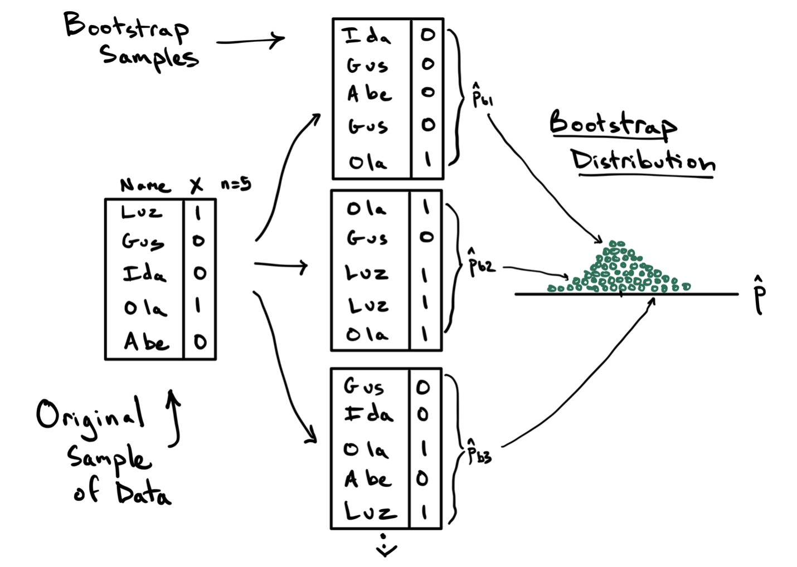
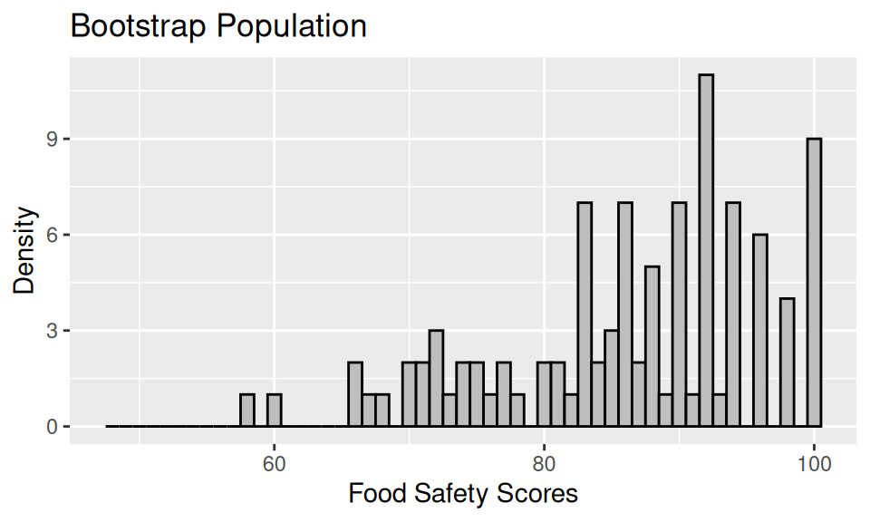
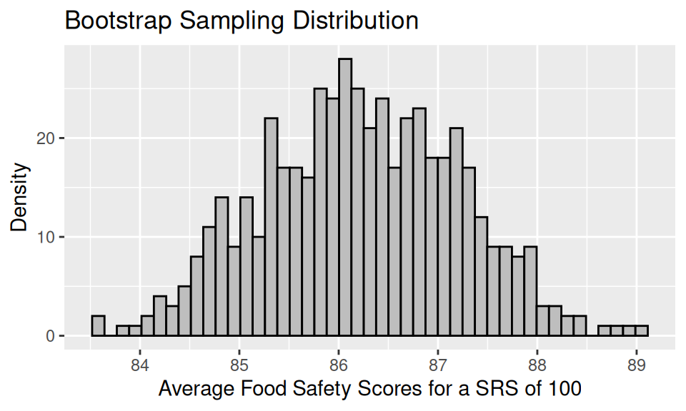
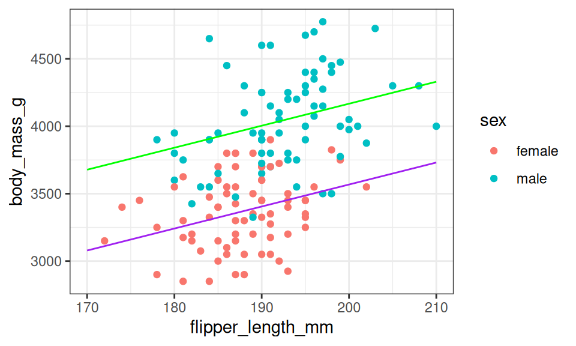

## Dẫn nhập: Giới hạn của Giải tích và Bước đột phá của Máy tính

Các khoảng tin cậy mà chúng ta xây dựng trong các bài học trước đều dựa trên một trụ cột toán học vững chắc: **Định lý Giới hạn Trung tâm (CLT)**. Định lý này khẳng định rằng tổng và trung bình của các biến ngẫu nhiên độc lập cùng phân phối sẽ hội tụ về phân phối chuẩn khi kích thước mẫu $n$ đủ lớn.

Nhờ có Định lý Giới hạn Trung tâm, ta có thể tự tin áp dụng phân phối chuẩn Gauss để xấp xỉ phân phối chọn mẫu cho các đại lượng thống kê quen thuộc: Trung bình mẫu $\bar{x}$, tỉ lệ mẫu $\hat{p}$, hiệu hai trung bình $\bar{x}_1 - \bar{x}_2$, hoặc hiệu hai tỉ lệ $\hat{p}_1 - \hat{p}_2$.

Tuy nhiên, trong thực tế nghiên cứu khoa học và kinh doanh, chúng ta thường xuyên đối mặt với những câu hỏi hóc búa vượt ngoài tầm với của Định lý Giới hạn Trung tâm:
- Điều gì sẽ xảy ra nếu đại lượng thống kê ta cần khảo sát **không thể biểu diễn dưới dạng tổng các biến ngẫu nhiên**? Chẳng hạn như trung vị mẫu, phân vị thứ 90, tỉ số giữa hai phương sai, hệ số tương quan hạng, hay các tham số của một mô hình học máy phi tuyến phức tạp?
- Điều gì sẽ xảy ra nếu **kích thước mẫu $n$ quá nhỏ** hoặc phân phối tổng thể bị lệch cực đoan khiến xấp xỉ chuẩn tắc không còn đáng tin cậy?

Trước kỷ nguyên bùng nổ của máy tính điện tử, các nhà thống kê gần như bất lực trước những tình huống này, hoặc buộc phải đặt ra các giả thiết phân phối lý thuyết hết sức khắt khe (chẳng hạn như giả định tổng thể tuân theo phân phối chuẩn hoàn hảo).

Đến năm 1979, nhà thống kê học lỗi lạc **Bradley Efron** tại Đại học Stanford đã đề xuất một phương pháp tính toán mang tính cách mạng: **Phương pháp Bootstrapping (Tái lấy mẫu)**. Phương pháp này tận dụng sức mạnh tính toán của máy tính để định lượng sai số chọn mẫu mà không cần phụ thuộc vào bất kỳ công thức giải tích phức tạp hay giả định phân phối nghiêm ngặt nào.

  

<em>Hình 17.1: Nguyên lý Bootstrapping: Mẫu dữ liệu ban đầu đóng vai trò làm 'tổng thể Bootstrap' để mô phỏng phân phối chọn mẫu.</em>

---

## Bản chất của Phương pháp Bootstrapping

Tên gọi **Bootstrap** bắt nguồn từ thành ngữ dân gian tiếng Anh: *"To pull yourself up by your own bootstraps"* (tự nhấc mình lên bằng chính quai giày của mình). Thành ngữ này hàm ý một hành động dường như bất khả thi: Tự lực cánh sinh để vươn lên mà không cần sự trợ giúp từ bên ngoài.

Trong thống kê, thành ngữ này phản ánh bản chất kỳ diệu của phương pháp: Dù trong thực tế chúng ta chỉ thu thập được duy nhất một mẫu quan sát từ tổng thể, phương pháp Bootstrap cho phép chúng ta dùng chính mẫu đơn lẻ đó để tạo ra vô số mẫu mới thông qua kỹ thuật **tái lấy mẫu có hoàn lại (resampling with replacement)**!

Trực giác triết học đằng sau phương pháp Bootstrap:
1. Nếu mẫu ban đầu được thu thập bằng phương pháp ngẫu nhiên không thiên lệch (chẳng hạn SRS), thì **phân phối thực nghiệm của mẫu chính là bản sao thu nhỏ tốt nhất** của phân phối tổng thể mà ta có thể tiếp cận được.
2. Vì ta không thể quay lại tổng thể thực để lấy thêm nhiều mẫu mới, ta thay thế thao tác đó bằng việc **lấy các mẫu mới từ chính phân phối thực nghiệm của mẫu ban đầu**!

---

## Thuật toán Tái lấy mẫu Bootstrap (The Bootstrap Algorithm)

::: info Thuật toán: Quy trình Tái lấy mẫu Bootstrap
Để ước lượng sai số chuẩn và xây dựng khoảng tin cậy cho một thống kê mẫu $\hat{\theta}$:
1. **Bước 1 (Thiết lập tổng thể Bootstrap)**: Coi mẫu dữ liệu ban đầu gồm $n$ quan sát như một chiếc hộp chứa đúng $n$ tấm vé, đại diện cho "tổng thể Bootstrap".
2. **Bước 2 (Rút mẫu Bootstrap)**: Rút ngẫu nhiên một mẫu mới có kích thước **đúng bằng $n$** từ tổng thể Bootstrap theo phương thức **có hoàn lại (with replacement)**. Mẫu này được gọi là một **mẫu Bootstrap (resample)**.
3. **Bước 3 (Tính thống kê Bootstrap)**: Tính toán giá trị của đại lượng thống kê quan tâm trên mẫu Bootstrap vừa rút được, ký hiệu là $\hat{\theta}^*$.
4. **Bước 4 (Lặp lại mô phỏng)**: Lặp lại Bước 2 và Bước 3 một số lượng lớn lần (thường từ $B = 500$ đến $B = 10{,}000$ lần) để thu được tập hợp $B$ giá trị thống kê: $\hat{\theta}^*_1, \hat{\theta}^*_2, \dots, \hat{\theta}^*_B$.
5. **Bước 5 (Xây dựng phân phối Bootstrap)**: Tập hợp các giá trị $\hat{\theta}^*$ tạo thành **phân phối chọn mẫu Bootstrap (Bootstrap Sampling Distribution)**.
:::

### Minh họa trực quan qua bài toán 5 chú chim cánh cụt

Để nắm bắt cơ chế vận hành của việc rút thăm có hoàn lại, hãy xét một ví dụ minh họa đơn giản với mẫu ban đầu gồm $n = 5$ chú chim cánh cụt được ghi nhận loài và biến nhị phân $X \in \{0, 1\}$ (với tỉ lệ mẫu ban đầu $\hat{p} = 2/5 = 0.4$):

  

<em>Hình 17.2: Cơ chế tái lấy mẫu có hoàn lại trên mẫu $n = 5$ chú chim cánh cụt.</em>

Quan sát kỹ Bước 2 trong Hình 17.2:
- Ở mẫu Bootstrap thứ nhất, ta rút được: `Ida, Gus, Abe, Gus, Ola`.
- Điểm đặc trưng cốt tử của việc rút thăm có hoàn lại: Một cá thể có thể được chọn nhiều lần (`Gus` xuất hiện 2 lần), trong khi một số cá thể khác có thể hoàn toàn không được chọn (`Luz` vắng mặt).
- Nhờ có cơ chế hoàn lại, mẫu Bootstrap mới có cơ hội tạo ra tổ hợp dữ liệu khác biệt so với mẫu gốc, từ đó tạo ra giá trị thống kê Bootstrap mới $\hat{p}^*_1 = 1/5 = 0.2$.

*(Lưu ý sư phạm: Mẫu $n = 5$ ở đây chỉ dùng để minh họa cơ chế, trong khi ở ứng dụng thực tế, cỡ mẫu phải đủ lớn thì mẫu mới mang tính đại diện cho tổng thể).*

---

## Khoảng tin cậy Bootstrap theo Phương pháp Phân vị (Percentile Method)

Sau khi thu được phân phối chọn mẫu Bootstrap gồm $B$ giá trị thống kê, làm thế nào để xây dựng khoảng tin cậy cho tham số tổng thể?

Cách tiếp cận tự nhiên và trực quan nhất là **Phương pháp phân vị (Percentile Bootstrap Confidence Interval)**:

::: info Công thức: Khoảng tin cậy Bootstrap Phân vị
Khoảng tin cậy $(1 - \alpha) \times 100\%$ theo phương pháp phân vị chính là khoảng chứa đúng $(1 - \alpha) \times 100\%$ khối lượng giá trị nằm ở chính giữa của phân phối Bootstrap:
$$
\text{CI}_{(1 - \alpha)} = \left[ q_{\alpha / 2}, \; q_{1 - \alpha / 2} \right]
$$
Trong đó $q_p$ là phân vị mức $p$ (quantile) của phân phối Bootstrap.
:::

Cụ thể, đối với **khoảng tin cậy 95%** ($\alpha = 0.05$):
- **Cận dưới**: Là phân vị thứ $2.5\%$ (quantile $0.025$) của phân phối Bootstrap.
- **Cận trên**: Là phân vị thứ $97.5\%$ (quantile $0.975$) của phân phối Bootstrap.

Ưu điểm tuyệt đối của phương pháp phân vị:
- Hoàn toàn không cần công thức giải tích tính sai số chuẩn.
- Không cần giả định phân phối có dạng đối xứng hay dạng chuông chuẩn tắc, do đó nếu phân phối Bootstrap bị lệch, khoảng tin cậy sẽ tự động thích ứng và bị lệch theo một cách tự nhiên.

---

## Nghiên cứu điển hình 1: Điểm an toàn thực phẩm tại San Francisco

Hãy áp dụng thuật toán Bootstrap vào bộ dữ liệu điểm an toàn thực phẩm của các nhà hàng San Francisco mà chúng ta đã làm quen ở bài học trước.

Mẫu ban đầu gồm $n = 100$ nhà hàng có trung bình mẫu $\bar{x} = 86.27$ và độ lệch chuẩn mẫu $s = 9.9$. Ta coi 100 con số này là tổng thể Bootstrap. Tiến hành rút mẫu $n = 100$ có hoàn lại và lặp lại $B = 500$ lần, ta thu được phân phối Bootstrap của các giá trị trung bình mẫu:

  

<em>Hình 17.3: Phân phối chọn mẫu Bootstrap của 500 giá trị trung bình mẫu từ bộ dữ liệu nhà hàng San Francisco.</em>

So sánh phân phối Bootstrap này với phân phối chọn mẫu lý thuyết:
1. **Hình dạng**: Phân phối Bootstrap phản ánh chân thực hình dạng quả chuông của phân phối chọn mẫu thực sự.
2. **Tâm đối xứng**: Tâm của phân phối Bootstrap nằm tại $86.23$, gần như trùng khít với trung bình mẫu ban đầu ($86.27$). Cần lưu ý rằng nó tập trung quanh $\bar{x}$, chứ không tập trung quanh tham số thực của tổng thể ($\mu = 87.6$).
3. **Độ phân tán (Sai số chuẩn)**: Độ lệch chuẩn của 500 giá trị Bootstrap là $\text{SE}_{\text{boot}} = 0.99$. Con số này trùng khớp hoàn hảo với công thức giải tích $\frac{s}{\sqrt{n}} = \frac{9.9}{\sqrt{100}} = 0.99$!

Tìm hai phân vị $2.5\%$ và $97.5\%$ của phân phối Bootstrap, ta thu được khoảng tin cậy 95%:

$$
\text{CI}_{95\%} = [84.4, \; 88.0]
$$

Khi đối chiếu khoảng này với khoảng tin cậy tính bằng phân phối chuẩn ở bài học trước ($[84.3, 88.2]$), hai khoảng gần như trùng khớp hoàn toàn. Điều này khẳng định rằng khi cỡ mẫu đủ lớn ($n = 100$), phương pháp Bootstrap và phương pháp xấp xỉ chuẩn tắc dẫn tới cùng một kết luận suy diễn nhất quán.

---

## Nghiên cứu điển hình 2: Hệ số hồi quy khối lượng chim cánh cụt Adelie

Sức mạnh thực sự của Bootstrapping bộc lộ rực rỡ nhất khi ta cần xây dựng khoảng tin cậy cho các mô hình phức tạp mà công thức giải tích cổ điển rất khó thiết lập hoặc đòi hỏi nhiều giả định phi thực tế.

Xét bài toán nghiên cứu sinh thái học: Các nhà nghiên cứu muốn dự báo khối lượng cơ thể ($Y$, tính bằng gam) của loài chim cánh cụt Adelie dựa trên giới tính ($X_1$) và chiều dài cánh ($X_2$, tính bằng mm).

Khớp mô hình hồi quy tuyến tính trên mẫu gồm $n = 146$ chú chim cánh cụt Adelie:

$$
\widehat{\text{body\_mass}} = 305.09 + 599.34 \cdot \text{sexmale} + 16.31 \cdot \text{flipper\_length}
$$

  

<em>Hình 17.4: Mối quan hệ giữa chiều dài cánh và khối lượng cơ thể của chim cánh cụt Adelie được phân tách bởi hai đường hồi quy song song theo giới tính.</em>

Hệ số hồi quy ước lượng của chiều dài cánh là $\hat{\beta}_{\text{flipper}} = 16.31$. Con số này cho biết: Trong cùng một giới tính, cứ mỗi milimét cánh dài thêm thì khối lượng cơ thể của chim cánh cụt tăng trung bình khoảng $16.31$ gam.

Một câu hỏi cốt tử: Giá trị $16.31$ này có thực sự phản ánh mối quan hệ sinh học thực sự trong toàn bộ quần thể chim cánh cụt Adelie tại Nam Cực hay chỉ là ngẫu nhiên do chọn mẫu? Nếu khoảng tin cậy của hệ số này chứa số $0$, ta không thể bác bỏ khả năng chiều dài cánh thực chất không có liên hệ với khối lượng cơ thể khi đã kiểm soát giới tính.

### Áp dụng Bootstrap cho Mô hình Hồi quy

Ta thực hiện thuật toán Bootstrap trên các dòng dữ liệu:
1. Tổng thể Bootstrap gồm $146$ dòng dữ liệu đầy đủ của các cá thể chim cánh cụt.
2. Mỗi lần rút mẫu, ta bốc ngẫu nhiên **nguyên cả dòng dữ liệu** (gồm cả khối lượng, chiều dài cánh và giới tính) có hoàn lại để tạo thành một mẫu mới gồm 146 dòng.
3. Trên mẫu Bootstrap này, ta khớp lại mô hình hồi quy tuyến tính bội và trích xuất hệ số góc của biến chiều dài cánh $\hat{\beta}^*_{\text{flipper}}$.
4. Lặp lại quy trình $B = 500$ lần.

  

<em>Hình 17.5: Phân phối Bootstrap của hệ số hồi quy chiều dài cánh qua 500 lần tái lấy mẫu.</em>

Từ phân phối Bootstrap ở Hình 17.5, ta trích xuất phân vị thứ $0.5\%$ và phân vị thứ $99.5\%$ để xây dựng **khoảng tin cậy 99%**:

$$
\text{CI}_{99\%} = [8.04, \; 26.82]
$$

Khoảng tin cậy $99\%$ kéo dài từ $8.04$ đến $26.82$ gam/mm và **hoàn toàn không chứa số 0**. Kết quả này cung cấp bằng chứng thống kê vững chắc rằng chiều dài cánh thực sự có quan hệ tương quan đồng biến chặt chẽ với khối lượng cơ thể của chim cánh cụt Adelie.

---

## Những giới hạn và Cảnh báo quan trọng khi dùng Bootstrap

Mặc dù Bootstrapping là một công cụ cực kỳ linh hoạt và mạnh mẽ, nó **không phải là phương thuốc vạn năng**. Người làm thống kê cần nắm vững bốn giới hạn cốt tử:

::: warning Bốn cạm bẫy cần tránh khi sử dụng Bootstrapping
1. **Bootstrap không thể cứu vãn một mẫu bị thiên lệch (Selection Bias)**:
   Nếu mẫu ban đầu là mẫu thuận tiện hoặc bị sai lệch có hệ thống, "tổng thể Bootstrap" cũng sẽ bị sai lệch tương ứng. Tái lấy mẫu hàng triệu lần từ một mẫu méo mó sẽ chỉ tạo ra một phân phối Bootstrap hội tụ quanh một giá trị sai lệch.
2. **Cỡ mẫu ban đầu phải đủ lớn**:
   Nếu cỡ mẫu ban đầu quá nhỏ (chẳng hạn $n = 5$ hay $n = 8$), mẫu không thể bao quát các đặc trưng cơ bản của tổng thể. Phân phối Bootstrap thu được sẽ rất nghèo nàn và không phản ánh đúng sai số thực tế.
3. **Thống kê bị chi phối bởi ngoại lai hoặc giá trị cực trị**:
   Bootstrapping hoạt động kém hiệu quả đối với các đại lượng thống kê nhạy cảm cao với điểm biên như giá trị cực đại $\max$, cực tiểu $\min$, hoặc dữ liệu có phân phối đuôi dày cực đoan.
4. **Quy trình tái lấy mẫu phải bảo toàn cấu trúc dữ liệu**:
   Khi làm việc với dữ liệu đa biến hoặc dữ liệu không gian/thời gian, ta phải tái lấy mẫu nguyên cả quan sát (toàn bộ dòng trong bảng dữ liệu), tuyệt đối không được tráo đổi ngẫu nhiên từng cột riêng lẻ làm phá vỡ tương quan giữa các biến.
:::

Về số lượng lần tái lấy mẫu: Trong thực hành nghiên cứu chuyên sâu, quy tắc chung là thực hiện từ $B = 10{,}000$ lần trở lên để các giá trị phân vị ở đuôi đạt độ ổn định cao.

---

## Tóm tắt kiến thức cốt lõi

1. **Ý tưởng cốt lõi**: Phân phối thực nghiệm của mẫu đại diện đóng vai trò xấp xỉ phân phối tổng thể, trong khi việc tái lấy mẫu có hoàn lại từ mẫu đóng vai trò mô phỏng việc lấy mẫu từ tổng thể.
2. **Quy tắc tái lấy mẫu**: Mẫu Bootstrap bắt buộc phải được rút **có hoàn lại** và **có cùng kích thước $n$** với mẫu dữ liệu ban đầu.
3. **Phương pháp phân vị**: Khoảng tin cậy $95\%$ Bootstrap được thiết lập trực tiếp bằng hai phân vị $2.5\%$ và $97.5\%$ của phân phối các thống kê Bootstrap.
4. **Ứng dụng vượt trội**: Áp dụng hiệu quả cho các đại lượng thống kê phức tạp (hệ số hồi quy, trung vị, tỉ số) mà không đòi hỏi giả thiết phân phối chuẩn.

## Bài tập rèn luyện

::: info Bài tập 1: Nhận diện Mẫu Bootstrap Hợp lệ
Xét một mẫu dữ liệu ban đầu gồm $n = 5$ cá thể chim cánh cụt với các thông tin được ghi nhận như sau:

| Mã cá thể | Tên gọi | Loài (Species) | Chiều dài cánh (mm) |
| :---: | :--- | :--- | :---: |
| 1 | Gus | Chinstrap | 50.7 |
| 2 | Luz | Gentoo | 48.5 |
| 3 | Ida | Chinstrap | 52.8 |
| 4 | Ola | Gentoo | 44.5 |
| 5 | Abe | Adelie | 42.0 |

Hãy phân tích và đánh giá xem các mẫu đề xuất dưới đây, mẫu nào là **mẫu Bootstrap hợp lệ** được rút từ mẫu ban đầu trên:

- **Mẫu A**: `Ida` (Chinstrap, 52.8), `Luz` (Gentoo, 48.5), `Abe` (Adelie, 42.0), `Ola` (Gentoo, 44.5), `Ida` (Chinstrap, 52.8).
- **Mẫu B**: `Ola` (Gentoo, 44.5), `Gus` (Chinstrap, 50.7), `Ida` (Chinstrap, 52.8), `Luz` (Gentoo, 48.5), `Gus` (Chinstrap, 50.7), `Gus` (Chinstrap, 50.7).
- **Mẫu C**: `Gus` (Chinstrap, 50.7), `Ola` (Gentoo, 48.5), `Ola` (Chinstrap, 52.8), `Ida` (Gentoo, 44.5), `Ida` (Adelie, 42.0).
- **Mẫu D**: `Gus` (Chinstrap, 50.7), `Abe` (Adelie, 42.0), `Gus` (Chinstrap, 50.7), `Gus` (Chinstrap, 50.7), `Gus` (Chinstrap, 50.7).
:::

::: details Lời giải chi tiết
Để một mẫu được coi là mẫu Bootstrap hợp lệ từ mẫu dữ liệu ban đầu gồm $n$ quan sát, nó phải thỏa mãn đồng thời ba điều kiện:
1. Kích thước mẫu phải **đúng bằng kích thước ban đầu**: $n_{\text{boot}} = n = 5$.
2. Mỗi quan sát trong mẫu phải là **một dòng dữ liệu nguyên vẹn** xuất hiện trong mẫu gốc (các biến đi cùng nhau không bị xáo trộn).
3. Được rút theo phương thức **có hoàn lại**, tức là một dòng có thể lặp lại nhiều lần hoặc vắng mặt.

**Đánh giá từng mẫu:**
- **Mẫu A**:
  - Kích thước: Gồm đúng 5 quan sát.
  - Mỗi dòng là một quan sát nguyên vẹn từ bảng gốc: `Ida` (lặp lại 2 lần), `Luz`, `Abe`, `Ola`. `Gus` vắng mặt.
  - $\implies$ **Mẫu A là mẫu Bootstrap hoàn toàn hợp lệ**.

- **Mẫu B**:
  - Kích thước: Gồm 6 quan sát ($n = 6 \ne 5$). Vi phạm điều kiện kích thước mẫu.
  - $\implies$ **Mẫu B không hợp lệ**.

- **Mẫu C**:
  - Kích thước: Gồm 5 quan sát.
  - Tuy nhiên, quan sát dòng 2 ghi `Ola` nhưng chiều dài cánh lại là $48.5$ (chiều dài của `Luz`), dòng 3 ghi `Ola` với loài `Chinstrap` (loài gốc là `Gentoo`). Mẫu này đã tráo đổi ngẫu nhiên các cột thay vì rút nguyên dòng dữ liệu.
  - $\implies$ **Mẫu C không hợp lệ**.

- **Mẫu D**:
  - Kích thước: Gồm đúng 5 quan sát.
  - Mọi dòng đều nguyên vẹn từ bảng gốc: `Gus` (xuất hiện 4 lần) và `Abe` (xuất hiện 1 lần).
  - Mặc dù đây là một kết cục rút thăm ít có khả năng xảy ra trong thực tế, về mặt lý thuyết xác suất rút thăm có hoàn lại, việc một phần tử được bốc 4 lần vẫn là hoàn toàn hợp lệ.
  - $\implies$ **Mẫu D về mặt nguyên tắc toán học là một mẫu Bootstrap hợp lệ** (nhưng trong thực hành ta ưu tiên Mẫu A vì đại diện cho các lần rút thông thường).
:::

---

::: info Bài tập 2: Xác định Phân vị cho các Mức độ Tin cậy
Một nhà phân tích dữ liệu thực hiện thuật toán Bootstrap trên một mẫu quan sát và tạo ra $B = 1{,}000$ mẫu tái lấy mẫu. Trên mỗi mẫu, nhà phân tích tính toán giá trị trung vị mẫu $\text{median}^*$, sau đó sắp xếp $1{,}000$ giá trị trung vị này theo thứ tự tăng dần từ nhỏ nhất đến lớn nhất:

$$
\text{median}^*_{(1)} \le \text{median}^*_{(2)} \le \dots \le \text{median}^*_{(1000)}
$$

1. Để xây dựng khoảng tin cậy 90% theo phương pháp phân vị, nhà phân tích cần chọn các giá trị tại vị trí thứ mấy trong danh sách đã sắp xếp?
2. Để xây dựng khoảng tin cậy 95% theo phương pháp phân vị, các vị trí tương ứng là bao nhiêu?
3. Nếu tăng số lần tái lấy mẫu lên $B = 10{,}000$ lần, vị trí cận dưới và cận trên của khoảng tin cậy 95% sẽ thay đổi như thế nào?
:::

::: details Lời giải chi tiết
**1. Khoảng tin cậy 90% với $B = 1{,}000$:**
Mức độ tin cậy $90\%$ tương ứng với $\alpha = 0.10$.
Ta cần loại bỏ $5\%$ khối lượng giá trị ở mỗi đầu đuôi:
- Phân vị cận dưới: $q_{0.05} \implies$ Vị trí trong danh sách: $1{,}000 \times 0.05 = 50$.
- Phân vị cận trên: $q_{0.95} \implies$ Vị trí trong danh sách: $1{,}000 \times 0.95 = 950$.
Khoảng tin cậy 90% là $\left[ \text{median}^*_{(50)}, \; \text{median}^*_{(950)} \right]$.

**2. Khoảng tin cậy 95% với $B = 1{,}000$:**
Mức độ tin cậy $95\%$ tương ứng với $\alpha = 0.05$.
Ta loại bỏ $2.5\%$ khối lượng giá trị ở mỗi đầu đuôi:
- Phân vị cận dưới: $q_{0.025} \implies$ Vị trí: $1{,}000 \times 0.025 = 25$.
- Phân vị cận trên: $q_{0.975} \implies$ Vị trí: $1{,}000 \times 0.975 = 975$.
Khoảng tin cậy 95% là $\left[ \text{median}^*_{(25)}, \; \text{median}^*_{(975)} \right]$.

**3. Khi tăng lên $B = 10{,}000$ lần tái lấy mẫu:**
Khi $B = 10{,}000$:
- Cận dưới mức $2.5\%$: $10{,}000 \times 0.025 = 250$.
- Cận trên mức $97.5\%$: $10{,}000 \times 0.975 = 9{,}750$.
Khoảng tin cậy 95% sẽ được xác định bởi $\left[ \text{median}^*_{(250)}, \; \text{median}^*_{(9750)} \right]$. Việc tăng $B$ lên 10,000 giúp các điểm phân vị này có độ ổn định số học cao hơn, giảm bớt sai số ngẫu nhiên của mô phỏng máy tính.
:::

---

::: info Bài tập 3: Tâm của Phân phối Bootstrap và Bản chất của Ước lượng
Một sinh viên sau khi chạy mô phỏng Bootstrap 500 lần từ một mẫu $n = 100$ quan sát nhận thấy rằng: Tâm của phân phối Bootstrap nằm tại giá trị $\bar{x} = 86.23$, trong khi tham số trung bình thực sự của tổng thể là $\mu = 87.60$. Sinh viên này thắc mắc: *"Tại sao phương pháp Bootstrap lại không thể định tâm phân phối quanh tham số thực của tổng thể $\mu$?"*

1. Hãy giải thích tại sao tâm của phân phối Bootstrap luôn tập trung quanh giá trị thống kê mẫu gốc $\hat{\theta}$ mà không tập trung quanh tham số tổng thể $\mu$.
2. Nếu tâm của phân phối Bootstrap không tập trung quanh $\mu$, thì phân phối Bootstrap cung cấp thông tin quý giá nào cho nhà nghiên cứu?
3. Điều gì sẽ xảy ra với phân phối Bootstrap nếu mẫu ban đầu là một mẫu bị thiên lệch nghiêm trọng (Selection Bias)?
:::

::: details Lời giải chi tiết
**1. Lý do tâm của phân phối Bootstrap tập trung quanh $\hat{\theta}$:**
- Trong thuật toán Bootstrap, "tổng thể" mà máy tính thực hiện rút thăm chính là mẫu dữ liệu ban đầu (gồm $n$ quan sát).
- Theo tính chất của phép lấy mẫu ngẫu nhiên có hoàn lại từ một tập hợp gồm $n$ giá trị cố định, giá trị kỳ vọng của một lần rút đơn lẻ bằng đúng trung bình cộng của $n$ giá trị đó ($\bar{x}$).
- Do đó, giá trị kỳ vọng của trung bình các mẫu tái lấy mẫu phải hội tụ về chính giá trị thống kê của mẫu ban đầu: $E(\bar{X}^*) = \bar{x}$.
- Máy tính hoàn toàn không được tiếp cận với tổng thể thực tế bên ngoài, do đó nó không thể biết $\mu$ ở đâu để định tâm phân phối quanh $\mu$.

**2. Giá trị then chốt mà phân phối Bootstrap mang lại:**
- Mục đích tối thượng của phương pháp Bootstrap không phải là tìm ra vị trí chính xác của tham số $\mu$ (vị trí này đã được ước lượng điểm bởi $\hat{\theta}$).
- Mục đích của Bootstrap là **mô phỏng hình dạng và độ phân tán (biến thiên lấy mẫu)** của quá trình chọn mẫu. Nó trả lời câu hỏi: *"Nếu quy trình lấy mẫu được lặp lại, thống kê mẫu sẽ dao động quanh tâm của nó với biên độ bao nhiêu (SE bằng bao nhiêu)?"*.
- Bằng cách đo lường độ phân tán quanh $\hat{\theta}$, ta xây dựng được độ rộng chuẩn xác cho khoảng tin cậy bao quanh tham số $\mu$.

**3. Hậu quả khi mẫu ban đầu bị thiên lệch:**
- Nếu mẫu ban đầu bị thiên lệch (Selection Bias), chẳng hạn $\bar{x}$ bị lệch xa khỏi $\mu$, thì tổng thể Bootstrap sẽ là một bản sao sai lệch của thế giới thực.
- Phân phối Bootstrap thu được sẽ tập trung chụm quanh giá trị sai lệch đó. Toàn bộ khoảng tin cậy Bootstrap sẽ bị dịch chuyển lệch hẳn khỏi tham số thực $\mu$.
- Điều này chứng minh rằng: **Bootstrapping chỉ định lượng được sai số do biến thiên chọn mẫu (Sampling Variability), hoàn toàn không thể phát hiện hay sửa chữa sai số do độ lệch hệ thống (Bias)**.
:::

## Tài liệu tham khảo

- UC Berkeley STAT 20: *Introduction to Probability and Statistics*, Department of Statistics, UC Berkeley.
- Efron, B., & Tibshirani, R. J. (1994). *An Introduction to the Bootstrap*. CRC Press.

