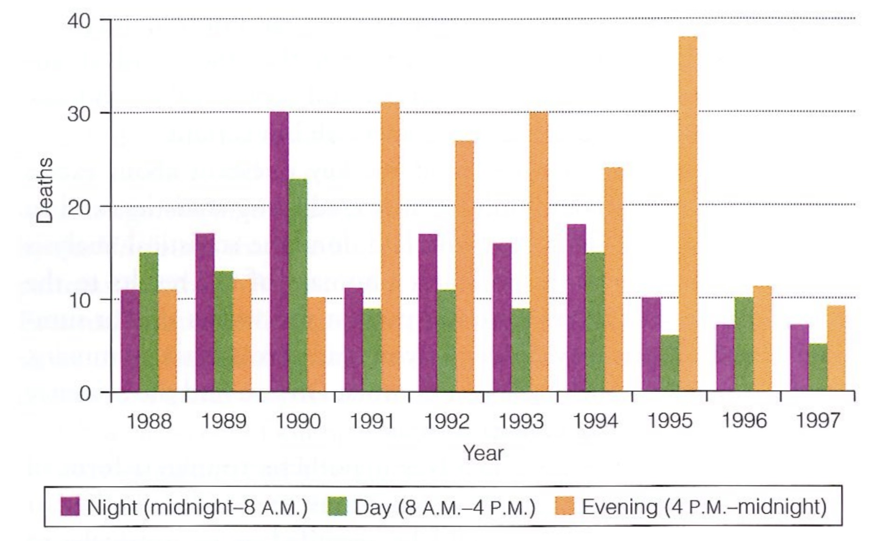
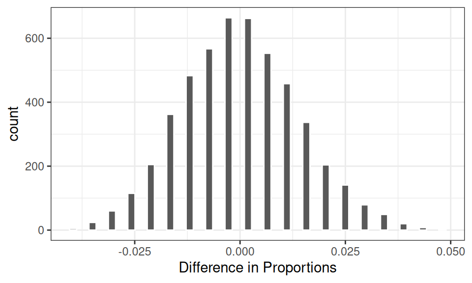
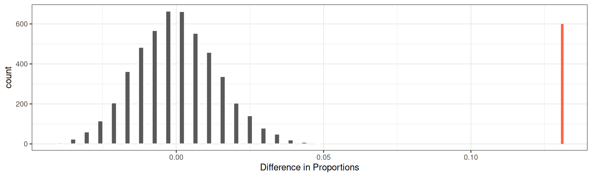

## Dẫn nhập: Hai phương thức Suy diễn Thống kê

Trong thống kê cổ điển, có hai phương thức căn bản để sử dụng một mẫu dữ liệu nhằm suy rộng về một quy luật tổng quát của thế giới thực:
1. **Khoảng tin cậy (Confidence Interval)**: Đóng vai trò định lượng mức độ bất định xung quanh ước lượng điểm của một tham số tổng thể chưa biết (chẳng hạn: Tham số $\mu$ nằm trong khoảng nào với độ tin cậy $95\%$).
2. **Kiểm định giả thuyết (Hypothesis Testing)**: Tiếp cận vấn đề theo một tư duy chủ động và mang tính tranh biện cao hơn: Ta đặt ra một **mô hình giả định cụ thể** về cơ chế sinh ra dữ liệu, sau đó đánh giá xem **dữ liệu thực tế quan sát được có tương thích với mô hình giả định đó hay không**.

Kiểm định giả thuyết là công cụ thống kê được sử dụng rộng rãi nhất trong khoa học tự nhiên, y sinh, kinh tế và khoa học xã hội. Tuy nhiên, logic lập luận của kiểm định giả thuyết thường mang tính gián tiếp và dễ gây hiểu lầm nếu người học không nắm vững bản chất triết học của nó.

Để khám phá logic của kiểm định giả thuyết, hãy cùng phân tích một vụ án hình sự nổi tiếng trong lịch sử tư pháp Hoa Kỳ, nơi các nhà thống kê học đóng vai trò nhân chứng quyết định.

---

## Vụ án pháp đình: Hoa Kỳ kiện Kristen Gilbert

Năm 1989, sau khi vừa tốt nghiệp trường điều dưỡng, Kristen Gilbert được nhận vào làm việc tại Trung tâm Y tế Cựu chiến binh (VA Medical Center) ở thành phố Northampton, bang Massachusetts. Trong những năm đầu công tác, Gilbert được các đồng nghiệp và cấp trên ngưỡng mộ nhờ sự tháo vát, vững vàng và tận tâm trong công việc.

  

<em>Hình 18.1: Bệnh viện Cựu chiến binh tại Northampton, Massachusetts.</em>

Kỹ năng chuyên môn của Gilbert đặc biệt bộc lộ rõ mỗi khi còi báo động "Code Blue" vang lên. Đây là tín hiệu cấp cứu khẩn cấp báo hiệu một bệnh nhân vừa rơi vào trạng thái ngừng tim đột ngột và cần được tiêm ngay một liều epinephrine để kích thích tim đập trở lại. Gilbert nổi tiếng trong bệnh viện vì sự bình tĩnh phi thường và đôi bàn tay vững vàng khi ứng phó với các tình huống sinh tử này.

Tuy nhiên, đến giữa thập niên 1990, các y tá khác trong khoa bắt đầu nhận thấy những dấu hiệu bất thường. Dường như có quá nhiều ca báo động ngừng tim và quá nhiều bệnh nhân tử vong trùng khớp với các ca trực của Gilbert. Nghi ngờ ngày càng lớn dần, các nhân viên đã báo cáo lên ban giám đốc bệnh viện. Ban quản lý lập tức mời một nhóm các nhà thống kê học vào cuộc để phân tích dữ liệu lưu trữ của bệnh viện.

### Bức tranh dữ liệu ban đầu (Exploratory Data Analysis)

Dữ liệu do bệnh viện cung cấp ghi nhận số ca tử vong trong suốt 10 năm trước đó, được phân loại theo ba ca trực trong ngày: Ca sáng (daytime), ca chiều tối (evening) và ca đêm (night).

Các nhà thống kê đã trực quan hóa dữ liệu lịch sử này qua biểu đồ dưới đây:

  

<em>Hình 18.2: Biểu đồ số ca tử vong theo từng ca trực từ năm 1988 đến 1998.</em>

Biểu đồ bộc lộ một xu hướng chấn động:
- Trong giai đoạn từ năm 1990 đến 1995, số lượng bệnh nhân tử vong tăng vọt một cách bất thường so với giai đoạn trước đó và sau đó.
- Trong suốt giai đoạn tăng vọt này, phần lớn các ca tử vong tập trung áp đảo vào **ca chiều tối (evening shift)**.
- Ngoại lệ duy nhất là năm 1990, khi ca đêm lại có số người tử vong nhiều nhất.

Khi đối chiếu với hồ sơ phân công công tác của Gilbert:
- Gilbert bắt đầu làm việc tại khoa này vào tháng 3 năm 1990 và rời đi vào tháng 2 năm 1996.
- Ca làm việc cố định của Gilbert trong suốt thời gian đó chính là **ca chiều tối**.
- Ngoại lệ duy nhất: Đúng vào năm 1990, Gilbert được phân công làm việc ở **ca đêm**!

Sự trùng khớp này tạo nên một mối liên hệ chặt chẽ giữa sự hiện diện của Gilbert và sự gia tăng đột biến của các ca tử vong. Đây là bằng chứng đầu tiên được công tố viên đưa ra trước tòa. Tuy nhiên, trong một phiên tòa hình sự, trách nhiệm chứng minh là cực kỳ nghiêm ngặt: *"Liệu xu hướng này có thể chỉ là một sự trùng hợp ngẫu nhiên thuần túy hay không?"*

---

## Vai trò của Yếu tố Ngẫu nhiên và Phép thử Hoán vị

Hãy đặt mình vào vị trí của luật sư bào chữa và giả định rằng: Gilbert hoàn toàn vô tội, và các ca tử vong xảy ra trong bệnh viện hoàn toàn không liên quan gì đến việc Gilbert có mặt trong ca trực hay không.

Nếu giả định này là đúng, tỉ lệ các ca trực có bệnh nhân tử vong khi có mặt Gilbert và khi không có mặt Gilbert về nguyên tắc phải tương đương nhau. Dẫu vậy, ta không thể kỳ vọng hai tỉ lệ này bằng nhau một cách tuyệt đối. Do yếu tố may rủi ngẫu nhiên, tỉ lệ tử vong trong các ca của Gilbert hoàn toàn có thể nhỉnh hơn đôi chút.

Dữ liệu ghi nhận từ $1{,}641$ ca trực được tổng hợp như sau:

| Ca trực | Có tử vong | Không tử vong | Tổng số ca | Tỉ lệ tử vong |
| :--- | :---: | :---: | :---: | :---: |
| **Có mặt Gilbert** | $40$ | $217$ | $257$ | $\hat{p}_1 = \frac{40}{257} \approx 15.56\%$ |
| **Không có Gilbert** | $34$ | $1{,}350$ | $1{,}384$ | $\hat{p}_2 = \frac{34}{1384} \approx 2.46\%$ |
| **Tổng cộng** | $74$ | $1{,}567$ | $1{,}641$ | $\hat{p}_{\text{chung}} \approx 4.51\%$ |

Độ chênh lệch giữa hai tỉ lệ quan sát được:

$$
\hat{p}_1 - \hat{p}_2 = \frac{40}{257} - \frac{34}{1384} \approx 0.1556 - 0.0246 \approx 0.131 \quad (13.1\%)
$$

Chênh lệch $13.1\%$ là rất lớn. Nhưng làm thế nào để khẳng định chắc chắn rằng con số $13.1\%$ này nằm ngoài biên độ biến thiên ngẫu nhiên thông thường?

### Mô phỏng Thế giới Ngẫu nhiên bằng Phép Hoán vị (Permutation Test)

Để mô phỏng một thế giới mà trong đó việc bệnh nhân tử vong hoàn toàn độc lập với sự có mặt của Gilbert:
1. Ta giữ nguyên cột danh tính người trực của $1{,}641$ ca trực.
2. Ta **xáo trộn ngẫu nhiên (shuffle / permute)** các giá trị ở cột "Tử vong" (gồm 74 ca "Có" và 1,567 ca "Không") để bẻ gãy mọi mối liên hệ nhân quả hay tương quan thực sự giữa hai biến số.
3. Trên bảng dữ liệu đã xáo trộn ngẫu nhiên, ta tính lại độ chênh lệch tỉ lệ tử vong mới.
4. Lặp lại quy trình xáo trộn này $500$ lần trên máy tính để vẽ nên bức tranh phân phối của các giá trị chênh lệch có thể xảy ra do may rủi thuần túy:

  

<em>Hình 18.3: Phân phối của hiệu hai tỉ lệ qua 500 lần xáo trộn ngẫu nhiên (Null Distribution).</em>

Đúng như dự đoán về mặt lý thuyết, trong một thế giới mà tử vong độc lập với Gilbert:
- Tâm phân phối nằm chính xác tại $0$.
- Các giá trị dao động ngẫu nhiên quanh $0$, thỉnh thoảng đạt mức $\pm 0.01$ hay $\pm 0.02$, và rất hiếm khi vượt quá $\pm 0.03$.
- Trong toàn bộ $500$ lần mô phỏng, **không có bất kỳ lần nào** giá trị hiệu tỉ lệ vượt quá $\pm 0.06$.

Bây giờ, hãy đặt giá trị thực tế quan sát được ($0.131$) lên cùng đồ thị này:

  

<em>Hình 18.4: Giá trị quan sát được (đường thẳng đứng màu đỏ tại 0.131) nằm xa tít tắp bên ngoài phạm vi của biến thiên ngẫu nhiên.</em>

Giá trị quan sát được ($0.131$) lớn gấp hơn hai lần giá trị cực đoan nhất có thể sinh ra do ngẫu nhiên! Xác suất để một sự chênh lệch lớn như vậy xuất hiện do ngẫu nhiên thuần túy là **bằng 0**.

Các nhà thống kê khẳng định trước tòa: **Có thể loại trừ hoàn toàn yếu tố may rủi ngẫu nhiên như một lời giải thích cho sự gia tăng các ca tử vong**. Một cơ chế phi ngẫu nhiên nào đó chắc chắn đã diễn ra.

---

## Bốn thành phần cốt lõi của một Kiểm định Giả thuyết

Toàn bộ quy trình suy luận chặt chẽ trong vụ án Kristen Gilbert chính là biểu hiện mẫu mực của một **Kiểm định giả thuyết thống kê (Hypothesis Test)**. Mọi bài toán kiểm định giả thuyết đều được cấu thành từ bốn thành phần sau:

### 1. Giả thuyết Không ($H_0$ - Null Hypothesis)

::: info Định nghĩa: Giả thuyết Không ($H_0$)
**Giả thuyết không ($H_0$)** là phát biểu khẳng định rằng: "Không có hiệu ứng đặc biệt nào xảy ra", sự khác biệt hay mối liên hệ quan sát được chỉ là kết quả của sự biến thiên ngẫu nhiên thông thường (business as usual).
:::

Giả thuyết không luôn được phát biểu dưới dạng các **tham số tổng thể** (chữ cái Hy Lạp hoặc ký hiệu tham số $p, \mu$), tuyệt đối không phát biểu bằng các đại lượng thống kê mẫu ($\hat{p}, \bar{x}$).

Trong vụ án Gilbert:
$$
H_0: p_{\text{gilbert}} = p_{\text{no\_gilbert}} \quad \iff \quad H_0: p_{\text{gilbert}} - p_{\text{no\_gilbert}} = 0
$$

### 2. Giả thuyết Đối ($H_A$ hoặc $H_1$ - Alternative Hypothesis)

::: info Định nghĩa: Giả thuyết Đối ($H_A$)
**Giả thuyết đối ($H_A$)** là phát biểu khẳng định rằng: Có một cơ chế thực sự (phi ngẫu nhiên) sinh ra dữ liệu, mâu thuẫn với giả thuyết không.
:::

Trong vụ án Gilbert:
$$
H_A: p_{\text{gilbert}} > p_{\text{no\_gilbert}} \quad \iff \quad H_A: p_{\text{gilbert}} - p_{\text{no\_gilbert}} > 0
$$

### 3. Đại lượng Thống kê Kiểm định (Test Statistic)

::: info Định nghĩa: Thống kê Kiểm định (Test Statistic)
**Thống kê kiểm định** là một con số tóm tắt tính toán từ dữ liệu mẫu, có khả năng phân định rõ ràng giữa giả thuyết không và giả thuyết đối. Dưới giả định $H_0$ đúng, thống kê này tuân theo một phân phối xác suất xác định (gọi là **Phân phối dưới giả thuyết không - Null Distribution**).
:::

Trong vụ án Gilbert, thống kê kiểm định là hiệu hai tỉ lệ mẫu:
$$
\text{Thống kê quan sát} = \hat{p}_{\text{gilbert}} - \hat{p}_{\text{no\_gilbert}} = 0.131
$$

### 4. Giá trị $p$-value

::: info Định nghĩa chuẩn xác: Giá trị $p$-value
**$p$-value** là xác suất để quan sát được một giá trị thống kê kiểm định cực đoan bằng hoặc hơn giá trị thực tế quan sát được từ dữ liệu mẫu, **dưới điều kiện giả định rằng giả thuyết không $H_0$ là đúng**:
$$
p\text{-value} = P\left(\text{Thống kê kiểm định} \ge \text{Giá trị quan sát} \;\middle|\; H_0 \text{ đúng}\right)
$$
:::

Quy tắc ra quyết định:
- Nếu $p$-value **rất nhỏ** (thường nhỏ hơn ngưỡng $\alpha = 0.05$): Dữ liệu thực tế mâu thuẫn sâu sắc với giả thuyết không. Ta **bác bỏ giả thuyết không ($H_0$)** và chấp nhận giả thuyết đối ($H_A$).
- Nếu $p$-value **lớn**: Dữ liệu thực tế hoàn toàn tương thích với giả thuyết không. Ta **chưa đủ bằng chứng để bác bỏ $H_0$**.

Trong mô phỏng vụ án Gilbert: Trong 500 lần rút, số lần đạt giá trị $\ge 0.131$ là 0 lần $\implies \widehat{p\text{-value}} = \frac{0}{500} = 0$. Giả thuyết về sự ngẫu nhiên bị bác bỏ hoàn toàn.

---

## Giải mã ba Ngộ nhận Tai hại về $p$-value

$p$-value được mệnh danh là công cụ được sử dụng nhiều nhất nhưng cũng bị hiểu sai và lạm dụng nhiều nhất trong toàn bộ lịch sử khoa học. Dưới đây là ba ngộ nhận nghiêm trọng nhất:

### Ngộ nhận 1: "$p$-value là xác suất để giả thuyết không $H_0$ là đúng" (SAI HOÀN TOÀN!)

Đây là lỗi tư duy phổ biến nhất:
- Về mặt toán học: $p$-value là xác suất có điều kiện $P(\text{Dữ liệu cực đoan} \mid H_0 \text{ đúng})$.
- Nó hoàn toàn khác với xác suất ngược $P(H_0 \text{ đúng} \mid \text{Dữ liệu})$.
- Toàn bộ phân phối Null chỉ được tạo ra khi ta **đã giả định $H_0$ đúng $100\%$ ngay từ đầu**. Một lập luận xuất phát từ tiền đề rằng $H_0$ đúng không bao giờ có thể quay lại tính ra xác suất để chính tiền đề đó đúng được.

### Ngộ nhận 2: "$p$-value lớn chứng minh rằng giả thuyết không $H_0$ là đúng" (SAI HOÀN TOÀN!)

Hãy nhớ lại nguyên tắc xét xử tại tòa án:
- Phiên tòa bắt đầu bằng nguyên tắc suy đoán vô tội ($H_0$: Bị cáo vô tội).
- Bên công tố đưa ra các chứng cứ phạm tội.
- Nếu chứng cứ không đủ thuyết phục ($p$-value lớn), bồi thẩm đoàn sẽ tuyên án **"Không đủ bằng chứng kết tội" (Not guilty)**, tuyệt đối không ai tuyên án **"Bị cáo vô tội" (Innocent)**!
- Việc không tìm thấy bằng chứng phạm tội hoàn toàn không đồng nghĩa với việc bị cáo thực sự trong sạch, mà điều đó có thể đơn giản là vì công tố viên chưa tìm thấy đủ chứng cứ.

### Ngộ nhận 3: "$p$-value là xác suất của toàn bộ tập dữ liệu" (SAI!)

$p$-value không đo lường xác suất xảy ra của từng dòng dữ liệu chi tiết, mà đo lường diện tích phần đuôi của **thống kê kiểm định tóm tắt** (những giá trị bằng hoặc cực đoan hơn giá trị quan sát).

---

## Nguồn gốc Trực giác của Ngưỡng Ý nghĩa $\alpha = 0.05$

Tại sao mốc $0.05$ ($5\%$) lại được cộng đồng khoa học toàn cầu lựa chọn làm ranh giới tiêu chuẩn để bác bỏ giả thuyết không?

Hãy xem xét một hoạt động thực nghiệm tâm lý: **Trò chơi rút lá bài đỏ**.

Giả sử một người mang đến một bộ bài và tuyên bố bộ bài hoàn toàn cân đối ($50\%$ đỏ, $50\%$ đen). Người đó mời bạn rút thăm và hứa tặng thưởng nếu rút được lá bài đỏ:
- Lần rút 1: Rút ra lá bài ĐEN. Xác suất: $(1/2)^1 = 0.50$ ($50\%$). Bạn nghĩ: Bình thường.
- Lần rút 2: Tiếp tục rút ra lá bài ĐEN. Xác suất: $(1/2)^2 = 0.25$ ($25\%$). Bạn nghĩ: Hơi đen đủi.
- Lần rút 3: Tiếp tục rút ra lá bài ĐEN. Xác suất: $(1/2)^3 = 0.125$ ($12.5\%$). Bạn bắt đầu nhíu mày.
- Lần rút 4: Lại ra lá bài ĐEN. Xác suất: $(1/2)^4 = 0.0625$ ($6.25\%$). Cả phòng bắt đầu xôn xao nghi ngờ.
- Lần rút 5: Vẫn là lá bài ĐEN! Xác suất: $(1/2)^5 = 0.03125$ ($3.125\%$). Lúc này, mọi người đồng loạt kêu lên: *"Trò này bị gian lận rồi!"*.

Ngưỡng nghi ngờ tâm lý của con người xuất hiện chính xác khi xác suất của biến cố giảm xuống dưới mức $5\%$ ($0.05$). Khi một hiện tượng có xác suất xảy ra dưới $5\%$ nếu giả định là ngẫu nhiên, con người có xu hướng trực giác hợp lý là từ bỏ giả định ban đầu!

---

## Tóm tắt kiến thức cốt lõi

1. **Bản chất kiểm định**: Đánh giá mức độ tương thích giữa mô hình ngẫu nhiên ($H_0$) và dữ liệu thực tế quan sát được.
2. **Cấu trúc 4 bước**:
   - Thiết lập $H_0$ (không có hiệu ứng) và $H_A$ (có hiệu ứng thực sự).
   - Xác định Thống kê kiểm định.
   - Xây dựng Phân phối dưới giả thuyết không (Null Distribution) bằng mô phỏng hoán vị hoặc giải tích.
   - Tính giá trị $p$-value và đưa ra kết luận.
3. **Ý nghĩa $p$-value**: $P(\text{Cực đoan hơn} \mid H_0 \text{ đúng})$. Nếu $p\text{-value} \le \alpha$ (thường là $0.05$), bác bỏ $H_0$, còn nếu $p\text{-value} > \alpha$, chưa đủ bằng chứng bác bỏ $H_0$.
4. **Hậu phác vụ án Gilbert**: Mặc dù kiểm định thống kê loại trừ hoàn toàn yếu tố may rủi, thống kê không chứng minh trực tiếp Gilbert là kẻ giết người (có thể có biến ẩn khác như tình trạng bệnh nhân ca đêm nặng hơn). Do đó, chứng cứ thống kê không được trình bày trực tiếp cho bồi thẩm đoàn để tránh gây thiên lệch tâm lý. Sau đó, Gilbert bị kết án dựa trên các chứng cứ độc chất học và dấu vết thực thể khác.

## Bài tập rèn luyện

::: info Bài tập 1: Phân định Giả thuyết Không ($H_0$) và Giả thuyết Đối ($H_A$)
Trong các tuyên bố nghiên cứu khoa học dưới đây, hãy xác định những tuyên bố nào tương ứng với **Giả thuyết Không ($H_0$)** và những tuyên bố nào tương ứng với **Giả thuyết Đối ($H_A$)**. Với mỗi trường hợp, hãy phát biểu lại giả thuyết bằng các tham số toán học rõ ràng:

1. Báo săn mồi biến chủng King cheetah chạy cùng tốc độ trung bình với báo săn mồi đốm tiêu chuẩn.
2. Chiều dài ngà trung bình của loài voi châu Phi đã thay đổi trong vòng 100 năm qua.
3. Nguy cơ dị tật khe hở vòm miệng ở trẻ sơ sinh có mẹ dùng viên bổ sung axit folic là ngang bằng với trẻ có mẹ không dùng axit folic.
4. Cân nặng trung bình khi sinh của trẻ sơ sinh có phụ thuộc vào lượng caffeine người mẹ tiêu thụ trong thai kỳ.
5. Xác suất gặp tai nạn giao thông khi vừa lái xe vừa sử dụng điện thoại tương đương với khi không sử dụng điện thoại.
:::

::: details Lời giải chi tiết
**Phân loại và phát biểu tham số:**

1. **Là Giả thuyết Không ($H_0$)**:
   - Nội dung: Tuyên bố không có sự khác biệt về tốc độ trung bình giữa hai phân loài báo.
   - Phát biểu tham số: $H_0: \mu_{\text{King}} - \mu_{\text{Standard}} = 0$.

2. **Là Giả thuyết Đối ($H_A$)**:
   - Nội dung: Tuyên bố có sự thay đổi (khác biệt) về chiều dài ngà trung bình qua thời gian.
   - Phát biểu tham số: $H_A: \mu_{\text{hiện tại}} \ne \mu_{\text{100 năm trước}}$.

3. **Là Giả thuyết Không ($H_0$)**:
   - Nội dung: Tuyên bố nguy cơ (tỉ lệ rủi ro) dị tật giữa hai nhóm phụ nữ là ngang bằng nhau.
   - Phát biểu tham số: $H_0: p_{\text{folic}} - p_{\text{không folic}} = 0$.

4. **Là Giả thuyết Đối ($H_A$)**:
   - Nội dung: Tuyên bố có mối liên hệ phụ thuộc (khác biệt về cân nặng trung bình giữa các mức độ tiêu thụ caffeine).
   - Phát biểu tham số: $H_A: \mu_{\text{caffeine}} \ne \mu_{\text{không caffeine}}$.

5. **Là Giả thuyết Không ($H_0$)**:
   - Nội dung: Tuyên bố xác suất tai nạn là như nhau dù có dùng điện thoại hay không.
   - Phát biểu tham số: $H_0: p_{\text{phone}} - p_{\text{no phone}} = 0$.
:::

---

::: info Bài tập 2: Đánh giá Kết quả Thử nghiệm Lâm sàng của Thuốc mới
Một công ty dược phẩm phát triển một loại thuốc bôi mới để điều trị bệnh chàm da (eczema) và tiến hành một thử nghiệm lâm sàng ngẫu nhiên có đối chứng để kiểm tra xem loại thuốc mới này có hiệu quả vượt trội hơn loại thuốc cũ của công ty hay không.

Kết quả kiểm định giả thuyết thống kê cho thấy giá trị $p$-value của phép thử là $10\%$ ($p = 0.10$).

Hãy đánh giá tính ĐÚNG / SAI về mặt khoa học của các phát biểu sau:
1. *"Xác suất để giả thuyết không là sai bằng 10%"*.
2. *"Giá trị $p$-value bằng 10% được tính toán dưới giả định rằng thuốc mới và thuốc cũ có hiệu quả tương đương nhau ($H_0$ đúng)"*.
3. *"Loại thuốc mới mang lại hiệu quả vượt trội có ý nghĩa thống kê so với thuốc cũ ở mức ý nghĩa tiêu chuẩn $\alpha = 0.05$"*.
4. *"Giả thuyết đối có khả năng xảy ra cao gấp 10 lần so với giả thuyết không"*.
:::

::: details Lời giải chi tiết
**1. Phát biểu 1 là SAI HOÀN TOÀN:**
$p$-value không phải là xác suất để giả thuyết không đúng hay sai ($P(H_0)$). Nó là xác suất để quan sát được kết quả thực nghiệm cực đoan như vậy dưới tiền đề giả thuyết không $H_0$ là đúng.

**2. Phát biểu 2 là ĐÚNG CHUẨN MỰC:**
Đây chính là định nghĩa gốc của $p$-value. Toàn bộ quá trình tính toán phân phối kiểm định đều được xây dựng dựa trên tiền đề rằng giả thuyết không $H_0$ là đúng (tức là hai loại thuốc không có sự khác biệt về hiệu quả thực sự).

**3. Phát biểu 3 là SAI:**
Ở mức ý nghĩa tiêu chuẩn $\alpha = 0.05$, vì $p\text{-value} = 0.10 > 0.05$, ta **không thể bác bỏ giả thuyết không**. Do đó, sự khác biệt quan sát được chưa đủ bằng chứng để khẳng định là có ý nghĩa thống kê.

**4. Phát biểu 4 là SAI HOÀN TOÀN:**
$p$-value không phải là tỉ số khả dĩ (likelihood ratio) hay tỉ số xác suất hậu nghiệm giữa hai giả thuyết. Một $p$-value bằng $0.10$ hoàn toàn không có nghĩa là giả thuyết đối có xác suất cao gấp 10 lần giả thuyết không.
:::

---

::: info Bài tập 3: Logic Kiểm định và Ngưỡng Ý nghĩa $\alpha = 0.05$
Một trò chơi tung đồng xu đặt cược yêu cầu người chơi đoán mặt ngửa (Head). Nếu ra mặt sấp (Tail), người chơi mất 1 USD. Một người chơi nghi ngờ đồng xu không cân đối và đã bị làm lệch trọng tâm để thiên về mặt sấp.

1. Hãy thiết lập giả thuyết không $H_0$ và giả thuyết đối $H_A$ cho bài toán kiểm tra độ cân đối của đồng xu đối với nghi ngờ trên.
2. Giả sử người chơi tung đồng xu 5 lần liên tiếp và cả 5 lần đều xuất hiện mặt sấp. Dưới giả định đồng xu cân đối ($H_0$), tính xác suất để xuất hiện 5 lần sấp liên tiếp.
3. So sánh xác suất tính được ở câu 2 với ngưỡng ý nghĩa tiêu chuẩn $\alpha = 0.05$. Người chơi có đủ cơ sở thống kê để kết luận đồng xu bị thiên lệch không?
:::

::: details Lời giải chi tiết
**1. Thiết lập giả thuyết thống kê:**
Gọi $p$ là xác suất xuất hiện mặt sấp của đồng xu.
- Giả thuyết không: $H_0: p = 0.5$ (Đồng xu hoàn toàn cân đối).
- Giả thuyết đối: $H_A: p > 0.5$ (Đồng xu bị làm lệch để thiên về mặt sấp).

**2. Tính xác suất xuất hiện 5 lần sấp liên tiếp dưới $H_0$:**
Dưới giả thuyết không $H_0$, mỗi lần tung có xác suất ra mặt sấp độc lập là $p = 0.5$.
Xác suất để xuất hiện liên tiếp 5 mặt sấp là:
$$
P(X = 5 \mid H_0) = (0.5)^5 = \frac{1}{32} = 0.03125 \quad (3.125\%)
$$
Vì kết cục 5 lần sấp đã là kết cục cực đoan nhất có thể, giá trị $p$-value của phép thử chính là:
$$
p\text{-value} = 0.03125
$$

**3. Đối chiếu với ngưỡng ý nghĩa $\alpha = 0.05$ và kết luận:**
- So sánh: $p\text{-value} = 0.03125 < 0.05$.
- Kết luận: Vì $p$-value nhỏ hơn ngưỡng mức ý nghĩa $\alpha = 0.05$, ta **bác bỏ giả thuyết không $H_0$** ở mức ý nghĩa $5\%$.
- Ý nghĩa thực tế: Khả năng xuất hiện 5 lần sấp liên tiếp trên một đồng xu cân đối là quá hiếm ($3.125\%$, nhỏ hơn $5\%$). Người chơi hoàn toàn có đủ cơ sở thống kê vững chắc để nghi ngờ và kết luận rằng đồng xu đã bị làm lệch trọng tâm.
:::

## Tài liệu tham khảo

- UC Berkeley STAT 20: *Introduction to Probability and Statistics*, Department of Statistics, UC Berkeley.
- Cobb, G. W., & Gelbach, J. B. (2005). Statistics in the Courtroom: United States v. Kristen Gilbert. In *Statistics: A Guide to the Unknown* (4th ed.). Duxbury Press.

