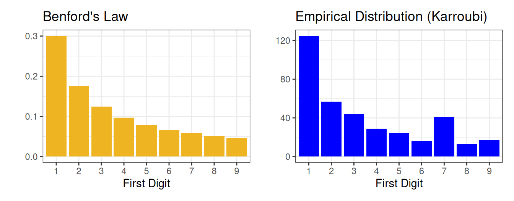
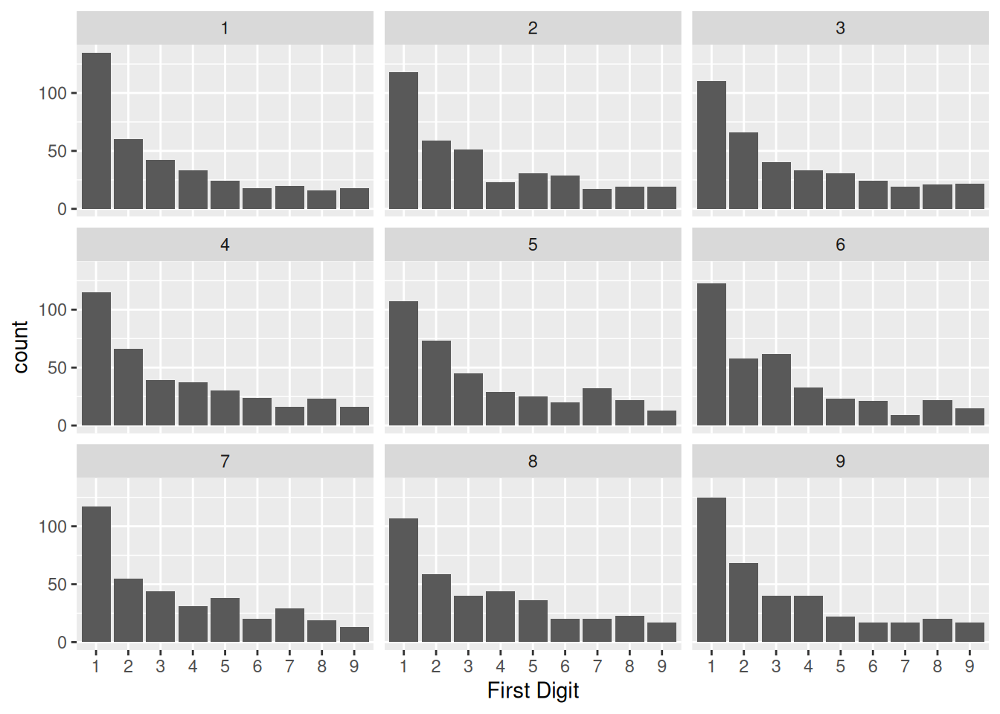
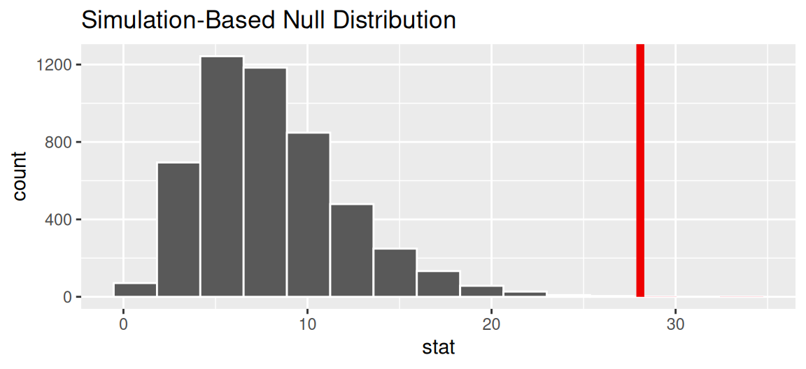

---

course: xac-suat-thong-ke

lecture: 19-kiem-dinh-gia-thuyet-2

section: lecture

title: "Kiểm định giả thuyết thống kê II: Kiểm định Chi bình phương"

prerequisites: ["mau-tong-the", "suy-rong-thong-ke"]

lessonStatus: ready

description: "Mô phỏng phân phối dưới H0 bằng mô hình rút thăm từ hộp, kiểm định nhiều tỉ lệ, khoảng cách Chi bình phương, Luật Benford trong bầu cử, kiểm định một phía và hai phía, và hiệu ứng Bouba/Kiki."

---

## Dẫn nhập: Tái hiện Mô hình Giả thuyết Không bằng Mô hình Hộp

Trong bài học trước, chúng ta đã tiếp cận cấu trúc bốn bước kinh điển của một kiểm định giả thuyết thống kê:

1. **Thiết lập mô hình giả định**: Đặt ra giả thuyết không $H_0$ mô tả cơ chế sinh dữ liệu thuần túy ngẫu nhiên.

2. **Chọn thống kê kiểm định**: Lựa chọn một đại lượng số tóm tắt dữ liệu phù hợp với câu hỏi nghiên cứu.

3. **Xây dựng phân phối dưới $H_0$ (Null Distribution)**: Ước lượng phân phối của thống kê kiểm định trong một thế giới mà giả thuyết không là đúng.

4. **Đánh giá mức độ tương thích**: Đối chiếu thống kê thực tế quan sát được với phân phối Null thông qua giá trị $p$-value.

Để xây dựng phân phối Null ở Bước 3 trong vụ án Kristen Gilbert, chúng ta đã sử dụng **phép thử hoán vị (Permutation Test / Shuffling)**. Phương pháp hoán vị đặc biệt đắc dụng khi giả thuyết không khẳng định rằng hai biến số độc lập với nhau, cho phép ta bẻ gãy mối liên hệ bằng cách xáo trộn nhãn giữa hai nhóm.

Tuy nhiên, trong thực tế khoa học, chúng ta thường xuyên đối mặt với một dạng giả thuyết không khác: **Giả thuyết quy định cụ thể tỉ lệ của nhiều nhóm danh mục (Test of Many Proportions)**. Khi đó, phép xáo trộn hai cột không còn áp dụng được nữa. Thay vào đó, chúng ta quay trở lại một công cụ quen thuộc đầy quyền năng: **Mô hình hộp rút thăm (The Box Model)**.

Để làm chủ phương pháp này, chúng ta sẽ khảo sát một cuộc tranh luận phân tích dữ liệu nổi tiếng xoay quanh cuộc bầu cử tổng thống Iran năm 2009 và quy luật toán học mang tên **Luật Benford**.

---

## Nghiên cứu thực tế: Cuộc bầu cử Tổng thống Iran năm 2009

Năm 2009, Iran tổ chức cuộc bầu cử tổng thống đầy kịch tính. Tổng thống đương nhiệm Mahmoud Ahmadinejad đối đầu với ba ứng viên thách thức, nổi bật là hai gương mặt thuộc phe cải cách: Mir-Hossein Mousavi và Mehdi Karroubi.

  

<em>Hình 19.1: Bốn ứng viên tổng thống Iran năm 2009 (từ trái sang phải: Rezai, Ahmadinejad, Karroubi và Mousavi).</em>

Trước ngày bầu cử, các cuộc thăm dò dư luận cho thấy sự ủng hộ rất mạnh mẽ dành cho Mousavi và Karroubi. Tuy nhiên, khi kết quả chính thức được công bố, phe cầm quyền tuyên bố Ahmadinejad giành chiến thắng áp đảo với $62.6\%$ số phiếu bầu, Mousavi được $33.75\%$, còn Karroubi chỉ đạt vỏn vẹn hơn $1\%$.

Các cuộc biểu tình rầm rộ nổ ra khắp đất nước, cáo buộc cuộc bầu cử đã bị thao túng gian lận. Các nhà quan sát quốc tế và các nhà khoa học dữ liệu lập tức vào cuộc kiểm tra tính trung thực của các con số. Một nhóm nghiên cứu độc lập đã áp dụng một phương pháp phân tích số học đặc biệt: **Luật Benford**.

---

## Quy luật Chữ số Đầu tiên của Benford (Benford's Law)

Luật Benford là một định luật toán học mô tả phân phối tần suất xuất hiện của các chữ số đầu tiên (từ 1 đến 9) trong các tập dữ liệu số xuất hiện tự nhiên trải dài qua nhiều bậc độ lớn (orders of magnitude) như: Dân số các thành phố, diện tích các con sông, giá cổ phiếu, hoặc số liệu kế toán tài chính.

Theo Luật Benford, chữ số đầu tiên $d \in \{1, 2, \dots, 9\}$ tuân theo phân phối logarit:

$$
\begin{aligned}
P(d) &= \log_{10}\left(1 + \frac{1}{d}\right) \\
&= \log_{10}\left(\frac{d + 1}{d}\right)
\end{aligned}
$$

Bảng phân phối xác suất theo Luật Benford:

| Chữ số đầu tiên | $1$ | $2$ | $3$ | $4$ | $5$ | $6$ | $7$ | $8$ | $9$ |
| :---: | :---: | :---: | :---: | :---: | :---: | :---: | :---: | :---: | :---: |
| **Tần suất lý thuyết** | $30.1\%$ | $17.6\%$ | $12.5\%$ | $9.7\%$ | $7.9\%$ | $6.7\%$ | $5.8\%$ | $5.1\%$ | $4.6\%$ |

Chữ số $1$ xuất hiện phổ biến nhất (chiếm tới gần một phần ba), tần suất giảm dần đều cho tới chữ số $9$ (chỉ chiếm khoảng $4.6\%$).

Nhiều nhà phân tích cho rằng: Nếu một cuộc bầu cử diễn ra công bằng, chữ số đầu tiên của số phiếu bầu tại hàng trăm đô thị sẽ tuân theo Luật Benford, trong khi hành vi gian lận (như nhồi thêm phiếu giả) sẽ làm sai lệch phân phối này.

  

<em>Hình 19.2: Trái: Phân phối lý thuyết theo Luật Benford. Phải: Phân phối thực tế chữ số đầu tiên trong số phiếu của ứng viên Karroubi tại 366 đô thị.</em>

Quan sát Hình 19.2 (phải), các nhà phân tích phát hiện một sự bất thường rõ rệt: **Chữ số 7 xuất hiện với tần suất cao đột biến**, vượt xa mức kỳ vọng $5.8\%$ của Luật Benford!

Liệu đây có phải là bằng chứng của gian lận phiếu bầu, hay sự bất thường này chỉ đơn giản là do biến thiên ngẫu nhiên?

---

## Thiết lập Kiểm định và Mô phỏng bằng Mô hình Hộp

Ta phát biểu bài toán kiểm định giả thuyết:

- **Giả thuyết không ($H_0$)**: Chữ số đầu tiên trong số phiếu của Karroubi được sinh ra hoàn toàn tuân thủ Luật Benford:

Công thức áp dụng cho chữ số đầu $d=1,2,\dots,9$. Các xác suất đầu lần lượt xấp xỉ 0,301, 0,176, 0,125 và xác suất cuối xấp xỉ 0,046.

$$
H_0:\ p_d=\log_{10}(1+1/d).
$$

- **Giả thuyết đối ($H_A$)**: Phân phối chữ số đầu tiên sai khác với Luật Benford (có ít nhất một tỉ lệ $p_i$ khác với giá trị lý thuyết).

### Mô phỏng Phân phối Null bằng Mô hình Hộp

Để tạo ra một thế giới mà trong đó $H_0$ hoàn toàn đúng, ta sử dụng mô hình hộp:

- Ta chuẩn bị một chiếc hộp gồm $1{,}000$ tấm vé: Trong đó có $301$ vé ghi số 1, $176$ vé ghi số 2, $\dots$, và $46$ vé ghi số 9.

- Vì toàn bộ Iran có $366$ đơn vị bầu cử (đô thị), ta rút ngẫu nhiên có hoàn lại đúng $n = 366$ tấm vé từ chiếc hộp này. Mẫu này mô phỏng một kết quả bầu cử có thể xảy ra dưới $H_0$.

Mô phỏng máy tính tạo ra 9 mẫu ngẫu nhiên độc lập được minh họa dưới đây:

  

<em>Hình 19.3: Chín phân phối thực nghiệm mô phỏng từ việc rút 366 vé có hoàn lại từ hộp Benford.</em>

Biến thiên ngẫu nhiên luôn tồn tại: Mẫu thứ 6 có nhiều số 3 bất thường, còn mẫu thứ 5 tình cờ có số lượng chữ số 7 tăng vọt giống như dữ liệu thực tế của Karroubi.

Làm thế nào để đo lường chính xác xem mẫu thực tế của Karroubi khác biệt với Luật Benford ở mức độ nào?

---

## Thống kê khoảng cách Chi bình phương

Khi so sánh hai biểu đồ cột (biểu đồ quan sát thực tế và biểu đồ lý thuyết kỳ vọng), ta cần nén toàn bộ sự sai lệch trên tất cả các cột thành một chỉ số số học duy nhất đo lường khoảng cách. Đại lượng tiêu chuẩn cho nhiệm vụ này là **Thống kê Chi bình phương ($\chi^2$)**.

::: info Định nghĩa: Thống kê Chi bình phương ($\chi^2$)

Cho một biến định tính gồm $k$ nhóm danh mục. Gọi $O_i$ là số lượng quan sát thực tế trong nhóm thứ $i$, và $E_i$ là số lượng kỳ vọng dưới giả thuyết không ($E_i = n \times p_i$).

Thống kê Chi bình phương đo lường khoảng cách giữa phân phối quan sát và phân phối kỳ vọng được xác định bởi:

$$
\chi^2 = \sum_{i=1}^k \frac{(O_i - E_i)^2}{E_i}
$$

:::

### Phân tích ý nghĩa cấu trúc toán học của thống kê Chi bình phương

1. **Hiệu số $O_i - E_i$**: Đo lường độ chênh lệch chiều cao giữa cột quan sát và cột kỳ vọng.

2. **Bình phương $(O_i - E_i)^2$**: Đảm bảo các sai lệch âm và dương đều đóng góp giá trị dương vào khoảng cách tổng thể (tránh triệt tiêu lẫn nhau).

3. **Chia cho $E_i$**: Chuẩn hóa độ lệch theo quy mô kỳ vọng của từng cột. Một độ lệch 10 đơn vị ở một cột có kỳ vọng 100 sẽ ít nghiêm trọng hơn nhiều so với độ lệch 10 đơn vị ở một cột chỉ có kỳ vọng 2!

### Tính toán trên dữ liệu của Karroubi

Với tổng số $n = 366$ đô thị:

- Chữ số 1: Quan sát được $O_1 = 125$ lần, với kỳ vọng $E_1 = 366 \times 0.301 = 110.17$ lần $\implies \frac{(125 - 110.17)^2}{110.17} \approx 1.998$.

- Lặp lại cho toàn bộ 9 chữ số và cộng dồn lại:

$$
\chi^2_{\mathrm{obs}} \approx 28.08
$$

Khoảng cách tính được là $28.08$. Nhưng con số $28.08$ này là lớn hay nhỏ? Liệu may rủi ngẫu nhiên có thể sinh ra một khoảng cách lớn như $28.08$ hay không?

---

## Phân phối dưới giả thuyết không của thống kê Chi bình phương và giá trị p-value

Để trả lời câu hỏi trên, ta tiến hành mô phỏng rút $366$ vé từ hộp Benford $5{,}000$ lần. Trên mỗi lần mô phỏng, ta tính toán giá trị $\chi^2$. Tập hợp $5{,}000$ giá trị này tạo nên **phân phối Null của thống kê Chi bình phương**:

  

<em>Hình 19.4: Phân phối Null của thống kê Chi bình phương qua 5.000 lần mô phỏng. Đường thẳng đứng màu đỏ biểu thị giá trị thực tế $\chi^2 = 28.1$.</em>

Bức tranh phân phối Null chỉ rõ:

- Trong một thế giới mà số phiếu thực sự tuân theo Luật Benford, giá trị $\chi^2$ thường dao động trong khoảng từ $4$ đến $14$, hiếm khi vượt quá $20$.

- Giá trị quan sát $\chi^2=28{,}08$ nằm ở đuôi phải của phân phối dưới giả thuyết không.

- Nếu một lần mô phỏng hữu hạn không có giá trị nào vượt ngưỡng, điều đó không có nghĩa xác suất lý thuyết bằng 0. Với $R$ lần mô phỏng và $b$ lần vượt ngưỡng, có thể dùng ước lượng $(b+1)/(R+1)$.

- Do đó:

$$
p\text{-value}=P(\chi^2_8\ge28{,}08).
$$

Giá trị xấp xỉ 0,00046, nhỏ hơn 0,05 nhưng không bằng 0.

Dữ liệu cho bằng chứng chống lại mô hình Benford ở mức ý nghĩa 0,05, nếu các giả thiết của phép kiểm định được đáp ứng.

---

## Bằng chứng của điều gì? Bài học về Giới hạn của Giả thuyết

Một p-value nhỏ chỉ lượng hóa mức độ không tương thích với mô hình Benford. Kết quả này có đủ để kết luận cuộc bầu cử bị gian lận hay không?

Câu trả lời đòi hỏi tư duy phản biện khoa học sâu sắc:

- Luật Benford chỉ là một mô hình toán học trừu tượng. Để một tập dữ liệu tuân theo Luật Benford, các con số phải trải rộng qua nhiều bậc độ lớn và hình thành từ các quá trình nhân ngẫu nhiên không bị giới hạn.

- Phiếu bầu cử tại các đô thị thường bị giới hạn bởi quy mô dân số của các quận huyện (thường chỉ dao động trong một khoảng nhất định), quy trình kiểm phiếu và ranh giới địa lý.

- Khi các nhà khoa học áp dụng phép thử Benford lên các cuộc bầu cử tại Hoa Kỳ và nhiều quốc gia dân chủ khác (nơi tính liêm chính của bầu cử được giám sát nghiêm ngặt), họ nhận thấy nhiều bang cũng có độ lệch $\chi^2$ lớn không kém!

::: tip Bài học phương pháp luận

Bác bỏ $H_0$ chỉ có nghĩa là dữ liệu không khớp với mô hình giả định mà bạn đưa ra. Nếu bản thân mô hình giả định (Luật Benford) chưa từng là một mô tả thích hợp cho hiện thực (bầu cử), thì việc bác bỏ nó **không thể được dùng làm bằng chứng khẳng định gian lận**. Sự thành công của suy rộng thống kê phụ thuộc quyết định vào việc mô hình giả định có bảo toàn được các đặc trưng cốt lõi của thực tế hay không.

:::

---

## Kiểm định một phía (One-tailed) hay Hai phía (Two-tailed)?

Trong kiểm định so sánh hai nhóm, ta thường đứng trước ba cách thiết lập giả thuyết đối:

1. $H_A: p_1 - p_2 < 0$ (Kiểm định một phía bên trái).

2. $H_A: p_1 - p_2 > 0$ (Kiểm định một phía bên phải).

3. $H_A: p_1 - p_2 \ne 0$ (Kiểm định hai phía).

Tại sao các nhà thống kê luôn khuyến nghị sử dụng **kiểm định hai phía** làm mặc định chuẩn mực khoa học?

- **Tránh thổi phồng sai lầm loại I (Type I Error)**: Nếu ta chỉ nhìn vào dữ liệu rồi mới chọn hướng của $H_A$ theo hướng dữ liệu đang nghiêng, ta đang "bắn súng rồi mới vẽ bia", làm tăng gấp đôi xác suất kết luận sai.

- **Tránh thiên kiến xác nhận (Confirmation Bias)**: Kiểm định khoa học chân chính phải cởi mở với mọi khả năng khách quan (kể cả khả năng hiệu ứng ngược lại với kỳ vọng ban đầu).

- **Trường hợp ngoại lệ của $\chi^2$**: Trong kiểm định độ phù hợp hoặc độc lập bằng thống kê Chi bình phương, miền bác bỏ nằm ở đuôi phải. Giá trị lớn phản ánh độ lệch lớn so với mô hình. Vùng bên trái (gần 0) đại diện cho sự trùng khớp hoàn hảo với $H_0$, chỉ có đuôi bên phải (giá trị $\chi^2$ rất lớn) mới đại diện cho sự sai lệch nghiêm trọng.

---

## Nghiên cứu mở rộng: Hiệu ứng Bouba/Kiki

Một ứng dụng kinh điển khác của kiểm định tỉ lệ thông qua thực nghiệm tâm lý học ngôn ngữ: **Hiệu ứng Bouba/Kiki**.

Năm 1929, nhà tâm lý học Wolfgang Köhler thực hiện một thí nghiệm nổi tiếng: Cho người tham gia quan sát hai hình vẽ dưới đây và yêu cầu gán hai cái tên vô nghĩa: **Bouba** và **Kiki**.

  

<em>Hình 19.5: Hai hình vẽ trong thí nghiệm Bouba/Kiki: Một hình góc cạnh sắc nhọn và một hình uốn lượn cong tròn.</em>

Khung kiểm định giả thuyết:

- **Giả thuyết không ($H_0$)**: Việc gán tên cho hình vẽ là hoàn toàn tùy tiện và ngẫu nhiên. Người tham gia chọn tên như tung đồng xu:

$$
H_0: p_{\text{kiki}} = 0.5
$$

- **Giả thuyết đối ($H_A$)**: Con người có xu hướng gán âm sắc nhọn "Kiki" cho hình sắc nhọn một cách phi ngẫu nhiên:

$$
H_A: p_{\text{kiki}} > 0.5
$$

Khi thực hiện trên hàng nghìn người thuộc nhiều nền văn hóa và ngôn ngữ khác nhau trên toàn cầu, hơn $95\%$ người tham gia đều chọn "Kiki" cho hình sắc nhọn bên trái. Thống kê kiểm định $\hat{p} \approx 0.95$ mang lại $p\text{-value} \approx 0$, bác bỏ hoàn toàn giả thuyết về sự ngẫu nhiên và chứng minh mối liên kết bẩm sinh sâu sắc giữa âm thanh ngôn ngữ và nhận thức thị giác của bộ não con người.

---

## Tóm tắt kiến thức cốt lõi

1. **Mô hình hộp cho nhiều tỉ lệ**: Khi $H_0$ quy định tỉ lệ xuất hiện của nhiều nhóm danh mục, ta tạo một chiếc hộp với số lượng vé tương ứng với các tỉ lệ lý thuyết và rút ngẫu nhiên có hoàn lại để tạo phân phối Null.

2. **Khoảng cách Chi bình phương**: Đây là thước đo khoảng cách chuẩn hóa giữa phân phối thực tế quan sát và phân phối kỳ vọng lý thuyết, xác định bởi công thức $\chi^2 = \sum \frac{(O_i - E_i)^2}{E_i}$.

3. **Quy tắc đuôi**: Phép thử Chi bình phương luôn tính $p$-value trên đuôi bên phải của phân phối Null.

4. **Cảnh báo về giải thích**: Bác bỏ $H_0$ chỉ chứng minh dữ liệu không phù hợp với mô hình lý thuyết, không tự động chứng minh kết luận nguyên nhân - kết quả nếu mô hình lý thuyết chưa phản ánh đúng thực tế.

## Bài tập rèn luyện

::: exercise Bài tập 1: So sánh khoảng cách Chi bình phương

Xét hai cặp phân phối tần số giữa giá trị quan sát ($O$) và giá trị kỳ vọng ($E$) trên một biến định tính có 3 nhóm danh mục:

- **Cặp phân phối A**:

  - Nhóm 1: Quan sát $O_1 = 1$, Kỳ vọng $E_1 = 1$.

  - Nhóm 2: Quan sát $O_2 = 10$, Kỳ vọng $E_2 = 1$.

  - Nhóm 3: Quan sát $O_3 = 1$, Kỳ vọng $E_3 = 10$.

- **Cặp phân phối B**:

  - Nhóm 1: Quan sát $O_1 = 3$, Kỳ vọng $E_1 = 5$.

  - Nhóm 2: Quan sát $O_2 = 4$, Kỳ vọng $E_2 = 4$.

  - Nhóm 3: Quan sát $O_3 = 5$, Kỳ vọng $E_3 = 3$.

1. Tính toán giá trị thống kê Chi bình phương $\chi^2$ cho cả hai cặp phân phối.

2. Cặp phân phối nào có khoảng cách Chi bình phương lớn hơn? Nêu trực giác toán học giải thích tại sao sự chênh lệch lại lớn đến như vậy.

:::

::: solution

**1. Tính toán thống kê Chi bình phương:**

- **Đối với Cặp phân phối A**:

Tính từng đóng góp: $r_1=0$, $r_2=81$, $r_3=8{,}1$.

$$
\begin{aligned}
&r_i=\frac{(O_i-E_i)^2}{E_i}, \\
&\chi_A^2=r_1+r_2+r_3 \\
&=0+81+8{,}1=89{,}1.
\end{aligned}
$$

- **Đối với Cặp phân phối B**:

Với ba ô của bảng B, các đóng góp lần lượt là $4/5$, $0$, $4/3$.

$$
\begin{aligned}
\chi_B^2&=r_1+r_2+r_3 \\
&=\frac45+0+\frac43 \\
&\approx2{,}13.
\end{aligned}
$$

**2. So sánh và trực giác toán học:**

- Cặp phân phối A có giá trị $\chi^2$ lớn vượt trội ($89.1$ so với $2.13$).

- Trực giác toán học: Công thức Chi bình phương bình phương độ lệch và chia cho giá trị kỳ vọng. Ở Cặp A, nhóm 2 có độ lệch tuyệt đối là $9$ trên một mức kỳ vọng rất nhỏ là $1$, tạo ra số hạng đóng góp khổng lồ $\frac{9^2}{1} = 81$. Điều này cho thấy: **Chỉ cần một nhóm danh mục có sự sai lệch lớn trên nền kỳ vọng nhỏ, khoảng cách Chi bình phương sẽ bị thổi bùng lên rất mạnh**.

:::

---

::: exercise Bài tập 2: Kiểm định luật Benford trên dữ liệu thuế

Một thanh tra viên thuế nghi ngờ một công ty làm giả sổ sách hóa đơn đầu vào. Thanh tra viên thu thập chữ số đầu tiên của $n = 200$ hóa đơn và đối chiếu với Luật Benford.

Dưới giả thuyết không $H_0$ rằng các hóa đơn tuân theo Luật Benford:

1. Tính số lượng hóa đơn kỳ vọng bắt đầu bằng chữ số 1 và số lượng kỳ vọng bắt đầu bằng chữ số 9.

2. Thiết kế một mô hình hộp rút thăm bằng vé để mô phỏng một mẫu gồm 200 hóa đơn dưới giả thuyết không $H_0$.

3. Nếu giá trị $\chi^2$ tính được từ mẫu của công ty là $5.4$, trong khi phân phối Null mô phỏng cho thấy $90\%$ các giá trị $\chi^2$ nằm trong khoảng từ $2.1$ đến $14.5$, thanh tra viên nên đưa ra kết luận gì?

:::

::: solution

**1. Số lượng hóa đơn kỳ vọng:**

Theo Luật Benford:

- Tỉ lệ lý thuyết của chữ số 1: $p_1 = \log_{10}(2) \approx 0.301$.

  Số hóa đơn kỳ vọng: $E_1 = n \cdot p_1 = 200 \times 0.301 = 60.2$ hóa đơn.

- Tỉ lệ lý thuyết của chữ số 9: $p_9 = \log_{10}(10/9) \approx 0.046$.

  Số hóa đơn kỳ vọng: $E_9 = n \cdot p_9 = 200 \times 0.046 = 9.2$ hóa đơn.

**2. Thiết kế mô hình hộp rút thăm:**

- Chuẩn bị một chiếc hộp gồm $1{,}000$ tấm vé đánh số từ 1 đến 9:

  - 301 vé ghi số 1, 176 vé ghi số 2, 125 vé ghi số 3, 97 vé ghi số 4, 79 vé ghi số 5, 67 vé ghi số 6, 58 vé ghi số 7, 51 vé ghi số 8 và 46 vé ghi số 9.

- Mỗi lần mô phỏng, rút ngẫu nhiên có hoàn lại $n = 200$ tấm vé từ chiếc hộp này.

**3. Kết luận của thanh tra viên:**

- Giá trị $\chi^2 = 5.4$ nằm hoàn toàn trong vùng dao động thông thường của phân phối Null ($[2.1, 14.5]$).

- Giá trị $p$-value sẽ khá lớn (chắc chắn lớn hơn $0.05$).

- Kết luận: **Chưa có đủ bằng chứng thống kê để bác bỏ giả thuyết không $H_0$**. Dữ liệu hóa đơn của công ty hoàn toàn tương thích với Luật Benford, đồng thời không có dấu hiệu bất thường về mặt tần suất chữ số đầu tiên.

:::

---

::: exercise Bài tập 3: Thiết lập kiểm định cho hiệu ứng Bouba/Kiki

Trong một lớp học gồm $n = 80$ sinh viên, giảng viên chiếu hình ảnh sắc nhọn lên màn hình và cho sinh viên 15 giây bình chọn giữa hai cái tên: "Kiki" và "Bouba". Kết quả ghi nhận có $72$ sinh viên chọn tên "Kiki" ($\hat{p} = \frac{72}{80} = 0.90$).

1. Hãy phát biểu giả thuyết không $H_0$ và giả thuyết đối một phía $H_A$ theo tham số tỉ lệ $p$.

2. Nếu giả thuyết không $H_0$ là đúng, số sinh viên kỳ vọng chọn tên "Kiki" là bao nhiêu? Độ lệch chuẩn của số người chọn "Kiki" dưới $H_0$ là bao nhiêu?

3. Tính giá trị chuẩn hóa Z-score của kết quả quan sát được dưới $H_0$ và ước lượng $p$-value. Nêu kết luận thực nghiệm.

:::

::: solution

**1. Phát biểu giả thuyết:**

Gọi $p$ là xác suất một người lựa chọn tên "Kiki" cho hình sắc nhọn.

- Giả thuyết không: $H_0: p = 0.5$ (Lựa chọn ngẫu nhiên, tên gọi và hình dạng độc lập).

- Giả thuyết đối: $H_A: p > 0.5$ (Xu hướng gán tên "Kiki" cho hình sắc nhọn cao hơn ngẫu nhiên).

**2. Kỳ vọng và độ lệch chuẩn của số người chọn Kiki dưới $H_0$:**

Dưới $H_0$, số sinh viên chọn Kiki $X$ tuân theo phân phối nhị thức $\text{Binomial}(n = 80, p = 0.5)$:

$$
\begin{aligned}
&E(X) = n p \\
&= 80 \times 0.5 \\
&= 40 \text{ people} \\
&\text{Var}(X) = n p (1 - p) \\
&= 80 \times 0.5 \times 0.5 \\
&= 20 \\
&\text{SD}(X) = \sqrt{20} \approx 4.472 \text{ people}
\end{aligned}
$$

**3. Chuẩn hóa Z-score và ước lượng $p$-value:**

Số người thực tế quan sát được là $x = 72$.

Độ lệch chuẩn hóa Z-score:

$$
\begin{aligned}
Z &= \frac{x - E(X)}{\text{SD}(X)} \\
&= \frac{72 - 40}{4.472} \\
&= \frac{32}{4.472} \\
&\approx 7.16
\end{aligned}
$$

Giá trị quan sát được nằm cách kỳ vọng hơn $7$ độ lệch chuẩn!

Theo quy tắc phân phối chuẩn, xác suất để một biến chuẩn tắc vượt quá $7.16$ là cực kỳ nhỏ:

$$
\begin{aligned}
p\text{-value} &= P(Z \ge 7.16) \\
&\approx 4 \times 10^{-13} \\
&\approx 0
\end{aligned}
$$

**Kết luận**: Vì $p$-value xấp xỉ bằng 0 (nhỏ hơn rất nhiều so với mọi ngưỡng ý nghĩa thông thường $\alpha = 0.05$ hay $0.001$), ta **bác bỏ hoàn toàn giả thuyết không $H_0$**. Kết quả thực nghiệm khẳng định sự tồn tại mạnh mẽ của hiệu ứng Bouba/Kiki trong nhận thức con người.

:::

## Tài liệu tham khảo

- UC Berkeley STAT 20: *Introduction to Probability and Statistics*, Department of Statistics, UC Berkeley.

- Benford, F. (1938). The law of anomalous numbers. *Proceedings of the American Philosophical Society*, 78(4), 551–572.

- Köhler, W. (1929). *Gestalt Psychology*. Horace Liveright.

